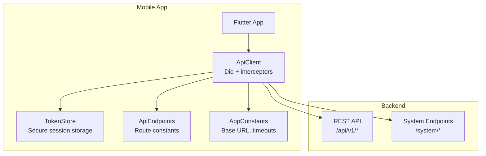
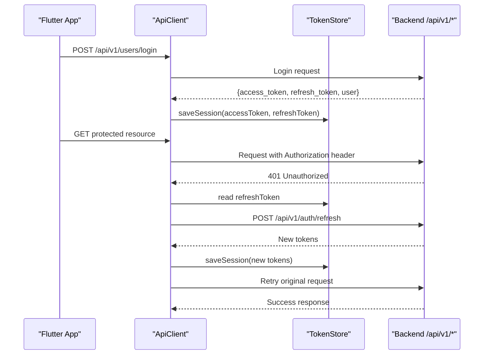
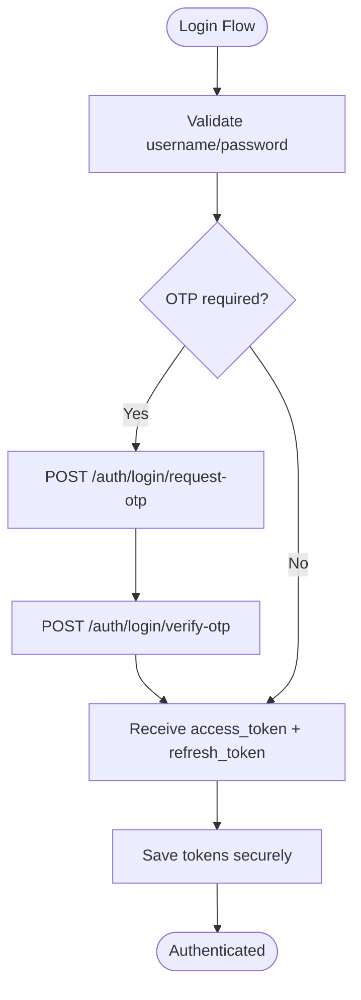
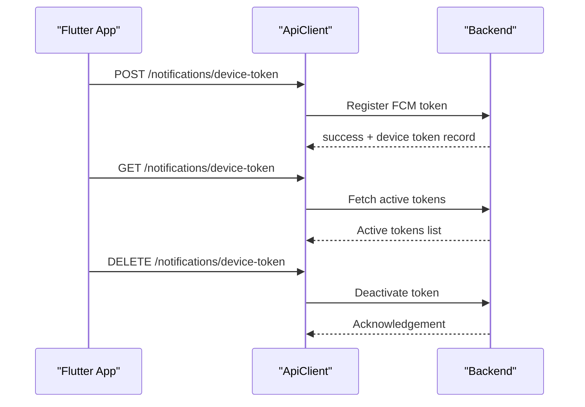
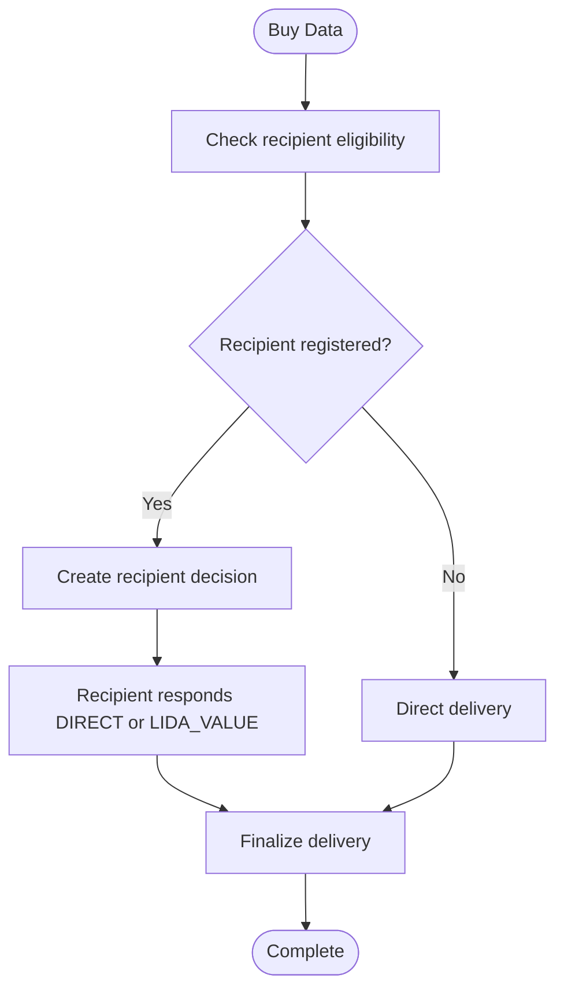
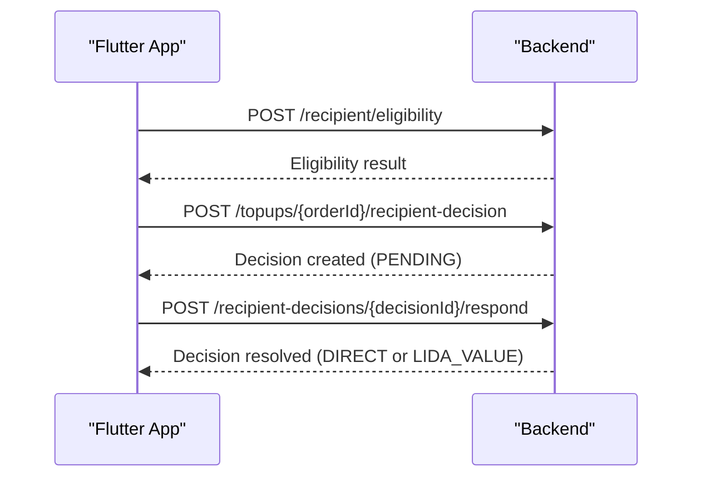
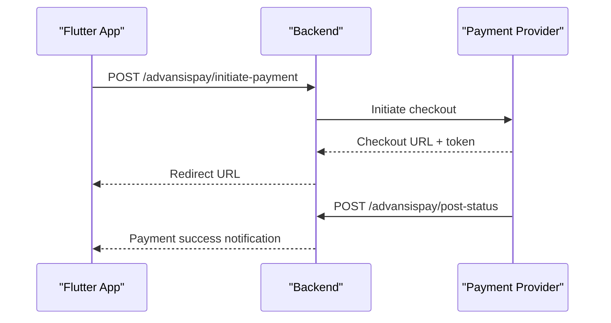
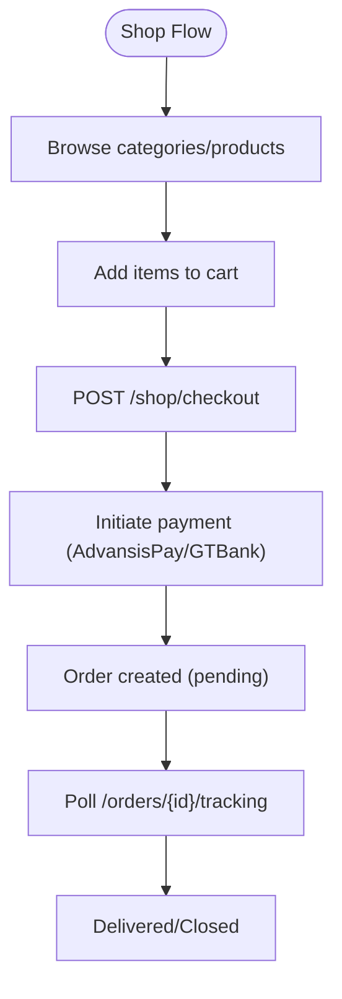
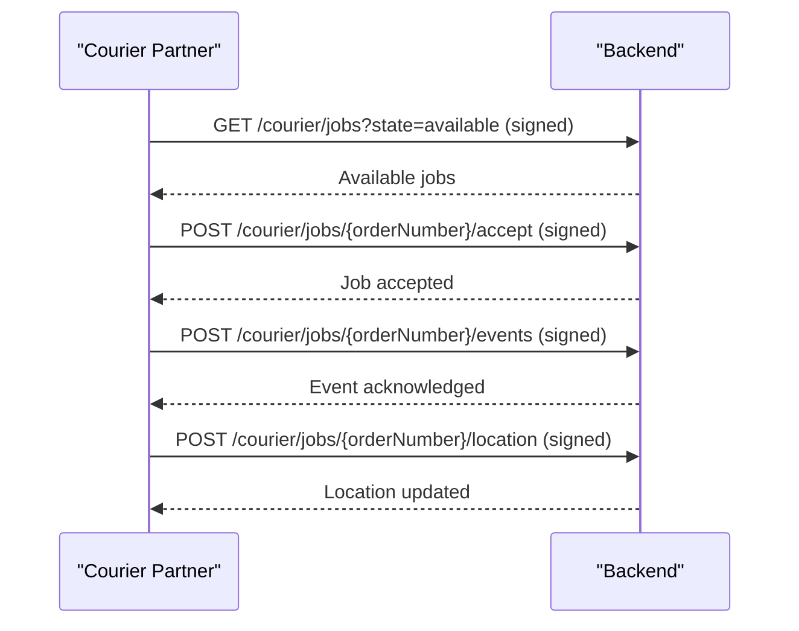
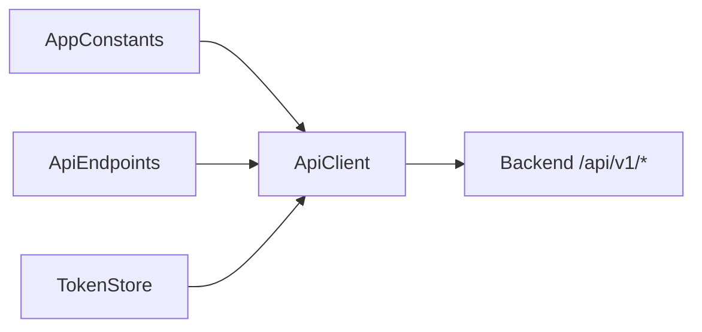

# API Documentation

<cite>
**Referenced Files in This Document**   
- [ENDPOINTS.md](file://api/ENDPOINTS.md)
- [swagger-api-documentation.md](file://docs/swagger-api-documentation.md)
- [app_constants.dart](file://lib/core/constants/app_constants.dart)
- [api_endpoints.dart](file://lib/core/network/api_endpoints.dart)
- [api_client.dart](file://lib/core/network/api_client.dart)
- [token_store.dart](file://lib/core/network/token_store.dart)
</cite>

## Table of Contents
1. [Introduction](#introduction)
2. [Project Structure](#project-structure)
3. [Core Components](#core-components)
4. [Architecture Overview](#architecture-overview)
5. [Detailed Component Analysis](#detailed-component-analysis)
6. [Dependency Analysis](#dependency-analysis)
7. [Performance Considerations](#performance-considerations)
8. [Troubleshooting Guide](#troubleshooting-guide)
9. [Conclusion](#conclusion)
10. [Appendices](#appendices)

## Introduction
This document describes the LidaPay backend REST API as consumed by the mobile application. It consolidates the endpoint map, Swagger-style reference documentation, and Flutter client implementation details into a single guide for engineers integrating or maintaining the mobile app against the backend.

The backend base URL is `https://api.advansistechnologies.com`. The mobile app uses versioned routes under `/api/v1`, with additional system endpoints such as `/system/health` and `/system/verify-env`. Authentication is primarily Bearer JWT, with partner-specific HMAC signing for the courier integration.

## Project Structure
The repository contains:
- Backend endpoint definitions and Swagger documentation under `api/` and `docs/`.
- Flutter client code under `lib/`, including constants, route path constants, HTTP client, token storage, and device identity helpers.
- Android and iOS platform configurations are present but not directly relevant to this API contract.

**Diagram sources**
- [app_constants.dart:1-65](file://lib/core/constants/app_constants.dart#L1-L65)
- [api_endpoints.dart:1-146](file://lib/core/network/api_endpoints.dart#L1-L146)
- [api_client.dart:1-276](file://lib/core/network/api_client.dart#L1-L276)
- [token_store.dart:1-238](file://lib/core/network/token_store.dart#L1-L238)

**Section sources**
- [ENDPOINTS.md:1-195](file://api/ENDPOINTS.md#L1-L195)
- [swagger-api-documentation.md:1-800](file://docs/swagger-api-documentation.md#L1-L800)
- [app_constants.dart:1-65](file://lib/core/constants/app_constants.dart#L1-L65)

## Core Components
- Base URL and environment configuration:
  - Production base URL: `https://api.advansistechnologies.com`.
  - Build-time overrides supported via `API_BASE_URL`.
  - Default timeouts: connect/send 15 seconds, receive 30 seconds.
- Route constants:
  - Centralized route paths for authentication, users, transactions, Lida Value/Lidapoints, airtime/data, Reloadly, AdvansisPay, GTBank, shop, notifications, and recipient decisions.
- HTTP client:
  - Dio-based client that injects `Authorization: Bearer <accessToken>` and `X-Request-Id`.
  - Transparent refresh on 401 using `/api/v1/auth/refresh`.
  - Sensitive payload redaction in debug logs.
- Token store:
  - Secure persistence of access and refresh tokens.
  - Biometric session support with migration from legacy plaintext storage.
  - Stream signaling when session is cleared.

**Section sources**
- [app_constants.dart:1-65](file://lib/core/constants/app_constants.dart#L1-L65)
- [api_endpoints.dart:1-146](file://lib/core/network/api_endpoints.dart#L1-L146)
- [api_client.dart:1-276](file://lib/core/network/api_client.dart#L1-L276)
- [token_store.dart:1-238](file://lib/core/network/token_store.dart#L1-L238)

## Architecture Overview
The mobile app communicates with the backend through a centralized HTTP client. Authentication is handled by storing JWTs securely and refreshing them automatically when needed. Device push tokens are registered for FCM. Payment flows may involve multiple integrations (AdvansisPay, GTBank, Reloadly), while the shop module provides e-commerce capabilities.

**Diagram sources**
- [api_client.dart:13-84](file://lib/core/network/api_client.dart#L13-L84)
- [api_client.dart:204-265](file://lib/core/network/api_client.dart#L204-L265)
- [token_store.dart:148-175](file://lib/core/network/token_store.dart#L148-L175)

## Detailed Component Analysis

### Authentication and Session Management
- User login:
  - Endpoint: `POST /api/v1/users/login`
  - Accepts username/password and optional device metadata for FCM registration.
  - Returns access and refresh tokens along with user profile data.
- Refresh tokens:
  - Endpoint: `POST /api/v1/auth/refresh`
  - Mobile-compatible refresh flow; legacy `/api/v1/users/refresh-token` is deprecated for mobile clients.
- OTP-based login:
  - Two-step flow: request OTP after validating credentials, then verify OTP to obtain tokens.
  - Endpoints: `POST /api/v1/auth/login/request-otp`, `POST /api/v1/auth/login/verify-otp`.
- Registration:
  - Endpoint: `POST /api/v1/users/register`
  - Creates a new user and optionally registers device token.
- Profile and account:
  - Get/update profile: `GET /api/v1/users/profile`, `PUT /api/v1/users/profile/update`.
  - Get account: `GET /api/v1/users/account`.
- Password management:
  - Change password: `PUT /api/v1/users/change-password`
  - Confirm change: `POST /api/v1/users/confirm-password-change`
  - Reset password: `POST /api/v1/users/reset-password`, `POST /api/v1/users/confirm-reset-password`
- Email and phone verification:
  - Verify email: `GET /api/v1/users/verify-email/{token}`
  - Resend verification: `POST /api/v1/users/resend-verification-email`
  - Verify phone: `POST /api/v1/users/verify-phone`
  - Resend phone code: `POST /api/v1/users/resend-phone-verification-code`
- Merchant authentication:
  - Register/login: `POST /api/v1/merchants/register`, `POST /api/v1/merchants/login`
  - Manage merchant: CRUD endpoints under `/api/v1/merchants/*`

**Diagram sources**
- [swagger-api-documentation.md:51-183](file://docs/swagger-api-documentation.md#L51-L183)
- [ENDPOINTS.md:6-15](file://api/ENDPOINTS.md#L6-L15)

**Section sources**
- [swagger-api-documentation.md:51-183](file://docs/swagger-api-documentation.md#L51-L183)
- [ENDPOINTS.md:6-39](file://api/ENDPOINTS.md#L6-L39)
- [api_client.dart:204-265](file://lib/core/network/api_client.dart#L204-L265)
- [token_store.dart:148-175](file://lib/core/network/token_store.dart#L148-L175)

### Device Push Notifications
- Register device token:
  - Endpoint: `POST /api/v1/notifications/device-token`
  - Aliases: `POST /api/v1/notifications/push-token`, `POST /api/v1/users/push-token`
  - Accepts token/platform/provider/deviceId/appVersion/locale.
- List active tokens:
  - Endpoint: `GET /api/v1/notifications/device-token`
- Deactivate token:
  - Endpoint: `DELETE /api/v1/notifications/device-token`
- Metrics:
  - Endpoint: `GET /api/v1/notifications/device-token/metrics`

**Diagram sources**
- [swagger-api-documentation.md:185-307](file://docs/swagger-api-documentation.md#L185-L307)
- [ENDPOINTS.md:72-81](file://api/ENDPOINTS.md#L72-L81)

**Section sources**
- [swagger-api-documentation.md:185-307](file://docs/swagger-api-documentation.md#L185-L307)
- [ENDPOINTS.md:72-81](file://api/ENDPOINTS.md#L72-L81)

### Internet Data and Airtime Top-up
- Buy internet data:
  - Endpoint: `POST /api/v1/internet/buydata`
  - Supports direct delivery or recipient decision flow depending on recipient registration status.
- List data bundles:
  - Endpoint: `POST /api/v1/internet/bundlelist`
- Airtime top-up:
  - Endpoints: `POST /api/v1/airtime/topup`, `POST /api/v1/airtime/transtatus`
- Reloadly integration:
  - Phone lookup, country list, operators, FX rates, buy data.

**Diagram sources**
- [swagger-api-documentation.md:309-395](file://docs/swagger-api-documentation.md#L309-L395)
- [swagger-api-documentation.md:398-530](file://docs/swagger-api-documentation.md#L398-L530)
- [ENDPOINTS.md:94-100](file://api/ENDPOINTS.md#L94-L100)

**Section sources**
- [swagger-api-documentation.md:309-395](file://docs/swagger-api-documentation.md#L309-L395)
- [swagger-api-documentation.md:398-530](file://docs/swagger-api-documentation.md#L398-L530)
- [ENDPOINTS.md:94-100](file://api/ENDPOINTS.md#L94-L100)

### Recipient Choice and Decision Workflow
- Check eligibility:
  - Endpoint: `POST /api/v1/recipient/eligibility`
- Create decision:
  - Endpoint: `POST /api/v1/topups/{topupOrderId}/recipient-decision`
- Respond to decision:
  - Endpoint: `POST /api/v1/recipient-decisions/{decisionId}/respond`
- Status queries:
  - Endpoints: `GET /api/v1/transaction-status/decision/{decisionId}`, `GET /api/v1/transaction-status/transaction/{transactionRef}`

**Diagram sources**
- [swagger-api-documentation.md:398-530](file://docs/swagger-api-documentation.md#L398-L530)
- [ENDPOINTS.md:8-9](file://api/ENDPOINTS.md#L8-L9)

**Section sources**
- [swagger-api-documentation.md:398-530](file://docs/swagger-api-documentation.md#L398-L530)
- [ENDPOINTS.md:8-9](file://api/ENDPOINTS.md#L8-L9)

### Payments: AdvansisPay and GTBank
- AdvansisPay:
  - Initiate payment: `POST /api/v1/advansispay/initiate-payment`
  - Query transaction: `POST /api/v1/advansispay/query-transaction`
  - Callback handling: `GET /api/v1/advansispay/redirect-url`
  - Additional endpoints include debit wallet, post status, and Constant Capital funding.
- GTBank (GTPay):
  - Services: `GET /api/v1/gtpay/services`
  - Query/verify: `POST /api/v1/gtpay/query`
  - Pay: `POST /api/v1/gtpay/pay`
  - Status: `POST /api/v1/gtpay/status`
  - Banks: `GET /api/v1/gtpay/banks`
  - Callback: `POST /api/v1/gtpay/callback`

**Diagram sources**
- [swagger-api-documentation.md:532-650](file://docs/swagger-api-documentation.md#L532-L650)
- [swagger-api-documentation.md:651-980](file://docs/swagger-api-documentation.md#L651-L980)
- [ENDPOINTS.md:139-158](file://api/ENDPOINTS.md#L139-L158)

**Section sources**
- [swagger-api-documentation.md:532-650](file://docs/swagger-api-documentation.md#L532-L650)
- [swagger-api-documentation.md:651-980](file://docs/swagger-api-documentation.md#L651-L980)
- [ENDPOINTS.md:139-158](file://api/ENDPOINTS.md#L139-L158)

### Shop and E-commerce Module
- Categories:
  - List: `GET /api/v1/shop/categories`
  - Admin create/update/delete: `POST/PUT/DELETE /api/v1/shop/categories/{id}`
- Products:
  - Browse: `GET /api/v1/shop/products`
  - Featured: `GET /api/v1/shop/products/featured`
  - Detail: `GET /api/v1/shop/products/{id}`
  - Admin create/update/delete: `POST/PUT/DELETE /api/v1/shop/products/{id}`
- Cart:
  - Get/add/update/remove/clear: endpoints under `/api/v1/shop/cart/*`
- Checkout:
  - Endpoint: `POST /api/v1/shop/checkout`
  - Returns order with pending payment status.
- Orders:
  - My orders: `GET /api/v1/shop/orders`
  - Order detail: `GET /api/v1/shop/orders/{id}`
  - Public tracking: `GET /api/v1/shop/orders/number/{orderNumber}`
  - Cancel: `POST /api/v1/shop/orders/{id}/cancel`
  - Tracking: `GET /api/v1/shop/orders/{id}/tracking`
- Admin operations:
  - List all orders: `GET /api/v1/shop/admin/orders`
  - Update status/payment/delivery: `PUT /api/v1/shop/admin/orders/{id}/{status,payment,delivery}`

**Diagram sources**
- [swagger-api-documentation.md:982-1296](file://docs/swagger-api-documentation.md#L982-L1296)
- [ENDPOINTS.md:159-185](file://api/ENDPOINTS.md#L159-L185)

**Section sources**
- [swagger-api-documentation.md:982-1296](file://docs/swagger-api-documentation.md#L982-L1296)
- [ENDPOINTS.md:159-185](file://api/ENDPOINTS.md#L159-L185)

### Courier Partner API
- Authentication:
  - Stateless HMAC-SHA256 per request using headers: `X-Partner-Id`, `X-Timestamp`, `X-Event-Id`, `X-Signature`.
- Endpoints:
  - Jobs: `GET /api/v1/courier/jobs?state=available|assigned`
  - Accept job: `POST /api/v1/courier/jobs/{orderNumber}/accept`
  - Events: `POST /api/v1/courier/jobs/{orderNumber}/events`
  - Location: `POST /api/v1/courier/jobs/{orderNumber}/location`

**Diagram sources**
- [swagger-api-documentation.md:1298-1507](file://docs/swagger-api-documentation.md#L1298-L1507)

**Section sources**
- [swagger-api-documentation.md:1298-1507](file://docs/swagger-api-documentation.md#L1298-L1507)

### System and Diagnostics
- Verify environment variables:
  - Endpoint: `GET /system/verify-env`
- Health check:
  - Endpoint: `GET /system/health`

**Section sources**
- [swagger-api-documentation.md:10-50](file://docs/swagger-api-documentation.md#L10-L50)
- [ENDPOINTS.md:193-195](file://api/ENDPOINTS.md#L193-L195)

## Dependency Analysis
The Flutter client depends on:
- `AppConstants` for base URL and timeouts.
- `ApiEndpoints` for route path constants.
- `TokenStore` for secure session persistence.
- `Dio` for HTTP requests and interceptors.

**Diagram sources**
- [app_constants.dart:1-65](file://lib/core/constants/app_constants.dart#L1-L65)
- [api_endpoints.dart:1-146](file://lib/core/network/api_endpoints.dart#L1-L146)
- [api_client.dart:1-276](file://lib/core/network/api_client.dart#L1-L276)
- [token_store.dart:1-238](file://lib/core/network/token_store.dart#L1-L238)

**Section sources**
- [app_constants.dart:1-65](file://lib/core/constants/app_constants.dart#L1-L65)
- [api_endpoints.dart:1-146](file://lib/core/network/api_endpoints.dart#L1-L146)
- [api_client.dart:1-276](file://lib/core/network/api_client.dart#L1-L276)
- [token_store.dart:1-238](file://lib/core/network/token_store.dart#L1-L238)

## Performance Considerations
- Timeouts:
  - Connect/send timeout: 15 seconds.
  - Receive timeout: 30 seconds.
- Retries:
  - Automatic retry on 401 after successful token refresh.
  - Single-flight refresh prevents concurrent refresh storms.
- Debug logging:
  - Sensitive fields are redacted in debug logs.
- External providers:
  - Longer timeouts accommodate provider round-trips (Reloadly/Prymo).

[No sources needed since this section provides general guidance]

## Troubleshooting Guide
Common issues and resolutions:
- 401 Unauthorized:
  - Ensure valid access token; if missing, refresh using `/api/v1/auth/refresh`.
  - Clear biometric session if refresh fails repeatedly.
- Invalid device token:
  - Re-register device token via `/api/v1/notifications/device-token`.
- Network errors:
  - Check connectivity and backend health via `/system/health`.
- Payment failures:
  - Verify callback URLs and HMAC signatures for partner integrations.
  - Use Swagger UI to test endpoints interactively.

**Section sources**
- [api_client.dart:50-84](file://lib/core/network/api_client.dart#L50-L84)
- [api_client.dart:204-265](file://lib/core/network/api_client.dart#L204-L265)
- [swagger-api-documentation.md:1510-1556](file://docs/swagger-api-documentation.md#L1510-L1556)

## Conclusion
The LidaPay backend exposes a comprehensive set of REST APIs covering authentication, user management, payments, shop/e-commerce, notifications, and courier partner integrations. The Flutter client centralizes HTTP communication, token management, and device identity, providing a robust foundation for mobile integration. Engineers should follow the documented authentication flows, validate inputs, handle errors gracefully, and use the provided endpoints and examples for reliable integration.

[No sources needed since this section summarizes without analyzing specific files]

## Appendices

### API Versioning and Base URL
- Base URL: `https://api.advansistechnologies.com`
- Versioning: All primary endpoints are under `/api/v1`.
- Environment override: `API_BASE_URL` can be set at build time.

**Section sources**
- [app_constants.dart:1-12](file://lib/core/constants/app_constants.dart#L1-L12)
- [ENDPOINTS.md:1-5](file://api/ENDPOINTS.md#L1-L5)

### Error Handling Strategy
- Standard error format includes `statusCode`, `message`, and `error`.
- Common codes: 400, 401, 404, 500.
- Partner integrations may return additional structured errors.

**Section sources**
- [swagger-api-documentation.md:1510-1527](file://docs/swagger-api-documentation.md#L1510-L1527)

### Client Implementation Guidelines
- Use `ApiClient` for all backend calls.
- Inject `TokenStore` for session management.
- Register device tokens for FCM.
- Handle 401 responses by relying on automatic refresh logic.

**Section sources**
- [api_client.dart:13-84](file://lib/core/network/api_client.dart#L13-L84)
- [token_store.dart:148-175](file://lib/core/network/token_store.dart#L148-L175)