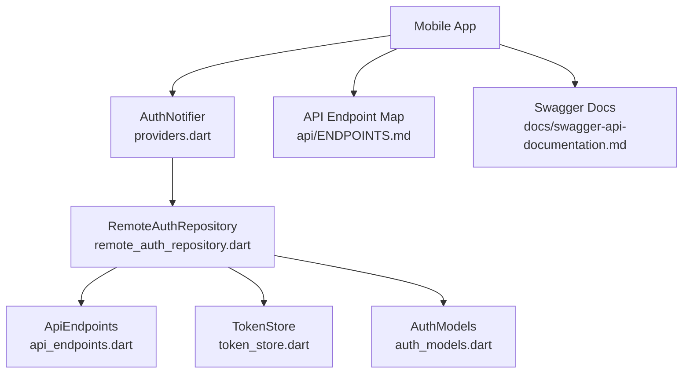
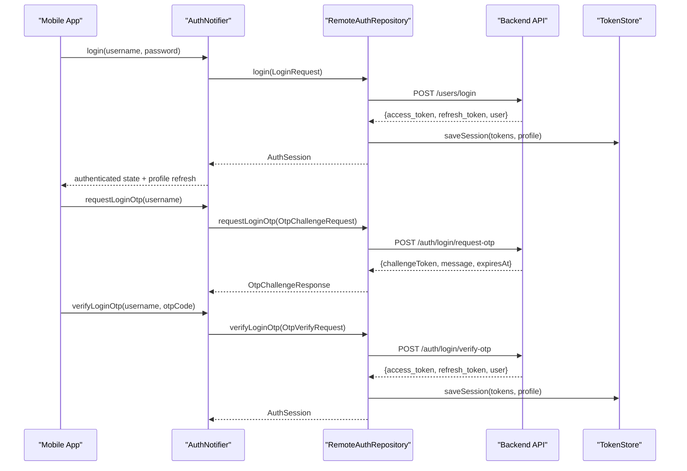
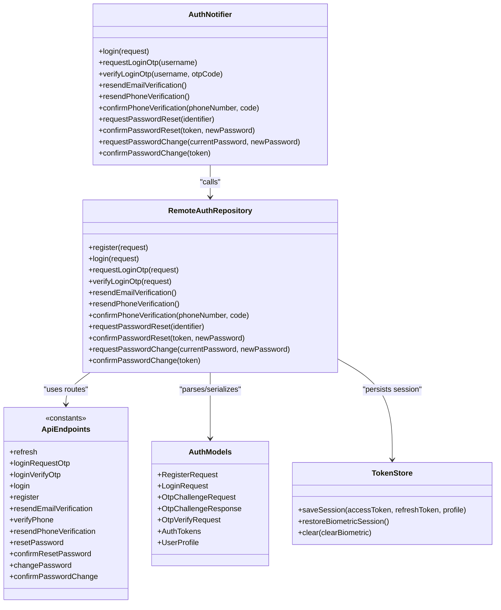

# Authentication API

<cite>
**Referenced Files in This Document**
- [ENDPOINTS.md](file://api/ENDPOINTS.md)
- [swagger-api-documentation.md](file://docs/swagger-api-documentation.md)
- [MOBILE_APP_REBUILD_HANDOFF.md](file://docs/MOBILE_APP_REBUILD_HANDOFF.md)
- [api_endpoints.dart](file://lib/core/network/api_endpoints.dart)
- [auth_models.dart](file://lib/features/auth/data/auth_models.dart)
- [remote_auth_repository.dart](file://lib/features/auth/data/remote_auth_repository.dart)
- [providers.dart](file://lib/features/auth/providers.dart)
- [token_store.dart](file://lib/core/network/token_store.dart)
- [deep_links.dart](file://lib/core/deep_links.dart)
</cite>

## Table of Contents
1. [Introduction](#introduction)
2. [Project Structure](#project-structure)
3. [Core Components](#core-components)
4. [Architecture Overview](#architecture-overview)
5. [Detailed Component Analysis](#detailed-component-analysis)
6. [Dependency Analysis](#dependency-analysis)
7. [Performance Considerations](#performance-considerations)
8. [Troubleshooting Guide](#troubleshooting-guide)
9. [Conclusion](#conclusion)
10. [Appendices](#appendices)

## Introduction
This document provides comprehensive API documentation for the authentication endpoints used by the mobile application. It covers user registration, login with username/password, OTP-based login, token refresh, email and phone verification, password reset, and password change flows. It also documents security considerations such as JWT handling, session persistence, device identity enrichment, and rate limiting behavior observed in the client layer.

The base URL is defined in the project’s API endpoint map and swagger documentation. The mobile app uses a repository pattern to call these endpoints and persists access and refresh tokens securely on the device.

## Project Structure
Authentication-related code is split between:
- Public endpoint definitions under `api/ENDPOINTS.md` and `docs/swagger-api-documentation.md`.
- Route constants in `lib/core/network/api_endpoints.dart`.
- Request/response models in `lib/features/auth/data/auth_models.dart`.
- Remote implementation in `lib/features/auth/data/remote_auth_repository.dart`.
- UI state and orchestration in `lib/features/auth/providers.dart`.
- Secure token storage in `lib/core/network/token_store.dart`.
- Deep link routing for password reset/change flows in `lib/core/deep_links.dart`.

**Diagram sources**
- [providers.dart:22-37](file://lib/features/auth/providers.dart#L22-L37)
- [remote_auth_repository.dart:42-80](file://lib/features/auth/data/remote_auth_repository.dart#L42-L80)
- [api_endpoints.dart:1-33](file://lib/core/network/api_endpoints.dart#L1-L33)
- [token_store.dart:74-175](file://lib/core/network/token_store.dart#L74-L175)
- [auth_models.dart:24-105](file://lib/features/auth/data/auth_models.dart#L24-L105)

**Section sources**
- [ENDPOINTS.md:1-38](file://api/ENDPOINTS.md#L1-L38)
- [swagger-api-documentation.md:51-181](file://docs/swagger-api-documentation.md#L51-L181)
- [api_endpoints.dart:1-33](file://lib/core/network/api_endpoints.dart#L1-L33)

## Core Components
- User Registration: POST /api/v1/users/register
- User Login: POST /api/v1/users/login
- OTP Challenge: POST /api/v1/auth/login/request-otp
- OTP Verification: POST /api/v1/auth/login/verify-otp
- Token Refresh: POST /api/v1/auth/refresh
- Email Verification Resend: POST /api/v1/users/resend-verification-email
- Phone Verification: POST /api/v1/users/verify-phone
- Phone Verification Resend: POST /api/v1/users/resend-phone-verification-code
- Password Reset Initiation: POST /api/v1/users/reset-password
- Password Reset Confirmation: POST /api/v1/users/confirm-reset-password
- Password Change Initiation: PUT /api/v1/users/change-password
- Password Change Confirmation: POST /api/v1/users/confirm-password-change

These endpoints are declared in the endpoint map and referenced by route constants and models.

**Section sources**
- [ENDPOINTS.md:10-38](file://api/ENDPOINTS.md#L10-L38)
- [api_endpoints.dart:6-33](file://lib/core/network/api_endpoints.dart#L6-L33)
- [auth_models.dart:24-105](file://lib/features/auth/data/auth_models.dart#L24-L105)

## Architecture Overview
The authentication flow follows this sequence:
- Registration creates a user and optionally registers a push token.
- Login returns an access token and refresh token along with the user profile.
- OTP login is a two-step process: request challenge then verify OTP to obtain tokens.
- Token refresh renews short-lived access tokens using the refresh token.
- Email and phone verification flows send codes or links; clients resend via dedicated endpoints.
- Password reset and change flows use emailed tokens to confirm changes.

**Diagram sources**
- [providers.dart:88-163](file://lib/features/auth/providers.dart#L88-L163)
- [remote_auth_repository.dart:42-80](file://lib/features/auth/data/remote_auth_repository.dart#L42-L80)
- [auth_models.dart:257-354](file://lib/features/auth/data/auth_models.dart#L257-L354)
- [token_store.dart:148-175](file://lib/core/network/token_store.dart#L148-L175)

## Detailed Component Analysis

### User Registration
- Method: POST
- URL: /api/v1/users/register
- Purpose: Create a new user account.
- Request schema:
  - firstName (string)
  - lastName (string)
  - email (string)
  - phoneNumber (string)
  - country (string)
  - password (string)
  - Optional device metadata: deviceToken, devicePlatform, deviceId, appVersion, locale
- Response schema:
  - User object including id, username, email, phoneNumber, firstName, lastName, country, roles, status, createdAt, updatedAt.

Implementation notes:
- The client maps registration fields into a JSON payload that includes roles ["user"] and optional device metadata.
- The response is parsed into a user model.

Security considerations:
- Passwords should be sent over HTTPS.
- Device metadata helps associate notifications but must not contain sensitive identifiers.

**Section sources**
- [swagger-api-documentation.md:132-181](file://docs/swagger-api-documentation.md#L132-L181)
- [auth_models.dart:24-105](file://lib/features/auth/data/auth_models.dart#L24-L105)

### User Login (Username/Password)
- Method: POST
- URL: /api/v1/users/login
- Purpose: Authenticate a user with username and password and return tokens plus user profile.
- Request schema:
  - username (string): phone number, email, or username
  - password (string)
  - Optional device metadata: deviceToken, devicePlatform, deviceId, appVersion, locale
- Response schema:
  - access_token (JWT)
  - refresh_token (JWT)
  - user (object): includes _id, username, email, phoneNumber, firstName, lastName, country, roles, status, timestamps.

Client behavior:
- The provider enriches the login request with device identity and FCM token when available.
- On success, the repository saves the session (tokens and profile) and triggers profile refresh.

Security considerations:
- Access token is short-lived; refresh token is used to renew it.
- Tokens are stored securely using TokenStore backed by secure storage.

Example login request:
- See the swagger example showing username and password fields plus optional device metadata.

**Section sources**
- [swagger-api-documentation.md:51-99](file://docs/swagger-api-documentation.md#L51-L99)
- [providers.dart:88-105](file://lib/features/auth/providers.dart#L88-L105)
- [auth_models.dart:197-255](file://lib/features/auth/data/auth_models.dart#L197-L255)

### OTP-Based Login Flow
Two-step flow:
1. Request OTP challenge:
   - Method: POST
   - URL: /api/v1/auth/login/request-otp
   - Request schema:
     - username (string)
   - Response schema:
     - challengeToken (string)
     - message (string)
     - expiresAt (optional datetime)

2. Verify OTP:
   - Method: POST
   - URL: /api/v1/auth/login/verify-otp
   - Request schema:
     - challengeToken (string)
     - otpCode (string)
     - Optional: username, deviceToken, devicePlatform, deviceId, appVersion, locale
   - Response schema:
     - access_token (JWT)
     - refresh_token (JWT)
     - user (object)

Client behavior:
- The challenge token is kept only in memory during verification.
- On successful verification, the repository persists the session and refreshes the profile.

OTP verification response guidance:
- Expect HTTP 200 with access_token, refresh_token, and full user object matching the login response.
- The JWT structure matches password login; downstream endpoints behave identically.

Security considerations:
- Do not persist the challenge token beyond the verification step.
- If verification fails due to invalid/expired OTP, keep the user on the OTP screen and do not create a partial session.

**Section sources**
- [auth_models.dart:257-354](file://lib/features/auth/data/auth_models.dart#L257-L354)
- [providers.dart:107-163](file://lib/features/auth/providers.dart#L107-L163)
- [MOBILE_APP_REBUILD_HANDOFF.md:154-178](file://docs/MOBILE_APP_REBUILD_HANDOFF.md#L154-L178)

### Token Refresh
- Method: POST
- URL: /api/v1/auth/refresh
- Purpose: Renew access and refresh tokens using the current refresh token.
- Request schema:
  - refreshToken (string)
- Response schema:
  - access_token (JWT)
  - refresh_token (JWT)
  - user (object): minimal user info including _id, username, phoneNumber, roles.

Notes:
- Legacy endpoint POST /api/v1/users/refresh-token is deprecated for mobile clients.
- The client stores both tokens and updates them on refresh.

**Section sources**
- [swagger-api-documentation.md:103-129](file://docs/swagger-api-documentation.md#L103-L129)
- [auth_models.dart:356-371](file://lib/features/auth/data/auth_models.dart#L356-L371)

### Email Verification
- Resend email verification link:
  - Method: POST
  - URL: /api/v1/users/resend-verification-email
- Client behavior:
  - Rate-limited at the client level with a cooldown window before calling the backend.
  - After successful resend, the client records the timestamp to enforce the cooldown.

Security considerations:
- Backend enforces its own limit across app restarts; client-side cooldown prevents unnecessary calls.

**Section sources**
- [api_endpoints.dart:14-15](file://lib/core/network/api_endpoints.dart#L14-L15)
- [providers.dart:280-294](file://lib/features/auth/providers.dart#L280-L294)

### Phone Verification
- Resend phone verification code:
  - Method: POST
  - URL: /api/v1/users/resend-phone-verification-code
- Confirm phone verification:
  - Method: POST
  - URL: /api/v1/users/verify-phone
  - Request schema:
    - phoneNumber (string)
    - code (string): typically a 6-digit SMS code
  - Response: updates verified flag; client refreshes profile afterward.

Client behavior:
- After resending, the UI prompts for the code immediately.
- On confirmation, the profile is refreshed so verified flags update everywhere.

**Section sources**
- [api_endpoints.dart:31-33](file://lib/core/network/api_endpoints.dart#L31-L33)
- [providers.dart:296-310](file://lib/features/auth/providers.dart#L296-L310)

### Password Reset
- Initiate password reset:
  - Method: POST
  - URL: /api/v1/users/reset-password
  - Request schema:
    - email (string) OR phoneNumber (string)
- Confirm password reset:
  - Method: POST
  - URL: /api/v1/users/confirm-reset-password
  - Request schema:
    - token (string): from email link
    - newPassword (string)

Client behavior:
- Identifier shape determines whether email or phone is used.
- Deep links route to reset or change password screens and pass the token safely.

**Section sources**
- [api_endpoints.dart:25-27](file://lib/core/network/api_endpoints.dart#L25-L27)
- [deep_links.dart:95-114](file://lib/core/deep_links.dart#L95-L114)

### Password Change
- Initiate password change:
  - Method: PUT
  - URL: /api/v1/users/change-password
  - Request schema:
    - currentPassword (string)
    - newPassword (string)
  - Behavior: emails a verification link; change lands only after confirmation.
- Confirm password change:
  - Method: POST
  - URL: /api/v1/users/confirm-password-change
  - Request schema:
    - token (string): from email link

Client behavior:
- After initiating, the UI instructs the user to open the verification link.
- Deep links route to the appropriate screen and carry the token.

**Section sources**
- [api_endpoints.dart:28-30](file://lib/core/network/api_endpoints.dart#L28-L30)
- [providers.dart:323-334](file://lib/features/auth/providers.dart#L323-L334)
- [deep_links.dart:95-114](file://lib/core/deep_links.dart#L95-L114)

## Dependency Analysis
Authentication components depend on each other as follows:
- AuthNotifier orchestrates login, OTP, verification, and password flows.
- RemoteAuthRepository translates requests to API endpoints and persists sessions.
- ApiEndpoints defines route paths.
- AuthModels define request/response shapes.
- TokenStore securely persists tokens and profile data.

**Diagram sources**
- [providers.dart:51-352](file://lib/features/auth/providers.dart#L51-L352)
- [remote_auth_repository.dart:42-80](file://lib/features/auth/data/remote_auth_repository.dart#L42-L80)
- [api_endpoints.dart:1-33](file://lib/core/network/api_endpoints.dart#L1-L33)
- [auth_models.dart:24-371](file://lib/features/auth/data/auth_models.dart#L24-L371)
- [token_store.dart:74-175](file://lib/core/network/token_store.dart#L74-L175)

**Section sources**
- [providers.dart:51-352](file://lib/features/auth/providers.dart#L51-L352)
- [remote_auth_repository.dart:42-80](file://lib/features/auth/data/remote_auth_repository.dart#L42-L80)
- [api_endpoints.dart:1-33](file://lib/core/network/api_endpoints.dart#L1-L33)
- [auth_models.dart:24-371](file://lib/features/auth/data/auth_models.dart#L24-L371)
- [token_store.dart:74-175](file://lib/core/network/token_store.dart#L74-L175)

## Performance Considerations
- Profile refresh is best-effort and retries transient failures once after a delay.
- Token store loads secrets asynchronously at startup and migrates legacy plaintext values to secure storage.
- OTP challenge tokens are kept in memory only to avoid unnecessary persistence overhead.
- Email verification resend is rate-limited client-side to reduce API load.

[No sources needed since this section provides general guidance]

## Troubleshooting Guide
Common issues and resolutions:
- Invalid or expired OTP:
  - Keep the user on the OTP screen; do not create a partially authenticated session.
  - Restart the login challenge if the challenge token is expired.
- Invalid token payload:
  - The backend rejects tokens missing or invalid sub claim with HTTP 401.
  - Clear local session storage and sign in again to obtain fresh tokens.
- Biometric sign-in failures:
  - Requires a refreshable session; otherwise throw an error prompting password login.
- Profile fetch failures:
  - Transient 5xx errors retry once; 401 clears the session and logs out the user.

Operational tips:
- Use deep links to route password reset/change flows and ensure tokens are passed safely.
- For phone verification, prompt for the 6-digit code immediately after resending.

**Section sources**
- [MOBILE_APP_REBUILD_HANDOFF.md:154-178](file://docs/MOBILE_APP_REBUILD_HANDOFF.md#L154-L178)
- [providers.dart:210-239](file://lib/features/auth/providers.dart#L210-L239)
- [providers.dart:186-202](file://lib/features/auth/providers.dart#L186-L202)
- [deep_links.dart:95-114](file://lib/core/deep_links.dart#L95-L114)

## Conclusion
The authentication system provides robust flows for registration, login, OTP verification, token refresh, email/phone verification, and password management. The client implements secure token storage, device identity enrichment, and resilient error handling. Follow the documented schemas and flows to integrate mobile clients correctly and maintain security best practices.

[No sources needed since this section summarizes without analyzing specific files]

## Appendices

### Security Considerations
- JWT Handling:
  - Access tokens are short-lived; refresh tokens renew them.
  - Tokens are stored securely using TokenStore backed by platform secure storage.
- Session Management:
  - Cold-start restoration restores persisted sessions.
  - Biometric sign-in requires a refreshable session snapshot.
- Rate Limiting:
  - Email verification resend is rate-limited client-side with a cooldown window.
  - Backend enforces its own limits across app restarts.

**Section sources**
- [token_store.dart:74-175](file://lib/core/network/token_store.dart#L74-L175)
- [providers.dart:280-294](file://lib/features/auth/providers.dart#L280-L294)

### Client Implementation Guidelines
- Mobile App Integration:
  - Enrich login and registration requests with device metadata.
  - Persist tokens securely and attach access tokens to authenticated requests.
  - Register FCM device tokens via notification endpoints after authentication.
- Error Handling:
  - Handle 401 by clearing sessions and redirecting to login.
  - For OTP errors, remain on the OTP screen and allow restarting the challenge.
- Debugging:
  - Use deep links to test password reset/change flows.
  - Validate token payloads and ensure sub claims are present.

**Section sources**
- [providers.dart:88-163](file://lib/features/auth/providers.dart#L88-L163)
- [MOBILE_APP_REBUILD_HANDOFF.md:154-178](file://docs/MOBILE_APP_REBUILD_HANDOFF.md#L154-L178)
- [deep_links.dart:95-114](file://lib/core/deep_links.dart#L95-L114)