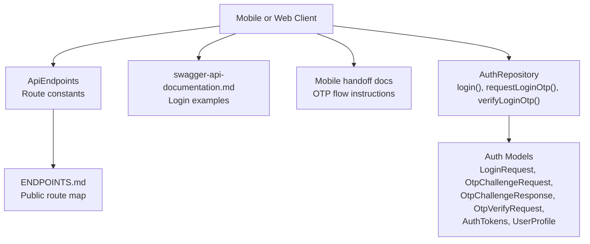
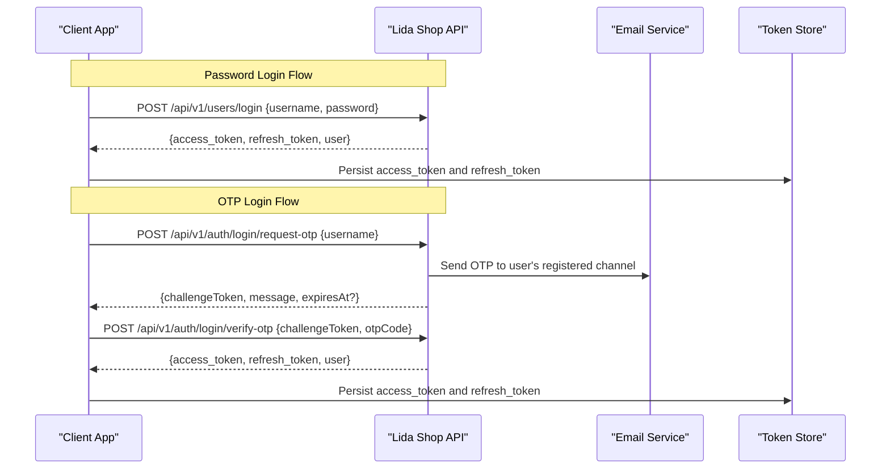
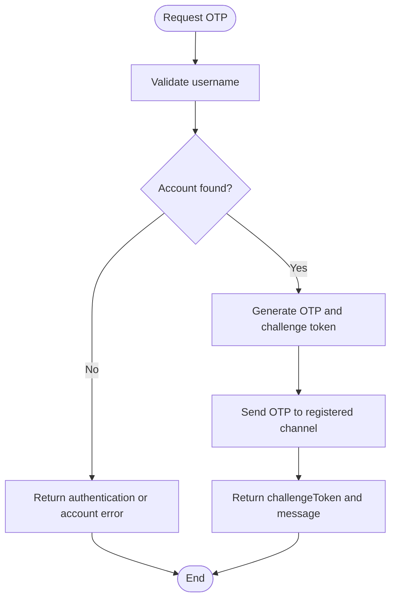
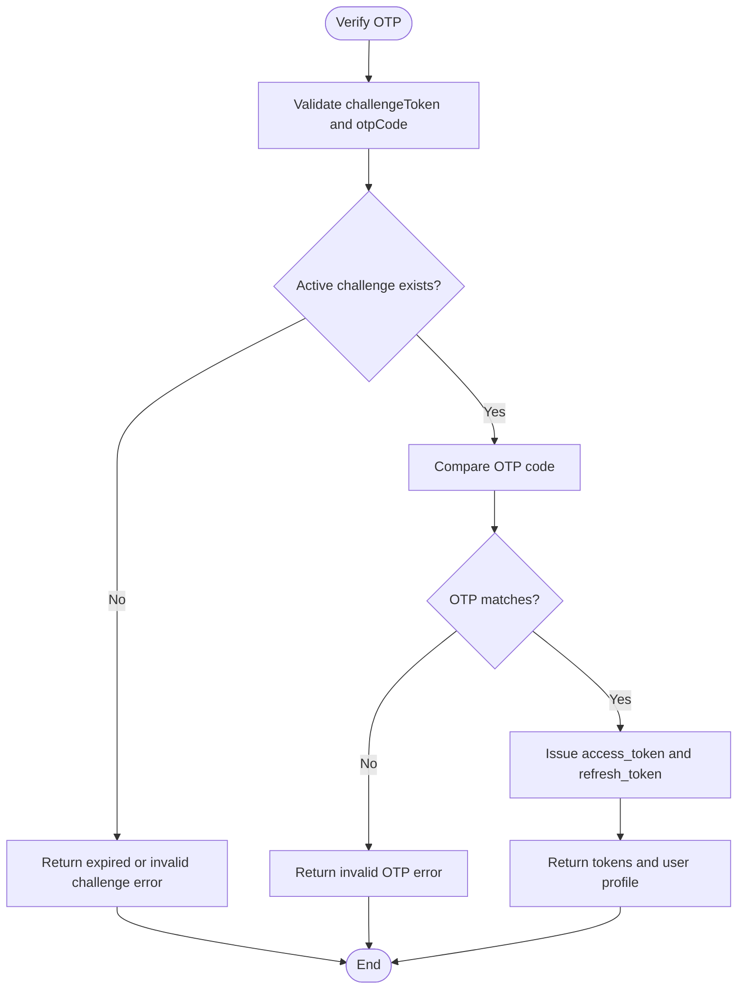
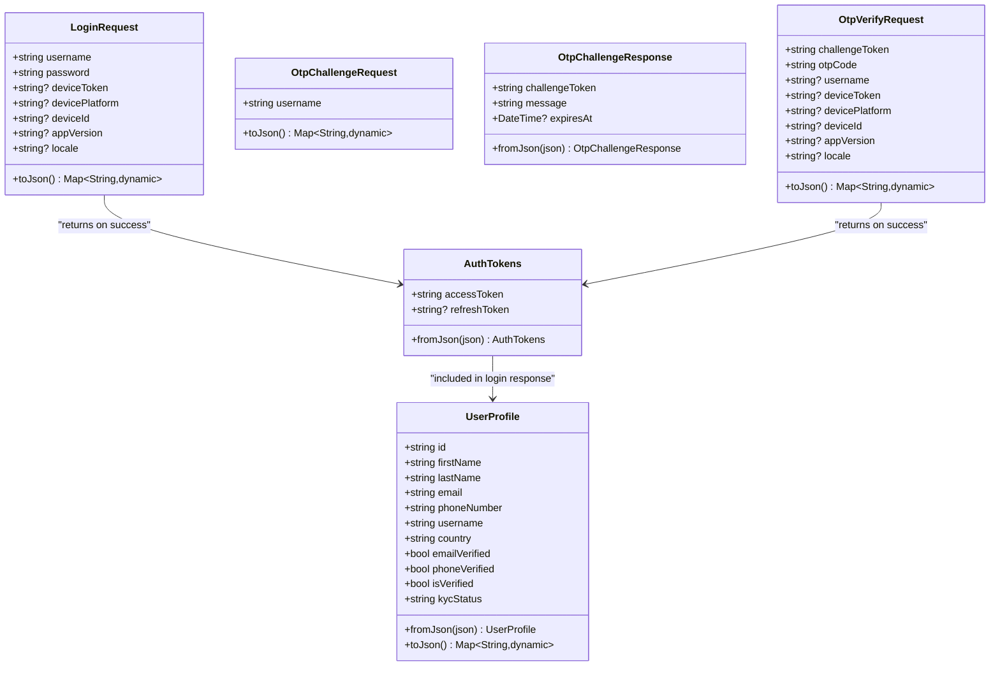
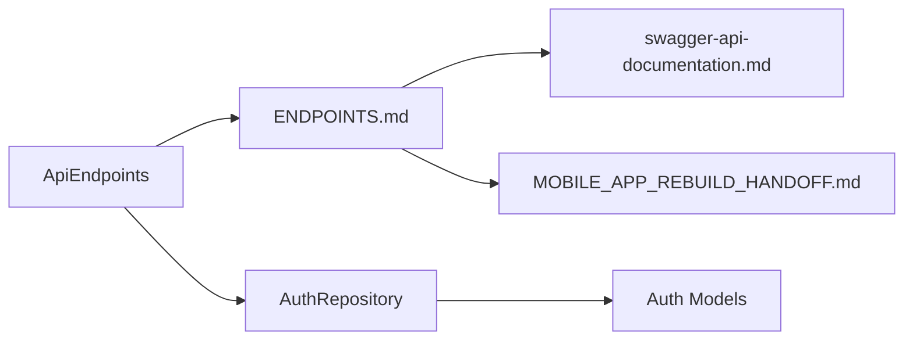

# Login & Authentication API

<cite>
**Referenced Files in This Document**   
- [ENDPOINTS.md](file://api/ENDPOINTS.md)
- [swagger-api-documentation.md](file://docs/swagger-api-documentation.md)
- [MOBILE_APP_REBUILD_HANDOFF.md](file://docs/MOBILE_APP_REBUILD_HANDOFF.md)
- [SHOP_API_MOBILE_HANDOFF.md](file://docs/SHOP_API_MOBILE_HANDOFF.md)
- [BACKEND_NOTIFICATION_TRIGGERS_HANDOFF.md](file://docs/BACKEND_NOTIFICATION_TRIGGERS_HANDOFF.md)
- [api_endpoints.dart](file://lib/core/network/api_endpoints.dart)
- [auth_repository.dart](file://lib/features/auth/data/auth_repository.dart)
- [auth_models.dart](file://lib/features/auth/data/auth_models.dart)
</cite>

## Table of Contents
1. [Introduction](#introduction)
2. [Project Structure](#project-structure)
3. [Core Components](#core-components)
4. [Architecture Overview](#architecture-overview)
5. [Detailed Component Analysis](#detailed-component-analysis)
6. [Dependency Analysis](#dependency-analysis)
7. [Performance Considerations](#performance-considerations)
8. [Troubleshooting Guide](#troubleshooting-guide)
9. [Conclusion](#conclusion)

## Introduction
This document provides comprehensive API documentation for the login and authentication endpoints used by the Lida Shop application. It covers:

- Standard password-based login via `POST /api/v1/users/login`.
- OTP-based login initiation via `POST /api/v1/auth/login/request-otp`.
- OTP verification via `POST /api/v1/auth/login/verify-otp`.

It includes request/response schemas, authentication flow diagrams, security considerations, example flows, and error-handling guidance. The base URL is documented as `https://api.advansistechnologies.com` for production and `http://localhost:1124` for development.

## Project Structure
The authentication-related contract is defined across several layers:

- **API endpoint map**: Lists all public routes, including the three login endpoints.
- **Swagger documentation**: Provides detailed request/response examples for standard login and refresh tokens.
- **Mobile handoff documents**: Describe how mobile clients should use password login and OTP login.
- **Client-side route constants**: Centralize endpoint paths for the Flutter app.
- **Authentication repository contract**: Defines the expected methods for login, OTP challenge, and OTP verification.
- **Authentication models**: Define request/response shapes such as `LoginRequest`, `OtpChallengeRequest`, `OtpChallengeResponse`, `OtpVerifyRequest`, `AuthTokens`, and `UserProfile`.

**Diagram sources**
- [ENDPOINTS.md:10-14](file://api/ENDPOINTS.md#L10-L14)
- [swagger-api-documentation.md:51-128](file://docs/swagger-api-documentation.md#L51-L128)
- [MOBILE_APP_REBUILD_HANDOFF.md:73-154](file://docs/MOBILE_APP_REBUILD_HANDOFF.md#L73-L154)
- [api_endpoints.dart:6-9](file://lib/core/network/api_endpoints.dart#L6-L9)
- [auth_repository.dart:19-29](file://lib/features/auth/data/auth_repository.dart#L19-L29)
- [auth_models.dart:197-371](file://lib/features/auth/data/auth_models.dart#L197-L371)

**Section sources**
- [ENDPOINTS.md:1-14](file://api/ENDPOINTS.md#L1-L14)
- [swagger-api-documentation.md:1-128](file://docs/swagger-api-documentation.md#L1-L128)
- [api_endpoints.dart:1-10](file://lib/core/network/api_endpoints.dart#L1-L10)
- [auth_repository.dart:1-29](file://lib/features/auth/data/auth_repository.dart#L1-L29)
- [auth_models.dart:197-371](file://lib/features/auth/data/auth_models.dart#L197-L371)

## Core Components
The authentication surface area relevant to this document consists of three HTTP endpoints and their client-side contracts:

| Endpoint | Purpose | Request Shape | Response Shape |
|---|---|---|---|
| `POST /api/v1/users/login` | Standard login with username and password; may also register device metadata for push notifications. | `LoginRequest`: `username`, `password`, optional device fields. | `access_token`, `refresh_token`, and `user` object. |
| `POST /api/v1/auth/login/request-otp` | Initiate an OTP-based login challenge after validating credentials or account identity. | `OtpChallengeRequest`: `username`. | `OtpChallengeResponse`: `challengeToken`, `message`, optional `expiresAt`. |
| `POST /api/v1/auth/login/verify-otp` | Verify the OTP code against the active challenge and return authenticated tokens. | `OtpVerifyRequest`: `challengeToken`, `otpCode`, optional device fields. | `AuthSession` containing `AuthTokens` and `UserProfile`. |

Key client-side types:

- `LoginRequest`: Mirrors `POST /api/v1/users/login`.
- `OtpChallengeRequest`: Mirrors `POST /api/v1/auth/login/request-otp`.
- `OtpChallengeResponse`: Challenge returned by OTP initiation.
- `OtpVerifyRequest`: Mirrors `POST /api/v1/auth/login/verify-otp`.
- `AuthTokens`: Contains `access_token` and optional `refresh_token`.
- `UserProfile`: Represents the user profile returned by login and refresh flows.

**Section sources**
- [ENDPOINTS.md:10-14](file://api/ENDPOINTS.md#L10-L14)
- [swagger-api-documentation.md:51-128](file://docs/swagger-api-documentation.md#L51-L128)
- [auth_repository.dart:19-29](file://lib/features/auth/data/auth_repository.dart#L19-L29)
- [auth_models.dart:197-371](file://lib/features/auth/data/auth_models.dart#L197-L371)

## Architecture Overview
The authentication architecture supports two primary login strategies:

1. **Password login**: The client sends username and password directly to `/api/v1/users/login`. On success, it receives access and refresh tokens plus a user profile.
2. **OTP login**: The client first calls `/api/v1/auth/login/request-otp` to create a short-lived challenge. After the user enters the OTP received through email, the client calls `/api/v1/auth/login/verify-otp` with the challenge token and OTP code to obtain tokens.

**Diagram sources**
- [swagger-api-documentation.md:51-128](file://docs/swagger-api-documentation.md#L51-L128)
- [MOBILE_APP_REBUILD_HANDOFF.md:73-154](file://docs/MOBILE_APP_REBUILD_HANDOFF.md#L73-L154)
- [auth_repository.dart:19-29](file://lib/features/auth/data/auth_repository.dart#L19-L29)
- [auth_models.dart:257-371](file://lib/features/auth/data/auth_models.dart#L257-L371)

## Detailed Component Analysis

### Standard Login: `POST /api/v1/users/login`
This endpoint authenticates a user using a username and password. It can also accept optional device metadata for push notification registration.

#### Request Schema
- `username`: String. Phone number, email, or username.
- `password`: String. User password.
- Optional device fields:
  - `deviceToken`: String. FCM token from Firebase.
  - `devicePlatform`: String. `"ANDROID"`, `"IOS"`, or `"WEB"`.
  - `deviceId`: String. Unique device identifier.
  - `appVersion`: String. App version.
  - `locale`: String. Device locale.

#### Response Schema
- `access_token`: String. JWT access token.
- `refresh_token`: String. JWT refresh token.
- `user`: Object. Full user profile including identifiers, contact information, roles, status, and timestamps.

#### Example Usage
A successful login returns both tokens and the user profile. A failed login should be treated as an authentication failure and should not expose sensitive details.

#### Security Notes
- Always send requests over HTTPS.
- Do not log passwords or tokens.
- Treat `access_token` as short-lived and `refresh_token` as long-lived but sensitive.
- Use the mobile-compatible refresh endpoint `/api/v1/auth/refresh` when rotating tokens.

**Section sources**
- [swagger-api-documentation.md:51-99](file://docs/swagger-api-documentation.md#L51-L99)
- [swagger-api-documentation.md:103-128](file://docs/swagger-api-documentation.md#L103-L128)
- [auth_models.dart:197-255](file://lib/features/auth/data/auth_models.dart#L197-L255)
- [auth_models.dart:356-371](file://lib/features/auth/data/auth_models.dart#L356-L371)

### OTP Login Initiation: `POST /api/v1/auth/login/request-otp`
This endpoint creates a short-lived login OTP challenge without creating an authenticated session. It is intended for passwordless or second-factor login workflows.

#### Request Schema
- `username`: String. The account identifier used to locate the user and deliver the OTP.

#### Response Schema
- `challengeToken`: String. Temporary token required for OTP verification.
- `message`: String. Human-readable message indicating that a verification code was sent.
- `expiresAt`: Optional timestamp indicating when the challenge expires.

#### Processing Logic

**Diagram sources**
- [auth_models.dart:257-307](file://lib/features/auth/data/auth_models.dart#L257-L307)
- [auth_repository.dart:23-25](file://lib/features/auth/data/auth_repository.dart#L23-L25)

#### Security Notes
- The challenge token is short-lived and must not be persisted as a session.
- Rate-limit OTP generation to prevent abuse.
- Do not reveal whether an account exists if doing so would aid enumeration.

**Section sources**
- [ENDPOINTS.md:10-11](file://api/ENDPOINTS.md#L10-L11)
- [auth_models.dart:257-307](file://lib/features/auth/data/auth_models.dart#L257-L307)
- [auth_repository.dart:23-25](file://lib/features/auth/data/auth_repository.dart#L23-L25)

### OTP Verification: `POST /api/v1/auth/login/verify-otp`
This endpoint verifies the OTP code against the active challenge token and returns an authenticated session.

#### Request Schema
- `challengeToken`: String. The challenge token from the OTP initiation response.
- `otpCode`: String. The 6-digit OTP entered by the user.
- Optional device fields:
  - `deviceToken`: String. FCM token.
  - `devicePlatform`: String. Platform value.
  - `deviceId`: String. Device identifier.
  - `appVersion`: String. App version.
  - `locale`: String. Locale.

#### Response Schema
- `access_token`: String. JWT access token.
- `refresh_token`: String. JWT refresh token.
- `user`: Object. Full user profile.

#### Processing Logic

**Diagram sources**
- [auth_models.dart:309-371](file://lib/features/auth/data/auth_models.dart#L309-L371)
- [auth_repository.dart:27-29](file://lib/features/auth/data/auth_repository.dart#L27-L29)

#### Security Notes
- Invalidate the challenge token after successful verification.
- Enforce maximum attempts per challenge.
- Treat expired challenges as unauthenticated failures.

**Section sources**
- [ENDPOINTS.md:11](file://api/ENDPOINTS.md#L11)
- [auth_models.dart:309-371](file://lib/features/auth/data/auth_models.dart#L309-L371)
- [auth_repository.dart:27-29](file://lib/features/auth/data/auth_repository.dart#L27-L29)

### Authentication Data Models
The client-side models define the exact shape of authentication payloads and responses.

**Diagram sources**
- [auth_models.dart:197-371](file://lib/features/auth/data/auth_models.dart#L197-L371)

**Section sources**
- [auth_models.dart:197-371](file://lib/features/auth/data/auth_models.dart#L197-L371)

## Dependency Analysis
The authentication endpoints are referenced consistently across the project:

- **Endpoint constants**: The Flutter app centralizes route paths in `ApiEndpoints`.
- **Public API map**: `ENDPOINTS.md` lists the three authentication endpoints alongside other API routes.
- **Documentation**: Swagger and mobile handoff documents describe usage patterns and expected behavior.
- **Repository contract**: `AuthRepository` defines the expected methods for login, OTP challenge, and OTP verification.
- **Models**: `auth_models.dart` defines request/response structures consumed by the repository and UI layer.

**Diagram sources**
- [api_endpoints.dart:6-9](file://lib/core/network/api_endpoints.dart#L6-L9)
- [ENDPOINTS.md:10-14](file://api/ENDPOINTS.md#L10-L14)
- [swagger-api-documentation.md:51-128](file://docs/swagger-api-documentation.md#L51-L128)
- [MOBILE_APP_REBUILD_HANDOFF.md:73-154](file://docs/MOBILE_APP_REBUILD_HANDOFF.md#L73-L154)
- [auth_repository.dart:19-29](file://lib/features/auth/data/auth_repository.dart#L19-L29)
- [auth_models.dart:197-371](file://lib/features/auth/data/auth_models.dart#L197-L371)

**Section sources**
- [api_endpoints.dart:6-9](file://lib/core/network/api_endpoints.dart#L6-L9)
- [ENDPOINTS.md:10-14](file://api/ENDPOINTS.md#L10-L14)
- [swagger-api-documentation.md:51-128](file://docs/swagger-api-documentation.md#L51-L128)
- [MOBILE_APP_REBUILD_HANDOFF.md:73-154](file://docs/MOBILE_APP_REBUILD_HANDOFF.md#L73-L154)
- [auth_repository.dart:19-29](file://lib/features/auth/data/auth_repository.dart#L19-L29)
- [auth_models.dart:197-371](file://lib/features/auth/data/auth_models.dart#L197-L371)

## Performance Considerations
- Prefer OTP login for improved security when users have access to email or another verified channel.
- Cache `access_token` only in memory and rotate it using the refresh endpoint when needed.
- Avoid repeated OTP generation for the same account within a short time window.
- Defer device metadata registration to login or explicit device-token endpoints unless required by business logic.
- Handle network errors gracefully and retry only non-idempotent operations when safe.

[No sources needed since this section provides general guidance]

## Troubleshooting Guide

### Invalid Credentials on Standard Login
- Symptom: Login fails with authentication error.
- Likely causes:
  - Incorrect username or password.
  - Account disabled or inactive.
  - Network or TLS issues.
- Recommended handling:
  - Show a generic authentication failure message.
  - Do not disclose whether the username exists.
  - Log only non-sensitive diagnostics.

**Section sources**
- [swagger-api-documentation.md:51-99](file://docs/swagger-api-documentation.md#L51-L99)

### Expired or Invalid OTP Challenge
- Symptom: OTP verification fails because the challenge is no longer valid.
- Likely causes:
  - Challenge expired.
  - Challenge already used.
  - Wrong challenge token passed to verification.
- Recommended handling:
  - Prompt the user to request a new OTP.
  - Clear any stale challenge state.
  - Retry OTP initiation rather than reusing the old token.

**Section sources**
- [auth_models.dart:271-307](file://lib/features/auth/data/auth_models.dart#L271-L307)
- [auth_repository.dart:23-29](file://lib/features/auth/data/auth_repository.dart#L23-L29)

### Invalid OTP Code
- Symptom: OTP verification fails due to mismatched code.
- Likely causes:
  - User entered wrong code.
  - Code already consumed.
  - Timing issue between generation and verification.
- Recommended handling:
  - Allow limited retries.
  - Require a new challenge after too many failures.
  - Never persist OTP codes.

**Section sources**
- [auth_models.dart:309-354](file://lib/features/auth/data/auth_models.dart#L309-L354)

### Token Refresh Issues
- Symptom: Access token expires or refresh fails.
- Likely causes:
  - Expired refresh token.
  - Server rotated refresh token.
  - Missing or malformed authorization header.
- Recommended handling:
  - Use `/api/v1/auth/refresh` for mobile compatibility.
  - Re-authenticate if refresh fails.
  - Clear stored tokens on permanent authentication failure.

**Section sources**
- [swagger-api-documentation.md:103-128](file://docs/swagger-api-documentation.md#L103-L128)

## Conclusion
The Lida Shop authentication system supports both traditional password login and OTP-based login. Clients should:

- Use `POST /api/v1/users/login` for direct credential-based authentication.
- Use `POST /api/v1/auth/login/request-otp` followed by `POST /api/v1/auth/login/verify-otp` for secure OTP-based authentication.
- Persist and rotate tokens securely.
- Handle invalid credentials, expired challenges, and invalid OTPs with clear, user-friendly error messages.
- Follow the documented request/response schemas and security best practices.

[No sources needed since this section summarizes without analyzing specific files]