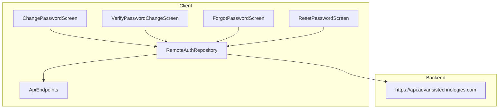
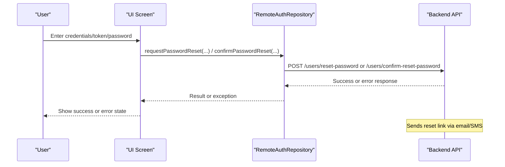
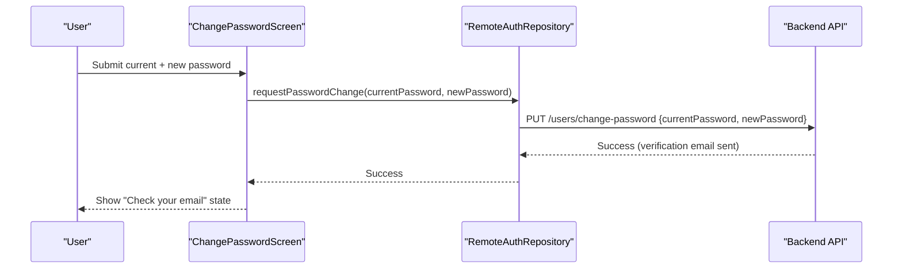
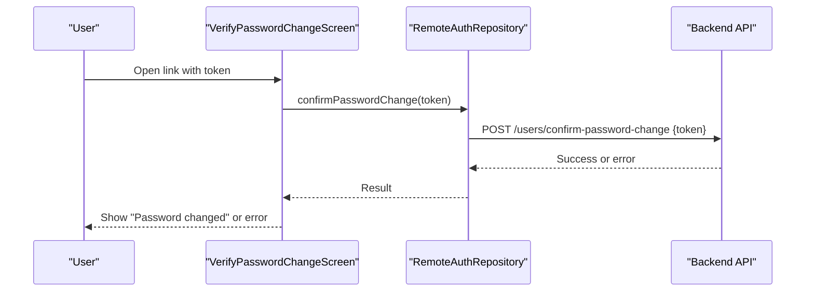
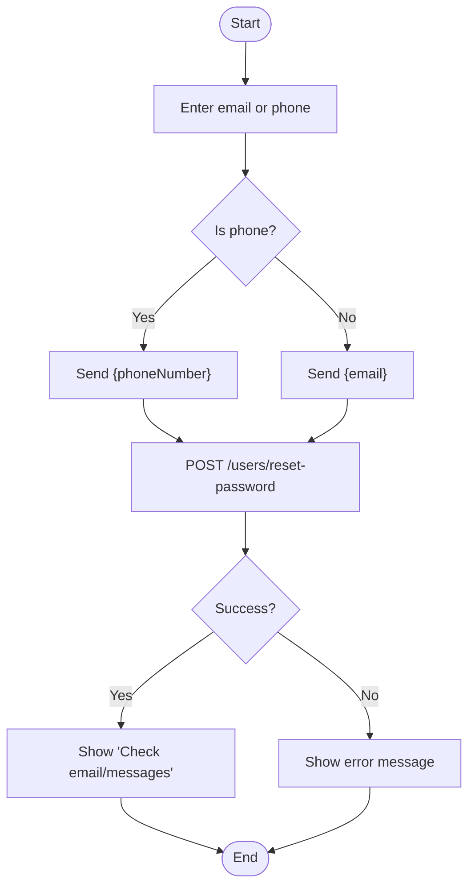
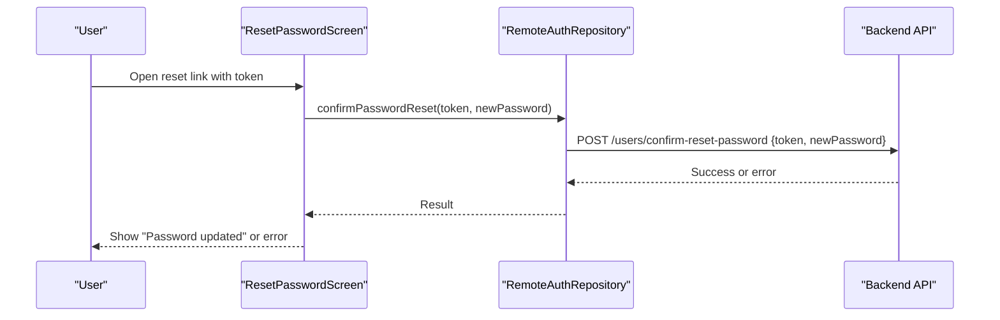
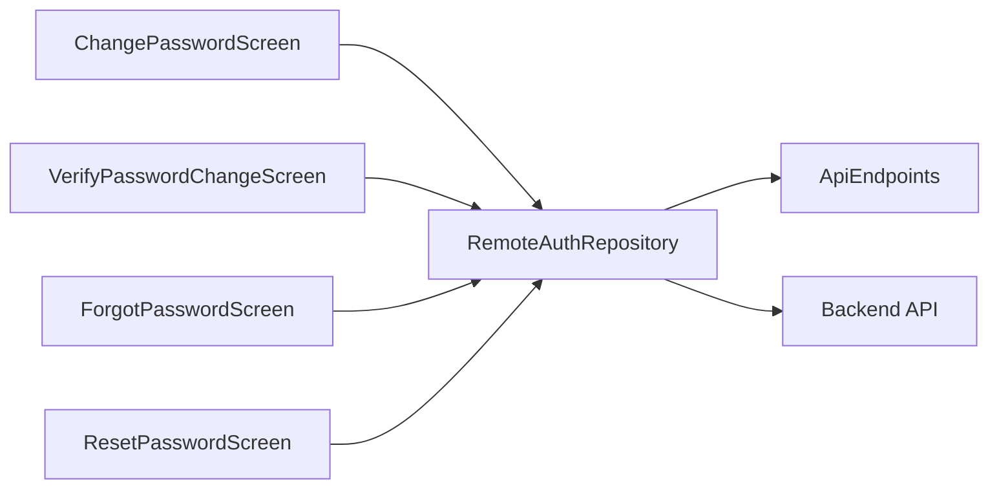

# Password Management API

<cite>
**Referenced Files in This Document**
- [ENDPOINTS.md](file://api/ENDPOINTS.md)
- [auth_repository.dart](file://lib/features/auth/data/auth_repository.dart)
- [remote_auth_repository.dart](file://lib/features/auth/data/remote_auth_repository.dart)
- [api_endpoints.dart](file://lib/core/network/api_endpoints.dart)
- [change_password_screen.dart](file://lib/features/auth/screens/change_password_screen.dart)
- [verify_password_change_screen.dart](file://lib/features/auth/screens/verify_password_change_screen.dart)
- [forgot_password_screen.dart](file://lib/features/auth/screens/forgot_password_screen.dart)
- [reset_password_screen.dart](file://lib/features/auth/screens/reset_password_screen.dart)
- [deep_links.dart](file://lib/core/deep_links.dart)
- [MOBILE_APP_REBUILD_HANDOFF.md](file://docs/MOBILE_APP_REBUILD_HANDOFF.md)
</cite>

## Table of Contents
1. [Introduction](#introduction)
2. [Project Structure](#project-structure)
3. [Core Components](#core-components)
4. [Architecture Overview](#architecture-overview)
5. [Detailed Component Analysis](#detailed-component-analysis)
6. [Dependency Analysis](#dependency-analysis)
7. [Performance Considerations](#performance-considerations)
8. [Troubleshooting Guide](#troubleshooting-guide)
9. [Conclusion](#conclusion)

## Introduction
This document provides comprehensive API documentation for password management endpoints used by the LidaPay mobile application and its backend. It covers:
- Password change flow for authenticated users
- Password reset flow for unauthenticated users
- Request/response contracts, workflows, security considerations, and error handling patterns

The documented endpoints are:
- `PUT /api/v1/users/change-password` — initiate a signed-in password change with email verification
- `POST /api/v1/users/confirm-password-change` — confirm a password change using an emailed token
- `POST /api/v1/users/reset-password` — initiate a password reset via email or phone
- `POST /api/v1/users/confirm-reset-password` — complete a password reset using a token from the reset link

## Project Structure
Password management is implemented across UI screens, repository abstractions, endpoint constants, and deep-link routing. The client calls the backend through a centralized repository that maps to OpenAPI-defined routes.

**Diagram sources**
- [change_password_screen.dart:13-15](file://lib/features/auth/screens/change_password_screen.dart#L13-L15)
- [verify_password_change_screen.dart:11-14](file://lib/features/auth/screens/verify_password_change_screen.dart#L11-L14)
- [forgot_password_screen.dart:13-13](file://lib/features/auth/screens/forgot_password_screen.dart#L13-L13)
- [reset_password_screen.dart:13-15](file://lib/features/auth/screens/reset_password_screen.dart#L13-L15)
- [remote_auth_repository.dart:230-270](file://lib/features/auth/data/remote_auth_repository.dart#L230-L270)
- [api_endpoints.dart:25-30](file://lib/core/network/api_endpoints.dart#L25-L30)

**Section sources**
- [ENDPOINTS.md:25-38](file://api/ENDPOINTS.md#L25-L38)
- [api_endpoints.dart:25-30](file://lib/core/network/api_endpoints.dart#L25-L30)

## Core Components
- AuthRepository contract defines password methods for both mock and remote implementations.
- RemoteAuthRepository implements HTTP calls against the backend using ApiEndpoints.
- Screens implement user flows and handle success/error states.
- Deep links route reset and verify-password-change URLs to the appropriate screens.

Key responsibilities:
- Validate inputs on the client side (e.g., email/phone format, password strength).
- Send requests to the correct endpoints with the right HTTP method and payload shape.
- Handle errors returned by the backend and present user-friendly messages.

**Section sources**
- [auth_repository.dart:54-75](file://lib/features/auth/data/auth_repository.dart#L54-L75)
- [remote_auth_repository.dart:230-270](file://lib/features/auth/data/remote_auth_repository.dart#L230-L270)
- [api_endpoints.dart:25-30](file://lib/core/network/api_endpoints.dart#L25-L30)

## Architecture Overview
The password management architecture separates concerns between UI, repository, and API contracts:
- UI screens collect user input and call repository methods.
- Repository translates domain calls into HTTP requests using ApiEndpoints.
- Backend enforces business rules, sends emails/SMS, and validates tokens.

**Diagram sources**
- [forgot_password_screen.dart:35-51](file://lib/features/auth/screens/forgot_password_screen.dart#L35-L51)
- [reset_password_screen.dart:49-76](file://lib/features/auth/screens/reset_password_screen.dart#L49-L76)
- [remote_auth_repository.dart:230-248](file://lib/features/auth/data/remote_auth_repository.dart#L230-L248)

## Detailed Component Analysis

### Endpoint: PUT /api/v1/users/change-password
Purpose:
- Initiate a password change for an authenticated user.
- Requires current and new passwords.
- The backend sends an email with a verification link; the change only becomes active after confirmation.

Request:
- Method: PUT
- Path: /api/v1/users/change-password
- Headers: Authorization Bearer token required
- Body fields:
  - currentPassword: string
  - newPassword: string

Response:
- Success: No body or minimal acknowledgment indicating verification email sent
- Error: ApiException mapped to user-facing message

Security:
- Requires valid access token
- New password must meet validation rules enforced by the client and backend

Workflow:
1. User submits current and new passwords from ChangePasswordScreen.
2. Client calls RemoteAuthRepository.requestPasswordChange.
3. Repository sends PUT request to backend.
4. Backend sends verification email with a link containing a token.
5. User opens the link to confirm the change.

**Diagram sources**
- [change_password_screen.dart:41-60](file://lib/features/auth/screens/change_password_screen.dart#L41-L60)
- [remote_auth_repository.dart:251-262](file://lib/features/auth/data/remote_auth_repository.dart#L251-L262)

**Section sources**
- [ENDPOINTS.md:25-25](file://api/ENDPOINTS.md#L25-L25)
- [change_password_screen.dart:13-15](file://lib/features/auth/screens/change_password_screen.dart#L13-L15)
- [remote_auth_repository.dart:251-262](file://lib/features/auth/data/remote_auth_repository.dart#L251-L262)

### Endpoint: POST /api/v1/users/confirm-password-change
Purpose:
- Confirm a pending password change using a token received via email.
- No session is required because the token is the authority.

Request:
- Method: POST
- Path: /api/v1/users/confirm-password-change
- Body fields:
  - token: string (from verification link)

Response:
- Success: Indicates password change confirmed
- Error: Invalid/expired token or network error

Workflow:
1. User clicks verification link from email.
2. App navigates to VerifyPasswordChangeScreen with token.
3. Screen automatically calls confirmPasswordChange(token).
4. Backend validates token and applies the new password.
5. Screen shows success or error state.

**Diagram sources**
- [verify_password_change_screen.dart:37-73](file://lib/features/auth/screens/verify_password_change_screen.dart#L37-L73)
- [remote_auth_repository.dart:265-270](file://lib/features/auth/data/remote_auth_repository.dart#L265-L270)

**Section sources**
- [ENDPOINTS.md:26-26](file://api/ENDPOINTS.md#L26-L26)
- [verify_password_change_screen.dart:11-14](file://lib/features/auth/screens/verify_password_change_screen.dart#L11-L14)
- [remote_auth_repository.dart:265-270](file://lib/features/auth/data/remote_auth_repository.dart#L265-L270)

### Endpoint: POST /api/v1/users/reset-password
Purpose:
- Initiate a password reset for an account identified by email or phone number.
- Backend sends a secure reset link via email or SMS depending on identifier type.

Request:
- Method: POST
- Path: /api/v1/users/reset-password
- Body fields:
  - email: string (if identifier is email)
  - phoneNumber: string (if identifier is phone)

Response:
- Success: Indicates reset link sent
- Error: Network or configuration issues (e.g., missing One4All SMS config returns 503; provider failure may return 502)

Workflow:
1. User enters email or phone on ForgotPasswordScreen.
2. Client detects phone vs email and sets the correct field.
3. Repository sends POST request to backend.
4. Backend sends reset link via email or SMS.
5. User opens the link to set a new password.

**Diagram sources**
- [forgot_password_screen.dart:35-51](file://lib/features/auth/screens/forgot_password_screen.dart#L35-L51)
- [remote_auth_repository.dart:230-237](file://lib/features/auth/data/remote_auth_repository.dart#L230-L237)

**Section sources**
- [ENDPOINTS.md:37-37](file://api/ENDPOINTS.md#L37-L37)
- [forgot_password_screen.dart:13-13](file://lib/features/auth/screens/forgot_password_screen.dart#L13-L13)
- [remote_auth_repository.dart:230-237](file://lib/features/auth/data/remote_auth_repository.dart#L230-L237)
- [MOBILE_APP_REBUILD_HANDOFF.md:197-197](file://docs/MOBILE_APP_REBUILD_HANDOFF.md#L197-L197)

### Endpoint: POST /api/v1/users/confirm-reset-password
Purpose:
- Complete a password reset using a token from the reset link.
- No session is required because the token is the authority.

Request:
- Method: POST
- Path: /api/v1/users/confirm-reset-password
- Body fields:
  - token: string (from reset link)
  - newPassword: string

Response:
- Success: Indicates password updated
- Error: Token invalid/expired or network error

Workflow:
1. User opens reset link (deep link or web path).
2. App navigates to ResetPasswordScreen with token.
3. User enters and confirms new password.
4. Screen calls confirmPasswordReset(token, newPassword).
5. Backend validates token and updates password.
6. Screen shows success or error state.

**Diagram sources**
- [reset_password_screen.dart:49-76](file://lib/features/auth/screens/reset_password_screen.dart#L49-L76)
- [remote_auth_repository.dart:240-248](file://lib/features/auth/data/remote_auth_repository.dart#L240-L248)

**Section sources**
- [ENDPOINTS.md:38-38](file://api/ENDPOINTS.md#L38-L38)
- [reset_password_screen.dart:13-15](file://lib/features/auth/screens/reset_password_screen.dart#L13-L15)
- [remote_auth_repository.dart:240-248](file://lib/features/auth/data/remote_auth_repository.dart#L240-L248)

## Dependency Analysis
The password management features depend on:
- ApiEndpoints for route definitions
- RemoteAuthRepository for HTTP implementation
- Screens for user interaction and state management
- Deep links for routing reset and verification URLs

**Diagram sources**
- [change_password_screen.dart:41-60](file://lib/features/auth/screens/change_password_screen.dart#L41-L60)
- [verify_password_change_screen.dart:37-73](file://lib/features/auth/screens/verify_password_change_screen.dart#L37-L73)
- [forgot_password_screen.dart:35-51](file://lib/features/auth/screens/forgot_password_screen.dart#L35-L51)
- [reset_password_screen.dart:49-76](file://lib/features/auth/screens/reset_password_screen.dart#L49-L76)
- [remote_auth_repository.dart:230-270](file://lib/features/auth/data/remote_auth_repository.dart#L230-L270)
- [api_endpoints.dart:25-30](file://lib/core/network/api_endpoints.dart#L25-L30)

**Section sources**
- [api_endpoints.dart:25-30](file://lib/core/network/api_endpoints.dart#L25-L30)
- [remote_auth_repository.dart:230-270](file://lib/features/auth/data/remote_auth_repository.dart#L230-L270)

## Performance Considerations
- Minimize unnecessary retries on failed requests; provide clear error messaging to guide users.
- Avoid exposing sensitive data in logs or error responses.
- Use efficient form validation to reduce server round-trips.
- Ensure deep links resolve quickly to improve user experience when opening reset/verification links.

[No sources needed since this section provides general guidance]

## Troubleshooting Guide
Common issues and resolutions:
- Missing token in verification/reset links:
  - Ensure the URL contains the token parameter.
  - If missing, request a new link from the app.
- Invalid or expired tokens:
  - Tokens are single-use and time-limited.
  - Request a new link if the token is rejected or expired.
- Network or provider failures:
  - For password reset via phone, missing One4All SMS configuration can cause 503 errors; provider failures may return 502.
  - Check backend logs and environment variables for SMS configuration.

Error handling patterns:
- ApiException is caught in screens and displayed to users.
- Screens differentiate between token-related errors and generic network errors.

**Section sources**
- [verify_password_change_screen.dart:56-73](file://lib/features/auth/screens/verify_password_change_screen.dart#L56-L73)
- [reset_password_screen.dart:63-76](file://lib/features/auth/screens/reset_password_screen.dart#L63-L76)
- [MOBILE_APP_REBUILD_HANDOFF.md:197-197](file://docs/MOBILE_APP_REBUILD_HANDOFF.md#L197-L197)

## Conclusion
The password management API provides two distinct flows:
- Signed-in password change requires email verification before activation.
- Password reset allows unauthenticated users to recover their account via email or phone.

Both flows rely on secure tokens and enforce validation at the client and backend levels. Proper error handling and clear user feedback ensure a robust and user-friendly experience.

[No sources needed since this section summarizes without analyzing specific files]