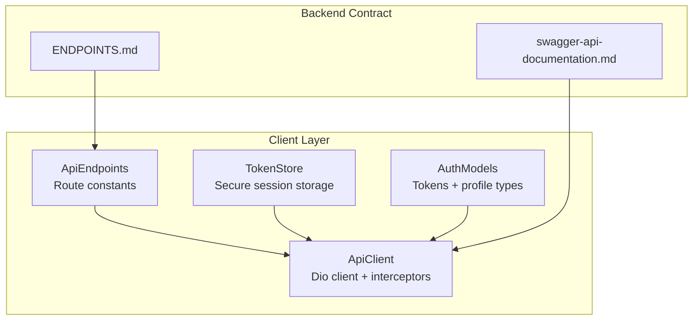
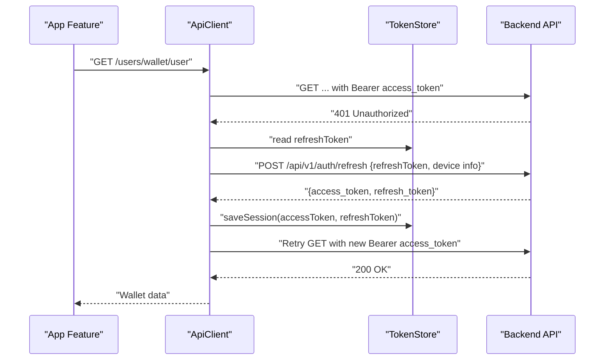
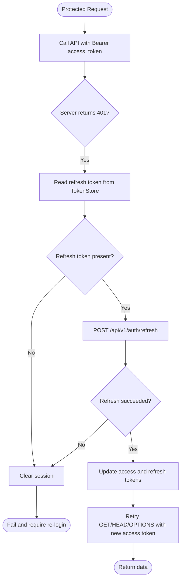
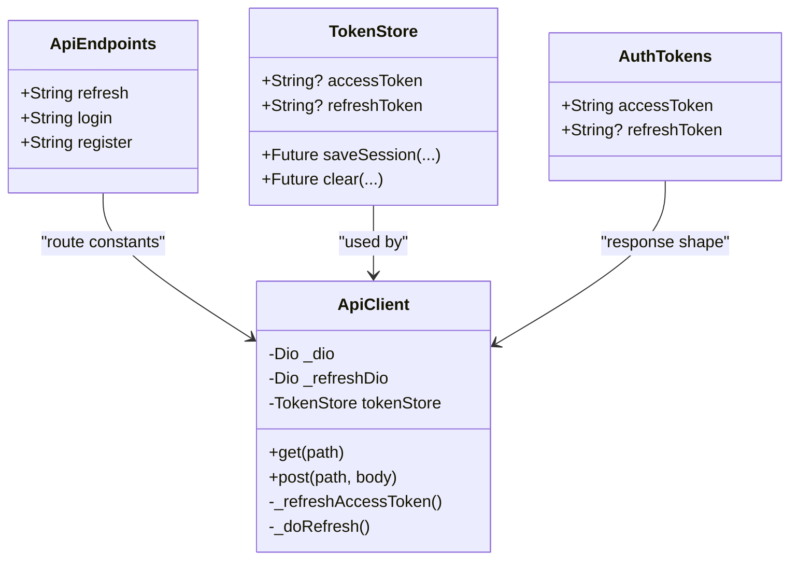

# Token Management API

<cite>
**Referenced Files in This Document**
- [ENDPOINTS.md](file://api/ENDPOINTS.md)
- [swagger-api-documentation.md](file://docs/swagger-api-documentation.md)
- [api_endpoints.dart](file://lib/core/network/api_endpoints.dart)
- [api_client.dart](file://lib/core/network/api_client.dart)
- [token_store.dart](file://lib/core/network/token_store.dart)
- [auth_models.dart](file://lib/features/auth/data/auth_models.dart)
- [remote_parsing_test.dart](file://test/remote_parsing_test.dart)
- [fcm_and_pending_decisions_test.dart](file://test/fcm_and_pending_decisions_test.dart)
</cite>

## Table of Contents
1. [Introduction](#introduction)
2. [Project Structure](#project-structure)
3. [Core Components](#core-components)
4. [Architecture Overview](#architecture-overview)
5. [Detailed Component Analysis](#detailed-component-analysis)
6. [Dependency Analysis](#dependency-analysis)
7. [Performance Considerations](#performance-considerations)
8. [Troubleshooting Guide](#troubleshooting-guide)
9. [Conclusion](#conclusion)

## Introduction
This document provides detailed API documentation for token management in the LidaPay mobile application, focusing on:
- Refreshing access and refresh tokens through `POST /api/v1/auth/refresh`.
- The legacy token refresh endpoint `POST /api/v1/users/refresh-token`.
- Client-side token storage, lifecycle management, expiration handling, automatic refresh strategies, and security best practices.
- Examples of token refresh flows, error handling for expired tokens, and integration patterns for maintaining authenticated sessions.

The implementation is a Flutter client that uses Dio for HTTP requests, a centralized API client with an interceptor-based automatic refresh mechanism, and secure local storage for sensitive tokens.

## Project Structure
Token-related functionality spans several layers:
- API contract and endpoint mapping are defined in the API documentation and Dart constants.
- The network layer handles request/response processing, header injection, and transparent token refresh.
- The token store persists and manages session material securely.
- Authentication models define token payloads and user profile structures.
- Tests validate refresh behavior, device metadata inclusion, and error handling.

**Diagram sources**
- [api_endpoints.dart:1-10](file://lib/core/network/api_endpoints.dart#L1-L10)
- [api_client.dart:13-20](file://lib/core/network/api_client.dart#L13-L20)
- [token_store.dart:71-105](file://lib/core/network/token_store.dart#L71-L105)
- [auth_models.dart:356-371](file://lib/features/auth/data/auth_models.dart#L356-L371)
- [ENDPOINTS.md:10-15](file://api/ENDPOINTS.md#L10-L15)
- [swagger-api-documentation.md:103-129](file://docs/swagger-api-documentation.md#L103-L129)

**Section sources**
- [api_endpoints.dart:1-10](file://lib/core/network/api_endpoints.dart#L1-L10)
- [ENDPOINTS.md:10-15](file://api/ENDPOINTS.md#L10-L15)
- [swagger-api-documentation.md:103-129](file://docs/swagger-api-documentation.md#L103-L129)

## Core Components
- ApiEndpoints: Centralizes route paths including `/api/v1/auth/refresh`.
- ApiClient: Adds Bearer authorization headers, redacts sensitive logs, and implements single-flight automatic refresh on 401 responses.
- TokenStore: Persists access and refresh tokens securely, supports migration from plaintext preferences, and exposes biometric session support.
- AuthModels: Defines token response shapes (`AuthTokens`) and user profile model used after login or refresh.

Key responsibilities:
- Automatic refresh: When a protected request receives 401, ApiClient calls `/api/v1/auth/refresh` once, updates stored tokens, and retries GET/HEAD/OPTIONS requests.
- Secure storage: Tokens are written to encrypted storage; legacy plaintext values are migrated at startup.
- Session state: `hasSession`, `accessToken`, `refreshToken`, and optional profile JSON are exposed for UI and feature logic.

**Section sources**
- [api_endpoints.dart:6-10](file://lib/core/network/api_endpoints.dart#L6-L10)
- [api_client.dart:13-84](file://lib/core/network/api_client.dart#L13-L84)
- [token_store.dart:71-105](file://lib/core/network/token_store.dart#L71-L105)
- [auth_models.dart:356-371](file://lib/features/auth/data/auth_models.dart#L356-L371)

## Architecture Overview
The token refresh architecture follows a client-driven pattern:
- Protected requests attach the current access token via Authorization header.
- On 401 Unauthorized, the interceptor triggers a single refresh operation using the stored refresh token.
- The refresh call includes device identity and FCM token when available.
- Successful refresh updates both access and refresh tokens in secure storage.
- Only safe methods (GET, HEAD, OPTIONS) are retried automatically; POST/PUT/DELETE are not replayed to avoid side effects.

**Diagram sources**
- [api_client.dart:50-84](file://lib/core/network/api_client.dart#L50-L84)
- [api_client.dart:211-252](file://lib/core/network/api_client.dart#L211-L252)
- [token_store.dart:148-170](file://lib/core/network/token_store.dart#L148-L170)

## Detailed Component Analysis

### POST /api/v1/auth/refresh — Mobile Refresh Endpoint
Purpose:
- Exchange a valid refresh token for a new access token and optionally a rotated refresh token.
- Accepts optional device metadata to associate push notifications and device identity with the refreshed session.

Request body:
- `refreshToken`: Required string.
- Optional fields sent by the client during refresh:
  - `deviceToken`: FCM token if available.
  - `devicePlatform`: e.g., `"ANDROID"` or `"IOS"`.
  - `deviceId`: Unique device identifier.
  - `appVersion`: Application version.
  - `locale`: Device locale.

Response:
- Returns new `access_token` and optionally `refresh_token`.
- May include nested `data` object containing camelCase keys like `accessToken` and `refreshToken`; the client normalizes snake_case and camelCase variants.

Behavioral notes:
- If the refresh token is missing or empty, the session is cleared.
- If the backend rejects the refresh token (e.g., 400/401/403), the session is cleared.
- Transient errors (timeouts, offline, 5xx) do not clear the session; they allow retry later.

Security considerations:
- Refresh tokens must be kept secret and transmitted over HTTPS.
- Avoid logging refresh tokens or access tokens; the client redacts sensitive fields in debug logs.

Integration examples:
- Automatic refresh triggered by 401 on protected endpoints.
- Manual refresh can be invoked before sensitive operations if needed, but the interceptor already handles it transparently.

Error handling:
- Missing refresh token → clear session.
- Explicit rejection (400/401/403) → clear session.
- Network/transient failures → keep tokens and retry later.

**Section sources**
- [swagger-api-documentation.md:103-129](file://docs/swagger-api-documentation.md#L103-L129)
- [api_client.dart:211-252](file://lib/core/network/api_client.dart#L211-L252)
- [api_client.dart:253-265](file://lib/core/network/api_client.dart#L253-L265)
- [api_client.dart:86-113](file://lib/core/network/api_client.dart#L86-L113)

### Legacy POST /api/v1/users/refresh-token
Status:
- Deprecated for mobile clients.

Recommendation:
- Use `POST /api/v1/auth/refresh` instead.
- Existing integrations should migrate to the mobile-compatible refresh endpoint.

**Section sources**
- [ENDPOINTS.md:12-15](file://api/ENDPOINTS.md#L12-L15)
- [swagger-api-documentation.md:127-129](file://docs/swagger-api-documentation.md#L127-L129)

### Token Storage Mechanisms
Storage strategy:
- Secrets (tokens and profile) are persisted in an encrypted backend (`SecureSecretStore` backed by platform keystore/keychain).
- A synchronous in-memory mirror avoids disk I/O during interceptors.
- Legacy plaintext tokens in shared preferences are migrated to secure storage at startup and then removed.

Lifecycle:
- `load()`: Migrates legacy values and loads secrets into memory.
- `saveSession()`: Writes access and refresh tokens and profile to secure storage; also syncs biometric session when applicable.
- `clear()`: Wipes active session; optional flag clears biometric session too.
- Biometric session: Stores a snapshot of access token, refresh token, and profile for quick restore without re-authentication.

Security:
- Tokens are never stored in plain text in production builds.
- Biometric session requires a refreshable session; otherwise, it throws to prevent partial state.
- Clearing session removes both secure and legacy keys.

Operational details:
- `hasSession` indicates whether a valid access token exists.
- `profileJson` returns parsed profile payload if present.

**Section sources**
- [token_store.dart:20-69](file://lib/core/network/token_store.dart#L20-L69)
- [token_store.dart:71-105](file://lib/core/network/token_store.dart#L71-L105)
- [token_store.dart:120-170](file://lib/core/network/token_store.dart#L120-L170)
- [token_store.dart:177-217](file://lib/core/network/token_store.dart#L177-L217)
- [token_store.dart:219-236](file://lib/core/network/token_store.dart#L219-L236)

### Token Lifecycle Management and Expiration Handling
Lifecycle phases:
- Login or OTP verification returns tokens and user profile.
- Access token is attached to subsequent requests.
- On 401, automatic refresh attempts once; successful refresh updates tokens and retries safe requests.
- If refresh fails due to explicit rejection, session is cleared and user must re-authenticate.
- If no refresh token is present, session is cleared immediately.

Expiration handling:
- The client does not parse JWT expiry locally; it relies on server 401 responses to trigger refresh.
- Transient network issues do not invalidate tokens; only explicit auth failures do.

Automatic refresh strategies:
- Single-flight refresh: Concurrent 401s share one refresh operation to avoid race conditions.
- Safe method retry: Only GET, HEAD, OPTIONS are retried after refresh to prevent unintended side effects.
- Device metadata: Refresh requests include device identity and FCM token when available.

Best practices:
- Always use HTTPS for all token exchanges.
- Rotate refresh tokens on each refresh when supported by the backend.
- Clear biometric session on logout or failed refresh to prevent stale credentials.

**Section sources**
- [api_client.dart:50-84](file://lib/core/network/api_client.dart#L50-L84)
- [api_client.dart:204-265](file://lib/core/network/api_client.dart#L204-L265)
- [token_store.dart:148-170](file://lib/core/network/token_store.dart#L148-L170)

### Security Best Practices
- Never log refresh tokens or access tokens; use redaction for debug logs.
- Store tokens in platform-secured storage (Keystore/Keychain).
- Migrate legacy plaintext tokens securely and remove them after migration.
- Require refreshable sessions for biometric sign-in.
- Treat order numbers and public tracking IDs as non-secret identifiers.

**Section sources**
- [api_client.dart:86-113](file://lib/core/network/api_client.dart#L86-L113)
- [token_store.dart:71-105](file://lib/core/network/token_store.dart#L71-L105)
- [token_store.dart:177-193](file://lib/core/network/token_store.dart#L177-L193)

### Token Refresh Flow Examples

#### Example 1: Automatic Refresh on Expired Access Token
Sequence:
1. App calls a protected GET endpoint.
2. Server responds with 401 because the access token is expired.
3. ApiClient reads the stored refresh token.
4. ApiClient calls `/api/v1/auth/refresh` with device metadata.
5. Backend returns new access and refresh tokens.
6. ApiClient updates TokenStore and retries the original GET request.
7. Server returns success with requested data.

**Diagram sources**
- [api_client.dart:50-84](file://lib/core/network/api_client.dart#L50-L84)
- [api_client.dart:211-252](file://lib/core/network/api_client.dart#L211-L252)
- [token_store.dart:148-170](file://lib/core/network/token_store.dart#L148-L170)

#### Example 2: Error Handling for Expired Tokens
Scenarios:
- Second 401 after refresh stops retrying and clears the session.
- 401 without refresh token clears the stale session.
- Non-safe methods (POST/PUT/DELETE) are not replayed after refresh.

Validation points:
- Tests assert that a second 401 results in session clearing.
- Tests assert that POST requests are not replayed after refresh.
- Tests assert that 401 without refresh token clears the session.

**Section sources**
- [remote_parsing_test.dart:1560-1597](file://test/remote_parsing_test.dart#L1560-L1597)
- [remote_parsing_test.dart:1599-1609](file://test/remote_parsing_test.dart#L1599-L1609)

### Integration Patterns for Maintaining Authenticated Sessions
- Initialize TokenStore at app startup and call `load()` to migrate and load secrets.
- Use ApiClient for all authenticated requests; it injects Authorization headers automatically.
- Handle ApiException at the feature layer to guide users to re-login when sessions are cleared.
- Optionally register device tokens via notification endpoints to maintain push notification delivery.

Device identity and FCM token:
- Refresh requests include device platform, device ID, app version, locale, and FCM token when available.
- This helps backend correlate sessions and deliver targeted notifications.

**Section sources**
- [api_client.dart:211-234](file://lib/core/network/api_client.dart#L211-L234)
- [fcm_and_pending_decisions_test.dart:151-188](file://test/fcm_and_pending_decisions_test.dart#L151-L188)

## Dependency Analysis
Component relationships:
- ApiEndpoints defines routes consumed by ApiClient.
- ApiClient depends on TokenStore for reading/writing tokens and on DeviceIdentity/PushNotificationService for metadata.
- AuthModels define token and profile structures used across authentication flows.
- Tests validate refresh behavior, device metadata inclusion, and error handling.

**Diagram sources**
- [api_endpoints.dart:1-10](file://lib/core/network/api_endpoints.dart#L1-L10)
- [api_client.dart:13-20](file://lib/core/network/api_client.dart#L13-L20)
- [token_store.dart:71-105](file://lib/core/network/token_store.dart#L71-L105)
- [auth_models.dart:356-371](file://lib/features/auth/data/auth_models.dart#L356-L371)

**Section sources**
- [api_endpoints.dart:1-10](file://lib/core/network/api_endpoints.dart#L1-L10)
- [api_client.dart:13-20](file://lib/core/network/api_client.dart#L13-L20)
- [token_store.dart:71-105](file://lib/core/network/token_store.dart#L71-L105)
- [auth_models.dart:356-371](file://lib/features/auth/data/auth_models.dart#L356-L371)

## Performance Considerations
- Single-flight refresh prevents multiple concurrent refresh calls, reducing unnecessary network traffic.
- In-memory token mirror avoids disk I/O during request interception, improving responsiveness.
- Redacting sensitive logs reduces overhead while maintaining useful debugging information.
- Using separate Dio instances for normal and refresh requests isolates refresh operations from general network contention.

[No sources needed since this section provides general guidance]

## Troubleshooting Guide
Common issues and resolutions:
- Repeated 401 errors: Indicates invalid or rejected refresh token; clear session and prompt re-login.
- No refresh token present: Session is cleared; require user to authenticate again.
- POST/PUT/DELETE not replayed: Expected behavior to prevent side effects; handle failure gracefully and inform the user.
- Biometric session restoration fails: Ensure a refreshable session exists before enabling biometric sign-in.

Debugging tips:
- Enable debug mode to inspect redacted request/response logs.
- Verify device identity and FCM token are included in refresh requests.
- Check that TokenStore migration completed successfully at startup.

**Section sources**
- [api_client.dart:50-84](file://lib/core/network/api_client.dart#L50-L84)
- [api_client.dart:211-265](file://lib/core/network/api_client.dart#L211-L265)
- [token_store.dart:120-170](file://lib/core/network/token_store.dart#L120-L170)

## Conclusion
The LidaPay client implements robust token management through:
- A centralized API client with automatic refresh on 401.
- Secure token storage with migration from legacy plaintext values.
- Support for device identity and FCM tokens during refresh.
- Clear error handling and session lifecycle management.

For new integrations, prefer `POST /api/v1/auth/refresh` and rely on the client’s automatic refresh mechanism. For legacy systems, migrate away from `POST /api/v1/users/refresh-token`. Follow the security best practices outlined here to ensure safe and reliable authenticated sessions.

[No sources needed since this section summarizes without analyzing specific files]