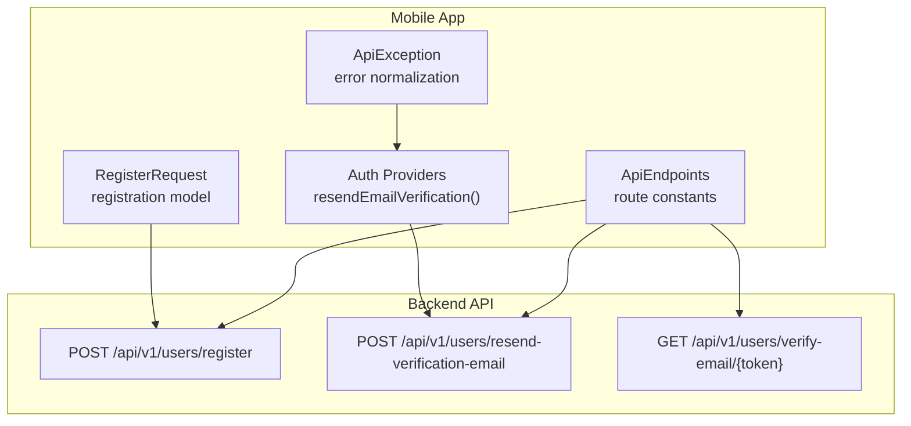
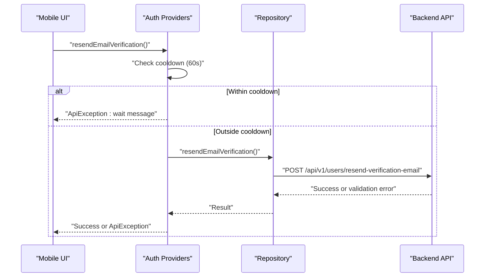
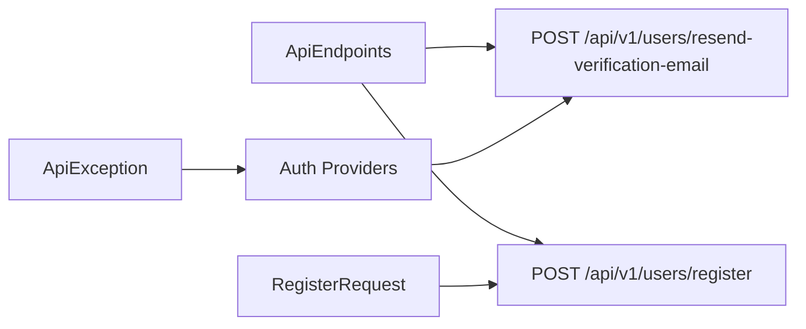

# User Registration API

<cite>
**Referenced Files in This Document**
- [ENDPOINTS.md](file://api/ENDPOINTS.md)
- [swagger-api-documentation.md](file://docs/swagger-api-documentation.md)
- [MOBILE_APP_REBUILD_HANDOFF.md](file://docs/MOBILE_APP_REBUILD_HANDOFF.md)
- [api_endpoints.dart](file://lib/core/network/api_endpoints.dart)
- [auth_models.dart](file://lib/features/auth/data/auth_models.dart)
- [providers.dart](file://lib/features/auth/providers.dart)
- [api_exception.dart](file://lib/core/network/api_exception.dart)
- [remote_parsing_test.dart](file://test/remote_parsing_test.dart)
</cite>

## Table of Contents
1. [Introduction](#introduction)
2. [Project Structure](#project-structure)
3. [Core Components](#core-components)
4. [Architecture Overview](#architecture-overview)
5. [Detailed Component Analysis](#detailed-component-analysis)
6. [Dependency Analysis](#dependency-analysis)
7. [Performance Considerations](#performance-considerations)
8. [Troubleshooting Guide](#troubleshooting-guide)
9. [Conclusion](#conclusion)

## Introduction
This document provides detailed API documentation for user registration and email verification flows, focusing on:
- POST /api/v1/users/register
- POST /api/v1/users/resend-verification-email
- GET /api/v1/users/verify-email/{token}

It includes request/response schemas, error handling patterns, mobile integration guidance, and concrete examples based on the repository’s API contract and client implementation.

## Project Structure
The relevant codebase is a Flutter-based mobile application that consumes a NestJS backend API. The endpoints are documented in the repository’s API map and Swagger guide, and the mobile app defines route constants, models, providers, and error handling utilities used by the UI.

**Diagram sources**
- [api_endpoints.dart:10-15](file://lib/core/network/api_endpoints.dart#L10-L15)
- [auth_models.dart:24-50](file://lib/features/auth/data/auth_models.dart#L24-L50)
- [providers.dart:280-294](file://lib/features/auth/providers.dart#L280-L294)
- [api_exception.dart:22-38](file://lib/core/network/api_exception.dart#L22-L38)

**Section sources**
- [ENDPOINTS.md:13-34](file://api/ENDPOINTS.md#L13-L34)
- [swagger-api-documentation.md:132-181](file://docs/swagger-api-documentation.md#L132-L181)
- [api_endpoints.dart:1-33](file://lib/core/network/api_endpoints.dart#L1-L33)

## Core Components
- Registration endpoint: POST /api/v1/users/register
- Email verification resend: POST /api/v1/users/resend-verification-email
- Email verification token: GET /api/v1/users/verify-email/{token}

Key client-side components:
- ApiEndpoints: centralizes route paths for register and resend-verification-email.
- RegisterRequest: strongly typed model mirroring the server registration payload.
- Auth Providers: enforces a cooldown before resending verification emails and calls the backend.
- ApiException: normalizes backend errors into user-friendly messages.

**Section sources**
- [api_endpoints.dart:10-15](file://lib/core/network/api_endpoints.dart#L10-L15)
- [auth_models.dart:24-50](file://lib/features/auth/data/auth_models.dart#L24-L50)
- [providers.dart:280-294](file://lib/features/auth/providers.dart#L280-L294)
- [api_exception.dart:22-38](file://lib/core/network/api_exception.dart#L22-L38)

## Architecture Overview
The registration and verification flow involves the mobile app calling the backend endpoints defined in the API map. The app validates inputs locally, sends requests using the centralized routes, and handles errors through a normalized exception layer.

**Diagram sources**
- [providers.dart:280-294](file://lib/features/auth/providers.dart#L280-L294)
- [api_endpoints.dart:14-15](file://lib/core/network/api_endpoints.dart#L14-L15)
- [api_exception.dart:22-38](file://lib/core/network/api_exception.dart#L22-L38)

## Detailed Component Analysis

### POST /api/v1/users/register
Purpose: Create a new user account. The mobile client constructs a registration request with required identity fields and optional device metadata for push notifications.

Request body schema:
- Required fields:
  - firstName: string
  - lastName: string
  - email: string (valid email address)
  - phoneNumber: string (Ghana format per app validators; see phone validator)
  - password: string (minimum length enforced by backend)
  - country: string (full country name)
  - roles: array (typically ["user"])
- Optional fields (device metadata):
  - deviceToken: string (FCM token)
  - devicePlatform: string ("ANDROID", "IOS", "WEB")
  - deviceId: string
  - appVersion: string
  - locale: string

Notes:
- The mobile test asserts that the request path is /api/v1/users/register and that the payload includes firstName, phoneNumber, country, roles, and password.
- The Swagger documentation shows an example request including device metadata alongside core registration fields.

Response schema (successful registration):
- Returns a user object containing identifiers and profile fields such as _id, username, email, phoneNumber, firstName, lastName, country, roles, status, points, createdAt, updatedAt.

Error scenarios:
- Validation errors: HTTP 400 with a structured error response (NestJS default shape).
- Duplicate user: Backend may return a conflict or validation error depending on uniqueness constraints (e.g., email or phone already registered).
- Network/server errors: Normalized via ApiException to friendly messages.

Integration guidelines:
- Validate email and phone number on the client before sending.
- Include device metadata to enable push notifications after login.
- On success, proceed to login or session establishment as per your app flow.
- Handle validation and duplicate-user errors gracefully with user-facing messages.

Concrete example (request):
- See the Swagger example under the User Registration section for a full JSON payload including required and optional fields.

Concrete example (response):
- See the Swagger example showing the returned user object after successful registration.

**Section sources**
- [swagger-api-documentation.md:132-181](file://docs/swagger-api-documentation.md#L132-L181)
- [remote_parsing_test.dart:1331-1351](file://test/remote_parsing_test.dart#L1331-L1351)
- [auth_models.dart:24-50](file://lib/features/auth/data/auth_models.dart#L24-L50)

### POST /api/v1/users/resend-verification-email
Purpose: Resend the email verification link to the signed-in user’s email address. No email address is sent in the request body; the backend uses the authenticated context.

Authentication:
- Requires a valid Bearer access token.

Rate limiting:
- The mobile provider enforces a 60-second cooldown before allowing another resend request. If within the cooldown window, it throws an ApiException with a message instructing the user to wait.

Response:
- Success: Indicates the verification email was resent.
- Error: Validation or rate-limit errors are normalized via ApiException.

Mobile behavior:
- The UI triggers resend from profile screens and displays success or error messages accordingly.

**Section sources**
- [MOBILE_APP_REBUILD_HANDOFF.md:240-252](file://docs/MOBILE_APP_REBUILD_HANDOFF.md#L240-L252)
- [providers.dart:280-294](file://lib/features/auth/providers.dart#L280-L294)
- [api_exception.dart:22-38](file://lib/core/network/api_exception.dart#L22-L38)

### GET /api/v1/users/verify-email/{token}
Purpose: Verify the user’s email address using a one-time token included in the verification email link.

Behavior:
- The token is single-use and expires after 24 hours.
- If expired or not received, users can request a new verification email via the resend endpoint above.

Mobile handling:
- Deep links or web views open this endpoint; upon success, the app should refresh profile state to reflect the verified status.

**Section sources**
- [MOBILE_APP_REBUILD_HANDOFF.md:240-252](file://docs/MOBILE_APP_REBUILD_HANDOFF.md#L240-L252)
- [ENDPOINTS.md:33-34](file://api/ENDPOINTS.md#L33-L34)

### Request and Response Schemas

Registration request (POST /api/v1/users/register):
- firstName: string (required)
- lastName: string (required)
- email: string (required, valid email)
- phoneNumber: string (required, Ghana format per app validators)
- password: string (required, minimum length enforced by backend)
- country: string (required, full country name)
- roles: array (required, typically ["user"])
- deviceToken: string (optional)
- devicePlatform: string (optional)
- deviceId: string (optional)
- appVersion: string (optional)
- locale: string (optional)

Registration response (success):
- _id: string
- username: string
- email: string
- phoneNumber: string
- firstName: string
- lastName: string
- country: string
- roles: array
- status: string
- points: number
- createdAt: string (ISO timestamp)
- updatedAt: string (ISO timestamp)

Resend verification email (POST /api/v1/users/resend-verification-email):
- Authentication: Bearer token required
- Body: none
- Response: success indication or error

Verify email (GET /api/v1/users/verify-email/{token}):
- Path parameter: token (one-time, single-use, expires in 24 hours)
- Response: success indication or error

**Section sources**
- [swagger-api-documentation.md:132-181](file://docs/swagger-api-documentation.md#L132-L181)
- [MOBILE_APP_REBUILD_HANDOFF.md:240-252](file://docs/MOBILE_APP_REBUILD_HANDOFF.md#L240-L252)
- [api_endpoints.dart:10-15](file://lib/core/network/api_endpoints.dart#L10-L15)

### Error Handling Patterns
- Validation errors: HTTP 400 with structured error responses (NestJS default shape). The client normalizes these into ApiException with a friendly message.
- Rate limit on resend: Client-side cooldown prevents repeated requests within 60 seconds; if triggered, ApiException is thrown with a wait message.
- Network/server errors: ApiException maps Dio exceptions to user-friendly messages and flags outcomeUnknown when no server response is received.

Common error messages:
- “Verification email was just sent. Please wait Xs before requesting another.”
- “We couldn’t find an account with that email or phone number. Check it and try again, or create an account.”
- “Incorrect phone, email, or password. Please try again.”
- “The service is temporarily unavailable. Please try again shortly.”

**Section sources**
- [providers.dart:280-294](file://lib/features/auth/providers.dart#L280-L294)
- [api_exception.dart:22-38](file://lib/core/network/api_exception.dart#L22-L38)

### Mobile Integration Guidelines
- Use ApiEndpoints.register and ApiEndpoints.resendEmailVerification for consistent routing.
- Construct RegisterRequest with all required fields; include device metadata to enable push notifications.
- Validate email and phone number on the client before sending.
- After registration, proceed to login or session establishment as per your app flow.
- For email verification:
  - Open the verification link in a secure WebView or deep link handler.
  - If the link expires, prompt the user to tap “Verify” to trigger resendEmailVerification().
  - Refresh profile state after successful verification to reflect verified status.
- Handle ApiException across the UI to display friendly messages and avoid exposing internal details.

**Section sources**
- [api_endpoints.dart:10-15](file://lib/core/network/api_endpoints.dart#L10-L15)
- [auth_models.dart:24-50](file://lib/features/auth/data/auth_models.dart#L24-L50)
- [providers.dart:280-294](file://lib/features/auth/providers.dart#L280-L294)
- [api_exception.dart:22-38](file://lib/core/network/api_exception.dart#L22-L38)

## Dependency Analysis
The mobile app depends on:
- Centralized route constants for register and resend-verification-email.
- Strongly typed models for registration payloads.
- Provider logic enforcing cooldown and calling repositories.
- Exception normalization for consistent error handling.

**Diagram sources**
- [api_endpoints.dart:10-15](file://lib/core/network/api_endpoints.dart#L10-L15)
- [auth_models.dart:24-50](file://lib/features/auth/data/auth_models.dart#L24-L50)
- [providers.dart:280-294](file://lib/features/auth/providers.dart#L280-L294)
- [api_exception.dart:22-38](file://lib/core/network/api_exception.dart#L22-L38)

**Section sources**
- [api_endpoints.dart:1-33](file://lib/core/network/api_endpoints.dart#L1-L33)
- [auth_models.dart:24-50](file://lib/features/auth/data/auth_models.dart#L24-L50)
- [providers.dart:280-294](file://lib/features/auth/providers.dart#L280-L294)
- [api_exception.dart:22-38](file://lib/core/network/api_exception.dart#L22-L38)

## Performance Considerations
- Avoid redundant resend requests by honoring the client-side cooldown.
- Minimize payload size by sending only necessary device metadata during registration.
- Cache verification state in the profile to reduce unnecessary network calls.
- Use idempotency keys where applicable for other operations; for registration, ensure unique attempts and handle duplicates gracefully.

[No sources needed since this section provides general guidance]

## Troubleshooting Guide
- Verification email not received:
  - Wait at least 60 seconds before requesting another resend.
  - Check spam/junk folders.
  - Ensure the API base URL is correctly configured for non-production environments.
- Duplicate user errors:
  - If email or phone is already registered, update the UI to inform the user and offer login or recovery options.
- Network timeouts or connection errors:
  - Display a friendly message and allow retry without blindly re-submitting non-idempotent operations.
- Server errors:
  - Show a temporary unavailability message and retry later.

**Section sources**
- [providers.dart:280-294](file://lib/features/auth/providers.dart#L280-L294)
- [api_exception.dart:22-38](file://lib/core/network/api_exception.dart#L22-L38)

## Conclusion
The user registration and email verification endpoints provide a clear contract between the mobile app and backend. By following the request/response schemas, respecting rate limits, and handling errors through ApiException, integrators can implement robust registration flows and reliable email verification experiences.

[No sources needed since this section summarizes without analyzing specific files]