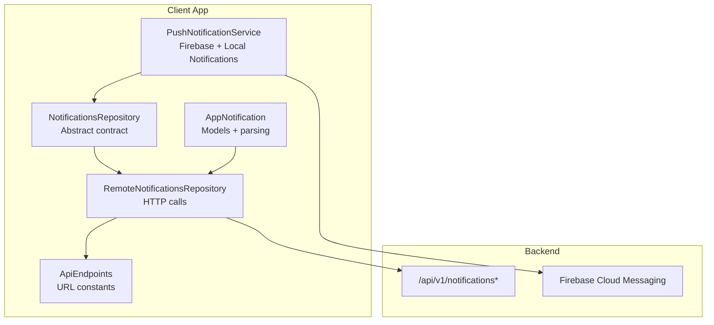
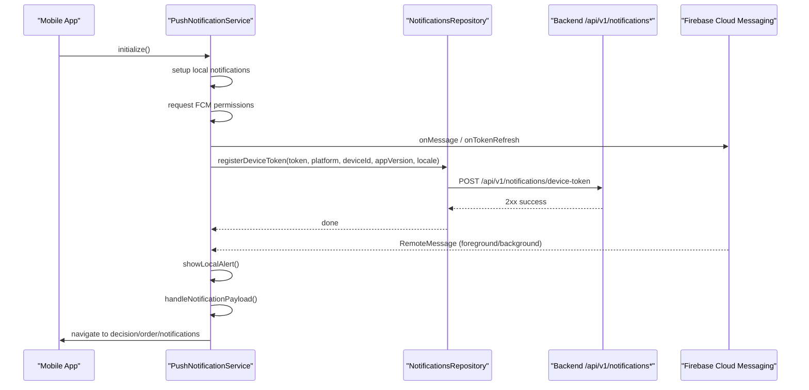
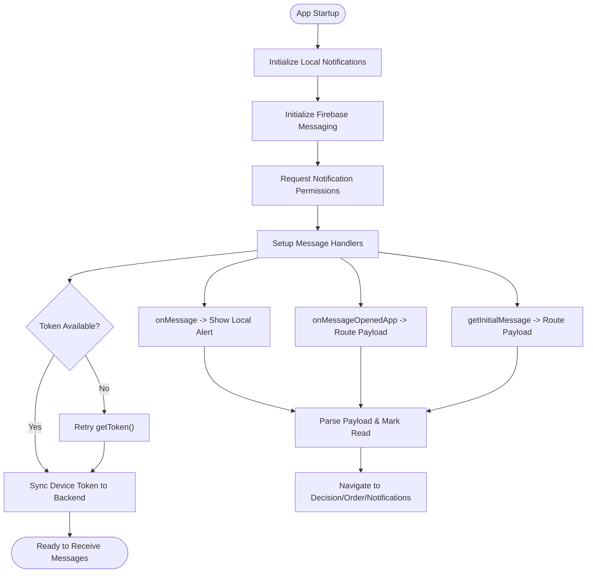
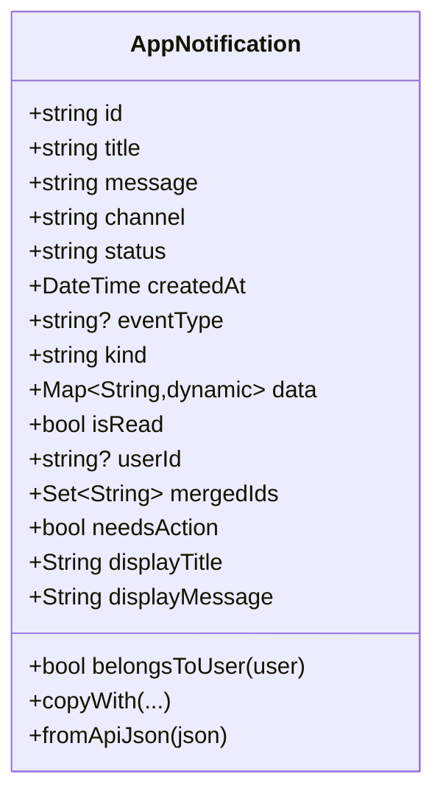
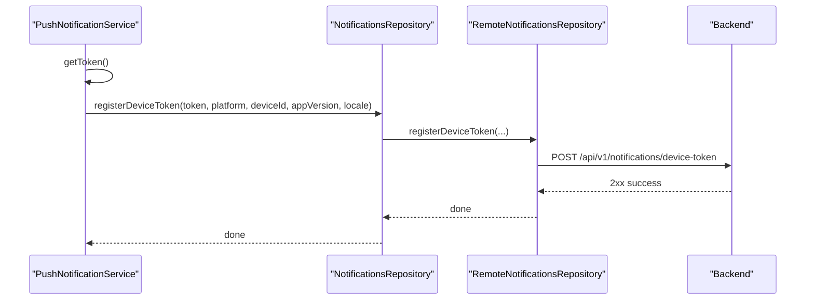
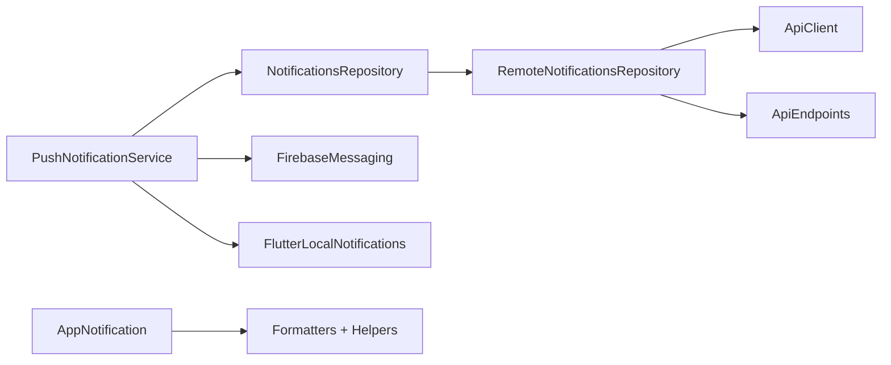

# Notification System API

<cite>
**Referenced Files in This Document**
- [ENDPOINTS.md](file://api/ENDPOINTS.md)
- [push_notification_service.dart](file://lib/core/notifications/push_notification_service.dart)
- [notification_models.dart](file://lib/features/notifications/data/notification_models.dart)
- [notifications_repository.dart](file://lib/features/notifications/data/notifications_repository.dart)
- [remote_notifications_repository.dart](file://lib/features/notifications/data/remote_notifications_repository.dart)
- [api_endpoints.dart](file://lib/core/network/api_endpoints.dart)
</cite>

## Table of Contents
1. [Introduction](#introduction)
2. [Project Structure](#project-structure)
3. [Core Components](#core-components)
4. [Architecture Overview](#architecture-overview)
5. [Detailed Component Analysis](#detailed-component-analysis)
6. [Dependency Analysis](#dependency-analysis)
7. [Performance Considerations](#performance-considerations)
8. [Troubleshooting Guide](#troubleshooting-guide)
9. [Conclusion](#conclusion)
10. [Appendices](#appendices)

## Introduction
This document provides detailed API documentation for the notification system endpoints used by the mobile application. It covers:
- HTTP methods and URL patterns for push token registration, notification listing, deletion, and operational metrics.
- Request and response schemas inferred from client usage and repository behavior.
- Firebase Cloud Messaging (FCM) integration points, payload handling, and deep-link routing.
- Delivery status tracking through server-side notification records.
- Client implementation guidelines for registering device tokens, sending notifications, and managing notification preferences.

The backend base URL is documented as `https://api.advansistechnologies.com`, and the endpoint map was extracted from the backend’s OpenAPI/Swagger initialization.

## Project Structure
The notification feature is implemented on the Flutter client with a clear separation between platform messaging, data models, repository abstraction, and API endpoint constants.

**Diagram sources**
- [push_notification_service.dart:28-198](file://lib/core/notifications/push_notification_service.dart#L28-L198)
- [notifications_repository.dart:3-28](file://lib/features/notifications/data/notifications_repository.dart#L3-L28)
- [remote_notifications_repository.dart:10-73](file://lib/features/notifications/data/remote_notifications_repository.dart#L10-L73)
- [api_endpoints.dart:132-134](file://lib/core/network/api_endpoints.dart#L132-L134)

**Section sources**
- [ENDPOINTS.md:1-5](file://api/ENDPOINTS.md#L1-L5)
- [api_endpoints.dart:132-134](file://lib/core/network/api_endpoints.dart#L132-L134)

## Core Components
- PushNotificationService: Initializes local notifications and Firebase Messaging, handles foreground/background messages, token refresh, and deep-link routing. It also triggers device token synchronization with the backend.
- NotificationsRepository: Abstract interface defining notification operations including listing, deletion, and device token management.
- RemoteNotificationsRepository: Implements HTTP calls to `/api/v1/notifications` and `/api/v1/notifications/device-token`.
- ApiEndpoints: Centralized URL constants for all backend routes, including notification endpoints.
- AppNotification: Data model that parses backend notification payloads into structured objects with display logic and categorization.

**Section sources**
- [push_notification_service.dart:32-198](file://lib/core/notifications/push_notification_service.dart#L32-L198)
- [notifications_repository.dart:3-28](file://lib/features/notifications/data/notifications_repository.dart#L3-L28)
- [remote_notifications_repository.dart:10-73](file://lib/features/notifications/data/remote_notifications_repository.dart#L10-L73)
- [api_endpoints.dart:132-134](file://lib/core/network/api_endpoints.dart#L132-L134)
- [notification_models.dart:19-371](file://lib/features/notifications/data/notification_models.dart#L19-L371)

## Architecture Overview
The notification architecture integrates three layers:
1. Platform layer: Firebase Messaging receives push events; FlutterLocalNotifications displays heads-up alerts.
2. Application layer: PushNotificationService processes messages, updates state, and navigates users based on payload content.
3. Backend layer: REST endpoints manage notification records and device tokens; FCM delivers messages to devices.

**Diagram sources**
- [push_notification_service.dart:55-198](file://lib/core/notifications/push_notification_service.dart#L55-L198)
- [remote_notifications_repository.dart:32-49](file://lib/features/notifications/data/remote_notifications_repository.dart#L32-L49)
- [api_endpoints.dart:132-134](file://lib/core/network/api_endpoints.dart#L132-L134)

## Detailed Component Analysis

### Notification Endpoints
The following endpoints are relevant to notification management and device token registration. All paths are relative to the base URL `https://api.advansistechnologies.com`.

- GET /api/v1/notifications
  - Purpose: Retrieve all notifications for the authenticated user.
  - Response shape: Array of notification records or wrapped rows parsed by the client.
  - Client usage: Lists notifications, sorts by creation time, and maps to AppNotification.

- DELETE /api/v1/notifications/{id}
  - Purpose: Delete a specific notification record.
  - Client usage: Removes a notification by ID.

- POST /api/v1/notifications/device-token
  - Purpose: Register or refresh a device push token for the authenticated user.
  - Request body fields:
    - token: string (required) — FCM token.
    - platform: string (required) — e.g., Android/iOS.
    - provider: string (optional) — always set to "FCM".
    - deviceId: string (optional).
    - appVersion: string (optional).
    - locale: string (optional).
  - Response: Success indicates token registered.

- DELETE /api/v1/notifications/device-token
  - Purpose: Deactivate a device push token for the authenticated user.
  - Request body fields:
    - token: string (required).
  - Response: Success indicates token deactivated.

- GET /api/v1/notifications/device-token
  - Purpose: Get active device token count for QA/startup verification.
  - Response shape: Either a list of tokens with isActive flag or a total/count field.
  - Client usage: Counts tokens where isActive is not false.

- GET /api/v1/notifications/device-token/metrics
  - Purpose: Debug/ops counter for push/token operations.
  - Usage: Internal/QA monitoring.

- POST /api/v1/notifications/push-token
  - Purpose: Alias for device-token registration.
  - Behavior: Equivalent to POST /api/v1/notifications/device-token.

- POST /api/v1/notifications
  - Purpose: Create a new notification (server-side dispatch).
  - Usage: Typically invoked by backend services when delivering push/email/SMS.

- GET /api/v1/notifications/{id}
  - Purpose: Find a notification by ID.
  - Usage: Inspect individual notification details.

- PUT /api/v1/notifications/{id}
  - Purpose: Update a notification.
  - Usage: Modify notification metadata or delivery state.

- DELETE /api/v1/notifications/{id}
  - Purpose: Delete a notification.
  - Usage: Remove unwanted or stale notifications.

**Section sources**
- [ENDPOINTS.md:72-81](file://api/ENDPOINTS.md#L72-L81)
- [api_endpoints.dart:132-134](file://lib/core/network/api_endpoints.dart#L132-L134)
- [notifications_repository.dart:3-28](file://lib/features/notifications/data/notifications_repository.dart#L3-L28)
- [remote_notifications_repository.dart:16-73](file://lib/features/notifications/data/remote_notifications_repository.dart#L16-L73)

### Firebase Cloud Messaging Integration
Key behaviors:
- Initialization:
  - Local notifications initialized with channel settings for Android and iOS/macOS.
  - Firebase Messaging initialized, permission requested, and foreground presentation configured.
- Message handling:
  - Foreground messages trigger local heads-up notifications.
  - Background messages use a background handler to ensure Firebase is initialized if needed.
  - Initial message and opened-app message are routed to navigation handlers.
- Token lifecycle:
  - onTokenRefresh triggers syncDeviceToken to register/update the token with the backend.
  - getToken is used to retrieve current token during startup and retry if null.
- Deep linking:
  - Payloads containing decisionId, orderId, or type route users to recipient decisions, order details, or notifications hub.
  - If no session exists at cold start, payload is flushed once session becomes available.

**Diagram sources**
- [push_notification_service.dart:55-198](file://lib/core/notifications/push_notification_service.dart#L55-L198)
- [push_notification_service.dart:257-337](file://lib/core/notifications/push_notification_service.dart#L257-L337)

**Section sources**
- [push_notification_service.dart:55-198](file://lib/core/notifications/push_notification_service.dart#L55-L198)
- [push_notification_service.dart:257-337](file://lib/core/notifications/push_notification_service.dart#L257-L337)

### Notification Payload Structures
The client parses backend notification records into AppNotification with robust field mapping:
- Identifier resolution: Supports `_id`, `id`, `notificationId`, `ref`, and MongoDB ObjectId wrapper.
- Channel vs event name:
  - type can be a channel (`email`, `sms`, `push`, `in_app`) or an event name (e.g., `recipient_topup_decision`).
  - eventType is extracted from `eventType`, `event`, `notificationType`, or inferred from type.
- Structured data:
  - Merges nested `data`, `payload`, `meta`, `metadata`.
  - Extracts common fields like `decisionId`, `topupOrderId`, `serviceType`, `amount`, `currency`, `senderName`, `recipientPhone`, `selectedChoice`, `finalDisposition`, `expiresAt`.
- Display formatting:
  - title derived from `subject`, `title`, `heading`, `name`.
  - message sanitized to remove embedded JSON blobs and sensitive tails.
  - kind classification: decision, resolved, security, airtime, data, order, wallet, promo, general.
- Read state:
  - isRead inferred from `isRead`, `read`, `readAt`, or status equals read.

**Diagram sources**
- [notification_models.dart:19-371](file://lib/features/notifications/data/notification_models.dart#L19-L371)

**Section sources**
- [notification_models.dart:19-371](file://lib/features/notifications/data/notification_models.dart#L19-L371)

### Device Token Registration Flow
The client registers device tokens via the repository abstraction:
- PushNotificationService.syncDeviceToken retrieves the FCM token and calls NotificationsRepository.registerDeviceToken with token, platform, deviceId, appVersion, and locale.
- RemoteNotificationsRepository posts to /api/v1/notifications/device-token with the required fields.
- On logout or account switch, unregisterCurrentToken calls delete on the same endpoint with the token.

**Diagram sources**
- [push_notification_service.dart:169-198](file://lib/core/notifications/push_notification_service.dart#L169-L198)
- [remote_notifications_repository.dart:32-49](file://lib/features/notifications/data/remote_notifications_repository.dart#L32-L49)

**Section sources**
- [push_notification_service.dart:169-198](file://lib/core/notifications/push_notification_service.dart#L169-L198)
- [notifications_repository.dart:13-23](file://lib/features/notifications/data/notifications_repository.dart#L13-L23)
- [remote_notifications_repository.dart:32-58](file://lib/features/notifications/data/remote_notifications_repository.dart#L32-L58)

### Notification Delivery Status Tracking
- Server-side storage:
  - The backend stores delivery state (`pending`, `sent`, `failed`) per notification record.
  - The client reads these statuses and overlays local read flags.
- Client parsing:
  - status mapped from `status` or `state`; defaults to `sent` if missing.
  - isRead inferred from explicit flags or status value.
- UI implications:
  - Unread notifications are highlighted; decisions require action.
  - Resolved notifications indicate completed top-ups.

**Section sources**
- [notification_models.dart:12-18](file://lib/features/notifications/data/notification_models.dart#L12-L18)
- [notification_models.dart:287-305](file://lib/features/notifications/data/notification_models.dart#L287-L305)

### Client Implementation Guidelines
- Initialize notifications early in app startup:
  - Call PushNotificationService.initialize with router and session checker.
  - Ensure Firebase options are loaded and permissions are granted.
- Register device tokens:
  - After successful login or when token refresh occurs, call syncDeviceToken.
  - Include platform, deviceId, appVersion, and locale for better targeting.
- Handle foreground messages:
  - Use showLocalAlert to display heads-up notifications.
  - Parse payload to mark notifications as read and navigate appropriately.
- Manage preferences:
  - Allow users to opt out of push notifications; deactivate tokens on logout or preference changes.
  - Provide UI to view active token count for QA/debugging.

**Section sources**
- [push_notification_service.dart:55-198](file://lib/core/notifications/push_notification_service.dart#L55-L198)
- [push_notification_service.dart:257-337](file://lib/core/notifications/push_notification_service.dart#L257-L337)

## Dependency Analysis
The notification system has clear dependencies:
- PushNotificationService depends on Firebase Messaging, FlutterLocalNotifications, Riverpod providers, and GoRouter.
- NotificationsRepository abstracts HTTP calls, allowing mock implementations for testing.
- RemoteNotificationsRepository depends on ApiClient and ApiEndpoints for consistent URL construction.
- AppNotification depends on utility helpers for payload parsing and formatting.

**Diagram sources**
- [push_notification_service.dart:1-13](file://lib/core/notifications/push_notification_service.dart#L1-L13)
- [remote_notifications_repository.dart:1-4](file://lib/features/notifications/data/remote_notifications_repository.dart#L1-L4)
- [api_endpoints.dart:132-134](file://lib/core/network/api_endpoints.dart#L132-L134)
- [notification_models.dart:1-5](file://lib/features/notifications/data/notification_models.dart#L1-L5)

**Section sources**
- [push_notification_service.dart:1-13](file://lib/core/notifications/push_notification_service.dart#L1-L13)
- [remote_notifications_repository.dart:1-4](file://lib/features/notifications/data/remote_notifications_repository.dart#L1-L4)
- [api_endpoints.dart:132-134](file://lib/core/network/api_endpoints.dart#L132-L134)
- [notification_models.dart:1-5](file://lib/features/notifications/data/notification_models.dart#L1-L5)

## Performance Considerations
- Avoid redundant token registration:
  - Only call syncDeviceToken when token changes or after login.
- Batch operations:
  - Prefer listing notifications once and caching locally; avoid frequent polling.
- Efficient payload parsing:
  - Reuse AppNotification.fromApiJson for consistent parsing without heavy allocations.
- Graceful degradation:
  - Local notifications should fail non-fatally if unavailable on certain platforms.
  - Firebase initialization failures should not block app startup.

[No sources needed since this section provides general guidance]

## Troubleshooting Guide
Common issues and resolutions:
- Firebase not configured:
  - Check DefaultFirebaseOptions and ensure Firebase.initializeApp is called before requesting permissions.
- Token null or empty:
  - Retry getToken() after a short delay; verify Play Services/App Store configuration.
- No notifications received:
  - Verify device token registration succeeded; check active token count endpoint.
  - Confirm notification permissions granted on device.
- Navigation not triggered:
  - Ensure router is passed to PushNotificationService.initialize.
  - Validate payload contains expected keys (decisionId, orderId, type).

**Section sources**
- [push_notification_service.dart:108-163](file://lib/core/notifications/push_notification_service.dart#L108-L163)
- [push_notification_service.dart:169-198](file://lib/core/notifications/push_notification_service.dart#L169-L198)
- [push_notification_service.dart:293-337](file://lib/core/notifications/push_notification_service.dart#L293-L337)

## Conclusion
The notification system integrates Firebase Cloud Messaging with a robust client-side service and a well-defined backend API. It supports device token registration, notification listing and deletion, and rich payload handling for deep linking. By following the outlined implementation guidelines and troubleshooting steps, developers can ensure reliable push notification delivery and seamless user experiences across mobile platforms.

[No sources needed since this section summarizes without analyzing specific files]

## Appendices

### Example Requests and Responses

#### Register Device Token
- Endpoint: POST /api/v1/notifications/device-token
- Request body:
  - token: string
  - platform: string
  - provider: "FCM"
  - deviceId: string (optional)
  - appVersion: string (optional)
  - locale: string (optional)
- Response: Success indicates token registered.

**Section sources**
- [remote_notifications_repository.dart:32-49](file://lib/features/notifications/data/remote_notifications_repository.dart#L32-L49)

#### Send Notification
- Endpoint: POST /api/v1/notifications
- Usage: Backend services create notification records when dispatching push/email/SMS.
- Response: Success indicates notification created.

**Section sources**
- [ENDPOINTS.md:72-76](file://api/ENDPOINTS.md#L72-L76)

#### Manage Notification Preferences
- Endpoint: DELETE /api/v1/notifications/device-token
- Request body:
  - token: string
- Response: Success indicates token deactivated.

**Section sources**
- [remote_notifications_repository.dart:52-58](file://lib/features/notifications/data/remote_notifications_repository.dart#L52-L58)