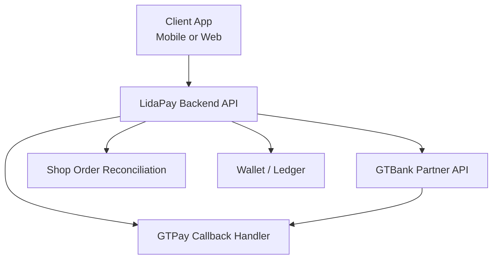
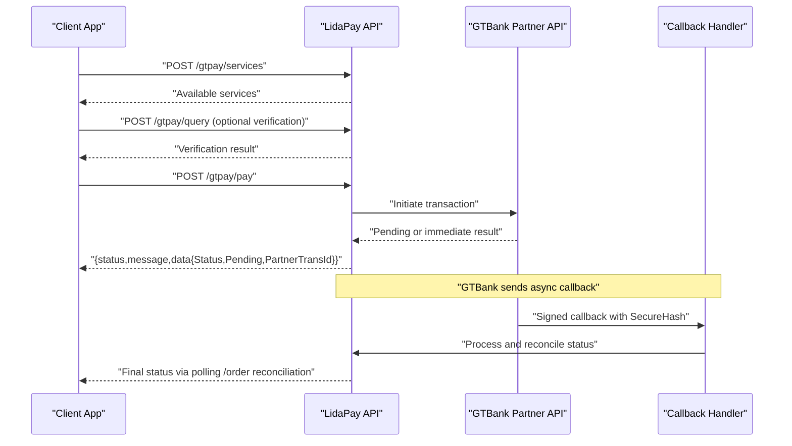
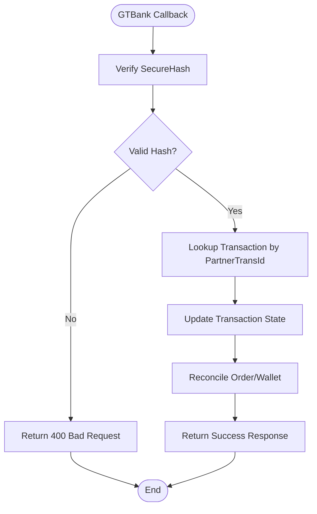
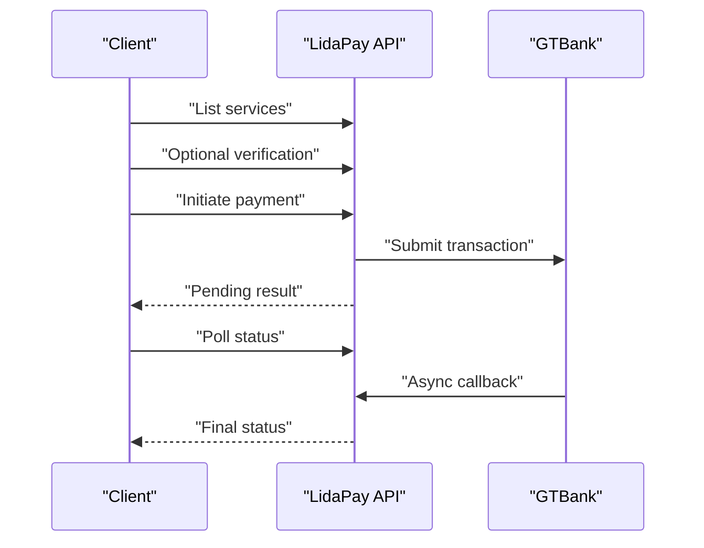
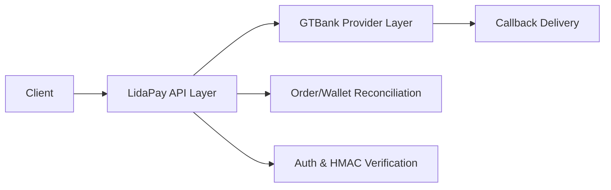

# Card Payments

<cite>
**Referenced Files in This Document**
- [ENDPOINTS.md](file://api/ENDPOINTS.md)
- [swagger-api-documentation.md](file://docs/swagger-api-documentation.md)
- [MOBILE_APP_REBUILD_HANDOFF.md](file://docs/MOBILE_APP_REBUILD_HANDOFF.md)
- [SHOP_API_MOBILE_HANDOFF.md](file://docs/SHOP_API_MOBILE_HANDOFF.md)
- [payment_models.dart](file://lib/features/payments/data/payment_models.dart)
- [remote_parsing_test.dart](file://test/remote_parsing_test.dart)
</cite>

## Table of Contents
1. [Introduction](#introduction)
2. [Project Structure](#project-structure)
3. [Core Components](#core-components)
4. [Architecture Overview](#architecture-overview)
5. [Detailed Component Analysis](#detailed-component-analysis)
6. [Dependency Analysis](#dependency-analysis)
7. [Performance Considerations](#performance-considerations)
8. [Troubleshooting Guide](#troubleshooting-guide)
9. [PCI Compliance and Security Considerations](#pci-compliance-and-security-considerations)
10. [Conclusion](#conclusion)

## Introduction
This document provides comprehensive API documentation for card and mobile-money payment processing through the GTBank GTPay integration exposed by the LidaPay backend. It focuses on the following endpoints:

- `POST /api/v1/gtpay/services` — List available GTBank services
- `POST /api/v1/gtpay/pay` — Initiate a payment or merchant transaction
- `POST /api/v1/gtpay/status` — Query the status of a previously initiated transaction
- `POST /api/v1/gtpay/callback` — Receive asynchronous transaction status callbacks from GTBank

The documentation includes request/response schemas, implementation examples, bank verification processes, error handling for declined or pending transactions, webhook patterns for payment status updates, and PCI/security considerations derived from the repository’s API specification and handoff guides.

## Project Structure
The relevant codebase artifacts for this documentation are:

- `api/ENDPOINTS.md`: Canonical endpoint map including all GTPay routes.
- `docs/swagger-api-documentation.md`: Detailed Swagger-style API documentation for GTPay services, query, pay, status, banks, and callback.
- `docs/MOBILE_APP_REBUILD_HANDOFF.md`: Mobile app guidance for GTPay usage, authorization caveats, service selection, and polling behavior.
- `docs/SHOP_API_MOBILE_HANDOFF.md`: Shop checkout flow using GTPay with `debitwallet`, order reconciliation, and status polling.
- `lib/features/payments/data/payment_models.dart`: Dart model describing parsed GTPay results and provider state.
- `test/remote_parsing_test.dart`: Tests showing how the client calls `/gtpay/query` and `/gtpay/pay`, and how service catalogues are parsed.



**Diagram sources**
- [ENDPOINTS.md:185-192](file://api/ENDPOINTS.md#L185-L192)
- [swagger-api-documentation.md:749-936](file://docs/swagger-api-documentation.md#L749-L936)
- [SHOP_API_MOBILE_HANDOFF.md:267-312](file://docs/SHOP_API_MOBILE_HANDOFF.md#L267-L312)

**Section sources**
- [ENDPOINTS.md:185-192](file://api/ENDPOINTS.md#L185-L192)
- [swagger-api-documentation.md:680-945](file://docs/swagger-api-documentation.md#L680-L945)

## Core Components
The GTPay integration exposes four primary operations used by clients and GTBank:

| Endpoint | Method | Purpose | Authentication | Notes |
|---|---:|---|---|---|
| `/api/v1/gtpay/services` | POST | Discover available GTBank services such as wallet top-up, airtime, bank transfer, and balance queries. | Bearer token per Swagger; production authorization caveat applies. | Returns a service catalogue that should not be hard-coded. |
| `/api/v1/gtpay/query` | POST | Verify customer details or check account balance depending on `ServiceName`. | Bearer token per Swagger. | Used before payment to validate recipient or balance. |
| `/api/v1/gtpay/pay` | POST | Initiate a payment or complete a merchant transaction. | Bearer token per Swagger; production authorization gap noted. | Asynchronous; may return `PENDING`. Final status arrives via callback or status polling. |
| `/api/v1/gtpay/status` | POST | Retrieve current status of a transaction by `PartnerTransId`. | Bearer token per Swagger. | Terminal states include `COMPLETED` and `FAILED`; `PENDING` requires continued polling. |
| `/api/v1/gtpay/callback` | POST | Internal webhook from GTBank with signed payload. | No client authentication; HMAC-SHA256 `SecureHash` validation. | Not called by client apps. |

**Section sources**
- [ENDPOINTS.md:185-192](file://api/ENDPOINTS.md#L185-L192)
- [swagger-api-documentation.md:700-936](file://docs/swagger-api-documentation.md#L700-L936)
- [MOBILE_APP_REBUILD_HANDOFF.md:430-470](file://docs/MOBILE_APP_REBUILD_HANDOFF.md#L430-L470)

## Architecture Overview
The GTBank card/mobile-money payment architecture is an asynchronous provider integration. The client interacts only with LidaPay; GTBank credentials, signing, outbound URLs, and callback handling remain server-side.



**Diagram sources**
- [swagger-api-documentation.md:749-936](file://docs/swagger-api-documentation.md#L749-L936)
- [SHOP_API_MOBILE_HANDOFF.md:267-312](file://docs/SHOP_API_MOBILE_HANDOFF.md#L267-L312)
- [MOBILE_APP_REBUILD_HANDOFF.md:460-470](file://docs/MOBILE_APP_REBUILD_HANDOFF.md#L460-L470)

## Detailed Component Analysis

### Listing Services: `POST /api/v1/gtpay/services`
This endpoint returns the list of services available on the GTBank Partner API. Clients should use it to discover supported `ServiceName` values rather than hard-coding them.

| Field | Type | Required | Description |
|---|---|---:|---|
| `data.services[]` | Array | Yes | List of services returned by GTBank. |
| `data.services[].ServiceName` | String | Yes | Internal service identifier such as `creditwallet`, `airtime`, `banktrf`, or `debitwallet`. |
| `data.services[].friendlyName` | String | Optional | Human-readable name. |
| `data.services[].description` | String | Optional | Service description. |
| `data.services[].Enabled` | Boolean | Optional | Whether the service is enabled. |

Example response structure:

```json
{
  "status": 200,
  "message": "Services retrieved successfully.",
  "data": {
    "services": [
      {
        "ServiceName": "creditwallet",
        "friendlyName": "Wallet Top-up",
        "description": "Fund a wallet",
        "Enabled": true
      },
      {
        "ServiceName": "banktrf",
        "Description": "Bank Transfer",
        "Enabled": true
      },
      {
        "ServiceName": "airtime",
        "Description": "Airtime Top-up",
        "Enabled": true
      }
    ]
  }
}
```

Implementation notes:
- Do not assume every service is appropriate for shop checkout.
- For normal customer payments, the handoff documents recommend `debitwallet`.
- For credit/inflow flows, `creditwallet` is reserved for explicitly supported scenarios.
- For external bank transfers/payouts, `banktrf` is distinct from customer debit flows.

**Section sources**
- [swagger-api-documentation.md:680-696](file://docs/swagger-api-documentation.md#L680-L696)
- [MOBILE_APP_REBUILD_HANDOFF.md:430-434](file://docs/MOBILE_APP_REBUILD_HANDOFF.md#L430-L434)
- [SHOP_API_MOBILE_HANDOFF.md:267-295](file://docs/SHOP_API_MOBILE_HANDOFF.md#L267-L295)
- [remote_parsing_test.dart:1207-1220](file://test/remote_parsing_test.dart#L1207-L1220)

### Verifying Customer Details or Balance: `POST /api/v1/gtpay/query`
This endpoint verifies customer details on a service or checks account balance when `ServiceName` is `balance`.

Request fields:

| Field | Type | Required | Description |
|---|---|---:|---|
| `PartnerTransId` | String | Optional | Unique transaction reference; auto-generated if omitted. |
| `ServiceName` | String | Yes | Service to query, e.g., `creditwallet`, `banktrf`, `airtime`, `balance`. |
| `ServiceNumber` | String | Optional | Account number, mobile money number, or wallet identifier. |
| `SecondaryServiceNumber` | String | Optional | Extra verification data such as a bank sort code. |

Response fields:

| Field | Type | Description |
|---|---|---|
| `status` | Number | HTTP-like envelope status. |
| `message` | String | Human-readable message. |
| `data.Status` | String | Provider-level status code. |
| `data.Message` | String | Provider-level message. |
| `data.Data` | Object | Verification or balance payload, e.g., account name, account number, account balance. |

Use cases:
- Validate a recipient account before initiating a payment.
- Check balance when `ServiceName` is `balance`.
- Use discovery-driven `ServiceName` values from `/gtpay/services`.

**Section sources**
- [swagger-api-documentation.md:700-745](file://docs/swagger-api-documentation.md#L700-L745)
- [remote_parsing_test.dart:1178-1205](file://test/remote_parsing_test.dart#L1178-L1205)

### Initiating Card Payment: `POST /api/v1/gtpay/pay`
This endpoint initiates a payment or completes a merchant transaction on the GTBank Partner API. It returns immediately; final status is delivered asynchronously via callback or can be polled through `/gtpay/status`.

Request headers:

| Header | Value |
|---|---|
| `Authorization` | `Bearer {access_token}` |
| `Content-Type` | `application/json` |

Request body fields:

| Field | Type | Required | Description |
|---|---|---:|---|
| `PartnerTransId` | String | Optional | Unique transaction reference; max 20 characters; auto-generated if omitted. |
| `CallbackURL` | String | Optional | URL for async status updates; defaults to system callback URL. |
| `userId` | String | Optional in DTO but must come from authenticated session | Authenticated user identifier. |
| `userName` | String | Optional in DTO but must come from authenticated session | Authenticated username. |
| `shopOrderNumber` | String | Optional | Links payment to a shop order for reconciliation. |
| `ServiceDetails.ServiceName` | String | Yes | Service being paid for. |
| `ServiceDetails.ServiceNumber` | String | Yes | Account number or identifier. |
| `ServiceDetails.Amount` | Number or numeric string | Yes | Payment amount; exact decimal precision matters. |
| `ServiceDetails.SecondaryServiceNumber` | String | Optional | Additional service identifier. |
| `ServiceDetails.Remarks` | String | Optional | Transaction notes. |
| `ServiceDetails.PaymentMethod` | String | Optional | Payment method such as `credit_account`. |
| `ServiceDetails.Payer` | Object | Optional | Payer information including Name, PhoneNumber, Email. |
| `ServiceDetails.PaidBy` | String | Optional | Name of payer in shop flows. |
| `ServiceDetails.PayeeName` | String | Optional | Payee name in shop flows. |

Important rules:
- The provider state is `data.Status`, not the envelope’s `status` number.
- A successful HTTP 200 can still contain `data.Status: "PENDING"`.
- Persist `data.PartnerTransId` before showing a verifying state.
- Do not retry the payment as a new transaction while the telco/provider response is outstanding.
- For shop orders, pass `shopOrderNumber` and use the exact server-returned order total.
- For normal customer payments, the documented service is `debitwallet`; do not substitute `creditwallet` or `banktrf` without explicit product support.

Example response structure:

```json
{
  "status": 200,
  "message": "Payment initiated successfully.",
  "data": {
    "Status": "02",
    "Message": "Transaction pending",
    "GTBTransId": "10462602201180001",
    "PartnerTransId": "2022011800011"
  }
}
```

**Section sources**
- [swagger-api-documentation.md:749-820](file://docs/swagger-api-documentation.md#L749-L820)
- [MOBILE_APP_REBUILD_HANDOFF.md:436-470](file://docs/MOBILE_APP_REBUILD_HANDOFF.md#L436-L470)
- [SHOP_API_MOBILE_HANDOFF.md:267-312](file://docs/SHOP_API_MOBILE_HANDOFF.md#L267-L312)
- [payment_models.dart:165-185](file://lib/features/payments/data/payment_models.dart#L165-L185)

### Querying Transaction Status: `POST /api/v1/gtpay/status`
This endpoint retrieves the current status of a previously initiated transaction.

Request headers:

| Header | Value |
|---|---|
| `Authorization` | `Bearer {access_token}` |
| `Content-Type` | `application/json` |

Request body fields:

| Field | Type | Required | Description |
|---|---|---:|---|
| `PartnerTransId` | String | Yes | The transaction reference used in the original `/pay` call. |

Response fields:

| Field | Type | Description |
|---|---|---|
| `status` | Number | Envelope status. |
| `message` | String | Human-readable message. |
| `data.Status` | String | Provider state such as completed, pending, or failed. |
| `data.Message` | String | Provider-level message. |
| `data.GTBTransId` | String | GTBank transaction identifier. |
| `data.PartnerTransId` | String | Partner transaction identifier. |
| `data.Amount` | String or Number | Transaction amount. |
| `data.TransactionDate` | String | Transaction timestamp. |

Polling behavior:
- While `data.Status` is `PENDING`, continue status checks with measured backoff while the app is active.
- Resume checking when the app returns to the foreground.
- Stop only when status is `COMPLETED` or `FAILED`.
- On timeout or `PAYMENT_STATUS_UNKNOWN`, query status with the same ID before considering any retry.

**Section sources**
- [swagger-api-documentation.md:824-860](file://docs/swagger-api-documentation.md#L824-L860)
- [MOBILE_APP_REBUILD_HANDOFF.md:462-466](file://docs/MOBILE_APP_REBUILD_HANDOFF.md#L462-L466)
- [SHOP_API_MOBILE_HANDOFF.md:298-312](file://docs/SHOP_API_MOBILE_HANDOFF.md#L298-L312)
- [payment_models.dart:165-185](file://lib/features/payments/data/payment_models.dart#L165-L185)

### Handling Asynchronous Callbacks: `POST /api/v1/gtpay/callback`
This endpoint receives asynchronous transaction status updates from GTBank. It is internal and must not be called by client applications.

Security:
- All callbacks are verified using HMAC-SHA256 `SecureHash` before processing.
- Invalid or missing hash results in `400 Bad Request`.

Callback payload fields:

| Field | Type | Description |
|---|---|---|
| `SecureHash` | String | HMAC signature for callback integrity. |
| `GTBTransId` | String | GTBank transaction identifier. |
| `PartnerTransId` | String | Partner transaction identifier. |
| `ProviderTransId` | String | Provider-specific transaction identifier. |
| `Status` | String | Final status such as `COMPLETED`. |
| `Message` | String | Human-readable status message. |
| `Data` | Object | Additional provider data. |

Callback response fields:

| Field | Type | Description |
|---|---|---|
| `success` | Boolean | Whether the callback was accepted. |
| `partnerTransId` | String | Partner transaction identifier. |
| `gtbTransId` | String | GTBank transaction identifier. |
| `status` | String | Final status. |
| `message` | String | Message. |

Webhook implementation recommendations:
- Validate `SecureHash` before processing.
- Deduplicate callbacks using `PartnerTransId` and/or `GTBTransId`.
- Update internal transaction records idempotently.
- Trigger downstream reconciliation such as updating shop order payment status.
- Return a success response so GTBank knows the callback was received.



**Diagram sources**
- [swagger-api-documentation.md:906-936](file://docs/swagger-api-documentation.md#L906-L936)

**Section sources**
- [swagger-api-documentation.md:906-936](file://docs/swagger-api-documentation.md#L906-L936)

### Bank Verification and Supported Banks
For bank-transfer-related flows, the API supports listing supported banks. There is both a GET and POST alias documented.

Endpoint:

| Method | Route | Description |
|---|---|---|
| GET | `/api/v1/gtpay/banks` | List supported banks for bank transfer services. |
| POST | `/api/v1/gtpay/banks` | Alias endpoint returning the same bank list. |

Response structure:

```json
{
  "status": 200,
  "message": "Banks retrieved successfully.",
  "data": {
    "Status": "00",
    "Message": "Successful",
    "Data": {
      "banks": [
        {
          "BankCode": "030100",
          "BankName": "GTBank Ghana",
          "SortCode": "030100"
        },
        {
          "BankCode": "040101",
          "BankName": "Ecobank Ghana",
          "SortCode": "040101"
        }
      ]
    }
  }
}
```

Notes:
- Internally, the app posts to GTBank `/services/query` with `ServiceName: "banks"` to retrieve the bank list.
- Use this list for bank-transfer flows; it is not the general card-payment service catalogue.

**Section sources**
- [swagger-api-documentation.md:864-902](file://docs/swagger-api-documentation.md#L864-L902)
- [ENDPOINTS.md:189-191](file://api/ENDPOINTS.md#L189-L191)

### Card Payment Flow Implementation Example
A typical card/mobile-money payment flow using GTPay is:

1. **Discover services**: Call `POST /api/v1/gtpay/services`.
2. **Optional verification**: Call `POST /api/v1/gtpay/query` to verify recipient or balance.
3. **Initiate payment**: Call `POST /api/v1/gtpay/pay` with `ServiceName`, `ServiceNumber`, `Amount`, and optional `shopOrderNumber`.
4. **Persist reference**: Save `PartnerTransId` and show a verifying state.
5. **Poll status**: Call `POST /api/v1/gtpay/status` until terminal state.
6. **Handle callback**: Server receives `POST /api/v1/gtpay/callback` from GTBank and reconciles internally.
7. **Settle receipt**: Only show a paid receipt after final backend-reconciled status.



**Diagram sources**
- [swagger-api-documentation.md:940-945](file://docs/swagger-api-documentation.md#L940-L945)
- [SHOP_API_MOBILE_HANDOFF.md:429-436](file://docs/SHOP_API_MOBILE_HANDOFF.md#L429-L436)

**Section sources**
- [swagger-api-documentation.md:940-945](file://docs/swagger-api-documentation.md#L940-L945)
- [SHOP_API_MOBILE_HANDOFF.md:429-447](file://docs/SHOP_API_MOBILE_HANDOFF.md#L429-L447)

## Dependency Analysis
The GTPay endpoints depend on several layers:

- **Client layer**: Mobile or web clients calling LidaPay endpoints.
- **API layer**: LidaPay controllers exposing `/gtpay/services`, `/gtpay/query`, `/gtpay/pay`, `/gtpay/status`, `/gtpay/banks`, and `/gtpay/callback`.
- **Provider layer**: GTBank Partner API handling actual payment processing.
- **Reconciliation layer**: Internal logic linking `PartnerTransId` and `GTBTransId` to shop orders, wallets, and ledger entries.
- **Security layer**: Bearer token authentication for client-facing endpoints and HMAC-SHA256 callback verification for GTBank-to-server callbacks.



**Diagram sources**
- [ENDPOINTS.md:185-192](file://api/ENDPOINTS.md#L185-L192)
- [swagger-api-documentation.md:749-936](file://docs/swagger-api-documentation.md#L749-L936)

**Section sources**
- [ENDPOINTS.md:185-192](file://api/ENDPOINTS.md#L185-L192)
- [swagger-api-documentation.md:749-936](file://docs/swagger-api-documentation.md#L749-L936)

## Performance Considerations
- Avoid hard-coding service catalogues; fetch from `/gtpay/services` to reduce stale configuration.
- Use measured backoff when polling `/gtpay/status` instead of tight loops.
- Resume polling when the app returns to the foreground to improve reliability without excessive network load.
- Deduplicate callback processing using transaction identifiers to avoid redundant reconciliation work.
- Cache bank lists where appropriate, but refresh when the UI needs up-to-date bank options.
- Keep payment initiation responses lightweight; defer heavy reconciliation to background processing triggered by callback or status polling.

[No sources needed since this section provides general guidance]

## Troubleshooting Guide
Common issues and resolutions:

| Symptom | Likely Cause | Resolution |
|---|---|---|
| Initial payment returns `PENDING` | GTBank is waiting for telco/operator confirmation. | Poll `/gtpay/status` with the saved `PartnerTransId`; do not treat as failure. |
| Payment never settles | Callback not received or status polling stopped too early. | Ensure callback handler is reachable and status polling continues until terminal state. |
| Declined or failed payment | Insufficient funds, invalid account, or provider rejection. | Show failure state, allow retry only after confirming no outstanding transaction. |
| Timeout during payment initiation | Network or provider latency. | Query `/gtpay/status` with the same ID before retrying. |
| Callback rejected | Missing or invalid `SecureHash`. | Verify HMAC-SHA256 signature before processing. |
| Wrong service used | Using `creditwallet` or `banktrf` for normal customer checkout. | Use `debitwallet` for normal customer payments; consult product docs for other services. |
| Order not reconciled | Missing `shopOrderNumber` or incorrect order linkage. | Pass `shopOrderNumber` and confirm backend reconciliation on `COMPLETED` or `FAILED`. |

**Section sources**
- [MOBILE_APP_REBUILD_HANDOFF.md:460-470](file://docs/MOBILE_APP_REBUILD_HANDOFF.md#L460-L470)
- [SHOP_API_MOBILE_HANDOFF.md:298-312](file://docs/SHOP_API_MOBILE_HANDOFF.md#L298-L312)
- [swagger-api-documentation.md:906-936](file://docs/swagger-api-documentation.md#L906-L936)

## PCI Compliance and Security Considerations
Although the repository documentation primarily describes mobile-money and GTBank partner integrations, the following security principles apply to card and payment processing:

- **Do not send sensitive card data to your own backend unless required.** Prefer provider-hosted or tokenized flows where possible.
- **Never embed GTBank credentials in client apps or browsers.** Credentials, signing keys, and callback secrets must remain server-side.
- **Require backend authentication/partner authorization.** The live Swagger snapshot notes that GTPay operations may appear without bearer security; this does not mean they should be publicly accessible.
- **Validate callbacks securely.** Use HMAC-SHA256 `SecureHash` verification for `/gtpay/callback`.
- **Treat provider responses as untrusted.** Always rely on the backend’s final reconciled status before marking an order paid.
- **Avoid logging sensitive data.** Redact tokens, full URIs, phone numbers, and account identifiers.
- **Implement idempotency.** Duplicate callbacks, retries, and deep-link events should not create duplicate charges or orders.
- **Follow least privilege.** Separate public endpoints, authenticated client endpoints, and internal webhook handlers.
- **Monitor and audit payment flows.** Log request/response metadata without exposing secrets, and alert on repeated failures or unexpected statuses.

**Section sources**
- [MOBILE_APP_REBUILD_HANDOFF.md:470-470](file://docs/MOBILE_APP_REBUILD_HANDOFF.md#L470-L470)
- [swagger-api-documentation.md:906-912](file://docs/swagger-api-documentation.md#L906-L912)

## Conclusion
The GTBank GTPay integration provides a robust asynchronous payment flow centered around service discovery, optional verification, payment initiation, status polling, and secure callback handling. Clients should interact only with LidaPay endpoints, preserve transaction references, poll responsibly, and settle receipts based on final backend-reconciled status. For shop orders, link payments using `shopOrderNumber`, use the documented `debitwallet` service for normal customer payments, and ensure production authorization and PCI/security controls are properly implemented before exposing payment routes to end users.

[No sources needed since this section summarizes without analyzing specific files]