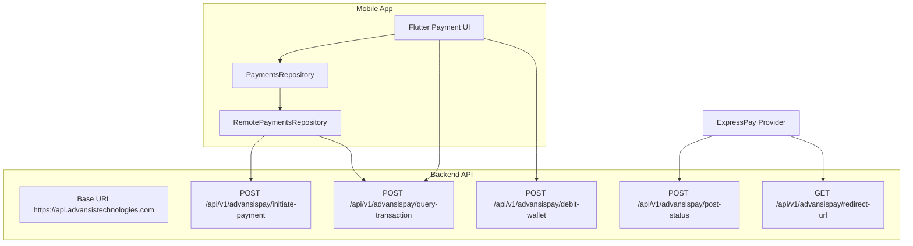
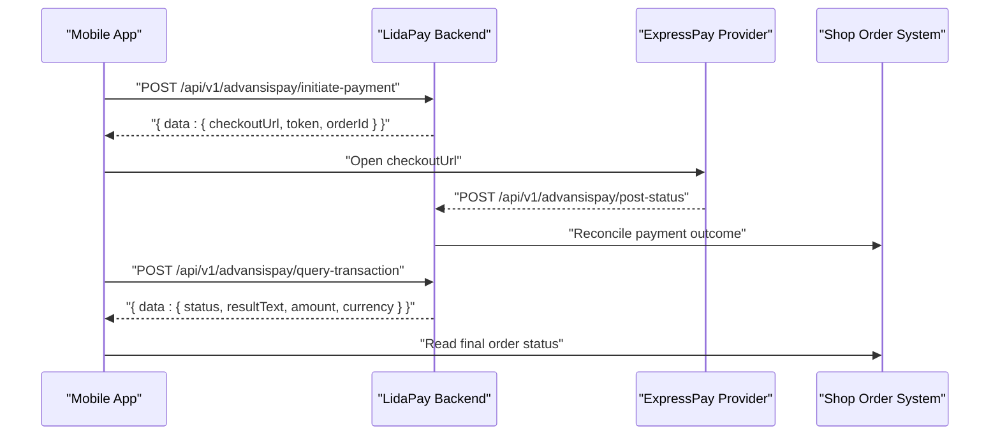
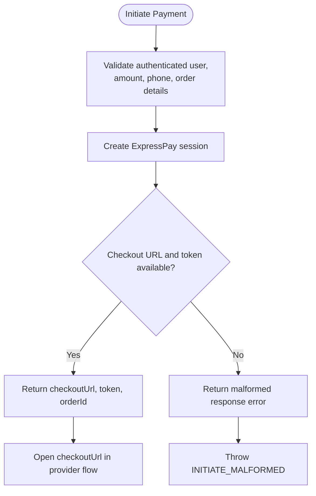
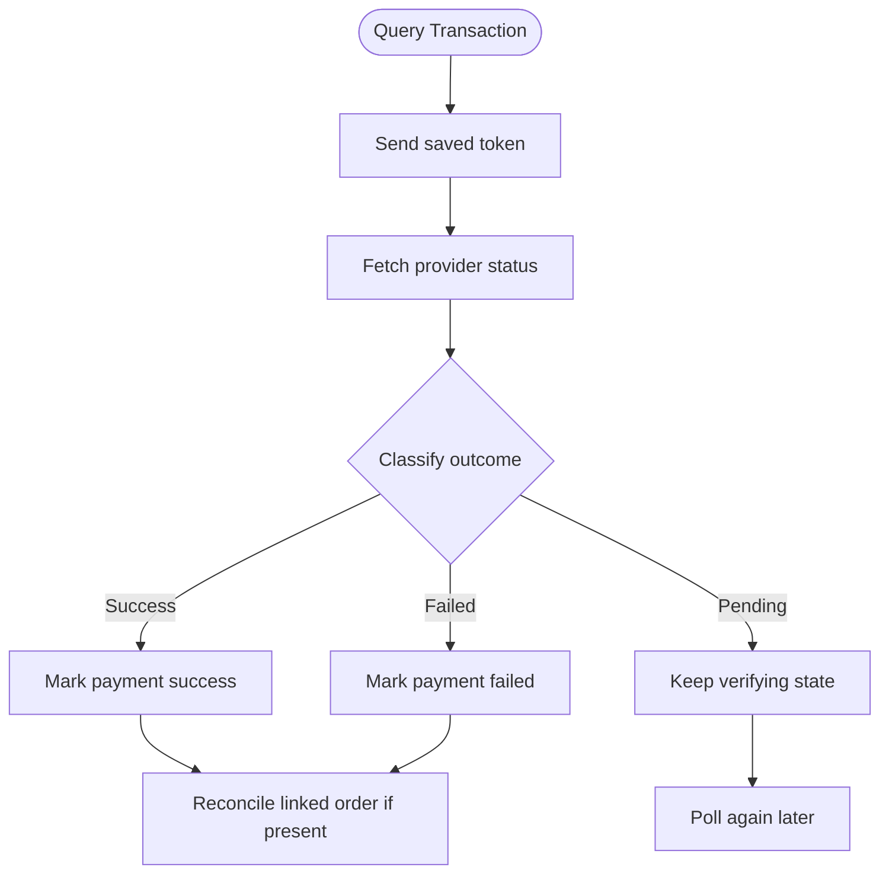
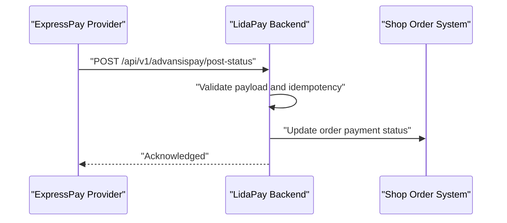
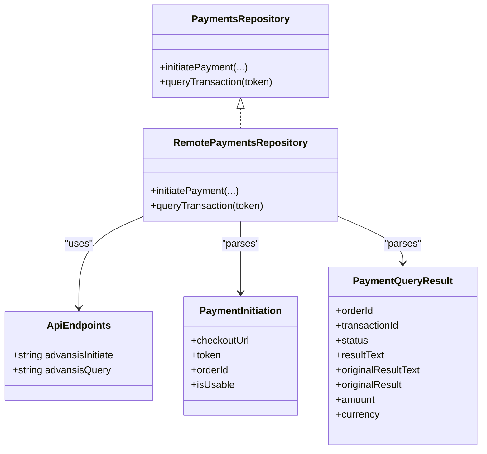

# Mobile Money Payments

<cite>
**Referenced Files in This Document**
- [ENDPOINTS.md](file://api/ENDPOINTS.md)
- [SHOP_API_MOBILE_HANDOFF.md](file://docs/SHOP_API_MOBILE_HANDOFF.md)
- [MOBILE_APP_REBUILD_HANDOFF.md](file://docs/MOBILE_APP_REBUILD_HANDOFF.md)
- [api_endpoints.dart](file://lib/core/network/api_endpoints.dart)
- [payments_repository.dart](file://lib/features/payments/data/payments_repository.dart)
- [remote_payments_repository.dart](file://lib/features/payments/data/remote_payments_repository.dart)
- [payment_models.dart](file://lib/features/payments/data/payment_models.dart)
</cite>

## Table of Contents
1. [Introduction](#introduction)
2. [Project Structure](#project-structure)
3. [Core Components](#core-components)
4. [Architecture Overview](#architecture-overview)
5. [Detailed Component Analysis](#detailed-component-analysis)
6. [Dependency Analysis](#dependency-analysis)
7. [Performance Considerations](#performance-considerations)
8. [Troubleshooting Guide](#troubleshooting-guide)
9. [Conclusion](#conclusion)
10. [Appendices](#appendices)

## Introduction
This document provides detailed API documentation for mobile money payment endpoints, focusing on the ExpressPay integration through Advansis Pay and its relationship to the shop checkout flow. It covers:

- The four core ExpressPay-related endpoints:
  - `POST /api/v1/advansispay/initiate-payment`
  - `POST /api/v1/advansispay/debit-wallet`
  - `POST /api/v1/advansispay/query-transaction`
  - `POST /api/v1/advansispay/post-status`
- Request/response schemas for initiating payments, querying transaction status, handling callbacks, and processing debit transactions.
- End-to-end payment flow examples for both general mobile money usage and shop checkout.
- Error handling strategies for failed, pending, and unknown payment states.
- Webhook and callback implementation guidance for status updates.
- Security requirements for mobile money integrations, including authentication, token handling, and provider boundaries.

The base API URL is `https://api.advansistechnologies.com`.

**Section sources**
- [ENDPOINTS.md:1-10](file://api/ENDPOINTS.md#L1-L10)

## Project Structure
The repository contains a Flutter-based mobile application with backend API contracts documented in markdown files and referenced by Dart code. The relevant parts for mobile money payments are:

- `api/ENDPOINTS.md`: Official endpoint map extracted from the live OpenAPI/Swagger spec.
- `docs/SHOP_API_MOBILE_HANDOFF.md`: Shop checkout contract, including ExpressPay and GTPay flows.
- `docs/MOBILE_APP_REBUILD_HANDOFF.md`: Detailed mobile app handoff notes covering Advansis Pay, GTPay, callbacks, and security constraints.
- `lib/core/network/api_endpoints.dart`: Client-side route constants used by the Flutter app.
- `lib/features/payments/data/payments_repository.dart`: Repository interface describing how the app calls payment APIs.
- `lib/features/payments/data/remote_payments_repository.dart`: Remote implementation that posts to `/api/v1/advansispay/initiate-payment`.
- `lib/features/payments/data/payment_models.dart`: Models for parsing initiation and query responses.

**Diagram sources**
- [ENDPOINTS.md:153-158](file://api/ENDPOINTS.md#L153-L158)
- [api_endpoints.dart:102-103](file://lib/core/network/api_endpoints.dart#L102-L103)
- [payments_repository.dart:4-26](file://lib/features/payments/data/payments_repository.dart#L4-L26)
- [remote_payments_repository.dart:13-53](file://lib/features/payments/data/remote_payments_repository.dart#L13-L53)

**Section sources**
- [ENDPOINTS.md:1-10](file://api/ENDPOINTS.md#L1-L10)
- [api_endpoints.dart:1-10](file://lib/core/network/api_endpoints.dart#L1-L10)

## Core Components
The mobile money payment system revolves around these components:

| Component | Responsibility | Key Contract |
|---|---|---|
| Advansis Pay / ExpressPay initiation | Creates a mobile money checkout session and returns a checkout URL plus an authoritative token. | `POST /api/v1/advansispay/initiate-payment` |
| Transaction query | Retrieves the final or current state of a payment using the saved token. | `POST /api/v1/advansispay/query-transaction` |
| Debit wallet | Processes a mobile money debit transaction. | `POST /api/v1/advansispay/debit-wallet` |
| Status webhook | Receives asynchronous payment status updates from ExpressPay. | `POST /api/v1/advansispay/post-status` |
| Redirect callback | Handles browser/native return flow after user completes the ExpressPay checkout. | `GET /api/v1/advansispay/redirect-url` |
| Shop order linkage | Connects payment outcomes to shop orders via `shopOrderNumber`. | Used across checkout and payment endpoints |

The Flutter client uses `ApiEndpoints.advansisInitiate` and `ApiEndpoints.advansisQuery` to call the backend. The repository layer enforces that only server-reconciled statuses should be treated as final.

**Section sources**
- [ENDPOINTS.md:153-158](file://api/ENDPOINTS.md#L153-L158)
- [api_endpoints.dart:102-103](file://lib/core/network/api_endpoints.dart#L102-L103)
- [payments_repository.dart:4-26](file://lib/features/payments/data/payments_repository.dart#L4-L26)

## Architecture Overview
The ExpressPay mobile money architecture separates three responsibilities:

1. **Client responsibility**: initiate payment, open the provider checkout, persist tokens, poll authoritative status, and update UI based on backend results.
2. **Backend responsibility**: validate requests, create provider sessions, reconcile provider outcomes, link payments to orders, and expose query/status endpoints.
3. **Provider responsibility**: handle customer approval, process mobile money debits, and send asynchronous status updates to the backend.

**Diagram sources**
- [SHOP_API_MOBILE_HANDOFF.md:237-265](file://docs/SHOP_API_MOBILE_HANDOFF.md#L237-L265)
- [MOBILE_APP_REBUILD_HANDOFF.md:380-402](file://docs/MOBILE_APP_REBUILD_HANDOFF.md#L380-L402)
- [ENDPOINTS.md:153-158](file://api/ENDPOINTS.md#L153-L158)

## Detailed Component Analysis

### POST /api/v1/advansispay/initiate-payment
This endpoint initiates a mobile money payment through Advansis Pay / ExpressPay.

| Field | Type | Required | Description |
|---|---|---:|---|
| `firstName` | string | Yes | Customer first name. |
| `lastName` | string | Yes | Customer last name. |
| `email` | string | Yes | Customer email address. |
| `phoneNumber` | string | Yes | Customer phone number used for mobile money. |
| `userId` | string | Yes | Authenticated user ID from login; must come from the verified session. |
| `username` | string | Yes | Authenticated username. |
| `amount` | number | Yes | Exact payable amount. For shop checkout, use the server-computed `order.total`. |
| `orderDesc` | string | Yes | Human-readable description of the payment. |
| `transType` | string | No | Payment type; default is `"MOMO"` for mobile money. |
| `payTransRef` | string | No | Optional provider reference. |
| `shopOrderNumber` | string | No | Shop order number linking this payment to a shop order. |
| `redirectUrl` | string | No | Optional browser redirect target; omitted for native deep-link behavior. |

Response envelope:
- `data.checkoutUrl`: URL to open in WebView or browser.
- `data.token`: Authoritative token for later verification.
- `data.orderId` or equivalent field: Provider-side order or transaction reference.

Important rules:
- Persist `token` before opening the checkout page.
- Do not compute or trust the payable total from client cart prices.
- For shop orders, include `shopOrderNumber` so the backend can reconcile the order automatically.
- For web clients, optionally pass `returnUrl`, `webhookUrl`, and `webhookSecret`; for native mobile apps, omit `returnUrl` unless explicitly supported.

**Diagram sources**
- [remote_payments_repository.dart:13-53](file://lib/features/payments/data/remote_payments_repository.dart#L13-L53)
- [payment_models.dart:5-49](file://lib/features/payments/data/payment_models.dart#L5-L49)
- [SHOP_API_MOBILE_HANDOFF.md:237-265](file://docs/SHOP_API_MOBILE_HANDOFF.md#L237-L265)
- [MOBILE_APP_REBUILD_HANDOFF.md:380-402](file://docs/MOBILE_APP_REBUILD_HANDOFF.md#L380-L402)

**Section sources**
- [payments_repository.dart:4-22](file://lib/features/payments/data/payments_repository.dart#L4-L22)
- [remote_payments_repository.dart:13-53](file://lib/features/payments/data/remote_payments_repository.dart#L13-L53)
- [payment_models.dart:5-49](file://lib/features/payments/data/payment_models.dart#L5-L49)
- [SHOP_API_MOBILE_HANDOFF.md:237-265](file://docs/SHOP_API_MOBILE_HANDOFF.md#L237-L265)
- [MOBILE_APP_REBUILD_HANDOFF.md:380-402](file://docs/MOBILE_APP_REBUILD_HANDOFF.md#L380-L402)

### POST /api/v1/advansispay/query-transaction
This endpoint is the authoritative check for payment status.

| Field | Type | Required | Description |
|---|---|---:|---|
| `token` | string | Yes | Saved initiation token; never use the deep-link value as authority. |

Response model fields:
- `orderId`: Provider order reference.
- `transactionId`: Provider transaction identifier.
- `status`: Coarse status string.
- `resultText`: Provider result text.
- `originalResultText`: Original provider result text.
- `originalResult`: Numeric provider result.
- `amount`: Payment amount.
- `currency`: Currency code.

Outcome classification:
- `success`: Final successful payment.
- `failed`: Final failed payment.
- `pending`: Ambiguous or still-processing payment.

Rules:
- Always use this endpoint to decide success/failure.
- Do not treat a redirect or deep-link status alone as proof of payment.
- If the result is pending or ambiguous, retain the pending state and offer retry/status refresh.
- Do not start a new payment while the provider response is outstanding.

**Diagram sources**
- [payment_models.dart:51-77](file://lib/features/payments/data/payment_models.dart#L51-L77)
- [MOBILE_APP_REBUILD_HANDOFF.md:399-402](file://docs/MOBILE_APP_REBUILD_HANDOFF.md#L399-L402)
- [SHOP_API_MOBILE_HANDOFF.md:254-265](file://docs/SHOP_API_MOBILE_HANDOFF.md#L254-L265)

**Section sources**
- [payments_repository.dart:24-26](file://lib/features/payments/data/payments_repository.dart#L24-L26)
- [payment_models.dart:51-77](file://lib/features/payments/data/payment_models.dart#L51-L77)
- [MOBILE_APP_REBUILD_HANDOFF.md:399-402](file://docs/MOBILE_APP_REBUILD_HANDOFF.md#L399-L402)
- [SHOP_API_MOBILE_HANDOFF.md:254-265](file://docs/SHOP_API_MOBILE_HANDOFF.md#L254-L265)

### POST /api/v1/advansispay/debit-wallet
This endpoint processes a mobile money debit transaction. In the broader LidaPay mobile money context, debit operations are also exposed through other provider routes such as GTPay’s `debitwallet` service. For ExpressPay, this endpoint represents the backend-facing debit action when the integration requires direct debit processing rather than a checkout URL flow.

Key considerations:
- Use debit endpoints only when the product flow requires a direct debit request.
- Preserve exact decimal precision for amounts.
- Link the transaction to a shop order using `shopOrderNumber` when applicable.
- Treat asynchronous provider responses carefully; do not assume immediate completion.
- Avoid double-charging by reconciling before retries.

**Section sources**
- [ENDPOINTS.md:155-158](file://api/ENDPOINTS.md#L155-L158)
- [SHOP_API_MOBILE_HANDOFF.md:267-316](file://docs/SHOP_API_MOBILE_HANDOFF.md#L267-L316)
- [MOBILE_APP_REBUILD_HANDOFF.md:430-470](file://docs/MOBILE_APP_REBUILD_HANDOFF.md#L430-L470)

### POST /api/v1/advansispay/post-status
This endpoint receives asynchronous payment status updates from ExpressPay. It is a server-to-server webhook and must not be called directly by the mobile app.

Responsibilities:
- Accept signed or validated status payloads from ExpressPay.
- Update internal transaction records.
- Reconcile linked shop orders when `shopOrderNumber` is present.
- Return a stable acknowledgment so ExpressPay knows the backend received the event.

Security requirements:
- Validate the source IP or signature depending on provider configuration.
- Idempotently handle duplicate status events.
- Never trust unverified client-side status values.

**Diagram sources**
- [ENDPOINTS.md:157-158](file://api/ENDPOINTS.md#L157-L158)
- [MOBILE_APP_REBUILD_HANDOFF.md:402-406](file://docs/MOBILE_APP_REBUILD_HANDOFF.md#L402-L406)

**Section sources**
- [ENDPOINTS.md:157-158](file://api/ENDPOINTS.md#L157-L158)
- [MOBILE_APP_REBUILD_HANDOFF.md:402-406](file://docs/MOBILE_APP_REBUILD_HANDOFF.md#L402-L406)

### GET /api/v1/advansispay/redirect-url
This endpoint handles the payment callback after the user completes the ExpressPay checkout. It supports both native deep-link fallback and HTTPS return URLs.

Behavior:
- Parse the returned reference/token and status.
- Treat them as hints, not authority.
- Route the user back to the app or web client.
- Trigger backend reconciliation through `query-transaction` or webhook processing.

Mobile-specific rule:
- The Android app must not call this callback endpoint directly.
- The app must never mark a transaction paid solely because the deep-link contains `status=COMPLETED`.

**Section sources**
- [ENDPOINTS.md:153-154](file://api/ENDPOINTS.md#L153-L154)
- [MOBILE_APP_REBUILD_HANDOFF.md:402-408](file://docs/MOBILE_APP_REBUILD_HANDOFF.md#L402-L408)

## Dependency Analysis
The client-side dependency chain for ExpressPay payments is straightforward:

**Diagram sources**
- [api_endpoints.dart:102-103](file://lib/core/network/api_endpoints.dart#L102-L103)
- [payments_repository.dart:3-26](file://lib/features/payments/data/payments_repository.dart#L3-L26)
- [remote_payments_repository.dart:7-53](file://lib/features/payments/data/remote_payments_repository.dart#L7-L53)
- [payment_models.dart:8-77](file://lib/features/payments/data/payment_models.dart#L8-L77)

Coupling and cohesion observations:
- `ApiEndpoints` centralizes route strings, reducing duplication.
- `PaymentsRepository` defines a clean abstraction for payment operations.
- `RemotePaymentsRepository` implements HTTP calls and validation.
- `PaymentInitiation` and `PaymentQueryResult` encapsulate provider response shapes.
- The mobile app depends on repository methods rather than raw HTTP calls.

Potential risks:
- If provider response shapes change, models and repository logic must evolve together.
- Misuse of deep-link status instead of `query-transaction` can lead to incorrect payment settlement.
- Missing `shopOrderNumber` breaks automatic order reconciliation.

**Section sources**
- [api_endpoints.dart:102-103](file://lib/core/network/api_endpoints.dart#L102-L103)
- [payments_repository.dart:3-26](file://lib/features/payments/data/payments_repository.dart#L3-L26)
- [remote_payments_repository.dart:7-53](file://lib/features/payments/data/remote_payments_repository.dart#L7-L53)
- [payment_models.dart:8-77](file://lib/features/payments/data/payment_models.dart#L8-L77)

## Performance Considerations
- Prefer polling `query-transaction` with measured backoff rather than tight loops.
- Stop polling when a terminal state (`success` or `failed`) is reached.
- Resume polling when the app returns to the foreground after backgrounding.
- Avoid starting duplicate payment attempts while a provider response is outstanding.
- Cache provider catalogue data where appropriate, but do not cache mutable payment state.
- Use server-reconciled order status as the final source of truth for shop payments.

[No sources needed since this section provides general guidance]

## Troubleshooting Guide

### Common Payment States
| State | Meaning | Recommended Action |
|---|---|---|
| Pending | Provider has not finalized the transaction. | Show verifying state; poll status with backoff. |
| Success | Payment completed successfully. | Mark order paid; show receipt. |
| Failed | Payment did not complete. | Mark payment failed; allow retry if allowed by business rules. |
| Unknown | Network timeout or provider unavailable. | Check status before retrying; do not immediately charge again. |
| Timed Out | Approval window expired or provider did not respond. | Offer “Check status” or cancel and retry. |

### Error Handling Patterns
- On malformed initiation response, throw `INITIATE_MALFORMED`.
- On network timeout (for example, 504), stop aggressive polling and let the user manually check status.
- On transient failures, treat them as unknown rather than definitive failure.
- On failed provider reports, display a friendly message and offer retry or status refresh.
- Never rely on deep-link or redirect status alone.

### Callback and Webhook Issues
- If the redirect callback arrives early, continue polling `query-transaction`.
- If the webhook is delayed, rely on polling until the backend reconciles the order.
- Ensure webhook endpoints are secure, idempotent, and server-only.
- Do not expose webhook endpoints to the mobile app.

**Section sources**
- [remote_payments_repository.dart:45-53](file://lib/features/payments/data/remote_payments_repository.dart#L45-L53)
- [MOBILE_APP_REBUILD_HANDOFF.md:613-613](file://docs/MOBILE_APP_REBUILD_HANDOFF.md#L613-L613)
- [SHOP_API_MOBILE_HANDOFF.md:254-265](file://docs/SHOP_API_MOBILE_HANDOFF.md#L254-L265)

## Conclusion
The ExpressPay mobile money integration in this repository follows a robust pattern:

- Initiate payment through `POST /api/v1/advansispay/initiate-payment`.
- Open the provider checkout URL.
- Verify outcomes through `POST /api/v1/advansispay/query-transaction`.
- Let the backend receive asynchronous updates through `POST /api/v1/advansispay/post-status`.
- Link payments to shop orders using `shopOrderNumber` for automatic reconciliation.
- Treat all client-side redirects and deep links as hints, not authority.
- Enforce authentication, token persistence, and provider boundaries.

For production reliability, always reconcile final payment status through the backend and avoid trusting unverified client signals.

[No sources needed since this section summarizes without analyzing specific files]

## Appendices

### A. Complete ExpressPay Endpoint Summary

| Method | Endpoint | Purpose |
|---|---|---|
| POST | `/api/v1/advansispay/initiate-payment` | Initiate a mobile money payment and return checkout URL and token. |
| POST | `/api/v1/advansispay/debit-wallet` | Process a mobile money debit transaction. |
| POST | `/api/v1/advansispay/query-transaction` | Query transaction status by token. |
| POST | `/api/v1/advansispay/post-status` | Receive payment status update from ExpressPay. |
| GET | `/api/v1/advansispay/redirect-url` | Handle payment callback and return flow. |

**Section sources**
- [ENDPOINTS.md:153-158](file://api/ENDPOINTS.md#L153-L158)

### B. Security Requirements for Mobile Money Integrations
- Require authentication for payment initiation and status queries.
- Derive identity from the verified session, not client-provided IDs.
- Persist and use the authoritative token from initiation.
- Do not call provider callback endpoints from the mobile app.
- Do not mark payments paid based on deep-link status alone.
- Use HTTPS for all API communication.
- Validate webhook payloads at the backend.
- Keep provider credentials server-side only.
- Use idempotency keys where retries are possible.
- Respect provider-specific service semantics; do not substitute debit, credit, or bank transfer services.

**Section sources**
- [MOBILE_APP_REBUILD_HANDOFF.md:402-408](file://docs/MOBILE_APP_REBUILD_HANDOFF.md#L402-L408)
- [MOBILE_APP_REBUILD_HANDOFF.md:430-470](file://docs/MOBILE_APP_REBUILD_HANDOFF.md#L430-L470)
- [SHOP_API_MOBILE_HANDOFF.md:237-316](file://docs/SHOP_API_MOBILE_HANDOFF.md#L237-L316)