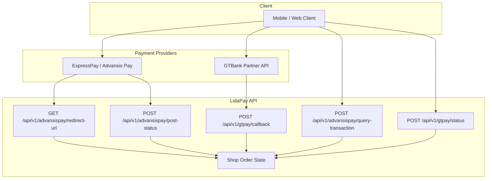
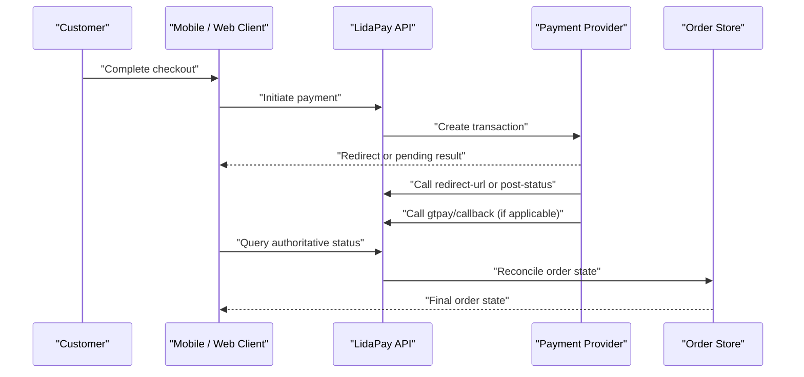
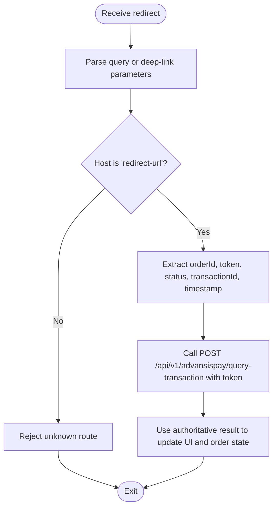
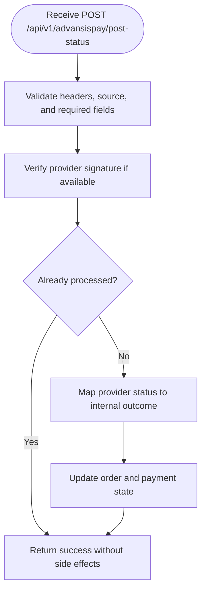
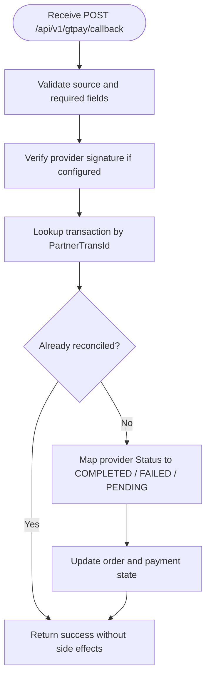
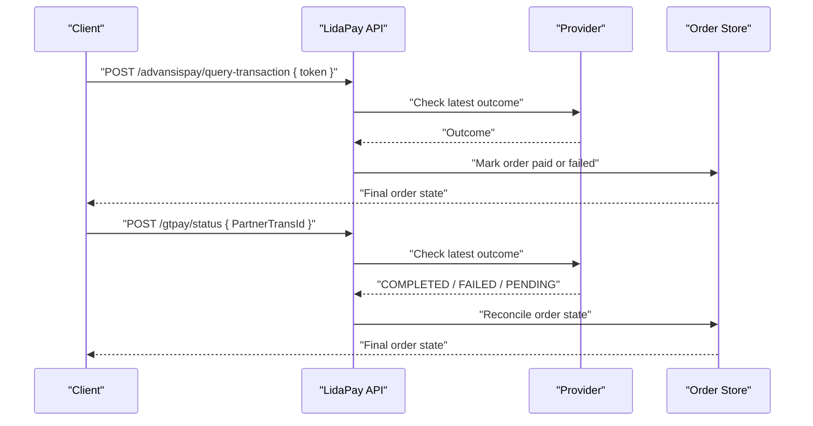
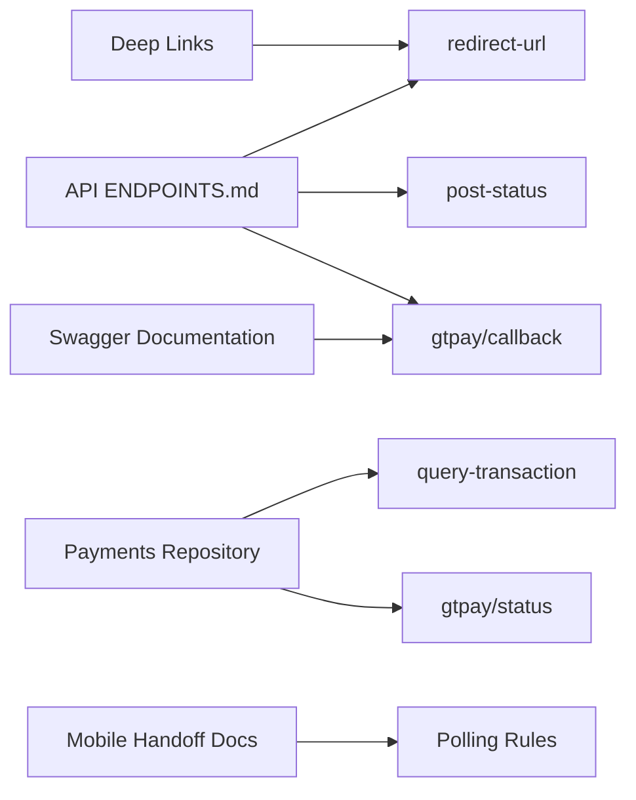

# Payment Callbacks & Webhooks

<cite>
**Referenced Files in This Document**
- [ENDPOINTS.md](file://api/ENDPOINTS.md)
- [swagger-api-documentation.md](file://docs/swagger-api-documentation.md)
- [MOBILE_APP_REBUILD_HANDOFF.md](file://docs/MOBILE_APP_REBUILD_HANDOFF.md)
- [SHOP_API_MOBILE_HANDOFF.md](file://docs/SHOP_API_MOBILE_HANDOFF.md)
- [payments_repository.dart](file://lib/features/payments/data/payments_repository.dart)
- [payment_models.dart](file://lib/features/payments/data/payment_models.dart)
- [deep_links.dart](file://lib/core/deep_links.dart)
- [AndroidManifest.xml](file://android/app/src/main/AndroidManifest.xml)
</cite>

## Table of Contents
1. [Introduction](#introduction)
2. [Project Structure](#project-structure)
3. [Core Components](#core-components)
4. [Architecture Overview](#architecture-overview)
5. [Detailed Component Analysis](#detailed-component-analysis)
6. [Dependency Analysis](#dependency-analysis)
7. [Performance Considerations](#performance-considerations)
8. [Troubleshooting Guide](#troubleshooting-guide)
9. [Conclusion](#conclusion)

## Introduction
This document specifies how payment callback and webhook handling works for the LidaPay system, focusing on three endpoints:

- `GET /api/v1/advansispay/redirect-url` — Advansis Pay / ExpressPay redirect callback.
- `POST /api/v1/advansispay/post-status` — Advansis Pay / ExpressPay server-to-server status update.
- `POST /api/v1/gtpay/callback` — GTBank GTPay asynchronous transaction callback.

The guidance covers payload expectations, signature verification, idempotency, retry behavior, error responses, and how to keep order and wallet state consistent across providers. It is written for both backend engineers implementing secure handlers and frontend/mobile clients that must not treat redirects or callbacks as proof of payment.

## Project Structure
The repository contains:

- API endpoint documentation listing the payment callback routes.
- Swagger-style documentation describing GTPay initiation, callback URL usage, and provider response shapes.
- Mobile handoff documents explaining how the app should handle deep links, when to poll authoritative status endpoints, and why callbacks are server-only.
- Flutter client models and repository contracts that describe the authoritative query flows for Advansis Pay and GTPay.
- Android manifest configuration for the native `lidapay://` payment return scheme.

**Diagram sources**
- [ENDPOINTS.md:153-157](file://api/ENDPOINTS.md#L153-L157)
- [ENDPOINTS.md:185-192](file://api/ENDPOINTS.md#L185-L192)
- [swagger-api-documentation.md:761-807](file://docs/swagger-api-documentation.md#L761-L807)
- [swagger-api-documentation.md:907-947](file://docs/swagger-api-documentation.md#L907-L947)

**Section sources**
- [ENDPOINTS.md:153-157](file://api/ENDPOINTS.md#L153-L157)
- [ENDPOINTS.md:185-192](file://api/ENDPOINTS.md#L185-L192)

## Core Components
The payment callback surface is defined by three server-side endpoints and two authoritative polling endpoints used by clients:

| Endpoint | Method | Purpose | Primary Caller |
|---|---:|---|---|
| `/api/v1/advansispay/redirect-url` | GET | Handles browser or native redirect after an ExpressPay checkout. | Provider or mobile deep link via `lidapay://redirect-url`. |
| `/api/v1/advansispay/post-status` | POST | Receives a provider-initiated status update from ExpressPay. | ExpressPay backend. |
| `/api/v1/gtpay/callback` | POST | Receives async transaction status from GTBank. | GTBank Partner API. |
| `/api/v1/advansispay/query-transaction` | POST | Authoritative Advansis Pay outcome check using a saved token. | Client after redirect or during polling. |
| `/api/v1/gtpay/status` | POST | Authoritative GTPay outcome check using `PartnerTransId`. | Client during polling or recovery. |

Key implementation rules derived from the repository:

- The mobile app must never call `/api/v1/gtpay/callback` directly. That endpoint is for GTBank-to-backend delivery.
- The mobile app must not mark a transaction paid solely from a deep-link `status=COMPLETED` value. It must verify through the authoritative query/status endpoints.
- For shop orders, sending `shopOrderNumber` with either provider enables automatic reconciliation: success marks the order paid; failure marks it failed while keeping the order retriable.
- The Flutter client uses `token` for Advansis Pay queries, not the deep-link value.
- The Flutter client uses `PartnerTransId` for GTPay status checks, not the initial pay request body alone.

**Section sources**
- [ENDPOINTS.md:153-157](file://api/ENDPOINTS.md#L153-L157)
- [ENDPOINTS.md:185-192](file://api/ENDPOINTS.md#L185-L192)
- [MOBILE_APP_REBUILD_HANDOFF.md:402-406](file://docs/MOBILE_APP_REBUILD_HANDOFF.md#L402-L406)
- [MOBILE_APP_REBUILD_HANDOFF.md:464](file://docs/MOBILE_APP_REBUILD_HANDOFF.md#L464)
- [SHOP_API_MOBILE_HANDOFF.md:237-265](file://docs/SHOP_API_MOBILE_HANDOFF.md#L237-L265)
- [SHOP_API_MOBILE_HANDOFF.md:267-316](file://docs/SHOP_API_MOBILE_HANDOFF.md#L267-L316)
- [payments_repository.dart:4-26](file://lib/features/payments/data/payments_repository.dart#L4-L26)
- [payments_repository.dart:28-44](file://lib/features/payments/data/payments_repository.dart#L28-L44)
- [payment_models.dart:5-48](file://lib/features/payments/data/payment_models.dart#L5-L48)

## Architecture Overview
The callback architecture separates untrusted user-facing signals from trusted provider-to-server updates and authoritative polling.

**Diagram sources**
- [ENDPOINTS.md:153-157](file://api/ENDPOINTS.md#L153-L157)
- [ENDPOINTS.md:185-192](file://api/ENDPOINTS.md#L185-L192)
- [SHOP_API_MOBILE_HANDOFF.md:237-316](file://docs/SHOP_API_MOBILE_HANDOFF.md#L237-L316)

## Detailed Component Analysis

### Advansis Pay Redirect Callback: `GET /api/v1/advansispay/redirect-url`

#### Contract and caller
- This endpoint handles the redirect path after an ExpressPay checkout.
- For the LidaPay Android app, the backend can fall back to a native `lidapay://redirect-url` deep link when no approved HTTP(S) `returnUrl` is supplied.
- The mobile app registers the `lidapay` scheme and routes `host="redirect-url"` into the payment-return handler.

#### Expected input shape
- The redirect may arrive as:
  - An HTTP(S) GET to `/api/v1/advansispay/redirect-url`.
  - A native deep link such as `lidapay://redirect-url?orderId=...&token=...&status=...&transactionId=...&timestamp=...`.
- Parameters are hints only. The documented allowlisted keys include:
  - `orderId`
  - `token`
  - `status`
  - `transactionId`
  - `timestamp`

#### Security requirements
- Treat all redirect parameters as untrusted.
- Do not trust `status=success` or `status=COMPLETED` as final confirmation.
- Use the saved `token` from the original `initiate-payment` response as the primary lookup key.
- Validate the deep link host strictly (`lidapay://redirect-url`) before processing.

#### Processing logic

**Diagram sources**
- [MOBILE_APP_REBUILD_HANDOFF.md:602-611](file://docs/MOBILE_APP_REBUILD_HANDOFF.md#L602-L611)
- [MOBILE_APP_REBUILD_HANDOFF.md:624-645](file://docs/MOBILE_APP_REBUILD_HANDOFF.md#L624-L645)
- [payments_repository.dart:24-26](file://lib/features/payments/data/payments_repository.dart#L24-L26)
- [payment_models.dart:5-48](file://lib/features/payments/data/payment_models.dart#L5-L48)

#### Error responses
- Unknown or malformed deep-link hosts should be rejected without navigating to payment screens.
- Missing or invalid tokens should not expose internal identifiers; return a safe client error and retain pending state.
- Temporary provider failures should not downgrade a pending payment to failed.

**Section sources**
- [ENDPOINTS.md:153](file://api/ENDPOINTS.md#L153)
- [MOBILE_APP_REBUILD_HANDOFF.md:402-406](file://docs/MOBILE_APP_REBUILD_HANDOFF.md#L402-L406)
- [MOBILE_APP_REBUILD_HANDOFF.md:602-611](file://docs/MOBILE_APP_REBUILD_HANDOFF.md#L602-L611)
- [MOBILE_APP_REBUILD_HANDOFF.md:624-645](file://docs/MOBILE_APP_REBUILD_HANDOFF.md#L624-L645)
- [AndroidManifest.xml:46](file://android/app/src/main/AndroidManifest.xml#L46)
- [deep_links.dart:63-73](file://lib/core/deep_links.dart#L63-L73)
- [payments_repository.dart:24-26](file://lib/features/payments/data/payments_repository.dart#L24-L26)

### Advansis Pay Server-to-Server Status: `POST /api/v1/advansispay/post-status`

#### Contract and caller
- This endpoint receives a payment status update from ExpressPay.
- It is a server-to-server integration point and must not be called by the mobile app.

#### Payload expectations
- The repository and handoff documents do not define a fixed JSON schema for this endpoint in the provided files.
- Implementers should expect provider-supplied fields such as order reference, transaction identifier, amount, currency, and status.
- Because provider vocabulary can be inconsistent, the client-side query model consults multiple fields including `status`, `resultText`, and provider-specific result values.

#### Signature verification
- No explicit signature algorithm is documented in the provided files for this endpoint.
- Recommended practice is to validate the source IP, use TLS, reject unexpected content types, and apply provider-specific HMAC or header-based signature verification if configured by the provider contract.

#### Idempotency
- The endpoint must be idempotent: duplicate notifications must not create duplicate credits, refunds, or order state changes.
- Use a stable provider transaction ID or partner reference as an idempotency key.
- If the same notification arrives again, return a successful acknowledgment without reprocessing.

#### Processing logic

**Diagram sources**
- [ENDPOINTS.md:157](file://api/ENDPOINTS.md#L157)
- [payment_models.dart:51-77](file://lib/features/payments/data/payment_models.dart#L51-L77)

#### Error responses
- Invalid or unsigned requests should return a client/server error appropriate to the validation failure.
- Internal processing errors should preserve idempotency semantics: retries must not double-update balances or orders.

**Section sources**
- [ENDPOINTS.md:157](file://api/ENDPOINTS.md#L157)
- [payment_models.dart:51-77](file://lib/features/payments/data/payment_models.dart#L51-L77)

### GTBank Callback: `POST /api/v1/gtpay/callback`

#### Contract and caller
- This endpoint receives an asynchronous transaction status callback from GTBank.
- The mobile app must not call it directly.
- During GTPay initiation, the swagger documentation shows a `CallbackURL` field pointing to `/api/v1/gtpay/callback`.

#### Initiation context
- The GTPay initiation example includes:
  - `PartnerTransId`
  - `CallbackURL`
  - `ServiceDetails.ServiceName`
  - `ServiceDetails.ServiceNumber`
  - `ServiceDetails.Amount`
  - Optional payer metadata.

#### Payload expectations
- The callback payload is provider-defined. Typical fields include:
  - `PartnerTransId`
  - `GTBTransId`
  - `Status`
  - `Message`
  - Service details and amount.
- The exact schema is not fully enumerated in the provided files; implementers should parse only documented fields and ignore unknown ones.

#### Signature verification
- The provided files do not specify a concrete signature algorithm for this callback.
- Recommended practice is to validate the request origin, enforce HTTPS, and apply any provider-mandated signature or secret mechanism.

#### Idempotency
- Duplicate callbacks must be ignored after the first successful reconciliation.
- Use `PartnerTransId` as the idempotency key.

#### Processing logic

**Diagram sources**
- [ENDPOINTS.md:192](file://api/ENDPOINTS.md#L192)
- [swagger-api-documentation.md:761-807](file://docs/swagger-api-documentation.md#L761-L807)
- [swagger-api-documentation.md:907-947](file://docs/swagger-api-documentation.md#L907-L947)

#### Error responses
- Malformed or unauthorized callbacks should fail safely without updating state.
- Transient provider errors should be logged and retried by the provider; the handler should acknowledge only after successful reconciliation.

**Section sources**
- [ENDPOINTS.md:192](file://api/ENDPOINTS.md#L192)
- [swagger-api-documentation.md:761-807](file://docs/swagger-api-documentation.md#L761-L807)
- [swagger-api-documentation.md:907-947](file://docs/swagger-api-documentation.md#L907-L947)
- [MOBILE_APP_REBUILD_HANDOFF.md:464](file://docs/MOBILE_APP_REBUILD_HANDOFF.md#L464)

### Authoritative Polling and Client Responsibilities

#### Advansis Pay polling
- After redirect, the client calls `POST /api/v1/advansispay/query-transaction` with the saved `token`.
- The `token` is the authority for later verification, not the deep-link value.
- The parsed query result may include order ID, transaction ID, status, result text, amount, and currency.

#### GTPay polling
- After initiating GTPay debit, the client persists `PartnerTransId`.
- The client polls `POST /api/v1/gtpay/status` with `{ "PartnerTransId": "..." }`.
- While the status is `PENDING`, continue polling with measured backoff and resume when the app returns to the foreground.
- Stop only when the status is `COMPLETED` or `FAILED`.

#### Shop order reconciliation
- When `shopOrderNumber` is sent with either provider, the backend automatically reconciles:
  - Success → `paymentStatus: success`, order status advanced to `paid`.
  - Failure or decline → `paymentStatus: failed`, order remains `pending` so payment can be retried.

**Diagram sources**
- [payments_repository.dart:24-44](file://lib/features/payments/data/payments_repository.dart#L24-L44)
- [payment_models.dart:51-77](file://lib/features/payments/data/payment_models.dart#L51-L77)
- [SHOP_API_MOBILE_HANDOFF.md:237-316](file://docs/SHOP_API_MOBILE_HANDOFF.md#L237-L316)
- [SHOP_API_MOBILE_HANDOFF.md:440-447](file://docs/SHOP_API_MOBILE_HANDOFF.md#L440-L447)

**Section sources**
- [payments_repository.dart:24-44](file://lib/features/payments/data/payments_repository.dart#L24-L44)
- [payment_models.dart:51-77](file://lib/features/payments/data/payment_models.dart#L51-L77)
- [SHOP_API_MOBILE_HANDOFF.md:237-316](file://docs/SHOP_API_MOBILE_HANDOFF.md#L237-L316)
- [SHOP_API_MOBILE_HANDOFF.md:440-447](file://docs/SHOP_API_MOBILE_HANDOFF.md#L440-L447)

## Dependency Analysis
The callback and webhook layer depends on:

- API endpoint definitions for routing.
- Provider contracts for payload shapes and callback URLs.
- Client-side repository contracts for authoritative polling.
- Deep-link routing for native payment returns.
- Order reconciliation logic tied to `shopOrderNumber`.

**Diagram sources**
- [ENDPOINTS.md:153-157](file://api/ENDPOINTS.md#L153-L157)
- [ENDPOINTS.md:185-192](file://api/ENDPOINTS.md#L185-L192)
- [swagger-api-documentation.md:761-807](file://docs/swagger-api-documentation.md#L761-L807)
- [payments_repository.dart:4-44](file://lib/features/payments/data/payments_repository.dart#L4-L44)
- [deep_links.dart:63-73](file://lib/core/deep_links.dart#L63-L73)
- [MOBILE_APP_REBUILD_HANDOFF.md:464](file://docs/MOBILE_APP_REBUILD_HANDOFF.md#L464)

**Section sources**
- [ENDPOINTS.md:153-157](file://api/ENDPOINTS.md#L153-L157)
- [ENDPOINTS.md:185-192](file://api/ENDPOINTS.md#L185-L192)
- [payments_repository.dart:4-44](file://lib/features/payments/data/payments_repository.dart#L4-L44)

## Performance Considerations
- Avoid treating redirects or callbacks as synchronous payment confirmations. Always reconcile through authoritative endpoints.
- Use measured backoff for GTPay polling while status is `PENDING`; resume polling when the app returns to the foreground.
- Limit redundant reconciliation by deduplicating provider callbacks using stable IDs.
- Keep callback handlers fast: validate, deduplicate, reconcile, and acknowledge promptly.
- Separate heavy background work, such as inventory updates, email receipts, or analytics, from the critical path of callback acknowledgment.

[No sources needed since this section provides general guidance]

## Troubleshooting Guide

### Common issues and resolutions

| Symptom | Likely cause | Resolution |
|---|---|---|
| Mobile app marks payment paid from deep-link status | Trusting untrusted redirect hint | Query `POST /api/v1/advansispay/query-transaction` with the saved token instead. |
| GTBank callback not received | Provider calling wrong URL or missing whitelisting | Ensure `/api/v1/gtpay/callback` is reachable and matches the `CallbackURL` used at initiation. |
| Duplicate credits or orders | Non-idempotent callback handler | Deduplicate by provider transaction ID and return success without side effects on duplicates. |
| Pending payments never settle | Stopping polling too early | Continue polling GTPay status until `COMPLETED` or `FAILED`; resume when the app returns to the foreground. |
| Redirect does not open payment screen | Incorrect deep-link host or route | Route only `lidapay://redirect-url`; reject other hosts. |
| Shop order not reconciled | Missing `shopOrderNumber` | Include `shopOrderNumber` when initiating payment so the backend can auto-reconcile. |

### Safe callback handler checklist

- Accept only expected methods and content types.
- Enforce TLS and restrict source IPs where possible.
- Verify provider signatures if configured.
- Validate required fields without leaking sensitive data.
- Deduplicate by stable provider ID.
- Map provider outcomes to internal states consistently.
- Update order state atomically.
- Return a success response only after successful reconciliation.
- Log enough context for debugging without logging secrets.

**Section sources**
- [MOBILE_APP_REBUILD_HANDOFF.md:402-406](file://docs/MOBILE_APP_REBUILD_HANDOFF.md#L402-L406)
- [MOBILE_APP_REBUILD_HANDOFF.md:464](file://docs/MOBILE_APP_REBUILD_HANDOFF.md#L464)
- [SHOP_API_MOBILE_HANDOFF.md:237-316](file://docs/SHOP_API_MOBILE_HANDOFF.md#L237-L316)
- [SHOP_API_MOBILE_HANDOFF.md:440-447](file://docs/SHOP_API_MOBILE_HANDOFF.md#L440-L447)

## Conclusion
Secure payment callback and webhook handling requires strict separation between untrusted user-facing signals and trusted provider updates. For Advansis Pay, always verify through `query-transaction` using the saved token. For GTPay, always verify through `gtpay/status` using `PartnerTransId`, and rely on `/api/v1/gtpay/callback` only as a server-to-server channel. Idempotency, signature verification, measured polling, and `shopOrderNumber` linkage together ensure consistent transaction state across providers and protect against duplicate charges, lost callbacks, and premature payment confirmation.

[No sources needed since this section summarizes without analyzing specific files]