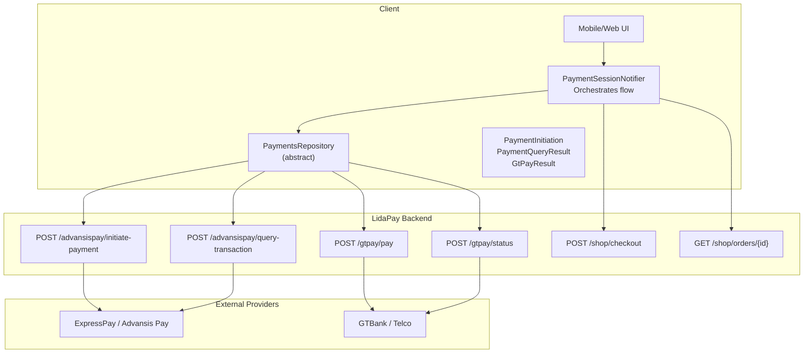
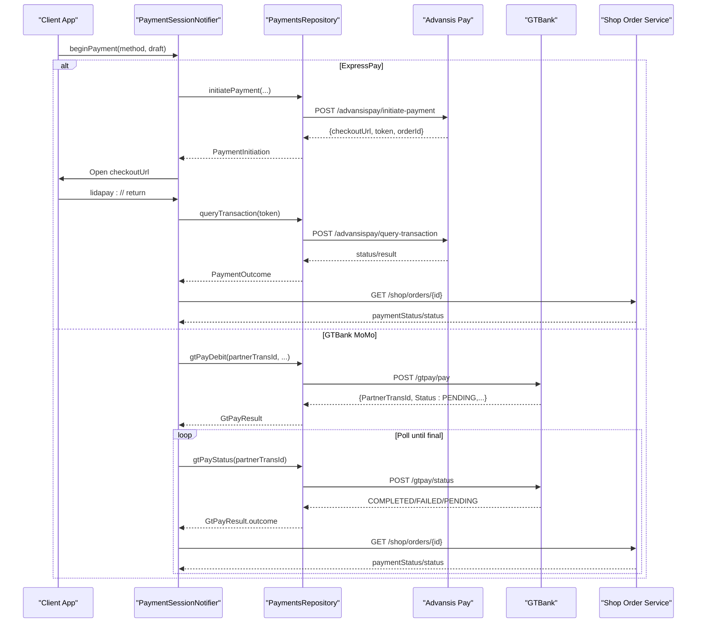
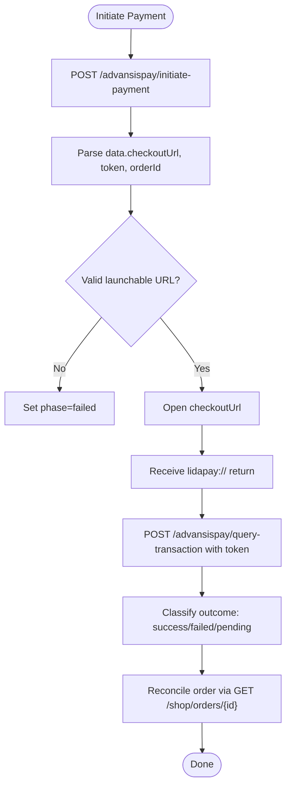
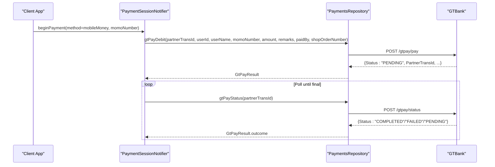
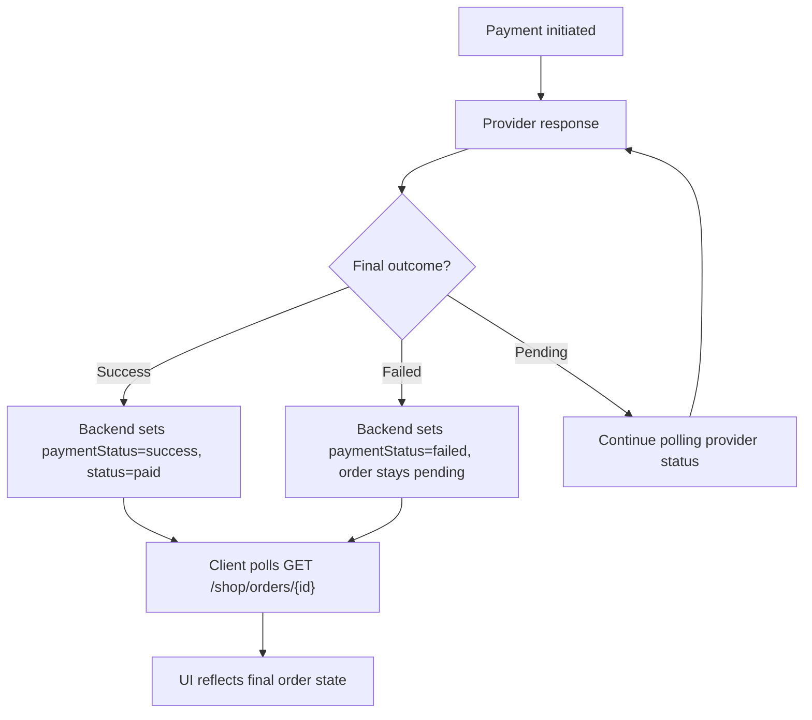
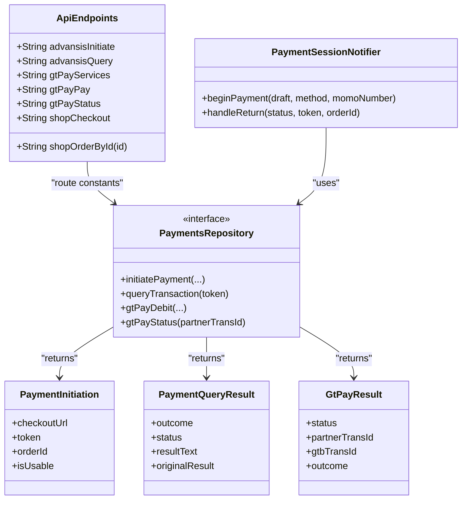

# Payment Processing API

<cite>
**Referenced Files in This Document**
- [ENDPOINTS.md](file://api/ENDPOINTS.md)
- [SHOP_API_MOBILE_HANDOFF.md](file://docs/SHOP_API_MOBILE_HANDOFF.md)
- [MOBILE_APP_REBUILD_HANDOFF.md](file://docs/MOBILE_APP_REBUILD_HANDOFF.md)
- [api_endpoints.dart](file://lib/core/network/api_endpoints.dart)
- [payment_models.dart](file://lib/features/payments/data/payment_models.dart)
- [payments_repository.dart](file://lib/features/payments/data/payments_repository.dart)
- [providers.dart](file://lib/features/payments/providers.dart)
</cite>

## Table of Contents
1. [Introduction](#introduction)
2. [Project Structure](#project-structure)
3. [Core Components](#core-components)
4. [Architecture Overview](#architecture-overview)
5. [Detailed Component Analysis](#detailed-component-analysis)
6. [Dependency Analysis](#dependency-analysis)
7. [Performance Considerations](#performance-considerations)
8. [Troubleshooting Guide](#troubleshooting-guide)
9. [Conclusion](#conclusion)
10. [Appendices](#appendices)

## Introduction
This document provides comprehensive API documentation for payment processing endpoints used by the LidaPay mobile and web clients. It covers:
- Mobile money transfers via GTBank (GTPay).
- Card payments through Advansis Pay / ExpressPay.
- Transaction status monitoring and reconciliation.
- Callbacks, deep links, and webhook considerations.
- Client integration guidelines for initiating payments, handling returns, polling status, and managing failed transactions.

The base URL for all documented APIs is `https://api.advansistechnologies.com`.

## Project Structure
Payment-related functionality is defined across:
- A public endpoint map describing available routes.
- Shop handoff documentation detailing checkout and payment flows.
- Client-side route constants and models for payment initiation, query, and GTBank results.
- A repository interface abstracting network calls.
- A session orchestrator coordinating checkout, callbacks, verification, and order reconciliation.

**Diagram sources**
- [ENDPOINTS.md:153-158](file://api/ENDPOINTS.md#L153-L158)
- [ENDPOINTS.md:185-192](file://api/ENDPOINTS.md#L185-L192)
- [SHOP_API_MOBILE_HANDOFF.md:237-316](file://docs/SHOP_API_MOBILE_HANDOFF.md#L237-L316)
- [api_endpoints.dart:102-109](file://lib/core/network/api_endpoints.dart#L102-L109)
- [payments_repository.dart:3-45](file://lib/features/payments/data/payments_repository.dart#L3-L45)
- [payment_models.dart:5-214](file://lib/features/payments/data/payment_models.dart#L5-L214)

**Section sources**
- [ENDPOINTS.md:1-195](file://api/ENDPOINTS.md#L1-L195)
- [SHOP_API_MOBILE_HANDOFF.md:1-452](file://docs/SHOP_API_MOBILE_HANDOFF.md#L1-L452)
- [api_endpoints.dart:1-155](file://lib/core/network/api_endpoints.dart#L1-L155)

## Core Components
- Endpoint registry: Centralized path constants for payment and shop endpoints.
- Payment models: Typed representations for initiation responses, query outcomes, and GTBank results.
- Repository contract: Defines methods to initiate payments, query transaction status, debit mobile money, and check GTBank status.
- Payment session orchestrator: Manages phases, deep-link return handling, polling, and safe reconciliation.

Key responsibilities:
- Initiate ExpressPay checkout and open a secure browser flow.
- Handle deep-link returns safely and verify authoritative status.
- Debit customer mobile money via GTBank and poll until final outcome.
- Reconcile order payment status using server-computed state.

**Section sources**
- [api_endpoints.dart:102-109](file://lib/core/network/api_endpoints.dart#L102-L109)
- [payment_models.dart:5-214](file://lib/features/payments/data/payment_models.dart#L5-L214)
- [payments_repository.dart:3-45](file://lib/features/payments/data/payments_repository.dart#L3-L45)
- [providers.dart:43-129](file://lib/features/payments/providers.dart#L43-L129)

## Architecture Overview
The payment architecture supports two primary rails:
- Advansis Pay / ExpressPay (card/hosted checkout): client initiates, opens hosted page, then verifies via token-based query.
- GTBank Mobile Money (debitwallet): client debits MoMo wallet; final settlement may be asynchronous.

Order linkage:
- For shop orders, include `shopOrderNumber` when initiating payment so the backend can reconcile order status automatically on success or failure.

**Diagram sources**
- [SHOP_API_MOBILE_HANDOFF.md:237-316](file://docs/SHOP_API_MOBILE_HANDOFF.md#L237-L316)
- [providers.dart:179-250](file://lib/features/payments/providers.dart#L179-L250)
- [payments_repository.dart:3-45](file://lib/features/payments/data/payments_repository.dart#L3-L45)
- [payment_models.dart:5-214](file://lib/features/payments/data/payment_models.dart#L5-L214)

## Detailed Component Analysis

### ExpressPay (Advansis Pay) Integration
Endpoints:
- `POST /api/v1/advansispay/initiate-payment`
- `POST /api/v1/advansispay/query-transaction`

Request schema (initiate):
- Required fields: `userId`, `firstName`, `lastName`, `email`, `phoneNumber`, `amount`, `orderDesc`, `transType`.
- Optional fields: `payTransRef`, `shopOrderNumber`, `redirectUrl` (for shop deep link), `returnUrl` (for web), `webhookUrl` + `webhookSecret` (for server-to-server notifications).

Response envelope:
- `data.checkoutUrl`: Hosted payment page URL.
- `data.token`: Authoritative identifier for later verification.
- `data.order-id` or equivalent: Provider-side reference.

Verification:
- Use `POST /api/v1/advansispay/query-transaction` with `{ token }`.
- Outcome classification considers multiple provider fields (`status`, `resultText`, `originalResponse.result`).

Security and callbacks:
- Do not trust deep-link `status` alone; always verify via query endpoint.
- Web clients may pass `returnUrl`; mobile uses `lidapay://` deep link when `returnUrl` is absent.
- Server-side ExpressPay callbacks exist (`redirect-url`, `post-status`) but must not be called directly from the app.

**Diagram sources**
- [SHOP_API_MOBILE_HANDOFF.md:237-265](file://docs/SHOP_API_MOBILE_HANDOFF.md#L237-L265)
- [MOBILE_APP_REBUILD_HANDOFF.md:376-402](file://docs/MOBILE_APP_REBUILD_HANDOFF.md#L376-L402)
- [payment_models.dart:5-150](file://lib/features/payments/data/payment_models.dart#L5-L150)
- [providers.dart:179-250](file://lib/features/payments/providers.dart#L179-L250)

**Section sources**
- [ENDPOINTS.md:153-158](file://api/ENDPOINTS.md#L153-L158)
- [SHOP_API_MOBILE_HANDOFF.md:237-265](file://docs/SHOP_API_MOBILE_HANDOFF.md#L237-L265)
- [MOBILE_APP_REBUILD_HANDOFF.md:376-402](file://docs/MOBILE_APP_REBUILD_HANDOFF.md#L376-L402)
- [payment_models.dart:5-150](file://lib/features/payments/data/payment_models.dart#L5-L150)
- [providers.dart:179-250](file://lib/features/payments/providers.dart#L179-L250)

### GTBank Mobile Money (GTPay) Integration
Endpoints:
- `POST /api/v1/gtpay/pay`
- `POST /api/v1/gtpay/status`

Request schema (debitwallet):
- Top-level fields: `userId`, `userName`, `shopOrderNumber` (optional but recommended).
- `ServiceDetails.ServiceName`: `"debitwallet"` for customer payments.
- `ServiceDetails.ServiceNumber`: Customer MoMo number (normalized to local format).
- `ServiceDetails.Amount`: String amount equal to order total.
- Additional fields: `Remarks`, `PaidBy`, `PayeeName`.

Response envelope:
- `data.Status`: `PENDING`, `COMPLETED`, or `FAILED`.
- `data.PartnerTransId`: Unique ID for reconciliation.
- `data.GTBTransId`: Provider transaction ID.
- `data.Data.Network`, `data.Data.TotalAmount`, optional charge info.

Status polling:
- Use `POST /api/v1/gtpay/status` with `{ PartnerTransId }`.
- Treat `PENDING` as asynchronous; continue polling with backoff.
- Never start a second payment while telco response is outstanding.

**Diagram sources**
- [SHOP_API_MOBILE_HANDOFF.md:267-316](file://docs/SHOP_API_MOBILE_HANDOFF.md#L267-L316)
- [payments_repository.dart:28-44](file://lib/features/payments/data/payments_repository.dart#L28-L44)
- [payment_models.dart:165-214](file://lib/features/payments/data/payment_models.dart#L165-L214)

**Section sources**
- [ENDPOINTS.md:185-192](file://api/ENDPOINTS.md#L185-L192)
- [SHOP_API_MOBILE_HANDOFF.md:267-316](file://docs/SHOP_API_MOBILE_HANDOFF.md#L267-L316)
- [payments_repository.dart:28-44](file://lib/features/payments/data/payments_repository.dart#L28-L44)
- [payment_models.dart:165-214](file://lib/features/payments/data/payment_models.dart#L165-L214)

### Transaction Status Monitoring and Order Reconciliation
- After payment initiation and callback/return, always verify via provider query or status endpoints.
- For shop orders, include `shopOrderNumber` so the backend reconciles order `paymentStatus` and `status` automatically on final outcomes.
- The client should also poll `GET /api/v1/shop/orders/{id}` to observe final order state.

**Diagram sources**
- [SHOP_API_MOBILE_HANDOFF.md:237-316](file://docs/SHOP_API_MOBILE_HANDOFF.md#L237-L316)
- [SHOP_API_MOBILE_HANDOFF.md:320-339](file://docs/SHOP_API_MOBILE_HANDOFF.md#L320-L339)

**Section sources**
- [SHOP_API_MOBILE_HANDOFF.md:237-339](file://docs/SHOP_API_MOBILE_HANDOFF.md#L237-L339)

### Refunds
- Refund policy and behavior are described in legal/support content; approved refunds are returned through the original payment method where possible.
- Order cancellation may trigger refund processing depending on order state.
- No dedicated refund initiation endpoint is exposed in the provided endpoint map; refunds are managed server-side based on business rules.

**Section sources**
- [ENDPOINTS.md:179-182](file://api/ENDPOINTS.md#L179-L182)
- [SHOP_API_MOBILE_HANDOFF.md:331-339](file://docs/SHOP_API_MOBILE_HANDOFF.md#L331-L339)

### Callbacks and Webhooks
- Mobile clients receive a deep link (`lidapay://...`) after ExpressPay completion.
- Web clients may use `returnUrl` and optionally `webhookUrl` + `webhookSecret` for server-to-server notifications during ExpressPay initiation.
- The app must never call callback endpoints directly; it must rely on query/status endpoints and order reconciliation.

**Section sources**
- [SHOP_API_MOBILE_HANDOFF.md:262-265](file://docs/SHOP_API_MOBILE_HANDOFF.md#L262-L265)
- [MOBILE_APP_REBUILD_HANDOFF.md:376-402](file://docs/MOBILE_APP_REBUILD_HANDOFF.md#L376-L402)

## Dependency Analysis
- `ApiEndpoints` centralizes route strings for payment and shop operations.
- `PaymentsRepository` defines the contract for initiating and verifying payments.
- `PaymentModels` parse provider responses and classify outcomes consistently.
- `PaymentSessionNotifier` coordinates user interactions, provider calls, and order reconciliation.

**Diagram sources**
- [api_endpoints.dart:102-109](file://lib/core/network/api_endpoints.dart#L102-L109)
- [payments_repository.dart:3-45](file://lib/features/payments/data/payments_repository.dart#L3-L45)
- [payment_models.dart:5-214](file://lib/features/payments/data/payment_models.dart#L5-L214)
- [providers.dart:131-250](file://lib/features/payments/providers.dart#L131-L250)

**Section sources**
- [api_endpoints.dart:102-109](file://lib/core/network/api_endpoints.dart#L102-L109)
- [payments_repository.dart:3-45](file://lib/features/payments/data/payments_repository.dart#L3-L45)
- [payment_models.dart:5-214](file://lib/features/payments/data/payment_models.dart#L5-L214)
- [providers.dart:131-250](file://lib/features/payments/providers.dart#L131-L250)

## Performance Considerations
- Avoid duplicate payments: do not retry GTBank debit if the request times out without a known outcome; first check `/gtpay/status`.
- Use measured backoff when polling provider status to reduce load.
- Stop polling tracking and payment status when the screen is backgrounded or the order reaches terminal states.
- Prefer server-computed prices and delivery fees; avoid client-side calculations that could cause mismatches.

[No sources needed since this section provides general guidance]

## Troubleshooting Guide
Common issues and resolutions:
- Invalid checkout URL: If the returned `checkoutUrl` is malformed or not launchable, set the session to failed and prompt retry.
- Mismatched return order IDs: Ignore deep-link `orderId` if it does not match the pending record; continue verification via saved token.
- Pending GTBank responses: Keep the order in a verifying state and poll `/gtpay/status` with backoff; do not start a second payment.
- Deep-link-only assumptions: Never mark a transaction paid solely from deep-link parameters; always verify via query/status endpoints.

Operational safeguards:
- Single-flight verification: Ensure only one verification runs at a time to prevent double crediting.
- Generation counter: Invalidate stale verifications when the user cancels, retries, or starts a new purchase.

**Section sources**
- [providers.dart:369-405](file://lib/features/payments/providers.dart#L369-L405)
- [providers.dart:179-250](file://lib/features/payments/providers.dart#L179-L250)
- [SHOP_API_MOBILE_HANDOFF.md:298-316](file://docs/SHOP_API_MOBILE_HANDOFF.md#L298-L316)

## Conclusion
The LidaPay payment system integrates two primary rails—ExpressPay for hosted card/mobile-money checkout and GTBank for mobile money debits. Clients should:
- Initiate payments via the appropriate endpoint.
- Handle deep-link returns safely and verify authoritative status.
- Include `shopOrderNumber` for automatic order reconciliation.
- Poll provider status endpoints with backoff and reconcile order state.
- Follow security requirements and avoid direct callback calls.

[No sources needed since this section summarizes without analyzing specific files]

## Appendices

### API Endpoint Reference Summary
- Base URL: `https://api.advansistechnologies.com`
- ExpressPay:
  - `POST /api/v1/advansispay/initiate-payment`
  - `POST /api/v1/advansispay/query-transaction`
- GTBank (GTPay):
  - `POST /api/v1/gtpay/services`
  - `POST /api/v1/gtpay/pay`
  - `POST /api/v1/gtpay/status`
  - `GET /api/v1/gtpay/banks`
- Shop Checkout and Orders:
  - `POST /api/v1/shop/checkout`
  - `GET /api/v1/shop/orders/{id}`
  - `GET /api/v1/shop/orders/{id}/tracking`

**Section sources**
- [ENDPOINTS.md:153-158](file://api/ENDPOINTS.md#L153-L158)
- [ENDPOINTS.md:185-192](file://api/ENDPOINTS.md#L185-L192)
- [ENDPOINTS.md:175-184](file://api/ENDPOINTS.md#L175-L184)