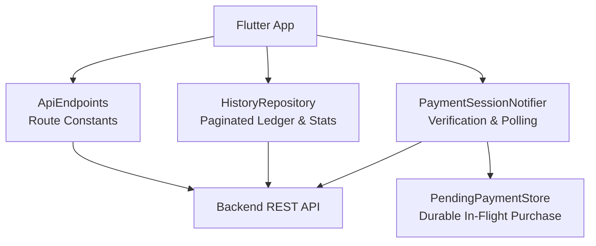
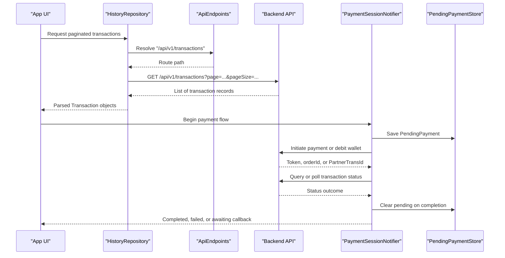
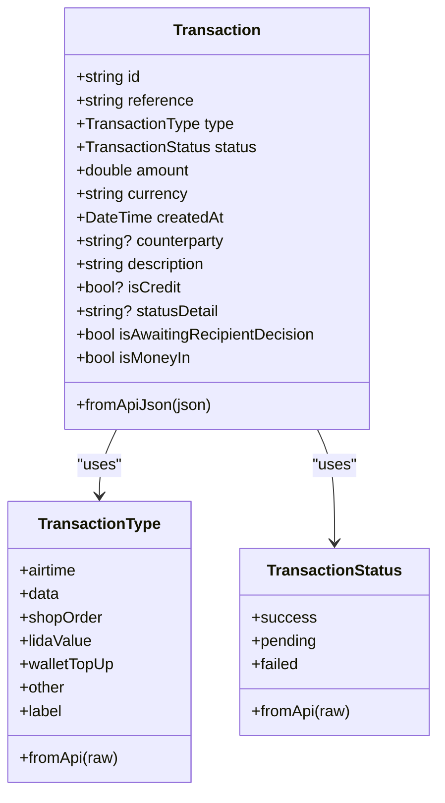
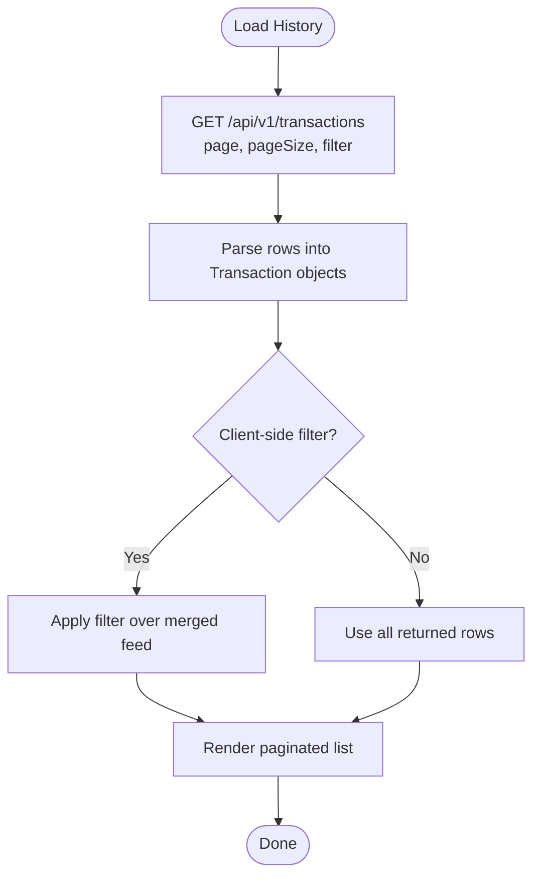
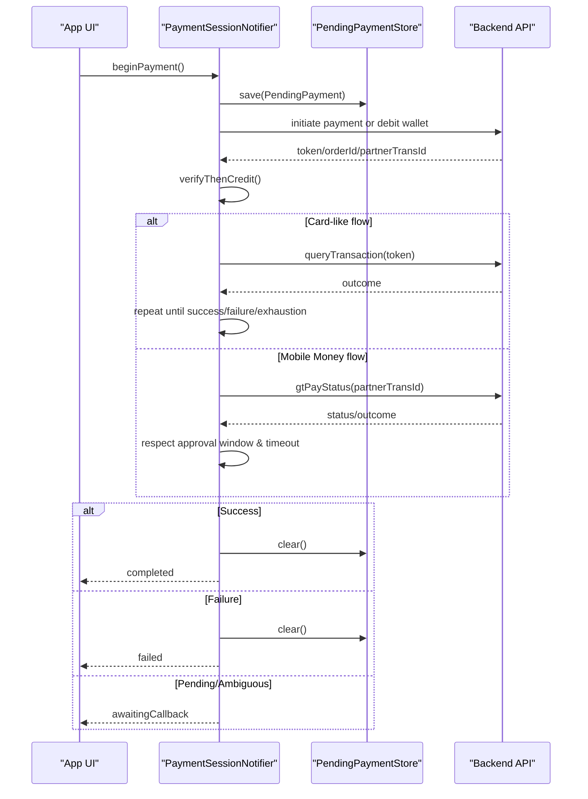
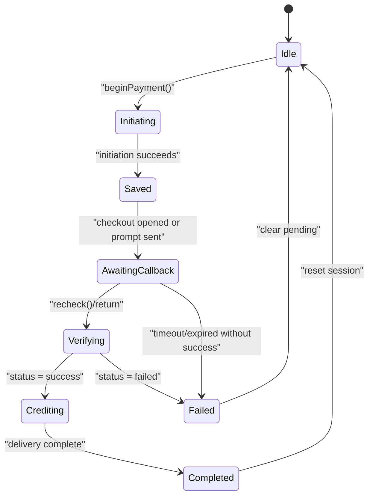
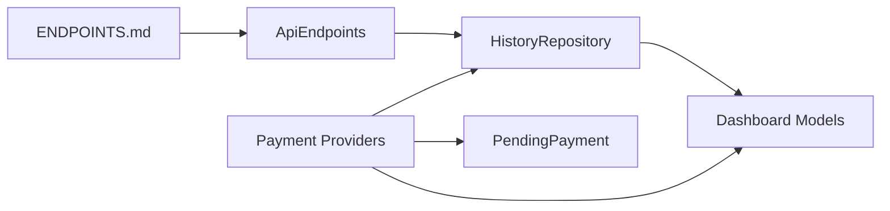

# Transaction Management

<cite>
**Referenced Files in This Document**   
- [ENDPOINTS.md](file://api/ENDPOINTS.md)
- [api_endpoints.dart](file://lib/core/network/api_endpoints.dart)
- [dashboard_models.dart](file://lib/features/dashboard/data/dashboard_models.dart)
- [history_repository.dart](file://lib/features/history/data/history_repository.dart)
- [providers.dart](file://lib/features/payments/providers.dart)
- [pending_payment.dart](file://lib/features/payments/data/pending_payment.dart)
- [payment_flow_test.dart](file://test/payment_flow_test.dart)
</cite>

## Table of Contents
1. [Introduction](#introduction)
2. [Project Structure](#project-structure)
3. [Core Components](#core-components)
4. [Architecture Overview](#architecture-overview)
5. [Detailed Component Analysis](#detailed-component-analysis)
6. [Dependency Analysis](#dependency-analysis)
7. [Performance Considerations](#performance-considerations)
8. [Troubleshooting Guide](#troubleshooting-guide)
9. [Conclusion](#conclusion)

## Introduction
This document provides API documentation for transaction management endpoints exposed by the backend and consumed by the mobile application. It focuses on:

- Creating transactions.
- Retrieving a transaction by ID.
- Filtering transactions by user.
- Checking transaction status through the dedicated transaction-status endpoint.
- Implementing transaction tracking, status monitoring, pagination handling, and integration with the pending payment store for real-time status updates.

The backend base URL is `https://api.advansistechnologies.com`. The documented endpoints are extracted from the repository’s OpenAPI-derived endpoint map and implemented or referenced by the Flutter client code.

## Project Structure
Transaction-related functionality spans three layers:

| Layer | Responsibility | Relevant Files |
|---|---|---|
| Backend contract | Declares available REST endpoints, including transaction creation, retrieval, filtering, and status checking. | [ENDPOINTS.md](file://api/ENDPOINTS.md) |
| Client routing | Defines route constants used by the app to call transaction endpoints. | [api_endpoints.dart](file://lib/core/network/api_endpoints.dart) |
| Client models and flows | Parses ledger rows, maps statuses, paginates history, and coordinates payment verification with the pending payment store. | [dashboard_models.dart](file://lib/features/dashboard/data/dashboard_models.dart), [history_repository.dart](file://lib/features/history/data/history_repository.dart), [providers.dart](file://lib/features/payments/providers.dart), [pending_payment.dart](file://lib/features/payments/data/pending_payment.dart) |

**Diagram sources**
- [api_endpoints.dart:35-40](file://lib/core/network/api_endpoints.dart#L35-L40)
- [history_repository.dart:4-24](file://lib/features/history/data/history_repository.dart#L4-L24)
- [providers.dart:120-159](file://lib/features/payments/providers.dart#L120-L159)
- [pending_payment.dart:24-46](file://lib/features/payments/data/pending_payment.dart#L24-L46)

**Section sources**
- [ENDPOINTS.md:60-71](file://api/ENDPOINTS.md#L60-L71)
- [api_endpoints.dart:35-40](file://lib/core/network/api_endpoints.dart#L35-L40)

## Core Components
This section documents the four transaction lifecycle endpoints requested in the objective.

### POST /api/v1/transactions/create
- **Purpose:** Create a new transaction.
- **HTTP Method:** `POST`
- **Path:** `/api/v1/transactions/create`
- **Authentication:** Typically required when creating financial records; the mobile app attaches authentication tokens for authenticated endpoints.
- **Request Body:** The repository does not define a strict request schema here. The mobile app uses higher-level payment initiation flows that send provider-specific parameters such as amount, currency, recipient information, order description, and client-generated references.
- **Response:** A created transaction record is expected. The client-side transaction model parses flexible fields from ledger responses, so exact response keys may vary across providers.

**Section sources**
- [ENDPOINTS.md:60](file://api/ENDPOINTS.md#L60)
- [dashboard_models.dart:142-312](file://lib/features/dashboard/data/dashboard_models.dart#L142-L312)

### GET /api/v1/transactions/{id}
- **Purpose:** Retrieve a single transaction by its identifier.
- **HTTP Method:** `GET`
- **Path:** `/api/v1/transactions/{id}`
- **Path Parameter:** `id` — the transaction identifier.
- **Response:** A transaction object containing identifiers, type, status, amount, currency, timestamps, and optional metadata such as counterparty, description, and status detail.

**Section sources**
- [ENDPOINTS.md:62](file://api/ENDPOINTS.md#L62)
- [dashboard_models.dart:92-131](file://lib/features/dashboard/data/dashboard_models.dart#L92-L131)

### GET /api/v1/transactions/user/{userId}
- **Purpose:** Get transactions belonging to a specific user, with pagination support.
- **HTTP Method:** `GET`
- **Path:** `/api/v1/transactions/user/{userId}`
- **Path Parameter:** `userId` — the user whose transactions are requested.
- **Pagination:** The endpoint supports paginated results. The client defines page and page size parameters for general transaction listing and applies client-side filtering over merged feeds.
- **Response:** A list of transaction records. Each record is parsed into the client’s `Transaction` model.

**Section sources**
- [ENDPOINTS.md:66](file://api/ENDPOINTS.md#L66)
- [api_endpoints.dart:36-37](file://lib/core/network/api_endpoints.dart#L36-L37)
- [history_repository.dart:4-12](file://lib/features/history/data/history_repository.dart#L4-L12)
- [dashboard_models.dart:142-312](file://lib/features/dashboard/data/dashboard_models.dart#L142-L312)

### GET /api/v1/transaction-status/transaction/{transactionRef}
- **Purpose:** Check the current status of a transaction using its transaction reference.
- **HTTP Method:** `GET`
- **Path:** `/api/v1/transaction-status/transaction/{transactionRef}`
- **Path Parameter:** `transactionRef` — the transaction reference used for status lookup.
- **Use Case:** Used when a transaction is pending, ambiguous, or requires reconciliation after an asynchronous provider callback.
- **Response:** A status result indicating success, pending, failure, or another provider-defined state.

**Section sources**
- [ENDPOINTS.md:9](file://api/ENDPOINTS.md#L9)

## Architecture Overview
The transaction lifecycle integrates backend endpoints, client routing, ledger parsing, and payment session coordination.

**Diagram sources**
- [history_repository.dart:4-24](file://lib/features/history/data/history_repository.dart#L4-L24)
- [api_endpoints.dart:35-40](file://lib/core/network/api_endpoints.dart#L35-L40)
- [providers.dart:179-277](file://lib/features/payments/providers.dart#L179-L277)
- [providers.dart:501-572](file://lib/features/payments/providers.dart#L501-L572)
- [providers.dart:574-665](file://lib/features/payments/providers.dart#L574-L665)
- [pending_payment.dart:24-46](file://lib/features/payments/data/pending_payment.dart#L24-L46)

## Detailed Component Analysis

### Transaction Model and Status Mapping
The client parses backend transaction rows into a strongly typed `Transaction` model. It tolerates multiple field names because the backend entity is not fully annotated in the OpenAPI spec.

Key behaviors:
- Flexible timestamp parsing (`initiatedAt`, `createdAt`, `date`, `timestamp`, etc.).
- Flexible amount parsing under nested `monetary` objects or flat fields.
- Flexible counterparty, description, and status-detail fields.
- Reference resolution across legacy and modern key names.
- Direction inference from explicit direction fields or heuristic keywords.
- Currency normalization with fallback to `GHS`.
- Status mapping to `success`, `pending`, or `failed`.
- Detection of recipient-decision waiting states.

**Diagram sources**
- [dashboard_models.dart:38-90](file://lib/features/dashboard/data/dashboard_models.dart#L38-L90)
- [dashboard_models.dart:92-326](file://lib/features/dashboard/data/dashboard_models.dart#L92-L326)

**Section sources**
- [dashboard_models.dart:38-90](file://lib/features/dashboard/data/dashboard_models.dart#L38-L90)
- [dashboard_models.dart:92-326](file://lib/features/dashboard/data/dashboard_models.dart#L92-L326)

### Pagination Handling
The history repository exposes a paginated ledger interface:

- `getTransactions(page, pageSize, filter)` calls `GET /api/v1/transactions`.
- `getStats()` calls `GET /api/v1/transactions/stats/{userId}`.
- `getByDateRange(start, end)` calls `GET /api/v1/transactions/date-range`.

The comment in the repository clarifies that filtering can be applied client-side over a merged feed so Lida Value, points, and shop rows remain visible under every filter combination.

**Diagram sources**
- [history_repository.dart:4-24](file://lib/features/history/data/history_repository.dart#L4-L24)

**Section sources**
- [history_repository.dart:4-24](file://lib/features/history/data/history_repository.dart#L4-L24)

### Transaction Tracking and Status Monitoring
The payment session orchestrates real-time tracking and reconciliation:

1. **Initiation:** The session initiates a payment, persists a `PendingPayment`, and opens checkout or sends a mobile money prompt.
2. **Verification:** For card-like flows, it polls a query endpoint until success, failure, or exhaustion.
3. **Mobile Money Flow:** It polls `/gtpay/status` using a saved `PartnerTransId`, respects an approval window, and treats timeouts differently from failures.
4. **Completion:** On success, it clears the pending record and delivers the purchase receipt.
5. **Failure Handling:** On failure, it clears the pending record and surfaces a user-friendly message.
6. **Ambiguous State:** If the network reports failure but the provider callback may still update the record, the session leaves the user options to check status again or retry.

**Diagram sources**
- [providers.dart:179-277](file://lib/features/payments/providers.dart#L179-L277)
- [providers.dart:474-572](file://lib/features/payments/providers.dart#L474-L572)
- [providers.dart:574-665](file://lib/features/payments/providers.dart#L574-L665)
- [providers.dart:700-754](file://lib/features/payments/providers.dart#L700-L754)
- [pending_payment.dart:24-46](file://lib/features/payments/data/pending_payment.dart#L24-L46)

**Section sources**
- [providers.dart:179-277](file://lib/features/payments/providers.dart#L179-L277)
- [providers.dart:474-572](file://lib/features/payments/providers.dart#L474-L572)
- [providers.dart:574-665](file://lib/features/payments/providers.dart#L574-L665)
- [providers.dart:700-754](file://lib/features/payments/providers.dart#L700-L754)
- [pending_payment.dart:24-46](file://lib/features/payments/data/pending_payment.dart#L24-L46)

### Integration With Pending Payment Store
The pending payment store persists durable in-flight purchase data:

- Persists immediately after successful initiation.
- Survives process death.
- Stores the client-generated reference, provider token, order identifiers, checkout URL, method, partner transaction ID, and mobile money number.
- Is cleared on completion, cancellation, or definitive failure.

**Diagram sources**
- [providers.dart:179-277](file://lib/features/payments/providers.dart#L179-L277)
- [providers.dart:423-468](file://lib/features/payments/providers.dart#L423-L468)
- [providers.dart:501-572](file://lib/features/payments/providers.dart#L501-L572)
- [providers.dart:574-665](file://lib/features/payments/providers.dart#L574-L665)
- [pending_payment.dart:24-46](file://lib/features/payments/data/pending_payment.dart#L24-L46)

**Section sources**
- [providers.dart:179-277](file://lib/features/payments/providers.dart#L179-L277)
- [providers.dart:423-468](file://lib/features/payments/providers.dart#L423-L468)
- [providers.dart:501-572](file://lib/features/payments/providers.dart#L501-L572)
- [providers.dart:574-665](file://lib/features/payments/providers.dart#L574-L665)
- [pending_payment.dart:24-46](file://lib/features/payments/data/pending_payment.dart#L24-L46)

### Example Usage Patterns

#### Creating a Transaction
- Call `POST /api/v1/transactions/create` with provider-specific payload.
- Persist any returned identifiers and references.
- Transition UI to initiating or awaiting state.

#### Retrieving a Transaction
- Call `GET /api/v1/transactions/{id}`.
- Parse the response into the `Transaction` model.
- Display status, amount, currency, counterparty, and description.

#### Filtering Transactions by User
- Call `GET /api/v1/transactions/user/{userId}`.
- Use `page` and `pageSize` for pagination.
- Optionally apply client-side filters over the merged feed.

#### Checking Transaction Status
- Call `GET /api/v1/transaction-status/transaction/{transactionRef}`.
- Treat ambiguous or transient errors as pending rather than final failure.
- Retry according to provider behavior and user context.

**Section sources**
- [ENDPOINTS.md:9](file://api/ENDPOINTS.md#L9)
- [ENDPOINTS.md:60](file://api/ENDPOINTS.md#L60)
- [ENDPOINTS.md:62](file://api/ENDPOINTS.md#L62)
- [ENDPOINTS.md:66](file://api/ENDPOINTS.md#L66)
- [dashboard_models.dart:142-312](file://lib/features/dashboard/data/dashboard_models.dart#L142-L312)

## Dependency Analysis
The transaction subsystem depends on:

- Backend endpoint definitions.
- Client route constants.
- Ledger parsing logic.
- Payment session orchestration.
- Pending payment persistence.

**Diagram sources**
- [ENDPOINTS.md:60-71](file://api/ENDPOINTS.md#L60-L71)
- [api_endpoints.dart:35-40](file://lib/core/network/api_endpoints.dart#L35-L40)
- [history_repository.dart:4-24](file://lib/features/history/data/history_repository.dart#L4-L24)
- [dashboard_models.dart:92-326](file://lib/features/dashboard/data/dashboard_models.dart#L92-L326)
- [providers.dart:120-159](file://lib/features/payments/providers.dart#L120-L159)
- [pending_payment.dart:24-46](file://lib/features/payments/data/pending_payment.dart#L24-L46)

**Section sources**
- [ENDPOINTS.md:60-71](file://api/ENDPOINTS.md#L60-L71)
- [api_endpoints.dart:35-40](file://lib/core/network/api_endpoints.dart#L35-L40)
- [history_repository.dart:4-24](file://lib/features/history/data/history_repository.dart#L4-L24)
- [dashboard_models.dart:92-326](file://lib/features/dashboard/data/dashboard_models.dart#L92-L326)
- [providers.dart:120-159](file://lib/features/payments/providers.dart#L120-L159)
- [pending_payment.dart:24-46](file://lib/features/payments/data/pending_payment.dart#L24-L46)

## Performance Considerations
- **Polling Limits:** The payment session caps query attempts and delays to avoid excessive network usage.
- **Approval Window:** Mobile money polling stops active polling after the approval window closes, reducing unnecessary requests.
- **Single-Flight Verification:** Duplicate return events or resume actions join the same verification future instead of starting duplicate polls.
- **Pagination:** Use reasonable page sizes to balance responsiveness and server load.
- **Error Classification:** Transient API errors are treated as unknown rather than failure during polling, preventing premature termination while avoiding infinite retries.

[No sources needed since this section provides general guidance]

## Troubleshooting Guide
Common issues and recommended handling:

| Symptom | Likely Cause | Recommended Action |
|---|---|---|
| Transaction remains pending after timeout | Approval window expired or provider did not respond | Use status endpoint once; allow user to check status or retry if appropriate. |
| Repeated charges on retry | Missing idempotency reference or reusing stale partner transaction ID | Ensure client-generated references and partner transaction IDs are unique per attempt. |
| Dashboard shows unexpected status | Backend returns non-standard status string | Rely on tolerant status mapping; surface detailed status reason when available. |
| History list missing recent rows | Pagination boundary or client-side filter too restrictive | Adjust page/pageSize and review filter logic. |
| Payment completes but delivery fails | Provider confirmed payment but service delivery failed | Keep pending record available for retry without charging again. |

**Section sources**
- [providers.dart:527-572](file://lib/features/payments/providers.dart#L527-L572)
- [providers.dart:602-665](file://lib/features/payments/providers.dart#L602-L665)
- [providers.dart:700-754](file://lib/features/payments/providers.dart#L700-L754)
- [payment_flow_test.dart:404-414](file://test/payment_flow_test.dart#L404-L414)
- [payment_flow_test.dart:719-745](file://test/payment_flow_test.dart#L719-L745)

## Conclusion
The transaction management layer combines a well-defined backend endpoint surface with a resilient Flutter client implementation. Creation, retrieval, user-scoped filtering, and status checking are supported through explicit REST routes. The client adds robustness through tolerant parsing, pagination, controlled polling, and durable pending-payment storage. For production integrations, always treat ambiguous network outcomes as pending, use unique idempotency references, and reconcile final state through the appropriate status endpoint before considering a transaction resolved.

[No sources needed since this section summarizes without analyzing specific files]