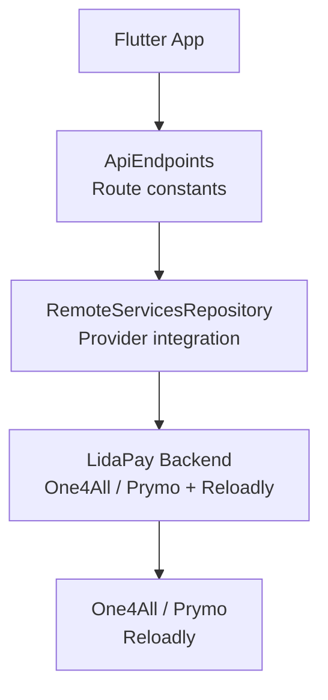
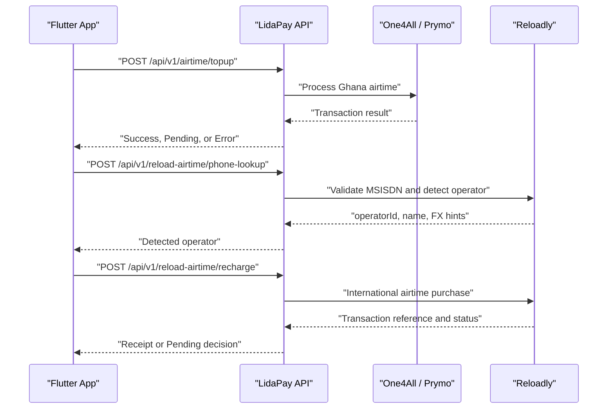
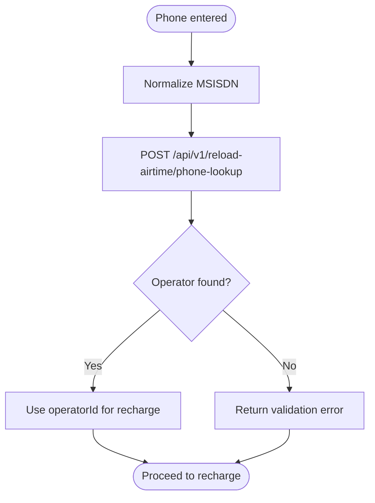
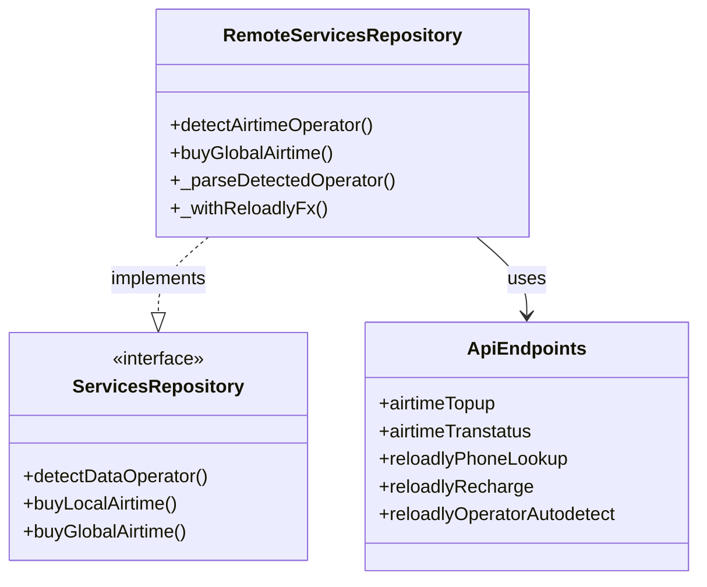

# Airtime Top-up API

<cite>
**Referenced Files in This Document**   
- [ENDPOINTS.md](file://api/ENDPOINTS.md)
- [api_endpoints.dart](file://lib/core/network/api_endpoints.dart)
- [remote_services_repository.dart](file://lib/features/services/data/remote_services_repository.dart)
- [services_repository.dart](file://lib/features/services/data/services_repository.dart)
- [MOBILE_APP_REBUILD_HANDOFF.md](file://docs/MOBILE_APP_REBUILD_HANDOFF.md)
- [BACKEND_NOTIFICATION_TRIGGERS_HANDOFF.md](file://docs/BACKEND_NOTIFICATION_TRIGGERS_HANDOFF.md)
- [airtime_screen.dart](file://lib/features/services/screens/airtime_screen.dart)
- [remote_parsing_test.dart](file://test/remote_parsing_test.dart)
</cite>

## Table of Contents
1. [Introduction](#introduction)
2. [Project Structure](#project-structure)
3. [Core Components](#core-components)
4. [Architecture Overview](#architecture-overview)
5. [Detailed Component Analysis](#detailed-component-analysis)
6. [Dependency Analysis](#dependency-analysis)
7. [Performance Considerations](#performance-considerations)
8. [Troubleshooting Guide](#troubleshooting-guide)
9. [Conclusion](#conclusion)

## Introduction
This document provides comprehensive API documentation for the airtime top-up endpoints exposed by the LidaPay backend and consumed by the Flutter client. It covers:

- Ghanaian domestic airtime via One4All/Prymo.
- International airtime via Reloadly.
- Phone number validation and operator detection (MNP Lookup).
- Transaction status checking.
- Recipient decision flow, idempotency, error handling, and notification triggers.

The base URL is `https://api.advansistechnologies.com`. All authenticated requests must include a valid bearer token as documented in the mobile handoff.

**Section sources**
- [ENDPOINTS.md:1-5](file://api/ENDPOINTS.md#L1-L5)
- [MOBILE_APP_REBUILD_HANDOFF.md:65-70](file://docs/MOBILE_APP_REBUILD_HANDOFF.md#L65-L70)

## Project Structure
The airtime top-up capability is implemented across three layers:

1. **Public endpoint map:** The OpenAPI-derived endpoint list documents the routes available to clients.
2. **Client-side route constants:** The Flutter app centralizes route paths under `ApiEndpoints`.
3. **Service repository implementation:** The remote service layer calls the backend, normalizes provider responses, handles fallbacks, and maps results into application receipts.



**Diagram sources**
- [api_endpoints.dart:69-83](file://lib/core/network/api_endpoints.dart#L69-L83)
- [remote_services_repository.dart:17-30](file://lib/features/services/data/remote_services_repository.dart#L17-L30)
- [ENDPOINTS.md:94-128](file://api/ENDPOINTS.md#L94-L128)

**Section sources**
- [ENDPOINTS.md:94-128](file://api/ENDPOINTS.md#L94-L128)
- [api_endpoints.dart:69-83](file://lib/core/network/api_endpoints.dart#L69-L83)
- [remote_services_repository.dart:17-30](file://lib/features/services/data/remote_services_repository.dart#L17-L30)

## Core Components
The airtime top-up system exposes four primary request surfaces relevant to this documentation:

| Endpoint | Purpose | Provider | Authentication |
|---|---|---|---|
| `POST /api/v1/airtime/topup` | Process Ghanaian airtime top-up | One4All / Prymo | Bearer token required |
| `POST /api/v1/reload-airtime/recharge` | Process international Reloadly airtime recharge | Reloadly | Bearer token required |
| `POST /api/v1/reload-airtime/recharge-async` | Asynchronous international airtime recharge | Reloadly | Bearer token required |
| `POST /api/v1/reload-airtime/phone-lookup` | Validate phone number and detect operator (MNP Lookup) | Reloadly-backed lookup | Bearer token required |

Additional related endpoints used by the same flows:

| Endpoint | Purpose |
|---|---|
| `POST /api/v1/airtime/transtatus` | Query Ghana airtime transaction status |
| `GET /api/v1/reload-airtime/topup-status/{transactionId}` | Query Reloadly airtime transaction status |
| `GET /api/v1/reload-airtime/token` | Generate reload-airtime access token (backend-owned) |
| `POST /api/v1/recipient/eligibility` | Check whether recipient choice applies |
| `POST /api/v1/recipient-decisions/{decisionId}/respond` | Recipient chooses `DIRECT` or `LIDA_VALUE` |
| `GET /api/v1/topups/{topupOrderId}/status` | Get canonical top-up status |

**Section sources**
- [ENDPOINTS.md:94-128](file://api/ENDPOINTS.md#L94-L128)
- [MOBILE_APP_REBUILD_HANDOFF.md:289-374](file://docs/MOBILE_APP_REBUILD_HANDOFF.md#L289-L374)

## Architecture Overview
The airtime top-up architecture separates domestic and international destinations:

- **Ghana (`GH`) destinations** use the domestic One4All/Prymo route.
- **International destinations** use Reloadly after country/operator discovery.
- **Operator detection** can be performed through Reloadly autodetect or MNP-style phone lookup.
- **Recipient choice** may return a pending decision instead of immediate delivery.
- **Status polling** uses provider-specific status endpoints.



**Diagram sources**
- [ENDPOINTS.md:94-128](file://api/ENDPOINTS.md#L94-L128)
- [MOBILE_APP_REBUILD_HANDOFF.md:289-374](file://docs/MOBILE_APP_REBUILD_HANDOFF.md#L289-L374)
- [remote_services_repository.dart:309-334](file://lib/features/services/data/remote_services_repository.dart#L309-L334)

## Detailed Component Analysis

### POST /api/v1/airtime/topup — Ghanaian Airtime Top-up (One4All)

#### Purpose
Process domestic airtime top-ups for Ghanaian recipients using the One4All/Prymo integration.

#### Request Schema
| Field | Type | Required | Description |
|---|---|---:|---|
| `recipientNumber` | string | Yes | Ghanaian phone number. Leading zeros must be preserved. |
| `amount` | number | Yes | Amount in local currency (for example GHS). |
| `network` | number | Yes | Prymo network code. Examples: MTN = `4`, AirtelTigo = `1`, Telecel = `6`. |
| `isSelfTopup` | boolean | Yes | `true` only when the signed-in user buys airtime for their own number; `false` for SEND. |
| `clientReference` | string | Yes | Unique per-attempt UUID v4 used for idempotency. |

Optional fields observed in tests and repository behavior include `userId` and `userName`, which are derived from the authenticated session rather than trusted client input.

#### Response Behavior
- **Immediate success:** Returns a provider transaction identifier and a successful state.
- **Pending recipient decision:** Returns `status: "PENDING"` with `decisionId` and `topupOrderId`.
- **Error:** Returns an application-level failure even if HTTP status is successful; the client must inspect response fields such as `success`, `ok`, or status tokens.

#### Idempotency Rule
Use one `clientReference` per attempt. Do not retry with the same reference after the backend reports a completed result. If the app resumes after a timeout, query the existing transaction status before considering a new request.

#### Example Scenarios

| Scenario | Network Code | Notes |
|---|---:|---|
| MTN Ghana | `4` | Domestic One4All route |
| AirtelTigo Ghana | `1` | Domestic One4All route |
| Telecel Ghana | `6` | Domestic One4All route |
| Glo Ghana | `3` | Domestic One4All route |
| Busy Ghana | `8` | Domestic One4All route |
| Surfline Ghana | `9` | Domestic One4All route |

#### Status Checking
For Ghana airtime, use:

```http
POST /api/v1/airtime/transtatus
Content-Type: application/json
Authorization: Bearer <access_token>

{
  "transReference": "<provider transaction reference>"
}
```

**Section sources**
- [ENDPOINTS.md:94-95](file://api/ENDPOINTS.md#L94-L95)
- [MOBILE_APP_REBUILD_HANDOFF.md:289-307](file://docs/MOBILE_APP_REBUILD_HANDOFF.md#L289-L307)
- [MOBILE_APP_REBUILD_HANDOFF.md:787-796](file://docs/MOBILE_APP_REBUILD_HANDOFF.md#L787-L796)
- [remote_parsing_test.dart:290-315](file://test/remote_parsing_test.dart#L290-L315)

### POST /api/v1/reload-airtime/phone-lookup — Operator Detection (MNP Lookup)

#### Purpose
Validate an international phone number and detect its operator before initiating a Reloadly purchase.

#### Request Schema
| Field | Type | Required | Description |
|---|---|---:|---|
| `phone` | string | Yes | Normalized MSISDN without spaces or display formatting. |
| `countryCode` | string | Yes | ISO-3166 alpha-2 destination country code. |

#### Response Schema
| Field | Type | Description |
|---|---|---|
| `operatorId` | number | Reloadly operator identifier. |
| `name` | string | Human-readable operator name. |
| Additional fields | object | May include suggested amounts, currency hints, or logo information depending on the backend mapping. |

#### Processing Notes
- The Flutter client normalizes the phone number before calling this endpoint.
- If no operator is detected, the client throws an API exception instructing the caller to check the country and phone number.
- For international airtime, the repository calls this lookup unless an explicit `operatorId` is already provided.

#### Example Flow


**Diagram sources**
- [remote_services_repository.dart:1212-1256](file://lib/features/services/data/remote_services_repository.dart#L1212-L1256)
- [remote_services_repository.dart:696-790](file://lib/features/services/data/remote_services_repository.dart#L696-L790)

**Section sources**
- [ENDPOINTS.md:127](file://api/ENDPOINTS.md#L127)
- [api_endpoints.dart:74-76](file://lib/core/network/api_endpoints.dart#L74-L76)
- [remote_services_repository.dart:1212-1256](file://lib/features/services/data/remote_services_repository.dart#L1212-L1256)
- [remote_services_repository.dart:696-790](file://lib/features/services/data/remote_services_repository.dart#L696-L790)

### POST /api/v1/reload-airtime/recharge — International Airtime Recharge (Reloadly)

#### Purpose
Initiate an international airtime recharge through Reloadly after operator detection.

#### Request Schema
| Field | Type | Required | Description |
|---|---|---:|---|
| `operatorId` | number | Yes | Reloadly operator ID returned by operator discovery or phone lookup. |
| `amount` | number | Yes | Sender-side amount. |
| `recipientNumber` | string | Yes | Normalized destination MSISDN. |
| `recipientCountryCode` | string | Yes | Destination ISO-3166 alpha-2 code. |
| `senderNumber` | string | Optional | Sender phone number. |
| `senderCountryCode` | string | Optional | Sender country code; defaults to Ghana in the client. |
| `currency` | string | Optional | Sender currency; defaults to USD in the client. |
| `recipientEmail` | string | Optional | Recipient email when supported. |
| `enableRecipientChoice` | boolean | Optional | Enables recipient choice for non-self sends. |
| `isSelfTopup` | boolean | Optional | `true` for self top-up; `false` for SEND. |
| `clientReference` | string | Yes | Unique per-attempt UUID v4 for idempotency. |

#### Response Behavior
- **Direct success:** Returns a Reloadly transaction reference and a successful state.
- **Pending recipient decision:** Returns `PENDING` with `decisionId` and `topupOrderId`.
- **Failure:** Returns an application-level error that must not be treated as success merely because HTTP status is `200`.

#### Example Scenarios

| Destination | Operator Discovery | Recharge Fields |
|---|---|---|
| Nigeria | Reloadly operator discovery or autodetect | `operatorId`, `recipientCountryCode: "NG"`, `currency: "USD"` or NGN depending on contract |
| Kenya | Reloadly operator discovery or autodetect | `operatorId`, `recipientCountryCode: "KE"` |
| United States | Reloadly operator discovery or autodetect | `operatorId`, `recipientCountryCode: "US"` |
| United Kingdom | Reloadly operator discovery or autodetect | `operatorId`, `recipientCountryCode: "GB"` |

#### Status Checking
For Reloadly airtime, use:

```http
GET /api/v1/reload-airtime/topup-status/{transactionId}
Authorization: Bearer <access_token>
```

Replace `{transactionId}` with the provider transaction reference returned by the recharge response.

**Section sources**
- [ENDPOINTS.md:125-128](file://api/ENDPOINTS.md#L125-L128)
- [MOBILE_APP_REBUILD_HANDOFF.md:329-348](file://docs/MOBILE_APP_REBUILD_HANDOFF.md#L329-L348)
- [MOBILE_APP_REBUILD_HANDOFF.md:787-796](file://docs/MOBILE_APP_REBUILD_HANDOFF.md#L787-L796)
- [remote_services_repository.dart:1212-1287](file://lib/features/services/data/remote_services_repository.dart#L1212-L1287)
- [remote_parsing_test.dart:317-340](file://test/remote_parsing_test.dart#L317-L340)

### POST /api/v1/reload-airtime/recharge-async — Asynchronous International Airtime Recharge

#### Purpose
Provide an asynchronous variant of the Reloadly international airtime recharge.

#### Contract Notes
- The endpoint exists in the public endpoint map.
- The current mobile handoff explicitly documents synchronous `POST /api/v1/reload-airtime/recharge` for international airtime.
- Clients should follow the documented synchronous contract unless the backend team publishes a separate async payload, callback, or polling contract.
- Until a dedicated async contract is confirmed, treat the async endpoint as backend-only or partner-only and do not invent request/response fields.

#### Recommended Client Behavior
- Use `POST /api/v1/reload-airtime/recharge` for standard mobile flows.
- If the backend returns a pending or ambiguous result, poll the supported status endpoint.
- Do not assume the async endpoint changes idempotency, recipient choice, or status semantics unless explicitly documented.

**Section sources**
- [ENDPOINTS.md:125-128](file://api/ENDPOINTS.md#L125-L128)
- [MOBILE_APP_REBUILD_HANDOFF.md:329-374](file://docs/MOBILE_APP_REBUILD_HANDOFF.md#L329-L374)

### Authentication Requirements

All authenticated top-up endpoints require:

```http
Authorization: Bearer <access_token>
Content-Type: application/json
```

Authentication flow summary:

1. Login with password or email OTP.
2. Save `access_token` and `refresh_token`.
3. Attach the access token to every protected request.
4. On expired access token, call `POST /api/v1/auth/refresh` once.
5. On refresh failure, clear the session and require re-authentication.

**Section sources**
- [MOBILE_APP_REBUILD_HANDOFF.md:65-77](file://docs/MOBILE_APP_REBUILD_HANDOFF.md#L65-L77)
- [MOBILE_APP_REBUILD_HANDOFF.md:180-193](file://docs/MOBILE_APP_REBUILD_HANDOFF.md#L180-L193)

### Rate Limiting

Observed rate-limiting behavior:

- Email OTP login is rate-limited.
- The mobile handoff warns against rapid retries on OTP endpoints.
- No explicit per-endpoint rate limits are defined in the referenced files for airtime endpoints.
- Clients should implement bounded retries, exponential backoff, and user-facing throttling feedback.

**Section sources**
- [MOBILE_APP_REBUILD_HANDOFF.md:113-122](file://docs/MOBILE_APP_REBUILD_HANDOFF.md#L113-L122)
- [MOBILE_APP_REBUILD_HANDOFF.md:193](file://docs/MOBILE_APP_REBUILD_HANDOFF.md#L193)

### Real-time Status Updates and Notifications

Airtime top-up outcomes are surfaced through:

1. **HTTP response state:** Immediate success, pending decision, or error.
2. **Status polling:** Provider-specific status endpoints.
3. **Notifications:** Backend-triggered events for delivered, failed, pending decisions, and resolved decisions.

Recommended polling strategy:

- Show a verifying state while the backend has not reached a terminal state.
- Poll with measured backoff while the screen is active.
- Resume polling on app resume.
- Stop only on final states such as delivered or failed.
- Treat timeouts as unknown, not failure.

Notification event types relevant to airtime:

| Event | Meaning |
|---|---|
| `topup_delivered` | Airtime or data successfully delivered |
| `topup_failed` | Delivery failed |
| `recipient_topup_decision` | Recipient decision is pending |
| `recipient_topup_resolved` | Recipient decision has been resolved |

**Section sources**
- [MOBILE_APP_REBUILD_HANDOFF.md:495-541](file://docs/MOBILE_APP_REBUILD_HANDOFF.md#L495-L541)
- [MOBILE_APP_REBUILD_HANDOFF.md:787-796](file://docs/MOBILE_APP_REBUILD_HANDOFF.md#L787-L796)
- [BACKEND_NOTIFICATION_TRIGGERS_HANDOFF.md:67-77](file://docs/BACKEND_NOTIFICATION_TRIGGERS_HANDOFF.md#L67-L77)
- [BACKEND_NOTIFICATION_TRIGGERS_HANDOFF.md:138-145](file://docs/BACKEND_NOTIFICATION_TRIGGERS_HANDOFF.md#L138-L145)

### Error Handling

Common error categories:

| Category | Cause | Client Action |
|---|---|---|
| Invalid phone number | Malformed MSISDN or unsupported prefix | Ask user to correct number and country |
| Operator not found | Country or number does not match any known operator | Return validation error |
| Insufficient balance | Wallet or payment funding insufficient | Show balance or payment error |
| Provider failure | One4All or Reloadly rejected the request | Show failure and allow safe retry after status check |
| Pending decision | Recipient has not chosen yet | Wait for decision or poll status |
| Duplicate request | Same `clientReference` submitted again | Return previous result if backend supports deduplication |
| Unknown timeout | Network timeout or provider delay | Query status before retrying |

The repository explicitly rejects application-level failures even when HTTP status indicates success, preventing false “delivered” receipts.

**Section sources**
- [remote_services_repository.dart:2000-2039](file://lib/features/services/data/remote_services_repository.dart#L2000-L2039)
- [remote_services_repository.dart:1212-1256](file://lib/features/services/data/remote_services_repository.dart#L1212-L1256)
- [MOBILE_APP_REBUILD_HANDOFF.md:787-796](file://docs/MOBILE_APP_REBUILD_HANDOFF.md#L787-L796)

## Dependency Analysis



**Diagram sources**
- [api_endpoints.dart:69-83](file://lib/core/network/api_endpoints.dart#L69-L83)
- [remote_services_repository.dart:17-30](file://lib/features/services/data/remote_services_repository.dart#L17-L30)
- [services_repository.dart:24-50](file://lib/features/services/data/services_repository.dart#L24-L50)

**Section sources**
- [api_endpoints.dart:69-83](file://lib/core/network/api_endpoints.dart#L69-L83)
- [remote_services_repository.dart:17-30](file://lib/features/services/data/remote_services_repository.dart#L17-L30)
- [services_repository.dart:24-50](file://lib/features/services/data/services_repository.dart#L24-L50)

## Performance Considerations

- **Operator catalogue caching:** Successful catalogue payloads are persisted locally so provider outages do not block the wizard after initial discovery.
- **Fallback operator detection:** When Reloadly autodetect fails, the client falls back to static prefix-based operator resolution for selected countries.
- **FX rate resolution:** Reloadly FX rates are fetched per operator when needed; static conversion tables are used as a last resort.
- **Retry policy:** Avoid automatic rapid retries on authentication or OTP endpoints. For top-ups, always query existing status before resubmitting.
- **Polling strategy:** Poll status only while the relevant screen is active and use backoff rather than tight loops.

**Section sources**
- [remote_services_repository.dart:46-69](file://lib/features/services/data/remote_services_repository.dart#L46-L69)
- [remote_services_repository.dart:309-334](file://lib/features/services/data/remote_services_repository.dart#L309-L334)
- [remote_services_repository.dart:367-421](file://lib/features/services/data/remote_services_repository.dart#L367-L421)
- [remote_services_repository.dart:427-468](file://lib/features/services/data/remote_services_repository.dart#L427-L468)
- [MOBILE_APP_REBUILD_HANDOFF.md:787-796](file://docs/MOBILE_APP_REBUILD_HANDOFF.md#L787-L796)

## Troubleshooting Guide

### Ghana Airtime Fails After Success Response
- Verify whether the response contains application-level failure fields.
- Check the provider transaction reference and call `POST /api/v1/airtime/transtatus`.
- Confirm the network code matches the intended operator.

### International Airtime Cannot Detect Operator
- Ensure the phone number is normalized to MSISDN format.
- Confirm the destination country code is correct.
- If autodetect fails, verify whether the backend’s Reloadly credentials are configured server-side.

### Pending Decision Never Resolves
- Poll `GET /api/v1/topups/{topupOrderId}/status`.
- Check recipient decision status via `GET /api/v1/recipient-decisions/{decisionId}`.
- Ensure the recipient’s FCM token is registered and notifications are enabled.

### Duplicate Charges or Repeated Requests
- Ensure each top-up attempt uses a unique `clientReference`.
- Do not resend the same `clientReference` after a completed result.
- On app resume, query existing status before deciding whether to retry.

### Reloadly Credentials Return Unauthorized
- Rotate upstream Reloadly keys server-side.
- Ghana domestic routes are unaffected by Reloadly credential issues.

**Section sources**
- [MOBILE_APP_REBUILD_HANDOFF.md:787-796](file://docs/MOBILE_APP_REBUILD_HANDOFF.md#L787-L796)
- [BACKEND_NOTIFICATION_TRIGGERS_HANDOFF.md:134-145](file://docs/BACKEND_NOTIFICATION_TRIGGERS_HANDOFF.md#L134-L145)
- [remote_services_repository.dart:2000-2039](file://lib/features/services/data/remote_services_repository.dart#L2000-L2039)

## Conclusion
The airtime top-up API integrates two provider ecosystems:

- **One4All/Prymo** for Ghanaian domestic airtime.
- **Reloadly** for international airtime, operator discovery, and FX conversion.

Clients must:

- Authenticate with a bearer token.
- Use `POST /api/v1/airtime/topup` for Ghana.
- Use `POST /api/v1/reload-airtime/phone-lookup` followed by `POST /api/v1/reload-airtime/recharge` for international destinations.
- Treat `POST /api/v1/reload-airtime/recharge-async` as undocumented for mobile until a separate contract is published.
- Implement idempotency with `clientReference`.
- Poll provider-specific status endpoints for pending or ambiguous results.
- Handle recipient decisions, errors, and notifications according to the documented flows.