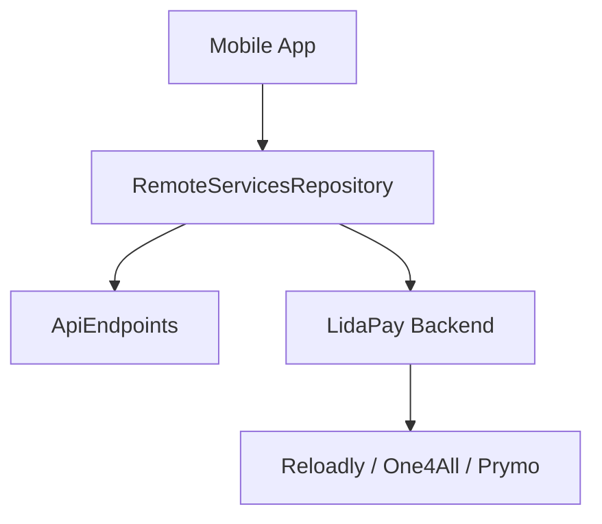
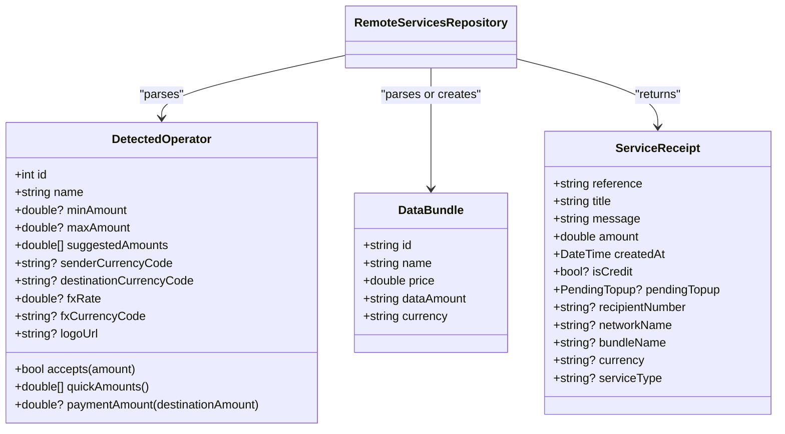
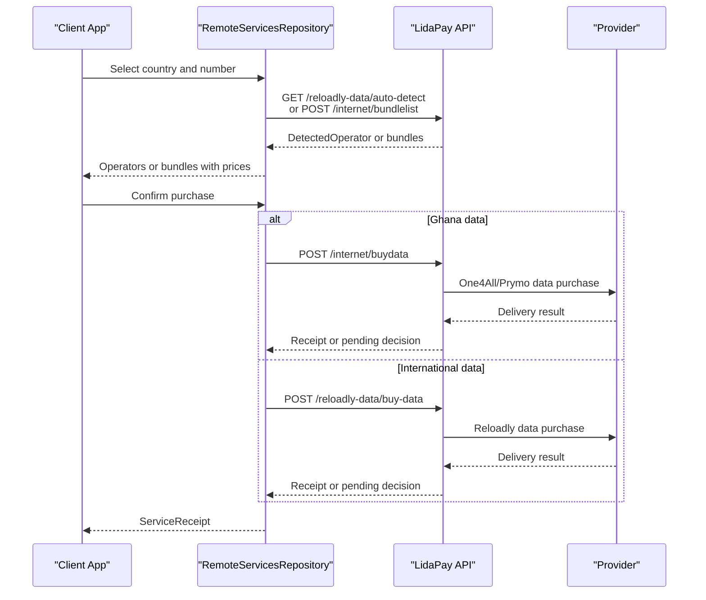
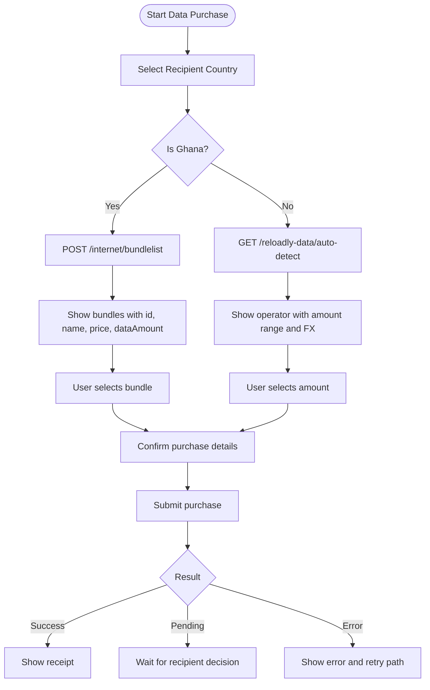
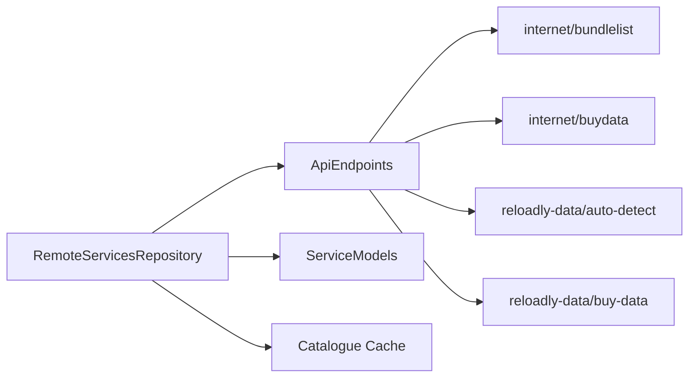

# Data Bundle Purchase API

<cite>
**Referenced Files in This Document**   
- [ENDPOINTS.md](file://api/ENDPOINTS.md)
- [swagger-api-documentation.md](file://docs/swagger-api-documentation.md)
- [MOBILE_APP_REBUILD_HANDOFF.md](file://docs/MOBILE_APP_REBUILD_HANDOFF.md)
- [api_endpoints.dart](file://lib/core/network/api_endpoints.dart)
- [remote_services_repository.dart](file://lib/features/services/data/remote_services_repository.dart)
- [service_models.dart](file://lib/features/services/data/service_models.dart)
</cite>

## Table of Contents
1. [Introduction](#introduction)
2. [Project Structure](#project-structure)
3. [Core Components](#core-components)
4. [Architecture Overview](#architecture-overview)
5. [Detailed Component Analysis](#detailed-component-analysis)
6. [Dependency Analysis](#dependency-analysis)
7. [Performance Considerations](#performance-considerations)
8. [Troubleshooting Guide](#troubleshooting-guide)
9. [Conclusion](#conclusion)

## Introduction
This document provides detailed API documentation for data bundle purchase endpoints exposed by the LidaPay backend and consumed by the mobile application. It covers:

- Reloadly international data purchases via `POST /api/v1/reloadly-data/buy-data`.
- Ghana domestic data purchases via `POST /api/v1/internet/buydata`.
- Ghana domestic bundle listing via `POST /api/v1/internet/bundlelist`.
- Operator auto-detection via `GET /api/v1/reloadly-data/auto-detect`.
- Country-specific operator discovery and bundle availability checks.
- Request/response formats, pricing fields, transaction confirmation, and error handling patterns.

The base URL used by the mobile app is `https://api.advansistechnologies.com`, and all authenticated service calls require a Bearer access token.

**Section sources**
- [ENDPOINTS.md:1-10](file://api/ENDPOINTS.md#L1-L10)
- [swagger-api-documentation.md:1-10](file://docs/swagger-api-documentation.md#L1-L10)

## Project Structure
The data bundle purchase feature is implemented as a client-side service layer that maps user actions to backend endpoints:

| Layer | Responsibility | Relevant files |
|---|---|---|
| Endpoint constants | Centralized route paths | [api_endpoints.dart](file://lib/core/network/api_endpoints.dart) |
| Service repository | Network calls, payload parsing, fallbacks, idempotency guidance | [remote_services_repository.dart](file://lib/features/services/data/remote_services_repository.dart) |
| Domain models | Operator detection, bundles, receipts, pending decisions | [service_models.dart](file://lib/features/services/data/service_models.dart) |
| Public endpoint map | Human-readable API surface | [ENDPOINTS.md](file://api/ENDPOINTS.md) |
| Swagger contract | Request/response examples and documented flows | [swagger-api-documentation.md](file://docs/swagger-api-documentation.md) |
| Mobile handoff | End-to-end flow rules, country/operator routing, idempotency | [MOBILE_APP_REBUILD_HANDOFF.md](file://docs/MOBILE_APP_REBUILD_HANDOFF.md) |

**Diagram sources**
- [api_endpoints.dart:71-100](file://lib/core/network/api_endpoints.dart#L71-L100)
- [remote_services_repository.dart:14-25](file://lib/features/services/data/remote_services_repository.dart#L14-L25)

**Section sources**
- [api_endpoints.dart:69-100](file://lib/core/network/api_endpoints.dart#L69-L100)
- [remote_services_repository.dart:14-70](file://lib/features/services/data/remote_services_repository.dart#L14-L70)

## Core Components
The data bundle purchase system has three primary runtime components:

1. **Endpoint registry**
   - Defines the exact routes used by the app:
     - `/api/v1/internet/bundlelist`
     - `/api/v1/internet/buydata`
     - `/api/v1/reloadly-data/auto-detect`
     - `/api/v1/reloadly-data/list-operators`
     - `/api/v1/reloadly-data/buy-data`

2. **Service repository**
   - Encapsulates network calls for Ghana data and Reloadly international data.
   - Normalizes phone numbers, resolves operators, parses flexible provider payloads, caches catalogue responses, and wraps provider results into typed domain objects.

3. **Domain models**
   - `DetectedOperator`: operator identity, amount range, suggested amounts, currencies, FX rate, logo.
   - `DataBundle`: bundle identifier, display name, price, data volume, currency.
   - `ServiceReceipt`: reference, title, message, amount, timestamps, optional pending decision, recipient, network, bundle, currency, service type.

**Diagram sources**
- [service_models.dart:31-143](file://lib/features/services/data/service_models.dart#L31-L143)
- [remote_services_repository.dart:696-790](file://lib/features/services/data/remote_services_repository.dart#L696-L790)
- [remote_services_repository.dart:961-1038](file://lib/features/services/data/remote_services_repository.dart#L961-L1038)
- [remote_services_repository.dart:1080-1122](file://lib/features/services/data/remote_services_repository.dart#L1080-L1122)

**Section sources**
- [service_models.dart:31-143](file://lib/features/services/data/service_models.dart#L31-L143)
- [remote_services_repository.dart:696-790](file://lib/features/services/data/remote_services_repository.dart#L696-L790)

## Architecture Overview
The data purchase architecture separates domestic (Ghana) and international (Reloadly) flows while sharing common concepts such as operator detection, amount validation, idempotency, and recipient choice.

**Diagram sources**
- [remote_services_repository.dart:336-365](file://lib/features/services/data/remote_services_repository.dart#L336-L365)
- [remote_services_repository.dart:961-1038](file://lib/features/services/data/remote_services_repository.dart#L961-L1038)
- [remote_services_repository.dart:1080-1122](file://lib/features/services/data/remote_services_repository.dart#L1080-L1122)
- [remote_services_repository.dart:1134-1198](file://lib/features/services/data/remote_services_repository.dart#L1134-L1198)

**Section sources**
- [MOBILE_APP_REBUILD_HANDOFF.md:254-287](file://docs/MOBILE_APP_REBUILD_HANDOFF.md#L254-L287)
- [MOBILE_APP_REBUILD_HANDOFF.md:309-372](file://docs/MOBILE_APP_REBUILD_HANDOFF.md#L309-L372)

## Detailed Component Analysis

### Reloadly Data Purchase: `POST /api/v1/reloadly-data/buy-data`

#### Purpose
Purchase international data bundles through Reloadly when the recipient country is not Ghana. The app discovers a data-capable operator first, then submits a single purchase request.

#### Route
`POST /api/v1/reloadly-data/buy-data`

#### Authentication
Bearer token required.

#### Request body
| Field | Type | Required | Description |
|---|---|---:|---|
| `operatorId` | number | Yes | Reloadly operator ID returned by operator discovery or auto-detection. |
| `operatorName` | string | No | Optional human-readable operator name. |
| `amount` | number | Yes | Sender-currency amount; validated against operator ranges and FX conversion. |
| `recipientNumber` | string | Yes | Recipient phone number, normalized to MSISDN format. |
| `recipientCountryCode` | string | Yes | ISO country code, uppercase. |
| `senderNumber` | string | No | Sender phone number; derived from session if omitted. |
| `senderCountryCode` | string | No | Sender country code; default is `GH`. |
| `currency` | string | No | Sender currency code; defaults to USD for international flows. |
| `recipientEmail` | string | No | Optional recipient email. |
| `enableRecipientChoice` | boolean | No | Enables recipient choice for SEND flows. |
| `isSelfTopup` | boolean | No | `true` for self top-up; `false` for SEND. |
| `clientReference` | string | Yes | Unique per-attempt UUID for idempotency. |
| `userId` | string | No | Authenticated user ID; server may override from session. |
| `userName` | string | No | Authenticated username; server may override from session. |

#### Response
The response is wrapped into a `ServiceReceipt` by the repository. Direct success includes a transaction reference, title, message, amount, currency, and service type. A pending response indicates recipient choice is required before final delivery.

#### Example usage
For Nigeria, the mobile handoff shows an international data request using a Reloadly operator ID, NGN currency, and a unique `clientReference`.

**Section sources**
- [ENDPOINTS.md:129-134](file://api/ENDPOINTS.md#L129-L134)
- [api_endpoints.dart:96-100](file://lib/core/network/api_endpoints.dart#L96-L100)
- [MOBILE_APP_REBUILD_HANDOFF.md:350-372](file://docs/MOBILE_APP_REBUILD_HANDOFF.md#L350-L372)
- [remote_services_repository.dart:1134-1198](file://lib/features/services/data/remote_services_repository.dart#L1134-L1198)

### Ghana Domestic Data Purchase: `POST /api/v1/internet/buydata`

#### Purpose
Purchase Ghana domestic data bundles through the One4All/Prymo integration. The recipient must be a valid Ghana number, and the bundle must come from the bundle list for the selected network.

#### Route
`POST /api/v1/internet/buydata`

#### Authentication
Bearer token required.

#### Request body
| Field | Type | Required | Description |
|---|---|---:|---|
| `recipientNumber` | string | Yes | Ghana number; normalized to local format. |
| `dataCode` | string | Yes | Bundle identifier returned by `/internet/bundlelist`. |
| `network` | number | Yes | Domestic network code. |
| `amount` | number | No | Bundle price; usually taken from the bundle object. |
| `currency` | string | No | Usually GHS for Ghana data. |
| `saveToLidaValue` | boolean | No | Save value to wallet instead of direct delivery. |
| `isSelfTopup` | boolean | No | `true` for USE self-topup; `false` for SEND. |
| `clientReference` | string | Yes | Unique per-attempt UUID for idempotency. |
| `userId` | string | No | Authenticated user ID. |
| `userName` | string | No | Authenticated username. |

#### Response
Direct delivery returns a success envelope with status, message, transaction reference, and balance after debit. If the recipient is registered and eligible for recipient choice, the response can be `PENDING` with `decisionId` and `topupOrderId`.

#### Example usage
The Swagger documentation shows a Ghana data purchase with MTN network code 4, a bundle code such as `DATA_10GB`, and GHS currency.

**Section sources**
- [ENDPOINTS.md:132-134](file://api/ENDPOINTS.md#L132-L134)
- [swagger-api-documentation.md:309-368](file://docs/swagger-api-documentation.md#L309-L368)
- [MOBILE_APP_REBUILD_HANDOFF.md:309-327](file://docs/MOBILE_APP_REBUILD_HANDOFF.md#L309-L327)
- [remote_services_repository.dart:1080-1122](file://lib/features/services/data/remote_services_repository.dart#L1080-L1122)

### Ghana Domestic Bundle Listing: `POST /api/v1/internet/bundlelist`

#### Purpose
Retrieve available data bundles for a specific Ghana network. The returned bundle identifier is used as `dataCode` in the buy-data request.

#### Route
`POST /api/v1/internet/bundlelist`

#### Request body
| Field | Type | Required | Description |
|---|---|---:|---|
| `network` | number | No | Network code; omit or use 0 for all networks. |

#### Response
A list of bundles containing identifiers, names, prices, and data amounts. The repository normalizes multiple possible field names such as `plan_id`, `plan_name`, `price`, and `volume`.

#### Example usage
The mobile handoff instructs fetching bundles with network 4 before purchasing data.

**Section sources**
- [ENDPOINTS.md:133-134](file://api/ENDPOINTS.md#L133-L134)
- [swagger-api-documentation.md:372-394](file://docs/swagger-api-documentation.md#L372-L394)
- [MOBILE_APP_REBUILD_HANDOFF.md:309-327](file://docs/MOBILE_APP_REBUILD_HANDOFF.md#L309-L327)
- [remote_services_repository.dart:961-1038](file://lib/features/services/data/remote_services_repository.dart#L961-L1038)

### Operator Auto-Detection: `GET /api/v1/reloadly-data/auto-detect`

#### Purpose
Detect the Reloadly operator for a given phone number and country. This drives operator selection and amount validation for international data purchases.

#### Route
`GET /api/v1/reloadly-data/auto-detect`

#### Query parameters
| Parameter | Type | Required | Description |
|---|---|---:|---|
| `msisdn` | string | Yes | Normalized phone number. |
| `countryCode` | string | Yes | Uppercase ISO country code. |

#### Response
A detected operator object including operator ID, name, amount range, suggested amounts, sender and destination currencies, FX rate, and logo URL. If auto-detection fails, the repository falls back to the airtime autodetect route and then to static prefix-based resolution.

#### Example usage
The mobile handoff documents calling this endpoint with a Nigerian number and `NG` country code.

**Section sources**
- [ENDPOINTS.md:129-131](file://api/ENDPOINTS.md#L129-L131)
- [api_endpoints.dart:97-100](file://lib/core/network/api_endpoints.dart#L97-L100)
- [MOBILE_APP_REBUILD_HANDOFF.md:267-272](file://docs/MOBILE_APP_REBUILD_HANDOFF.md#L267-L272)
- [remote_services_repository.dart:336-365](file://lib/features/services/data/remote_services_repository.dart#L336-L365)

### Country-Specific Operator Listing and Bundle Availability

#### Purpose
Discover supported countries and data-capable operators before presenting bundle options. For Ghana, domestic network codes are fixed; for other countries, Reloadly operator discovery is used.

#### Supported routes
| Route | Method | Purpose |
|---|---|---|
| `/api/v1/reloadly/country-list` | GET | List supported countries. |
| `/api/v1/reloadly/find-country-by-code` | POST | Find a country by ISO code. |
| `/api/v1/reloadly/network-operators` | POST | List operators with pagination and filters. |
| `/api/v1/reloadly/get-operator-by-code` | POST | Get operators by country ISO code. |
| `/api/v1/reloadly-data/list-operators` | POST | List data-eligible operators by country. |

#### Repository behavior
The repository tries multiple Reloadly routes in order:
1. Data-only route if data is requested.
2. General network operators route.
3. Operators-by-country route.
4. Fallback static operator data when live routes fail.

It also caches successful catalogue responses so UI remains usable when provider catalogues are temporarily unavailable.

**Section sources**
- [api_endpoints.dart:77-100](file://lib/core/network/api_endpoints.dart#L77-L100)
- [remote_services_repository.dart:98-160](file://lib/features/services/data/remote_services_repository.dart#L98-L160)
- [remote_services_repository.dart:208-307](file://lib/features/services/data/remote_services_repository.dart#L208-L307)
- [MOBILE_APP_REBUILD_HANDOFF.md:265-287](file://docs/MOBILE_APP_REBUILD_HANDOFF.md#L265-L287)

### Bundle Selection Flow

**Diagram sources**
- [remote_services_repository.dart:961-1038](file://lib/features/services/data/remote_services_repository.dart#L961-L1038)
- [remote_services_repository.dart:1080-1122](file://lib/features/services/data/remote_services_repository.dart#L1080-L1122)
- [remote_services_repository.dart:1134-1198](file://lib/features/services/data/remote_services_repository.dart#L1134-L1198)

**Section sources**
- [swagger-api-documentation.md:309-394](file://docs/swagger-api-documentation.md#L309-L394)
- [MOBILE_APP_REBUILD_HANDOFF.md:309-372](file://docs/MOBILE_APP_REBUILD_HANDOFF.md#L309-L372)

### Pricing Information

| Flow | Currency source | Price field | Notes |
|---|---|---|---|
| Ghana data | Backend bundle catalogue | `price` on bundle object | Usually GHS. |
| Reloadly international data | Reloadly operator configuration and FX lookup | `amount` in sender currency | FX rate may be derived from operator ranges or explicit FX endpoint. |
| Reloadly fixed plans | Operator `fixedAmounts` or `localFixedAmounts` | Amount values plus description maps | Used to render bundle-like cards for international data. |

The repository prefers live Reloadly FX rates and falls back to a static USD-to-currency table when Reloadly is unreachable.

**Section sources**
- [remote_services_repository.dart:367-421](file://lib/features/services/data/remote_services_repository.dart#L367-L421)
- [remote_services_repository.dart:470-544](file://lib/features/services/data/remote_services_repository.dart#L470-L544)
- [remote_services_repository.dart:905-958](file://lib/features/services/data/remote_services_repository.dart#L905-L958)
- [service_models.dart:31-77](file://lib/features/services/data/service_models.dart#L31-L77)

### Transaction Confirmation

A successful data purchase returns a `ServiceReceipt`. Important fields include:

| Field | Meaning |
|---|---|
| `reference` | Transaction or order reference. |
| `title` | User-facing summary such as “Data bundle credited”. |
| `message` | Additional context. |
| `amount` | Charged amount. |
| `createdAt` | Timestamp. |
| `pendingTopup` | Present when recipient choice is required. |
| `recipientNumber` | Recipient phone number. |
| `networkName` | Domestic network label for Ghana. |
| `bundleName` | Bundle label for Ghana data. |
| `currency` | Currency code. |
| `serviceType` | `AIRTIME` or `DATA`. |

When `pendingTopup` is present, the app must poll the top-up status or decision status until the backend reports a final disposition.

**Section sources**
- [service_models.dart:145-212](file://lib/features/services/data/service_models.dart#L145-L212)
- [swagger-api-documentation.md:348-368](file://docs/swagger-api-documentation.md#L348-L368)
- [MOBILE_APP_REBUILD_HANDOFF.md:495-541](file://docs/MOBILE_APP_REBUILD_HANDOFF.md#L495-L541)

## Dependency Analysis

**Diagram sources**
- [api_endpoints.dart:71-100](file://lib/core/network/api_endpoints.dart#L71-L100)
- [remote_services_repository.dart:46-69](file://lib/features/services/data/remote_services_repository.dart#L46-L69)
- [remote_services_repository.dart:961-1038](file://lib/features/services/data/remote_services_repository.dart#L961-L1038)
- [remote_services_repository.dart:1080-1198](file://lib/features/services/data/remote_services_repository.dart#L1080-L1198)

**Section sources**
- [api_endpoints.dart:69-100](file://lib/core/network/api_endpoints.dart#L69-L100)
- [remote_services_repository.dart:46-69](file://lib/features/services/data/remote_services_repository.dart#L46-L69)

## Performance Considerations
- **Catalogue caching**: Successful responses for countries, operators, and bundles are persisted locally. If the live call fails, stale catalogue data is served so the wizard does not dead-end during provider outages.
- **Multiple reloadly route attempts**: Operator discovery tries several Reloadly routes because the backend mints its provider token per route. This reduces failure risk but adds latency; clients should avoid unnecessary retries.
- **FX fallback**: When Reloadly FX is unavailable, the repository uses a static USD-to-currency table. This keeps UX responsive but means exchange rates may be approximate.
- **Phone normalization**: Phone numbers are normalized before provider calls to reduce downstream errors and retries.
- **Idempotency**: Clients must generate a unique `clientReference` per attempt and must not resubmit completed transactions.

**Section sources**
- [remote_services_repository.dart:46-69](file://lib/features/services/data/remote_services_repository.dart#L46-L69)
- [remote_services_repository.dart:239-307](file://lib/features/services/data/remote_services_repository.dart#L239-L307)
- [remote_services_repository.dart:367-421](file://lib/features/services/data/remote_services_repository.dart#L367-L421)
- [MOBILE_APP_REBUILD_HANDOFF.md:303-327](file://docs/MOBILE_APP_REBUILD_HANDOFF.md#L303-L327)

## Troubleshooting Guide

### Insufficient Balance
- **Symptoms**: Provider or backend rejects the purchase due to insufficient funds.
- **Recommended action**: Show the error clearly, refresh wallet balance, and allow retry only after the user changes amount or funding method. Do not automatically resend the same `clientReference`.

### Invalid Operator or Number
- **Symptoms**: Auto-detection fails or no data operator is found.
- **Recommended action**: Validate country and phone number, ensure the number is in MSISDN format, and confirm the destination country supports data. The repository falls back to static operator resolution when Reloadly is unreachable, but this is not a substitute for correct input.

### Network Failures
- **Symptoms**: Timeout, connection error, or provider catalogue unavailable.
- **Recommended action**: Use cached catalogue data when available. Retry once with exponential backoff for transient failures. Do not treat a timeout as a confirmed failure; query transaction or decision status before retrying.

### Pending Recipient Decision
- **Symptoms**: Purchase returns `PENDING` with `decisionId` and `topupOrderId`.
- **Recommended action**: Do not show delivered. Persist the decision references, show waiting state, and poll top-up/decision status until resolved. The recipient chooses between direct delivery and Lida Value.

### Duplicate Purchase Prevention
- **Rule**: Never re-submit a completed top-up with the same `clientReference`.
- **Recovery**: On background/resume, query existing transaction status before considering a new request.

**Section sources**
- [swagger-api-documentation.md:348-368](file://docs/swagger-api-documentation.md#L348-L368)
- [MOBILE_APP_REBUILD_HANDOFF.md:303-327](file://docs/MOBILE_APP_REBUILD_HANDOFF.md#L303-L327)
- [MOBILE_APP_REBUILD_HANDOFF.md:495-541](file://docs/MOBILE_APP_REBUILD_HANDOFF.md#L495-L541)
- [remote_services_repository.dart:336-365](file://lib/features/services/data/remote_services_repository.dart#L336-L365)
- [remote_services_repository.dart:1134-1198](file://lib/features/services/data/remote_services_repository.dart#L1134-L1198)

## Conclusion
The data bundle purchase API surface combines two distinct provider paths:

- Ghana domestic data uses `/api/v1/internet/bundlelist` followed by `/api/v1/internet/buydata`.
- International data uses Reloadly operator discovery and `/api/v1/reloadly-data/buy-data`.

Both flows share important operational principles: authenticate requests, validate recipients, derive prices from the backend, support recipient choice where applicable, persist idempotency keys, and settle receipts through final backend state rather than HTTP status alone. The mobile repository implementation demonstrates robust parsing, fallback behavior, and catalogue caching, making it a reliable reference for integrating these endpoints.