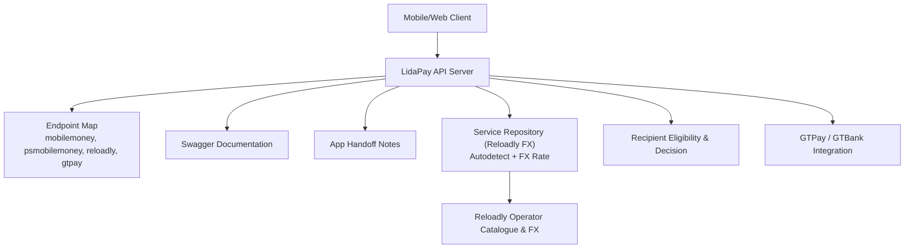
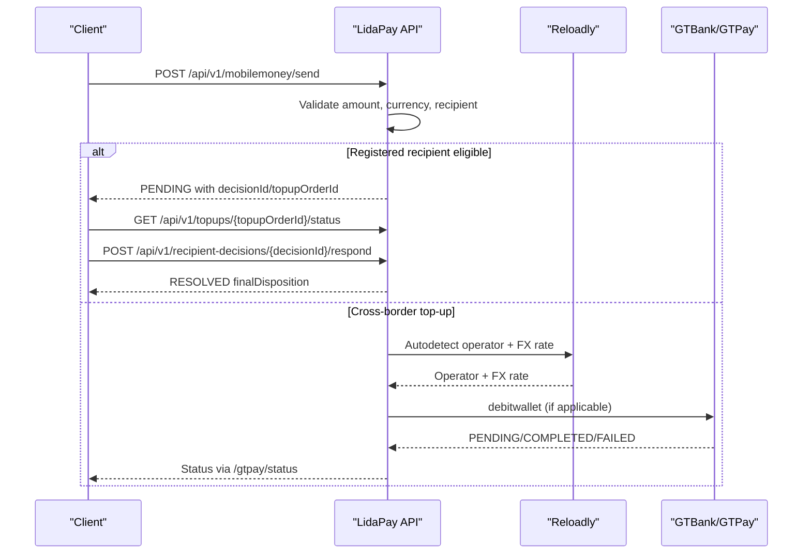
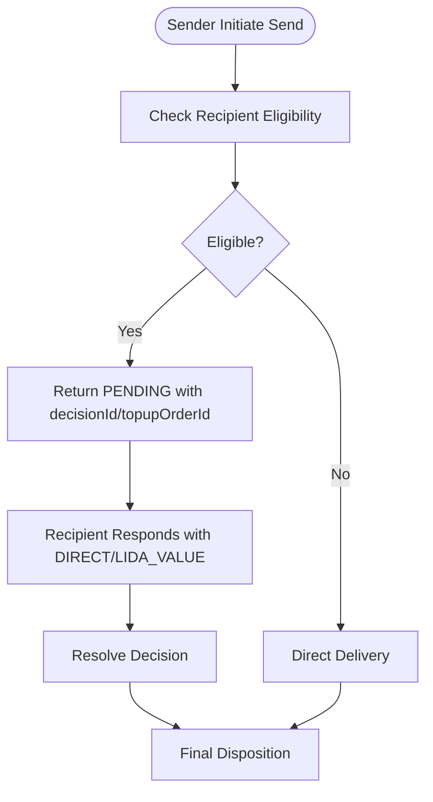
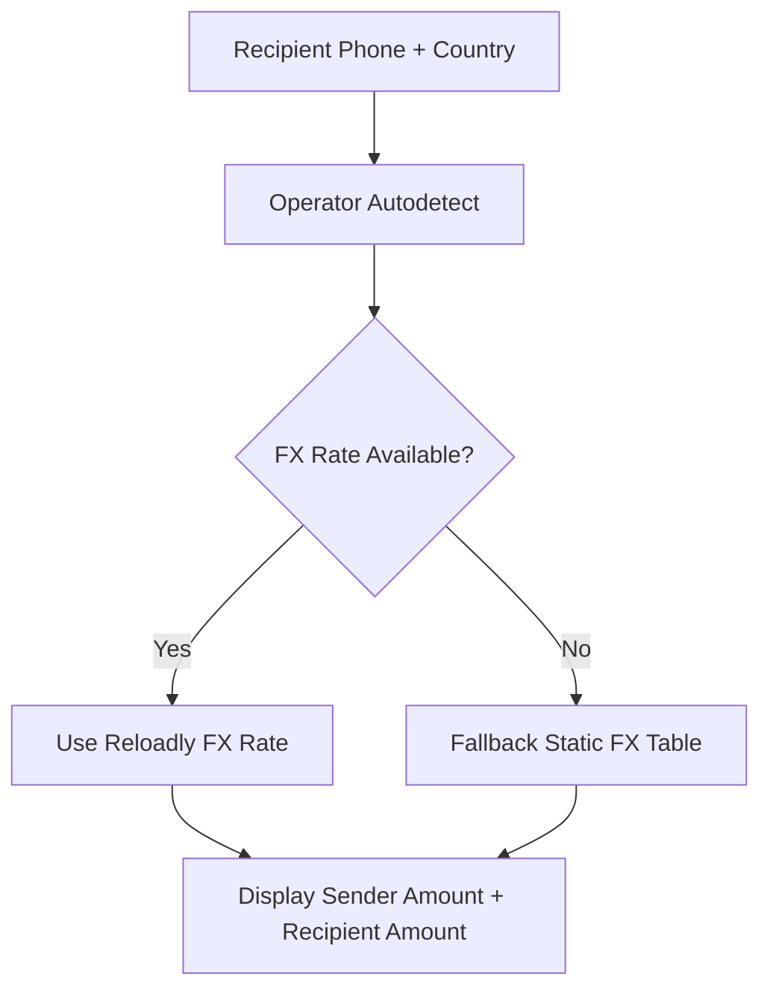
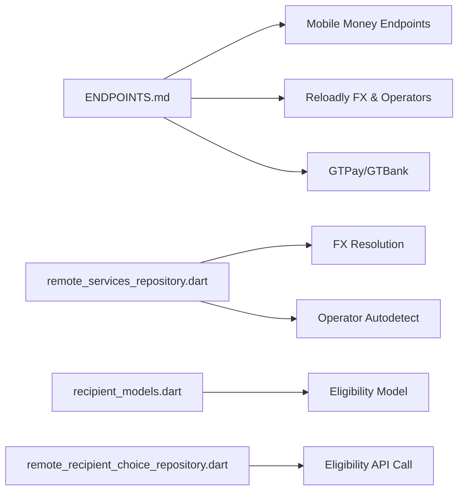

# International Money Transfer API

<cite>
**Referenced Files in This Document**
- [ENDPOINTS.md](file://api/ENDPOINTS.md)
- [swagger-api-documentation.md](file://docs/swagger-api-documentation.md)
- [MOBILE_APP_REBUILD_HANDOFF.md](file://docs/MOBILE_APP_REBUILD_HANDOFF.md)
- [remote_services_repository.dart](file://lib/features/services/data/remote_services_repository.dart)
- [service_models.dart](file://lib/features/services/data/service_models.dart)
- [recipient_models.dart](file://lib/features/recipient_choice/data/recipient_models.dart)
- [remote_recipient_choice_repository.dart](file://lib/features/recipient_choice/data/remote_recipient_choice_repository.dart)
</cite>

## Table of Contents
1. [Introduction](#introduction)
2. [Project Structure](#project-structure)
3. [Core Components](#core-components)
4. [Architecture Overview](#architecture-overview)
5. [Detailed Component Analysis](#detailed-component-analysis)
6. [Dependency Analysis](#dependency-analysis)
7. [Performance Considerations](#performance-considerations)
8. [Troubleshooting Guide](#troubleshooting-guide)
9. [Conclusion](#conclusion)

## Introduction
This document provides comprehensive API documentation for international money transfer endpoints, with a focus on mobile money transfers and cross-border top-ups. It covers:
- Mobile money transfer endpoints: `POST /api/v1/mobilemoney/send`, `POST /api/v1/mobilemoney/receive`, and `POST /api/v1/psmobilemoney/transfermoney`.
- Recipient eligibility checks and decision flows.
- Amount validation, supported countries and operators, and FX conversion behavior.
- Transaction status tracking and settlement.
- Security measures, fraud prevention considerations, and regulatory compliance guidance.

The base URL is `https://api.advansistechnologies.com`. The repository also documents related payment integrations such as GTBank/GTPay (`debitwallet`), Reloadly operator catalogues, and Lida Value wallet operations that interact with or complement the mobile money flows.

## Project Structure
The relevant parts of this codebase for international money transfer are:
- API endpoint map listing all public routes, including mobile money and Reloadly operator/FX endpoints.
- Swagger API documentation describing authentication, recipient choice, and GTPay integration.
- Mobile app handoff notes clarifying how to use GTPay debitwallet safely and securely.
- Service repository and models implementing Reloadly operator autodetection, FX rate resolution, and fallback logic.
- Recipient eligibility models and remote repository used by the sender flow.

**Diagram sources**
- [ENDPOINTS.md:1-10](file://api/ENDPOINTS.md#L1-L10)
- [swagger-api-documentation.md:1-10](file://docs/swagger-api-documentation.md#L1-L10)
- [MOBILE_APP_REBUILD_HANDOFF.md:430-470](file://docs/MOBILE_APP_REBUILD_HANDOFF.md#L430-L470)
- [remote_services_repository.dart:367-421](file://lib/features/services/data/remote_services_repository.dart#L367-L421)

**Section sources**
- [ENDPOINTS.md:1-10](file://api/ENDPOINTS.md#L1-L10)
- [swagger-api-documentation.md:1-10](file://docs/swagger-api-documentation.md#L1-L10)

## Core Components
This section summarizes the core components involved in international money transfers:
- Mobile Money Transfer Endpoints:
  - `POST /api/v1/mobilemoney/send` — Send money to a recipient.
  - `POST /api/v1/mobilemoney/receive` — Receive money from a sender.
  - `POST /api/v1/psmobilemoney/transfermoney` — Transfer mobile money.
- Recipient Eligibility and Decision:
  - `POST /api/v1/recipient/eligibility` — Check if recipient can choose delivery method.
  - `POST /api/v1/topups/{topupOrderId}/recipient-decision` — Create pending decision.
  - `POST /api/v1/recipient-decisions/{decisionId}/respond` — Recipient chooses DIRECT or LIDA_VALUE.
- FX Conversion and Operator Discovery:
  - `GET /api/v1/reloadly/operators/{operatorId}/fx-rate` — Fetch FX rate per operator and amount.
  - Autodetect and fallback logic for non-Ghana destinations.
- GTPay / GTBank Payment Integration:
  - `POST /api/v1/gtpay/pay` with `ServiceName: debitwallet` for customer debits.
  - `POST /api/v1/gtpay/status` for transaction status polling.
  - `POST /api/v1/gtpay/callback` for provider callbacks.

**Section sources**
- [ENDPOINTS.md:135-151](file://api/ENDPOINTS.md#L135-L151)
- [swagger-api-documentation.md:398-540](file://docs/swagger-api-documentation.md#L398-L540)
- [MOBILE_APP_REBUILD_HANDOFF.md:430-470](file://docs/MOBILE_APP_REBUILD_HANDOFF.md#L430-L470)
- [remote_services_repository.dart:367-421](file://lib/features/services/data/remote_services_repository.dart#L367-L421)

## Architecture Overview
The international money transfer architecture integrates multiple providers and flows:
- Sender initiates a mobile money send via `/api/v1/mobilemoney/send`.
- For eligible registered recipients, the backend may return a pending decision requiring recipient choice.
- For cross-border top-ups, the service repository calls Reloadly to detect operators and resolve FX rates.
- Settlement may involve GTPay/GTBank debitwallet for customer payments or other provider-specific flows.
- Status tracking uses canonical endpoints for decisions and transactions.

**Diagram sources**
- [ENDPOINTS.md:135-151](file://api/ENDPOINTS.md#L135-L151)
- [swagger-api-documentation.md:398-540](file://docs/swagger-api-documentation.md#L398-L540)
- [MOBILE_APP_REBUILD_HANDOFF.md:430-470](file://docs/MOBILE_APP_REBUILD_HANDOFF.md#L430-L470)
- [remote_services_repository.dart:367-421](file://lib/features/services/data/remote_services_repository.dart#L367-L421)

## Detailed Component Analysis

### Mobile Money Transfer Endpoints
- `POST /api/v1/mobilemoney/send`: Initiates sending money to a recipient. May require recipient eligibility check and decision flow for registered recipients.
- `POST /api/v1/mobilemoney/receive`: Receives money from a sender; typically used when the recipient accepts funds into their account or wallet.
- `POST /api/v1/psmobilemoney/transfermoney`: Transfers mobile money through the PS mobile money integration.

These endpoints are part of the broader mobile money ecosystem and may integrate with GTPay/GTBank or other providers depending on the destination country and operator.

**Section sources**
- [ENDPOINTS.md:135-138](file://api/ENDPOINTS.md#L135-L138)

### Recipient Eligibility and Decision Flow
Recipient eligibility determines whether a recipient can choose between direct delivery or saving to Lida Value. The flow includes:
- Preflight eligibility check via `POST /api/v1/recipient/eligibility`.
- If eligible, the sender’s request may return `PENDING` with `decisionId` and `topupOrderId`.
- Recipient responds via `POST /api/v1/recipient-decisions/{decisionId}/respond` with `DIRECT` or `LIDA_VALUE`.
- Sender polls status via `GET /api/v1/topups/{topupOrderId}/status` or `GET /api/v1/recipient-decisions/{decisionId}` until resolved.

**Diagram sources**
- [swagger-api-documentation.md:398-540](file://docs/swagger-api-documentation.md#L398-L540)
- [recipient_models.dart:1-43](file://lib/features/recipient_choice/data/recipient_models.dart#L1-L43)
- [remote_recipient_choice_repository.dart:1-43](file://lib/features/recipient_choice/data/remote_recipient_choice_repository.dart#L1-L43)

**Section sources**
- [swagger-api-documentation.md:398-540](file://docs/swagger-api-documentation.md#L398-L540)
- [recipient_models.dart:1-43](file://lib/features/recipient_choice/data/recipient_models.dart#L1-L43)
- [remote_recipient_choice_repository.dart:1-43](file://lib/features/recipient_choice/data/remote_recipient_choice_repository.dart#L1-L43)

### FX Conversion and Supported Countries/Operators
For cross-border transfers, the system uses Reloadly to:
- Detect operators by phone number and country.
- Retrieve FX rates per operator and amount.
- Provide fallback conversion tables when live FX data is unavailable.

Key behaviors:
- Non-Ghana destinations trigger Reloadly FX lookup.
- Static USD-to-currency conversion table serves as last resort.
- Sender pays in sender currency (often USD), recipient receives in destination currency.

**Diagram sources**
- [remote_services_repository.dart:367-421](file://lib/features/services/data/remote_services_repository.dart#L367-L421)
- [service_models.dart:52-77](file://lib/features/services/data/service_models.dart#L52-L77)

**Section sources**
- [remote_services_repository.dart:367-421](file://lib/features/services/data/remote_services_repository.dart#L367-L421)
- [service_models.dart:52-77](file://lib/features/services/data/service_models.dart#L52-L77)

### GTPay / GTBank Debitwallet Integration
The GTPay integration uses `debitwallet` for customer mobile-money debits:
- Discover services via `POST /api/v1/gtpay/services`.
- Initiate payment via `POST /api/v1/gtpay/pay` with `ServiceName: debitwallet`.
- Poll status via `POST /api/v1/gtpay/status`.
- Handle callbacks via `POST /api/v1/gtpay/callback`.

Important notes:
- Do not hard-code service names; discover them from the API.
- Preserve exact decimal precision for amounts.
- Treat HTTP 200 with `data.Status: PENDING` as non-terminal; continue polling.
- Never call the callback endpoint from the client; it is server-to-server.

**Section sources**
- [MOBILE_APP_REBUILD_HANDOFF.md:430-470](file://docs/MOBILE_APP_REBUILD_HANDOFF.md#L430-L470)
- [swagger-api-documentation.md:651-980](file://docs/swagger-api-documentation.md#L651-L980)

### Amount Validation and Fee Calculations
- Amount validation is enforced by the backend; clients should not guess fees.
- For GTPay, there is no fee-quote endpoint; final debit including fees must be confirmed server-side.
- FX conversion affects the recipient amount; sender amount is denominated in sender currency.

**Section sources**
- [MOBILE_APP_REBUILD_HANDOFF.md:468-470](file://docs/MOBILE_APP_REBUILD_HANDOFF.md#L468-L470)
- [remote_services_repository.dart:367-421](file://lib/features/services/data/remote_services_repository.dart#L367-L421)

### Transaction Status Tracking
- Use `GET /api/v1/topups/{topupOrderId}/status` for top-up status.
- Use `GET /api/v1/recipient-decisions/{decisionId}` for decision status.
- Use `POST /api/v1/gtpay/status` for GTPay transaction status.
- Terminal states include `COMPLETED`, `FAILED`, and provider-specific outcomes.

**Section sources**
- [swagger-api-documentation.md:398-540](file://docs/swagger-api-documentation.md#L398-L540)
- [MOBILE_APP_REBUILD_HANDOFF.md:430-470](file://docs/MOBILE_APP_REBUILD_HANDOFF.md#L430-L470)

## Dependency Analysis
The international money transfer flow depends on:
- Endpoint definitions for mobile money and Reloadly/GTPay integrations.
- Service repository for operator autodetection and FX resolution.
- Recipient eligibility models and repositories for decision flows.
- GTPay/GTBank integration for settlement.

**Diagram sources**
- [ENDPOINTS.md:135-151](file://api/ENDPOINTS.md#L135-L151)
- [remote_services_repository.dart:367-421](file://lib/features/services/data/remote_services_repository.dart#L367-L421)
- [recipient_models.dart:1-43](file://lib/features/recipient_choice/data/recipient_models.dart#L1-L43)
- [remote_recipient_choice_repository.dart:1-43](file://lib/features/recipient_choice/data/remote_recipient_choice_repository.dart#L1-L43)

**Section sources**
- [ENDPOINTS.md:135-151](file://api/ENDPOINTS.md#L135-L151)
- [remote_services_repository.dart:367-421](file://lib/features/services/data/remote_services_repository.dart#L367-L421)
- [recipient_models.dart:1-43](file://lib/features/recipient_choice/data/recipient_models.dart#L1-L43)
- [remote_recipient_choice_repository.dart:1-43](file://lib/features/recipient_choice/data/remote_recipient_choice_repository.dart#L1-L43)

## Performance Considerations
- Cache operator catalogue and FX rates where possible to reduce latency during provider outages.
- Use exponential backoff when polling transaction status to avoid overwhelming the API.
- Avoid redundant calls to create duplicate recipient decisions; rely on backend-owned decision creation.
- Prefer server-side fee calculation and confirmation to minimize client-side errors.

[No sources needed since this section provides general guidance]

## Troubleshooting Guide
Common issues and resolutions:
- **Pending Decisions Not Received**: Ensure FCM token registration is complete and device tokens are active.
- **FX Rate Missing**: Fall back to static conversion table; verify Reloadly availability.
- **GTPay Status Unknown**: Query status with the same PartnerTransId before retrying; do not initiate duplicate payments.
- **Invalid MoMo Number**: Normalize Ghana MoMo numbers and validate format before submission.

**Section sources**
- [MOBILE_APP_REBUILD_HANDOFF.md:559-593](file://docs/MOBILE_APP_REBUILD_HANDOFF.md#L559-L593)
- [remote_services_repository.dart:367-421](file://lib/features/services/data/remote_services_repository.dart#L367-L421)

## Conclusion
The international money transfer API provides robust support for mobile money transfers, recipient eligibility checks, FX conversion, and transaction status tracking. Integrations with Reloadly and GTPay/GTBank enable cross-border top-ups and secure settlement. Adhering to the documented flows, security practices, and compliance guidelines ensures reliable and compliant money transfer operations.

[No sources needed since this section summarizes without analyzing specific files]