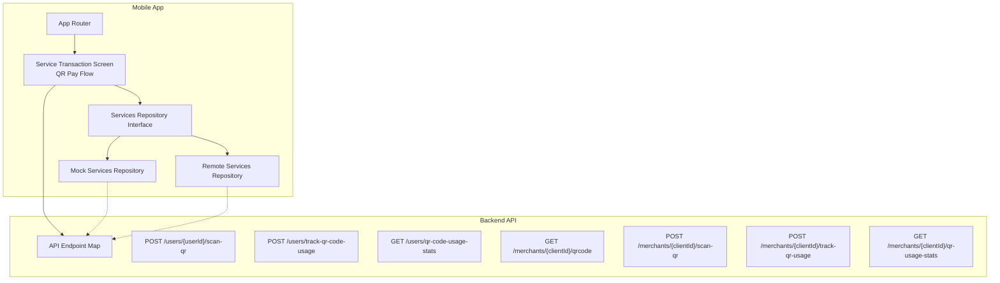
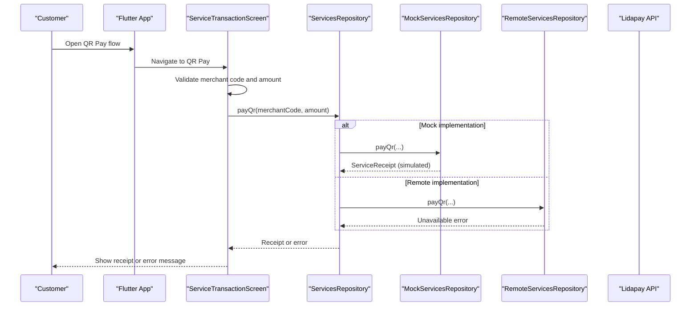
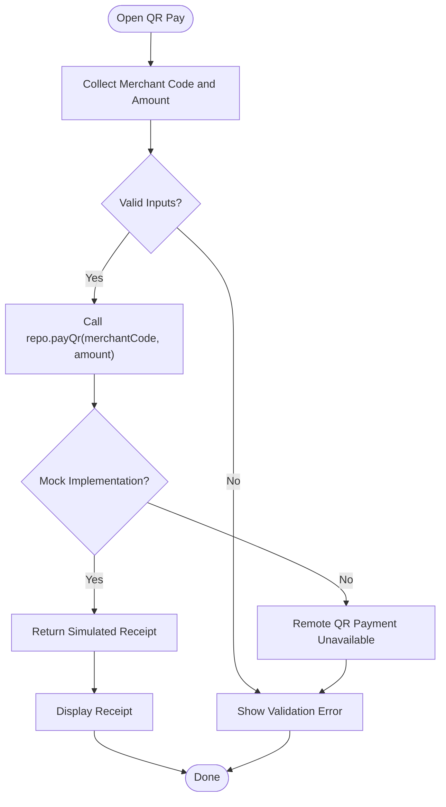
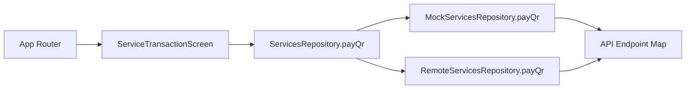

# QR Code Payment API

<cite>
**Referenced Files in This Document**
- [ENDPOINTS.md](file://api/ENDPOINTS.md)
- [service_transaction_screen.dart](file://lib/features/services/screens/service_transaction_screen.dart)
- [services_repository.dart](file://lib/features/services/data/services_repository.dart)
- [remote_services_repository.dart](file://lib/features/services/data/remote_services_repository.dart)
- [mock_services_repository.dart](file://lib/features/services/data/mock_services_repository.dart)
- [app_router.dart](file://lib/core/router/app_router.dart)
</cite>

## Table of Contents
1. [Introduction](#introduction)
2. [Project Structure](#project-structure)
3. [Core Components](#core-components)
4. [Architecture Overview](#architecture-overview)
5. [Detailed Component Analysis](#detailed-component-analysis)
6. [Dependency Analysis](#dependency-analysis)
7. [Performance Considerations](#performance-considerations)
8. [Troubleshooting Guide](#troubleshooting-guide)
9. [Conclusion](#conclusion)

## Introduction
This document provides detailed API documentation for the QR code payment functionality exposed by the Lidapay backend and used by the Flutter mobile application. It covers:

- User QR code operations: scanning a user’s QR code, tracking QR usage, and retrieving usage statistics.
- Merchant QR code management: generating merchant QR codes, scanning merchant QR codes, tracking merchant QR usage, and retrieving merchant QR analytics.
- End-to-end examples for QR code generation, scanning workflows, payment processing, and usage tracking.
- Security measures, fraud prevention considerations, and integration guidelines for QR-based payments.

The authoritative endpoint map is maintained in the repository’s API documentation file, while the mobile client demonstrates how QR payments are initiated from the app UI and routed through service repositories.

## Project Structure
The QR payment feature spans both backend API endpoints and frontend flows:

- Backend endpoints are documented in the API endpoint map.
- The mobile app exposes a “QR Pay” flow that collects a merchant code and amount, then calls the services repository to process the payment.
- The repository layer currently has a mock implementation for QR payments and an unavailable placeholder for the remote implementation.

**Diagram sources**
- [app_router.dart:290-305](file://lib/core/router/app_router.dart#L290-L305)
- [service_transaction_screen.dart:33-34](file://lib/features/services/screens/service_transaction_screen.dart#L33-L34)
- [service_transaction_screen.dart:169-172](file://lib/features/services/screens/service_transaction_screen.dart#L169-L172)
- [services_repository.dart:73-76](file://lib/features/services/data/services_repository.dart#L73-L76)
- [remote_services_repository.dart:1791-1794](file://lib/features/services/data/remote_services_repository.dart#L1791-L1794)
- [mock_services_repository.dart:304-315](file://lib/features/services/data/mock_services_repository.dart#L304-L315)
- [ENDPOINTS.md:27-56](file://api/ENDPOINTS.md#L27-L56)

**Section sources**
- [ENDPOINTS.md:1-56](file://api/ENDPOINTS.md#L1-L56)
- [service_transaction_screen.dart:33-34](file://lib/features/services/screens/service_transaction_screen.dart#L33-L34)
- [service_transaction_screen.dart:169-172](file://lib/features/services/screens/service_transaction_screen.dart#L169-L172)
- [services_repository.dart:73-76](file://lib/features/services/data/services_repository.dart#L73-L76)
- [remote_services_repository.dart:1791-1794](file://lib/features/services/data/remote_services_repository.dart#L1791-L1794)
- [mock_services_repository.dart:304-315](file://lib/features/services/data/mock_services_repository.dart#L304-L315)
- [app_router.dart:290-305](file://lib/core/router/app_router.dart#L290-L305)

## Core Components
The QR payment system includes:

- **User QR endpoints**:
  - `POST /api/v1/users/{userId}/scan-qr`: Scan a user’s QR code.
  - `POST /api/v1/users/track-qr-code-usage`: Track QR code usage.
  - `GET /api/v1/users/qr-code-usage-stats`: Get QR code usage stats.

- **Merchant QR endpoints**:
  - `GET /api/v1/merchants/{clientId}/qrcode`: Get a merchant QR code.
  - `POST /api/v1/merchants/{clientId}/scan-qr`: Scan a merchant QR code.
  - `POST /api/v1/merchants/{clientId}/track-qr-usage`: Track merchant QR usage.
  - `GET /api/v1/merchants/{clientId}/qr-usage-stats`: Get merchant QR usage stats.

- **Mobile QR Pay flow**:
  - The app’s Service Transaction Screen supports a `qrPay` flow where users enter a merchant code and amount.
  - The screen calls `repo.payQr(merchantCode, amount)`.
  - The mock repository returns a simulated receipt; the remote repository currently marks QR payment as unavailable.

These components together define the QR payment experience: merchants expose QR identifiers, users scan or enter merchant codes, payments are processed, and usage is tracked and analyzed.

**Section sources**
- [ENDPOINTS.md:27-56](file://api/ENDPOINTS.md#L27-L56)
- [service_transaction_screen.dart:33-34](file://lib/features/services/screens/service_transaction_screen.dart#L33-L34)
- [service_transaction_screen.dart:169-172](file://lib/features/services/screens/service_transaction_screen.dart#L169-L172)
- [services_repository.dart:73-76](file://lib/features/services/data/services_repository.dart#L73-L76)
- [remote_services_repository.dart:1791-1794](file://lib/features/services/data/remote_services_repository.dart#L1791-L1794)
- [mock_services_repository.dart:304-315](file://lib/features/services/data/mock_services_repository.dart#L304-L315)

## Architecture Overview
The QR payment architecture connects the mobile UI, repository layer, and backend APIs:

**Diagram sources**
- [service_transaction_screen.dart:169-172](file://lib/features/services/screens/service_transaction_screen.dart#L169-L172)
- [services_repository.dart:73-76](file://lib/features/services/data/services_repository.dart#L73-L76)
- [remote_services_repository.dart:1791-1794](file://lib/features/services/data/remote_services_repository.dart#L1791-L1794)
- [mock_services_repository.dart:304-315](file://lib/features/services/data/mock_services_repository.dart#L304-L315)

## Detailed Component Analysis

### User QR Code Operations
- `POST /api/v1/users/{userId}/scan-qr`
  - Purpose: Scan a user’s QR code.
  - Typical use: A customer scans another user’s QR to initiate a peer-to-peer action such as a transfer or reward redemption.
  - Authentication: Requires authenticated user context.
  - Expected behavior: Validate the scanned identifier, associate it with the provided `{userId}`, and return a result indicating success or failure.

- `POST /api/v1/users/track-qr-code-usage`
  - Purpose: Record usage events for QR interactions.
  - Typical use: Track when a QR code is scanned, viewed, or used to trigger downstream actions.
  - Data captured: Scanning device metadata, timestamp, source QR identifier, and outcome.

- `GET /api/v1/users/qr-code-usage-stats`
  - Purpose: Retrieve aggregated usage statistics for user QR codes.
  - Typical use: Dashboards and analytics showing scan counts, conversion rates, and time-based trends.

Example workflow:
1. Customer opens the app and selects “QR Pay”.
2. Customer scans a user QR or enters a user-specific code.
3. App calls `POST /users/{userId}/scan-qr`.
4. Backend validates and processes the scan.
5. App calls `POST /users/track-qr-code-usage` to record the event.
6. Admin or user queries `GET /users/qr-code-usage-stats` for insights.

Security and fraud prevention:
- Enforce authentication and authorization on all user QR endpoints.
- Rate-limit scan and track endpoints to prevent abuse.
- Validate QR payloads against known user records before processing.
- Log and monitor anomalous patterns such as repeated failed scans or high-frequency requests.

Integration guidelines:
- Always include the authenticated user context in requests.
- Handle errors gracefully and surface actionable messages to the user.
- Use idempotency keys for critical actions if replay protection is required.

**Section sources**
- [ENDPOINTS.md:27-29](file://api/ENDPOINTS.md#L27-L29)

### Merchant QR Code Management and Usage Analytics
- `GET /api/v1/merchants/{clientId}/qrcode`
  - Purpose: Retrieve a merchant’s QR code asset or identifier.
  - Typical use: Display the merchant’s QR code in-app or on receipts.

- `POST /api/v1/merchants/{clientId}/scan-qr`
  - Purpose: Process a scan of a merchant’s QR code.
  - Typical use: Customer scans a merchant QR to initiate a payment or promotion.

- `POST /api/v1/merchants/{clientId}/track-qr-usage`
  - Purpose: Track merchant QR usage events.
  - Typical use: Capture scan attempts, successful redemptions, and campaign performance.

- `GET /api/v1/merchants/{clientId}/qr-usage-stats`
  - Purpose: Retrieve merchant QR usage analytics.
  - Typical use: Merchant dashboards showing scan volume, conversions, and ROI.

Example workflow:
1. Merchant logs in and retrieves their QR via `GET /merchants/{clientId}/qrcode`.
2. Customer scans the merchant QR using the app.
3. App calls `POST /merchants/{clientId}/scan-qr` with the scanned payload.
4. Backend validates the merchant, processes the scan, and may create a transaction.
5. App calls `POST /merchants/{clientId}/track-qr-usage` to record the event.
6. Merchant views analytics via `GET /merchants/{clientId}/qr-usage-stats`.

Security and fraud prevention:
- Restrict access to merchant endpoints by merchant identity and permissions.
- Validate QR payloads and ensure they belong to the specified `{clientId}`.
- Implement rate limiting and anomaly detection for scan and track endpoints.
- Require secure channels (HTTPS) and token-based authentication.

Integration guidelines:
- Use the merchant’s `{clientId}` consistently across all endpoints.
- Provide clear feedback when scans fail due to invalid or expired QRs.
- Integrate analytics pipelines to aggregate usage data for reporting.

**Section sources**
- [ENDPOINTS.md:52-56](file://api/ENDPOINTS.md#L52-L56)

### Mobile QR Pay Flow
The mobile app implements a “QR Pay” flow within the Service Transaction Screen:

- Navigation: The app router routes to the Service Transaction Screen with `ServiceFlow.qrPay`.
- Input collection: The screen prompts for a merchant code and amount.
- Submission: On submit, the screen calls `repo.payQr(merchantCode, amount)`.
- Result handling: The screen displays a receipt on success or shows an error message on failure.

Current implementation details:
- The mock repository simulates a successful QR payment and returns a receipt with a “QRP” prefix.
- The remote repository currently marks QR payment as unavailable, meaning production QR payments are not yet wired to the backend.

**Diagram sources**
- [app_router.dart:290-305](file://lib/core/router/app_router.dart#L290-L305)
- [service_transaction_screen.dart:169-172](file://lib/features/services/screens/service_transaction_screen.dart#L169-L172)
- [mock_services_repository.dart:304-315](file://lib/features/services/data/mock_services_repository.dart#L304-L315)
- [remote_services_repository.dart:1791-1794](file://lib/features/services/data/remote_services_repository.dart#L1791-L1794)

**Section sources**
- [app_router.dart:290-305](file://lib/core/router/app_router.dart#L290-L305)
- [service_transaction_screen.dart:169-172](file://lib/features/services/screens/service_transaction_screen.dart#L169-L172)
- [services_repository.dart:73-76](file://lib/features/services/data/services_repository.dart#L73-L76)
- [mock_services_repository.dart:304-315](file://lib/features/services/data/mock_services_repository.dart#L304-L315)
- [remote_services_repository.dart:1791-1794](file://lib/features/services/data/remote_services_repository.dart#L1791-L1794)

## Dependency Analysis
The QR payment dependencies connect UI, repository interfaces, implementations, and backend endpoints:

**Diagram sources**
- [app_router.dart:290-305](file://lib/core/router/app_router.dart#L290-L305)
- [service_transaction_screen.dart:169-172](file://lib/features/services/screens/service_transaction_screen.dart#L169-L172)
- [services_repository.dart:73-76](file://lib/features/services/data/services_repository.dart#L73-L76)
- [mock_services_repository.dart:304-315](file://lib/features/services/data/mock_services_repository.dart#L304-L315)
- [remote_services_repository.dart:1791-1794](file://lib/features/services/data/remote_services_repository.dart#L1791-L1794)
- [ENDPOINTS.md:27-56](file://api/ENDPOINTS.md#L27-L56)

**Section sources**
- [services_repository.dart:73-76](file://lib/features/services/data/services_repository.dart#L73-L76)
- [mock_services_repository.dart:304-315](file://lib/features/services/data/mock_services_repository.dart#L304-L315)
- [remote_services_repository.dart:1791-1794](file://lib/features/services/data/remote_services_repository.dart#L1791-L1794)
- [ENDPOINTS.md:27-56](file://api/ENDPOINTS.md#L27-L56)

## Performance Considerations
- Prefer asynchronous operations for QR scanning and payment processing to keep the UI responsive.
- Cache merchant QR assets locally when appropriate to reduce network calls.
- Implement retry logic with exponential backoff for transient network failures.
- Monitor latency and error rates for QR endpoints to detect bottlenecks early.
- Use pagination and filtering for usage stats endpoints to handle large datasets efficiently.

[No sources needed since this section provides general guidance]

## Troubleshooting Guide
Common issues and resolutions:

- QR payment unavailable in production:
  - Symptom: The remote repository marks QR payment as unavailable.
  - Resolution: Wire the remote repository to call the backend QR payment endpoints and implement proper error handling.

- Invalid merchant code:
  - Symptom: Scan fails validation.
  - Resolution: Ensure the merchant code matches a valid merchant record and is associated with the correct `{clientId}`.

- Missing authentication:
  - Symptom: Requests to user or merchant QR endpoints fail.
  - Resolution: Include valid authentication tokens and verify permissions for the requested operation.

- Excessive scan attempts:
  - Symptom: Rate limiting or throttling triggers.
  - Resolution: Implement client-side debouncing and server-side rate limits; investigate potential abuse.

- Analytics gaps:
  - Symptom: Usage stats do not reflect recent scans.
  - Resolution: Verify that tracking endpoints are called after successful scans and that data ingestion pipelines are operational.

**Section sources**
- [remote_services_repository.dart:1791-1794](file://lib/features/services/data/remote_services_repository.dart#L1791-L1794)
- [ENDPOINTS.md:27-56](file://api/ENDPOINTS.md#L27-L56)

## Conclusion
The QR code payment functionality is defined by clear backend endpoints for user and merchant QR operations, along with a mobile flow that initiates QR payments. While the mock repository simulates successful QR payments, the remote repository currently indicates that QR payment is unavailable, signaling the need for backend integration. Integrating these endpoints securely, implementing robust fraud prevention, and providing comprehensive analytics will enable a reliable QR-based payment experience for customers and merchants alike.

[No sources needed since this section summarizes without analyzing specific files]