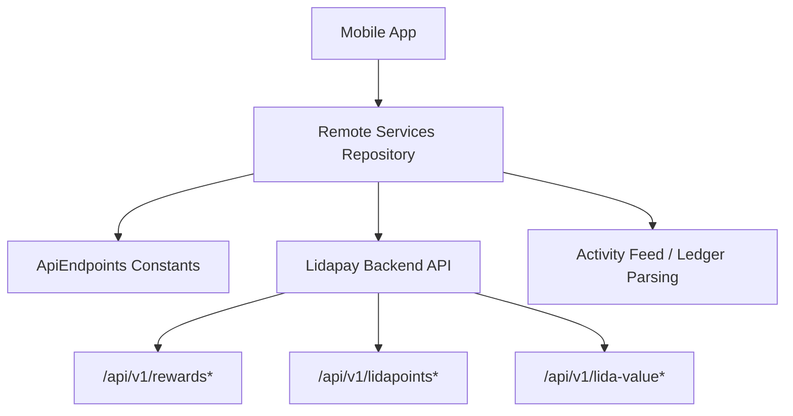
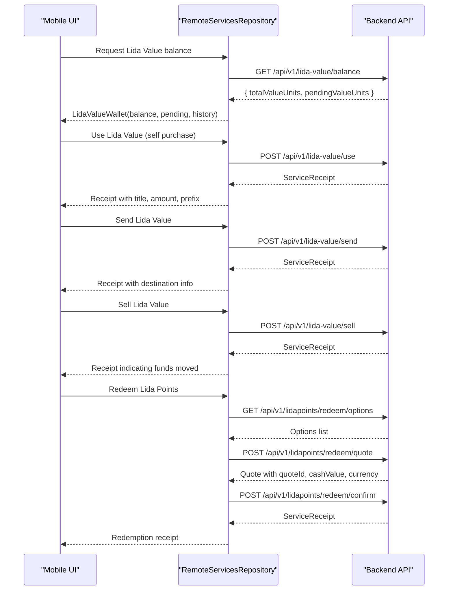
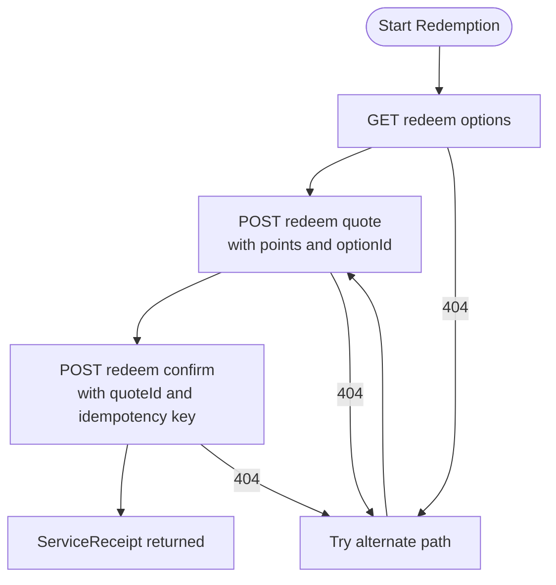
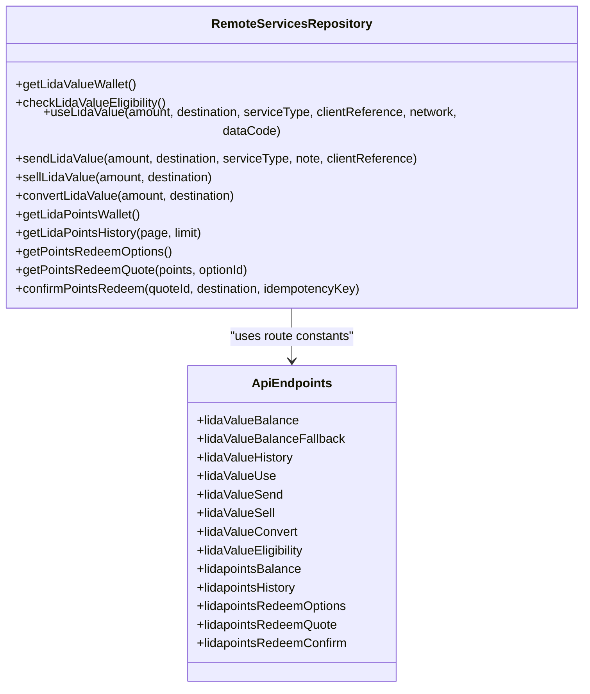
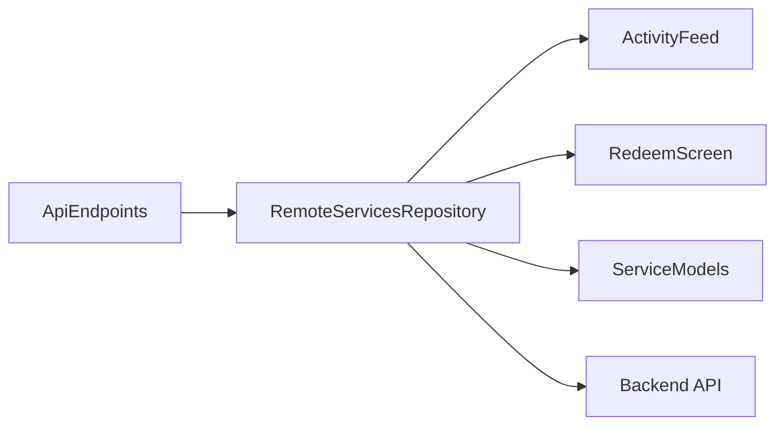

# Rewards & Loyalty API

<cite>
**Referenced Files in This Document**
- [ENDPOINTS.md](file://api/ENDPOINTS.md)
- [api_endpoints.dart](file://lib/core/network/api_endpoints.dart)
- [remote_services_repository.dart](file://lib/features/services/data/remote_services_repository.dart)
- [activity_feed.dart](file://lib/features/dashboard/data/activity_feed.dart)
- [service_models.dart](file://lib/features/services/data/service_models.dart)
- [redeem_screen.dart](file://lib/features/services/screens/redeem_screen.dart)
- [MOBILE_APP_REBUILD_HANDOFF.md](file://docs/MOBILE_APP_REBUILD_HANDOFF.md)
</cite>

## Table of Contents
1. [Introduction](#introduction)
2. [Project Structure](#project-structure)
3. [Core Components](#core-components)
4. [Architecture Overview](#architecture-overview)
5. [Detailed Component Analysis](#detailed-component-analysis)
6. [Dependency Analysis](#dependency-analysis)
7. [Performance Considerations](#performance-considerations)
8. [Troubleshooting Guide](#troubleshooting-guide)
9. [Conclusion](#conclusion)

## Introduction
This document provides comprehensive API documentation for the rewards and loyalty system exposed by the Lidapay backend, as consumed by the mobile application. It covers:

- Reward management endpoints under `/api/v1/rewards`.
- Lida Points balance and history under `/api/v1/lidapoints`.
- Lida Value wallet operations including balance, use, send, sell, convert, eligibility, and history.
- Point redemption flows through options, quote, and confirm endpoints.
- Eligibility checks, transaction history parsing, idempotency behavior, and integration with shop, airtime, data, affiliate, and recipient decision features.

The base URL is `https://api.advansistechnologies.com`, and all documented routes are versioned under `/api/v1`.

## Project Structure
The repository contains a Flutter-based mobile client that calls the backend REST API. The relevant parts for this documentation are:

- `api/ENDPOINTS.md`: Canonical endpoint map extracted from the backend OpenAPI/Swagger definition.
- `lib/core/network/api_endpoints.dart`: Centralized route constants used by the app.
- `lib/features/services/data/remote_services_repository.dart`: Repository layer implementing Lida Points and Lida Value operations.
- `lib/features/dashboard/data/activity_feed.dart`: Dashboard logic that renders reward and wallet activity.
- `lib/features/services/data/service_models.dart`: Models for points redemption options and quotes.
- `lib/features/services/screens/redeem_screen.dart`: UI flow for redeeming Lida Points.
- `docs/MOBILE_APP_REBUILD_HANDOFF.md`: Handoff notes describing Lida Value request shapes.

**Diagram sources**
- [api_endpoints.dart:42-65](file://lib/core/network/api_endpoints.dart#L42-L65)
- [remote_services_repository.dart:1289-1482](file://lib/features/services/data/remote_services_repository.dart#L1289-L1482)
- [activity_feed.dart:152-198](file://lib/features/dashboard/data/activity_feed.dart#L152-L198)

**Section sources**
- [ENDPOINTS.md:82-112](file://api/ENDPOINTS.md#L82-L112)
- [api_endpoints.dart:1-65](file://lib/core/network/api_endpoints.dart#L1-L65)

## Core Components
The rewards and loyalty system is implemented around three main areas:

1. **Reward Management**: CRUD-style endpoints for rewards, primarily used by admin or partner workflows.
2. **Lida Points**: A point-based loyalty ledger with balance, history, and redemption via options, quote, and confirm.
3. **Lida Value Wallet**: A value-denominated wallet supporting balance queries, self-use purchases, transfers, selling, conversion, and eligibility checks.

Key responsibilities:

- `ApiEndpoints` centralizes route paths so the app does not hardcode strings.
- `RemoteServicesRepository` implements business logic for fetching balances, histories, performing transactions, and handling fallbacks.
- `ActivityFeed` renders unified activity across Lida Value and Lida Points.
- `RedeemScreen` drives the user-facing redemption flow.

**Section sources**
- [api_endpoints.dart:42-65](file://lib/core/network/api_endpoints.dart#L42-L65)
- [remote_services_repository.dart:1289-1482](file://lib/features/services/data/remote_services_repository.dart#L1289-L1482)
- [activity_feed.dart:152-198](file://lib/features/dashboard/data/activity_feed.dart#L152-L198)
- [redeem_screen.dart:14-41](file://lib/features/services/screens/redeem_screen.dart#L14-L41)

## Architecture Overview
The following diagram maps the high-level architecture between the mobile client, repository layer, and backend endpoints.

**Diagram sources**
- [remote_services_repository.dart:1289-1482](file://lib/features/services/data/remote_services_repository.dart#L1289-L1482)
- [remote_services_repository.dart:1797-1872](file://lib/features/services/data/remote_services_repository.dart#L1797-L1872)
- [api_endpoints.dart:42-65](file://lib/core/network/api_endpoints.dart#L42-L65)

## Detailed Component Analysis

### Reward Management Endpoints
The backend exposes reward management endpoints under `/api/v1/rewards`. These include creating, listing, retrieving by user ID, updating, and deleting rewards.

| Endpoint | Method | Purpose | Notes |
|---|---|---|---|
| `/api/v1/rewards` | `POST` | Create a new reward | Used to define reward definitions or award entries. |
| `/api/v1/rewards` | `GET` | Find all rewards | Admin or partner listing of available rewards. |
| `/api/v1/rewards/{userId}` | `GET` | Find a reward by user ID | Retrieve reward state for a specific user. |
| `/api/v1/rewards/{userId}` | `PUT` | Update a reward | Modify reward attributes for a user. |
| `/api/v1/rewards/{userId}` | `DELETE` | Delete a reward | Remove a reward entry for a user. |

These endpoints are declared in the backend endpoint map and are referenced by the app through centralized route constants where applicable.

**Section sources**
- [ENDPOINTS.md:82-86](file://api/ENDPOINTS.md#L82-L86)

### Lida Points System
Lida Points provide a loyalty ledger with balance, history, and redemption capabilities.

#### Balance
- **Endpoint**: `GET /api/v1/lidapoints/balance`
- **Purpose**: Get current user Lida Points balance.
- **Response shape**: The client accepts multiple forms:
  - A bare number.
  - A string that can be parsed as a number.
  - An object containing fields such as `balance`, `points`, or `totalPoints`.
  - Optional redeemable value fields like `redeemableValue`, `cashValue`, or `value`.

The repository tries both `/api/v1/lidapoints/balance` and `/api/v1/users/points` as fallbacks, rethrowing authentication errors but otherwise returning a default zero balance when unavailable.

#### History
- **Endpoint**: `GET /api/v1/lidapoints/history`
- **Query parameters**: `page`, `limit`, optional `userId`.
- **Purpose**: Get paginated history of points earned or redeemed.
- **Parsing behavior**:
  - Items may appear as a top-level list or inside named list fields.
  - Each row includes a reference, type/title, description/message, amount field (`points` or `amount`), timestamp, and direction/entryType.
  - Direction values `credit` or `accrual` are treated as credits; `debit` or `redemption` are debits.

The dashboard also fetches Lida Points history with a limit of 50 and page 1, optionally filtering by user ID.

#### Redemption Flow
The redemption flow uses three backend routes:

1. **Options**: `GET /api/v1/lidapoints/redeem/options` or `/api/v1/lidapoint/redeem/options`
   - Returns a list of redeem options with fields such as `name`, `description`, `minPoints`, `needsDestination`, and an identifier.
2. **Quote**: `POST /api/v1/lidapoints/redeem/quote` or `/api/v1/lidapoint/redeem/quote`
   - Body: `{ points, optionId? }`
   - Returns a quote with `quoteId`, `points`, `cashValue`, `currency`, and optional message.
3. **Confirm**: `POST /api/v1/lidapoints/redeem/confirm` or `/api/v1/lidapoint/redeem/confirm`
   - Body: `{ quoteId, destination? }`
   - Header: `X-Idempotency-Key`
   - Returns a service receipt confirming redemption.

The repository tries both plural and singular path variants, treating 404 as “not yet available” and falling back to the next variant before failing.

**Diagram sources**
- [remote_services_repository.dart:1805-1872](file://lib/features/services/data/remote_services_repository.dart#L1805-L1872)
- [api_endpoints.dart:52-65](file://lib/core/network/api_endpoints.dart#L52-L65)

**Section sources**
- [ENDPOINTS.md:96-99](file://api/ENDPOINTS.md#L96-L99)
- [api_endpoints.dart:52-65](file://lib/core/network/api_endpoints.dart#L52-L65)
- [remote_services_repository.dart:1474-1562](file://lib/features/services/data/remote_services_repository.dart#L1474-L1562)
- [remote_services_repository.dart:1797-1872](file://lib/features/services/data/remote_services_repository.dart#L1797-L1872)
- [activity_feed.dart:173-198](file://lib/features/dashboard/data/activity_feed.dart#L173-L198)
- [service_models.dart:277-324](file://lib/features/services/data/service_models.dart#L277-L324)

### Lida Value Wallet Operations
Lida Value is a wallet denominated in value units. It supports balance queries, self-use purchases, transfers, selling, conversion, eligibility checks, and history.

#### Balance
- **Endpoint**: `GET /api/v1/lida-value/balance`
- **Fallback**: `GET /api/v1/lida-value-wallet/balance`
- **Purpose**: Get current user Lida Value balance.
- **Response shape**:
  - Accepts a bare number or an object.
  - Primary balance fields: `totalValueUnits`, `balance`, `valueUnits`, `value`, `amount`.
  - Pending fields: `pendingValueUnits`, `pending`, `pendingAmount`.
- **Behavior**:
  - If balance cannot be parsed, the repository throws an API exception indicating unavailability.
  - Authentication failures are rethrown; other failures return zero balance.

#### History
- **Endpoint**: `GET /api/v1/lida-value/history`
- **Query parameters**: `page`, `limit`, optional `userId`.
- **Purpose**: Get wallet action history including use, send, sell, convert, and received value.
- **Parsing behavior**:
  - Items may be a top-level list or inside named list fields.
  - Fields include reference, type/title, description/message, amount/valueUnits, timestamp, and direction/entryType.
  - Credits and debits are inferred from direction or entryType.

#### Use (Self Purchase)
- **Endpoint**: `POST /api/v1/lida-value/use`
- **Body**:
  - `amount`: numeric amount to spend.
  - `destination`: phone number or target identifier.
  - `phoneNumber`: same as destination.
  - `serviceType`: typically `AIRTIME` or `DATA`.
  - `clientReference`: optional idempotency reference.
  - `metadata`:
    - `productType`: uppercase service type.
    - `network`: operator code.
    - `dataCode`: required when purchasing data.
- **Headers**: `X-Idempotency-Key` when `clientReference` is provided.
- **Purpose**: Buy airtime or data for the authenticated user using Lida Value.

#### Send (Transfer)
- **Endpoint**: `POST /api/v1/lida-value/send`
- **Body**:
  - `amount`: numeric amount to transfer.
  - `destination`: recipient identifier.
  - `recipientPhone`: same as destination.
  - `serviceType`: typically `AIRTIME`.
  - `clientReference`: optional idempotency reference.
  - `metadata.message`: optional note.
- **Headers**: `X-Idempotency-Key` when `clientReference` is provided.
- **Purpose**: Transfer Lida Value to another user.

#### Sell
- **Endpoint**: `POST /api/v1/lida-value/sell`
- **Body**:
  - `amount`: numeric amount to sell.
  - `destination`: optional destination account or phone.
- **Purpose**: Convert Lida Value back into Lidapay wallet funds.

#### Convert
- **Endpoint**: `POST /api/v1/lida-value/convert`
- **Body**:
  - `amount`: numeric amount to convert.
  - `destination`: must match pattern `momo:...`, `bank:...`, `btc:...`, `eth:...`, or `usdt:...`.
- **Client validation**: Destination format is validated before calling the backend.
- **Purpose**: Convert Lida Value to mobile money, bank account, or crypto addresses.

#### Eligibility
- **Endpoint**: `GET /api/v1/lida-value/eligibility`
- **Purpose**: Check whether the user can save to Lida Value.
- **Response**: Boolean-like field `canSaveToLidaValue`.
- **Behavior**: If the call fails, the client defaults to allowing the feature rather than blocking it.

#### Fallback Endpoints
The spec defines fallback routes under `/api/v1/lida-value-wallet/*` for balance and history, plus use and send. The repository prefers the canonical `/api/v1/lida-value/*` routes and falls back to the `-wallet` variants when needed.

**Diagram sources**
- [remote_services_repository.dart:1289-1482](file://lib/features/services/data/remote_services_repository.dart#L1289-L1482)
- [remote_services_repository.dart:1797-1872](file://lib/features/services/data/remote_services_repository.dart#L1797-L1872)
- [api_endpoints.dart:42-65](file://lib/core/network/api_endpoints.dart#L42-L65)

**Section sources**
- [ENDPOINTS.md:98-112](file://api/ENDPOINTS.md#L98-L112)
- [api_endpoints.dart:42-65](file://lib/core/network/api_endpoints.dart#L42-L65)
- [remote_services_repository.dart:1289-1482](file://lib/features/services/data/remote_services_repository.dart#L1289-L1482)
- [remote_services_repository.dart:1874-1934](file://lib/features/services/data/remote_services_repository.dart#L1874-L1934)
- [activity_feed.dart:152-198](file://lib/features/dashboard/data/activity_feed.dart#L152-L198)
- [MOBILE_APP_REBUILD_HANDOFF.md:472-484](file://docs/MOBILE_APP_REBUILD_HANDOFF.md#L472-L484)

### Examples

#### Earning Lida Points
- Trigger actions that generate commission or accrual entries.
- Verify earnings via:
  - `GET /api/v1/lidapoints/balance`
  - `GET /api/v1/lidapoints/history?page=1&limit=50`
- Expected indicators:
  - `direction` or `entryType` equals `credit` or `accrual`.
  - `points` or `amount` reflects earned points.

#### Redeeming Lida Points
- Step 1: `GET /api/v1/lidapoints/redeem/options`
- Step 2: `POST /api/v1/lidapoints/redeem/quote` with `{ points, optionId }`
- Step 3: `POST /api/v1/lidapoints/redeem/confirm` with `{ quoteId, destination? }` and header `X-Idempotency-Key`
- Result: Service receipt with title “Points redeemed”.

#### Using Lida Value for Self
- Call `POST /api/v1/lida-value/use` with:
  - `amount`, `destination`, `serviceType`, and metadata including `productType` and `network`.
- For data purchases, include `dataCode` in metadata.
- Use `clientReference` and `X-Idempotency-Key` for idempotent retries.

#### Sending Lida Value
- Call `POST /api/v1/lida-value/send` with:
  - `amount`, `destination`, optional `note`, and optional `clientReference`.
- Idempotency is supported via `X-Idempotency-Key`.

#### Selling Lida Value
- Call `POST /api/v1/lida-value/sell` with `amount` and optional `destination`.
- Funds move to the user’s Lidapay wallet.

#### Converting Lida Value
- Call `POST /api/v1/lida-value/convert` with `amount` and `destination` matching the required prefix pattern.
- Supported prefixes include `momo`, `bank`, `btc`, `eth`, and `usdt`.

#### Checking Eligibility
- Call `GET /api/v1/lida-value/eligibility`.
- Display eligibility-gated actions only if `canSaveToLidaValue` is true.

**Section sources**
- [remote_services_repository.dart:1338-1468](file://lib/features/services/data/remote_services_repository.dart#L1338-L1468)
- [remote_services_repository.dart:1797-1872](file://lib/features/services/data/remote_services_repository.dart#L1797-L1872)
- [MOBILE_APP_REBUILD_HANDOFF.md:472-484](file://docs/MOBILE_APP_REBUILD_HANDOFF.md#L472-L484)

## Dependency Analysis
The rewards and loyalty system depends on several backend services and internal patterns:

- **Endpoint mapping**: All routes are defined in `ApiEndpoints`, ensuring consistency between the app and backend.
- **Repository abstraction**: `RemoteServicesRepository` encapsulates HTTP calls, response parsing, fallbacks, and idempotency.
- **Dashboard integration**: `ActivityFeed` consumes history endpoints to render unified activity.
- **Models**: `service_models.dart` defines redemption option and quote structures.
- **UI flow**: `redeem_screen.dart` orchestrates the user journey for points redemption.

**Diagram sources**
- [api_endpoints.dart:42-65](file://lib/core/network/api_endpoints.dart#L42-L65)
- [remote_services_repository.dart:1289-1482](file://lib/features/services/data/remote_services_repository.dart#L1289-L1482)
- [activity_feed.dart:152-198](file://lib/features/dashboard/data/activity_feed.dart#L152-L198)
- [service_models.dart:277-324](file://lib/features/services/data/service_models.dart#L277-L324)
- [redeem_screen.dart:14-41](file://lib/features/services/screens/redeem_screen.dart#L14-L41)

**Section sources**
- [api_endpoints.dart:1-65](file://lib/core/network/api_endpoints.dart#L1-L65)
- [remote_services_repository.dart:1289-1934](file://lib/features/services/data/remote_services_repository.dart#L1289-L1934)
- [activity_feed.dart:152-319](file://lib/features/dashboard/data/activity_feed.dart#L152-L319)
- [service_models.dart:277-324](file://lib/features/services/data/service_models.dart#L277-L324)
- [redeem_screen.dart:14-41](file://lib/features/services/screens/redeem_screen.dart#L14-L41)

## Performance Considerations
- **Fallback routing**: The repository tries multiple route variants for redemption and balance endpoints. This improves resilience but adds latency when a route is missing. Prefer stable backend routes to minimize fallback attempts.
- **Pagination**: History endpoints support `page` and `limit`. Clients should paginate responsibly to avoid large payloads.
- **Idempotency**: Use `clientReference` and `X-Idempotency-Key` for write operations to prevent duplicate charges on retry.
- **Error handling**: Authentication errors are rethrown; non-authentication errors often degrade gracefully (zero balance, empty history). Consumers should surface user-friendly messages while preserving error context.

[No sources needed since this section provides general guidance]

## Troubleshooting Guide
Common issues and resolutions:

- **Unauthenticated requests**:
  - Symptom: 401 errors on balance or history endpoints.
  - Resolution: Ensure bearer token is attached and valid. The repository rethrows 401 errors rather than masking them.

- **Missing redemption routes**:
  - Symptom: 404 on `/api/v1/lidapoints/redeem/*`.
  - Resolution: The client tries alternate plural/singular paths. If all fail, redemption is reported as unavailable.

- **Invalid conversion destination**:
  - Symptom: Client-side validation failure for `/api/v1/lida-value/convert`.
  - Resolution: Format destination as `momo:...`, `bank:...`, `btc:...`, `eth:...`, or `usdt:...` with sufficient length.

- **Balance parsing failures**:
  - Symptom: Lida Value balance unavailable.
  - Resolution: Check backend response shape; ensure one of the accepted balance fields is present.

- **History not rendering**:
  - Symptom: Empty activity feed for Lida Points or Lida Value.
  - Resolution: Verify history endpoint returns rows with a recognizable reference field and correct direction/entryType.

**Section sources**
- [remote_services_repository.dart:1299-1336](file://lib/features/services/data/remote_services_repository.dart#L1299-L1336)
- [remote_services_repository.dart:1446-1472](file://lib/features/services/data/remote_services_repository.dart#L1446-L1472)
- [remote_services_repository.dart:1805-1872](file://lib/features/services/data/remote_services_repository.dart#L1805-L1872)
- [remote_services_repository.dart:1874-1934](file://lib/features/services/data/remote_services_repository.dart#L1874-L1934)

## Conclusion
The rewards and loyalty system provides a robust set of endpoints for managing rewards, tracking Lida Points, and operating a Lida Value wallet. The mobile client implements resilient parsing, fallback routing, idempotency, and clear user flows for earning, spending, transferring, selling, converting, and redeeming value. Integrators should rely on the documented endpoints, respect pagination and idempotency headers, and handle errors gracefully to deliver a reliable experience.

[No sources needed since this section summarizes without analyzing specific files]