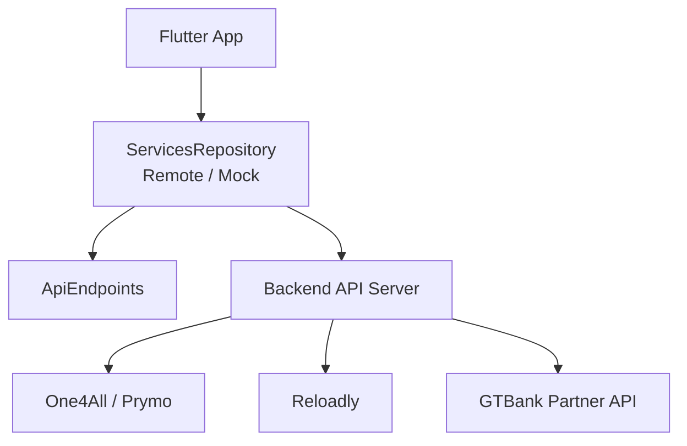
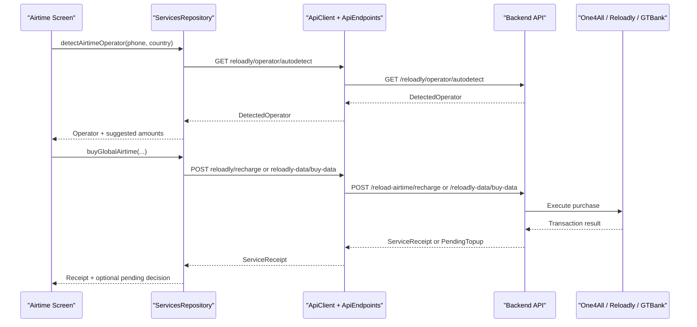
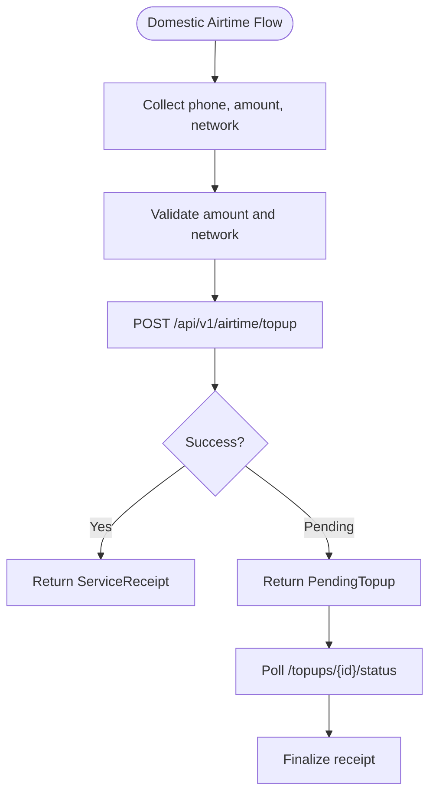
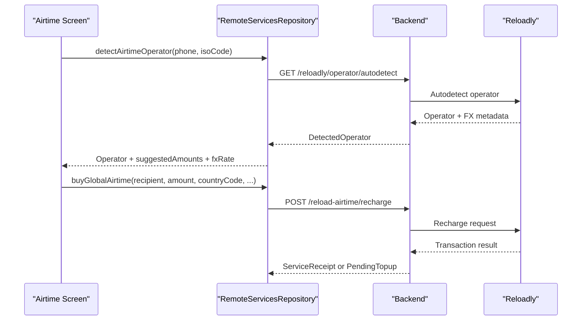
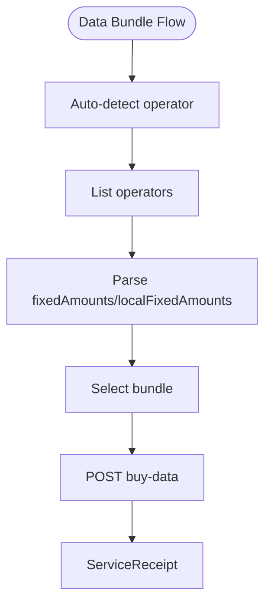
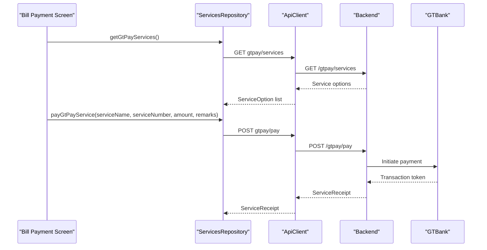
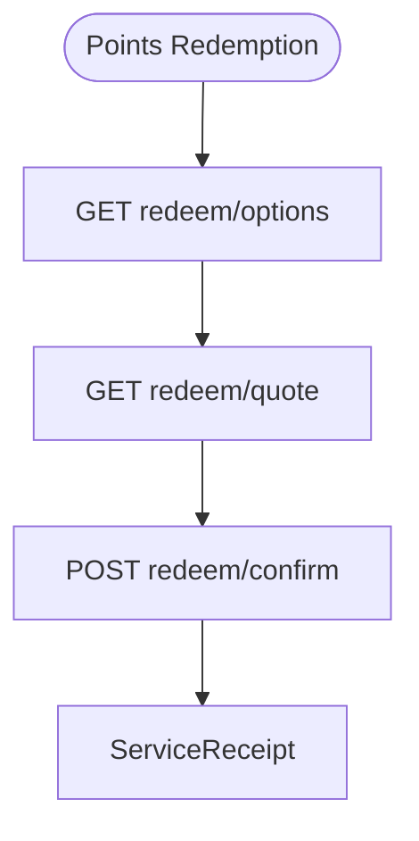
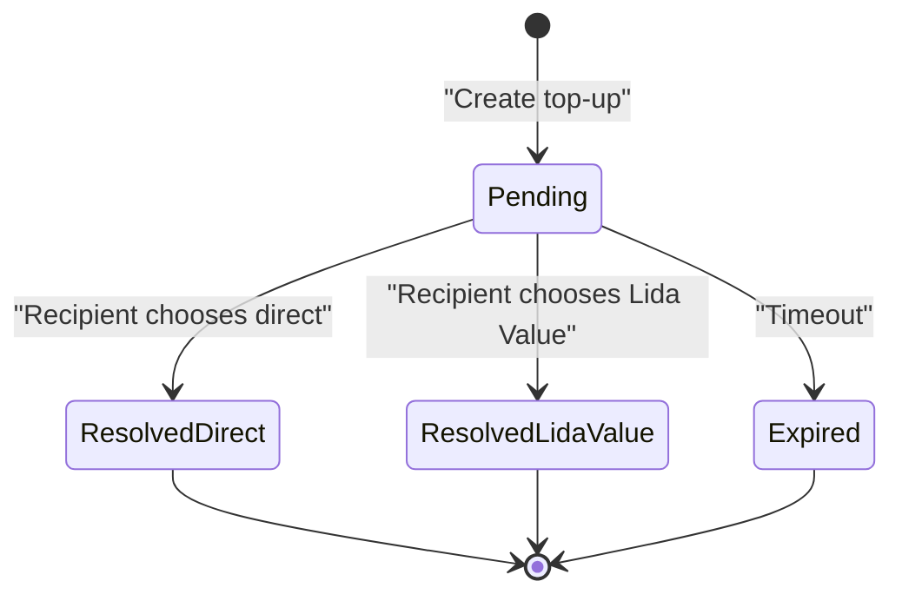
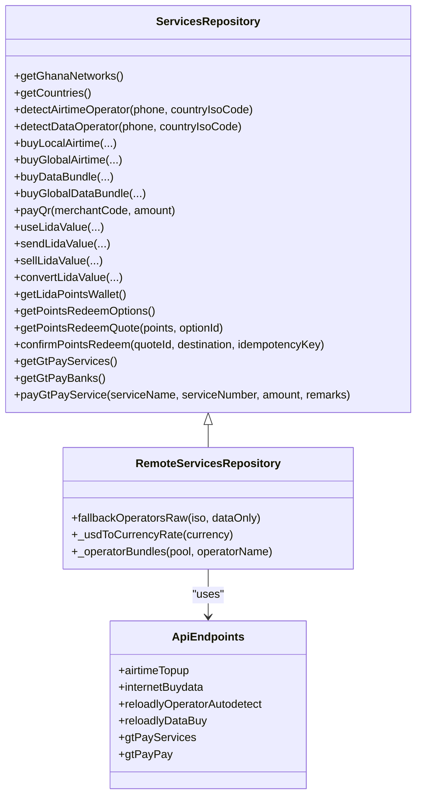

# Services & Utilities API

<cite>
**Referenced Files in This Document**
- [ENDPOINTS.md](file://api/ENDPOINTS.md)
- [api_endpoints.dart](file://lib/core/network/api_endpoints.dart)
- [services_repository.dart](file://lib/features/services/data/services_repository.dart)
- [service_models.dart](file://lib/features/services/data/service_models.dart)
- [remote_services_repository.dart](file://lib/features/services/data/remote_services_repository.dart)
- [mock_services_repository.dart](file://lib/features/services/data/mock_services_repository.dart)
- [ghana_networks.dart](file://lib/core/utils/ghana_networks.dart)
- [airtime_screen.dart](file://lib/features/services/screens/airtime_screen.dart)
- [activity_feed.dart](file://lib/features/dashboard/data/activity_feed.dart)
- [dashboard_providers.dart](file://lib/features/dashboard/providers.dart)
- [dashboard_models.dart](file://lib/features/dashboard/data/dashboard_models.dart)
- [history_models.dart](file://lib/features/history/data/history_models.dart)
- [BACKEND_NOTIFICATION_TRIGGERS_HANDOFF.md](file://docs/BACKEND_NOTIFICATION_TRIGGERS_HANDOFF.md)
</cite>

## Table of Contents
1. [Introduction](#introduction)
2. [Project Structure](#project-structure)
3. [Core Components](#core-components)
4. [Architecture Overview](#architecture-overview)
5. [Detailed Component Analysis](#detailed-component-analysis)
6. [Dependency Analysis](#dependency-analysis)
7. [Performance Considerations](#performance-considerations)
8. [Troubleshooting Guide](#troubleshooting-guide)
9. [Conclusion](#conclusion)
10. [Appendices](#appendices)

## Introduction
This document provides comprehensive API documentation for the services and utility endpoints exposed by the backend, as consumed by the mobile application. It covers:

- Airtime top-up (domestic One4All/Prymo and international Reloadly)
- Data bundle purchases (One4All and Reloadly)
- International money transfers via GTBank Partner API
- QR code payments
- Rewards system (Lida Points redemption)
- Third-party integrations (Reloadly, One4All, GTBank)
- Error handling, idempotency, and real-time status updates
- Integration guidelines for implementing new utility services

The base URL for all documented endpoints is `https://api.advansistechnologies.com`.

## Project Structure
The repository exposes a single OpenAPI endpoint map and a Flutter client that maps service flows to HTTP calls. The most relevant parts for this document are:

- Backend endpoint map: `api/ENDPOINTS.md`
- Client-side route constants: `lib/core/network/api_endpoints.dart`
- Service abstraction and models: `lib/features/services/data/services_repository.dart`, `lib/features/services/data/service_models.dart`
- Remote implementation and fallback logic: `lib/features/services/data/remote_services_repository.dart`
- Mock implementation used in tests: `lib/features/services/data/mock_services_repository.dart`
- Domestic operator mapping: `lib/core/utils/ghana_networks.dart`
- UI flow integration: `lib/features/services/screens/airtime_screen.dart`
- Real-time transaction tracking: `lib/features/dashboard/data/activity_feed.dart`, `lib/features/dashboard/providers.dart`, `lib/features/dashboard/data/dashboard_models.dart`
- Failure analysis and guidance: `lib/features/history/data/history_models.dart`
- Provider configuration notes: `docs/BACKEND_NOTIFICATION_TRIGGERS_HANDOFF.md`

**Diagram sources**
- [api_endpoints.dart:1-155](file://lib/core/network/api_endpoints.dart#L1-L155)
- [services_repository.dart:1-170](file://lib/features/services/data/services_repository.dart#L1-L170)
- [remote_services_repository.dart:470-509](file://lib/features/services/data/remote_services_repository.dart#L470-L509)
- [ENDPOINTS.md:94-157](file://api/ENDPOINTS.md#L94-L157)

**Section sources**
- [ENDPOINTS.md:1-195](file://api/ENDPOINTS.md#L1-L195)
- [api_endpoints.dart:1-155](file://lib/core/network/api_endpoints.dart#L1-L155)

## Core Components
The service layer is abstracted through `ServicesRepository`. It hides provider differences behind consistent methods for airtime, data bundles, QR payments, Lida Value operations, points redemption, and GTBank bill payments.

Key responsibilities:
- Operator detection and amount validation
- Country and operator listing
- Purchase execution with idempotency keys
- Receipt modeling and pending decision handling
- Points and Lida Value wallet interactions
- GTBank service catalog and payment completion

**Section sources**
- [services_repository.dart:1-170](file://lib/features/services/data/services_repository.dart#L1-L170)
- [service_models.dart:5-143](file://lib/features/services/data/service_models.dart#L5-L143)
- [service_models.dart:145-212](file://lib/features/services/data/service_models.dart#L145-L212)

## Architecture Overview
The end-to-end flow for services uses these layers:

1. UI screens collect user input (phone number, country, amount, network).
2. The screen calls `ServicesRepository` methods.
3. `RemoteServicesRepository` translates calls into HTTP requests using `ApiEndpoints`.
4. The backend routes to third-party providers (One4All, Reloadly, GTBank).
5. Status polling or callbacks update the dashboard and history feeds.

**Diagram sources**
- [airtime_screen.dart:546-576](file://lib/features/services/screens/airtime_screen.dart#L546-L576)
- [services_repository.dart:15-29](file://lib/features/services/data/services_repository.dart#L15-L29)
- [api_endpoints.dart:74-100](file://lib/core/network/api_endpoints.dart#L74-L100)
- [ENDPOINTS.md:123-133](file://api/ENDPOINTS.md#L123-L133)

## Detailed Component Analysis

### Airtime Top-Up API

#### Domestic Airtime (One4All / Prymo)
- Purpose: Top up Ghanaian numbers using One4All/Prymo network codes.
- Primary endpoints:
  - `POST /api/v1/airtime/topup`
  - `POST /api/v1/airtime/transtatus`
- Client usage:
  - `ServicesRepository.buyLocalAirtime(...)`
  - Network selection uses local prefix detection and One4All/Prymo codes.

Request schema (conceptual):
- recipientNumber: string
- amount: number
- networkId: string (One4All/Prymo code)
- saveToLidaValue: boolean
- clientReference: string (idempotency key)
- isSelfTopup: boolean (optional)

Response schema (conceptual):
- reference: string
- title: string
- message: string
- amount: number
- createdAt: datetime
- currency: string
- serviceType: string
- pendingTopup: object (optional)

Operator detection for domestic flows:
- Ghana networks are mapped deterministically from phone prefixes.
- If an operator name arrives from upstream, it is translated to a Prymo code; otherwise auto-detect is used.

**Diagram sources**
- [services_repository.dart:30-37](file://lib/features/services/data/services_repository.dart#L30-L37)
- [api_endpoints.dart:69-72](file://lib/core/network/api_endpoints.dart#L69-L72)
- [ENDPOINTS.md:94-95](file://api/ENDPOINTS.md#L94-L95)
- [ghana_networks.dart:1-115](file://lib/core/utils/ghana_networks.dart#L1-L115)

**Section sources**
- [services_repository.dart:30-37](file://lib/features/services/data/services_repository.dart#L30-L37)
- [api_endpoints.dart:69-72](file://lib/core/network/api_endpoints.dart#L69-L72)
- [ENDPOINTS.md:94-95](file://api/ENDPOINTS.md#L94-L95)
- [ghana_networks.dart:1-115](file://lib/core/utils/ghana_networks.dart#L1-L115)

#### International Airtime (Reloadly)
- Purpose: Top up non-Ghana numbers using Reloadly.
- Primary endpoints:
  - `GET /api/v1/reload-airtime/phone-lookup`
  - `POST /api/v1/reload-airtime/recharge`
  - `POST /api/v1/reload-airtime/recharge-async`
  - `GET /api/v1/reload-airtime/topup-status/{transactionId}`
  - `GET /api/v1/reloadly/country-list`
  - `POST /api/v1/reloadly/find-country-by-code`
  - `POST /api/v1/reloadly/get-operator-by-code`
  - `POST /api/v1/reloadly/operator/autodetect`
  - `GET /api/v1/reloadly/operators/{operatorId}/fx-rate`

Client usage:
- `ServicesRepository.detectAirtimeOperator(...)`
- `ServicesRepository.buyGlobalAirtime(...)`

Operator detection:
- The app calls autodetect with phone and country ISO code.
- For Ghana, the detected Reloadly operator is mapped to a Prymo code for domestic delivery.
- Suggested amounts, min/max, and FX rate drive the amount step.

FX handling:
- Reloadly may return sender and destination currencies plus an FX rate.
- If live FX is unavailable, the remote repository falls back to a USD-based conversion table.

**Diagram sources**
- [airtime_screen.dart:546-576](file://lib/features/services/screens/airtime_screen.dart#L546-L576)
- [services_repository.dart:15-29](file://lib/features/services/data/services_repository.dart#L15-L29)
- [api_endpoints.dart:74-89](file://lib/core/network/api_endpoints.dart#L74-L89)
- [remote_services_repository.dart:470-509](file://lib/features/services/data/remote_services_repository.dart#L470-L509)
- [ENDPOINTS.md:123-128](file://api/ENDPOINTS.md#L123-L128)

**Section sources**
- [services_repository.dart:15-29](file://lib/features/services/data/services_repository.dart#L15-L29)
- [api_endpoints.dart:74-89](file://lib/core/network/api_endpoints.dart#L74-L89)
- [remote_services_repository.dart:470-509](file://lib/features/services/data/remote_services_repository.dart#L470-L509)
- [ENDPOINTS.md:123-128](file://api/ENDPOINTS.md#L123-L128)

### Data Bundle Purchases API

#### One4All Data Bundles (Ghana)
- Purpose: Buy data bundles for Ghanaian numbers.
- Primary endpoints:
  - `POST /api/v1/internet/bundlelist`
  - `POST /api/v1/internet/buydata`

Client usage:
- `ServicesRepository.getDataBundles(networkId)`
- `ServicesRepository.buyDataBundle(...)`

Request schema (conceptual):
- recipientNumber: string
- networkId: string (One4All/Prymo code)
- bundle: object (bundle id, price, description)
- saveToLidaValue: boolean
- clientReference: string
- isSelfTopup: boolean (optional)

Response schema (conceptual):
- ServiceReceipt fields including bundleName and serviceType DATA.

#### Reloadly Data Bundles (International)
- Purpose: Buy data bundles for international numbers.
- Primary endpoints:
  - `GET /api/v1/reloadly-data/auto-detect`
  - `POST /api/v1/reloadly-data/list-operators`
  - `POST /api/v1/reloadly-data/buy-data`

Client usage:
- `ServicesRepository.detectDataOperator(...)`
- `ServicesRepository.buyGlobalDataBundle(...)`

Operator detection and bundles:
- Auto-detect returns operator metadata and fixed plan lists.
- Fixed plans include sender-priced and destination-priced amounts plus descriptions.
- The remote repository parses these into `DataBundle` objects.

**Diagram sources**
- [services_repository.dart:24-29](file://lib/features/services/data/services_repository.dart#L24-L29)
- [api_endpoints.dart:96-100](file://lib/core/network/api_endpoints.dart#L96-L100)
- [remote_services_repository.dart:905-959](file://lib/features/services/data/remote_services_repository.dart#L905-L959)
- [ENDPOINTS.md:129-133](file://api/ENDPOINTS.md#L129-L133)

**Section sources**
- [services_repository.dart:24-29](file://lib/features/services/data/services_repository.dart#L24-L29)
- [api_endpoints.dart:96-100](file://lib/core/network/api_endpoints.dart#L96-L100)
- [remote_services_repository.dart:905-959](file://lib/features/services/data/remote_services_repository.dart#L905-L959)
- [ENDPOINTS.md:129-133](file://api/ENDPOINTS.md#L129-L133)

### International Money Transfers (GTBank Partner API)

- Purpose: Pay bills and perform transfers via GTBank Partner API.
- Primary endpoints:
  - `POST /api/v1/gtpay/services`
  - `POST /api/v1/gtpay/query`
  - `POST /api/v1/gtpay/pay`
  - `POST /api/v1/gtpay/status`
  - `POST /api/v1/gtpay/banks`
  - `GET /api/v1/gtpay/banks`
  - `POST /api/v1/gtpay/callback`

Client usage:
- `ServicesRepository.getGtPayServices()`
- `ServicesRepository.getGtPayBanks()`
- `ServicesRepository.payGtPayService(serviceName, serviceNumber, amount, remarks)`

Verification:
- Optional customer verification via query before payment.
- A failed query is advisory and does not block an explicit payment.

**Diagram sources**
- [services_repository.dart:153-168](file://lib/features/services/data/services_repository.dart#L153-L168)
- [api_endpoints.dart:105-109](file://lib/core/network/api_endpoints.dart#L105-L109)
- [ENDPOINTS.md:185-192](file://api/ENDPOINTS.md#L185-L192)

**Section sources**
- [services_repository.dart:153-168](file://lib/features/services/data/services_repository.dart#L153-L168)
- [api_endpoints.dart:105-109](file://lib/core/network/api_endpoints.dart#L105-L109)
- [ENDPOINTS.md:185-192](file://api/ENDPOINTS.md#L185-L192)

### QR Code Payments

- Purpose: Pay merchants via QR code.
- Primary endpoints:
  - `POST /api/v1/users/track-qr-code-usage`
  - `GET /api/v1/users/qr-code-usage-stats`
  - `POST /api/v1/users/{userId}/scan-qr`
  - Merchant-specific QR endpoints under `/api/v1/merchants/{clientId}/...`

Client usage:
- `ServicesRepository.payQr(merchantCode, amount)`
- In the remote implementation, QR payment is currently marked unavailable; mock implementation returns a receipt.

Notes:
- QR usage tracking and stats are available for users and merchants.
- The app’s remote repository returns an “unavailable” placeholder for QR payments at present.

**Section sources**
- [services_repository.dart:73-76](file://lib/features/services/data/services_repository.dart#L73-L76)
- [mock_services_repository.dart:303-315](file://lib/features/services/data/mock_services_repository.dart#L303-L315)
- [remote_services_repository.dart:1790-1794](file://lib/features/services/data/remote_services_repository.dart#L1790-L1794)
- [ENDPOINTS.md:27-32](file://api/ENDPOINTS.md#L27-L32)
- [ENDPOINTS.md:52-59](file://api/ENDPOINTS.md#L52-L59)

### Rewards System (Lida Points Redemption)

- Purpose: Earn and redeem Lida Points for airtime, data, cash, or Lida Value credit.
- Primary endpoints:
  - `GET /api/v1/users/points`
  - `GET /api/v1/lidapoints/balance`
  - `GET /api/v1/lidapoints/history`
  - `GET /api/v1/lidapoints/redeem/options`
  - `GET /api/v1/lidapoints/redeem/quote`
  - `POST /api/v1/lidapoints/redeem/confirm`

Client usage:
- `ServicesRepository.getLidaPointsWallet()`
- `ServicesRepository.getLidaPointsHistory(page, limit)`
- `ServicesRepository.getPointsRedeemOptions()`
- `ServicesRepository.getPointsRedeemQuote(points, optionId)`
- `ServicesRepository.confirmPointsRedeem(quoteId, destination, idempotencyKey)`

Models:
- `PointsRedeemOption`: redemption type, minimum points, destination requirement.
- `PointsRedeemQuote`: quote id, points, cash value, currency, message.

**Diagram sources**
- [services_repository.dart:128-145](file://lib/features/services/data/services_repository.dart#L128-L145)
- [service_models.dart:266-357](file://lib/features/services/data/service_models.dart#L266-L357)
- [ENDPOINTS.md:82-86](file://api/ENDPOINTS.md#L82-L86)

**Section sources**
- [services_repository.dart:128-145](file://lib/features/services/data/services_repository.dart#L128-L145)
- [service_models.dart:266-357](file://lib/features/services/data/service_models.dart#L266-L357)
- [ENDPOINTS.md:82-86](file://api/ENDPOINTS.md#L82-L86)

### Lida Value Utility Endpoints

- Purpose: Save, send, sell, convert, and use Lida Value for self top-ups.
- Primary endpoints:
  - `GET /api/v1/lida-value/balance`
  - `GET /api/v1/lida-value/history`
  - `POST /api/v1/lida-value/use`
  - `POST /api/v1/lida-value/send`
  - `POST /api/v1/lida-value/sell`
  - `POST /api/v1/lida-value/convert`
  - `GET /api/v1/lida-value/eligibility`

Client usage:
- `ServicesRepository.useLidaValue(amount, destination, serviceType, clientReference, network, dataCode)`
- `ServicesRepository.sendLidaValue(amount, destination, serviceType, note, clientReference)`
- `ServicesRepository.sellLidaValue(amount, destination)`
- `ServicesRepository.convertLidaValue(amount, destination)`

Idempotency:
- `clientReference` must be reused on retries so the backend can return the previous result instead of debiting twice.

**Section sources**
- [services_repository.dart:77-127](file://lib/features/services/data/services_repository.dart#L77-L127)
- [ENDPOINTS.md:98-109](file://api/ENDPOINTS.md#L98-L109)

### Recipient Choice and Pending Top-Ups

- Purpose: Some top-ups require the recipient to choose between direct delivery and Lida Value.
- Primary endpoints:
  - `POST /api/v1/topups/{topupOrderId}/recipient-decision`
  - `GET /api/v1/topups/{topupOrderId}/recipient-decision`
  - `GET /api/v1/recipient-decisions/{decisionId}`
  - `POST /api/v1/recipient-decisions/{decisionId}/respond`
  - `GET /api/v1/topups/{topupOrderId}/status`

Client behavior:
- When a receipt includes `pendingTopup`, the app polls `/topups/{topupOrderId}/status` until terminal.
- Dashboard providers track pending decisions and settle them when resolved.

**Diagram sources**
- [service_models.dart:145-163](file://lib/features/services/data/service_models.dart#L145-L163)
- [dashboard_providers.dart:131-249](file://lib/features/dashboard/providers.dart#L131-L249)
- [ENDPOINTS.md:113-122](file://api/ENDPOINTS.md#L113-L122)

**Section sources**
- [service_models.dart:145-163](file://lib/features/services/data/service_models.dart#L145-L163)
- [dashboard_providers.dart:131-249](file://lib/features/dashboard/providers.dart#L131-L249)
- [ENDPOINTS.md:113-122](file://api/ENDPOINTS.md#L113-L122)

## Dependency Analysis

**Diagram sources**
- [services_repository.dart:1-170](file://lib/features/services/data/services_repository.dart#L1-L170)
- [remote_services_repository.dart:470-509](file://lib/features/services/data/remote_services_repository.dart#L470-L509)
- [remote_services_repository.dart:905-959](file://lib/features/services/data/remote_services_repository.dart#L905-L959)
- [api_endpoints.dart:69-109](file://lib/core/network/api_endpoints.dart#L69-L109)

**Section sources**
- [services_repository.dart:1-170](file://lib/features/services/data/services_repository.dart#L1-L170)
- [remote_services_repository.dart:470-509](file://lib/features/services/data/remote_services_repository.dart#L470-L509)
- [api_endpoints.dart:69-109](file://lib/core/network/api_endpoints.dart#L69-L109)

## Performance Considerations

- Idempotency: Always reuse `clientReference` for retries to avoid duplicate charges.
- Operator detection: Use autodetect once per session where possible; cache results if appropriate.
- FX rates: Prefer live Reloadly FX; fall back to USD conversion table only when necessary.
- Status polling: Use exponential backoff for pending top-ups; stop polling after terminal state.
- Bundle parsing: Fixed plan descriptions should be cached locally to reduce repeated parsing overhead.

[No sources needed since this section provides general guidance]

## Troubleshooting Guide

Common issues and resolutions:

- Reloadly credentials invalid:
  - Symptoms: `401 INVALID_CREDENTIALS` on Reloadly endpoints.
  - Resolution: Rotate upstream keys server-side; Ghana routes remain unaffected.

- Missing SMS configuration:
  - Symptoms: HTTP `503` for password reset via One4All SMS.
  - Resolution: Ensure backend has `ONE4ALL_BASEURL`, `ONE4ALL_APIKEY`, `ONE4ALL_APISECRET`, and approved `ONE4ALL_SMS_SENDER_ID`.

- Provider timeouts:
  - Symptoms: Transactions stuck in pending or failing due to timeout.
  - Resolution: Retry with same `clientReference`; verify payment first, then redeliver from pending record.

- Insufficient balance:
  - Symptoms: Failures mentioning insufficient funds or balance.
  - Resolution: Fund wallet and retry.

- Network/operator mismatch:
  - Symptoms: Provider rejects request due to wrong operator.
  - Resolution: Confirm destination network/operator before retrying.

- Expired recipient decision:
  - Symptoms: Decision expired; default to Lida Value.
  - Resolution: Resend when recipient is available; worker resolves expired decisions automatically.

Real-time status updates:
- The dashboard aggregates transactions from multiple sources and deduplicates by reference.
- Pending top-ups are polled until terminal; settled top-ups trigger notifications and invalidate recent transaction caches.

**Section sources**
- [BACKEND_NOTIFICATION_TRIGGERS_HANDOFF.md:119-148](file://docs/BACKEND_NOTIFICATION_TRIGGERS_HANDOFF.md#L119-L148)
- [history_models.dart:501-524](file://lib/features/history/data/history_models.dart#L501-L524)
- [activity_feed.dart:1-37](file://lib/features/dashboard/data/activity_feed.dart#L1-L37)
- [dashboard_providers.dart:131-249](file://lib/features/dashboard/providers.dart#L131-L249)

## Conclusion
The Services & Utilities API provides a unified interface for airtime, data bundles, international transfers, QR payments, and rewards. The Flutter client abstracts provider differences through `ServicesRepository`, while the backend integrates One4All, Reloadly, and GTBank. Robust error handling, idempotency, and real-time status polling ensure reliable user experiences. Integrators should follow the documented schemas, respect idempotency keys, and implement proper fallbacks for operator detection and FX rates.

[No sources needed since this section summarizes without analyzing specific files]

## Appendices

### Endpoint Reference Summary

- Airtime:
  - `POST /api/v1/airtime/topup`
  - `POST /api/v1/airtime/transtatus`
- Reloadly:
  - `GET /api/v1/reload-airtime/phone-lookup`
  - `POST /api/v1/reload-airtime/recharge`
  - `POST /api/v1/reload-airtime/recharge-async`
  - `GET /api/v1/reload-airtime/topup-status/{transactionId}`
  - `GET /api/v1/reloadly/country-list`
  - `POST /api/v1/reloadly/find-country-by-code`
  - `POST /api/v1/reloadly/get-operator-by-code`
  - `POST /api/v1/reloadly/operator/autodetect`
  - `GET /api/v1/reloadly/operators/{operatorId}/fx-rate`
- Reloadly Data:
  - `GET /api/v1/reloadly-data/auto-detect`
  - `POST /api/v1/reloadly-data/list-operators`
  - `POST /api/v1/reloadly-data/buy-data`
- One4All Data:
  - `POST /api/v1/internet/bundlelist`
  - `POST /api/v1/internet/buydata`
- GTBank:
  - `POST /api/v1/gtpay/services`
  - `POST /api/v1/gtpay/query`
  - `POST /api/v1/gtpay/pay`
  - `POST /api/v1/gtpay/status`
  - `POST /api/v1/gtpay/banks`
  - `GET /api/v1/gtpay/banks`
  - `POST /api/v1/gtpay/callback`
- Lida Value:
  - `GET /api/v1/lida-value/balance`
  - `GET /api/v1/lida-value/history`
  - `POST /api/v1/lida-value/use`
  - `POST /api/v1/lida-value/send`
  - `POST /api/v1/lida-value/sell`
  - `POST /api/v1/lida-value/convert`
  - `GET /api/v1/lida-value/eligibility`
- Lida Points:
  - `GET /api/v1/users/points`
  - `GET /api/v1/lidapoints/balance`
  - `GET /api/v1/lidapoints/history`
  - `GET /api/v1/lidapoints/redeem/options`
  - `GET /api/v1/lidapoints/redeem/quote`
  - `POST /api/v1/lidapoints/redeem/confirm`
- QR and Merchants:
  - `POST /api/v1/users/track-qr-code-usage`
  - `GET /api/v1/users/qr-code-usage-stats`
  - `POST /api/v1/users/{userId}/scan-qr`
  - `GET /api/v1/merchants/{clientId}/qrcode`
  - `POST /api/v1/merchants/{clientId}/track-qr-usage`
  - `GET /api/v1/merchants/{clientId}/qr-usage-stats`
  - `POST /api/v1/merchants/{clientId}/scan-qr`

**Section sources**
- [ENDPOINTS.md:94-192](file://api/ENDPOINTS.md#L94-L192)