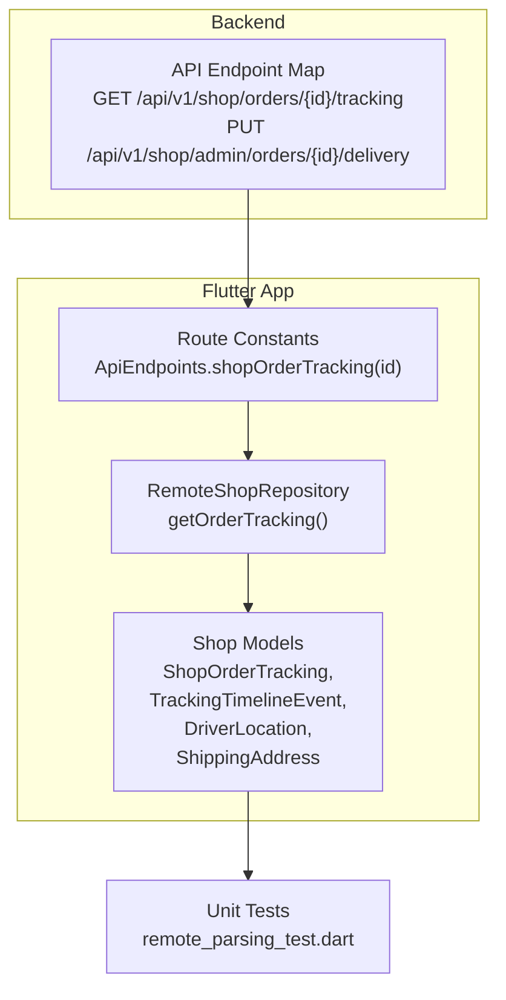
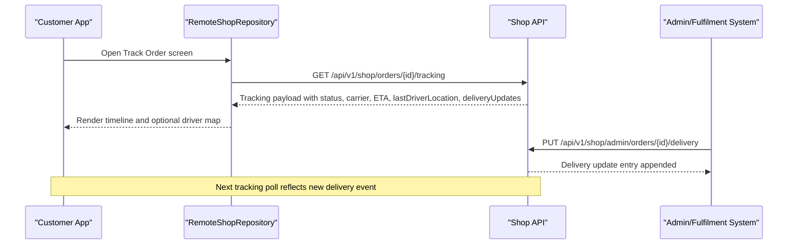
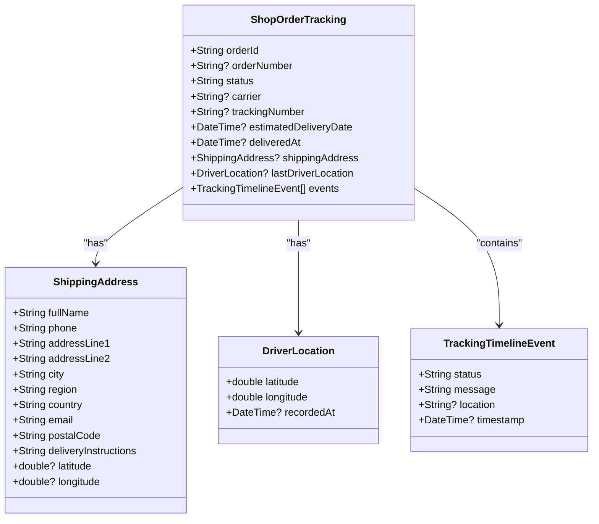
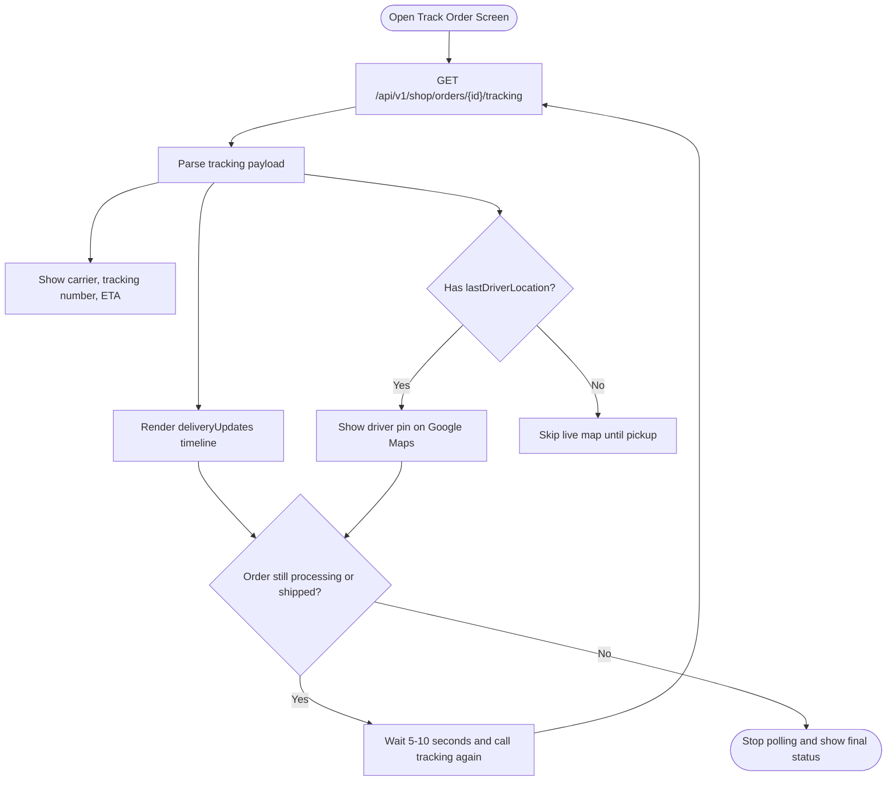
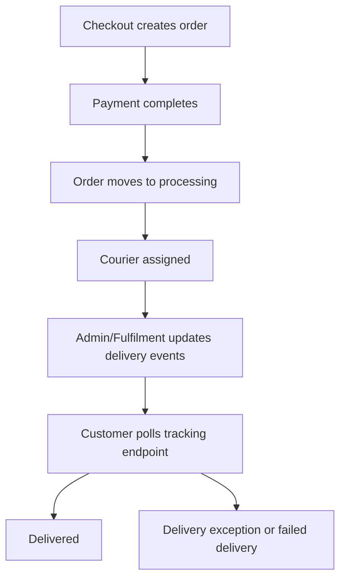

# Delivery Tracking API

<cite>
**Referenced Files in This Document**   
- [ENDPOINTS.md](file://api/ENDPOINTS.md)
- [SHOP_API_MOBILE_HANDOFF.md](file://docs/SHOP_API_MOBILE_HANDOFF.md)
- [remote_shop_repository.dart](file://lib/features/shop/data/remote_shop_repository.dart)
- [api_endpoints.dart](file://lib/core/network/api_endpoints.dart)
- [shop_models.dart](file://lib/features/shop/data/shop_models.dart)
- [remote_parsing_test.dart](file://test/remote_parsing_test.dart)
</cite>

## Table of Contents
1. [Introduction](#introduction)
2. [Project Structure](#project-structure)
3. [Core Components](#core-components)
4. [Architecture Overview](#architecture-overview)
5. [Detailed Component Analysis](#detailed-component-analysis)
6. [Dependency Analysis](#dependency-analysis)
7. [Performance Considerations](#performance-considerations)
8. [Troubleshooting Guide](#troubleshooting-guide)
9. [Conclusion](#conclusion)
10. [Appendices](#appendices)

## Introduction
This document provides detailed API documentation for delivery tracking endpoints exposed by the LidaPay shop backend and consumed by the Flutter mobile application. It covers:

- Retrieving delivery tracking information for an order.
- Updating delivery tracking status through admin/fulfilment endpoints.
- Managing delivery entries via the fulfilment workflow.
- Admin and fulfilment endpoints related to delivery management.
- Integration examples for implementing delivery tracking in the mobile application, including live driver location polling and timeline rendering.

The base URL for all documented endpoints is `https://api.advansistechnologies.com`. The shop API path prefix is `/api/v1/shop`.

## Project Structure
Delivery tracking functionality spans three layers:

- **Backend contract**: Declared in the endpoint map and mobile handoff documentation.
- **Mobile client layer**: Defines route constants and parses server responses into typed models.
- **Models and tests**: Define the shape of tracking payloads and validate parsing behavior.



**Diagram sources**
- [ENDPOINTS.md:183-184](file://api/ENDPOINTS.md#L183-L184)
- [api_endpoints.dart:121-130](file://lib/core/network/api_endpoints.dart#L121-L130)
- [remote_shop_repository.dart:175-214](file://lib/features/shop/data/remote_shop_repository.dart#L175-L214)
- [shop_models.dart:347-389](file://lib/features/shop/data/shop_models.dart#L347-L389)
- [remote_parsing_test.dart:1097-1133](file://test/remote_parsing_test.dart#L1097-L1133)

**Section sources**
- [ENDPOINTS.md:183-184](file://api/ENDPOINTS.md#L183-L184)
- [SHOP_API_MOBILE_HANDOFF.md:320-349](file://docs/SHOP_API_MOBILE_HANDOFF.md#L320-L349)
- [api_endpoints.dart:121-130](file://lib/core/network/api_endpoints.dart#L121-L130)
- [remote_shop_repository.dart:175-214](file://lib/features/shop/data/remote_shop_repository.dart#L175-L214)
- [shop_models.dart:347-389](file://lib/features/shop/data/shop_models.dart#L347-L389)
- [remote_parsing_test.dart:1097-1133](file://test/remote_parsing_test.dart#L1097-L1133)

## Core Components
The delivery tracking system is built around these core components:

| Component | Responsibility | Key Source |
|---|---|---|
| Backend endpoint map | Defines public and admin delivery tracking routes | [ENDPOINTS.md](file://api/ENDPOINTS.md) |
| Mobile handoff guide | Documents tracking response fields, statuses, and app responsibilities | [SHOP_API_MOBILE_HANDOFF.md](file://docs/SHOP_API_MOBILE_HANDOFF.md) |
| Route constants | Centralizes shop order tracking URL generation | [api_endpoints.dart](file://lib/core/network/api_endpoints.dart) |
| Remote repository | Calls the tracking endpoint and maps raw JSON to domain objects | [remote_shop_repository.dart](file://lib/features/shop/data/remote_shop_repository.dart) |
| Domain models | Represents tracking events, driver location, shipping address, and order data | [shop_models.dart](file://lib/features/shop/data/shop_models.dart) |
| Parsing tests | Validates that the repository correctly reads delivery updates and addresses | [remote_parsing_test.dart](file://test/remote_parsing_test.dart) |

**Section sources**
- [ENDPOINTS.md:183-184](file://api/ENDPOINTS.md#L183-L184)
- [SHOP_API_MOBILE_HANDOFF.md:320-349](file://docs/SHOP_API_MOBILE_HANDOFF.md#L320-L349)
- [api_endpoints.dart:121-130](file://lib/core/network/api_endpoints.dart#L121-L130)
- [remote_shop_repository.dart:175-214](file://lib/features/shop/data/remote_shop_repository.dart#L175-L214)
- [shop_models.dart:347-389](file://lib/features/shop/data/shop_models.dart#L347-L389)
- [remote_parsing_test.dart:1097-1133](file://test/remote_parsing_test.dart#L1097-L1133)

## Architecture Overview
The delivery tracking flow connects the mobile app to the backend through a read-only customer-facing tracking endpoint and a write-capable admin/fulfilment endpoint.



**Diagram sources**
- [SHOP_API_MOBILE_HANDOFF.md:341-349](file://docs/SHOP_API_MOBILE_HANDOFF.md#L341-L349)
- [ENDPOINTS.md:183-184](file://api/ENDPOINTS.md#L183-L184)
- [remote_shop_repository.dart:175-214](file://lib/features/shop/data/remote_shop_repository.dart#L175-L214)

## Detailed Component Analysis

### Delivery Tracking Endpoints

#### Get Delivery Tracking Information
- **HTTP method**: `GET`
- **URL pattern**: `/api/v1/shop/orders/{id}/tracking`
- **Authentication**: Required for customers; uses a bearer access token.
- **Path parameter**:
  - `id`: The MongoDB `_id` of the order. Do not use the public `orderNumber` here.
- **Response fields**:
  - `orderNumber`: Public order identifier used for sharing and public lookup.
  - `status`: Order lifecycle status such as `pending`, `paid`, `processing`, `shipped`, `delivered`, `cancelled`, or `refunded`.
  - `trackingNumber`: Courier-provided tracking code.
  - `carrier`: Courier name or provider label.
  - `estimatedDeliveryDate`: Expected delivery timestamp when available.
  - `deliveredAt`: Actual delivery timestamp once completed.
  - `shippingAddress`: Destination address object.
  - `lastDriverLocation`: Optional GPS point pushed by the courier integration.
  - `deliveryUpdates[]`: Chronological delivery timeline entries.

Example request:
```http
GET /api/v1/shop/orders/{order._id}/tracking
Authorization: Bearer <customer-access-token>
```

Example response structure:
```json
{
  "_id": "<order Mongo id>",
  "orderNumber": "LPS...",
  "status": "shipped",
  "carrier": "Frank Courier",
  "trackingNumber": "FRANK-TRACK-0001",
  "estimatedDeliveryDate": "2026-11-04T12:00:00.000Z",
  "deliveredAt": null,
  "shippingAddress": {
    "fullName": "Kofi Mensah",
    "phone": "0241120481",
    "addressLine1": "12 Osu Avenue",
    "city": "Accra",
    "region": "Greater Accra",
    "country": "Ghana"
  },
  "lastDriverLocation": {
    "latitude": 5.6037,
    "longitude": -0.187,
    "recordedAt": "2026-11-04T10:15:05.000Z"
  },
  "deliveryUpdates": [
    {
      "status": "courier_accepted",
      "message": "Courier accepted the delivery job",
      "timestamp": "2026-11-04T09:45:00.000Z"
    },
    {
      "status": "picked_up",
      "message": "Parcel picked up from Melcom warehouse",
      "location": "Spintex Road, Accra",
      "timestamp": "2026-11-04T10:00:00.000Z"
    },
    {
      "status": "out_for_delivery",
      "message": "Driver is on the way to the recipient",
      "location": "Osu, Accra",
      "timestamp": "2026-11-04T10:15:00.000Z"
    }
  ]
}
```

**Section sources**
- [ENDPOINTS.md:183](file://api/ENDPOINTS.md#L183)
- [SHOP_API_MOBILE_HANDOFF.md:326-349](file://docs/SHOP_API_MOBILE_HANDOFF.md#L326-L349)
- [remote_shop_repository.dart:175-214](file://lib/features/shop/data/remote_shop_repository.dart#L175-L214)
- [remote_parsing_test.dart:1097-1133](file://test/remote_parsing_test.dart#L1097-L1133)

#### Update Delivery Tracking Status
- **HTTP method**: `PUT`
- **URL pattern**: `/api/v1/shop/admin/orders/{id}/delivery`
- **Purpose**: Add a delivery update entry for an order.
- **Access control**: Admin or fulfilment role.
- **Behavior**: Appends a delivery event to the order’s delivery timeline. The mobile app should treat this as a write operation and must never be called from the customer-facing app.

Example request:
```http
PUT /api/v1/shop/admin/orders/{order._id}/delivery
Authorization: Bearer <admin-or-fulfilment-token>
```

Expected effect:
- A new delivery update appears in subsequent calls to `GET /api/v1/shop/orders/{id}/tracking`.
- The mobile app renders the new event in the delivery timeline.

**Section sources**
- [ENDPOINTS.md:184](file://api/ENDPOINTS.md#L184)
- [SHOP_API_MOBILE_HANDOFF.md:331-339](file://docs/SHOP_API_MOBILE_HANDOFF.md#L331-L339)

### Delivery Status Values
The delivery timeline uses a stable set of status values:

| Category | Status values | Meaning |
|---|---|---|
| Order lifecycle | `pending`, `paid`, `processing`, `shipped`, `delivered`, `cancelled`, `refunded` | High-level order state transitions. |
| Payment-related | `payment_confirmed`, `payment_failed` | Payment outcome events that may appear in the timeline. |
| Courier operations | `courier_accepted`, `packed`, `picked_up`, `out_for_delivery`, `delivered`, `delivery_exception`, `failed_delivery` | Operational delivery milestones. |

These values are rendered as a chronological timeline. The mobile app should map them to user-friendly labels rather than exposing raw internal codes directly without context.

**Section sources**
- [SHOP_API_MOBILE_HANDOFF.md:331-339](file://docs/SHOP_API_MOBILE_HANDOFF.md#L331-L339)

### Data Models Used by the Mobile App
The Flutter app normalizes tracking responses into typed models:



**Diagram sources**
- [remote_shop_repository.dart:175-214](file://lib/features/shop/data/remote_shop_repository.dart#L175-L214)
- [shop_models.dart:206-239](file://lib/features/shop/data/shop_models.dart#L206-L239)
- [shop_models.dart:347-389](file://lib/features/shop/data/shop_models.dart#L347-L389)

**Section sources**
- [remote_shop_repository.dart:175-214](file://lib/features/shop/data/remote_shop_repository.dart#L175-L214)
- [shop_models.dart:206-239](file://lib/features/shop/data/shop_models.dart#L206-L239)
- [shop_models.dart:347-389](file://lib/features/shop/data/shop_models.dart#L347-L389)

### Mobile Integration Flow
The mobile app implements delivery tracking as a read-only experience:

1. **Open the Track Order screen.**
2. **Call the tracking endpoint** using the order’s MongoDB `_id`.
3. **Render the summary header:** carrier, tracking number, estimated delivery date, or delivered time.
4. **Render the delivery timeline:** each `deliveryUpdates` entry shows status, message, optional location, and timestamp.
5. **Optionally render the driver location:** if the order status is active and `lastDriverLocation` is present, display it on Google Maps.
6. **Poll while the screen is visible:** poll every 5–10 seconds while the order is still being processed or shipped. Stop polling when the order reaches a terminal state or the screen is dismissed.



**Diagram sources**
- [SHOP_API_MOBILE_HANDOFF.md:341-420](file://docs/SHOP_API_MOBILE_HANDOFF.md#L341-L420)
- [remote_shop_repository.dart:175-214](file://lib/features/shop/data/remote_shop_repository.dart#L175-L214)

**Section sources**
- [SHOP_API_MOBILE_HANDOFF.md:341-420](file://docs/SHOP_API_MOBILE_HANDOFF.md#L341-L420)
- [remote_shop_repository.dart:175-214](file://lib/features/shop/data/remote_shop_repository.dart#L175-L214)

### Getting Delivery Tracking Info for Orders
There are two common ways to identify an order in the shop API:

| Use case | Endpoint | Notes |
|---|---|---|
| List current user’s orders | `GET /api/v1/shop/orders?page=1&limit=20` | Returns paginated orders for the authenticated user. |
| Get order detail by internal ID | `GET /api/v1/shop/orders/{id}` | Own orders only. |
| Public tracking lookup | `GET /api/v1/shop/orders/number/{orderNumber}` | Public endpoint; returns full order without customer GPS coordinates. Treat `orderNumber` as a shareable tracking ID. |
| Full tracking view | `GET /api/v1/shop/orders/{id}/tracking` | Includes delivery timeline, carrier info, ETA, driver location, and shipping address. |

Recommended mobile usage:
- Use `GET /api/v1/shop/orders/{id}/tracking` for the dedicated tracking screen.
- Use `GET /api/v1/shop/orders/number/{orderNumber}` only when you need a public, shareable order view.

**Section sources**
- [SHOP_API_MOBILE_HANDOFF.md:320-329](file://docs/SHOP_API_MOBILE_HANDOFF.md#L320-L329)
- [api_endpoints.dart:121-130](file://lib/core/network/api_endpoints.dart#L121-L130)

### Updating Delivery Tracking Status
The admin/fulfilment endpoint adds a delivery update entry:

- **Endpoint**: `PUT /api/v1/shop/admin/orders/{id}/delivery`
- **Role requirement**: Admin or fulfilment.
- **Effect**: Appends a delivery event to the order’s delivery timeline.
- **Client responsibility**: The mobile app must not call this endpoint. Only backend systems, admin tools, or fulfilment integrations should update delivery status.

When integrating fulfilment automation:
- Send delivery events with meaningful status values such as `courier_accepted`, `packed`, `picked_up`, `out_for_delivery`, `delivered`, `delivery_exception`, or `failed_delivery`.
- Include human-readable messages and optional location strings where helpful.
- Ensure timestamps are consistent so the timeline remains chronological.

**Section sources**
- [ENDPOINTS.md:184](file://api/ENDPOINTS.md#L184)
- [SHOP_API_MOBILE_HANDOFF.md:331-339](file://docs/SHOP_API_MOBILE_HANDOFF.md#L331-L339)

### Managing Delivery Entries
Delivery entries are managed through the fulfilment workflow:

1. **Create an order** through the checkout flow.
2. **Process payment** and advance the order to processing/shipping.
3. **Assign a courier** and record initial delivery events.
4. **Update delivery status** using the admin/fulfilment delivery endpoint.
5. **Expose the timeline** to the customer through the tracking endpoint.
6. **Finalize delivery** with `delivered` or handle exceptions with `delivery_exception` or `failed_delivery`.



**Diagram sources**
- [SHOP_API_MOBILE_HANDOFF.md:320-349](file://docs/SHOP_API_MOBILE_HANDOFF.md#L320-L349)
- [ENDPOINTS.md:183-184](file://api/ENDPOINTS.md#L183-L184)

**Section sources**
- [SHOP_API_MOBILE_HANDOFF.md:320-349](file://docs/SHOP_API_MOBILE_HANDOFF.md#L320-L349)
- [ENDPOINTS.md:183-184](file://api/ENDPOINTS.md#L183-L184)

## Dependency Analysis
The delivery tracking feature depends on several interconnected parts of the codebase:

```mermaid
graph LR
EndpointsDoc["api/ENDPOINTS.md"] --> MobileHandoff["docs/SHOP_API_MOBILE_HANDOFF.md"]
MobileHandoff --> ApiEndpoints["lib/core/network/api_endpoints.dart"]
ApiEndpoints --> RemoteRepo["lib/features/shop/data/remote_shop_repository.dart"]
RemoteRepo --> ShopModels["lib/features/shop/data/shop_models.dart"]
ShopModels --> ParsingTests["test/remote_parsing_test.dart"]
```



**Diagram sources**
- [ENDPOINTS.md:183-184](file://api/ENDPOINTS.md#L183-L184)
- [SHOP_API_MOBILE_HANDOFF.md:320-349](file://docs/SHOP_API_MOBILE_HANDOFF.md#L320-L349)
- [api_endpoints.dart:121-130](file://lib/core/network/api_endpoints.dart#L121-L130)
- [remote_shop_repository.dart:175-214](file://lib/features/shop/data/remote_shop_repository.dart#L175-L214)
- [shop_models.dart:347-389](file://lib/features/shop/data/shop_models.dart#L347-L389)
- [remote_parsing_test.dart:1097-1133](file://test/remote_parsing_test.dart#L1097-L1133)

**Section sources**
- [ENDPOINTS.md:183-184](file://api/ENDPOINTS.md#L183-L184)
- [SHOP_API_MOBILE_HANDOFF.md:320-349](file://docs/SHOP_API_MOBILE_HANDOFF.md#L320-L349)
- [api_endpoints.dart:121-130](file://lib/core/network/api_endpoints.dart#L121-L130)
- [remote_shop_repository.dart:175-214](file://lib/features/shop/data/remote_shop_repository.dart#L175-L214)
- [shop_models.dart:347-389](file://lib/features/shop/data/shop_models.dart#L347-L389)
- [remote_parsing_test.dart:1097-1133](file://test/remote_parsing_test.dart#L1097-L1133)

## Performance Considerations
- **Polling frequency**: The mobile handoff recommends polling the tracking endpoint every 5–10 seconds while the tracking screen is active and the order is still in progress.
- **Stop conditions**: Stop polling when the order reaches a terminal state such as `delivered` or `cancelled`, or when the user navigates away from the tracking screen.
- **Driver location staleness**: Display the `recordedAt` timestamp from `lastDriverLocation` so users understand how recent the driver position is.
- **Network resilience**: Treat network failures differently from missing orders. A missing order can return a safe empty result, but connection errors should propagate to error handling.
- **Timeline ordering**: The repository sorts delivery events chronologically and presents them newest-first for UI timelines.

[No sources needed since this section provides general guidance]

## Troubleshooting Guide
Common issues and their likely causes:

| Symptom | Likely cause | Resolution |
|---|---|---|
| Tracking screen shows no timeline | Missing or malformed `deliveryUpdates` | Verify the backend returns a list of delivery events; check parsing logic in the repository. |
| Driver location not shown | Order not yet shipped or courier has not sent GPS | Wait for `shipped` status and valid `lastDriverLocation`; do not assume GPS is always present. |
| Public order lookup fails | Invalid `orderNumber` or order does not exist | Confirm the public order number and ensure the order exists. |
| Admin delivery update not reflected | Incorrect order ID or insufficient permissions | Use the order’s MongoDB `_id` and ensure admin/fulfilment credentials. |
| Timeline events appear out of order | Inconsistent timestamps or missing time fields | Ensure delivery events include reliable timestamps; the repository sorts by timestamp. |

**Section sources**
- [remote_shop_repository.dart:175-214](file://lib/features/shop/data/remote_shop_repository.dart#L175-L214)
- [remote_parsing_test.dart:1097-1133](file://test/remote_parsing_test.dart#L1097-L1133)

## Conclusion
The delivery tracking API exposes a clear separation between customer-facing read operations and admin/fulfilment write operations. Customers retrieve tracking information through `GET /api/v1/shop/orders/{id}/tracking`, which includes order status, carrier details, estimated delivery time, driver location, and a chronological delivery timeline. Fulfilment systems update delivery status through `PUT /api/v1/shop/admin/orders/{id}/delivery`, appending events that the mobile app then displays.

For mobile integration, implement a read-only tracking screen that polls the tracking endpoint at a reasonable interval, renders the delivery timeline, and optionally shows the driver location on a map. Avoid calling admin endpoints from the customer app and rely on the backend to manage delivery state securely.

[No sources needed since this section summarizes without analyzing specific files]

## Appendices

### API Reference Summary

| Method | Endpoint | Role | Purpose |
|---|---|---|---|
| `GET` | `/api/v1/shop/orders` | Authenticated customer | List current user’s orders. |
| `GET` | `/api/v1/shop/orders/{id}` | Authenticated customer | Get order detail by internal ID. |
| `GET` | `/api/v1/shop/orders/number/{orderNumber}` | Public | Lookup order by public order number. |
| `GET` | `/api/v1/shop/orders/{id}/tracking` | Authenticated customer | Retrieve delivery tracking information. |
| `POST` | `/api/v1/shop/orders/{id}/cancel` | Authenticated customer | Cancel an eligible order. |
| `PUT` | `/api/v1/shop/admin/orders/{id}/delivery` | Admin/Fulfilment | Update delivery tracking by adding a delivery entry. |

**Section sources**
- [ENDPOINTS.md:176-184](file://api/ENDPOINTS.md#L176-L184)
- [SHOP_API_MOBILE_HANDOFF.md:320-349](file://docs/SHOP_API_MOBILE_HANDOFF.md#L320-L349)