# Order Management API

<cite>
**Referenced Files in This Document**   
- [ENDPOINTS.md](file://api/ENDPOINTS.md)
- [SHOP_API_MOBILE_HANDOFF.md](file://docs/SHOP_API_MOBILE_HANDOFF.md)
- [swagger-api-documentation.md](file://docs/swagger-api-documentation.md)
- [api_endpoints.dart](file://lib/core/network/api_endpoints.dart)
- [remote_shop_repository.dart](file://lib/features/shop/data/remote_shop_repository.dart)
</cite>

## Table of Contents
1. [Introduction](#introduction)
2. [Project Structure](#project-structure)
3. [Core Components](#core-components)
4. [Architecture Overview](#architecture-overview)
5. [Detailed Component Analysis](#detailed-component-analysis)
6. [Dependency Analysis](#dependency-analysis)
7. [Performance Considerations](#performance-considerations)
8. [Troubleshooting Guide](#troubleshooting-guide)
9. [Conclusion](#conclusion)
10. [Appendices](#appendices)

## Introduction
This document provides detailed API documentation for order management endpoints used by the LidaPay shop and mobile application. It covers:

- Customer-facing order creation, listing, detail retrieval, cancellation, and public tracking.
- Payment integration with ExpressPay (AdvansisPay) and GTBank Mobile Money (GTPay).
- Admin and fulfillment endpoints for order status updates, payment status management, and delivery tracking.
- Integration examples for implementing order management in the Flutter mobile application.

The authoritative endpoint map is maintained in `api/ENDPOINTS.md`, while the mobile app contract and checkout flow are documented in `docs/SHOP_API_MOBILE_HANDOFF.md`. The Flutter client defines route constants in `lib/core/network/api_endpoints.dart` and implements repository calls in `lib/features/shop/data/remote_shop_repository.dart`.

## Project Structure
The order management surface spans three layers:

| Layer | Responsibility | Relevant Files |
|---|---|---|
| Backend API contract | HTTP methods, URL patterns, request/response schemas, admin routes | [ENDPOINTS.md](file://api/ENDPOINTS.md), [swagger-api-documentation.md](file://docs/swagger-api-documentation.md) |
| Mobile handoff contract | Checkout, payment linkage, order lifecycle, tracking behavior, status values | [SHOP_API_MOBILE_HANDOFF.md](file://docs/SHOP_API_MOBILE_HANDOFF.md) |
| Flutter client | Route constants, repository calls, error handling, polling strategy | [api_endpoints.dart](file://lib/core/network/api_endpoints.dart), [remote_shop_repository.dart](file://lib/features/shop/data/remote_shop_repository.dart) |

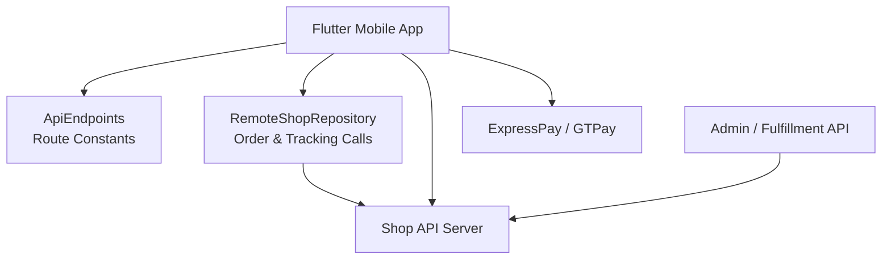

**Diagram sources**
- [api_endpoints.dart:111-130](file://lib/core/network/api_endpoints.dart#L111-L130)
- [remote_shop_repository.dart:137-223](file://lib/features/shop/data/remote_shop_repository.dart#L137-L223)
- [ENDPOINTS.md:175-184](file://api/ENDPOINTS.md#L175-L184)

**Section sources**
- [ENDPOINTS.md:1-195](file://api/ENDPOINTS.md#L1-L195)
- [SHOP_API_MOBILE_HANDOFF.md:1-452](file://docs/SHOP_API_MOBILE_HANDOFF.md#L1-L452)
- [api_endpoints.dart:111-130](file://lib/core/network/api_endpoints.dart#L111-L130)
- [remote_shop_repository.dart:137-223](file://lib/features/shop/data/remote_shop_repository.dart#L137-L223)

## Core Components
The order management system is built around these core components:

| Component | Purpose | Key Behavior |
|---|---|---|
| Shop Checkout | Creates an order from the authenticated user's cart | Validates stock, recomputes prices, clears cart, returns order with `pending` status and payment state |
| Order Listing | Returns paginated orders for the current user | Uses `page` and `limit`; response envelope includes `orders`, `total`, `page`, `totalPages` |
| Order Detail | Retrieves a single order owned by the authenticated user | Enforces ownership; 404 when not found |
| Public Order Lookup | Tracks an order by its shareable order number | Returns full order without sensitive GPS coordinates |
| Order Cancellation | Cancels eligible orders and restores stock | Only allows cancellation for pending or processing orders |
| Delivery Tracking | Reads delivery timeline, carrier info, driver location | Read-only for the mobile app; supports polling |
| Admin Order Management | Updates order status, payment status, and delivery tracking | Enforces valid transitions and fulfillment operations |
| Payment Linkage | Connects payment provider outcomes to order state | Auto-advances order to paid on success, failed on decline |

**Section sources**
- [ENDPOINTS.md:175-184](file://api/ENDPOINTS.md#L175-L184)
- [SHOP_API_MOBILE_HANDOFF.md:148-226](file://docs/SHOP_API_MOBILE_HANDOFF.md#L148-L226)
- [SHOP_API_MOBILE_HANDOFF.md:320-339](file://docs/SHOP_API_MOBILE_HANDOFF.md#L320-L339)
- [remote_shop_repository.dart:137-223](file://lib/features/shop/data/remote_shop_repository.dart#L137-L223)

## Architecture Overview
The end-to-end order architecture connects the mobile app, backend shop API, payment providers, and admin/fulfillment systems.

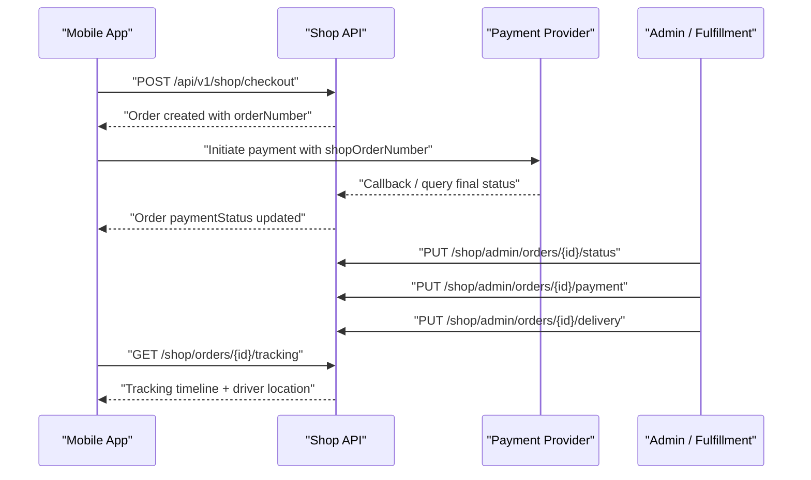

**Diagram sources**
- [ENDPOINTS.md:175-184](file://api/ENDPOINTS.md#L175-L184)
- [SHOP_API_MOBILE_HANDOFF.md:229-317](file://docs/SHOP_API_MOBILE_HANDOFF.md#L229-L317)
- [SHOP_API_MOBILE_HANDOFF.md:341-436](file://docs/SHOP_API_MOBILE_HANDOFF.md#L341-L436)

## Detailed Component Analysis

### Order Creation — Checkout
Checkout creates an order from the server-side cart. Prices are computed on the server; the app must not calculate or override totals.

| Field | Type | Required | Description |
|---|---|---:|---|
| `shippingAddress.fullName` | string | Yes | Recipient full name |
| `shippingAddress.phone` | string | Yes | Recipient phone number |
| `shippingAddress.addressLine1` | string | Yes | Primary address line |
| `shippingAddress.city` | string | Yes | City |
| `shippingAddress.region` | string | Yes | Region or state |
| `shippingAddress.country` | string | Yes | Country |
| `shippingAddress.email` | string | No | Optional email |
| `shippingAddress.addressLine2` | string | No | Optional secondary address |
| `shippingAddress.postalCode` | string | No | Optional postal code |
| `shippingAddress.deliveryInstructions` | string | No | Optional delivery notes |
| `shippingAddress.latitude` | number | Conditional | Optional destination coordinate |
| `shippingAddress.longitude` | number | Conditional | Optional destination coordinate |
| `deliveryDistanceKm` | number | No | Optional driving distance computed by the app |
| `paymentMethod` | string | No | `momo`, `card`, or `wallet`; default `momo` |
| `redirectUrl` | string | No | Deep link or return URL for payment callback |

Response fields include:

| Field | Type | Description |
|---|---|---|
| `_id` | string | MongoDB order identifier |
| `orderNumber` | string | Shareable tracking ID such as `LPS...` |
| `items` | array | Snapshot of ordered products |
| `subtotal` | number | Sum of item prices |
| `discount` | number | Applied discount amount |
| `deliveryFee` | number | Server-computed delivery fee |
| `total` | number | Final payable amount |
| `currency` | string | Currency code, typically `GHS` |
| `status` | string | Order lifecycle status |
| `paymentStatus` | string | Pending, success, failed, or refunded |
| `paymentMethod` | string | Selected payment method |
| `deliveryUpdates` | array | Initial timeline entry such as `order_placed` |

Important rules:

- Stock is validated and decremented.
- Cart is cleared after successful checkout.
- Empty cart or insufficient stock returns a validation error.
- The order item `sku` and optional `description` come from the catalog, not the client request.

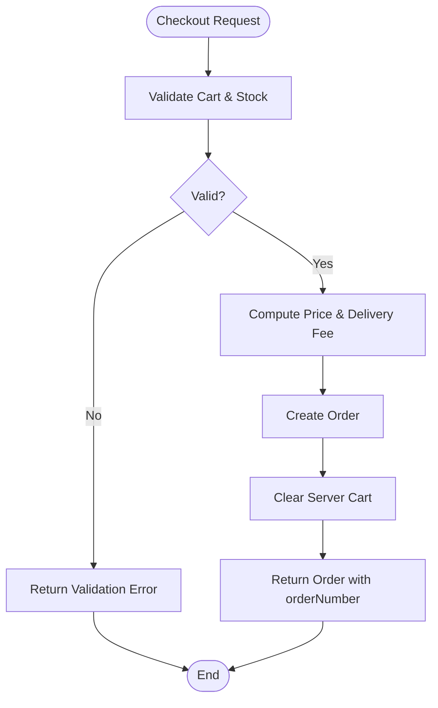

**Diagram sources**
- [SHOP_API_MOBILE_HANDOFF.md:148-226](file://docs/SHOP_API_MOBILE_HANDOFF.md#L148-L226)

**Section sources**
- [SHOP_API_MOBILE_HANDOFF.md:148-226](file://docs/SHOP_API_MOBILE_HANDOFF.md#L148-L226)
- [ENDPOINTS.md:175-176](file://api/ENDPOINTS.md#L175-L176)

### Order Listing with Pagination
Customers retrieve their own orders through a paginated list.

| Method | Endpoint | Query Parameters | Response Envelope |
|---|---|---|---|
| GET | `/api/v1/shop/orders` | `page`, `limit` | `{ orders: Order[], total, page, totalPages }` |

Client behavior:

- Default pagination is `page=1`, `limit=20`.
- A network failure must not be treated as an empty order list; it should propagate as an error state.
- The repository maps raw API rows into typed order objects.

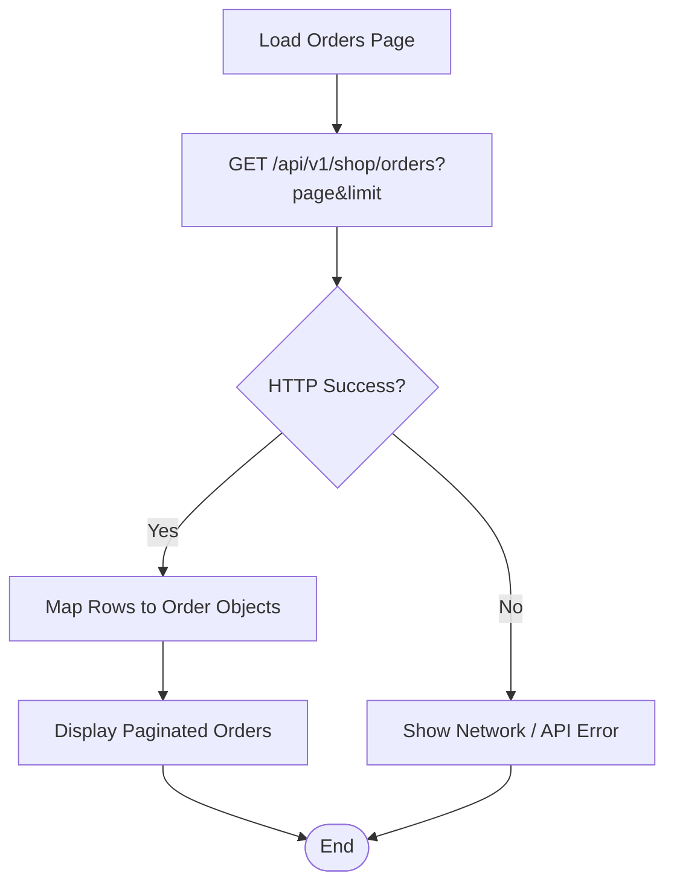

**Diagram sources**
- [remote_shop_repository.dart:137-146](file://lib/features/shop/data/remote_shop_repository.dart#L137-L146)
- [ENDPOINTS.md:176](file://api/ENDPOINTS.md#L176)

**Section sources**
- [ENDPOINTS.md:176](file://api/ENDPOINTS.md#L176)
- [SHOP_API_MOBILE_HANDOFF.md:320-324](file://docs/SHOP_API_MOBILE_HANDOFF.md#L320-L324)
- [remote_shop_repository.dart:137-146](file://lib/features/shop/data/remote_shop_repository.dart#L137-L146)

### Order Detail Retrieval
Retrieving an order by ID returns details for the authenticated user’s own order.

| Method | Endpoint | Authorization | Notes |
|---|---|---|---|
| GET | `/api/v1/shop/orders/{id}` | Bearer token required | Own orders only |

Behavior:

- If the order does not exist, the repository treats 404 as a real answer and returns null rather than throwing.
- Other errors are rethrown so UI can show connection or server failures.

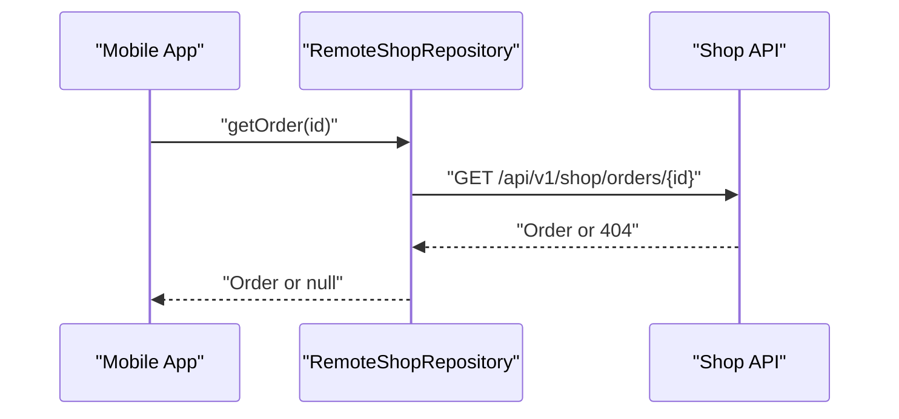

**Diagram sources**
- [remote_shop_repository.dart:148-160](file://lib/features/shop/data/remote_shop_repository.dart#L148-L160)
- [ENDPOINTS.md:177](file://api/ENDPOINTS.md#L177)

**Section sources**
- [ENDPOINTS.md:177](file://api/ENDPOINTS.md#L177)
- [remote_shop_repository.dart:148-160](file://lib/features/shop/data/remote_shop_repository.dart#L148-L160)

### Public Order Tracking by Order Number
Public tracking uses the shareable order number instead of the internal MongoDB ID.

| Method | Endpoint | Authorization | Notes |
|---|---|---|---|
| GET | `/api/v1/shop/orders/number/{orderNumber}` | None | Public lookup; returns full order without customer GPS coordinates |

Client behavior:

- Treat `orderNumber` as a shareable tracking ID.
- Do not treat missing data as a transient network failure; 404 means the order was not found.
- Use this endpoint for sharing tracking links where sensitive location data must be excluded.

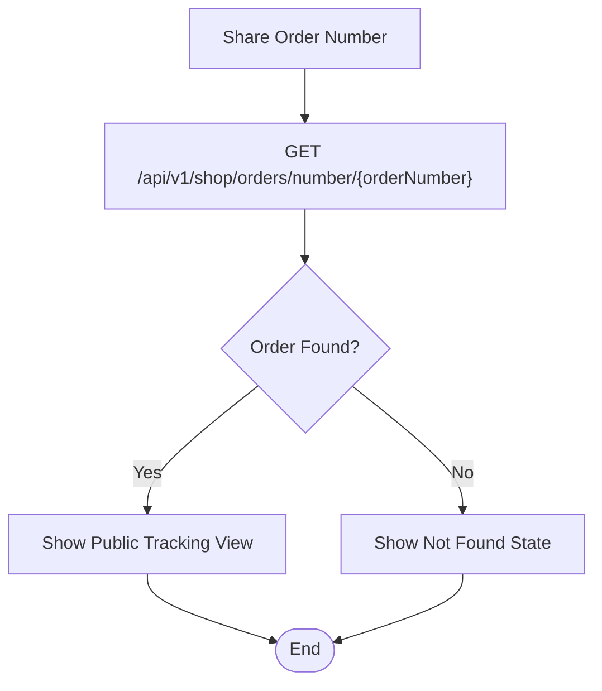

**Diagram sources**
- [api_endpoints.dart:124-127](file://lib/core/network/api_endpoints.dart#L124-L127)
- [remote_shop_repository.dart:162-173](file://lib/features/shop/data/remote_shop_repository.dart#L162-L173)
- [ENDPOINTS.md:178](file://api/ENDPOINTS.md#L178)

**Section sources**
- [ENDPOINTS.md:178](file://api/ENDPOINTS.md#L178)
- [api_endpoints.dart:124-127](file://lib/core/network/api_endpoints.dart#L124-L127)
- [remote_shop_repository.dart:162-173](file://lib/features/shop/data/remote_shop_repository.dart#L162-L173)

### Order Cancellation
Cancellation is available to customers for eligible orders.

| Method | Endpoint | Authorization | Request Body | Rules |
|---|---|---|---|---|
| POST | `/api/v1/shop/orders/{id}/cancel` | Bearer token required | `{ reason?: string }` | Only pending or processing orders can be cancelled; stock is restored |

Client behavior:

- Send an optional reason.
- The repository posts the body and maps the returned order.
- UI should prevent cancellation for orders that are already paid, shipped, delivered, or otherwise ineligible.

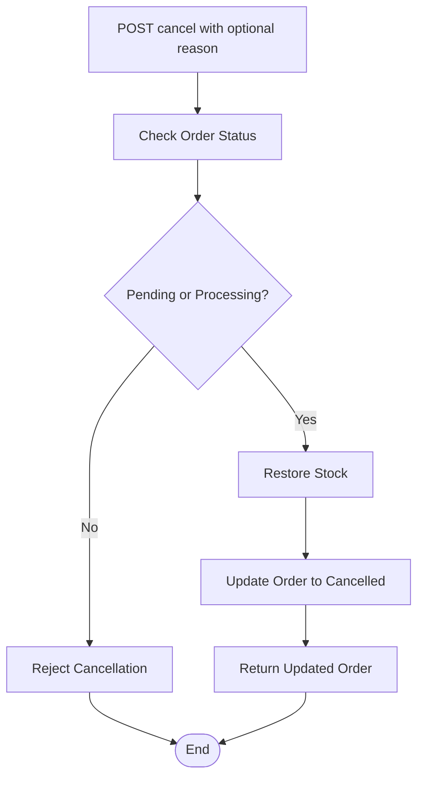

**Diagram sources**
- [SHOP_API_MOBILE_HANDOFF.md:329](file://docs/SHOP_API_MOBILE_HANDOFF.md#L329)
- [remote_shop_repository.dart:217-223](file://lib/features/shop/data/remote_shop_repository.dart#L217-L223)
- [ENDPOINTS.md:179](file://api/ENDPOINTS.md#L179)

**Section sources**
- [ENDPOINTS.md:179](file://api/ENDPOINTS.md#L179)
- [SHOP_API_MOBILE_HANDOFF.md:329](file://docs/SHOP_API_MOBILE_HANDOFF.md#L329)
- [remote_shop_repository.dart:217-223](file://lib/features/shop/data/remote_shop_repository.dart#L217-L223)

### Order Tracking and Delivery Timeline
Tracking is read-only for the mobile app and returns delivery events, carrier information, estimated delivery date, and optionally driver location.

| Method | Endpoint | Authorization | Response Fields |
|---|---|---|---|
| GET | `/api/v1/shop/orders/{id}/tracking` | Bearer token required | `orderNumber`, `status`, `trackingNumber`, `carrier`, `estimatedDeliveryDate`, `deliveredAt`, `deliveryUpdates[]`, `lastDriverLocation`, `shippingAddress` |

Key tracking behaviors:

- `deliveryUpdates[].status` includes order lifecycle events and courier milestones.
- `lastDriverLocation` contains latitude, longitude, and a recorded timestamp.
- The mobile app polls every 5–10 seconds while the tracking screen is active and the order is in progress.
- Polling stops when the order reaches terminal states such as delivered or cancelled.

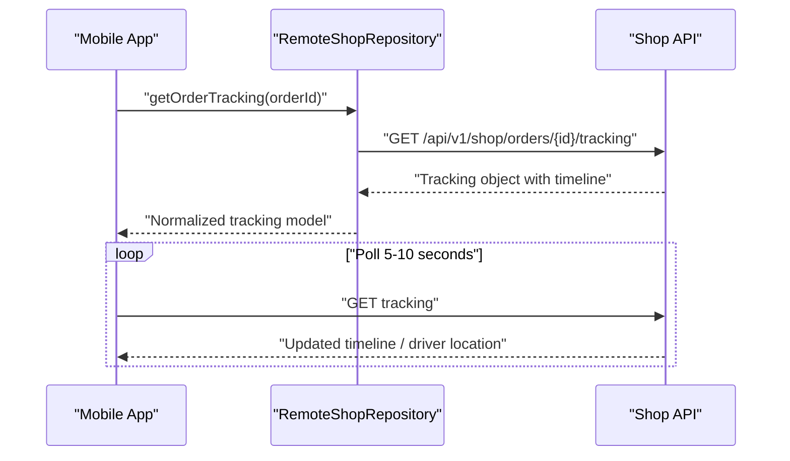

**Diagram sources**
- [SHOP_API_MOBILE_HANDOFF.md:341-436](file://docs/SHOP_API_MOBILE_HANDOFF.md#L341-L436)
- [remote_shop_repository.dart:175-214](file://lib/features/shop/data/remote_shop_repository.dart#L175-L214)
- [ENDPOINTS.md:183](file://api/ENDPOINTS.md#L183)

**Section sources**
- [ENDPOINTS.md:183](file://api/ENDPOINTS.md#L183)
- [SHOP_API_MOBILE_HANDOFF.md:341-436](file://docs/SHOP_API_MOBILE_HANDOFF.md#L341-L436)
- [remote_shop_repository.dart:175-214](file://lib/features/shop/data/remote_shop_repository.dart#L175-L214)

### Payment Integration and Order Reconciliation
After checkout, the app initiates payment using either ExpressPay or GTPay. Both flows link the payment to the order via `shopOrderNumber`.

#### ExpressPay (AdvansisPay)
| Step | Action | Details |
|---|---|---|
| Initiate | `POST /api/v1/advansispay/initiate-payment` | Include `shopOrderNumber`, amount, customer details |
| Redirect | Open hosted checkout URL | User completes payment in provider UI |
| Confirm | `POST /api/v1/advansispay/query-transaction` | Verify final outcome |
| Reconcile | Automatic | Backend sets `paymentStatus` and advances order `status` |

#### GTPay (GTBank Mobile Money)
| Step | Action | Details |
|---|---|---|
| Initiate | `POST /api/v1/gtpay/pay` | Use `debitwallet` service with exact order total |
| Persist Reference | Store `PartnerTransId` | Use for status checks |
| Check Status | `POST /api/v1/gtpay/status` | Poll until `COMPLETED`, `PENDING`, or `FAILED` |
| Reconcile | Automatic | Backend reconciles to order state |

Important rules:

- Always pass `shopOrderNumber` so payments reconcile to the correct order.
- An initiation response is not proof of payment; always verify final status.
- On success, order becomes `paymentStatus: success` and `status: paid`.
- On failure or decline, order becomes `paymentStatus: failed`; the order remains pending so payment can be retried.

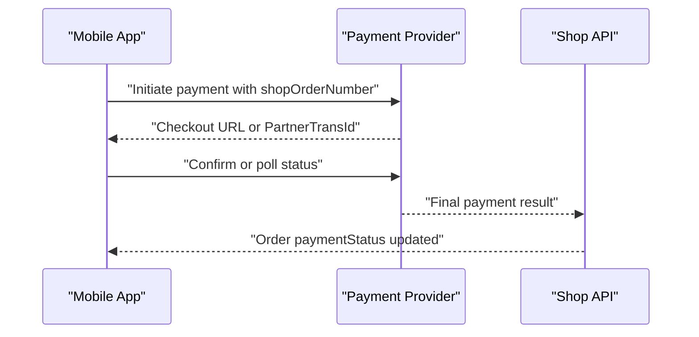

**Diagram sources**
- [SHOP_API_MOBILE_HANDOFF.md:229-317](file://docs/SHOP_API_MOBILE_HANDOFF.md#L229-L317)
- [ENDPOINTS.md:153-158](file://api/ENDPOINTS.md#L153-L158)
- [ENDPOINTS.md:185-192](file://api/ENDPOINTS.md#L185-L192)

**Section sources**
- [SHOP_API_MOBILE_HANDOFF.md:229-317](file://docs/SHOP_API_MOBILE_HANDOFF.md#L229-L317)
- [ENDPOINTS.md:153-158](file://api/ENDPOINTS.md#L153-L158)
- [ENDPOINTS.md:185-192](file://api/ENDPOINTS.md#L185-L192)

### Admin Endpoints for Order Fulfillment and Status Management
Admin endpoints are not intended for normal mobile app use but are part of the backend API contract.

| Method | Endpoint | Purpose | Notes |
|---|---|---|---|
| GET | `/api/v1/shop/admin/orders` | List all orders | Filter by status or paymentStatus |
| PUT | `/api/v1/shop/admin/orders/{id}/status` | Update order status | Enforces valid status transitions |
| PUT | `/api/v1/shop/admin/orders/{id}/payment` | Update payment status | Auto-advances order to paid on success |
| PUT | `/api/v1/shop/admin/orders/{id}/delivery` | Update delivery tracking | Adds a delivery update entry |

Valid order status progression:

- `pending` → `paid` → `processing` → `shipped` → `delivered`
- Terminal or exceptional states include `cancelled` and `refunded`.

Payment status values:

- `pending`
- `success`
- `failed`
- `refunded`

Delivery update statuses include:

- `order_placed`
- `payment_confirmed`
- `payment_failed`
- `courier_accepted`
- Courier events: `packed`, `picked_up`, `out_for_delivery`, `delivered`, `delivery_exception`, `failed_delivery`
- Raw order-status values pushed by fulfillment: `paid`, `processing`, `shipped`, `cancelled`, `refunded`

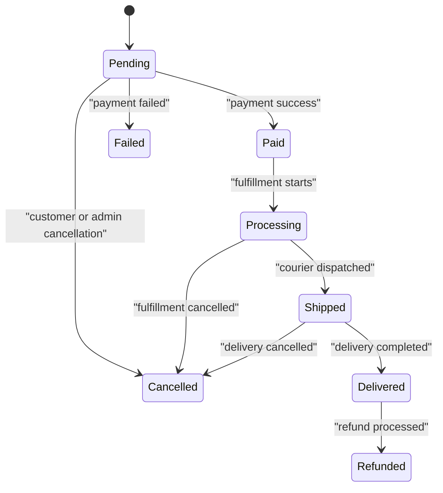

**Diagram sources**
- [SHOP_API_MOBILE_HANDOFF.md:331-339](file://docs/SHOP_API_MOBILE_HANDOFF.md#L331-L339)
- [ENDPOINTS.md:180-184](file://api/ENDPOINTS.md#L180-L184)

**Section sources**
- [ENDPOINTS.md:180-184](file://api/ENDPOINTS.md#L180-L184)
- [SHOP_API_MOBILE_HANDOFF.md:331-339](file://docs/SHOP_API_MOBILE_HANDOFF.md#L331-L339)

### Flutter Integration Examples

#### Implementing Order Listing
Use the repository method to fetch paginated orders. Handle 404 as a real answer only for single-order lookups; for listing, propagate network errors as UI errors.

```dart
// Conceptual usage path
final orders = await remoteShopRepository.getOrders(page: currentPage, limit: pageSize);
```

**Section sources**
- [remote_shop_repository.dart:137-146](file://lib/features/shop/data/remote_shop_repository.dart#L137-L146)
- [api_endpoints.dart:121](file://lib/core/network/api_endpoints.dart#L121)

#### Implementing Order Detail Retrieval
Call the repository with the order ID. Treat 404 as a missing order, not a network failure.

```dart
// Conceptual usage path
final order = await remoteShopRepository.getOrder(orderId);
```

**Section sources**
- [remote_shop_repository.dart:148-160](file://lib/features/shop/data/remote_shop_repository.dart#L148-L160)
- [api_endpoints.dart:122](file://lib/core/network/api_endpoints.dart#L122)

#### Implementing Public Order Tracking
Use the order number endpoint for shareable tracking links.

```dart
// Conceptual usage path
final order = await remoteShopRepository.getOrderByNumber(orderNumber);
```

**Section sources**
- [remote_shop_repository.dart:162-173](file://lib/features/shop/data/remote_shop_repository.dart#L162-L173)
- [api_endpoints.dart:124-127](file://lib/core/network/api_endpoints.dart#L124-L127)

#### Implementing Order Cancellation
Send an optional reason and display the updated order state.

```dart
// Conceptual usage path
final updatedOrder = await remoteShopRepository.cancelOrder(orderId, reason: selectedReason);
```

**Section sources**
- [remote_shop_repository.dart:217-223](file://lib/features/shop/data/remote_shop_repository.dart#L217-L223)
- [api_endpoints.dart:130](file://lib/core/network/api_endpoints.dart#L130)

#### Implementing Live Order Tracking
Poll the tracking endpoint while the screen is visible and the order is still in progress.

```dart
// Conceptual usage path
final tracking = await remoteShopRepository.getOrderTracking(orderId);
```

**Section sources**
- [remote_shop_repository.dart:175-214](file://lib/features/shop/data/remote_shop_repository.dart#L175-L214)
- [SHOP_API_MOBILE_HANDOFF.md:341-436](file://docs/SHOP_API_MOBILE_HANDOFF.md#L341-L436)

## Dependency Analysis
The Flutter client depends on centralized route constants and repository implementations. The backend exposes both customer and admin surfaces.

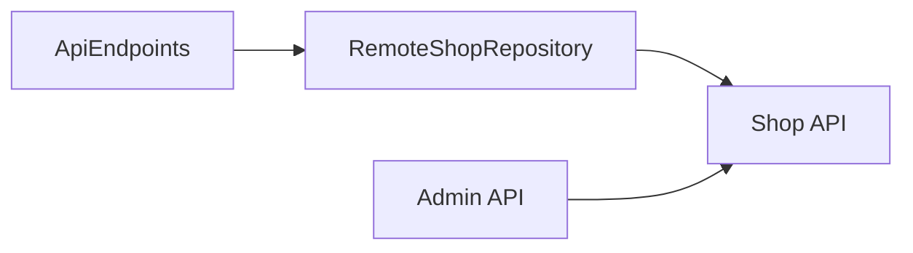

**Diagram sources**
- [api_endpoints.dart:111-130](file://lib/core/network/api_endpoints.dart#L111-L130)
- [remote_shop_repository.dart:137-223](file://lib/features/shop/data/remote_shop_repository.dart#L137-L223)
- [ENDPOINTS.md:175-184](file://api/ENDPOINTS.md#L175-L184)

**Section sources**
- [api_endpoints.dart:111-130](file://lib/core/network/api_endpoints.dart#L111-L130)
- [remote_shop_repository.dart:137-223](file://lib/features/shop/data/remote_shop_repository.dart#L137-L223)
- [ENDPOINTS.md:175-184](file://api/ENDPOINTS.md#L175-L184)

## Performance Considerations
- **Pagination:** Use `page` and `limit` for order listing to avoid large payloads.
- **Polling:** Limit tracking polling to the active screen lifetime and stop on terminal order states.
- **Network Errors:** Distinguish between missing resources and connectivity failures.
- **Price Integrity:** Never compute or override pricing in the app; rely on server responses.
- **Delivery Fees:** Do not send delivery fees from the client; they are calculated server-side based on distance and rate cards.
- **Idempotency:** For payment initiation, follow provider guidance and avoid duplicate payments while a telco response is outstanding.

[No sources needed since this section provides general guidance]

## Troubleshooting Guide

| Symptom | Likely Cause | Recommended Action |
|---|---|---|
| Order list appears empty after network failure | Error treated as empty data | Propagate API exceptions as UI errors instead of empty lists |
| Order detail shows no data | 404 or invalid order ID | Treat 404 as missing order; validate order ID before calling |
| Public tracking fails | Invalid or expired order number | Show not-found state; do not retry indefinitely |
| Cancellation rejected | Order not in pending or processing state | Disable cancel button for ineligible orders |
| Payment initiated but order not marked paid | Payment still pending or provider response delayed | Poll payment status and order status; do not assume initiation success |
| Tracking screen freezes | Polling not stopped on background or terminal state | Stop polling when screen is hidden or order is delivered/cancelled |
| Delivery fee mismatch | Client sent or calculated fee | Remove client-side fee logic; trust server-computed total |

**Section sources**
- [remote_shop_repository.dart:137-160](file://lib/features/shop/data/remote_shop_repository.dart#L137-L160)
- [SHOP_API_MOBILE_HANDOFF.md:429-452](file://docs/SHOP_API_MOBILE_HANDOFF.md#L429-L452)

## Conclusion
The order management API provides a complete lifecycle for shopping, payment, fulfillment, and delivery tracking. The mobile app should:

- Use server-computed prices and totals.
- Link payments to orders via `shopOrderNumber`.
- Respect order eligibility rules for cancellation.
- Poll tracking responsibly and render delivery timelines.
- Avoid using admin endpoints directly; those are for backend administration and fulfillment tools.

For implementation, follow the mobile handoff contract, use the Flutter route constants, and implement repository calls with proper error handling and polling strategies.

[No sources needed since this section summarizes without analyzing specific files]

## Appendices

### Base URLs and Authentication
- Production base URL: `https://api.advansistechnologies.com`
- Development base URL: `http://localhost:1124`
- Shop base path: `/api/v1/shop`
- Authentication: Bearer token required for cart, checkout, orders, and tracking. Product and category browsing is public.

**Section sources**
- [swagger-api-documentation.md:1-10](file://docs/swagger-api-documentation.md#L1-L10)
- [SHOP_API_MOBILE_HANDOFF.md:1-20](file://docs/SHOP_API_MOBILE_HANDOFF.md#L1-L20)

### Complete Shop Order Endpoint Summary
| Category | Method | Endpoint | Access |
|---|---|---|---|
| Checkout | POST | `/api/v1/shop/checkout` | Authenticated |
| Order List | GET | `/api/v1/shop/orders` | Authenticated |
| Order Detail | GET | `/api/v1/shop/orders/{id}` | Authenticated |
| Public Tracking | GET | `/api/v1/shop/orders/number/{orderNumber}` | Public |
| Order Tracking | GET | `/api/v1/shop/orders/{id}/tracking` | Authenticated |
| Order Cancellation | POST | `/api/v1/shop/orders/{id}/cancel` | Authenticated |
| Admin Order List | GET | `/api/v1/shop/admin/orders` | Admin |
| Admin Status Update | PUT | `/api/v1/shop/admin/orders/{id}/status` | Admin |
| Admin Payment Update | PUT | `/api/v1/shop/admin/orders/{id}/payment` | Admin |
| Admin Delivery Update | PUT | `/api/v1/shop/admin/orders/{id}/delivery` | Admin |

**Section sources**
- [ENDPOINTS.md:175-184](file://api/ENDPOINTS.md#L175-L184)