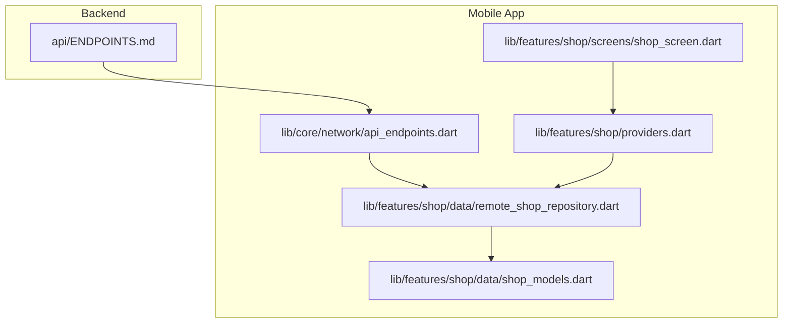
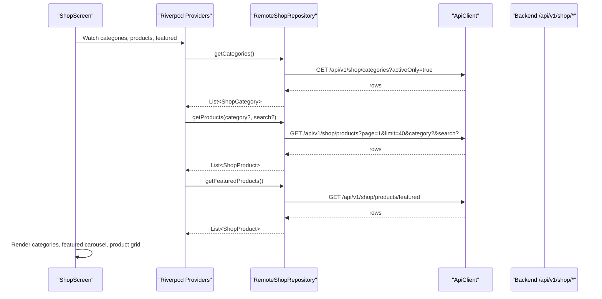
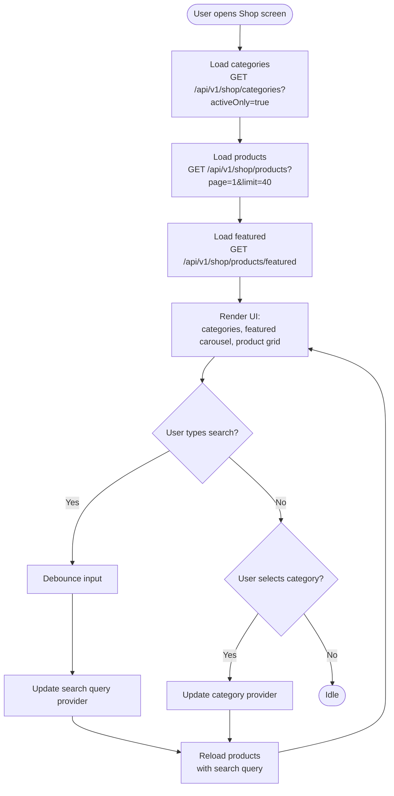
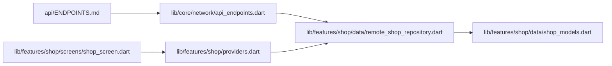

# Product Catalog API

<cite>
**Referenced Files in This Document**   
- [ENDPOINTS.md](file://api/ENDPOINTS.md)
- [api_endpoints.dart](file://lib/core/network/api_endpoints.dart)
- [remote_shop_repository.dart](file://lib/features/shop/data/remote_shop_repository.dart)
- [shop_models.dart](file://lib/features/shop/data/shop_models.dart)
- [providers.dart](file://lib/features/shop/providers.dart)
- [shop_screen.dart](file://lib/features/shop/screens/shop_screen.dart)
</cite>

## Table of Contents
1. [Introduction](#introduction)
2. [Project Structure](#project-structure)
3. [Core Components](#core-components)
4. [Architecture Overview](#architecture-overview)
5. [Detailed Component Analysis](#detailed-component-analysis)
6. [Dependency Analysis](#dependency-analysis)
7. [Performance Considerations](#performance-considerations)
8. [Troubleshooting Guide](#troubleshooting-guide)
9. [Conclusion](#conclusion)

## Introduction
This document describes the product catalog API exposed by the shop endpoints and how the mobile application consumes them. It covers:
- Public product browsing, search, filtering, featured products, and product details.
- Category listing.
- Admin/partner endpoints for creating, updating, and deleting products and categories.
- Request/response schemas inferred from the backend endpoint map and the mobile repository’s field mapping.
- Integration examples showing how the Flutter app displays catalogs, handles pagination, and renders product detail views.

The authoritative endpoint list is maintained in the backend documentation file, while the mobile client maps those endpoints to typed models and UI state.

**Section sources**
- [ENDPOINTS.md:159-169](file://api/ENDPOINTS.md#L159-L169)
- [api_endpoints.dart:111-114](file://lib/core/network/api_endpoints.dart#L111-L114)

## Project Structure
The product catalog integration spans three layers:
- Backend endpoint contract: `api/ENDPOINTS.md`.
- Client route constants: `lib/core/network/api_endpoints.dart`.
- Repository, models, providers, and screens under `lib/features/shop/...`.

**Diagram sources**
- [ENDPOINTS.md:159-169](file://api/ENDPOINTS.md#L159-L169)
- [api_endpoints.dart:111-114](file://lib/core/network/api_endpoints.dart#L111-L114)
- [remote_shop_repository.dart:18-70](file://lib/features/shop/data/remote_shop_repository.dart#L18-L70)
- [shop_models.dart:5-93](file://lib/features/shop/data/shop_models.dart#L5-L93)
- [providers.dart:26-40](file://lib/features/shop/providers.dart#L26-L40)
- [shop_screen.dart:87-90](file://lib/features/shop/screens/shop_screen.dart#L87-L90)

**Section sources**
- [ENDPOINTS.md:159-169](file://api/ENDPOINTS.md#L159-L169)
- [api_endpoints.dart:111-114](file://lib/core/network/api_endpoints.dart#L111-L114)
- [remote_shop_repository.dart:18-70](file://lib/features/shop/data/remote_shop_repository.dart#L18-L70)
- [shop_models.dart:5-93](file://lib/features/shop/data/shop_models.dart#L5-L93)
- [providers.dart:26-40](file://lib/features/shop/providers.dart#L26-L40)
- [shop_screen.dart:87-90](file://lib/features/shop/screens/shop_screen.dart#L87-L90)

## Core Components
- Endpoint registry: centralizes all shop URLs used by the app.
- Remote repository: performs HTTP calls, normalizes flexible server payloads into typed models.
- Data models: strongly typed representations of categories, products, cart, orders, tracking, and shipping address.
- Riverpod providers: expose reactive state for categories, products, featured products, cart, and orders.
- Shop screen: composes UI for search, category chips, featured carousel, product grid, and deep-linked product detail.

Key responsibilities:
- Browsing: GET `/api/v1/shop/products` with optional `category` and `search` query parameters.
- Featured: GET `/api/v1/shop/products/featured`.
- Details: GET `/api/v1/shop/products/{id}`.
- Categories: GET `/api/v1/shop/categories`, plus admin CRUD endpoints.

**Section sources**
- [api_endpoints.dart:111-114](file://lib/core/network/api_endpoints.dart#L111-L114)
- [remote_shop_repository.dart:18-70](file://lib/features/shop/data/remote_shop_repository.dart#L18-L70)
- [shop_models.dart:5-93](file://lib/features/shop/data/shop_models.dart#L5-L93)
- [providers.dart:26-40](file://lib/features/shop/providers.dart#L26-L40)

## Architecture Overview
The mobile app requests catalog data through a repository that wraps HTTP calls. The repository decouples the UI from backend response shape variations by mapping multiple possible JSON keys to stable model fields.

**Diagram sources**
- [remote_shop_repository.dart:18-70](file://lib/features/shop/data/remote_shop_repository.dart#L18-L70)
- [providers.dart:26-40](file://lib/features/shop/providers.dart#L26-L40)
- [shop_screen.dart:87-90](file://lib/features/shop/screens/shop_screen.dart#L87-L90)

## Detailed Component Analysis

### Product Catalog Endpoints

#### Base URL
- Base URL: `https://api.advansistechnologies.com`
- Versioned path prefix: `/api/v1`

#### Category Endpoints
| Method | URL Pattern | Description | Auth | Request Body | Response Shape |
|---|---|---|---|---|---|
| GET | `/api/v1/shop/categories` | List all product categories | Public | Query: `activeOnly=true` (client always sends this) | Array of category objects |
| POST | `/api/v1/shop/categories` | Create a product category | Admin | Object with category fields | Created category object |
| GET | `/api/v1/shop/categories/{id}` | Get a category by ID | Public | Path: `id` | Category object |
| PUT | `/api/v1/shop/categories/{id}` | Update a category | Admin | Updated category fields | Updated category object |
| DELETE | `/api/v1/shop/categories/{id}` | Delete a category | Admin | Path: `id` | Success or error if products are attached |

Notes:
- The mobile client always requests active-only categories via `activeOnly=true`.
- Deleting a category fails when products are still attached.

#### Product Endpoints
| Method | URL Pattern | Description | Auth | Request Body | Response Shape |
|---|---|---|---|---|---|
| GET | `/api/v1/shop/products` | Browse products with pagination, search, and filters | Public | Query: `page`, `limit`, `category`, `search` | Paginated product array |
| POST | `/api/v1/shop/products` | Create a product | Admin or Partner | Product object | Created product object |
| GET | `/api/v1/shop/products/featured` | List featured products | Public | None | Array of featured product objects |
| GET | `/api/v1/shop/products/{id}` | Get product details by ID | Public | Path: `id` | Single product object |
| PUT | `/api/v1/shop/products/{id}` | Update a product | Admin or Partner | Updated product fields | Updated product object |
| DELETE | `/api/v1/shop/products/{id}` | Delete a product | Admin | Path: `id` | Success or error |

Notes:
- The mobile client uses default pagination `page=1`, `limit=40` for browsing.
- Search is performed via the `search` query parameter.
- Filtering by category is performed via the `category` query parameter.

#### Example Requests and Responses

- List products with pagination and search
  - Request: `GET /api/v1/shop/products?page=1&limit=40&search=headphones`
  - Response: Array of product objects.

- Filter products by category
  - Request: `GET /api/v1/shop/products?page=1&limit=40&category=electronics`
  - Response: Array of product objects belonging to the selected category.

- Get featured products
  - Request: `GET /api/v1/shop/products/featured`
  - Response: Array of featured product objects.

- Get product details
  - Request: `GET /api/v1/shop/products/{productId}`
  - Response: Single product object.

- Create a product (admin/partner)
  - Request: `POST /api/v1/shop/products`
  - Body: Product object including name, price, images, stock, category, etc.
  - Response: Created product object.

- Update a product (admin/partner)
  - Request: `PUT /api/v1/shop/products/{productId}`
  - Body: Updated product fields.
  - Response: Updated product object.

- Delete a product (admin)
  - Request: `DELETE /api/v1/shop/products/{productId}`
  - Response: Success or error.

- Create a category (admin)
  - Request: `POST /api/v1/shop/categories`
  - Body: Category object including name and icon.
  - Response: Created category object.

- Update a category (admin)
  - Request: `PUT /api/v1/shop/categories/{categoryId}`
  - Body: Updated category fields.
  - Response: Updated category object.

- Delete a category (admin)
  - Request: `DELETE /api/v1/shop/categories/{categoryId}`
  - Response: Success or error; fails if products are attached.

**Section sources**
- [ENDPOINTS.md:159-169](file://api/ENDPOINTS.md#L159-L169)
- [remote_shop_repository.dart:18-70](file://lib/features/shop/data/remote_shop_repository.dart#L18-L70)

### Mobile Integration: Data Flow and State

**Diagram sources**
- [shop_screen.dart:56-70](file://lib/features/shop/screens/shop_screen.dart#L56-L70)
- [providers.dart:20-40](file://lib/features/shop/providers.dart#L20-L40)
- [remote_shop_repository.dart:44-60](file://lib/features/shop/data/remote_shop_repository.dart#L44-L60)

**Section sources**
- [shop_screen.dart:56-70](file://lib/features/shop/screens/shop_screen.dart#L56-L70)
- [providers.dart:20-40](file://lib/features/shop/providers.dart#L20-L40)
- [remote_shop_repository.dart:44-60](file://lib/features/shop/data/remote_shop_repository.dart#L44-L60)

### Data Models

#### ShopCategory
- Fields:
  - `id`: String identifier.
  - `name`: Display name.
  - `icon`: Icon key resolved in the UI layer.

#### ShopProduct
- Fields:
  - `id`: Product identifier.
  - `name`: Product name.
  - `categoryId`: Category identifier.
  - `price`: Selling price; uses discounted price when available.
  - `oldPrice`: Pre-discount price when applicable.
  - `currency`: Currency code; defaults to GHS.
  - `imageAsset`: Primary image URL or asset path.
  - `images`: All images published by the API.
  - `description`: Product description.
  - `stock`: Stock quantity.
  - `rating`: Rating value.
  - `sold`: Sales count.
  - `isFeatured`: Whether the product is featured.
  - `brand`: Brand or manufacturer.
  - `partnerName`: Seller name shown on detail page.
  - `partnerId`: Seller identifier.
  - `partnerLocationId`: Fulfillment location identifier.
  - `sku`: Stock keeping unit.
  - `attributes`: Free-form spec attributes.
  - `weightKg`: Weight in kilograms.

Derived properties:
- `inStock`: True when stock > 0.
- `displaySku`: Uses real SKU if present, otherwise falls back to id.
- `discountPercent`: Percentage discount computed from old price and current price.

**Section sources**
- [shop_models.dart:5-93](file://lib/features/shop/data/shop_models.dart#L5-L93)

### Repository Field Mapping Strategy
The repository normalizes flexible backend responses by trying multiple candidate keys for each field. This makes the app resilient to schema drift or alternate naming conventions.

Examples:
- Product id may be `productId`, `id`, `_id`, `sku`, or `slug`.
- Price may be `price`, `regularPrice`, `mrp`, `listPrice`, or `cost`.
- Discounted price may be `discountPrice`, `salePrice`, `sellingPrice`, or `promoPrice`.
- Images may appear as `imageAsset`, `image`, `imageUrl`, `thumbnail`, `photo`, `images`, `imageUrls`, or `gallery`.

This strategy ensures consistent UI behavior even when the backend changes field names.

**Section sources**
- [remote_shop_repository.dart:430-547](file://lib/features/shop/data/remote_shop_repository.dart#L430-L547)
- [remote_shop_repository.dart:560-602](file://lib/features/shop/data/remote_shop_repository.dart#L560-L602)

### Pagination Behavior
- Default browse request uses `page=1` and `limit=40`.
- The mobile UI currently shows one page of results for the main product grid.
- Orders use a separate pagination controller with a sentinel row to detect “has more”.

Recommendation:
- Extend product browsing to support additional pages when the user scrolls to the bottom.
- Use the same sentinel-row pattern applied to orders for consistency.

**Section sources**
- [remote_shop_repository.dart:44-55](file://lib/features/shop/data/remote_shop_repository.dart#L44-L55)
- [providers.dart:98-175](file://lib/features/shop/providers.dart#L98-L175)

### Search and Category Filtering
- Search:
  - The shop screen debounces user input by 350 milliseconds.
  - The updated query is stored in `shopSearchQueryProvider`.
  - `shopProductsProvider` watches the query and category and calls `getProducts`.
- Category filtering:
  - Category chips are rendered from `shopCategoriesProvider`.
  - Selecting a chip updates `shopCategoryProvider`.
  - `shopProductsProvider` re-fetches products with the selected category.

**Section sources**
- [shop_screen.dart:56-70](file://lib/features/shop/screens/shop_screen.dart#L56-L70)
- [providers.dart:20-36](file://lib/features/shop/providers.dart#L20-L36)
- [remote_shop_repository.dart:44-55](file://lib/features/shop/data/remote_shop_repository.dart#L44-L55)

### Featured Products
- The app fetches featured products via `/api/v1/shop/products/featured`.
- The shop screen renders a horizontal carousel of featured items.
- If no featured products exist, the hero slide falls back to the first product from the general catalog.

**Section sources**
- [remote_shop_repository.dart:58-60](file://lib/features/shop/data/remote_shop_repository.dart#L58-L60)
- [shop_screen.dart:123-127](file://lib/features/shop/screens/shop_screen.dart#L123-L127)
- [shop_screen.dart:367-443](file://lib/features/shop/screens/shop_screen.dart#L367-L443)

### Product Detail Retrieval
- The repository provides `getProduct(id)` which calls `/api/v1/shop/products/{id}`.
- The method returns null on failure, making it safe for deep links and fallback flows.
- The shop screen can open a product detail sheet when a product is tapped or when a deep link targets a product.

**Section sources**
- [remote_shop_repository.dart:62-72](file://lib/features/shop/data/remote_shop_repository.dart#L62-L72)
- [shop_screen.dart:95-106](file://lib/features/shop/screens/shop_screen.dart#L95-L106)

### Admin and Partner Operations
- Creating, updating, and deleting products requires admin or partner permissions depending on the endpoint.
- Creating, updating, and deleting categories requires admin permissions.
- Deleting a category fails when products are still attached.

Operational guidance:
- Always validate required fields before sending create/update requests.
- Handle deletion errors gracefully, especially for categories with attached products.
- Use idempotency where supported; the checkout flow demonstrates idempotency headers and references, which is a good pattern for other write operations.

**Section sources**
- [ENDPOINTS.md:159-169](file://api/ENDPOINTS.md#L159-L169)

### Integration Examples for the Mobile Application

#### Displaying Product Catalogs
- Fetch categories and display them as filter chips.
- Fetch products and render them in a two-column grid.
- Show featured products in a horizontal carousel at the top.
- Support search with debounced input.
- Support category selection to filter the product list.

Implementation anchors:
- Category loading: `getCategories`.
- Product loading: `getProducts`.
- Featured loading: `getFeaturedProducts`.
- UI composition: `ShopScreen`.

**Section sources**
- [remote_shop_repository.dart:18-60](file://lib/features/shop/data/remote_shop_repository.dart#L18-L60)
- [shop_screen.dart:87-90](file://lib/features/shop/screens/shop_screen.dart#L87-L90)
- [shop_screen.dart:261-352](file://lib/features/shop/screens/shop_screen.dart#L261-L352)
- [shop_screen.dart:451-487](file://lib/features/shop/screens/shop_screen.dart#L451-L487)

#### Searching Products by Keywords
- User types into the search field.
- Input is debounced to avoid excessive network calls.
- The search query updates the provider state.
- Products are reloaded with the `search` query parameter.

**Section sources**
- [shop_screen.dart:56-70](file://lib/features/shop/screens/shop_screen.dart#L56-L70)
- [providers.dart:20-36](file://lib/features/shop/providers.dart#L20-L36)
- [remote_shop_repository.dart:44-55](file://lib/features/shop/data/remote_shop_repository.dart#L44-L55)

#### Filtering by Categories
- Categories are loaded once and cached in provider state.
- Tapping a category chip updates the selected category.
- Products are reloaded with the `category` query parameter.

**Section sources**
- [shop_screen.dart:261-352](file://lib/features/shop/screens/shop_screen.dart#L261-L352)
- [providers.dart:20-36](file://lib/features/shop/providers.dart#L20-L36)
- [remote_shop_repository.dart:44-55](file://lib/features/shop/data/remote_shop_repository.dart#L44-L55)

#### Getting Featured Products
- The app calls the featured endpoint and renders a carousel.
- If no featured products are returned, the hero section falls back to the first product from the general catalog.

**Section sources**
- [remote_shop_repository.dart:58-60](file://lib/features/shop/data/remote_shop_repository.dart#L58-L60)
- [shop_screen.dart:123-127](file://lib/features/shop/screens/shop_screen.dart#L123-L127)
- [shop_screen.dart:367-443](file://lib/features/shop/screens/shop_screen.dart#L367-L443)

#### Retrieving Product Details
- When a product card is tapped, the app opens a detail sheet.
- For deep links, the app resolves the product id and opens the detail sheet after the catalog loads.

**Section sources**
- [remote_shop_repository.dart:62-72](file://lib/features/shop/data/remote_shop_repository.dart#L62-L72)
- [shop_screen.dart:95-106](file://lib/features/shop/screens/shop_screen.dart#L95-L106)

## Dependency Analysis

**Diagram sources**
- [ENDPOINTS.md:159-169](file://api/ENDPOINTS.md#L159-L169)
- [api_endpoints.dart:111-114](file://lib/core/network/api_endpoints.dart#L111-L114)
- [remote_shop_repository.dart:18-70](file://lib/features/shop/data/remote_shop_repository.dart#L18-L70)
- [shop_models.dart:5-93](file://lib/features/shop/data/shop_models.dart#L5-L93)
- [providers.dart:26-40](file://lib/features/shop/providers.dart#L26-L40)
- [shop_screen.dart:87-90](file://lib/features/shop/screens/shop_screen.dart#L87-L90)

**Section sources**
- [ENDPOINTS.md:159-169](file://api/ENDPOINTS.md#L159-L169)
- [api_endpoints.dart:111-114](file://lib/core/network/api_endpoints.dart#L111-L114)
- [remote_shop_repository.dart:18-70](file://lib/features/shop/data/remote_shop_repository.dart#L18-L70)
- [shop_models.dart:5-93](file://lib/features/shop/data/shop_models.dart#L5-L93)
- [providers.dart:26-40](file://lib/features/shop/providers.dart#L26-L40)
- [shop_screen.dart:87-90](file://lib/features/shop/screens/shop_screen.dart#L87-L90)

## Performance Considerations
- Debounce search input to reduce unnecessary network requests.
- Cache categories and products in provider state to avoid repeated fetches.
- Prefer server-side totals for cart and order summaries rather than recomputing locally.
- Use skeleton loaders and progress indicators to improve perceived performance.
- Consider implementing infinite scroll for product listings when the catalog grows large.
- Avoid fetching product details unless needed; rely on list data for cards and only fetch full details for deep links or detail sheets.

[No sources needed since this section provides general guidance]

## Troubleshooting Guide
Common issues and resolutions:
- Empty product list:
  - Verify search query and category filters.
  - Check whether the backend returns an empty array or an error.
  - Ensure pagination parameters are valid.

- Missing product details:
  - Confirm the product id exists.
  - Handle null returns gracefully in the UI.

- Category deletion failures:
  - Check whether products are still attached to the category.
  - Remove or reassign products before deleting.

- Image loading problems:
  - Validate image URLs or asset paths.
  - Inspect the normalized image list produced by the repository.

- Network errors:
  - Surface error states in the shop screen.
  - Provide retry actions for failed requests.

**Section sources**
- [shop_screen.dart:108-121](file://lib/features/shop/screens/shop_screen.dart#L108-L121)
- [remote_shop_repository.dart:62-72](file://lib/features/shop/data/remote_shop_repository.dart#L62-L72)
- [remote_shop_repository.dart:430-547](file://lib/features/shop/data/remote_shop_repository.dart#L430-L547)

## Conclusion
The product catalog API provides a clear set of endpoints for browsing, searching, filtering, and managing products and categories. The mobile application integrates these endpoints through a robust repository that normalizes flexible backend responses into typed models. The UI composes categories, featured products, and product grids reactively using Riverpod providers. For production integrations, ensure proper authentication for admin/partner endpoints, implement pagination for large catalogs, and handle edge cases such as missing products, empty lists, and network failures gracefully.

[No sources needed since this section summarizes without analyzing specific files]