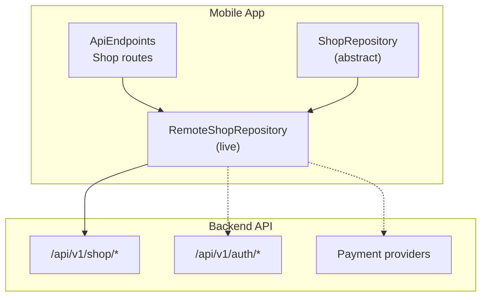
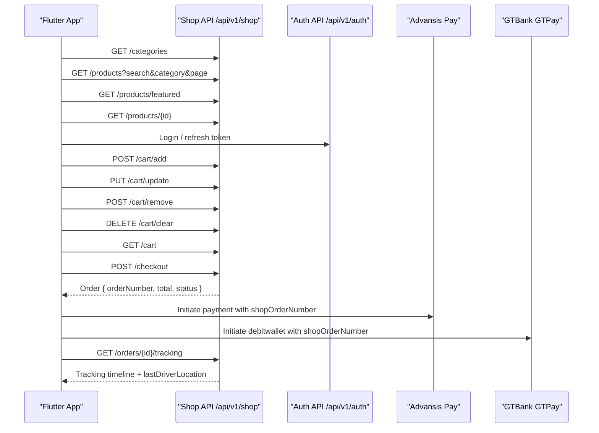
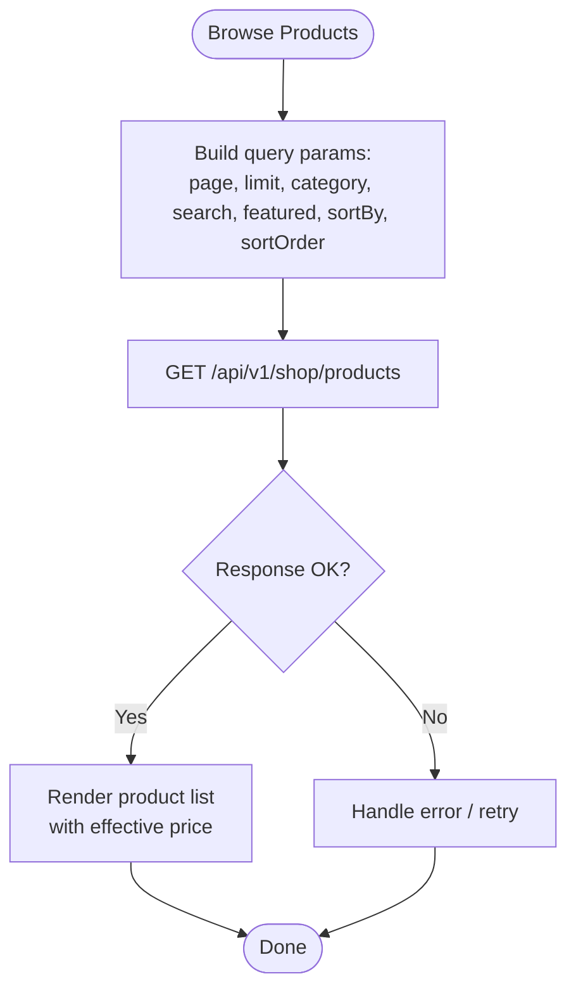
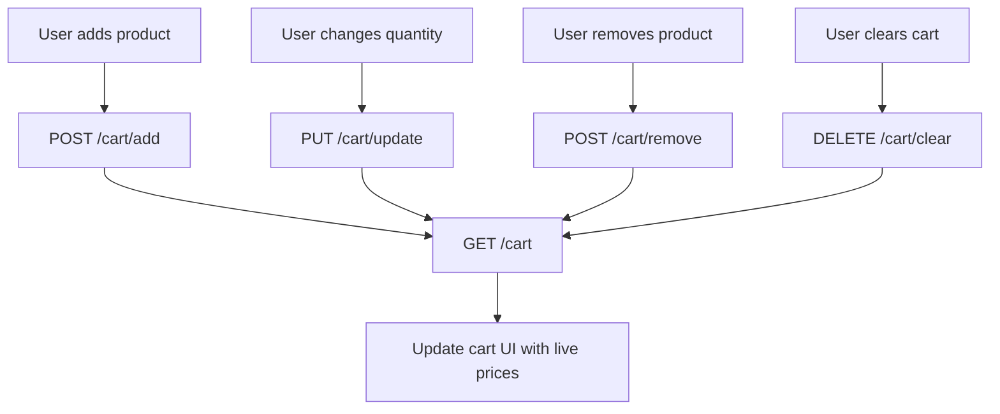
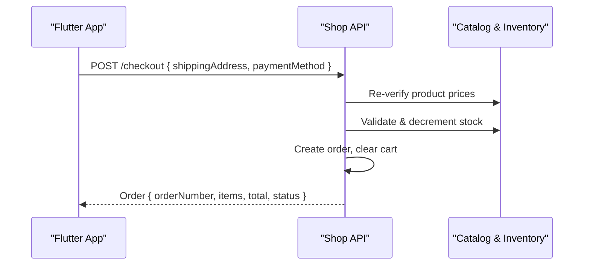
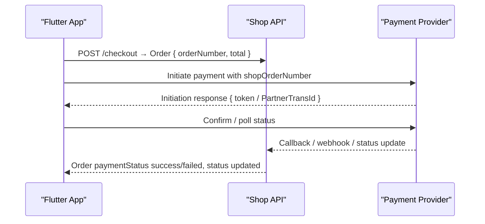
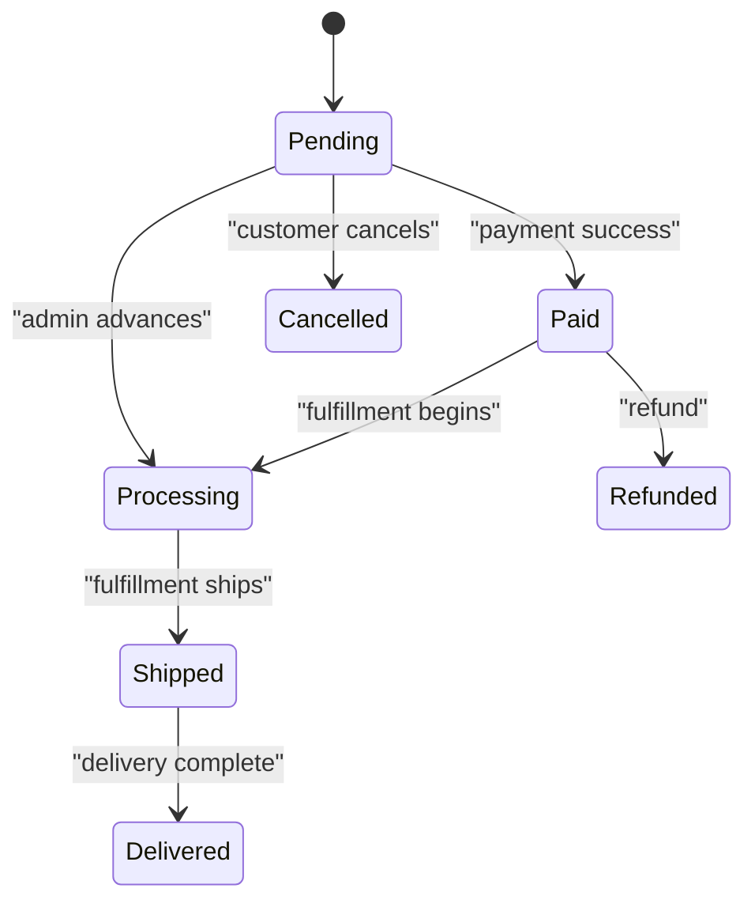
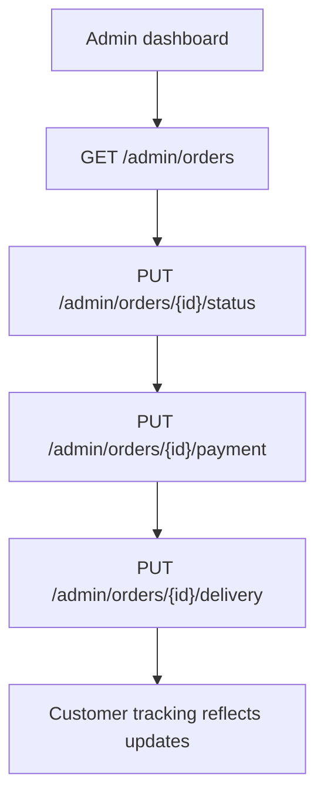
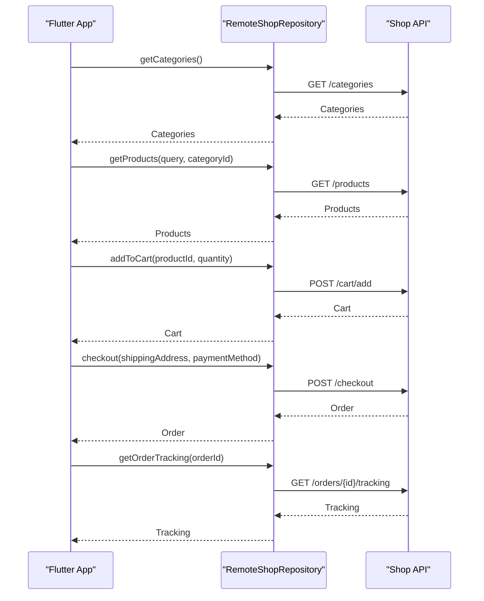
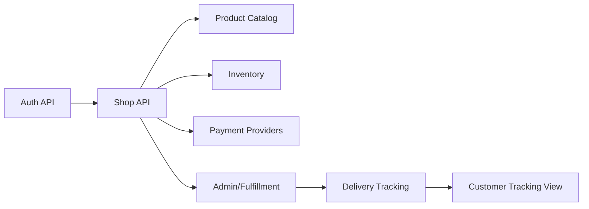

# Shop & E-commerce API

<cite>
**Referenced Files in This Document**   
- [ENDPOINTS.md](file://api/ENDPOINTS.md)
- [SHOP_API_MOBILE_HANDOFF.md](file://docs/SHOP_API_MOBILE_HANDOFF.md)
- [swagger-api-documentation.md](file://docs/swagger-api-documentation.md)
- [api_endpoints.dart](file://lib/core/network/api_endpoints.dart)
- [shop_repository.dart](file://lib/features/shop/data/shop_repository.dart)
- [remote_shop_repository.dart](file://lib/features/shop/data/remote_shop_repository.dart)
</cite>

## Table of Contents
1. [Introduction](#introduction)
2. [Project Structure](#project-structure)
3. [Core Components](#core-components)
4. [Architecture Overview](#architecture-overview)
5. [Detailed Component Analysis](#detailed-component-analysis)
6. [Dependency Analysis](#dependency-analysis)
7. [Performance Considerations](#performance-considerations)
8. [Troubleshooting Guide](#troubleshooting-guide)
9. [Conclusion](#conclusion)
10. [Appendices](#appendices)

## Introduction
This document provides detailed API documentation for the shop and e-commerce features exposed by the LidaPay backend, as used by the Flutter mobile application. It covers:

- Product catalog browsing (categories, products, featured items).
- Shopping cart management (add, update, remove, clear).
- Order processing (checkout, payment linkage, order listing, cancellation).
- Delivery tracking (order tracking timeline, driver location, courier events).
- Admin endpoints for product/category management, order fulfillment, and delivery updates.
- Mobile integration examples for browsing, cart operations, checkout, payment, and live order tracking.

The authoritative base URL is `https://api.advansistechnologies.com`, with the shop module under `/api/v1/shop`. Authentication is required for cart, checkout, orders, and admin endpoints; product and category browsing is public.

**Section sources**
- [ENDPOINTS.md:159-184](file://api/ENDPOINTS.md#L159-L184)
- [SHOP_API_MOBILE_HANDOFF.md:1-21](file://docs/SHOP_API_MOBILE_HANDOFF.md#L1-L21)
- [swagger-api-documentation.md:982-990](file://docs/swagger-api-documentation.md#L982-L990)

## Project Structure
The shop/e-commerce functionality is defined at the API layer and consumed by the Flutter app through a small set of network constants and repositories:

- The backend endpoint map is maintained in `api/ENDPOINTS.md`.
- The Flutter app centralizes shop route paths in `lib/core/network/api_endpoints.dart`.
- The shop feature defines an abstract repository contract in `lib/features/shop/data/shop_repository.dart`.
- The live implementation lives in `lib/features/shop/data/remote_shop_repository.dart`.
- Mobile-specific contracts, pricing rules, checkout payloads, and tracking responsibilities are documented in `docs/SHOP_API_MOBILE_HANDOFF.md` and `docs/swagger-api-documentation.md`.

**Diagram sources**
- [api_endpoints.dart:111-130](file://lib/core/network/api_endpoints.dart#L111-L130)
- [shop_repository.dart:3-30](file://lib/features/shop/data/shop_repository.dart#L3-L30)
- [remote_shop_repository.dart:1-12](file://lib/features/shop/data/remote_shop_repository.dart#L1-L12)

**Section sources**
- [ENDPOINTS.md:159-184](file://api/ENDPOINTS.md#L159-L184)
- [api_endpoints.dart:111-130](file://lib/core/network/api_endpoints.dart#L111-L130)
- [shop_repository.dart:3-30](file://lib/features/shop/data/shop_repository.dart#L3-L30)
- [remote_shop_repository.dart:1-12](file://lib/features/shop/data/remote_shop_repository.dart#L1-L12)

## Core Components
The shop module has four main operational areas:

| Area | Responsibility | Key Backend Paths |
|---|---|---|
| Catalog | Browse categories and products, including search and filters | `/api/v1/shop/categories`, `/api/v1/shop/products`, `/api/v1/shop/products/featured`, `/api/v1/shop/products/{id}` |
| Cart | Manage authenticated user's shopping cart | `/api/v1/shop/cart`, `/api/v1/shop/cart/add`, `/api/v1/shop/cart/update`, `/api/v1/shop/cart/remove`, `/api/v1/shop/cart/clear` |
| Checkout & Orders | Create orders from cart, list orders, cancel orders, track deliveries | `/api/v1/shop/checkout`, `/api/v1/shop/orders`, `/api/v1/shop/orders/{id}`, `/api/v1/shop/orders/number/{orderNumber}`, `/api/v1/shop/orders/{id}/cancel`, `/api/v1/shop/orders/{id}/tracking` |
| Admin & Fulfillment | Manage categories/products, manage orders, update delivery tracking | `/api/v1/shop/admin/*` |

Pricing is server-computed: `price` includes commission, `discountPrice` is the final promo price when greater than zero, and the effective price is `discountPrice > 0 ? discountPrice : price`. Clients must not recompute or add discounts.

**Section sources**
- [SHOP_API_MOBILE_HANDOFF.md:24-35](file://docs/SHOP_API_MOBILE_HANDOFF.md#L24-L35)
- [ENDPOINTS.md:159-184](file://api/ENDPOINTS.md#L159-L184)

## Architecture Overview
The shop flow connects the mobile app to the backend shop API and external payment providers.

**Diagram sources**
- [SHOP_API_MOBILE_HANDOFF.md:108-226](file://docs/SHOP_API_MOBILE_HANDOFF.md#L108-L226)
- [SHOP_API_MOBILE_HANDOFF.md:229-317](file://docs/SHOP_API_MOBILE_HANDOFF.md#L229-L317)
- [SHOP_API_MOBILE_HANDOFF.md:320-436](file://docs/SHOP_API_MOBILE_HANDOFF.md#L320-L436)
- [swagger-api-documentation.md:993-1197](file://docs/swagger-api-documentation.md#L993-L1197)

## Detailed Component Analysis

### Catalog Browsing
Public endpoints allow unauthenticated browsing of categories and products.

| Method | Endpoint | Query Parameters | Response Envelope | Notes |
|---|---|---|---|---|
| GET | `/api/v1/shop/categories` | `activeOnly=true` | Array of categories | Use this to populate category filters. |
| GET | `/api/v1/shop/categories/{id}` | — | Category object | Category detail. |
| GET | `/api/v1/shop/products` | `page`, `limit`, `category`, `search`, `featured`, `sortBy`, `sortOrder` | `{ products, total, page, totalPages }` | Full-text search on name/description/brand. |
| GET | `/api/v1/shop/products/featured` | — | Featured product list | Shortcut curated row. |
| GET | `/api/v1/shop/products/{id}` | — | Product detail | Includes `category`, optional `description`, images. |

Product fields include `_id`, `name`, `price`, `discountPrice`, `stock`, `sku`, `brand`, `imageUrl`, `images`, `attributes`, `category`, `active`, `featured`, and optional metadata such as `rating`, `reviewCount`, `salesCount`, `createdAt`, `updatedAt`.

**Diagram sources**
- [swagger-api-documentation.md:1007-1045](file://docs/swagger-api-documentation.md#L1007-L1045)
- [SHOP_API_MOBILE_HANDOFF.md:108-121](file://docs/SHOP_API_MOBILE_HANDOFF.md#L108-L121)

**Section sources**
- [swagger-api-documentation.md:993-1045](file://docs/swagger-api-documentation.md#L993-L1045)
- [SHOP_API_MOBILE_HANDOFF.md:108-121](file://docs/SHOP_API_MOBILE_HANDOFF.md#L108-L121)
- [api_endpoints.dart:111-114](file://lib/core/network/api_endpoints.dart#L111-L114)

### Shopping Cart Management
Cart endpoints require authentication. The server cart is the source of truth at checkout; the app may keep a local cart for UX but must sync before checkout.

| Method | Endpoint | Request Body | Response | Errors |
|---|---|---|---|---|
| GET | `/api/v1/shop/cart` | — | `{ items, itemCount, subtotal, discount, total, cart }` | — |
| POST | `/api/v1/shop/cart/add` | `{ productId, quantity }` | Updated cart | `400` insufficient stock/inactive product; `404` missing product/item |
| PUT | `/api/v1/shop/cart/update` | `{ productId, quantity }` | Updated cart | Same validation |
| POST | `/api/v1/shop/cart/remove` | `{ productId }` | Updated cart | `404` if item missing |
| DELETE | `/api/v1/shop/cart/clear` | — | Cleared cart | — |

Cart line items contain `productId`, `name`, optional `sku`, `price`, image array, `quantity`, and `discountPrice`. Catalog-only fields like `attributes` are not copied into cart items.

**Diagram sources**
- [SHOP_API_MOBILE_HANDOFF.md:125-144](file://docs/SHOP_API_MOBILE_HANDOFF.md#L125-L144)
- [swagger-api-documentation.md:1049-1089](file://docs/swagger-api-documentation.md#L1049-L1089)

**Section sources**
- [SHOP_API_MOBILE_HANDOFF.md:125-144](file://docs/SHOP_API_MOBILE_HANDOFF.md#L125-L144)
- [swagger-api-documentation.md:1049-1089](file://docs/swagger-api-documentation.md#L1049-L1089)
- [api_endpoints.dart:115-119](file://lib/core/network/api_endpoints.dart#L115-L119)

### Checkout Flow
Checkout creates an order from the authenticated user's server cart. Prices are re-verified against the database, stock is validated and decremented, and the cart is cleared.

Request payload:

| Field | Type | Required | Notes |
|---|---|---:|---|
| `shippingAddress.fullName` | string | Yes | Recipient name |
| `shippingAddress.phone` | string | Yes | Contact phone |
| `shippingAddress.addressLine1` | string | Yes | Primary address line |
| `shippingAddress.city` | string | Yes | City |
| `shippingAddress.region` | string | Yes | Region/state |
| `shippingAddress.country` | string | Yes | Country |
| `shippingAddress.email` | string | No | Optional email |
| `shippingAddress.addressLine2` | string | No | Optional secondary address |
| `shippingAddress.postalCode` | string | No | Optional postal code |
| `shippingAddress.deliveryInstructions` | string | No | Optional instructions |
| `shippingAddress.latitude` | number | Conditional | Decimal degrees; send with longitude |
| `shippingAddress.longitude` | number | Conditional | Decimal degrees; send with latitude |
| `deliveryDistanceKm` | number | No | Client-computed driving km; backend may compute server-side |
| `paymentMethod` | enum | No | `momo`, `card`, `wallet`; default `momo` |
| `redirectUrl` | string | No | Deep link or redirect target |

Response includes the created order with `orderNumber`, line-item snapshots, computed totals, `status: pending`, `paymentStatus: pending`, and initial `deliveryUpdates`.

**Diagram sources**
- [SHOP_API_MOBILE_HANDOFF.md:148-226](file://docs/SHOP_API_MOBILE_HANDOFF.md#L148-L226)
- [swagger-api-documentation.md:1093-1134](file://docs/swagger-api-documentation.md#L1093-L1134)

**Section sources**
- [SHOP_API_MOBILE_HANDOFF.md:148-226](file://docs/SHOP_API_MOBILE_HANDOFF.md#L148-L226)
- [swagger-api-documentation.md:1093-1134](file://docs/swagger-api-documentation.md#L1093-L1134)
- [api_endpoints.dart:120](file://lib/core/network/api_endpoints.dart#L120)

### Payment Integration
After checkout, initiate payment for `order.total` using either Advansis Pay (ExpressPay) or GTBank GTPay. Both providers receive the shop order number so the backend can reconcile payment outcomes to the order.

| Provider | Endpoint | Key Fields | Outcome Handling |
|---|---|---|---|
| Advansis Pay | `POST /api/v1/advansispay/initiate-payment` | `firstName`, `lastName`, `email`, `phoneNumber`, `userId`, `amount`, `shopOrderNumber`, `orderDesc`, `transType` | Open `checkoutUrl`; confirm via `query-transaction`; backend marks `paymentStatus` and advances order status. |
| GTBank GTPay | `POST /api/v1/gtpay/pay` | `userId`, `userName`, `shopOrderNumber`, `ServiceDetails.ServiceName=debitwallet`, `ServiceDetails.Amount`, etc. | Persist `PartnerTransId`; poll `/gtpay/status`; only final reconciled status decides paid/failed. |

Important rules:
- Always pass `shopOrderNumber` so payment reconciliation links to the correct order.
- Do not treat asynchronous initiation responses as proof of payment; poll until the backend reconciles.
- For web clients, use `returnUrl` and optionally signed webhook configuration; deep links apply to mobile.

**Diagram sources**
- [SHOP_API_MOBILE_HANDOFF.md:229-317](file://docs/SHOP_API_MOBILE_HANDOFF.md#L229-L317)
- [swagger-api-documentation.md:1128-1134](file://docs/swagger-api-documentation.md#L1128-L1134)

**Section sources**
- [SHOP_API_MOBILE_HANDOFF.md:229-317](file://docs/SHOP_API_MOBILE_HANDOFF.md#L229-L317)
- [swagger-api-documentation.md:1128-1134](file://docs/swagger-api-documentation.md#L1128-L1134)

### Orders & Delivery Tracking
Customers can list their orders, view order details, look up orders publicly by order number, cancel eligible orders, and track deliveries.

| Method | Endpoint | Access | Purpose |
|---|---|---|---|
| GET | `/api/v1/shop/orders?page=1&limit=20` | Authenticated customer | Paginated order history |
| GET | `/api/v1/shop/orders/{id}` | Authenticated customer | Own order detail |
| GET | `/api/v1/shop/orders/number/{orderNumber}` | Public | Shareable tracking lookup without GPS coordinates |
| POST | `/api/v1/shop/orders/{id}/cancel` | Authenticated customer | Cancel pending/processing orders; restores stock |
| GET | `/api/v1/shop/orders/{id}/tracking` | Authenticated customer | Live tracking timeline and driver location |

Order statuses:
- `status`: `pending` → `paid` → `processing` → `shipped` → `delivered` (also `cancelled`, `refunded`).
- `paymentStatus`: `pending`, `success`, `failed`, `refunded`.
- `deliveryUpdates[].status`: `order_placed`, `payment_confirmed`, `payment_failed`, `courier_accepted`, courier events (`packed`, `picked_up`, `out_for_delivery`, `delivered`, `delivery_exception`, `failed_delivery`), and raw order-status values pushed by fulfillment/admin.

Tracking response includes `orderNumber`, `status`, `trackingNumber`, `carrier`, `estimatedDeliveryDate`, `deliveredAt`, `shippingAddress`, `lastDriverLocation`, and `deliveryUpdates[]`.

**Diagram sources**
- [SHOP_API_MOBILE_HANDOFF.md:331-339](file://docs/SHOP_API_MOBILE_HANDOFF.md#L331-L339)
- [swagger-api-documentation.md:1138-1197](file://docs/swagger-api-documentation.md#L1138-L1197)

**Section sources**
- [SHOP_API_MOBILE_HANDOFF.md:320-436](file://docs/SHOP_API_MOBILE_HANDOFF.md#L320-L436)
- [swagger-api-documentation.md:1138-1197](file://docs/swagger-api-documentation.md#L1138-L1197)
- [api_endpoints.dart:121-130](file://lib/core/network/api_endpoints.dart#L121-L130)

### Admin & Fulfillment Endpoints
Admin endpoints support product/category management, order fulfillment, and delivery tracking updates. These are not intended for normal app use.

| Method | Endpoint | Role | Purpose |
|---|---|---|---|
| GET | `/api/v1/shop/categories` | Admin/partner | List/create categories |
| POST | `/api/v1/shop/categories` | Admin/partner | Create category |
| PUT | `/api/v1/shop/categories/{id}` | Admin/partner | Update category |
| DELETE | `/api/v1/shop/categories/{id}` | Admin | Delete category (fails if products attached) |
| POST | `/api/v1/shop/products` | Admin/partner | Create product |
| PUT | `/api/v1/shop/products/{id}` | Admin/partner | Update product |
| DELETE | `/api/v1/shop/products/{id}` | Admin | Delete product |
| GET | `/api/v1/shop/admin/orders` | Admin | List all orders; filter by `status`, `paymentStatus` |
| PUT | `/api/v1/shop/admin/orders/{id}/status` | Admin | Update order status with valid transitions |
| PUT | `/api/v1/shop/admin/orders/{id}/payment` | Admin | Update payment status; auto-advance to `paid` on success |
| PUT | `/api/v1/shop/admin/orders/{id}/delivery` | Admin/Fulfillment | Add delivery update entry |

**Diagram sources**
- [ENDPOINTS.md:159-184](file://api/ENDPOINTS.md#L159-L184)
- [swagger-api-documentation.md:1200-1225](file://docs/swagger-api-documentation.md#L1200-L1225)

**Section sources**
- [ENDPOINTS.md:159-184](file://api/ENDPOINTS.md#L159-L184)
- [swagger-api-documentation.md:1200-1225](file://docs/swagger-api-documentation.md#L1200-L1225)

### Mobile Application Integration Examples
The Flutter app uses centralized route constants and a repository abstraction to call shop endpoints.

Key integration points:

- **Route constants**: `ApiEndpoints.shopCategories`, `shopProducts`, `shopFeatured`, `shopProduct(id)`, `shopCart`, `shopCartAdd`, `shopCartUpdate`, `shopCartRemove`, `shopCartClear`, `shopCheckout`, `shopOrders`, `shopOrderById(id)`, `shopOrderByNumber(orderNumber)`, `shopOrderTracking(id)`, `shopOrderCancel(id)`.
- **Repository contract**: `ShopRepository` exposes methods for categories, products, cart, checkout, orders, tracking, and cancellation.
- **Live repository**: `RemoteShopRepository` maps these methods to HTTP calls and parses flexible payload keys.

Recommended mobile flow:

1. Authenticate via `/api/v1/users/login` or OTP flow; store access token.
2. Browse categories and products using public endpoints.
3. Sync cart by calling `cart/add`, `cart/update`, `cart/remove`, then `cart`.
4. Call `POST /shop/checkout` with shipping address and payment method.
5. Initiate payment with `shopOrderNumber` via Advansis Pay or GTPay.
6. Poll payment status until backend reconciles.
7. Show order list and details; open tracking screen and poll `/orders/{id}/tracking`.

**Diagram sources**
- [api_endpoints.dart:111-130](file://lib/core/network/api_endpoints.dart#L111-L130)
- [shop_repository.dart:3-30](file://lib/features/shop/data/shop_repository.dart#L3-L30)
- [remote_shop_repository.dart:175-223](file://lib/features/shop/data/remote_shop_repository.dart#L175-L223)

**Section sources**
- [api_endpoints.dart:111-130](file://lib/core/network/api_endpoints.dart#L111-L130)
- [shop_repository.dart:3-30](file://lib/features/shop/data/shop_repository.dart#L3-L30)
- [remote_shop_repository.dart:175-223](file://lib/features/shop/data/remote_shop_repository.dart#L175-L223)
- [SHOP_API_MOBILE_HANDOFF.md:429-436](file://docs/SHOP_API_MOBILE_HANDOFF.md#L429-L436)

## Dependency Analysis
The shop module depends on:

- **Authentication**: Customer endpoints require a bearer token obtained from auth endpoints.
- **Catalog & Inventory**: Checkout validates and decrements stock; product listings return enriched category data.
- **Payment Providers**: Advansis Pay and GTBank GTPay integrate via separate provider endpoints; both link back to shop orders through `shopOrderNumber`.
- **Fulfillment/Admin**: Admin endpoints control order lifecycle and delivery updates; customers read tracking state.

**Diagram sources**
- [ENDPOINTS.md:159-184](file://api/ENDPOINTS.md#L159-L184)
- [SHOP_API_MOBILE_HANDOFF.md:229-317](file://docs/SHOP_API_MOBILE_HANDOFF.md#L229-L317)

**Section sources**
- [ENDPOINTS.md:159-184](file://api/ENDPOINTS.md#L159-L184)
- [SHOP_API_MOBILE_HANDOFF.md:229-317](file://docs/SHOP_API_MOBILE_HANDOFF.md#L229-L317)

## Performance Considerations
- **Pagination**: Use `page` and `limit` for product and order lists; respect max limits where documented.
- **Live prices**: Always fetch cart and checkout totals from the server; do not compute locally.
- **Tracking polling**: Poll tracking every 5–10 seconds only while the tracking screen is visible and the order is active; stop on backgrounding or completion.
- **Image loading**: Use `imageUrl` or the first value in `images`; these are CDN URLs already optimized for display.
- **Stock validation**: Checkout validates stock server-side; avoid repeated checkout attempts while inventory is being processed.

[No sources needed since this section provides general guidance]

## Troubleshooting Guide
Common issues and resolutions:

| Symptom | Likely Cause | Resolution |
|---|---|---|
| Cart add returns `400` | Insufficient stock or inactive product | Refresh product catalog and cart; retry after stock replenishment. |
| Cart add returns `404` | Product or cart item missing | Verify `productId` and ensure the item exists in the current cart. |
| Checkout fails with incomplete address | Missing required shipping address fields | Collect full shipping address; include phone, city, region, country. |
| Payment initiated but order remains pending | Asynchronous provider response | Poll provider status and backend order until reconciled; do not double-initiate. |
| Tracking shows stale driver location | Driver GPS not yet updated or old timestamp | Continue polling while screen is active; handle missing/stale coordinates gracefully. |
| Admin order update rejected | Invalid status transition | Ensure requested status follows allowed transitions. |

**Section sources**
- [SHOP_API_MOBILE_HANDOFF.md:144-144](file://docs/SHOP_API_MOBILE_HANDOFF.md#L144-L144)
- [SHOP_API_MOBILE_HANDOFF.md:174-198](file://docs/SHOP_API_MOBILE_HANDOFF.md#L174-L198)
- [SHOP_API_MOBILE_HANDOFF.md:301-312](file://docs/SHOP_API_MOBILE_HANDOFF.md#L301-L312)
- [SHOP_API_MOBILE_HANDOFF.md:396-427](file://docs/SHOP_API_MOBILE_HANDOFF.md#L396-L427)

## Conclusion
The shop and e-commerce API provides a complete backend foundation for product browsing, cart management, checkout, payment reconciliation, order lifecycle, and delivery tracking. The Flutter app integrates through well-defined route constants and a repository abstraction, relying on server-computed prices, authenticated cart/order operations, and provider-linked payments. Admin endpoints enable fulfillment workflows and delivery updates, while customer-facing tracking endpoints deliver a live timeline and driver location experience.

[No sources needed since this section summarizes without analyzing specific files]

## Appendices

### A. Base URLs and Authentication Summary
- Base URL: `https://api.advansistechnologies.com`
- Shop base path: `/api/v1/shop`
- Authentication: Bearer token from `/api/v1/auth/access-token` or login flows; required for cart, checkout, orders, and admin endpoints.

**Section sources**
- [SHOP_API_MOBILE_HANDOFF.md:1-21](file://docs/SHOP_API_MOBILE_HANDOFF.md#L1-L21)
- [swagger-api-documentation.md:986-990](file://docs/swagger-api-documentation.md#L986-L990)

### B. Status Reference
- Order status: `pending`, `paid`, `processing`, `shipped`, `delivered`, `cancelled`, `refunded`.
- Payment status: `pending`, `success`, `failed`, `refunded`.
- Delivery update statuses: `order_placed`, `payment_confirmed`, `payment_failed`, `courier_accepted`, `packed`, `picked_up`, `out_for_delivery`, `delivered`, `delivery_exception`, `failed_delivery`.

**Section sources**
- [SHOP_API_MOBILE_HANDOFF.md:331-339](file://docs/SHOP_API_MOBILE_HANDOFF.md#L331-L339)