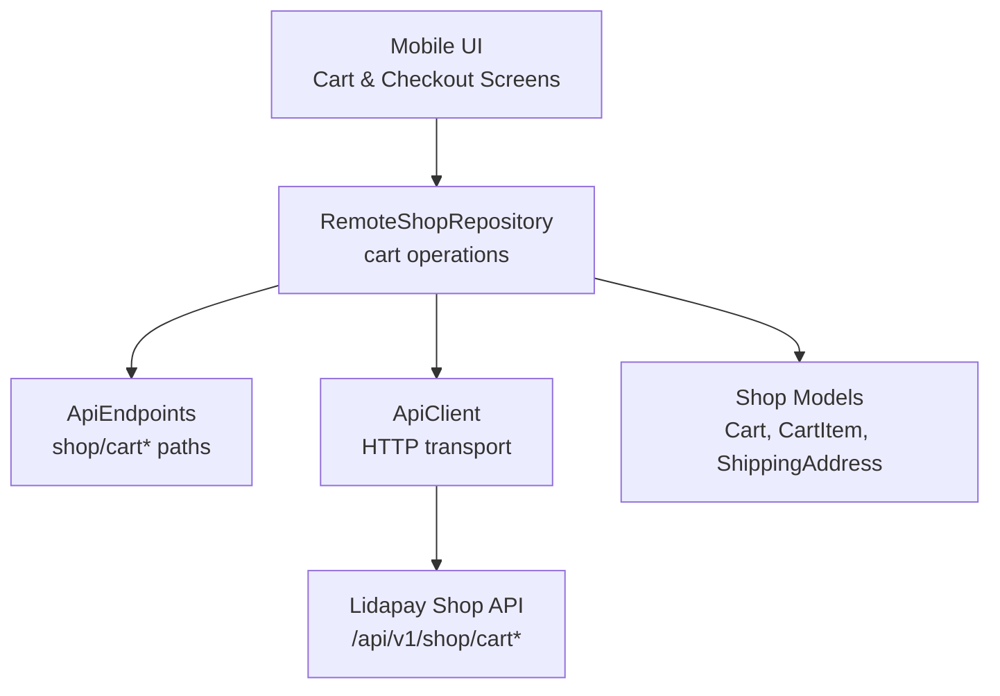
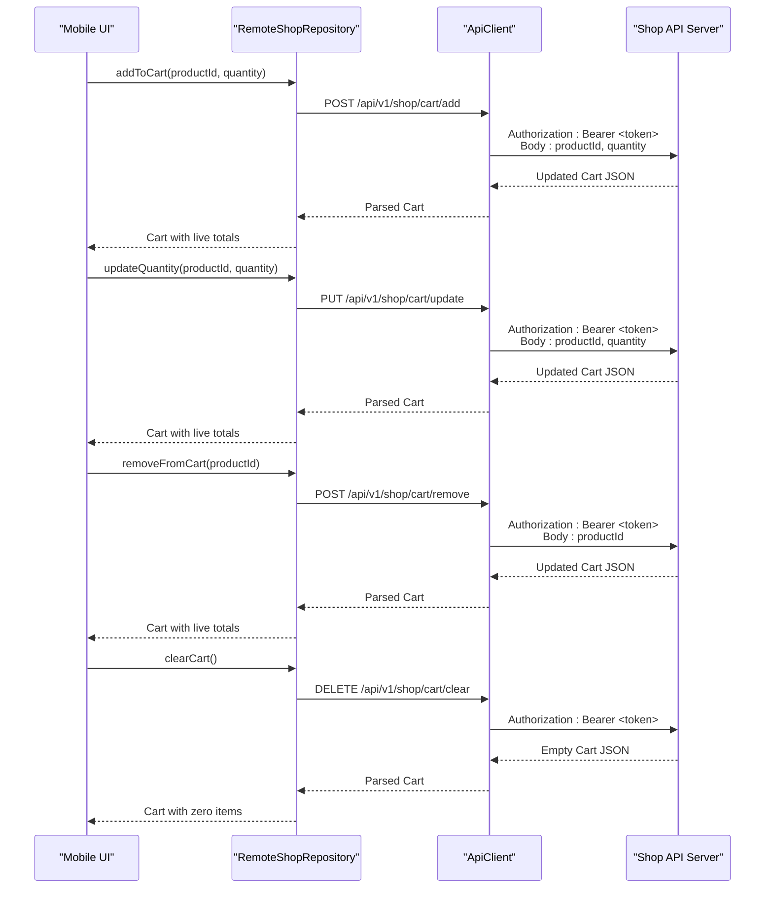
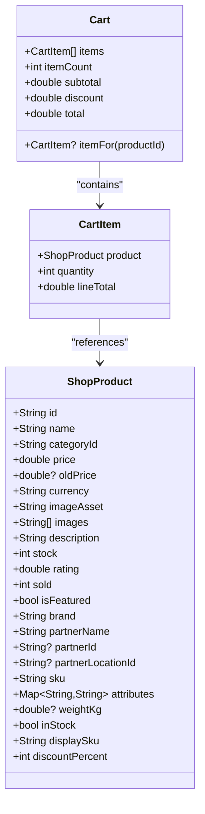
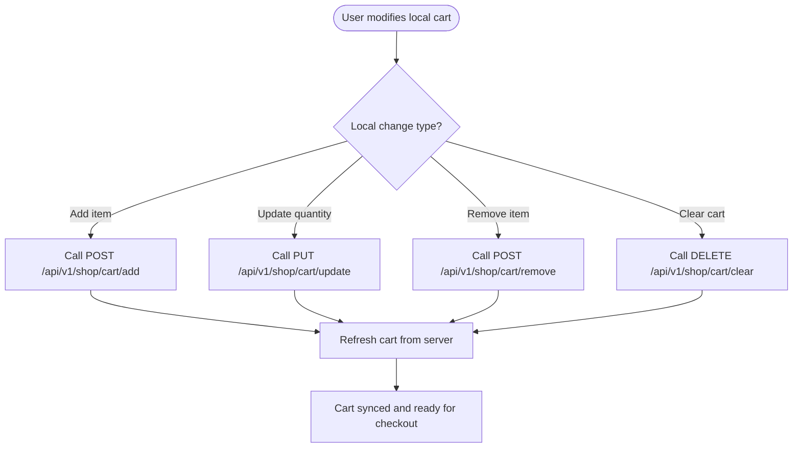
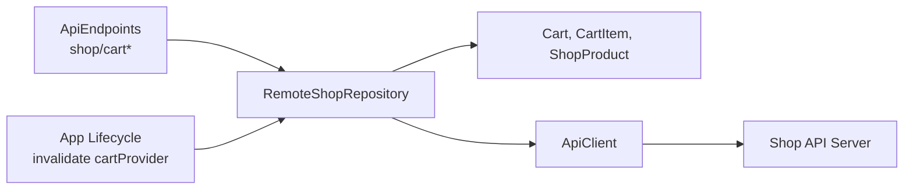

# Shopping Cart API

<cite>
**Referenced Files in This Document**
- [ENDPOINTS.md](file://api/ENDPOINTS.md)
- [SHOP_API_MOBILE_HANDOFF.md](file://docs/SHOP_API_MOBILE_HANDOFF.md)
- [api_endpoints.dart](file://lib/core/network/api_endpoints.dart)
- [remote_shop_repository.dart](file://lib/features/shop/data/remote_shop_repository.dart)
- [shop_models.dart](file://lib/features/shop/data/shop_models.dart)
- [shop_repository.dart](file://lib/features/shop/data/shop_repository.dart)
- [app.dart](file://lib/app.dart)
</cite>

## Table of Contents
1. [Introduction](#introduction)
2. [Project Structure](#project-structure)
3. [Core Components](#core-components)
4. [Architecture Overview](#architecture-overview)
5. [Detailed Component Analysis](#detailed-component-analysis)
6. [Dependency Analysis](#dependency-analysis)
7. [Performance Considerations](#performance-considerations)
8. [Troubleshooting Guide](#troubleshooting-guide)
9. [Conclusion](#conclusion)
10. [Appendices](#appendices)

## Introduction
This document provides detailed API documentation for the shopping cart endpoints used by the LidaPay mobile application. It covers HTTP methods, URL patterns, request and response schemas, validation rules, error handling, cart state synchronization, and integration examples for implementing shopping cart functionality on mobile devices.

The shop API base URL is `https://api.advansistechnologies.com`, with the shop path under `/api/v1/shop`. Product and category browsing is public, but all cart, checkout, order, and tracking endpoints require authentication via a Bearer access token.

## Project Structure
The shopping cart functionality is defined across:
- A server endpoint map listing the official REST routes.
- Mobile app constants defining the exact paths consumed by Flutter.
- A repository layer that calls the backend and maps responses into typed models.
- Domain models representing cart items, totals, shipping addresses, orders, and tracking data.



**Diagram sources**
- [remote_shop_repository.dart:74-104](file://lib/features/shop/data/remote_shop_repository.dart#L74-L104)
- [api_endpoints.dart:115-119](file://lib/core/network/api_endpoints.dart#L115-L119)
- [shop_models.dart:95-150](file://lib/features/shop/data/shop_models.dart#L95-L150)

**Section sources**
- [ENDPOINTS.md:159-175](file://api/ENDPOINTS.md#L159-L175)
- [SHOP_API_MOBILE_HANDOFF.md:1-11](file://docs/SHOP_API_MOBILE_HANDOFF.md#L1-L11)
- [api_endpoints.dart:111-120](file://lib/core/network/api_endpoints.dart#L111-L120)

## Core Components
The cart feature is implemented through these core components:

| Component | Responsibility |
|---|---|
| `ApiEndpoints` | Centralizes shop route strings, including cart endpoints. |
| `RemoteShopRepository` | Calls the backend cart endpoints, sends requests, and parses responses into domain models. |
| `ShopRepository` | Abstract contract exposing cart methods to the rest of the app. |
| `Cart` / `CartItem` | Represents the server cart snapshot and its line items. |
| `ShippingAddress` | Required address payload for checkout; also used by order/tracking payloads. |

Key behaviors:
- The mobile app may keep a local cart for responsiveness, but the **server cart is the source of truth at checkout**.
- The GET cart response includes live summary fields (`itemCount`, `subtotal`, `discount`, `total`) that should be preferred over locally recomputed values.
- Cart mutations return the updated cart object so the UI can refresh immediately.

**Section sources**
- [shop_repository.dart:1-30](file://lib/features/shop/data/shop_repository.dart#L1-L30)
- [remote_shop_repository.dart:74-104](file://lib/features/shop/data/remote_shop_repository.dart#L74-L104)
- [shop_models.dart:95-150](file://lib/features/shop/data/shop_models.dart#L95-L150)

## Architecture Overview
The cart flow integrates the mobile UI, repository, API client, and backend server. Authentication is required for cart operations, and the backend validates stock, product status, and quantity constraints.



**Diagram sources**
- [remote_shop_repository.dart:78-104](file://lib/features/shop/data/remote_shop_repository.dart#L78-L104)
- [api_endpoints.dart:115-119](file://lib/core/network/api_endpoints.dart#L115-L119)
- [SHOP_API_MOBILE_HANDOFF.md:125-144](file://docs/SHOP_API_MOBILE_HANDOFF.md#L125-L144)

## Detailed Component Analysis

### Authentication and Base Contract
- Base URL: `https://api.advansistechnologies.com`
- Shop base path: `/api/v1/shop`
- Auth header: `Authorization: Bearer <accessToken>`
- Token acquisition: login or OTP-based login returns `access_token`, `refresh_token`, and user info; refresh via `/api/v1/auth/refresh`.

**Section sources**
- [SHOP_API_MOBILE_HANDOFF.md:1-21](file://docs/SHOP_API_MOBILE_HANDOFF.md#L1-L21)

### Cart Endpoints

#### Get Cart Summary
- **Method:** `GET`
- **URL:** `/api/v1/shop/cart`
- **Auth:** Required
- **Response schema:**
  - `items`: array of cart line items
  - `itemCount`: total number of items
  - `subtotal`: sum of item prices before promotions
  - `discount`: promotion discount applied by the server
  - `total`: final amount payable before delivery fees
  - `cart`: raw cart structure returned by the backend

Notes:
- Prices are live and server-computed.
- The mobile model prefers top-level summary fields when present.

Example response envelope (conceptual):
```jsonc
{
  "items": [
    {
      "productId": "<ObjectId>",
      "name": "Product Name",
      "sku": "optional-SKU",
      "price": 69.29,
      "image": ["https://cdn.example/product.webp"],
      "quantity": 2,
      "discountPrice": 69.29
    }
  ],
  "itemCount": 2,
  "subtotal": 138.58,
  "discount": 15.40,
  "total": 123.18,
  "cart": { ... }
}
```

**Section sources**
- [ENDPOINTS.md:170](file://api/ENDPOINTS.md#L170)
- [SHOP_API_MOBILE_HANDOFF.md:125-144](file://docs/SHOP_API_MOBILE_HANDOFF.md#L125-L144)
- [remote_shop_repository.dart:74-76](file://lib/features/shop/data/remote_shop_repository.dart#L74-L76)
- [shop_models.dart:108-150](file://lib/features/shop/data/shop_models.dart#L108-L150)

#### Add Item to Cart
- **Method:** `POST`
- **URL:** `/api/v1/shop/cart/add`
- **Auth:** Required
- **Request body:**
  - `productId`: string ObjectId of the product
  - `quantity`: integer, default 1
- **Response:** Updated cart with live totals

Validation and business rules:
- Product must exist and be active.
- Stock must be sufficient for the requested quantity.
- Invalid or inactive products return `400`.
- Missing product or cart item returns `404`.

Example request:
```jsonc
{
  "productId": "<ObjectId>",
  "quantity": 2
}
```

**Section sources**
- [ENDPOINTS.md:171](file://api/ENDPOINTS.md#L171)
- [SHOP_API_MOBILE_HANDOFF.md:125-144](file://docs/SHOP_API_MOBILE_HANDOFF.md#L125-L144)
- [remote_shop_repository.dart:78-84](file://lib/features/shop/data/remote_shop_repository.dart#L78-L84)

#### Update Item Quantity
- **Method:** `PUT`
- **URL:** `/api/v1/shop/cart/update`
- **Auth:** Required
- **Request body:**
  - `productId`: string ObjectId of the cart item/product
  - `quantity`: integer new quantity
- **Response:** Updated cart with live totals

Validation and business rules:
- If quantity is zero or negative, the item should be removed or rejected depending on server behavior.
- Insufficient stock returns `400`.
- Missing product or cart item returns `404`.

Example request:
```jsonc
{
  "productId": "<ObjectId>",
  "quantity": 3
}
```

**Section sources**
- [ENDPOINTS.md:172](file://api/ENDPOINTS.md#L172)
- [SHOP_API_MOBILE_HANDOFF.md:125-144](file://docs/SHOP_API_MOBILE_HANDOFF.md#L125-L144)
- [remote_shop_repository.dart:86-92](file://lib/features/shop/data/remote_shop_repository.dart#L86-L92)

#### Remove Item from Cart
- **Method:** `POST`
- **URL:** `/api/v1/shop/cart/remove`
- **Auth:** Required
- **Request body:**
  - `productId`: string ObjectId of the product to remove
- **Response:** Updated cart without the removed item

Validation and business rules:
- Removing a non-existent cart item returns `404`.

Example request:
```jsonc
{
  "productId": "<ObjectId>"
}
```

**Section sources**
- [ENDPOINTS.md:173](file://api/ENDPOINTS.md#L173)
- [SHOP_API_MOBILE_HANDOFF.md:125-144](file://docs/SHOP_API_MOBILE_HANDOFF.md#L125-L144)
- [remote_shop_repository.dart:94-100](file://lib/features/shop/data/remote_shop_repository.dart#L94-L100)

#### Clear Cart
- **Method:** `DELETE`
- **URL:** `/api/v1/shop/cart/clear`
- **Auth:** Required
- **Request body:** None
- **Response:** Empty cart with zero items and zero totals

Use cases:
- After successful checkout.
- When the user explicitly clears their cart.

**Section sources**
- [ENDPOINTS.md:174](file://api/ENDPOINTS.md#L174)
- [SHOP_API_MOBILE_HANDOFF.md:125-144](file://docs/SHOP_API_MOBILE_HANDOFF.md#L125-L144)
- [remote_shop_repository.dart:102-104](file://lib/features/shop/data/remote_shop_repository.dart#L102-L104)

### Cart Data Model
The mobile app represents the cart using typed models:



**Diagram sources**
- [shop_models.dart:95-150](file://lib/features/shop/data/shop_models.dart#L95-L150)
- [shop_models.dart:23-93](file://lib/features/shop/data/shop_models.dart#L23-L93)

**Section sources**
- [shop_models.dart:95-150](file://lib/features/shop/data/shop_models.dart#L95-L150)
- [remote_shop_repository.dart:604-647](file://lib/features/shop/data/remote_shop_repository.dart#L604-L647)

### Cart Validation Rules and Business Logic Constraints
- Pricing is final and server-computed; the app must not add commission or reapply discounts.
- Effective price is `discountPrice > 0 ? discountPrice : price`.
- Cart line items are snapshots: they include `name`, optional `sku`, `price`, `image`, `quantity`, and `discountPrice`; catalog-only fields like `attributes` are not copied into cart items.
- Stock validation occurs on the server; insufficient stock or inactive products result in `400`.
- Missing product or cart item results in `404`.
- Checkout requires a valid, non-empty cart; otherwise the server returns `400`.

**Section sources**
- [SHOP_API_MOBILE_HANDOFF.md:24-34](file://docs/SHOP_API_MOBILE_HANDOFF.md#L24-L34)
- [SHOP_API_MOBILE_HANDOFF.md:98-104](file://docs/SHOP_API_MOBILE_HANDOFF.md#L98-L104)
- [SHOP_API_MOBILE_HANDOFF.md:125-144](file://docs/SHOP_API_MOBILE_HANDOFF.md#L125-L144)
- [SHOP_API_MOBILE_HANDOFF.md:219-225](file://docs/SHOP_API_MOBILE_HANDOFF.md#L219-L225)

### Cart State Synchronization
- The server cart is authoritative at checkout.
- The app may maintain a local cart for UX, but must sync changes to the backend before checkout.
- Sync strategy:
  - Call `cart/add` per added item.
  - Call `cart/update` to reconcile existing quantities.
  - Call `cart/remove` when items are deleted locally.
  - Call `cart/clear` after successful checkout or explicit user action.
- On account change, the app invalidates and refreshes the in-memory cart.



**Diagram sources**
- [SHOP_API_MOBILE_HANDOFF.md:125-144](file://docs/SHOP_API_MOBILE_HANDOFF.md#L125-L144)
- [remote_shop_repository.dart:74-104](file://lib/features/shop/data/remote_shop_repository.dart#L74-L104)
- [app.dart:96-97](file://lib/app.dart#L96-L97)

**Section sources**
- [SHOP_API_MOBILE_HANDOFF.md:125-144](file://docs/SHOP_API_MOBILE_HANDOFF.md#L125-L144)
- [app.dart:96-97](file://lib/app.dart#L96-L97)

### Integration Examples for Mobile Application

#### Adding an Item
1. Ensure the user is authenticated and has a valid access token.
2. Send `POST /api/v1/shop/cart/add` with `productId` and `quantity`.
3. Parse the returned cart and replace the local cart with the server-provided totals.
4. Handle `400` (insufficient stock/inactive product) and `404` (missing product).

Example request:
```jsonc
{
  "productId": "<ObjectId>",
  "quantity": 2
}
```

#### Updating Quantity
1. Send `PUT /api/v1/shop/cart/update` with `productId` and the new `quantity`.
2. Replace local cart with the server response.
3. Handle validation errors as above.

Example request:
```jsonc
{
  "productId": "<ObjectId>",
  "quantity": 3
}
```

#### Removing an Item
1. Send `POST /api/v1/shop/cart/remove` with `productId`.
2. Replace local cart with the server response.
3. Handle `404` if the item is missing.

Example request:
```jsonc
{
  "productId": "<ObjectId>"
}
```

#### Clearing the Cart
1. Send `DELETE /api/v1/shop/cart/clear`.
2. Replace local cart with an empty cart.
3. Typically performed after successful checkout.

#### Getting Cart Summary
1. Send `GET /api/v1/shop/cart`.
2. Use the top-level `itemCount`, `subtotal`, `discount`, and `total` for display.
3. Render `items` as cart line items.

Example response envelope (conceptual):
```jsonc
{
  "items": [
    {
      "productId": "<ObjectId>",
      "name": "Product Name",
      "sku": "optional-SKU",
      "price": 69.29,
      "image": ["https://cdn.example/product.webp"],
      "quantity": 2,
      "discountPrice": 69.29
    }
  ],
  "itemCount": 2,
  "subtotal": 138.58,
  "discount": 15.40,
  "total": 123.18,
  "cart": { ... }
}
```

**Section sources**
- [SHOP_API_MOBILE_HANDOFF.md:125-144](file://docs/SHOP_API_MOBILE_HANDOFF.md#L125-L144)
- [remote_shop_repository.dart:74-104](file://lib/features/shop/data/remote_shop_repository.dart#L74-L104)

## Dependency Analysis
The cart implementation depends on:
- Endpoint constants for stable routing.
- Repository methods for network calls and parsing.
- Models for strongly-typed cart data.
- App lifecycle logic to invalidate cart state on account changes.



**Diagram sources**
- [api_endpoints.dart:115-119](file://lib/core/network/api_endpoints.dart#L115-L119)
- [remote_shop_repository.dart:74-104](file://lib/features/shop/data/remote_shop_repository.dart#L74-L104)
- [shop_models.dart:95-150](file://lib/features/shop/data/shop_models.dart#L95-L150)
- [app.dart:96-97](file://lib/app.dart#L96-L97)

**Section sources**
- [api_endpoints.dart:111-120](file://lib/core/network/api_endpoints.dart#L111-L120)
- [remote_shop_repository.dart:74-104](file://lib/features/shop/data/remote_shop_repository.dart#L74-L104)
- [shop_models.dart:95-150](file://lib/features/shop/data/shop_models.dart#L95-L150)
- [app.dart:96-97](file://lib/app.dart#L96-L97)

## Performance Considerations
- Prefer server-provided cart totals rather than computing them locally to avoid pricing drift.
- Batch cart updates where possible to reduce network calls during rapid user interactions.
- Avoid redundant cart fetches; rely on mutation responses to refresh the UI.
- Cache product details separately; cart line items do not include full catalog metadata.

[No sources needed since this section provides general guidance]

## Troubleshooting Guide
Common issues and resolutions:
- `400 Bad Request`:
  - Insufficient stock: reduce quantity or remove the item.
  - Inactive product: verify product availability before adding.
  - Empty cart at checkout: ensure at least one item exists before calling checkout.
- `404 Not Found`:
  - Product ID does not exist or is no longer available.
  - Cart item ID mismatch: ensure you use the correct `productId` from the catalog or cart.
- Authentication failures:
  - Ensure the access token is present and valid.
  - Refresh tokens using `/api/v1/auth/refresh` when necessary.
- Cart state inconsistency:
  - Re-sync the cart by calling `GET /api/v1/shop/cart`.
  - Invalidate local cart state on account switch.

**Section sources**
- [SHOP_API_MOBILE_HANDOFF.md:125-144](file://docs/SHOP_API_MOBILE_HANDOFF.md#L125-L144)
- [SHOP_API_MOBILE_HANDOFF.md:219-225](file://docs/SHOP_API_MOBILE_HANDOFF.md#L219-L225)
- [app.dart:96-97](file://lib/app.dart#L96-L97)

## Conclusion
The shopping cart API provides a secure, server-authoritative foundation for e-commerce operations. By following the documented endpoints, validation rules, and synchronization strategies, mobile applications can implement reliable cart manipulation, accurate pricing, and smooth checkout flows. Always treat the server cart as the source of truth and handle errors gracefully to provide a robust user experience.

[No sources needed since this section summarizes without analyzing specific files]

## Appendices

### Endpoint Reference Summary

| Operation | Method | URL | Auth | Request Body | Response | Errors |
|---|---|---|---|---|---|---|
| Get cart | `GET` | `/api/v1/shop/cart` | Required | None | Cart with items and live totals | None expected |
| Add item | `POST` | `/api/v1/shop/cart/add` | Required | `{ productId, quantity }` | Updated cart | `400` insufficient stock/inactive product; `404` missing product |
| Update quantity | `PUT` | `/api/v1/shop/cart/update` | Required | `{ productId, quantity }` | Updated cart | `400` insufficient stock; `404` missing product/item |
| Remove item | `POST` | `/api/v1/shop/cart/remove` | Required | `{ productId }` | Updated cart | `404` missing product/item |
| Clear cart | `DELETE` | `/api/v1/shop/cart/clear` | Required | None | Empty cart | None expected |

**Section sources**
- [ENDPOINTS.md:170-174](file://api/ENDPOINTS.md#L170-L174)
- [SHOP_API_MOBILE_HANDOFF.md:125-144](file://docs/SHOP_API_MOBILE_HANDOFF.md#L125-L144)