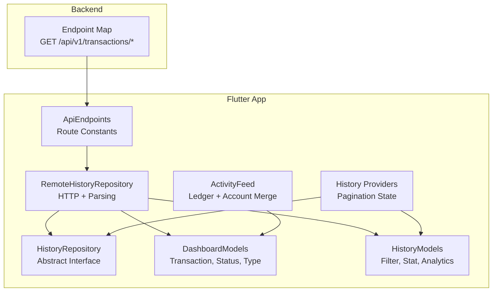
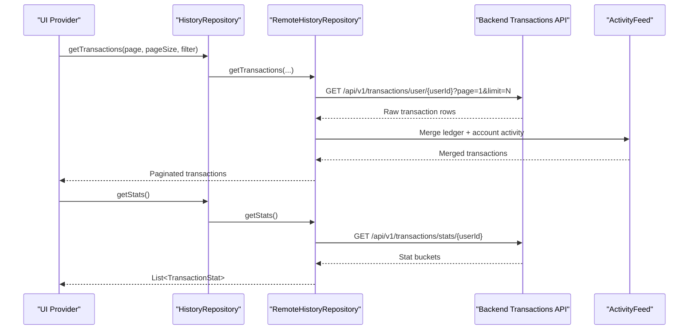
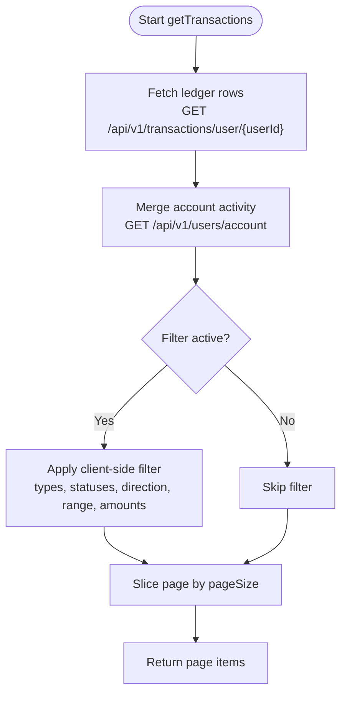
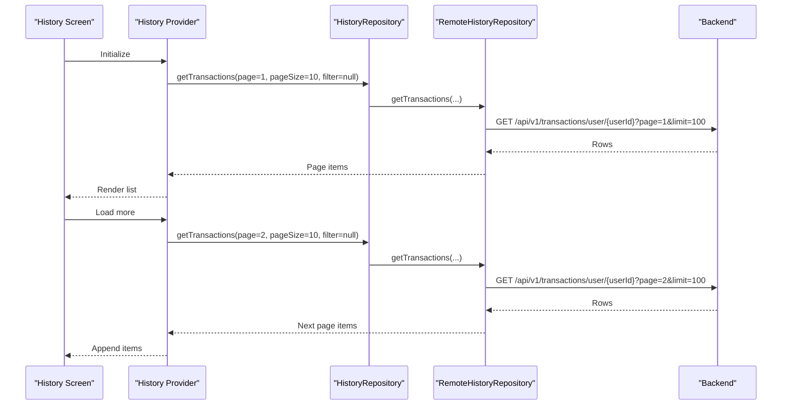
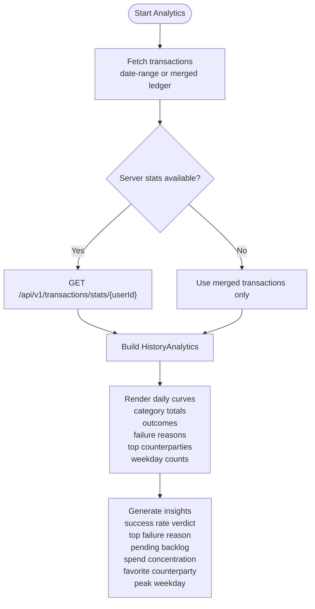
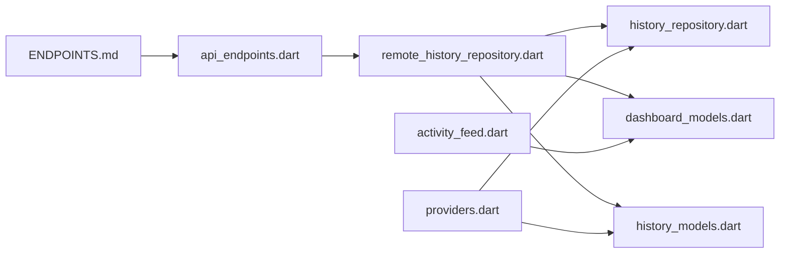

# Transaction History API

<cite>
**Referenced Files in This Document**
- [ENDPOINTS.md](file://api/ENDPOINTS.md)
- [api_endpoints.dart](file://lib/core/network/api_endpoints.dart)
- [history_repository.dart](file://lib/features/history/data/history_repository.dart)
- [remote_history_repository.dart](file://lib/features/history/data/remote_history_repository.dart)
- [history_models.dart](file://lib/features/history/data/history_models.dart)
- [dashboard_models.dart](file://lib/features/dashboard/data/dashboard_models.dart)
- [activity_feed.dart](file://lib/features/dashboard/data/activity_feed.dart)
- [providers.dart](file://lib/features/history/providers.dart)
</cite>

## Table of Contents
1. [Introduction](#introduction)
2. [Project Structure](#project-structure)
3. [Core Components](#core-components)
4. [Architecture Overview](#architecture-overview)
5. [Detailed Component Analysis](#detailed-component-analysis)
6. [Dependency Analysis](#dependency-analysis)
7. [Performance Considerations](#performance-considerations)
8. [Troubleshooting Guide](#troubleshooting-guide)
9. [Conclusion](#conclusion)
10. [Appendices](#appendices)

## Introduction
This document provides comprehensive API documentation for transaction history endpoints exposed by the backend and consumed by the mobile application. It covers:

- HTTP methods and URL patterns for retrieving, filtering, paginating, and analyzing transactions.
- Request and response data formats as inferred from the client-side models and endpoint map.
- Examples for fetching transaction lists, filtering by date ranges and categories, retrieving details, and accessing analytics.
- Sorting options, pagination behavior, and performance considerations for large datasets.
- Integration examples for building a transaction history display and analytics features.

The base URL is defined in the backend endpoint map, and all transaction-related routes are under `/api/v1`.

## Project Structure
Transaction history functionality spans several layers:

- Backend endpoint definitions are documented in the endpoint map.
- The Flutter app defines route constants for transaction endpoints.
- A repository abstraction hides network calls behind typed methods.
- Remote repository implementation performs HTTP requests and parses responses.
- Domain models define transaction shapes, statistics, filters, and analytics aggregations.
- Dashboard activity feed fetches ledger rows and merges them with account-level activity.
- UI providers manage pagination state and load more items.

**Diagram sources**
- [ENDPOINTS.md:60-71](file://api/ENDPOINTS.md#L60-L71)
- [api_endpoints.dart:35-40](file://lib/core/network/api_endpoints.dart#L35-L40)
- [history_repository.dart:4-24](file://lib/features/history/data/history_repository.dart#L4-L24)
- [remote_history_repository.dart:70-113](file://lib/features/history/data/remote_history_repository.dart#L70-L113)
- [dashboard_models.dart:38-326](file://lib/features/dashboard/data/dashboard_models.dart#L38-L326)
- [history_models.dart:7-529](file://lib/features/history/data/history_models.dart#L7-L529)
- [activity_feed.dart:40-57](file://lib/features/dashboard/data/activity_feed.dart#L40-L57)
- [providers.dart:144-189](file://lib/features/history/providers.dart#L144-L189)

**Section sources**
- [ENDPOINTS.md:60-71](file://api/ENDPOINTS.md#L60-L71)
- [api_endpoints.dart:35-40](file://lib/core/network/api_endpoints.dart#L35-L40)

## Core Components
This section documents the core components involved in transaction history retrieval and analytics.

- Endpoint map: Defines available transaction endpoints including list, user-scoped list, stats, and date-range queries.
- Route constants: Centralizes transaction URLs used by the app.
- Repository interface: Declares methods for paginated transactions, server-side statistics, and date-range queries.
- Remote repository: Implements HTTP calls, query parameters, and response parsing into domain models.
- Models: Define transaction entities, status/type enums, advanced filters, stat buckets, and analytics aggregation.
- Activity feed: Fetches ledger rows and merges account-level activity to enrich the history view.
- Providers: Manage UI pagination state and incremental loading.

**Section sources**
- [ENDPOINTS.md:60-71](file://api/ENDPOINTS.md#L60-L71)
- [api_endpoints.dart:35-40](file://lib/core/network/api_endpoints.dart#L35-L40)
- [history_repository.dart:4-24](file://lib/features/history/data/history_repository.dart#L4-L24)
- [remote_history_repository.dart:70-113](file://lib/features/history/data/remote_history_repository.dart#L70-L113)
- [dashboard_models.dart:38-326](file://lib/features/dashboard/data/dashboard_models.dart#L38-L326)
- [history_models.dart:7-529](file://lib/features/history/data/history_models.dart#L7-L529)
- [activity_feed.dart:40-57](file://lib/features/dashboard/data/activity_feed.dart#L40-L57)
- [providers.dart:144-189](file://lib/features/history/providers.dart#L144-L189)

## Architecture Overview
The transaction history architecture follows a layered approach:

- Backend exposes REST endpoints for transactions.
- The app uses typed route constants to call these endpoints.
- The remote repository handles HTTP requests and maps raw JSON to domain models.
- The repository interface abstracts data access for UI providers.
- The activity feed merges multiple sources (ledger and account activity).
- Analytics are computed from merged transactions and optional server stats.

**Diagram sources**
- [history_repository.dart:4-24](file://lib/features/history/data/history_repository.dart#L4-L24)
- [remote_history_repository.dart:70-113](file://lib/features/history/data/remote_history_repository.dart#L70-L113)
- [activity_feed.dart:40-57](file://lib/features/dashboard/data/activity_feed.dart#L40-L57)
- [providers.dart:144-189](file://lib/features/history/providers.dart#L144-L189)

## Detailed Component Analysis

### Transaction Endpoints
The following endpoints are relevant to transaction history:

- `GET /api/v1/transactions` — Get all transactions with pagination.
- `GET /api/v1/transactions/user/{userId}` — Get transactions by user ID with pagination.
- `GET /api/v1/transactions/stats/{userId}` — Get transaction statistics for a user.
- `GET /api/v1/transactions/date-range` — Get transactions by date range.

Additional transaction endpoints exist for creation, updates, deletions, and lookups by reference; however, this document focuses on history retrieval, filtering, pagination, and analytics.

**Section sources**
- [ENDPOINTS.md:60-71](file://api/ENDPOINTS.md#L60-L71)

### Pagination and Filtering
- Pagination:
  - User-scoped transactions use query parameters `page` and `limit`.
  - The repository layer supports `page` and `pageSize`, merging results and applying client-side filters before slicing the page.
- Filtering:
  - Client-side filter supports types, statuses, direction (money-in/money-out), date range, and min/max amount bounds.
  - Server-side filtering is primarily via date-range endpoint; other filters are applied client-side over merged data.

**Diagram sources**
- [remote_history_repository.dart:70-86](file://lib/features/history/data/remote_history_repository.dart#L70-L86)
- [history_models.dart:7-91](file://lib/features/history/data/history_models.dart#L7-L91)
- [activity_feed.dart:40-57](file://lib/features/dashboard/data/activity_feed.dart#L40-L57)

**Section sources**
- [remote_history_repository.dart:70-86](file://lib/features/history/data/remote_history_repository.dart#L70-L86)
- [history_models.dart:7-91](file://lib/features/history/data/history_models.dart#L7-L91)

### Data Formats

#### Transaction Model
A transaction includes:

- Identifier fields: `id`, `reference`.
- Classification: `type` (airtime, data, shop order, lida value, wallet top-up, other).
- Status: `success`, `pending`, `failed`.
- Monetary: `amount`, `currency`.
- Timestamp: `createdAt`.
- Optional metadata: `counterparty`, `description`, `isCredit`, `statusDetail`, `isAwaitingRecipientDecision`.

Parsing tolerates multiple field names across legacy and live payloads, including nested monetary objects and varied status shapes.

**Section sources**
- [dashboard_models.dart:38-326](file://lib/features/dashboard/data/dashboard_models.dart#L38-L326)

#### Statistics Model
Statistics are grouped by `{transType, status}` and include:

- Group keys: `type`, `status`.
- Aggregates: `count`, `totalAmount`, `avgAmount`, `minAmount`, `maxAmount`.

Parsing tolerates nested `_id` group keys and alternative field spellings.

**Section sources**
- [history_models.dart:95-154](file://lib/features/history/data/history_models.dart#L95-L154)

#### Filter Model
Advanced filter supports:

- Types: Set of `TransactionType`.
- Statuses: Set of `TransactionStatus`.
- Direction: All, money-in, money-out.
- Date range: Inclusive day boundaries.
- Amount bounds: Min and max.

The filter evaluates against merged transaction rows.

**Section sources**
- [history_models.dart:7-91](file://lib/features/history/data/history_models.dart#L7-L91)

#### Analytics Model
Analytics aggregates include:

- Daily totals for money-in and money-out over a configurable window.
- Category totals and counts by type.
- Outcome distribution by status.
- Failure reasons normalized and ranked.
- Top counterparties ranked by frequency.
- Success rate derived from terminal outcomes.
- Weekday counts for activity bar charts.
- Generated insights based on success rate, failure reasons, pending backlog, spend concentration, frequent counterparties, and peak weekday.

**Section sources**
- [history_models.dart:156-529](file://lib/features/history/data/history_models.dart#L156-L529)

### Request and Response Schemas

#### Fetch Transaction List
- Method: `GET`
- URL: `/api/v1/transactions/user/{userId}`
- Query parameters:
  - `page`: Integer page number.
  - `limit`: Integer maximum rows per request.
- Response:
  - Array of transaction rows or wrapped list under common keys such as `transactions`, `data`, `items`, `results`, or `records`.
  - Each row is parsed into a `Transaction` model.

Example usage:
- Fetch first page with limit 100 to merge with account activity.
- Subsequent pages increment `page` and adjust `limit` accordingly.

**Section sources**
- [ENDPOINTS.md:66-67](file://api/ENDPOINTS.md#L66-L67)
- [api_endpoints.dart:35-37](file://lib/core/network/api_endpoints.dart#L35-L37)
- [activity_feed.dart:40-57](file://lib/features/dashboard/data/activity_feed.dart#L40-L57)
- [remote_history_repository.dart:70-86](file://lib/features/history/data/remote_history_repository.dart#L70-L86)

#### Filter Transactions
- Method: Client-side filtering over merged transactions.
- Filters:
  - Types: Select one or more transaction categories.
  - Statuses: Select one or more statuses.
  - Direction: Money-in or money-out.
  - Date range: Inclusive day boundaries.
  - Amount bounds: Min and max thresholds.

Example usage:
- Show only airtime transactions that succeeded within the last 7 days and between GHS 10 and GHS 200.

**Section sources**
- [history_models.dart:7-91](file://lib/features/history/data/history_models.dart#L7-L91)
- [remote_history_repository.dart:70-86](file://lib/features/history/data/remote_history_repository.dart#L70-L86)

#### Retrieve Transaction Details
- Methods:
  - `GET /api/v1/transactions/{id}`
  - `GET /api/v1/transactions/trans-id/{transId}`
  - `GET /api/v1/transactions/trans-trxn/{trxn}`
- Purpose: Retrieve a single transaction by internal id, transId, or transaction reference.

Note: This document focuses on history retrieval; detail endpoints are included here for completeness.

**Section sources**
- [ENDPOINTS.md:62-71](file://api/ENDPOINTS.md#L62-L71)

#### Access Transaction Statistics
- Method: `GET`
- URL: `/api/v1/transactions/stats/{userId}`
- Response:
  - Array of stat buckets grouped by `{transType, status}`.
  - Fields include count, total amount, average, minimum, and maximum.

Example usage:
- Display category-wise totals and averages on the analytics screen.

**Section sources**
- [ENDPOINTS.md:67](file://api/ENDPOINTS.md#L67)
- [api_endpoints.dart:38-39](file://lib/core/network/api_endpoints.dart#L38-L39)
- [history_models.dart:95-154](file://lib/features/history/data/history_models.dart#L95-L154)
- [remote_history_repository.dart:88-97](file://lib/features/history/data/remote_history_repository.dart#L88-L97)

#### Date Range Queries
- Method: `GET`
- URL: `/api/v1/transactions/date-range`
- Query parameters:
  - `startDate`: ISO 8601 datetime string.
  - `endDate`: ISO 8601 datetime string.
- Response:
  - Array of transaction rows within the specified range.

Example usage:
- Load trend data for the last 30 days by setting start and end dates.

**Section sources**
- [ENDPOINTS.md:68](file://api/ENDPOINTS.md#L68)
- [api_endpoints.dart:40](file://lib/core/network/api_endpoints.dart#L40)
- [remote_history_repository.dart:99-113](file://lib/features/history/data/remote_history_repository.dart#L99-L113)

### Sorting Options
- The repository does not enforce explicit sort parameters in the documented methods.
- The analytics builder computes daily totals and weekday counts aligned to current time, ordering oldest-first for curve rendering.
- Failure reasons and top counterparties are sorted by frequency descending.

Recommendation:
- If sorting is required at the API level, consider adding query parameters such as `sortBy` and `order` to the backend endpoints. Until then, client-side sorting can be applied after fetching pages.

**Section sources**
- [history_models.dart:230-331](file://lib/features/history/data/history_models.dart#L230-L331)

### Integration Examples

#### Transaction History Display
Steps:
1. Call `GET /api/v1/transactions/user/{userId}` with `page=1` and an initial `limit` (e.g., 100).
2. Merge with account activity from `GET /api/v1/users/account` to include wallet deposits/withdrawals.
3. Apply client-side filters if needed.
4. Slice the first page using `pageSize`.
5. For “load more”, increment `page` and repeat until no new items are returned.

**Diagram sources**
- [providers.dart:144-189](file://lib/features/history/providers.dart#L144-L189)
- [remote_history_repository.dart:70-86](file://lib/features/history/data/remote_history_repository.dart#L70-L86)
- [activity_feed.dart:40-57](file://lib/features/dashboard/data/activity_feed.dart#L40-L57)

#### Analytics Features
Steps:
1. Fetch merged transactions for the desired window.
2. Optionally fetch server-side stats via `GET /api/v1/transactions/stats/{userId}`.
3. Build analytics using the analytics builder to compute daily curves, category totals, outcome distribution, failure reasons, top counterparties, success rate, weekday counts, and insights.

**Diagram sources**
- [history_models.dart:230-529](file://lib/features/history/data/history_models.dart#L230-L529)
- [remote_history_repository.dart:88-113](file://lib/features/history/data/remote_history_repository.dart#L88-L113)

## Dependency Analysis
The transaction history feature depends on:

- Backend endpoints for transactions, user-scoped transactions, stats, and date-range queries.
- Route constants for constructing URLs.
- Repository abstraction for decoupling UI from network logic.
- Remote repository for HTTP calls and parsing.
- Dashboard models for transaction shape and enums.
- History models for filters, stats, and analytics.
- Activity feed for merging ledger and account activity.
- Providers for managing pagination state.

**Diagram sources**
- [ENDPOINTS.md:60-71](file://api/ENDPOINTS.md#L60-L71)
- [api_endpoints.dart:35-40](file://lib/core/network/api_endpoints.dart#L35-L40)
- [history_repository.dart:4-24](file://lib/features/history/data/history_repository.dart#L4-L24)
- [remote_history_repository.dart:70-113](file://lib/features/history/data/remote_history_repository.dart#L70-L113)
- [dashboard_models.dart:38-326](file://lib/features/dashboard/data/dashboard_models.dart#L38-L326)
- [history_models.dart:7-529](file://lib/features/history/data/history_models.dart#L7-L529)
- [activity_feed.dart:40-57](file://lib/features/dashboard/data/activity_feed.dart#L40-L57)
- [providers.dart:144-189](file://lib/features/history/providers.dart#L144-L189)

**Section sources**
- [ENDPOINTS.md:60-71](file://api/ENDPOINTS.md#L60-L71)
- [api_endpoints.dart:35-40](file://lib/core/network/api_endpoints.dart#L35-L40)
- [history_repository.dart:4-24](file://lib/features/history/data/history_repository.dart#L4-L24)
- [remote_history_repository.dart:70-113](file://lib/features/history/data/remote_history_repository.dart#L70-L113)
- [dashboard_models.dart:38-326](file://lib/features/dashboard/data/dashboard_models.dart#L38-L326)
- [history_models.dart:7-529](file://lib/features/history/data/history_models.dart#L7-L529)
- [activity_feed.dart:40-57](file://lib/features/dashboard/data/activity_feed.dart#L40-L57)
- [providers.dart:144-189](file://lib/features/history/providers.dart#L144-L189)

## Performance Considerations
- Pagination:
  - Use reasonable `limit` values when fetching ledger rows to balance memory and latency.
  - Incremental loading avoids re-fetching entire histories.
- Merging:
  - Merging ledger and account activity occurs in-memory; keep merged sets bounded by page size where possible.
- Filtering:
  - Prefer server-side date-range queries for large windows to reduce payload size.
  - Apply client-side filters after fetching to avoid excessive round trips.
- Analytics:
  - Compute analytics over the fetched window; avoid recomputing on every render.
  - Cache server stats and rebuild analytics only when underlying data changes.
- Large datasets:
  - Consider implementing server-side sorting and additional filters to reduce client processing.
  - Debounce filter changes to prevent repeated heavy computations.

[No sources needed since this section provides general guidance]

## Troubleshooting Guide
Common issues and resolutions:

- Empty transaction list:
  - Verify user ID is valid and non-empty.
  - Check network connectivity and authentication tokens.
  - Confirm backend endpoint availability.
- Missing fields in transactions:
  - The parser tolerates multiple field names; ensure backend returns at least one recognized key.
  - Inspect raw payload to identify actual field spelling.
- Incorrect status mapping:
  - Status parsing accepts multiple strings; verify backend status values match expected patterns.
- Pagination not working:
  - Ensure `page` and `limit` are passed correctly.
  - Validate that the backend returns more rows than requested to signal additional pages.
- Analytics anomalies:
  - Verify currency normalization (GHS handling).
  - Check that failed transactions have readable status details or descriptions for failure reason extraction.

**Section sources**
- [dashboard_models.dart:140-326](file://lib/features/dashboard/data/dashboard_models.dart#L140-L326)
- [history_models.dart:230-529](file://lib/features/history/data/history_models.dart#L230-L529)
- [remote_history_repository.dart:70-113](file://lib/features/history/data/remote_history_repository.dart#L70-L113)

## Conclusion
The transaction history API provides robust endpoints for retrieving, filtering, paginating, and analyzing user transactions. The Flutter app implements a resilient integration layer that merges multiple data sources, applies flexible client-side filters, and computes rich analytics. For optimal performance with large datasets, leverage server-side date-range queries, paginate carefully, and cache analytics results. Future enhancements may include server-side sorting and expanded filter support to further reduce client workload.

[No sources needed since this section summarizes without analyzing specific files]

## Appendices

### API Reference Summary

- Base URL: Defined in endpoint map.
- Endpoints:
  - `GET /api/v1/transactions` — Paginated ledger.
  - `GET /api/v1/transactions/user/{userId}` — User-scoped paginated ledger.
  - `GET /api/v1/transactions/stats/{userId}` — Aggregated statistics.
  - `GET /api/v1/transactions/date-range` — Date-range query.

**Section sources**
- [ENDPOINTS.md:60-71](file://api/ENDPOINTS.md#L60-L71)