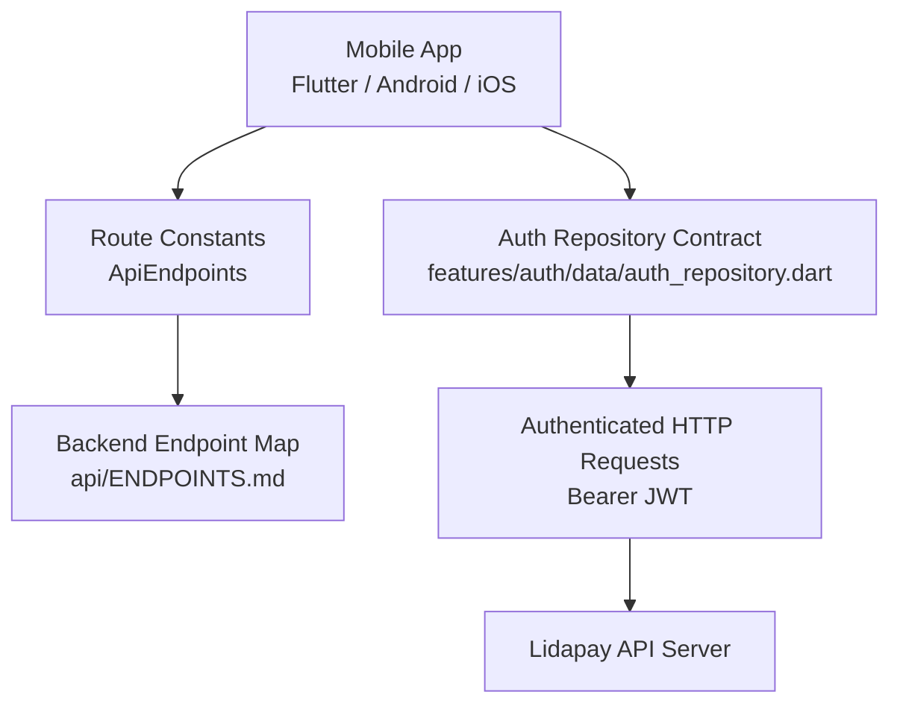
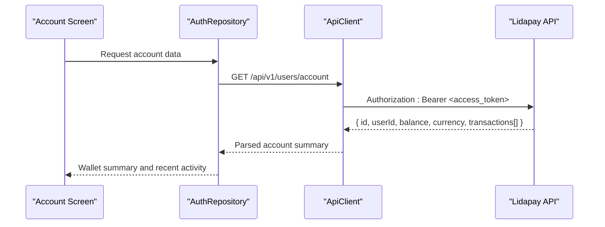
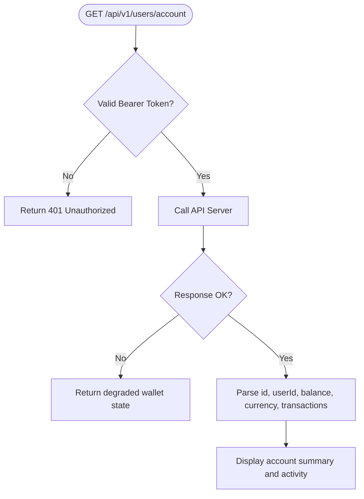
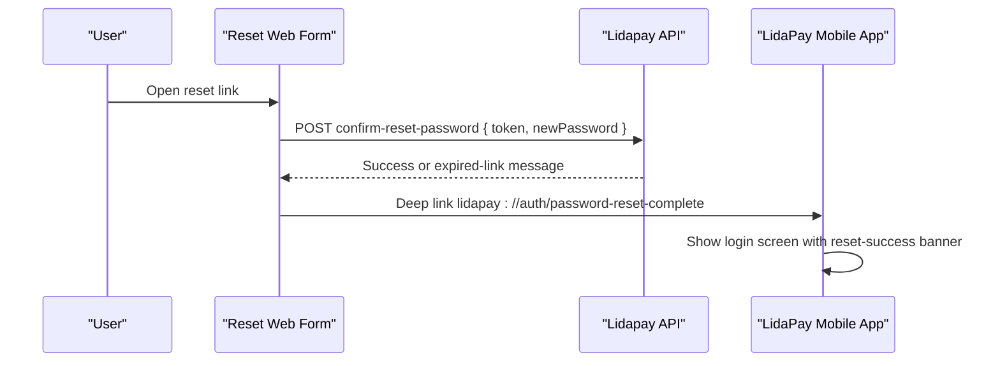
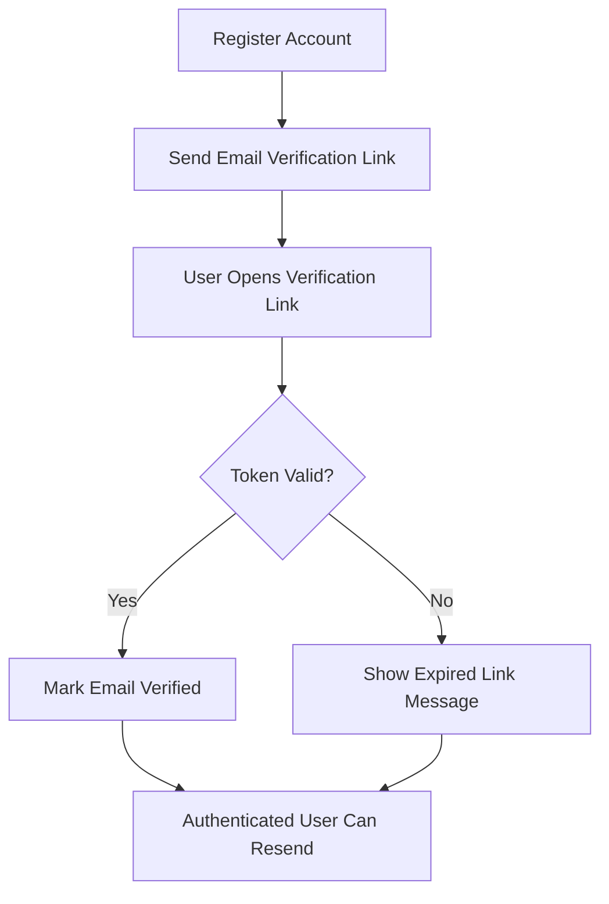
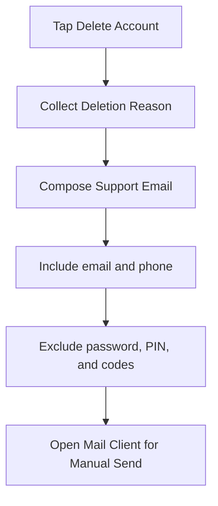
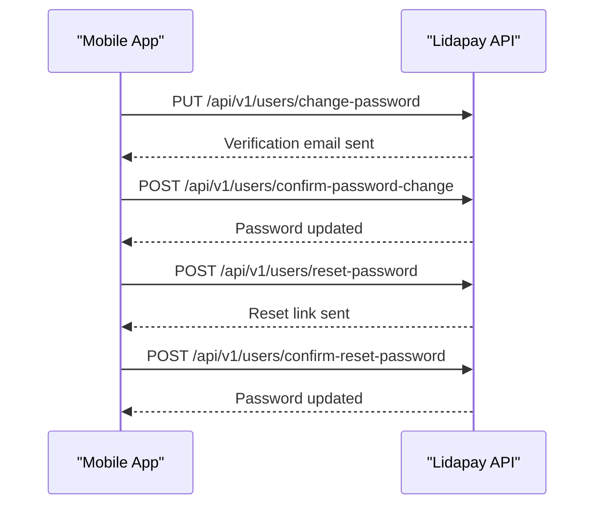
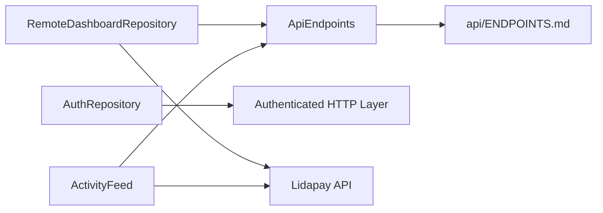

# Account Management API

<cite>
**Referenced Files in This Document**   
- [ENDPOINTS.md](file://api/ENDPOINTS.md)
- [api_endpoints.dart](file://lib/core/network/api_endpoints.dart)
- [auth_repository.dart](file://lib/features/auth/data/auth_repository.dart)
- [auth_models.dart](file://lib/features/auth/data/auth_models.dart)
- [remote_dashboard_repository.dart](file://lib/features/dashboard/data/remote_dashboard_repository.dart)
- [activity_feed.dart](file://lib/features/dashboard/data/activity_feed.dart)
- [MOBILE_APP_REBUILD_HANDOFF.md](file://docs/MOBILE_APP_REBUILD_HANDOFF.md)
</cite>

## Table of Contents
1. [Introduction](#introduction)
2. [Project Structure](#project-structure)
3. [Core Components](#core-components)
4. [Architecture Overview](#architecture-overview)
5. [Detailed Component Analysis](#detailed-component-analysis)
6. [Dependency Analysis](#dependency-analysis)
7. [Performance Considerations](#performance-considerations)
8. [Troubleshooting Guide](#troubleshooting-guide)
9. [Conclusion](#conclusion)

## Introduction
This document provides detailed API documentation for account management endpoints used by the LidaPay mobile application and its integrations. It covers:

- Retrieving the authenticated user’s account information.
- Changing a signed-in user’s password with email verification.
- Confirming a pending password change using an emailed token.
- Initiating a password reset via email or phone number.
- Completing a password reset using the token from the reset link.
- Security requirements, including bearer authentication, email verification, and safe handling of tokens.
- Email verification steps and account deletion procedures as implemented by the app.
- Mobile integration examples for Flutter/Android/iOS flows.

The backend base URL is `https://api.advansistechnologies.com`, and all authenticated requests must include a valid access token in the `Authorization` header.

**Section sources**
- [ENDPOINTS.md:1-4](file://api/ENDPOINTS.md#L1-L4)
- [MOBILE_APP_REBUILD_HANDOFF.md:65-70](file://docs/MOBILE_APP_REBUILD_HANDOFF.md#L65-L70)

## Project Structure
The account management endpoints are part of the `/api/v1/users` namespace. The mobile client defines route constants that match the backend OpenAPI specification, while the repository layer documents the contract for each endpoint.

**Diagram sources**
- [api_endpoints.dart:1-33](file://lib/core/network/api_endpoints.dart#L1-L33)
- [ENDPOINTS.md:13-38](file://api/ENDPOINTS.md#L13-L38)
- [auth_repository.dart:54-75](file://lib/features/auth/data/auth_repository.dart#L54-L75)

**Section sources**
- [api_endpoints.dart:1-33](file://lib/core/network/api_endpoints.dart#L1-L33)
- [ENDPOINTS.md:13-38](file://api/ENDPOINTS.md#L13-L38)

## Core Components
The account management surface includes five primary endpoints:

| Endpoint | Method | Purpose | Authentication |
|---|---|---|---|
| `/api/v1/users/account` | GET | Retrieve the current user’s account document, including balance and embedded transactions. | Bearer access token |
| `/api/v1/users/change-password` | PUT | Start a signed-in password change; the backend emails a verification link. | Bearer access token |
| `/api/v1/users/confirm-password-change` | POST | Complete the pending password change using the emailed verification token. | Usually public token-based flow; confirm with backend spec |
| `/api/v1/users/reset-password` | POST | Initiate a password reset by sending a reset link to the account’s email or SMS. | Public identifier-based request |
| `/api/v1/users/confirm-reset-password` | POST | Set a new password using the token carried by the reset link. | Token-based confirmation |

The mobile client centralizes these routes under `ApiEndpoints`, and the auth repository documents their intended behavior.

**Section sources**
- [ENDPOINTS.md:25-38](file://api/ENDPOINTS.md#L25-L38)
- [api_endpoints.dart:17-30](file://lib/core/network/api_endpoints.dart#L17-L30)
- [auth_repository.dart:54-75](file://lib/features/auth/data/auth_repository.dart#L54-L75)

## Architecture Overview
Account management integrates three layers:

1. **Mobile UI:** Screens for viewing account details, changing passwords, requesting resets, and confirming changes.
2. **Repository layer:** A typed contract describing endpoint behavior, parameters, and expected outcomes.
3. **Network layer:** An authenticated HTTP client that attaches the bearer token and parses responses.

**Diagram sources**
- [remote_dashboard_repository.dart:57-70](file://lib/features/dashboard/data/remote_dashboard_repository.dart#L57-L70)
- [activity_feed.dart:59-66](file://lib/features/dashboard/data/activity_feed.dart#L59-L66)

**Section sources**
- [remote_dashboard_repository.dart:57-70](file://lib/features/dashboard/data/remote_dashboard_repository.dart#L57-L70)
- [activity_feed.dart:59-66](file://lib/features/dashboard/data/activity_feed.dart#L59-L66)

## Detailed Component Analysis

### GET /api/v1/users/account
Retrieves the authenticated user’s account document. The mobile dashboard uses this endpoint when the wallet-specific endpoint fails, treating it as a fallback source of balance and currency.

- **HTTP method:** GET
- **URL pattern:** `/api/v1/users/account`
- **Authentication:** Required. Attach `Authorization: Bearer <access_token>`.
- **Request body:** None.
- **Success response shape:**
  - `id`: Account identifier.
  - `userId`: User identifier.
  - `balance`: Numeric balance value.
  - `currency`: Currency code; defaults to `GHS` when missing.
  - `transactions`: Embedded transaction list used for account activity.
- **Error responses:**
  - `401 Unauthorized`: Missing or invalid access token.
  - `500 Internal Server Error`: Backend failure; the dashboard degrades gracefully instead of failing the entire screen.

#### Example: Retrieving Account Information
A mobile app should call this endpoint after login or session restore and display:

- Current balance and currency.
- Recent transactions if available.
- A degraded state when the endpoint fails, rather than crashing.

**Diagram sources**
- [remote_dashboard_repository.dart:57-70](file://lib/features/dashboard/data/remote_dashboard_repository.dart#L57-L70)
- [activity_feed.dart:59-66](file://lib/features/dashboard/data/activity_feed.dart#L59-L66)

**Section sources**
- [ENDPOINTS.md:43](file://api/ENDPOINTS.md#L43)
- [api_endpoints.dart:17](file://lib/core/network/api_endpoints.dart#L17)
- [remote_dashboard_repository.dart:57-70](file://lib/features/dashboard/data/remote_dashboard_repository.dart#L57-L70)
- [activity_feed.dart:59-66](file://lib/features/dashboard/data/activity_feed.dart#L59-L66)

### PUT /api/v1/users/change-password
Starts a password change for a signed-in user. The backend requires the current password and a new password, then sends an email verification link. The change is not applied until the confirmation step succeeds.

- **HTTP method:** PUT
- **URL pattern:** `/api/v1/users/change-password`
- **Authentication:** Required. Attach `Authorization: Bearer <access_token>`.
- **Request body:**
  - `currentPassword`: The user’s existing password.
  - `newPassword`: The desired new password.
- **Behavior:**
  - Validates the current password.
  - Enforces password policy on the new password.
  - Sends an email containing a verification token.
  - Does not apply the new password until confirmation.
- **Success response:** Indicates that a verification email was sent.
- **Error responses:**
  - `401 Unauthorized`: Invalid or missing token.
  - `400 Bad Request`: Invalid current password, weak new password, or malformed payload.
  - `500 Internal Server Error`: Backend failure.

#### Example: Starting a Password Change
After the user enters their current password and a new password:

1. Validate input locally (length, complexity).
2. Send the request with the bearer token.
3. Show a message directing the user to check their email for the verification link.
4. Navigate to the confirmation screen once the request succeeds.

**Section sources**
- [ENDPOINTS.md:25](file://api/ENDPOINTS.md#L25)
- [api_endpoints.dart:28](file://lib/core/network/api_endpoints.dart#L28)
- [auth_repository.dart:65-71](file://lib/features/auth/data/auth_repository.dart#L65-L71)

### POST /api/v1/users/confirm-password-change
Completes the pending password change using the token from the verification email.

- **HTTP method:** POST
- **URL pattern:** `/api/v1/users/confirm-password-change`
- **Authentication:** Depends on backend implementation; typically token-based through the emailed link.
- **Request body:**
  - `token`: Verification token from the password-change email.
- **Behavior:**
  - Validates the token.
  - Applies the pending new password.
  - Invalidates the one-time token.
- **Success response:** Indicates that the password has been updated.
- **Error responses:**
  - `400 Bad Request`: Invalid, expired, or already-used token.
  - `401 Unauthorized`: If the endpoint expects a bearer token and none is provided.
  - `500 Internal Server Error`: Backend failure.

#### Example: Confirming a Password Change
When the user opens the verification link or taps the confirmation action:

1. Extract the token from the link or deep link.
2. Submit the token to the confirmation endpoint.
3. On success, show a confirmation message and optionally redirect to login or the home screen.
4. On failure, explain that the link may be expired or invalid.

**Section sources**
- [ENDPOINTS.md:26](file://api/ENDPOINTS.md#L26)
- [api_endpoints.dart:29-30](file://lib/core/network/api_endpoints.dart#L29-L30)
- [auth_repository.dart:73-75](file://lib/features/auth/data/auth_repository.dart#L73-L75)

### POST /api/v1/users/reset-password
Initiates a password reset. The backend accepts either the account’s email address or phone number. For phone resets, the backend sends an SMS through One4All.

- **HTTP method:** POST
- **URL pattern:** `/api/v1/users/reset-password`
- **Authentication:** Not required for initiation; the request identifies the account by email or phone.
- **Request body:** Either:
  - `email`: The registered email address.
  - `phoneNumber`: The registered phone number.
- **Behavior:**
  - Looks up the account by the provided identifier.
  - Generates a reset token.
  - Sends a reset link by email or SMS.
  - Returns a success indication without exposing sensitive account details.
- **Error responses:**
  - `400 Bad Request`: Missing or malformed identifier.
  - `404 Not Found`: No matching account (or intentionally generic error).
  - `502 Bad Gateway`: Provider failure for SMS delivery.
  - `503 Service Unavailable`: Missing One4All SMS configuration.
  - `500 Internal Server Error`: Backend failure.

#### Example: Initiating a Password Reset
When the user selects “Forgot password”:

1. Ask for email or phone number.
2. Validate format locally.
3. Send the reset request.
4. Show instructions to check email or SMS.
5. Do not log identifiers, tokens, or provider credentials.

**Section sources**
- [ENDPOINTS.md:37](file://api/ENDPOINTS.md#L37)
- [api_endpoints.dart:25](file://lib/core/network/api_endpoints.dart#L25)
- [auth_repository.dart:54-56](file://lib/features/auth/data/auth_repository.dart#L54-L56)
- [MOBILE_APP_REBUILD_HANDOFF.md:195-197](file://docs/MOBILE_APP_REBUILD_HANDOFF.md#L195-L197)

### POST /api/v1/users/confirm-reset-password
Confirms the password reset using the token from the reset link.

- **HTTP method:** POST
- **URL pattern:** `/api/v1/users/confirm-reset-password`
- **Authentication:** Token-based through the reset link.
- **Request body:**
  - `token`: Reset token from the URL fragment or link.
  - `newPassword`: The new password to set.
- **Behavior:**
  - Validates the reset token.
  - Enforces password policy.
  - Updates the account password.
  - Invalidates the reset token.
- **Success response:** Indicates successful password update.
- **Error responses:**
  - `400 Bad Request`: Invalid, expired, or malformed token/password.
  - `401 Unauthorized`: If bearer authentication is required and missing.
  - `500 Internal Server Error`: Backend failure.

#### Example: Completing a Password Reset
When the user opens the reset link:

1. Extract the token from the URL fragment.
2. Prompt for the new password.
3. Submit the token and new password.
4. Show success or expired-link messaging.
5. Optionally open the app via deep link or return to web login.

**Diagram sources**
- [MOBILE_APP_REBUILD_HANDOFF.md:195-204](file://docs/MOBILE_APP_REBUILD_HANDOFF.md#L195-L204)

**Section sources**
- [ENDPOINTS.md:38](file://api/ENDPOINTS.md#L38)
- [api_endpoints.dart:26-27](file://lib/core/network/api_endpoints.dart#L26-L27)
- [auth_repository.dart:58-63](file://lib/features/auth/data/auth_repository.dart#L58-L63)
- [MOBILE_APP_REBUILD_HANDOFF.md:195-204](file://docs/MOBILE_APP_REBUILD_HANDOFF.md#L195-L204)

### Security Requirements
- **Bearer authentication:** All protected endpoints require a valid access token unless explicitly documented as public.
- **Token storage:** Store access and refresh tokens in secure storage; never log them.
- **One-time tokens:** Treat password-change and reset tokens as single-use and short-lived.
- **Identifier safety:** Do not expose full account details in reset or verification responses.
- **Provider secrets:** Never embed One4All or other provider credentials in the mobile app.
- **Email verification:** Password changes initiated by a signed-in user require email confirmation before applying.
- **Phone verification:** Phone verification is separate from email verification and password reset flows.

**Section sources**
- [MOBILE_APP_REBUILD_HANDOFF.md:65-70](file://docs/MOBILE_APP_REBUILD_HANDOFF.md#L65-L70)
- [MOBILE_APP_REBUILD_HANDOFF.md:195-197](file://docs/MOBILE_APP_REBUILD_HANDOFF.md#L195-L197)
- [auth_repository.dart:65-75](file://lib/features/auth/data/auth_repository.dart#L65-L75)

### Email Verification Steps
Email verification is distinct from password reset:

1. Registration triggers an email verification link.
2. The user opens the public verification link.
3. The backend marks the email as verified.
4. If the link expires or is missing, the authenticated user can resend the verification email.

**Diagram sources**
- [MOBILE_APP_REBUILD_HANDOFF.md:237-252](file://docs/MOBILE_APP_REBUILD_HANDOFF.md#L237-L252)

**Section sources**
- [MOBILE_APP_REBUILD_HANDOFF.md:237-252](file://docs/MOBILE_APP_REBUILD_HANDOFF.md#L237-L252)

### Account Deletion Procedures
The mobile app does not directly call a delete-account endpoint from the account-management screens shown here. Instead, it prepares a support email that includes the user’s email and phone number but excludes sensitive credentials such as passwords, PINs, or codes.

- The deletion request is prepared as a mailto-style support request.
- The subject indicates deletion.
- The body contains identifying account information for support agents.
- Sensitive values are intentionally excluded.

**Diagram sources**
- [profile_screen.dart:83-97](file://lib/features/profile/screens/profile_screen.dart#L83-L97)
- [legal_support_test.dart:159-176](file://test/legal_support_test.dart#L159-L176)

**Section sources**
- [profile_screen.dart:83-97](file://lib/features/profile/screens/profile_screen.dart#L83-L97)
- [legal_support_test.dart:159-176](file://test/legal_support_test.dart#L159-L176)

### Mobile Integration Examples

#### Retrieving Account Information
- After login, attach the access token.
- Call `GET /api/v1/users/account`.
- Display balance, currency, and recent transactions.
- Handle `401` by refreshing once; clear session if refresh fails.
- Handle `500` by showing a degraded wallet state.

#### Password Change Workflow
1. User signs in.
2. User submits current and new password to `PUT /api/v1/users/change-password`.
3. Backend sends a verification email.
4. User opens the verification link and calls `POST /api/v1/users/confirm-password-change`.
5. Backend applies the new password.

#### Password Reset Workflow
1. User submits email or phone to `POST /api/v1/users/reset-password`.
2. Backend sends a reset link by email or SMS.
3. User opens the reset link and submits token plus new password to `POST /api/v1/users/confirm-reset-password`.
4. Backend updates the password and redirects or returns success.

**Diagram sources**
- [auth_repository.dart:54-75](file://lib/features/auth/data/auth_repository.dart#L54-L75)
- [MOBILE_APP_REBUILD_HANDOFF.md:195-204](file://docs/MOBILE_APP_REBUILD_HANDOFF.md#L195-L204)

**Section sources**
- [auth_repository.dart:54-75](file://lib/features/auth/data/auth_repository.dart#L54-L75)
- [MOBILE_APP_REBUILD_HANDOFF.md:195-204](file://docs/MOBILE_APP_REBUILD_HANDOFF.md#L195-L204)

## Dependency Analysis
The account management features depend on:

- Route constants for stable endpoint paths.
- The backend endpoint map for authoritative HTTP contracts.
- The auth repository for typed behavior and parameter contracts.
- The dashboard repository for fallback balance resolution.
- The activity feed for extracting embedded transactions.

**Diagram sources**
- [api_endpoints.dart:1-33](file://lib/core/network/api_endpoints.dart#L1-L33)
- [ENDPOINTS.md:13-38](file://api/ENDPOINTS.md#L13-L38)
- [remote_dashboard_repository.dart:57-70](file://lib/features/dashboard/data/remote_dashboard_repository.dart#L57-L70)
- [activity_feed.dart:59-66](file://lib/features/dashboard/data/activity_feed.dart#L59-L66)

**Section sources**
- [api_endpoints.dart:1-33](file://lib/core/network/api_endpoints.dart#L1-L33)
- [ENDPOINTS.md:13-38](file://api/ENDPOINTS.md#L13-L38)
- [remote_dashboard_repository.dart:57-70](file://lib/features/dashboard/data/remote_dashboard_repository.dart#L57-L70)
- [activity_feed.dart:59-66](file://lib/features/dashboard/data/activity_feed.dart#L59-L66)

## Performance Considerations
- Cache the access token securely and reuse it across requests.
- Retry refresh only once on `401`; do not loop retries.
- Avoid blocking the UI on slow account endpoints; degrade gracefully.
- Do not repeatedly request OTP, verification, or reset links; respect rate limits.
- Prefer server-side pagination and filtering where supported.
- Avoid logging sensitive payloads, tokens, or provider responses.

[No sources needed since this section provides general guidance]

## Troubleshooting Guide
Common issues and resolutions:

| Symptom | Likely Cause | Resolution |
|---|---|---|
| `401 Unauthorized` on account retrieval | Missing or expired access token | Refresh once; if refresh fails, clear session and require re-authentication. |
| `500 Internal Server Error` on account retrieval | Backend wallet service failure | Fall back to `/api/v1/users/account`; degrade wallet card instead of failing the screen. |
| Password change email not received | Email provider delay or misconfiguration | Check spam folder, verify email address, and allow time before resending. |
| Reset link expired | Token validity window passed | Request a new reset link. |
| SMS reset fails with `502` | One4All provider failure | Retry later; check backend logs. |
| SMS reset fails with `503` | Missing One4All configuration | Backend team must configure SMS provider settings. |
| Account deletion email contains sensitive data | Incorrect support email composition | Ensure only email and phone are included; exclude passwords, PINs, and codes. |

**Section sources**
- [remote_dashboard_repository.dart:57-70](file://lib/features/dashboard/data/remote_dashboard_repository.dart#L57-L70)
- [MOBILE_APP_REBUILD_HANDOFF.md:195-197](file://docs/MOBILE_APP_REBUILD_HANDOFF.md#L195-L197)
- [legal_support_test.dart:159-176](file://test/legal_support_test.dart#L159-L176)

## Conclusion
The account management API surface provides secure, token-driven operations for retrieving account information, changing passwords with email verification, and resetting passwords via email or SMS. The mobile client relies on stable route constants, a typed repository contract, and robust error handling to deliver a resilient user experience. Integrators should follow the security requirements, handle one-time tokens carefully, and implement graceful degradation when backend services fail.

[No sources needed since this section summarizes without analyzing specific files]