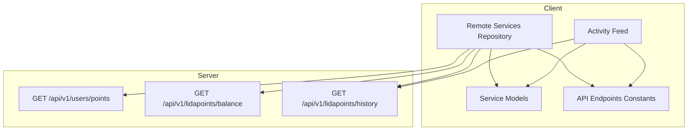
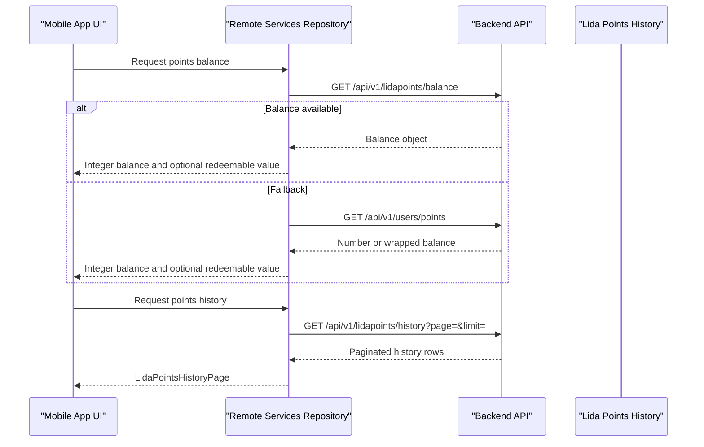
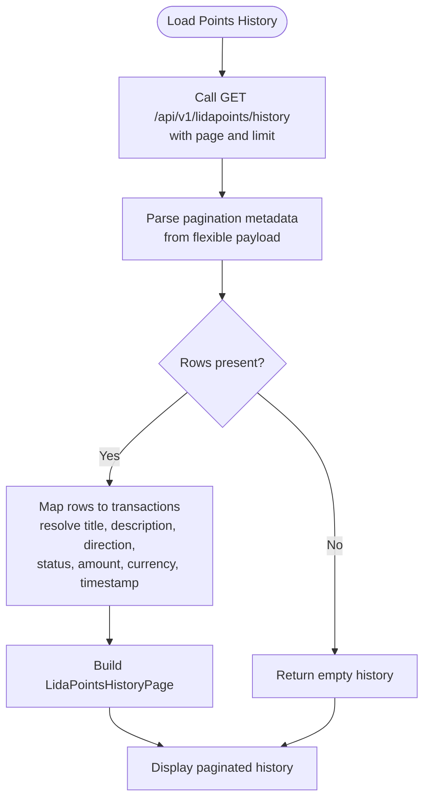
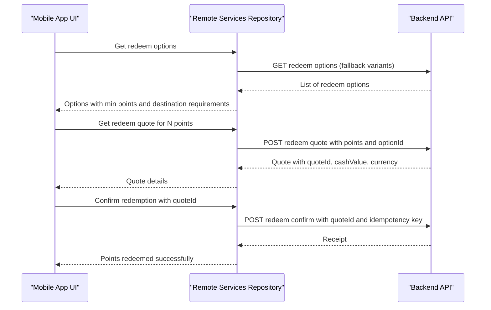
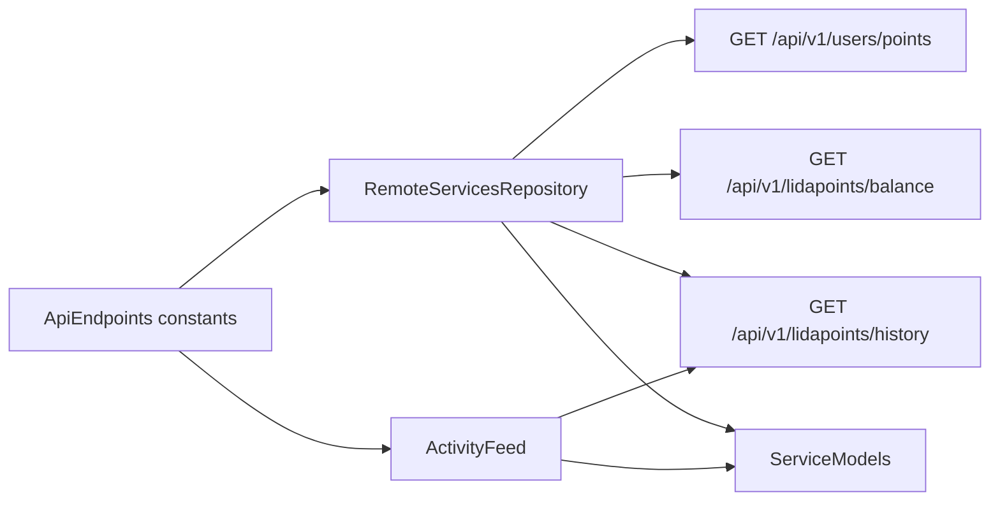

# Points & Rewards API

<cite>
**Referenced Files in This Document**
- [ENDPOINTS.md](file://api/ENDPOINTS.md)
- [api_endpoints.dart](file://lib/core/network/api_endpoints.dart)
- [remote_services_repository.dart](file://lib/features/services/data/remote_services_repository.dart)
- [activity_feed.dart](file://lib/features/dashboard/data/activity_feed.dart)
- [service_models.dart](file://lib/features/services/data/service_models.dart)
</cite>

## Table of Contents
1. [Introduction](#introduction)
2. [Project Structure](#project-structure)
3. [Core Components](#core-components)
4. [Architecture Overview](#architecture-overview)
5. [Detailed Component Analysis](#detailed-component-analysis)
6. [Dependency Analysis](#dependency-analysis)
7. [Performance Considerations](#performance-considerations)
8. [Troubleshooting Guide](#troubleshooting-guide)
9. [Conclusion](#conclusion)
10. [Appendices](#appendices)

## Introduction
This document provides detailed API documentation for the points and rewards features exposed by the Lida Shop backend, as consumed by the mobile application. It focuses on three endpoints:

- `GET /api/v1/users/points` — Retrieve user points balance.
- `GET /api/v1/lidapoints/balance` — Retrieve current Lida Points balance.
- `GET /api/v1/lidapoints/history` — Retrieve Lida Points transaction history.

It also documents how the mobile app integrates these endpoints, including fallback behavior, pagination, redemption flows, and interpretation of point transactions.

The base URL used by the client is defined in the repository’s endpoint map, and all authenticated requests should include an access token obtained through the authentication endpoints documented alongside these routes.

## Project Structure
The points and rewards functionality is implemented across a small set of files:

| File | Responsibility |
| --- | --- |
| `api/ENDPOINTS.md` | Canonical server-side endpoint map, including the three target endpoints. |
| `lib/core/network/api_endpoints.dart` | Client-side constants that define route paths such as `/api/v1/users/points`, `/api/v1/lidapoints/balance`, and `/api/v1/lidapoints/history`. |
| `lib/features/services/data/remote_services_repository.dart` | Repository layer that calls the endpoints, parses flexible response shapes, handles pagination, and implements the points redemption workflow. |
| `lib/features/dashboard/data/activity_feed.dart` | Dashboard logic that fetches Lida Points history and maps raw rows into unified transaction records. |
| `lib/features/services/data/service_models.dart` | Data models for Lida Points wallet, paginated history, redeem options, quotes, and related structures. |

**Diagram sources**
- [api_endpoints.dart:18-65](file://lib/core/network/api_endpoints.dart#L18-L65)
- [remote_services_repository.dart:1484-1562](file://lib/features/services/data/remote_services_repository.dart#L1484-L1562)
- [activity_feed.dart:173-198](file://lib/features/dashboard/data/activity_feed.dart#L173-L198)
- [service_models.dart:230-357](file://lib/features/services/data/service_models.dart#L230-L357)

**Section sources**
- [ENDPOINTS.md:16-16](file://api/ENDPOINTS.md#L16-L16)
- [ENDPOINTS.md:98-99](file://api/ENDPOINTS.md#L98-L99)
- [api_endpoints.dart:18-18](file://lib/core/network/api_endpoints.dart#L18-L18)
- [api_endpoints.dart:52-65](file://lib/core/network/api_endpoints.dart#L52-L65)

## Core Components
The core components involved in points and rewards are:

1. **Endpoint definitions**
   - The server exposes `GET /api/v1/users/points`, `GET /api/v1/lidapoints/balance`, and `GET /api/v1/lidapoints/history`.
   - These are declared in the endpoint map and referenced by client constants.

2. **Repository layer**
   - Calls the balance and history endpoints.
   - Tries multiple fallback paths when reading points balance.
   - Parses flexible JSON shapes for balance, history, and redemption data.
   - Implements a two-step redemption flow: quote then confirm.

3. **Dashboard activity feed**
   - Reads Lida Points history.
   - Maps each row to a transaction with fields such as reference, amount, currency, status, direction, counterparty, and timestamp.

4. **Service models**
   - Define structured representations for Lida Points wallet, paginated history, redeem options, and redeem quotes.

**Section sources**
- [ENDPOINTS.md:16-16](file://api/ENDPOINTS.md#L16-L16)
- [ENDPOINTS.md:98-99](file://api/ENDPOINTS.md#L98-L99)
- [api_endpoints.dart:18-18](file://lib/core/network/api_endpoints.dart#L18-L18)
- [api_endpoints.dart:52-65](file://lib/core/network/api_endpoints.dart#L52-L65)
- [remote_services_repository.dart:1484-1562](file://lib/features/services/data/remote_services_repository.dart#L1484-L1562)
- [activity_feed.dart:173-198](file://lib/features/dashboard/data/activity_feed.dart#L173-L198)
- [service_models.dart:230-357](file://lib/features/services/data/service_models.dart#L230-L357)

## Architecture Overview
The points and rewards feature follows a layered architecture:

- **API contract**: Defined by the server endpoints listed in the endpoint map.
- **Client constants**: Centralized route strings prevent typos and make it easy to migrate or add fallback routes.
- **Repository**: Encapsulates HTTP calls, error handling, parsing, pagination, and business rules for redemption.
- **UI layer**: Uses repository methods and models to display balances, history, and redemption options.

**Diagram sources**
- [remote_services_repository.dart:1484-1562](file://lib/features/services/data/remote_services_repository.dart#L1484-L1562)
- [api_endpoints.dart:18-18](file://lib/core/network/api_endpoints.dart#L18-L18)
- [api_endpoints.dart:52-65](file://lib/core/network/api_endpoints.dart#L52-L65)

## Detailed Component Analysis

### Endpoint: GET /api/v1/users/points
- **Purpose**: Retrieve the authenticated user’s points balance.
- **HTTP method**: `GET`
- **URL pattern**: `/api/v1/users/points`
- **Authentication**: Required. The client attaches an access token from the authentication flow.
- **Request parameters**: None.
- **Response shape**: The client tolerates multiple response formats:
  - A bare number.
  - A string representing a number.
  - An object containing one of several possible balance fields.
- **Parsed fields**:
  - `balance`, `points`, or `totalPoints` for the integer point balance.
  - Optional redeemable value from `redeemableValue`, `cashValue`, or `value`.
- **Error behavior**:
  - A `401 Unauthorized` propagates to the caller so the app can redirect to login.
  - Other failures are handled by the repository’s fallback logic.

#### Example: Retrieving User Points Balance
A typical integration step is:

1. Authenticate the user and obtain an access token.
2. Call `GET /api/v1/users/points`.
3. Parse the response as either a number or an object with a recognized balance field.
4. Display the integer point balance and any optional redeemable value.

**Section sources**
- [ENDPOINTS.md:16-16](file://api/ENDPOINTS.md#L16-L16)
- [api_endpoints.dart:18-18](file://lib/core/network/api_endpoints.dart#L18-L18)
- [remote_services_repository.dart:1531-1562](file://lib/features/services/data/remote_services_repository.dart#L1531-L1562)

### Endpoint: GET /api/v1/lidapoints/balance
- **Purpose**: Retrieve the current Lida Points balance.
- **HTTP method**: `GET`
- **URL pattern**: `/api/v1/lidapoints/balance`
- **Authentication**: Required.
- **Request parameters**: None.
- **Response shape**: Flexible; the client accepts:
  - A number.
  - A string convertible to a number.
  - An object with a recognized balance field.
- **Parsed fields**:
  - `balance`, `points`, or `totalPoints`.
  - Optional redeemable value from `redeemableValue`, `cashValue`, or `value`.
- **Fallback behavior**: If this endpoint does not return usable data, the repository tries `/api/v1/users/points`.

#### Example: Accessing Lida Points Balance
A typical integration step is:

1. Call `GET /api/v1/lidapoints/balance`.
2. If the response contains a recognized balance field, use it.
3. Otherwise, call `GET /api/v1/users/points` as a fallback.
4. Display the resulting integer balance.

**Section sources**
- [ENDPOINTS.md:98-98](file://api/ENDPOINTS.md#L98-L98)
- [api_endpoints.dart:52-52](file://lib/core/network/api_endpoints.dart#L52-L52)
- [remote_services_repository.dart:1531-1562](file://lib/features/services/data/remote_services_repository.dart#L1531-L1562)

### Endpoint: GET /api/v1/lidapoints/history
- **Purpose**: Retrieve the authenticated user’s Lida Points transaction history.
- **HTTP method**: `GET`
- **URL pattern**: `/api/v1/lidapoints/history`
- **Authentication**: Required.
- **Query parameters**:
  - `page`: Page number, default `1`.
  - `limit`: Items per page, default `20`.
  - `userId`: Optional parameter used by some dashboard flows to scope results.
- **Response shape**: A paginated list of history rows. The client extracts pagination metadata from flexible locations such as `pagination`, `meta`, `total`, `totalCount`, `totalItems`, `count`, `totalPages`, `pages`, `hasNextPage`, or `hasMore`.
- **Row fields interpreted by the client**:
  - Identifier: `transactionReference`, `transId`, `trxn`, `reference`, `ref`, `transRef`, `_id`, or `id`.
  - Title or type: `type`, `transactionType`, `action`, `title`, or `category`.
  - Description: `description`, `message`, `remarks`, or `narration`.
  - Direction: `direction` or `entryType`, where credit-like values indicate earnings and debit-like values indicate redemptions.
  - Status: `status` or `state`; absence means success.
  - Amount: `amount`, `valueUnits`, `points`, `total`, or `value`.
  - Currency: For points, treated as `PTS`.
  - Timestamp: Parsed from date fields.
  - Counterparty: `recipient`, `recipientPhone`, `receiver`, `sender`, or `destination`.

#### Example: Viewing Points Transaction History
A typical integration step is:

1. Call `GET /api/v1/lidapoints/history?page=1&limit=20`.
2. Render the first page of transactions.
3. Use `hasMore`, `total`, or `totalPages` to implement pagination.
4. Map each row to a transaction record showing whether it is a credit or debit.

**Diagram sources**
- [remote_services_repository.dart:1484-1529](file://lib/features/services/data/remote_services_repository.dart#L1484-L1529)
- [activity_feed.dart:262-341](file://lib/features/dashboard/data/activity_feed.dart#L262-L341)

**Section sources**
- [ENDPOINTS.md:99-99](file://api/ENDPOINTS.md#L99-L99)
- [api_endpoints.dart:65-65](file://lib/core/network/api_endpoints.dart#L65-L65)
- [remote_services_repository.dart:1484-1529](file://lib/features/services/data/remote_services_repository.dart#L1484-L1529)
- [activity_feed.dart:173-198](file://lib/features/dashboard/data/activity_feed.dart#L173-L198)
- [activity_feed.dart:262-341](file://lib/features/dashboard/data/activity_feed.dart#L262-L341)
- [service_models.dart:244-264](file://lib/features/services/data/service_models.dart#L244-L264)

### Points Calculation Rules
Based on the client-side parsing and mapping logic:

- **Point balance source**:
  - Primary source: `/api/v1/lidapoints/balance`.
  - Fallback source: `/api/v1/users/points`.
- **Balance representation**:
  - The client converts numeric responses to integers.
  - Recognized balance fields include `balance`, `points`, and `totalPoints`.
- **Redeemable value**:
  - An optional monetary or equivalent value may be returned under `redeemableValue`, `cashValue`, or `value`.
- **Transaction direction**:
  - Credit-like entries include terms such as save, accept, credit, earn, receive, refund, bonus, or cashback.
  - Debit-like entries include redemption-style actions.
- **Status interpretation**:
  - Missing status generally means success.
  - Explicit status values are mapped to internal transaction statuses.

These rules describe how the mobile app interprets backend data rather than defining backend business logic.

**Section sources**
- [remote_services_repository.dart:1531-1562](file://lib/features/services/data/remote_services_repository.dart#L1531-L1562)
- [activity_feed.dart:298-341](file://lib/features/dashboard/data/activity_feed.dart#L298-L341)

### Reward Redemption Process
The redemption process is a multi-step flow:

1. **Get redeem options**:
   - The client tries multiple route variants for redeem options.
   - Each option includes an identifier, name, description, minimum points requirement, and whether a destination is required.
2. **Get a redemption quote**:
   - The client posts the requested points and an optional option identifier.
   - The response includes a quote identifier, points, cash value, currency, and message.
3. **Confirm redemption**:
   - The client posts the quote identifier and optional destination.
   - The request must include an idempotency key header to prevent duplicate redemptions.
   - On success, the client returns a service receipt indicating that points were redeemed.

**Diagram sources**
- [remote_services_repository.dart:1797-1872](file://lib/features/services/data/remote_services_repository.dart#L1797-L1872)
- [service_models.dart:266-357](file://lib/features/services/data/service_models.dart#L266-L357)

**Section sources**
- [remote_services_repository.dart:1805-1872](file://lib/features/services/data/remote_services_repository.dart#L1805-L1872)
- [service_models.dart:266-357](file://lib/features/services/data/service_models.dart#L266-L357)

### Point Expiration Policies
The analyzed client code does not define point expiration rules. There is no explicit expiration date field parsed for points, nor is there visible policy enforcement logic in the examined files. Any expiration behavior would need to be defined by the backend and surfaced through additional fields in the balance or history responses.

[No sources needed since this section summarizes observed absence of expiration logic]

## Dependency Analysis
The following diagram shows how the client-side components depend on each other and on the backend endpoints:

**Diagram sources**
- [api_endpoints.dart:18-18](file://lib/core/network/api_endpoints.dart#L18-L18)
- [api_endpoints.dart:52-65](file://lib/core/network/api_endpoints.dart#L52-L65)
- [remote_services_repository.dart:1484-1562](file://lib/features/services/data/remote_services_repository.dart#L1484-L1562)
- [activity_feed.dart:173-198](file://lib/features/dashboard/data/activity_feed.dart#L173-L198)
- [service_models.dart:230-357](file://lib/features/services/data/service_models.dart#L230-L357)

**Section sources**
- [api_endpoints.dart:18-18](file://lib/core/network/api_endpoints.dart#L18-L18)
- [api_endpoints.dart:52-65](file://lib/core/network/api_endpoints.dart#L52-L65)
- [remote_services_repository.dart:1484-1562](file://lib/features/services/data/remote_services_repository.dart#L1484-L1562)
- [activity_feed.dart:173-198](file://lib/features/dashboard/data/activity_feed.dart#L173-L198)
- [service_models.dart:230-357](file://lib/features/services/data/service_models.dart#L230-L357)

## Performance Considerations
- **Pagination**: Use `page` and `limit` for `/api/v1/lidapoints/history` to avoid loading large datasets at once.
- **Fallback resilience**: The repository tries multiple balance endpoints; prefer the canonical `/api/v1/lidapoints/balance` first and fall back only when necessary.
- **Idempotency**: Always provide a unique idempotency key when confirming point redemptions to prevent duplicate charges.
- **Caching**: Cache the latest balance and recent history until the user refreshes or performs an action that changes points.
- **Error handling**: Treat `401` as a signal to re-authenticate; treat missing history gracefully by returning an empty list.

[No sources needed since this section provides general guidance]

## Troubleshooting Guide
Common issues and their likely causes:

| Symptom | Likely Cause | Resolution |
| --- | --- | --- |
| Points balance is zero even though the user earned points | Authentication token missing or expired | Refresh tokens and retry with a valid access token. |
| Balance endpoint returns unexpected shape | Backend response format changed | Rely on the client’s flexible parser; verify that one of the recognized fields is present. |
| History page shows no items | Pagination parameters or network error | Check `page`, `limit`, and network status; inspect API errors. |
| Redemption fails after confirmation | Duplicate request or invalid quote | Ensure a unique idempotency key and a valid, unexpired quote ID. |
| History direction is unclear | Missing or ambiguous direction/status fields | Inspect raw row fields such as `direction`, `entryType`, `status`, and text-based hints. |

**Section sources**
- [remote_services_repository.dart:1531-1562](file://lib/features/services/data/remote_services_repository.dart#L1531-L1562)
- [remote_services_repository.dart:1805-1872](file://lib/features/services/data/remote_services_repository.dart#L1805-L1872)
- [activity_feed.dart:298-341](file://lib/features/dashboard/data/activity_feed.dart#L298-L341)

## Conclusion
The points and rewards system centers on three primary endpoints: user points, Lida Points balance, and Lida Points history. The mobile client uses robust parsing and fallback strategies to handle flexible backend responses, supports paginated history, and implements a safe two-step redemption flow with quotes and idempotency keys. Integration teams should authenticate users, call the canonical balance endpoint first, paginate history responsibly, and follow the quote-then-confirm redemption sequence.

[No sources needed since this section summarizes without analyzing specific files]

## Appendices

### API Summary Table

| Endpoint | Method | URL Pattern | Purpose | Key Query Parameters | Notes |
| --- | --- | --- | --- | --- | --- |
| Get user points | `GET` | `/api/v1/users/points` | Retrieve user points balance | None | Accepts number, string, or object response. |
| Get Lida Points balance | `GET` | `/api/v1/lidapoints/balance` | Retrieve current Lida Points balance | None | Preferred balance endpoint; falls back to user points. |
| Get Lida Points history | `GET` | `/api/v1/lidapoints/history` | Retrieve points transaction history | `page`, `limit`, optional `userId` | Returns paginated rows with flexible metadata. |

**Section sources**
- [ENDPOINTS.md:16-16](file://api/ENDPOINTS.md#L16-L16)
- [ENDPOINTS.md:98-99](file://api/ENDPOINTS.md#L98-L99)
- [api_endpoints.dart:18-18](file://lib/core/network/api_endpoints.dart#L18-L18)
- [api_endpoints.dart:52-65](file://lib/core/network/api_endpoints.dart#L52-L65)