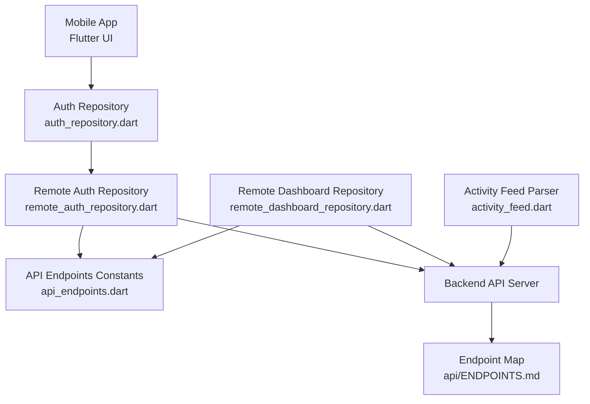
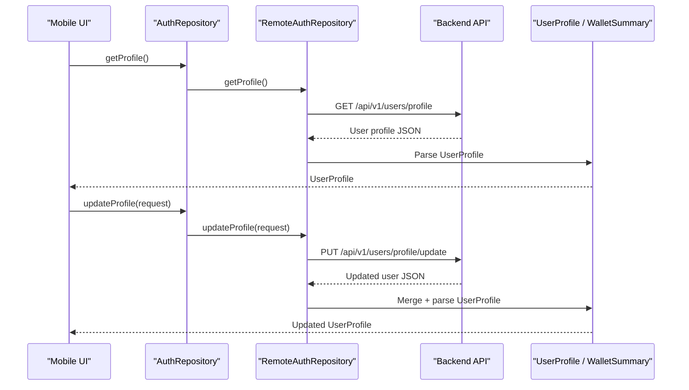
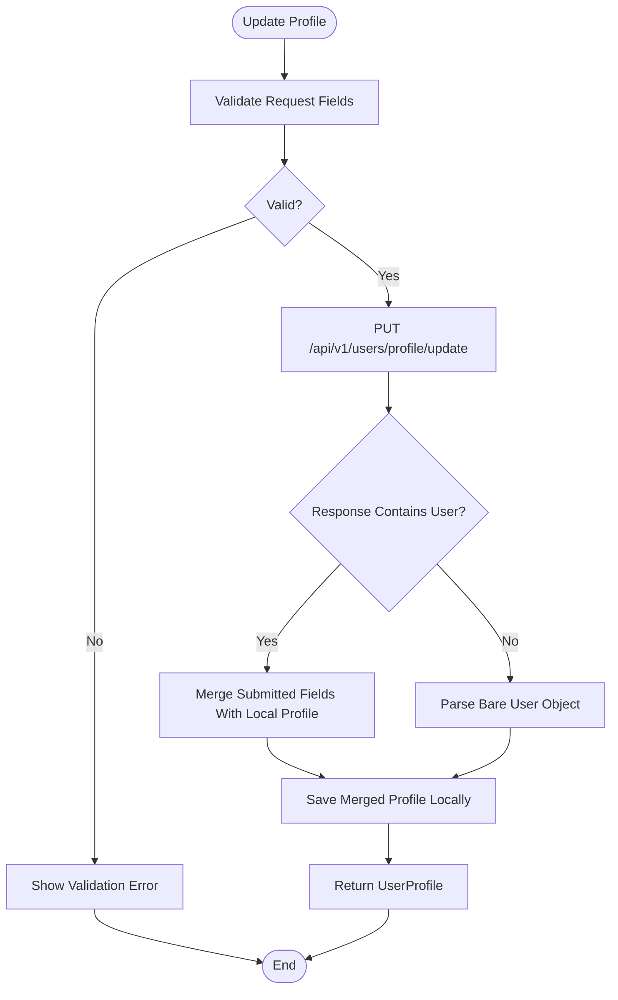
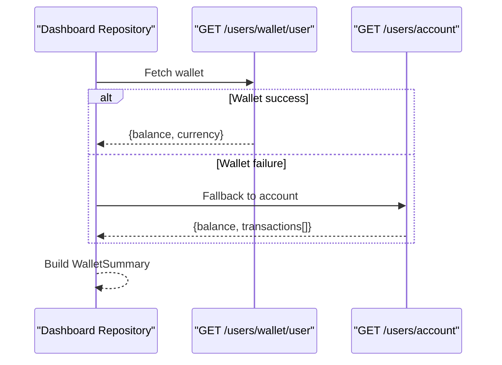
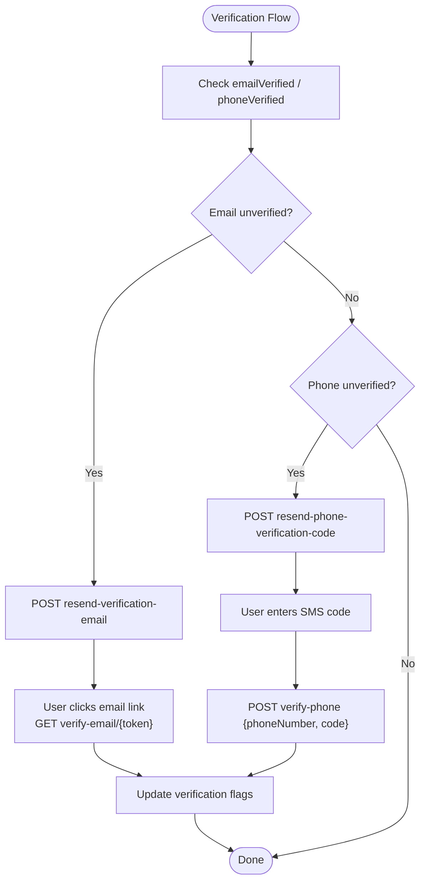
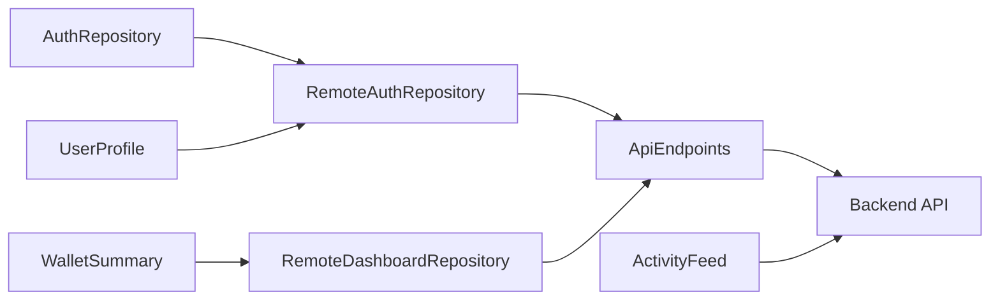

# User Management API

<cite>
**Referenced Files in This Document**
- [ENDPOINTS.md](file://api/ENDPOINTS.md)
- [swagger-api-documentation.md](file://docs/swagger-api-documentation.md)
- [api_endpoints.dart](file://lib/core/network/api_endpoints.dart)
- [auth_repository.dart](file://lib/features/auth/data/auth_repository.dart)
- [remote_auth_repository.dart](file://lib/features/auth/data/remote_auth_repository.dart)
- [auth_models.dart](file://lib/features/auth/data/auth_models.dart)
- [remote_dashboard_repository.dart](file://lib/features/dashboard/data/remote_dashboard_repository.dart)
- [dashboard_models.dart](file://lib/features/dashboard/data/dashboard_models.dart)
- [activity_feed.dart](file://lib/features/dashboard/data/activity_feed.dart)
</cite>

## Table of Contents
1. [Introduction](#introduction)
2. [Project Structure](#project-structure)
3. [Core Components](#core-components)
4. [Architecture Overview](#architecture-overview)
5. [Detailed Component Analysis](#detailed-component-analysis)
6. [Dependency Analysis](#dependency-analysis)
7. [Performance Considerations](#performance-considerations)
8. [Troubleshooting Guide](#troubleshooting-guide)
9. [Conclusion](#conclusion)
10. [Appendices](#appendices)

## Introduction
This document provides detailed API documentation for user management endpoints used by the LidaPay mobile application and its backend. It focuses on:
- User profile operations
- Wallet and account data retrieval
- Points and rewards balances
- Email and phone verification flows
- Password reset and change workflows
- Authorization, validation rules, privacy considerations, and mobile integration examples

The authoritative endpoint map is maintained in `api/ENDPOINTS.md`, while the frontend client defines route constants and behavior in Dart files under `lib/`. The Swagger-style reference in `docs/swagger-api-documentation.md` documents authentication payloads and common response shapes.

## Project Structure
The relevant parts of this repository for user management are:
- Backend endpoint map: `api/ENDPOINTS.md`
- Swagger-style API guide: `docs/swagger-api-documentation.md`
- Frontend route constants: `lib/core/network/api_endpoints.dart`
- Authentication repository interfaces and implementations: `lib/features/auth/data/auth_repository.dart`, `lib/features/auth/data/remote_auth_repository.dart`
- User profile model: `lib/features/auth/data/auth_models.dart`
- Dashboard wallet summary and fallback logic: `lib/features/dashboard/data/remote_dashboard_repository.dart`, `lib/features/dashboard/data/dashboard_models.dart`
- Account activity parsing: `lib/features/dashboard/data/activity_feed.dart`

**Diagram sources**
- [api_endpoints.dart:1-33](file://lib/core/network/api_endpoints.dart#L1-L33)
- [auth_repository.dart:35-78](file://lib/features/auth/data/auth_repository.dart#L35-L78)
- [remote_auth_repository.dart:179-216](file://lib/features/auth/data/remote_auth_repository.dart#L179-L216)
- [remote_dashboard_repository.dart:14-102](file://lib/features/dashboard/data/remote_dashboard_repository.dart#L14-L102)
- [activity_feed.dart:59-96](file://lib/features/dashboard/data/activity_feed.dart#L59-L96)
- [ENDPOINTS.md:13-43](file://api/ENDPOINTS.md#L13-L43)

**Section sources**
- [ENDPOINTS.md:1-43](file://api/ENDPOINTS.md#L1-L43)
- [api_endpoints.dart:1-33](file://lib/core/network/api_endpoints.dart#L1-L33)

## Core Components
This section summarizes the core user management components exposed to the mobile app:
- Profile retrieval and update
- Wallet and account balance retrieval
- Points and rewards balance
- Email and phone verification
- Password reset and change
- Device token registration for push notifications

Key responsibilities:
- `ApiEndpoints`: Centralizes URL paths for all user-related routes.
- `AuthRepository` / `RemoteAuthRepository`: Define and implement profile and verification operations.
- `UserProfile`: Models user identity, address, verification flags, and KYC status.
- `RemoteDashboardRepository`: Aggregates wallet, Lida Value, and points data with resilient fallbacks.
- `ActivityFeed`: Parses account-level transaction entries from the user account endpoint.

**Section sources**
- [api_endpoints.dart:1-33](file://lib/core/network/api_endpoints.dart#L1-L33)
- [auth_repository.dart:35-78](file://lib/features/auth/data/auth_repository.dart#L35-L78)
- [remote_auth_repository.dart:179-216](file://lib/features/auth/data/remote_auth_repository.dart#L179-L216)
- [auth_models.dart:398-424](file://lib/features/auth/data/auth_models.dart#L398-L424)
- [remote_dashboard_repository.dart:14-102](file://lib/features/dashboard/data/remote_dashboard_repository.dart#L14-L102)
- [dashboard_models.dart:1-36](file://lib/features/dashboard/data/dashboard_models.dart#L1-L36)
- [activity_feed.dart:59-96](file://lib/features/dashboard/data/activity_feed.dart#L59-L96)

## Architecture Overview
The user management flow follows a layered architecture:
- Mobile UI calls repository methods.
- Repositories call HTTP endpoints defined in `ApiEndpoints`.
- Backend exposes REST endpoints documented in `ENDPOINTS.md`.
- Responses are parsed into domain models such as `UserProfile` and `WalletSummary`.

**Diagram sources**
- [auth_repository.dart:35-40](file://lib/features/auth/data/auth_repository.dart#L35-L40)
- [remote_auth_repository.dart:179-196](file://lib/features/auth/data/remote_auth_repository.dart#L179-L196)
- [api_endpoints.dart:12-13](file://lib/core/network/api_endpoints.dart#L12-L13)
- [ENDPOINTS.md:16-18](file://api/ENDPOINTS.md#L16-L18)

## Detailed Component Analysis

### User Profile Operations
Endpoints:
- `GET /api/v1/users/profile`
- `PUT /api/v1/users/profile/update`

Authorization:
- Requires a valid Bearer access token.

Request/response schema highlights:
- Profile includes identity fields (id, firstName, lastName, email, phoneNumber, username), optional address fields (street, city, region, digitalAddress, latitude, longitude), avatar/gravatar URLs, verification flags (`emailVerified`, `phoneVerified`, `isVerified`), and KYC status.
- Update request should include only editable fields; the backend returns a refreshed user object that may wrap the user payload under `user` or `data`.

Validation rules:
- Email must be a valid email address.
- Phone number should follow local formatting expectations.
- Address fields are optional but should be validated for length and format when present.
- Avatar/gravatar URLs must be safe HTTPS URLs.

Privacy considerations:
- Do not expose sensitive identifiers unnecessarily.
- Treat KYC status and verification flags as sensitive account state.
- Avoid logging full profile responses in client logs.

Integration example:
- Fetch profile after login or OTP verification.
- On update, merge submitted fields with existing profile locally to ensure consistent UI even if backend omits optional fields.

**Diagram sources**
- [remote_auth_repository.dart:179-206](file://lib/features/auth/data/remote_auth_repository.dart#L179-L206)
- [auth_models.dart:398-518](file://lib/features/auth/data/auth_models.dart#L398-L518)

**Section sources**
- [ENDPOINTS.md:16-18](file://api/ENDPOINTS.md#L16-L18)
- [api_endpoints.dart:12-13](file://lib/core/network/api_endpoints.dart#L12-L13)
- [auth_repository.dart:35-40](file://lib/features/auth/data/auth_repository.dart#L35-L40)
- [remote_auth_repository.dart:179-206](file://lib/features/auth/data/remote_auth_repository.dart#L179-L206)
- [auth_models.dart:398-518](file://lib/features/auth/data/auth_models.dart#L398-L518)

### Wallet Management and Account Data Retrieval
Endpoints:
- `GET /api/v1/users/wallet/user`
- `POST /api/v1/users/wallet`
- `DELETE /api/v1/users/wallet`
- `GET /api/v1/users/wallet/{id}`
- `GET /api/v1/users/account`

Authorization:
- Requires a valid Bearer access token.

Behavior:
- The dashboard fetches the user wallet first. If it fails with a non-auth error, it falls back to the user account endpoint to extract a usable balance.
- The account endpoint also embeds a transaction list used for activity feed rendering.

Schema highlights:
- Wallet response may contain `balance`, `amount`, `value`, or `walletBalance`, plus `currency` or `currencyCode`.
- Account response contains `id`, `userId`, `balance`, and `transactions[]`.

Validation rules:
- Balance values should be numeric and non-negative where applicable.
- Currency codes should conform to ISO standards.

Privacy considerations:
- Wallet and account balances are sensitive financial data.
- Transaction lists may contain personal details; restrict sharing and avoid exposing them in analytics.

Integration example:
- Load wallet summary concurrently with Lida Value and points balances.
- Display degraded wallet card if wallet endpoint fails but account balance is available.

**Diagram sources**
- [remote_dashboard_repository.dart:14-71](file://lib/features/dashboard/data/remote_dashboard_repository.dart#L14-L71)
- [dashboard_models.dart:1-36](file://lib/features/dashboard/data/dashboard_models.dart#L1-L36)
- [activity_feed.dart:59-96](file://lib/features/dashboard/data/activity_feed.dart#L59-L96)
- [ENDPOINTS.md:39-43](file://api/ENDPOINTS.md#L39-L43)

**Section sources**
- [ENDPOINTS.md:39-43](file://api/ENDPOINTS.md#L39-L43)
- [api_endpoints.dart:16-17](file://lib/core/network/api_endpoints.dart#L16-L17)
- [remote_dashboard_repository.dart:14-71](file://lib/features/dashboard/data/remote_dashboard_repository.dart#L14-L71)
- [dashboard_models.dart:1-36](file://lib/features/dashboard/data/dashboard_models.dart#L1-L36)
- [activity_feed.dart:59-96](file://lib/features/dashboard/data/activity_feed.dart#L59-L96)

### User Points and Rewards Balances
Endpoints:
- `GET /api/v1/users/points`
- `GET /api/v1/lidapoints/balance`
- `GET /api/v1/lidapoints/history`

Authorization:
- Requires a valid Bearer access token.

Behavior:
- The dashboard prefers richer points data from `/lidapoints/balance` when available, but treats `/users/points` as a bare number fallback.
- Tests confirm both endpoints can represent the same logical points balance.

Schema highlights:
- `/users/points` may return a bare number.
- `/lidapoints/balance` typically returns an object containing a numeric balance.

Validation rules:
- Points must be non-negative integers.

Privacy considerations:
- Points balances are sensitive reward data; do not log or share beyond necessary scopes.

Integration example:
- Use `/lidapoints/balance` as primary source; fall back to `/users/points` if needed.
- Cache points briefly to reduce network load during dashboard refreshes.

**Section sources**
- [ENDPOINTS.md:16](file://api/ENDPOINTS.md#L16)
- [api_endpoints.dart:52-65](file://lib/core/network/api_endpoints.dart#L52-L65)
- [remote_dashboard_repository.dart:105-110](file://lib/features/dashboard/data/remote_dashboard_repository.dart#L105-L110)
- [remote_parsing_test.dart:601-619](file://test/remote_parsing_test.dart#L601-L619)

### User Verification Processes
Endpoints:
- `POST /api/v1/users/resend-verification-email`
- `GET /api/v1/users/verify-email/{token}`
- `POST /api/v1/users/verify-phone`
- `POST /api/v1/users/resend-phone-verification-code`

Authorization:
- Resending verification emails and phone codes generally requires authentication.
- Verifying via token may use a time-limited link-based token.

Behavior:
- The auth repository exposes methods to resend email and phone verification, and to confirm phone verification with `{phoneNumber, code}`.
- Profile model includes `emailVerified`, `phoneVerified`, and `isVerified` flags.

Validation rules:
- Phone numbers must match expected formats.
- Verification codes are short-lived and single-use.

Privacy considerations:
- Verification tokens must be transmitted over HTTPS and treated as secrets.
- Avoid logging phone numbers or verification codes.

Integration example:
- After login, check verification flags and prompt users to verify email/phone if missing.
- Provide “Resend code” flows with rate limiting.

**Diagram sources**
- [auth_repository.dart:42-52](file://lib/features/auth/data/auth_repository.dart#L42-L52)
- [api_endpoints.dart:14-15](file://lib/core/network/api_endpoints.dart#L14-L15)
- [api_endpoints.dart:31-33](file://lib/core/network/api_endpoints.dart#L31-L33)
- [auth_models.dart:413-416](file://lib/features/auth/data/auth_models.dart#L413-L416)
- [ENDPOINTS.md:33-36](file://api/ENDPOINTS.md#L33-L36)

**Section sources**
- [ENDPOINTS.md:33-36](file://api/ENDPOINTS.md#L33-L36)
- [api_endpoints.dart:14-15](file://lib/core/network/api_endpoints.dart#L14-L15)
- [api_endpoints.dart:31-33](file://lib/core/network/api_endpoints.dart#L31-L33)
- [auth_repository.dart:42-52](file://lib/features/auth/data/auth_repository.dart#L42-L52)
- [auth_models.dart:413-416](file://lib/features/auth/data/auth_models.dart#L413-L416)

### Password Reset and Change Workflows
Endpoints:
- `POST /api/v1/users/reset-password`
- `POST /api/v1/users/confirm-reset-password`
- `PUT /api/v1/users/change-password`
- `POST /api/v1/users/confirm-password-change`

Authorization:
- Password reset initiation may be public or require minimal identification.
- Password change for signed-in users requires a Bearer token.

Behavior:
- Reset password sends a token via email; confirmation sets the new password.
- Change password for authenticated users triggers an email verification step before finalizing.

Validation rules:
- New passwords must meet minimum complexity requirements.
- Tokens are single-use and time-bound.

Privacy considerations:
- Never log tokens or new passwords.
- Enforce HTTPS and secure storage for tokens.

Integration example:
- Prompt user for email or phone to initiate reset.
- After receiving email, navigate to confirmation screen and submit token + new password.

**Section sources**
- [ENDPOINTS.md:25-26](file://api/ENDPOINTS.md#L25-L26)
- [ENDPOINTS.md:37-38](file://api/ENDPOINTS.md#L37-L38)
- [api_endpoints.dart:25-30](file://lib/core/network/api_endpoints.dart#L25-L30)
- [auth_repository.dart:54-75](file://lib/features/auth/data/auth_repository.dart#L54-L75)

### Device Token Registration for Push Notifications
Endpoints:
- `POST /api/v1/notifications/device-token`
- `POST /api/v1/notifications/push-token`
- `POST /api/v1/users/push-token`

Authorization:
- Requires a valid Bearer access token.

Behavior:
- Accepts flexible payload keys for token/platform/device metadata.
- Supports legacy compatibility fields like `deviceToken` and `devicePlatform`.

Validation rules:
- At least one token field and one platform field must be provided.
- Provider defaults to FCM if omitted.

Privacy considerations:
- Device identifiers should be treated as sensitive device metadata.
- Do not log raw FCM tokens.

Integration example:
- After login, register the latest FCM token with platform and app version.
- Deactivate old tokens on logout or device change.

**Section sources**
- [ENDPOINTS.md:77-81](file://api/ENDPOINTS.md#L77-L81)
- [swagger-api-documentation.md:185-245](file://docs/swagger-api-documentation.md#L185-L245)

## Dependency Analysis
The following diagram shows how user management features depend on shared endpoints and models:

**Diagram sources**
- [auth_repository.dart:35-78](file://lib/features/auth/data/auth_repository.dart#L35-L78)
- [remote_auth_repository.dart:179-216](file://lib/features/auth/data/remote_auth_repository.dart#L179-L216)
- [api_endpoints.dart:1-33](file://lib/core/network/api_endpoints.dart#L1-L33)
- [remote_dashboard_repository.dart:14-102](file://lib/features/dashboard/data/remote_dashboard_repository.dart#L14-L102)
- [activity_feed.dart:59-96](file://lib/features/dashboard/data/activity_feed.dart#L59-L96)
- [auth_models.dart:398-424](file://lib/features/auth/data/auth_models.dart#L398-L424)
- [dashboard_models.dart:1-36](file://lib/features/dashboard/data/dashboard_models.dart#L1-L36)

**Section sources**
- [api_endpoints.dart:1-33](file://lib/core/network/api_endpoints.dart#L1-L33)
- [auth_repository.dart:35-78](file://lib/features/auth/data/auth_repository.dart#L35-L78)
- [remote_auth_repository.dart:179-216](file://lib/features/auth/data/remote_auth_repository.dart#L179-L216)
- [remote_dashboard_repository.dart:14-102](file://lib/features/dashboard/data/remote_dashboard_repository.dart#L14-L102)
- [activity_feed.dart:59-96](file://lib/features/dashboard/data/activity_feed.dart#L59-L96)
- [auth_models.dart:398-424](file://lib/features/auth/data/auth_models.dart#L398-L424)
- [dashboard_models.dart:1-36](file://lib/features/dashboard/data/dashboard_models.dart#L1-L36)

## Performance Considerations
- Concurrent fetching: The dashboard fetches wallet, Lida Value, and points concurrently to minimize latency.
- Fallback resilience: If wallet endpoint fails, the dashboard falls back to account balance to keep the UI responsive.
- Caching: Points and balances can be cached briefly to reduce repeated network calls during rapid UI updates.
- Payload normalization: The client tolerates multiple field names and envelope shapes to handle backend evolution gracefully.

[No sources needed since this section provides general guidance]

## Troubleshooting Guide
Common issues and resolutions:
- 401 Unauthorized: Ensure the access token is present and valid; refresh tokens using `/api/v1/auth/refresh`.
- Wallet 500: The dashboard automatically falls back to `/api/v1/users/account`; verify account endpoint availability.
- Profile update response shape: Some builds wrap the user object under `user` or `data`; the client unwraps both.
- Verification failures: Check rate limits for resending codes and ensure tokens are used within their validity window.
- Device token registration: Confirm at least one token and one platform field are provided; use legacy fields for compatibility.

**Section sources**
- [swagger-api-documentation.md:103-129](file://docs/swagger-api-documentation.md#L103-L129)
- [remote_dashboard_repository.dart:46-71](file://lib/features/dashboard/data/remote_dashboard_repository.dart#L46-L71)
- [remote_auth_repository.dart:198-206](file://lib/features/auth/data/remote_auth_repository.dart#L198-L206)
- [swagger-api-documentation.md:185-245](file://docs/swagger-api-documentation.md#L185-L245)

## Conclusion
The user management API provides a comprehensive set of endpoints for profile operations, wallet and account data retrieval, points and rewards balances, verification workflows, and password management. The mobile client uses resilient patterns—concurrent requests, fallbacks, and flexible payload parsing—to deliver a smooth user experience even when backend responses vary. Integration guidelines emphasize secure authorization, strict validation, and careful handling of sensitive data.

[No sources needed since this section summarizes without analyzing specific files]

## Appendices

### API Reference Summary

#### Profile
- `GET /api/v1/users/profile`
  - Auth: Bearer token
  - Response: UserProfile object
- `PUT /api/v1/users/profile/update`
  - Auth: Bearer token
  - Request: Editable profile fields
  - Response: Updated user object (may be wrapped)

#### Wallet and Account
- `GET /api/v1/users/wallet/user`
  - Auth: Bearer token
  - Response: Wallet balance and currency
- `POST /api/v1/users/wallet`
  - Auth: Bearer token
  - Request: Wallet creation/update payload
- `DELETE /api/v1/users/wallet`
  - Auth: Bearer token
- `GET /api/v1/users/wallet/{id}`
  - Auth: Bearer token
- `GET /api/v1/users/account`
  - Auth: Bearer token
  - Response: Account with balance and transactions

#### Points and Rewards
- `GET /api/v1/users/points`
  - Auth: Bearer token
  - Response: Numeric points
- `GET /api/v1/lidapoints/balance`
  - Auth: Bearer token
  - Response: Points balance object
- `GET /api/v1/lidapoints/history`
  - Auth: Bearer token
  - Response: Points history

#### Verification
- `POST /api/v1/users/resend-verification-email`
  - Auth: Bearer token
- `GET /api/v1/users/verify-email/{token}`
  - Public or token-scoped
- `POST /api/v1/users/verify-phone`
  - Auth: Bearer token
  - Request: `{phoneNumber, code}`
- `POST /api/v1/users/resend-phone-verification-code`
  - Auth: Bearer token

#### Password Management
- `POST /api/v1/users/reset-password`
  - Request: Identifier (email or phone)
- `POST /api/v1/users/confirm-reset-password`
  - Request: `{token, newPassword}`
- `PUT /api/v1/users/change-password`
  - Auth: Bearer token
  - Request: `{currentPassword, newPassword}`
- `POST /api/v1/users/confirm-password-change`
  - Request: `{token}`

#### Device Tokens
- `POST /api/v1/notifications/device-token`
  - Auth: Bearer token
  - Request: Flexible token/platform/device metadata
- `POST /api/v1/notifications/push-token`
  - Alias for device-token
- `POST /api/v1/users/push-token`
  - Legacy alias

**Section sources**
- [ENDPOINTS.md:13-43](file://api/ENDPOINTS.md#L13-L43)
- [ENDPOINTS.md:77-81](file://api/ENDPOINTS.md#L77-L81)
- [swagger-api-documentation.md:51-129](file://docs/swagger-api-documentation.md#L51-L129)
- [swagger-api-documentation.md:185-245](file://docs/swagger-api-documentation.md#L185-L245)