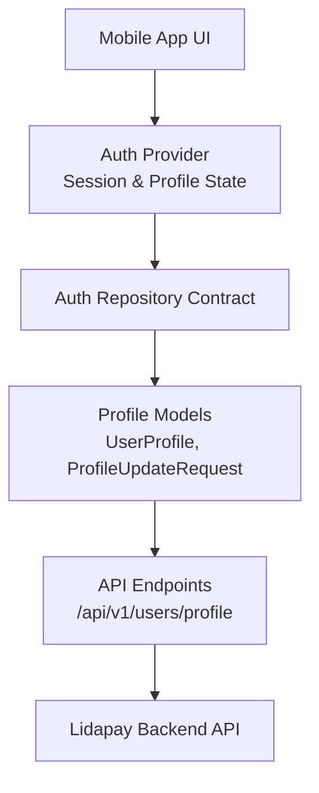
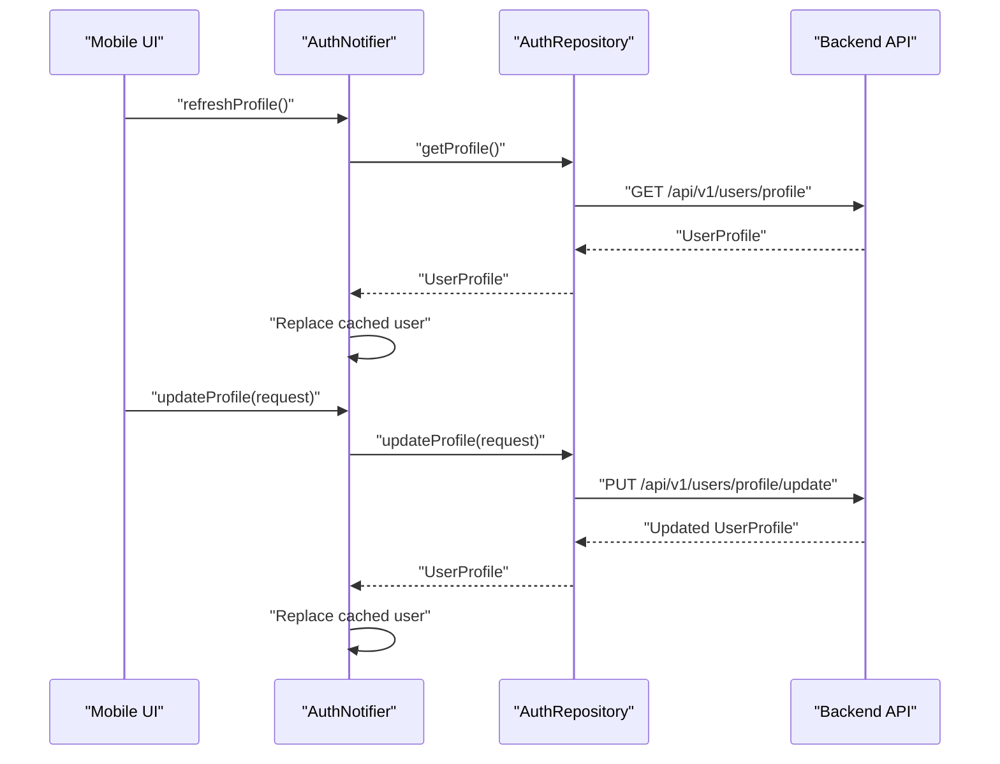
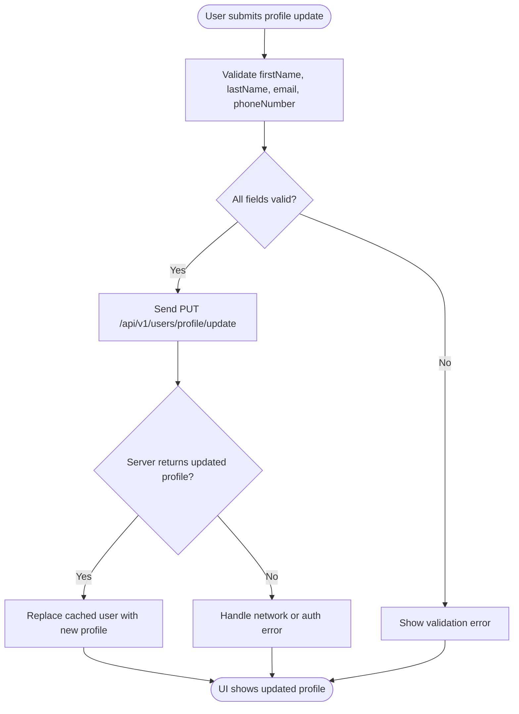
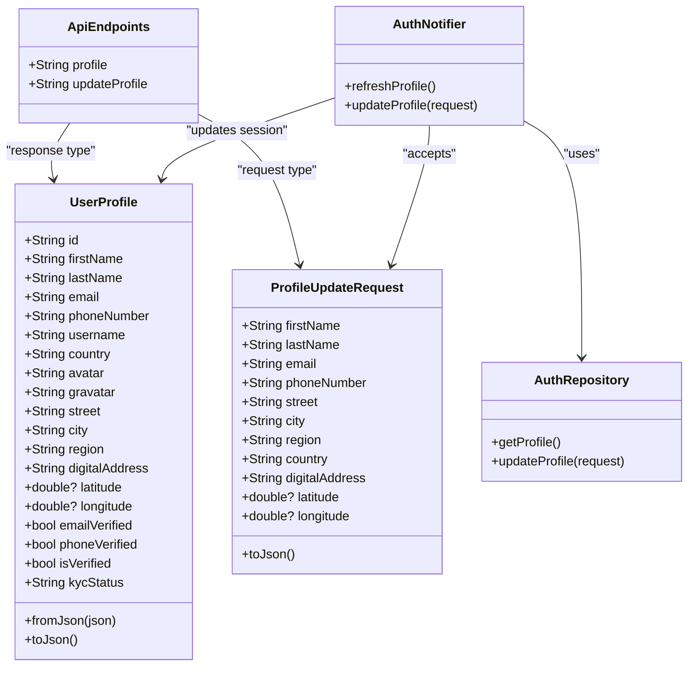

# User Profile API

<cite>
**Referenced Files in This Document**
- [ENDPOINTS.md](file://api/ENDPOINTS.md)
- [auth_models.dart](file://lib/features/auth/data/auth_models.dart)
- [auth_repository.dart](file://lib/features/auth/data/auth_repository.dart)
- [providers.dart](file://lib/features/auth/providers.dart)
- [api_endpoints.dart](file://lib/core/network/api_endpoints.dart)
- [validators.dart](file://lib/core/utils/validators.dart)
- [api_models_test.dart](file://test/api_models_test.dart)
</cite>

## Table of Contents
1. [Introduction](#introduction)
2. [Project Structure](#project-structure)
3. [Core Components](#core-components)
4. [Architecture Overview](#architecture-overview)
5. [Detailed Component Analysis](#detailed-component-analysis)
6. [Dependency Analysis](#dependency-analysis)
7. [Performance Considerations](#performance-considerations)
8. [Troubleshooting Guide](#troubleshooting-guide)
9. [Conclusion](#conclusion)

## Introduction
This document provides detailed API documentation for the user profile endpoints used by the mobile application:

- `GET /api/v1/users/profile` — Retrieve the authenticated user’s current profile.
- `PUT /api/v1/users/profile/update` — Update editable profile fields such as name, email, phone number, and address.

The base URL is defined in the repository’s endpoint map, and the Flutter client defines these routes centrally. The mobile app models describe the response shape and the update request body, while validators define field validation rules applied before sending requests to the backend.

## Project Structure
The relevant code for this API lives primarily in the Flutter feature layer:

- Endpoint paths are declared in a central constants file.
- The endpoint map documents the live backend routes.
- Data models define the profile object and the update request payload.
- The authentication provider orchestrates session state, token handling, and profile refresh behavior.
- Validators enforce input rules for email and phone numbers.

**Diagram sources**
- [api_endpoints.dart:12-13](file://lib/core/network/api_endpoints.dart#L12-L13)
- [providers.dart:204-278](file://lib/features/auth/providers.dart#L204-L278)
- [auth_models.dart:375-672](file://lib/features/auth/data/auth_models.dart#L375-L672)

**Section sources**
- [ENDPOINTS.md:3-4](file://api/ENDPOINTS.md#L3-L4)
- [api_endpoints.dart:1-13](file://lib/core/network/api_endpoints.dart#L1-L13)

## Core Components
The user profile functionality is implemented through several coordinated components:

| Component | Responsibility | Key Behavior |
|---|---|---|
| `ApiEndpoints` | Centralized route constants | Defines `/api/v1/users/profile` and `/api/v1/users/profile/update`. |
| `UserProfile` | Response model for profile data | Parses flexible backend payloads, computes derived display values, and serializes to JSON. |
| `ProfileUpdateRequest` | Request model for profile updates | Sends only user-editable fields; omits empty optional address fields. |
| `AuthRepository` | API contract | Declares `getProfile()` and `updateProfile()`. |
| `AuthNotifier` | Session and profile orchestration | Refreshes profile after login/OTP verification, retries transient failures, and replaces cached profile on successful update. |
| `Validators` | Input validation | Validates email format and Ghana/international phone formats. |

**Section sources**
- [api_endpoints.dart:12-13](file://lib/core/network/api_endpoints.dart#L12-L13)
- [auth_models.dart:375-672](file://lib/features/auth/data/auth_models.dart#L375-L672)
- [auth_repository.dart:35-40](file://lib/features/auth/data/auth_repository.dart#L35-L40)
- [providers.dart:204-278](file://lib/features/auth/providers.dart#L204-L278)
- [validators.dart:1-31](file://lib/core/utils/validators.dart#L1-L31)

## Architecture Overview
The profile endpoints follow a standard authenticated REST pattern:

- The mobile app attaches an access token to requests.
- `GET /api/v1/users/profile` returns the latest profile, including verification and KYC status.
- `PUT /api/v1/users/profile/update` accepts editable fields and returns the refreshed profile.
- The provider keeps the local session synchronized with the server profile.

**Diagram sources**
- [providers.dart:204-278](file://lib/features/auth/providers.dart#L204-L278)
- [auth_repository.dart:35-40](file://lib/features/auth/data/auth_repository.dart#L35-L40)

## Detailed Component Analysis

### GET /api/v1/users/profile
- **HTTP Method:** `GET`
- **URL Pattern:** `/api/v1/users/profile`
- **Authentication:** Required (access token attached by the client).
- **Purpose:** Retrieve the authenticated user’s current profile.
- **Response Model:** `UserProfile`

#### Response Fields
| Field | Type | Description |
|---|---|---|
| `id` | String | Internal user identifier. |
| `firstName` | String | User’s first name. |
| `lastName` | String | User’s last name. |
| `email` | String | Account email address. |
| `phoneNumber` | String | Primary phone number. |
| `username` | String | Username; may be used as fallback contact phone. |
| `country` | String | Country value. |
| `avatar` | String | Explicit avatar or image URL. |
| `gravatar` | String | Gravatar reference. |
| `street` | String | Street address line. |
| `city` | String | City. |
| `region` | String | Region or state. |
| `digitalAddress` | String | Digital address code. |
| `latitude` | Number? | Optional geographic latitude. |
| `longitude` | Number? | Optional geographic longitude. |
| `emailVerified` | Boolean | Whether the email has been verified. |
| `phoneVerified` | Boolean | Whether the phone number has been verified. |
| `isVerified` | Boolean | Overall account verification status. |
| `kycStatus` | String | KYC status value. |

#### Derived Display Values
- `fullName`: Concatenated first and last name.
- `contactPhone`: Preferred phone for prefilling forms.
- `avatarUrl`: Resolved avatar URL or computed Gravatar link.
- `hasDeliveryAddress`: True when street and city are present.
- `formattedDeliveryAddress`: Comma-separated address string.

#### Example Response Shape
A typical response contains the profile object with identification, contact, address, verification flags, and KYC metadata. The mobile parser handles multiple possible backend key names and normalizes missing or legacy values.

**Section sources**
- [ENDPOINTS.md:17-18](file://api/ENDPOINTS.md#L17-L18)
- [api_endpoints.dart:12-13](file://lib/core/network/api_endpoints.dart#L12-L13)
- [auth_models.dart:375-526](file://lib/features/auth/data/auth_models.dart#L375-L526)
- [providers.dart:204-239](file://lib/features/auth/providers.dart#L204-L239)

### PUT /api/v1/users/profile/update
- **HTTP Method:** `PUT`
- **URL Pattern:** `/api/v1/users/profile/update`
- **Authentication:** Required (access token attached by the client).
- **Purpose:** Update editable profile fields.
- **Request Body:** `ProfileUpdateRequest`
- **Response:** Updated `UserProfile`

#### Request Fields
| Field | Type | Required | Description |
|---|---|---:|---|
| `firstName` | String | Yes | User’s first name. |
| `lastName` | String | Yes | User’s last name. |
| `email` | String | Yes | Account email address. |
| `phoneNumber` | String | Yes | Primary phone number. |
| `street` | String | No | Street address line. |
| `city` | String | No | City. |
| `region` | String | No | Region or state. |
| `country` | String | No | Country value. |
| `digitalAddress` | String | No | Digital address code. |
| `latitude` | Number? | No | Optional geographic latitude. |
| `longitude` | Number? | No | Optional geographic longitude. |

#### Validation Rules
- Email must be non-empty and match the client-side email format validator.
- Phone number must be non-empty and match the Ghana-format validator (`0xxxxxxxx`, ten digits starting with zero).
- International phone validation exists for other flows and accepts six to fifteen digits with an optional country dial code.
- Optional address fields are trimmed and omitted from the request when empty.

#### Example Update Scenarios
- Update name: Provide updated `firstName` and `lastName`.
- Update email: Provide a validated email address.
- Update phone number: Provide a valid Ghana-format phone number.
- Update address: Provide one or more of `street`, `city`, `region`, `country`, or `digitalAddress`.
- Update location: Provide `latitude` and/or `longitude` when available.

#### Example Request Shape
The request includes the four required fields plus any non-empty optional address fields. Empty strings for optional fields are not sent.

**Section sources**
- [ENDPOINTS.md:18](file://api/ENDPOINTS.md#L18)
- [api_endpoints.dart:13](file://lib/core/network/api_endpoints.dart#L13)
- [auth_models.dart:614-672](file://lib/features/auth/data/auth_models.dart#L614-L672)
- [validators.dart:4-31](file://lib/core/utils/validators.dart#L4-L31)
- [api_models_test.dart:140-155](file://test/api_models_test.dart#L140-L155)

### Profile Update Flow
The provider ensures that profile updates preserve the existing session tokens and replace the cached user with the server-returned profile.

**Diagram sources**
- [providers.dart:267-278](file://lib/features/auth/providers.dart#L267-L278)
- [validators.dart:4-31](file://lib/core/utils/validators.dart#L4-L31)

**Section sources**
- [providers.dart:267-278](file://lib/features/auth/providers.dart#L267-L278)
- [auth_models.dart:614-672](file://lib/features/auth/data/auth_models.dart#L614-L672)

## Dependency Analysis
The following diagram shows how the profile-related components depend on each other:

**Diagram sources**
- [api_endpoints.dart:12-13](file://lib/core/network/api_endpoints.dart#L12-L13)
- [auth_models.dart:375-672](file://lib/features/auth/data/auth_models.dart#L375-L672)
- [auth_repository.dart:35-40](file://lib/features/auth/data/auth_repository.dart#L35-L40)
- [providers.dart:204-278](file://lib/features/auth/providers.dart#L204-L278)

**Section sources**
- [api_endpoints.dart:12-13](file://lib/core/network/api_endpoints.dart#L12-L13)
- [auth_models.dart:375-672](file://lib/features/auth/data/auth_models.dart#L375-L672)
- [auth_repository.dart:35-40](file://lib/features/auth/data/auth_repository.dart#L35-L40)
- [providers.dart:204-278](file://lib/features/auth/providers.dart#L204-L278)

## Performance Considerations
- Profile refresh is best-effort: transient backend errors trigger one delayed retry, but failed authentication clears the session.
- Cached profile remains available even when refresh fails, preventing UI crashes during temporary outages.
- Only user-editable fields are sent in update requests, reducing payload size and avoiding unnecessary server-side changes.
- Address fields are trimmed and omitted when empty, minimizing request size.

[No sources needed since this section provides general guidance]

## Troubleshooting Guide

### Common Errors and Handling
- **Unauthenticated Requests:** A `401` response clears the stored session and resets the UI to the login flow.
- **Transient Server Errors:** Non-authentication errors may trigger a single retry after a short delay.
- **Validation Failures:** Invalid email or phone inputs should be rejected before sending the request.
- **Empty Optional Fields:** Empty address fields are not included in update requests; ensure required fields are always provided.

### Recommended Mobile Integration Steps
1. After login or OTP verification, call `refreshProfile()` to load the latest profile.
2. Before updating the profile, validate `firstName`, `lastName`, `email`, and `phoneNumber`.
3. Attach the access token to both profile retrieval and update requests.
4. On successful update, replace the cached user with the returned profile.
5. If the session expires during profile operations, redirect the user to sign in again.

**Section sources**
- [providers.dart:204-239](file://lib/features/auth/providers.dart#L204-L239)
- [providers.dart:267-278](file://lib/features/auth/providers.dart#L267-L278)
- [validators.dart:4-31](file://lib/core/utils/validators.dart#L4-L31)

## Conclusion
The user profile API provides a straightforward way for the mobile application to retrieve and update core user information. The Flutter client enforces strong input validation, sends only editable fields, and maintains a consistent local profile state. For reliable integration, applications should validate inputs locally, handle authentication failures gracefully, and rely on the provider’s retry and caching behavior for resilience.

[No sources needed since this section summarizes without analyzing specific files]