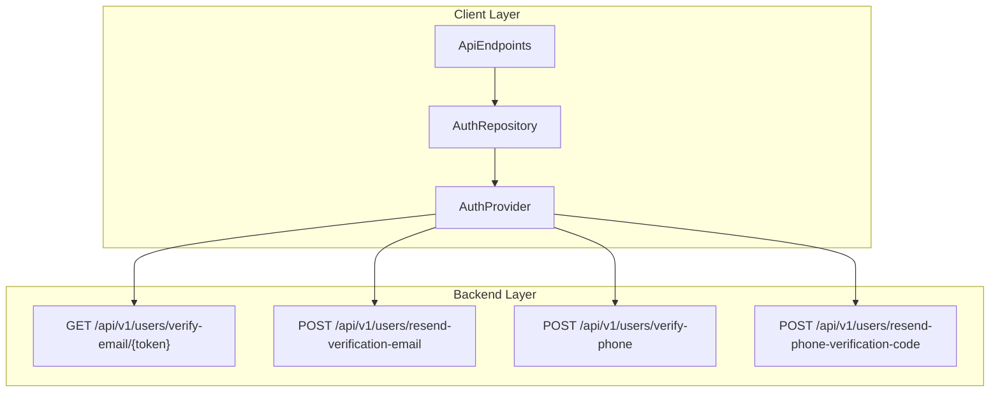
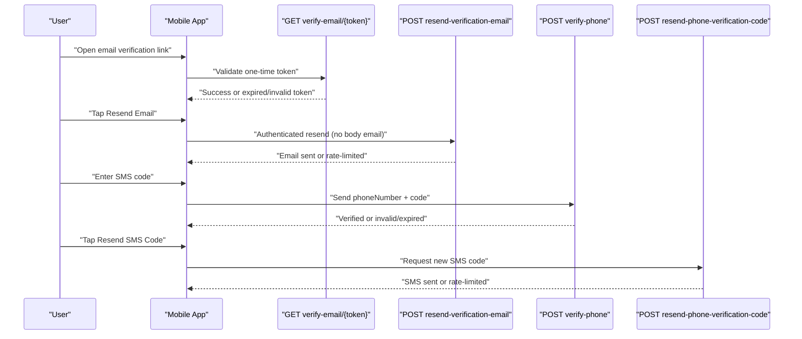
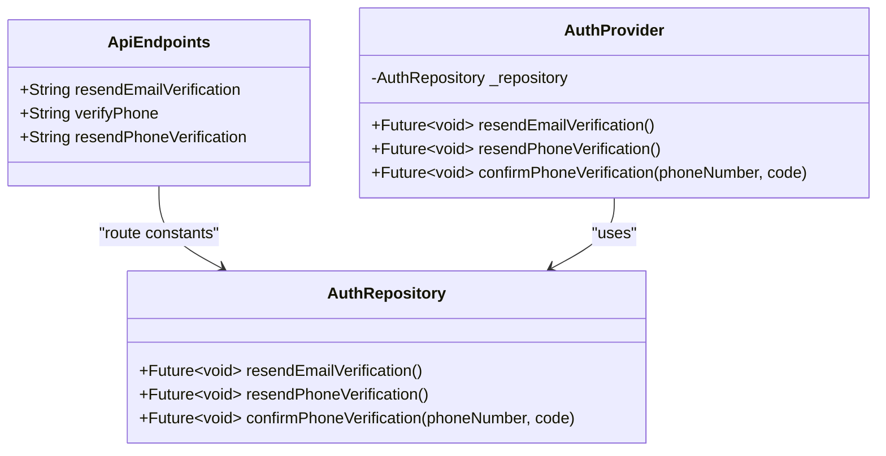

# Verification API

<cite>
**Referenced Files in This Document**
- [ENDPOINTS.md](file://api/ENDPOINTS.md)
- [MOBILE_APP_REBUILD_HANDOFF.md](file://docs/MOBILE_APP_REBUILD_HANDOFF.md)
- [api_endpoints.dart](file://lib/core/network/api_endpoints.dart)
- [auth_repository.dart](file://lib/features/auth/data/auth_repository.dart)
- [providers.dart](file://lib/features/auth/providers.dart)
</cite>

## Table of Contents
1. [Introduction](#introduction)
2. [Project Structure](#project-structure)
3. [Core Components](#core-components)
4. [Architecture Overview](#architecture-overview)
5. [Detailed Component Analysis](#detailed-component-analysis)
6. [Dependency Analysis](#dependency-analysis)
7. [Performance Considerations](#performance-considerations)
8. [Troubleshooting Guide](#troubleshooting-guide)
9. [Conclusion](#conclusion)

## Introduction
This document describes the user verification endpoints used by LidaPay: email verification, email verification resend, phone number verification, and phone verification code resend. It covers HTTP methods, URL patterns, request and response expectations, token handling, expiration policies, security considerations, and mobile app integration examples.

The backend base URL is `https://api.advansistechnologies.com`. The interactive OpenAPI contract is available at `https://api.advansistechnologies.com/api-doc`.

## Project Structure
The verification endpoints are part of the public `/api/v1/users` namespace. Their presence is documented in the endpoint map and referenced by the Flutter client through centralized route constants and authentication repository methods.



**Diagram sources**
- [ENDPOINTS.md:33-36](file://api/ENDPOINTS.md#L33-L36)
- [api_endpoints.dart:14-33](file://lib/core/network/api_endpoints.dart#L14-L33)
- [auth_repository.dart:42-52](file://lib/features/auth/data/auth_repository.dart#L42-L52)
- [providers.dart:280-310](file://lib/features/auth/providers.dart#L280-L310)

**Section sources**
- [ENDPOINTS.md:1-36](file://api/ENDPOINTS.md#L1-L36)
- [api_endpoints.dart:1-33](file://lib/core/network/api_endpoints.dart#L1-L33)

## Core Components
The verification workflow spans three client-side components:

| Component | Responsibility | Relevant Contract References |
|---|---|---|
| `ApiEndpoints` | Centralizes route paths for verification calls. | `resendEmailVerification`, `verifyPhone`, `resendPhoneVerification` |
| `AuthRepository` | Declares the verification method contracts used by providers. | `resendEmailVerification`, `resendPhoneVerification`, `confirmPhoneVerification` |
| `AuthProvider` | Implements UX-level behavior such as cooldowns, error propagation, and profile refresh after phone verification. | Email resend cooldown, phone verification confirmation flow |

Key responsibilities:
- **Email verification link**: Public GET endpoint that validates a one-time token.
- **Email verification resend**: Authenticated POST endpoint that resends an email to the signed-in account.
- **Phone verification**: Authenticated POST endpoint that accepts a phone number and SMS code.
- **Phone verification code resend**: Authenticated POST endpoint that requests a new SMS code.

**Section sources**
- [api_endpoints.dart:14-33](file://lib/core/network/api_endpoints.dart#L14-L33)
- [auth_repository.dart:42-52](file://lib/features/auth/data/auth_repository.dart#L42-L52)
- [providers.dart:280-310](file://lib/features/auth/providers.dart#L280-L310)

## Architecture Overview
The verification system separates public token validation from authenticated resend and SMS-based phone verification.



**Diagram sources**
- [ENDPOINTS.md:33-36](file://api/ENDPOINTS.md#L33-L36)
- [MOBILE_APP_REBUILD_HANDOFF.md:237-252](file://docs/MOBILE_APP_REBUILD_HANDOFF.md#L237-L252)
- [providers.dart:280-310](file://lib/features/auth/providers.dart#L280-L310)

## Detailed Component Analysis

### GET /api/v1/users/verify-email/{token}
This endpoint verifies a user’s email address using a one-time token embedded in an emailed link.

| Property | Value |
|---|---|
| Method | `GET` |
| URL pattern | `/api/v1/users/verify-email/{token}` |
| Authentication | Not required when opening the link |
| Path parameter | `token`: one-time verification token |
| Purpose | Mark the associated email address as verified |
| Token policy | Single-use; expires after 24 hours |
| Typical success response | Indicates successful email verification |
| Typical failure responses | Expired token, invalid token, already verified, or server error |

#### Request Example
```http
GET https://api.advansistechnologies.com/api/v1/users/verify-email/<one-time-token>
```

#### Response Behavior
- Success: The user’s email becomes verified.
- Failure: The client should inform the user that the link is expired or invalid and offer to resend the verification email.

#### Mobile Integration Notes
- The link can be opened directly from email without an access token.
- After successful verification, the app should refresh the user profile so UI flags such as `emailVerified` update correctly.
- If the link is expired, guide the user to authenticate and use the resend endpoint.

**Section sources**
- [ENDPOINTS.md:33](file://api/ENDPOINTS.md#L33)
- [MOBILE_APP_REBUILD_HANDOFF.md:237-252](file://docs/MOBILE_APP_REBUILD_HANDOFF.md#L237-L252)

### POST /api/v1/users/resend-verification-email
This endpoint sends a new email verification message to the signed-in user’s registered email address.

| Property | Value |
|---|---|
| Method | `POST` |
| URL pattern | `/api/v1/users/resend-verification-email` |
| Authentication | Required (`Authorization: Bearer <access_token>`) |
| Request body | Empty; the backend uses the authenticated account’s email |
| Purpose | Resend the email verification link |
| Rate limiting | Client enforces a cooldown; backend also enforces its own limit |
| Typical success response | Indicates the verification email was sent |
| Typical failure responses | Unauthenticated, rate-limited, or server error |

#### Request Example
```http
POST https://api.advansistechnologies.com/api/v1/users/resend-verification-email
Authorization: Bearer <access_token>
Content-Type: application/json
```

#### Client-Side Cooldown
The provider layer blocks repeated taps for approximately 60 seconds before calling the backend. This prevents unnecessary network traffic while the backend applies its own global rate limit.

#### Mobile Integration Notes
- Do not send the email address in the request body.
- Show a countdown or disabled state during the cooldown window.
- On success, prompt the user to check their inbox and open the new link.
- On failure, surface a clear retry path or support message.

**Section sources**
- [ENDPOINTS.md:34](file://api/ENDPOINTS.md#L34)
- [api_endpoints.dart:14-15](file://lib/core/network/api_endpoints.dart#L14-L15)
- [auth_repository.dart:42](file://lib/features/auth/data/auth_repository.dart#L42)
- [providers.dart:81-94](file://lib/features/auth/providers.dart#L81-L94)
- [providers.dart:280-294](file://lib/features/auth/providers.dart#L280-L294)
- [MOBILE_APP_REBUILD_HANDOFF.md:245-252](file://docs/MOBILE_APP_REBUILD_HANDOFF.md#L245-L252)

### POST /api/v1/users/verify-phone
This endpoint confirms a phone number using an SMS verification code.

| Property | Value |
|---|---|
| Method | `POST` |
| URL pattern | `/api/v1/users/verify-phone` |
| Authentication | Required (`Authorization: Bearer <access_token>`) |
| Request body | `phoneNumber`, `code` |
| Purpose | Verify the user’s phone number |
| Typical success response | Phone verification succeeds; app should refresh profile |
| Typical failure responses | Invalid code, expired code, unauthenticated, or server error |

#### Request Schema
```json
{
  "phoneNumber": "<account phone number>",
  "code": "<SMS verification code>"
}
```

#### Response Behavior
- Success: The phone number is marked verified.
- Failure: The client should indicate whether the code is invalid or expired and allow the user to request a new code.

#### Mobile Integration Notes
- After success, refresh the user profile so fields such as `phoneVerified` reflect the updated state.
- Treat pending or ambiguous responses as non-terminal; do not assume delivery until the backend confirms.
- Never treat an initial provider response alone as final settlement.

**Section sources**
- [ENDPOINTS.md:35](file://api/ENDPOINTS.md#L35)
- [api_endpoints.dart:31](file://lib/core/network/api_endpoints.dart#L31)
- [auth_repository.dart:46-52](file://lib/features/auth/data/auth_repository.dart#L46-L52)
- [providers.dart:299-310](file://lib/features/auth/providers.dart#L299-L310)

### POST /api/v1/users/resend-phone-verification-code
This endpoint requests a new SMS verification code for phone verification.

| Property | Value |
|---|---|
| Method | `POST` |
| URL pattern | `/api/v1/users/resend-phone-verification-code` |
| Authentication | Required (`Authorization: Bearer <access_token>`) |
| Request body | Backend-specific identity for the phone verification session |
| Purpose | Send a new SMS code to the user |
| Rate limiting | Backend enforces limits; client should avoid rapid retries |
| Typical success response | Indicates the SMS code was sent |
| Typical failure responses | Unauthenticated, rate-limited, or server error |

#### Request Example
```http
POST https://api.advansistechnologies.com/api/v1/users/resend-phone-verification-code
Authorization: Bearer <access_token>
Content-Type: application/json
```

#### Mobile Integration Notes
- Call this endpoint before asking the user to enter the code if no code has been received.
- Avoid automatic rapid retries; rely on backend rate limiting and provide a manual resend control.
- After receiving a new code, reset any local timers and allow the user to submit verification again.

**Section sources**
- [ENDPOINTS.md:36](file://api/ENDPOINTS.md#L36)
- [api_endpoints.dart:32-33](file://lib/core/network/api_endpoints.dart#L32-L33)
- [auth_repository.dart:44](file://lib/features/auth/data/auth_repository.dart#L44)
- [providers.dart:296-297](file://lib/features/auth/providers.dart#L296-L297)

## Dependency Analysis
The verification endpoints are consumed by the Flutter client through a layered structure.



**Diagram sources**
- [api_endpoints.dart:14-33](file://lib/core/network/api_endpoints.dart#L14-L33)
- [auth_repository.dart:42-52](file://lib/features/auth/data/auth_repository.dart#L42-L52)
- [providers.dart:280-310](file://lib/features/auth/providers.dart#L280-L310)

**Section sources**
- [api_endpoints.dart:14-33](file://lib/core/network/api_endpoints.dart#L14-L33)
- [auth_repository.dart:42-52](file://lib/features/auth/data/auth_repository.dart#L42-L52)
- [providers.dart:280-310](file://lib/features/auth/providers.dart#L280-L310)

## Performance Considerations
- **Email verification resend cooldown**: The client blocks repeated taps for about 60 seconds to reduce unnecessary backend load.
- **Backend rate limiting**: Both email and phone verification resends are rate-limited on the server; clients should not implement aggressive retry loops.
- **Profile refresh after phone verification**: The provider refreshes the profile after successful phone verification so UI state remains consistent.
- **Idempotent operations**: Verification attempts should be treated carefully; do not repeatedly submit the same code or token beyond normal retry semantics.

[No sources needed since this section provides general guidance]

## Troubleshooting Guide

### Email Verification Link Issues
- **Expired link**: The email verification token expires after 24 hours. Ask the user to authenticate and resend the email.
- **Invalid link**: The token may have already been used or corrupted. Resend a fresh link.
- **Already verified**: The email may have been verified previously; refresh the profile to update UI state.

**Section sources**
- [MOBILE_APP_REBUILD_HANDOFF.md:237-252](file://docs/MOBILE_APP_REBUILD_HANDOFF.md#L237-L252)

### Email Resend Failures
- **Rate-limited**: The client enforces a cooldown; wait before trying again.
- **Unauthenticated**: Ensure the access token is attached and valid.
- **Server error**: Retry once with backoff; otherwise show a support path.

**Section sources**
- [providers.dart:81-94](file://lib/features/auth/providers.dart#L81-L94)
- [providers.dart:280-294](file://lib/features/auth/providers.dart#L280-L294)

### Phone Verification Failures
- **Invalid code**: Ask the user to request a new SMS code.
- **Expired code**: Request a new code and reset local timers.
- **Pending or ambiguous result**: Poll the relevant status endpoint or refresh the profile rather than assuming success or failure.

**Section sources**
- [auth_repository.dart:46-52](file://lib/features/auth/data/auth_repository.dart#L46-L52)
- [providers.dart:299-310](file://lib/features/auth/providers.dart#L299-L310)

### Security Measures
- **Bearer authentication**: Resend and phone verification endpoints require a valid access token.
- **One-time tokens**: Email verification links are single-use and time-bound.
- **No sensitive data in logs**: Tokens, codes, phone numbers, and full URIs should be redacted.
- **Trust boundaries**: Deep links and redirects are hints; always verify final state through authenticated API calls.

**Section sources**
- [MOBILE_APP_REBUILD_HANDOFF.md:63-77](file://docs/MOBILE_APP_REBUILD_HANDOFF.md#L63-L77)
- [MOBILE_APP_REBUILD_HANDOFF.md:237-252](file://docs/MOBILE_APP_REBUILD_HANDOFF.md#L237-L252)

## Conclusion
The verification API provides a secure, separated flow for confirming email addresses and phone numbers. Email verification relies on a public one-time token link, while resend and phone verification require authentication. Clients should enforce cooldowns, handle token expiration clearly, refresh profiles after successful verification, and never trust unverified redirects or provider hints as final outcomes.

[No sources needed since this section summarizes without analyzing specific files]