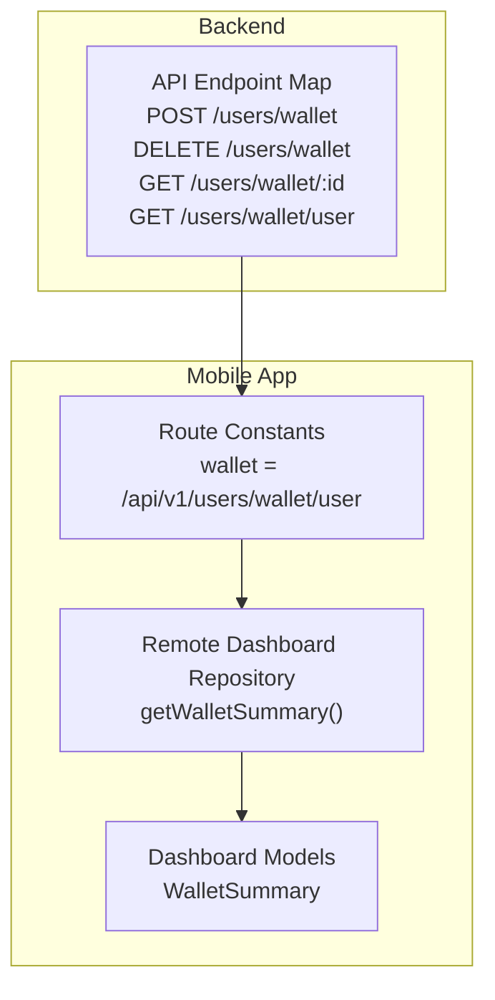
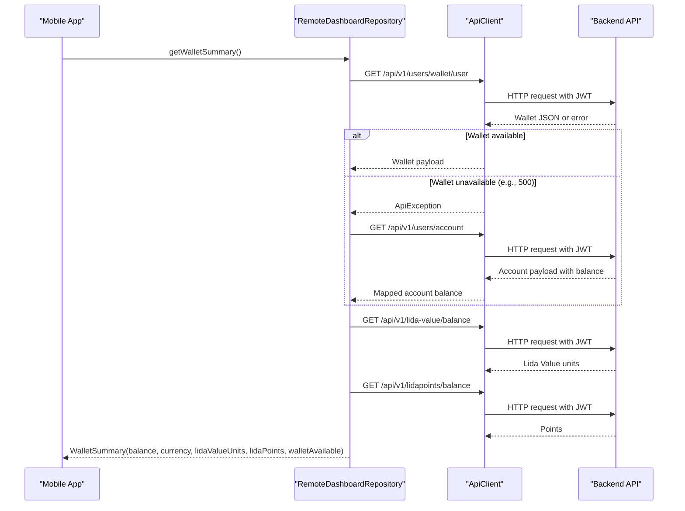
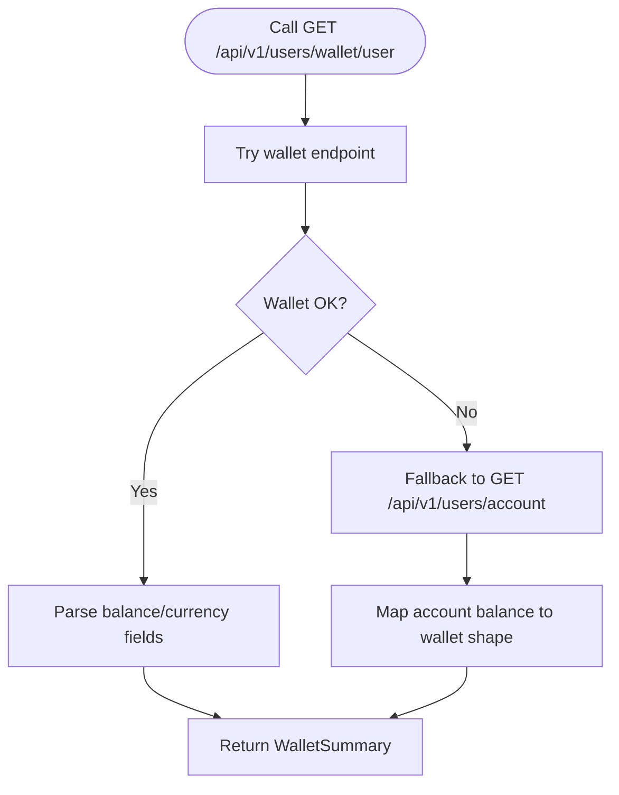
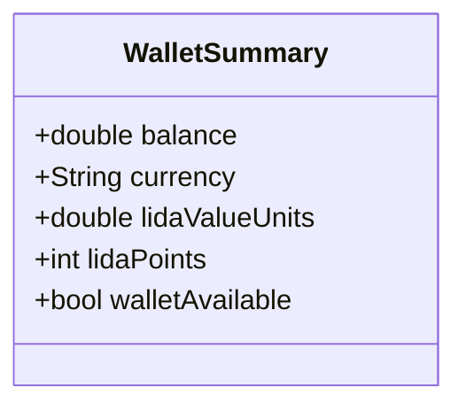
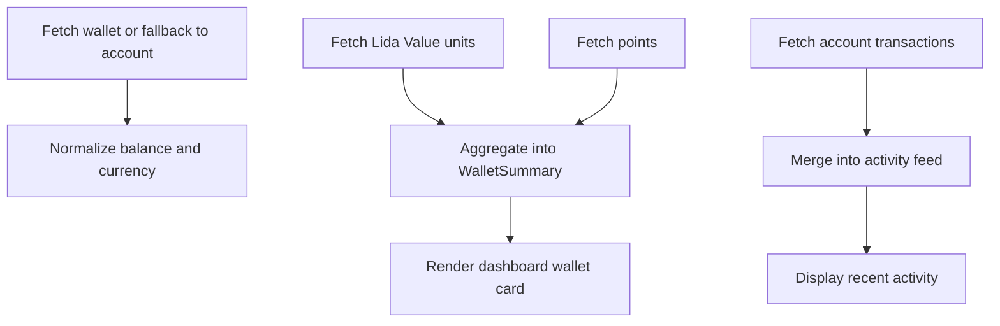
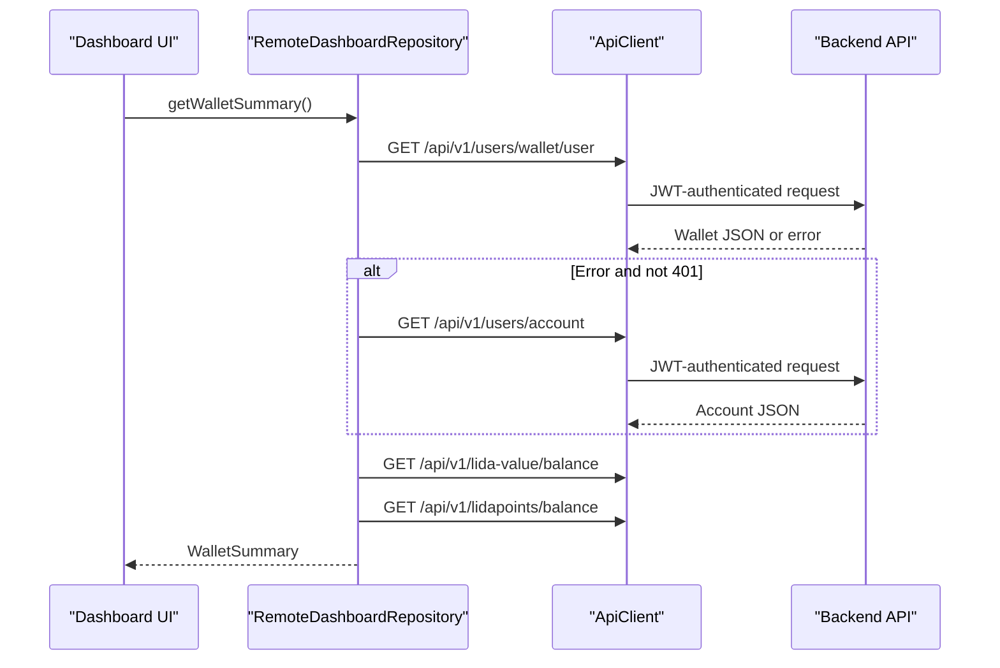
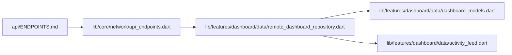

# Wallet Management API

<cite>
**Referenced Files in This Document**
- [ENDPOINTS.md](file://api/ENDPOINTS.md)
- [api_endpoints.dart](file://lib/core/network/api_endpoints.dart)
- [dashboard_models.dart](file://lib/features/dashboard/data/dashboard_models.dart)
- [remote_dashboard_repository.dart](file://lib/features/dashboard/data/remote_dashboard_repository.dart)
- [activity_feed.dart](file://lib/features/dashboard/data/activity_feed.dart)
- [MOBILE_APP_REBUILD_HANDOFF.md](file://docs/MOBILE_APP_REBUILD_HANDOFF.md)
</cite>

## Table of Contents
1. [Introduction](#introduction)
2. [Project Structure](#project-structure)
3. [Core Components](#core-components)
4. [Architecture Overview](#architecture-overview)
5. [Detailed Component Analysis](#detailed-component-analysis)
6. [Dependency Analysis](#dependency-analysis)
7. [Performance Considerations](#performance-considerations)
8. [Troubleshooting Guide](#troubleshooting-guide)
9. [Conclusion](#conclusion)
10. [Appendices](#appendices)

## Introduction
This document provides detailed API documentation for wallet management endpoints exposed by the backend and consumed by the mobile application. It focuses on:

- POST /api/v1/users/wallet — Create or update a user wallet.
- DELETE /api/v1/users/wallet — Delete a user wallet.
- GET /api/v1/users/wallet/{id} — Get a wallet by its identifier.
- GET /api/v1/users/wallet/user — Get the authenticated user’s wallet.

It also documents the wallet data model used by the app, balance handling behavior, security considerations, and practical integration examples for mobile wallet operations.

The base URL for all endpoints is https://api.advansistechnologies.com, as defined in the repository’s endpoint map.

**Section sources**
- [ENDPOINTS.md:1-5](file://api/ENDPOINTS.md#L1-L5)

## Project Structure
Wallet-related functionality spans three main areas:

- Backend endpoint definitions are documented in the repository’s endpoint map.
- The mobile app defines route constants for wallet endpoints.
- The dashboard layer consumes the wallet endpoint to render balances and activity.

**Diagram sources**
- [ENDPOINTS.md:39-42](file://api/ENDPOINTS.md#L39-L42)
- [api_endpoints.dart:16-17](file://lib/core/network/api_endpoints.dart#L16-L17)
- [remote_dashboard_repository.dart:20-44](file://lib/features/dashboard/data/remote_dashboard_repository.dart#L20-L44)
- [dashboard_models.dart:7-36](file://lib/features/dashboard/data/dashboard_models.dart#L7-L36)

**Section sources**
- [ENDPOINTS.md:39-42](file://api/ENDPOINTS.md#L39-L42)
- [api_endpoints.dart:16-17](file://lib/core/network/api_endpoints.dart#L16-L17)
- [remote_dashboard_repository.dart:20-44](file://lib/features/dashboard/data/remote_dashboard_repository.dart#L20-L44)
- [dashboard_models.dart:7-36](file://lib/features/dashboard/data/dashboard_models.dart#L7-L36)

## Core Components
The wallet feature is primarily represented by:

- WalletSummary: A client-side model that aggregates wallet balance, currency, Lida Value units, points, and availability.
- RemoteDashboardRepository.getWalletSummary(): Orchestrates fetching the wallet, Lida Value, and points, with resilient fallbacks when the wallet endpoint fails.
- ApiEndpoints.wallet: The route constant used by the app to call GET /api/v1/users/wallet/user.

Key responsibilities:

- WalletSummary holds normalized values for UI consumption.
- RemoteDashboardRepository handles:
  - Parallel fetching of wallet, Lida Value, and points.
  - Fallback from GET /api/v1/users/wallet/user to GET /api/v1/users/account when the wallet document is missing or returns an error.
  - Degraded rendering when individual services fail.

Balance handling:

- The wallet response may expose the balance under multiple field names such as balance, amount, value, or walletBalance.
- Currency may be provided as currency or currencyCode; defaults to GHS if absent.
- Lida Value units are read from totalValueUnits, balance, valueUnits, value, or amount depending on the live payload shape.
- Points are read from either lidapoints/balance or users/points, tolerating both numeric and object payloads.

Security context:

- Wallet endpoints are JWT-scoped. Authentication tokens are required for these calls.
- The mobile app attaches the access token to authenticated requests after login or OTP verification.

**Section sources**
- [dashboard_models.dart:7-36](file://lib/features/dashboard/data/dashboard_models.dart#L7-L36)
- [remote_dashboard_repository.dart:20-44](file://lib/features/dashboard/data/remote_dashboard_repository.dart#L20-L44)
- [remote_dashboard_repository.dart:46-71](file://lib/features/dashboard/data/remote_dashboard_repository.dart#L46-L71)
- [remote_dashboard_repository.dart:73-102](file://lib/features/dashboard/data/remote_dashboard_repository.dart#L73-L102)
- [remote_dashboard_repository.dart:104-119](file://lib/features/dashboard/data/remote_dashboard_repository.dart#L104-L119)
- [api_endpoints.dart:16-17](file://lib/core/network/api_endpoints.dart#L16-L17)
- [MOBILE_APP_REBUILD_HANDOFF.md:174](file://docs/MOBILE_APP_REBUILD_HANDOFF.md#L174)

## Architecture Overview
The wallet architecture connects the backend endpoints to the mobile dashboard through a resilient repository layer.

**Diagram sources**
- [remote_dashboard_repository.dart:20-44](file://lib/features/dashboard/data/remote_dashboard_repository.dart#L20-L44)
- [remote_dashboard_repository.dart:46-71](file://lib/features/dashboard/data/remote_dashboard_repository.dart#L46-L71)
- [remote_dashboard_repository.dart:73-102](file://lib/features/dashboard/data/remote_dashboard_repository.dart#L73-L102)
- [remote_dashboard_repository.dart:104-119](file://lib/features/dashboard/data/remote_dashboard_repository.dart#L104-L119)
- [api_endpoints.dart:16-17](file://lib/core/network/api_endpoints.dart#L16-L17)

## Detailed Component Analysis

### Wallet Endpoints

#### POST /api/v1/users/wallet
- Purpose: Create or update a user wallet.
- Authentication: Required (JWT).
- Request body: Not specified in the repository’s endpoint map. Clients should follow backend validation rules and include fields necessary for wallet creation/update.
- Response: Not specified in the repository’s endpoint map. Clients should handle success and error responses according to standard HTTP semantics.

Integration notes:
- After successful creation or update, clients can refresh the wallet via GET /api/v1/users/wallet/user.
- Ensure the access token is attached to the request header.

**Section sources**
- [ENDPOINTS.md:39](file://api/ENDPOINTS.md#L39)
- [MOBILE_APP_REBUILD_HANDOFF.md:174](file://docs/MOBILE_APP_REBUILD_HANDOFF.md#L174)

#### DELETE /api/v1/users/wallet
- Purpose: Delete a user wallet.
- Authentication: Required (JWT).
- Request body: Not specified in the repository’s endpoint map.
- Response: Not specified in the repository’s endpoint map.

Integration notes:
- After deletion, GET /api/v1/users/wallet/user may return an error indicating no wallet document exists.
- Clients should gracefully degrade the wallet card and optionally prompt the user to create a new wallet.

**Section sources**
- [ENDPOINTS.md:40](file://api/ENDPOINTS.md#L40)
- [remote_dashboard_repository.dart:46-55](file://lib/features/dashboard/data/remote_dashboard_repository.dart#L46-L55)

#### GET /api/v1/users/wallet/{id}
- Purpose: Retrieve a specific wallet by ID.
- Path parameter: id — the wallet identifier.
- Authentication: Required (JWT).
- Response: Not specified in the repository’s endpoint map.

Integration notes:
- Use this endpoint when you need to fetch a wallet by explicit ID rather than the current user’s default wallet.
- Handle errors such as not found or unauthorized appropriately.

**Section sources**
- [ENDPOINTS.md:41](file://api/ENDPOINTS.md#L41)

#### GET /api/v1/users/wallet/user
- Purpose: Retrieve the authenticated user’s wallet.
- Authentication: Required (JWT).
- Response: Not strictly typed in swagger; the app reads flexible fields for balance and currency.

Response shape observed by the app:
- Balance may be returned as balance, amount, value, or walletBalance.
- Currency may be returned as currency or currencyCode; defaults to GHS if missing.
- The repository maps these fields into WalletSummary.balance and WalletSummary.currency.

Fallback behavior:
- If this endpoint fails with a non-authentication error (for example, 500 for users without a wallet document), the repository falls back to GET /api/v1/users/account to obtain a usable balance.

**Diagram sources**
- [remote_dashboard_repository.dart:20-44](file://lib/features/dashboard/data/remote_dashboard_repository.dart#L20-L44)
- [remote_dashboard_repository.dart:46-71](file://lib/features/dashboard/data/remote_dashboard_repository.dart#L46-L71)

**Section sources**
- [ENDPOINTS.md:42](file://api/ENDPOINTS.md#L42)
- [api_endpoints.dart:16](file://lib/core/network/api_endpoints.dart#L16)
- [dashboard_models.dart:7-36](file://lib/features/dashboard/data/dashboard_models.dart#L7-L36)
- [remote_dashboard_repository.dart:20-44](file://lib/features/dashboard/data/remote_dashboard_repository.dart#L20-L44)
- [remote_dashboard_repository.dart:46-71](file://lib/features/dashboard/data/remote_dashboard_repository.dart#L46-L71)

### Wallet Data Model

WalletSummary represents the aggregated wallet state shown in the dashboard.

Attributes:
- balance: Numeric balance derived from the wallet or account endpoint.
- currency: Currency code, typically GHS.
- lidaValueUnits: Lida Value balance units.
- lidaPoints: User points.
- walletAvailable: Indicates whether the wallet endpoint succeeded.

**Diagram sources**
- [dashboard_models.dart:7-36](file://lib/features/dashboard/data/dashboard_models.dart#L7-L36)

**Section sources**
- [dashboard_models.dart:7-36](file://lib/features/dashboard/data/dashboard_models.dart#L7-L36)

### Balance Handling and Activity Feed

Balance handling:
- The repository attempts multiple plausible field names for balance and currency to accommodate variations in backend payloads.
- When the wallet endpoint fails, it retrieves the account document and maps its balance into the wallet summary.

Activity feed:
- The activity feed merges transactions from multiple sources, including the shared ledger and the account document’s embedded transaction list.
- Transaction rows are parsed flexibly, supporting various field names for amount, date, type, status, and direction.

**Diagram sources**
- [remote_dashboard_repository.dart:20-44](file://lib/features/dashboard/data/remote_dashboard_repository.dart#L20-L44)
- [remote_dashboard_repository.dart:46-71](file://lib/features/dashboard/data/remote_dashboard_repository.dart#L46-L71)
- [activity_feed.dart:59-132](file://lib/features/dashboard/data/activity_feed.dart#L59-L132)

**Section sources**
- [remote_dashboard_repository.dart:20-44](file://lib/features/dashboard/data/remote_dashboard_repository.dart#L20-L44)
- [remote_dashboard_repository.dart:46-71](file://lib/features/dashboard/data/remote_dashboard_repository.dart#L46-L71)
- [activity_feed.dart:59-132](file://lib/features/dashboard/data/activity_feed.dart#L59-L132)

### Security Considerations

Authentication:
- Wallet endpoints require a valid JWT access token.
- The mobile app attaches the access token to authenticated requests after login or OTP verification.

Token lifecycle:
- Access tokens and refresh tokens are issued during authentication flows.
- The app should store tokens securely and refresh them as needed.

Authorization:
- Wallet endpoints are scoped to the authenticated user.
- Clients must ensure they do not attempt to access another user’s wallet unless explicitly authorized by the backend.

Best practices:
- Always attach the latest access token to wallet requests.
- Handle 401 Unauthorized by refreshing tokens or re-authenticating.
- Avoid logging sensitive token values or wallet details.

**Section sources**
- [MOBILE_APP_REBUILD_HANDOFF.md:174](file://docs/MOBILE_APP_REBUILD_HANDOFF.md#L174)
- [remote_dashboard_repository.dart:46-55](file://lib/features/dashboard/data/remote_dashboard_repository.dart#L46-L55)

### Mobile App Integration Examples

Creating or updating a wallet:
- Call POST /api/v1/users/wallet with the required payload.
- Attach the access token.
- On success, refresh the wallet via GET /api/v1/users/wallet/user.

Deleting a wallet:
- Call DELETE /api/v1/users/wallet with the access token.
- Handle potential 500 responses from GET /api/v1/users/wallet/user by falling back to GET /api/v1/users/account.

Retrieving wallet details:
- For the current user: GET /api/v1/users/wallet/user.
- For a specific wallet: GET /api/v1/users/wallet/{id}.

Retrieving wallet summary in the app:
- Use RemoteDashboardRepository.getWalletSummary(), which:
  - Calls GET /api/v1/users/wallet/user.
  - Falls back to GET /api/v1/users/account if needed.
  - Aggregates Lida Value and points.
  - Returns WalletSummary with balance, currency, lidaValueUnits, lidaPoints, and walletAvailable.

Example flow for displaying the wallet card:

**Diagram sources**
- [remote_dashboard_repository.dart:20-44](file://lib/features/dashboard/data/remote_dashboard_repository.dart#L20-L44)
- [remote_dashboard_repository.dart:46-71](file://lib/features/dashboard/data/remote_dashboard_repository.dart#L46-L71)
- [remote_dashboard_repository.dart:73-119](file://lib/features/dashboard/data/remote_dashboard_repository.dart#L73-L119)

**Section sources**
- [remote_dashboard_repository.dart:20-44](file://lib/features/dashboard/data/remote_dashboard_repository.dart#L20-L44)
- [remote_dashboard_repository.dart:46-71](file://lib/features/dashboard/data/remote_dashboard_repository.dart#L46-L71)
- [remote_dashboard_repository.dart:73-119](file://lib/features/dashboard/data/remote_dashboard_repository.dart#L73-L119)
- [MOBILE_APP_REBUILD_HANDOFF.md:174](file://docs/MOBILE_APP_REBUILD_HANDOFF.md#L174)

## Dependency Analysis
The wallet feature depends on:

- Backend endpoints defined in the endpoint map.
- Route constants in the app’s network layer.
- Dashboard models and repository logic for parsing and aggregating wallet data.

**Diagram sources**
- [ENDPOINTS.md:39-42](file://api/ENDPOINTS.md#L39-L42)
- [api_endpoints.dart:16-17](file://lib/core/network/api_endpoints.dart#L16-L17)
- [remote_dashboard_repository.dart:20-44](file://lib/features/dashboard/data/remote_dashboard_repository.dart#L20-L44)
- [dashboard_models.dart:7-36](file://lib/features/dashboard/data/dashboard_models.dart#L7-L36)
- [activity_feed.dart:59-132](file://lib/features/dashboard/data/activity_feed.dart#L59-L132)

**Section sources**
- [ENDPOINTS.md:39-42](file://api/ENDPOINTS.md#L39-L42)
- [api_endpoints.dart:16-17](file://lib/core/network/api_endpoints.dart#L16-L17)
- [remote_dashboard_repository.dart:20-44](file://lib/features/dashboard/data/remote_dashboard_repository.dart#L20-L44)
- [dashboard_models.dart:7-36](file://lib/features/dashboard/data/dashboard_models.dart#L7-L36)
- [activity_feed.dart:59-132](file://lib/features/dashboard/data/activity_feed.dart#L59-L132)

## Performance Considerations
- Parallel fetching: The repository fetches wallet, Lida Value, and points concurrently to reduce latency.
- Resilient parsing: Flexible field mapping reduces failures due to minor backend payload changes.
- Degraded rendering: Failures in individual services do not block the entire dashboard; the wallet card degrades gracefully.
- Fallback strategy: When the wallet endpoint fails, the repository falls back to the account endpoint to provide a usable balance.

Recommendations:
- Cache WalletSummary briefly to avoid excessive network calls during rapid UI updates.
- Retry failed requests with exponential backoff for transient errors.
- Monitor 401 responses and proactively refresh tokens before they expire.

[No sources needed since this section provides general guidance]

## Troubleshooting Guide
Common issues and resolutions:

- 401 Unauthorized:
  - Cause: Missing or expired access token.
  - Resolution: Refresh tokens or re-authenticate, then retry the request.

- 500 Internal Server Error on GET /api/v1/users/wallet/user:
  - Cause: User does not have a wallet document.
  - Resolution: The repository automatically falls back to GET /api/v1/users/account. If the fallback also fails, the wallet card will show degraded state with zero balance.

- Missing balance or currency fields:
  - Cause: Backend payload variation.
  - Resolution: The repository tries multiple field names; ensure the backend includes at least one recognized field.

- Incorrect transaction direction:
  - Cause: Ambiguous direction fields in transaction payloads.
  - Resolution: The activity feed uses heuristics based on type and direction fields; verify backend transaction metadata for accurate direction.

**Section sources**
- [remote_dashboard_repository.dart:46-71](file://lib/features/dashboard/data/remote_dashboard_repository.dart#L46-L71)
- [activity_feed.dart:59-132](file://lib/features/dashboard/data/activity_feed.dart#L59-L132)

## Conclusion
The wallet management API provides essential endpoints for creating, deleting, retrieving, and reading the authenticated user’s wallet. The mobile app implements robust parsing, fallback strategies, and parallel fetching to deliver a resilient wallet experience. Developers integrating with these endpoints should ensure proper authentication, handle flexible response shapes, and implement graceful degradation when backend services are unavailable.

[No sources needed since this section summarizes without analyzing specific files]

## Appendices

### Endpoint Summary

- Base URL: https://api.advansistechnologies.com
- Authentication: JWT access token required for wallet endpoints.

| Method | Endpoint | Description | Notes |
|--------|----------|-------------|-------|
| POST | /api/v1/users/wallet | Create or update user wallet | Requires JWT; payload schema not specified in repo |
| DELETE | /api/v1/users/wallet | Delete user wallet | Requires JWT; handle fallback behavior |
| GET | /api/v1/users/wallet/{id} | Get wallet by ID | Requires JWT; path parameter id |
| GET | /api/v1/users/wallet/user | Get authenticated user wallet | Requires JWT; flexible response shape |

**Section sources**
- [ENDPOINTS.md:39-42](file://api/ENDPOINTS.md#L39-L42)
- [MOBILE_APP_REBUILD_HANDOFF.md:174](file://docs/MOBILE_APP_REBUILD_HANDOFF.md#L174)