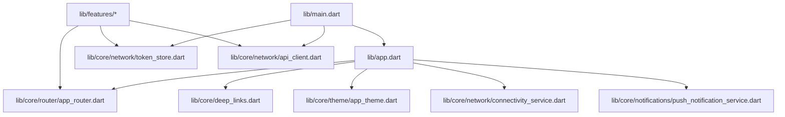
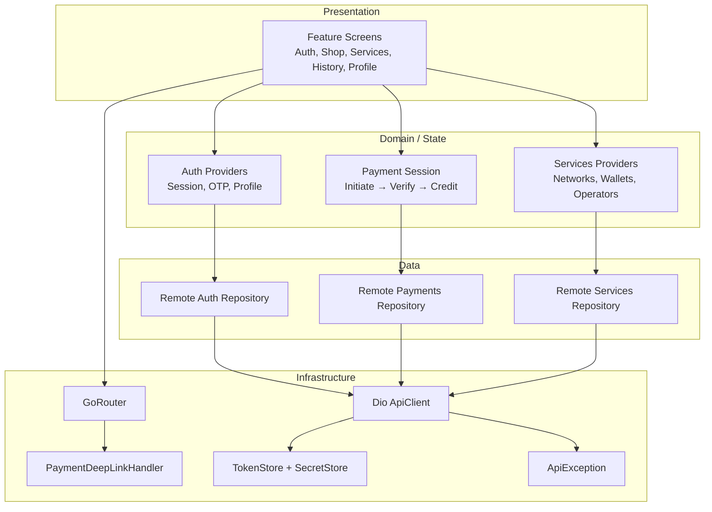
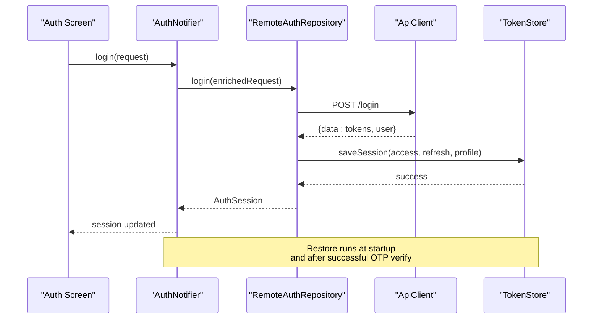
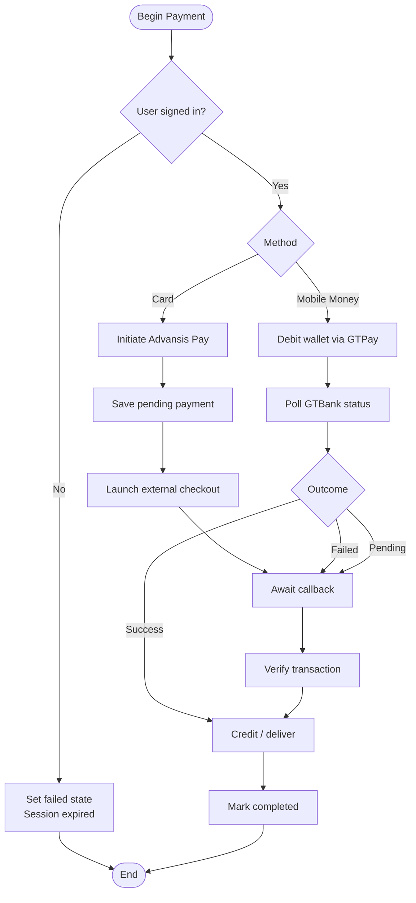
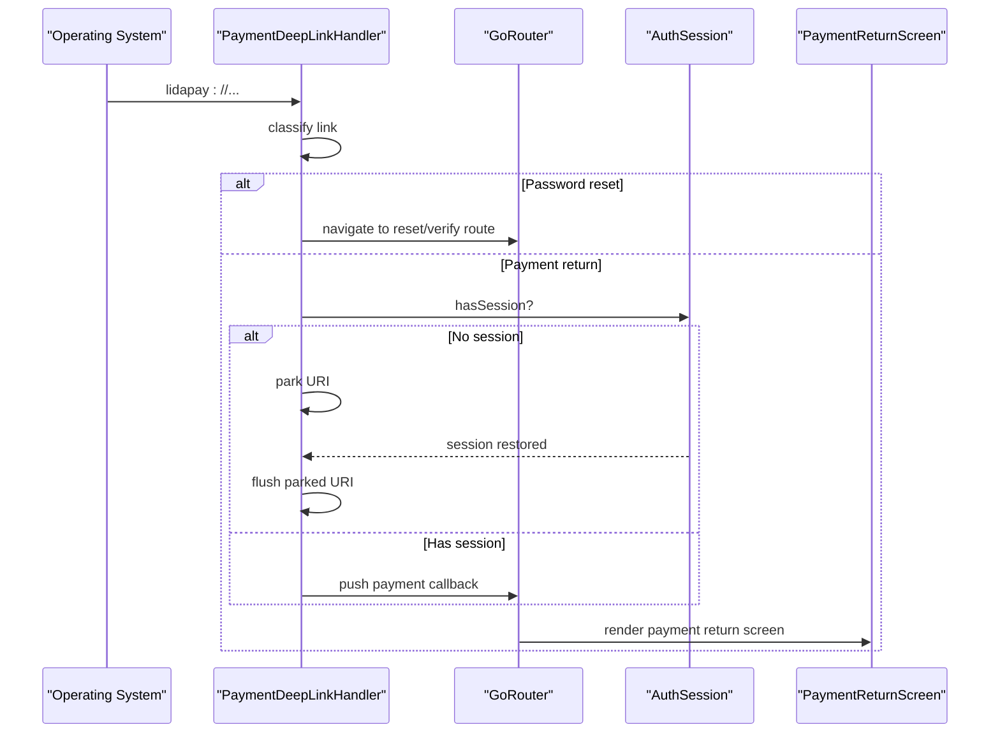
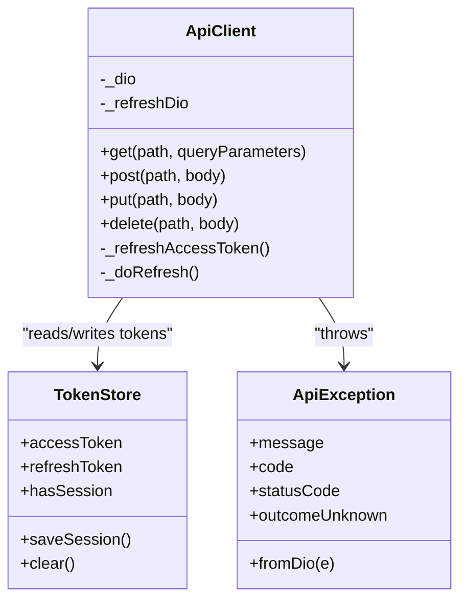
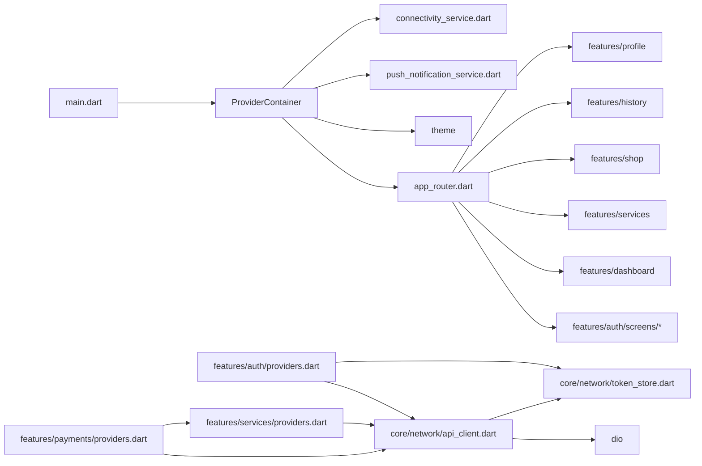

# Architecture & Design

<cite>
**Referenced Files in This Document**
- [pubspec.yaml](file://pubspec.yaml)
- [README.md](file://README.md)
- [main.dart](file://lib/main.dart)
- [app.dart](file://lib/app.dart)
- [app_router.dart](file://lib/core/router/app_router.dart)
- [deep_links.dart](file://lib/core/deep_links.dart)
- [api_client.dart](file://lib/core/network/api_client.dart)
- [token_store.dart](file://lib/core/network/token_store.dart)
- [api_exception.dart](file://lib/core/network/api_exception.dart)
- [providers.dart (auth)](file://lib/features/auth/providers.dart)
- [remote_auth_repository.dart](file://lib/features/auth/data/remote_auth_repository.dart)
- [providers.dart (payments)](file://lib/features/payments/providers.dart)
- [remote_payments_repository.dart](file://lib/features/payments/data/remote_payments_repository.dart)
- [providers.dart (services)](file://lib/features/services/providers.dart)
</cite>

## Table of Contents
1. [Introduction](#introduction)
2. [Project Structure](#project-structure)
3. [Core Components](#core-components)
4. [Architecture Overview](#architecture-overview)
5. [Detailed Component Analysis](#detailed-component-analysis)
6. [Dependency Analysis](#dependency-analysis)
7. [Performance Considerations](#performance-considerations)
8. [Troubleshooting Guide](#troubleshooting-guide)
9. [Conclusion](#conclusion)

## Introduction
LidaPay is a Flutter mobile application that implements a feature-based architecture with MVVM-style separation, Riverpod for state management, and GoRouter for navigation. The app separates presentation screens from domain logic through feature modules, while core infrastructure provides networking, authentication persistence, routing, deep linking, notifications, and platform integration.

The system supports:
- Feature-based organization under `lib/features`.
- Core infrastructure under `lib/core`.
- Platform-specific code under `android` and `ios`.
- Authentication, payments, services, shop, history, profile, legal, notifications, and onboarding features.
- Secure token storage, API client retry and refresh, deep-link handling, push notifications, and offline awareness.

This document explains the architectural patterns, component interactions, data flows, cross-cutting concerns, technology decisions, and trade-offs.

## Project Structure
At a high level:
- `lib/main.dart` initializes the runtime, error boundaries, secure storage, token store, device identity, pending payment hydration, session restoration, and the Riverpod container.
- `lib/app.dart` defines the root `MaterialApp.router`, theme, scroll behavior, edge-to-edge UI, connectivity banner, deep link handler, and notification initialization.
- `lib/core` contains shared infrastructure: router, network client, token store, exceptions, deep links, notifications, theme, utilities, and widgets.
- `lib/features` groups functionality by business capability: auth, dashboard, history, legal, lida_value, notifications, payments, profile, recipient_choice, services, shell, shop, splash, support.
- `android` and `ios` contain native entry points and platform configuration.
- `tool`, `test`, `web`, and `assets` provide tooling, tests, static web pages, and assets.

**Diagram sources**
- [main.dart:17-149](file://lib/main.dart#L17-L149)
- [app.dart:56-260](file://lib/app.dart#L56-L260)
- [app_router.dart:94-410](file://lib/core/router/app_router.dart#L94-L410)
- [deep_links.dart:11-158](file://lib/core/deep_links.dart#L11-L158)
- [api_client.dart:16-275](file://lib/core/network/api_client.dart#L16-L275)
- [token_store.dart:74-237](file://lib/core/network/token_store.dart#L74-L237)

**Section sources**
- [pubspec.yaml:1-152](file://pubspec.yaml#L1-L152)
- [README.md:1-47](file://README.md#L1-L47)
- [main.dart:17-149](file://lib/main.dart#L17-L149)
- [app.dart:56-260](file://lib/app.dart#L56-L260)

## Core Components
The LidaPay application is built around these core components:

- Application bootstrap and global error handling:
  - Initializes Flutter bindings, edge-to-edge mode, debug logging suppression in release, framework error handler, platform error handler, error widget builder, shared preferences, device identity, secure secret store, token store, pending payment hydration, and session restoration.
  - Creates a single `ProviderContainer` and injects shared dependencies into Riverpod providers.

- Root app shell:
  - Configures `MaterialApp.router` with GoRouter, theme, scroll behavior, overlay styling, offline banner, update gate, keyboard dismissal, and lifecycle-aware session refresh.

- Navigation:
  - Centralized route constants and GoRouter configuration with guarded redirects based on session state, deep link handling, and shell branches for main tabs.

- Networking:
  - Dio-based `ApiClient` with request/response logging, sensitive field redaction, automatic bearer injection, single-flight token refresh on 401, and normalized `ApiException` mapping.

- Security and persistence:
  - `TokenStore` with encrypted secret storage via `SecureSecretStore`, in-memory mirror for synchronous access, legacy migration, biometric session snapshot, and clear/cleanup events.

- Deep links:
  - `PaymentDeepLinkHandler` routes password reset links and payment return URIs, parks callbacks until session exists, and avoids duplicate callback pages.

- Feature providers:
  - Auth, payments, services, and other features expose repositories and state notifiers wired to Riverpod, using `apiClientProvider` and `tokenStoreProvider`.

**Section sources**
- [main.dart:17-149](file://lib/main.dart#L17-L149)
- [app.dart:56-260](file://lib/app.dart#L56-L260)
- [app_router.dart:40-423](file://lib/core/router/app_router.dart#L40-L423)
- [api_client.dart:16-275](file://lib/core/network/api_client.dart#L16-L275)
- [token_store.dart:74-237](file://lib/core/network/token_store.dart#L74-L237)
- [deep_links.dart:11-158](file://lib/core/deep_links.dart#L11-L158)

## Architecture Overview
LidaPay follows a feature-based architecture layered over MVVM-like responsibilities:

- Presentation layer:
  - Screens and widgets inside each feature folder consume Riverpod providers and display state.
  - Example: dashboard, shop, services, history, profile, auth screens.

- Domain/state layer:
  - Feature providers encapsulate business workflows such as authentication flow, payment orchestration, service delivery, and data fetching.
  - State notifiers manage phases, retries, and user-facing messages.

- Data layer:
  - Repositories implement feature-specific contracts and call `ApiClient`.
  - Remote repositories map API responses to domain models and persist tokens/profiles via `TokenStore`.

- Infrastructure layer:
  - Shared across features: routing, networking, security, notifications, deep links, theme, utilities.

**Diagram sources**
- [providers.dart (auth):15-37](file://lib/features/auth/providers.dart#L15-L37)
- [providers.dart (payments):24-129](file://lib/features/payments/providers.dart#L24-L129)
- [providers.dart (services):12-30](file://lib/features/services/providers.dart#L12-L30)
- [remote_auth_repository.dart:13-274](file://lib/features/auth/data/remote_auth_repository.dart#L13-L274)
- [remote_payments_repository.dart:7-110](file://lib/features/payments/data/remote_payments_repository.dart#L7-L110)
- [api_client.dart:16-275](file://lib/core/network/api_client.dart#L16-L275)
- [token_store.dart:74-237](file://lib/core/network/token_store.dart#L74-L237)
- [api_exception.dart:5-78](file://lib/core/network/api_exception.dart#L5-L78)
- [app_router.dart:94-410](file://lib/core/router/app_router.dart#L94-L410)
- [deep_links.dart:11-158](file://lib/core/deep_links.dart#L11-L158)

## Detailed Component Analysis

### Authentication Flow
Authentication uses a repository pattern with a remote implementation, a Riverpod state notifier, and secure token persistence.

Key behaviors:
- Login and OTP verification create an `AuthSession` and persist tokens and profile.
- Session restore at startup loads persisted tokens and reconstructs session without re-authentication.
- Biometric login reads a saved biometric session snapshot and verifies it against the backend.
- Profile refresh updates display fields and merges local changes.
- Logout clears tokens and optionally clears biometric session.

**Diagram sources**
- [providers.dart (auth):89-105](file://lib/features/auth/providers.dart#L89-L105)
- [remote_auth_repository.dart:20-80](file://lib/features/auth/data/remote_auth_repository.dart#L20-L80)
- [api_client.dart:137-178](file://lib/core/network/api_client.dart#L137-L178)
- [token_store.dart:148-175](file://lib/core/network/token_store.dart#L148-L175)

**Section sources**
- [providers.dart (auth):15-37](file://lib/features/auth/providers.dart#L15-L37)
- [providers.dart (auth):51-351](file://lib/features/auth/providers.dart#L51-L351)
- [remote_auth_repository.dart:13-274](file://lib/features/auth/data/remote_auth_repository.dart#L13-L274)
- [token_store.dart:74-237](file://lib/core/network/token_store.dart#L74-L237)

### Payment Orchestration
Payments are orchestrated by a stateful session that handles initiation, external checkout, verification polling, crediting, and completion or failure states.

Key behaviors:
- Card checkout initiates a payment, opens an external browser page, persists pending payment, and waits for a deep-link callback.
- Mobile money via GTPay debits the wallet, polls status, and reconciles outcomes.
- Verification is single-flighted per purchase reference to avoid double crediting.
- Delivery goes through the services repository; shop orders complete locally after gateway confirmation.
- Pending payments survive process death and can be resumed or retried safely.

**Diagram sources**
- [providers.dart (payments):131-178](file://lib/features/payments/providers.dart#L131-L178)
- [providers.dart (payments):182-277](file://lib/features/payments/providers.dart#L182-L277)
- [providers.dart (payments):283-367](file://lib/features/payments/providers.dart#L283-L367)
- [providers.dart (payments):474-572](file://lib/features/payments/providers.dart#L474-L572)
- [providers.dart (payments):578-665](file://lib/features/payments/providers.dart#L578-L665)
- [providers.dart (payments):700-769](file://lib/features/payments/providers.dart#L700-L769)
- [remote_payments_repository.dart:12-110](file://lib/features/payments/data/remote_payments_repository.dart#L12-L110)

**Section sources**
- [providers.dart (payments):24-129](file://lib/features/payments/providers.dart#L24-L129)
- [providers.dart (payments):131-800](file://lib/features/payments/providers.dart#L131-L800)
- [remote_payments_repository.dart:7-110](file://lib/features/payments/data/remote_payments_repository.dart#L7-L110)

### Routing and Deep Links
GoRouter centralizes navigation and guards routes based on session state. Deep links handle both password reset flows and payment returns.

Key behaviors:
- Splash, onboarding, login, register, forgot password, reset password, and verify password change routes.
- Shell branches for home, services, shop, history, and profile.
- Redirect logic prevents unauthenticated access and routes authenticated users away from auth screens.
- Password links bypass session requirements because the token is authority.
- Payment callback routes are root-level so cold-start deep links reach them directly.
- `PaymentDeepLinkHandler` parks callbacks until session exists and flushes once.

**Diagram sources**
- [app_router.dart:40-86](file://lib/core/router/app_router.dart#L40-L86)
- [app_router.dart:108-164](file://lib/core/router/app_router.dart#L108-L164)
- [app_router.dart:166-237](file://lib/core/router/app_router.dart#L166-L237)
- [deep_links.dart:27-61](file://lib/core/deep_links.dart#L27-L61)
- [deep_links.dart:66-135](file://lib/core/deep_links.dart#L66-L135)
- [deep_links.dart:137-158](file://lib/core/deep_links.dart#L137-L158)

**Section sources**
- [app_router.dart:40-423](file://lib/core/router/app_router.dart#L40-L423)
- [deep_links.dart:11-158](file://lib/core/deep_links.dart#L11-L158)

### Network Layer and Error Handling
`ApiClient` wraps Dio with interceptors for authorization headers, request IDs, debug logging, and token refresh. Errors are normalized into `ApiException`.

Key behaviors:
- Bearer token injected from `TokenStore`.
- Single-flight refresh on 401; concurrent failures share one refresh attempt.
- Non-idempotent requests are not automatically retried after refresh.
- Sensitive fields are redacted in logs.
- `ApiException.fromDio` maps Dio errors to user-friendly messages and marks unknown outcomes when no server response was received.

**Diagram sources**
- [api_client.dart:16-275](file://lib/core/network/api_client.dart#L16-L275)
- [token_store.dart:74-237](file://lib/core/network/token_store.dart#L74-L237)
- [api_exception.dart:5-78](file://lib/core/network/api_exception.dart#L5-L78)

**Section sources**
- [api_client.dart:16-275](file://lib/core/network/api_client.dart#L16-L275)
- [api_exception.dart:5-78](file://lib/core/network/api_exception.dart#L5-L78)
- [token_store.dart:74-237](file://lib/core/network/token_store.dart#L74-L237)

### Dependency Injection and Riverpod
Riverpod is used throughout:
- `ProviderContainer` created in `main()` overrides shared dependencies like `SharedPreferences`, `TokenStore`, `SecretStore`, and `DeviceIdentity`.
- Feature providers depend on `apiClientProvider`, `tokenStoreProvider`, and feature repositories.
- `UncontrolledProviderScope` exposes the container to the app tree.

Trade-offs:
- Centralized DI simplifies testing and swapping implementations.
- Overriding providers in `main()` ensures consistent initialization order.
- Riverpod’s reactive model keeps UI synchronized with session and network state.

**Section sources**
- [main.dart:98-145](file://lib/main.dart#L98-L145)
- [providers.dart (auth):15-37](file://lib/features/auth/providers.dart#L15-L37)
- [providers.dart (payments):24-41](file://lib/features/payments/providers.dart#L24-L41)
- [providers.dart (services):12-30](file://lib/features/services/providers.dart#L12-L30)

## Dependency Analysis
The following diagram shows how core infrastructure and feature modules interact.

**Diagram sources**
- [main.dart:98-145](file://lib/main.dart#L98-L145)
- [app_router.dart:94-410](file://lib/core/router/app_router.dart#L94-L410)
- [providers.dart (auth):15-37](file://lib/features/auth/providers.dart#L15-L37)
- [providers.dart (payments):24-129](file://lib/features/payments/providers.dart#L24-L129)
- [providers.dart (services):12-30](file://lib/features/services/providers.dart#L12-L30)
- [api_client.dart:16-275](file://lib/core/network/api_client.dart#L16-L275)
- [token_store.dart:74-237](file://lib/core/network/token_store.dart#L74-L237)

**Section sources**
- [main.dart:98-145](file://lib/main.dart#L98-L145)
- [app_router.dart:94-410](file://lib/core/router/app_router.dart#L94-L410)
- [providers.dart (auth):15-37](file://lib/features/auth/providers.dart#L15-L37)
- [providers.dart (payments):24-129](file://lib/features/payments/providers.dart#L24-L129)
- [providers.dart (services):12-30](file://lib/features/services/providers.dart#L12-L30)
- [api_client.dart:16-275](file://lib/core/network/api_client.dart#L16-L275)
- [token_store.dart:74-237](file://lib/core/network/token_store.dart#L74-L237)

## Performance Considerations
- Fast boot:
  - Startup operations are bounded with timeouts to prevent splash freeze if network or keystore is slow.
  - Pending payment hydration and session restoration run asynchronously and gracefully degrade on failure.

- Network efficiency:
  - Dio timeouts are tuned for mobile handovers and provider round-trips.
  - Token refresh is single-flighted to avoid redundant refresh calls.
  - Debug logging is suppressed in release builds.

- UI responsiveness:
  - Offline banner does not block rendering.
  - Scroll behavior improves perceived smoothness.
  - Error widget builder prevents red-screen-of-death scenarios.

[No sources needed since this section provides general guidance]

## Troubleshooting Guide
Common issues and their architectural handling:

- Unexpected UI errors:
  - Global Flutter error handler and custom error widget builder catch layout bugs and present a safe recovery screen with a refresh action.

- Platform errors:
  - Root error handler catches platform dispatch errors and prevents host process crashes.

- Authentication failures:
  - `ApiClient` clears tokens on invalid refresh responses.
  - `AuthNotifier` mirrors token store clear events to drop session state and redirect to login.
  - Profile refresh retries transient failures but preserves cached profile.

- Payment inconsistencies:
  - Pending payment store survives process death.
  - Verification is single-flighted per purchase reference.
  - GTPay status polling respects timeouts and expiration windows.
  - Delivery failures keep pending records so users can retry crediting without paying again.

- Deep link duplication:
  - Handler avoids stacking duplicate callback pages by checking current route before pushing.

**Section sources**
- [main.dart:30-40](file://lib/main.dart#L30-L40)
- [main.dart:44-96](file://lib/main.dart#L44-L96)
- [providers.dart (auth):51-79](file://lib/features/auth/providers.dart#L51-L79)
- [providers.dart (auth):210-239](file://lib/features/auth/providers.dart#L210-L239)
- [providers.dart (payments):474-572](file://lib/features/payments/providers.dart#L474-L572)
- [providers.dart (payments):578-665](file://lib/features/payments/providers.dart#L578-L665)
- [providers.dart (payments):700-769](file://lib/features/payments/providers.dart#L700-L769)
- [deep_links.dart:146-158](file://lib/core/deep_links.dart#L146-L158)

## Conclusion
LidaPay’s architecture emphasizes clear separation of concerns, robust security, and resilient user flows:

- Feature-based organization isolates business capabilities while sharing core infrastructure.
- MVVM-like structure separates presentation, domain state, and data repositories.
- Riverpod provides reactive state and dependency injection.
- GoRouter centralizes navigation and integrates with deep links and session guards.
- `ApiClient` and `TokenStore` ensure secure, efficient, and resilient communication with the backend.
- Payment orchestration protects against double charges, handles asynchronous rails, and recovers from interruptions.

Technology decisions favor stability and maintainability:
- Dio for HTTP with interceptors and timeout tuning.
- Flutter Secure Storage for secrets.
- GoRouter for declarative routing.
- Riverpod for predictable state and testable providers.

Trade-offs include complexity in payment reconciliation and deep link handling, which are mitigated by single-flight verification, pending stores, and explicit session checks. Overall, the design balances developer ergonomics, security, and reliability for a financial mobile application.

[No sources needed since this section summarizes without analyzing specific files]