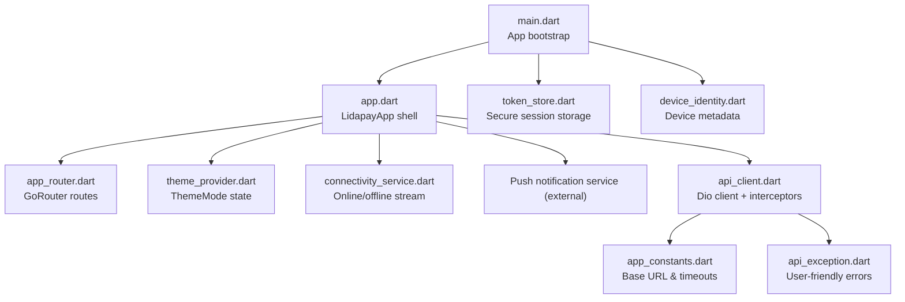
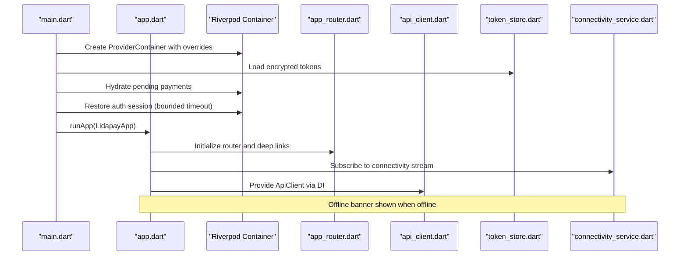
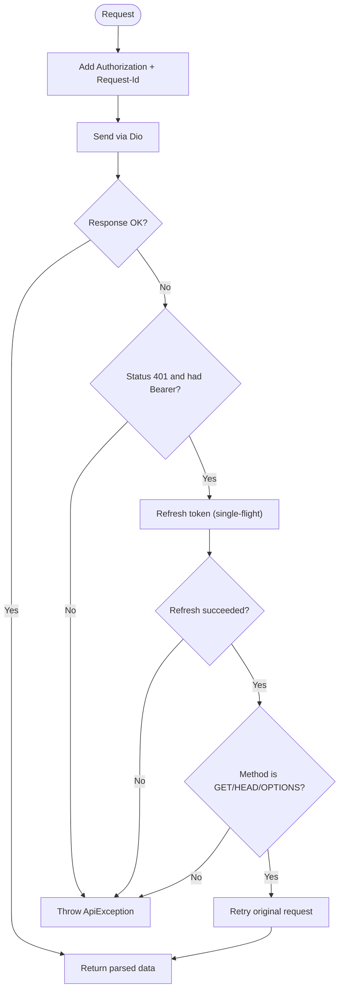
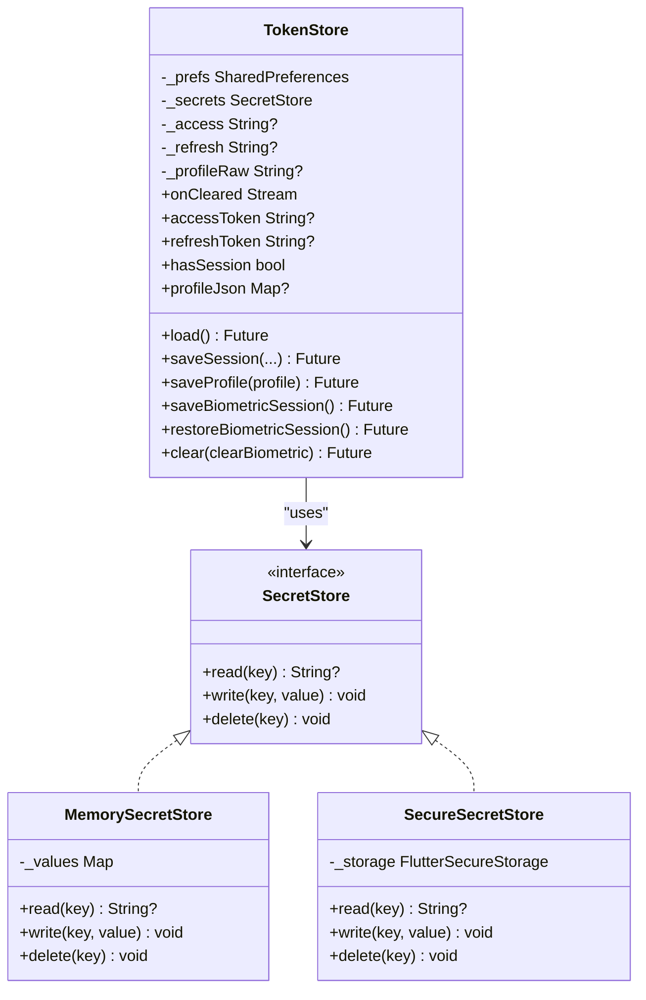
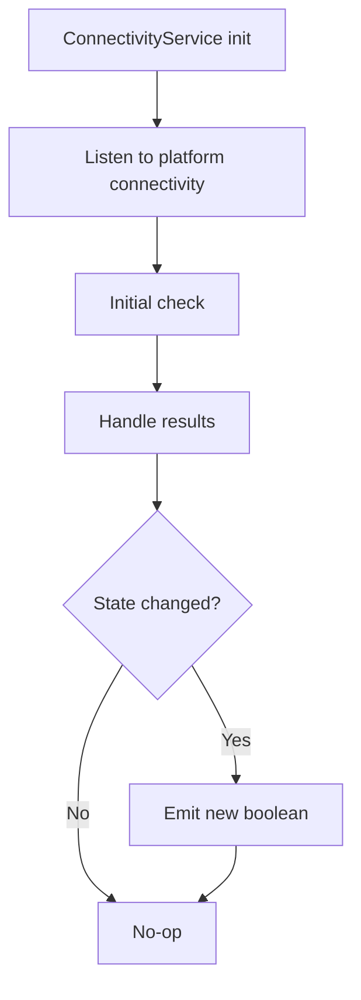
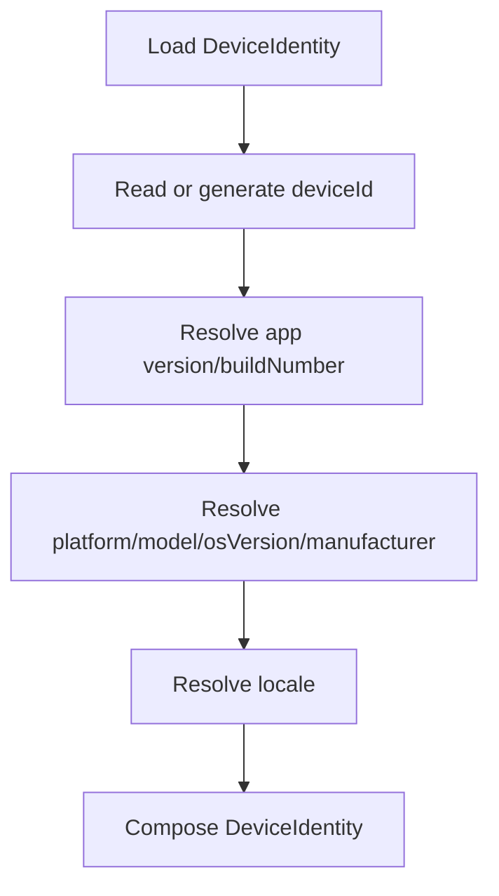
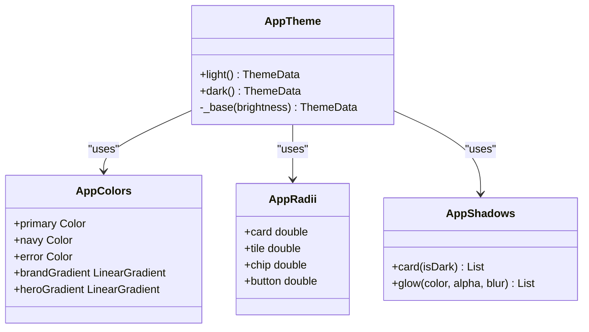
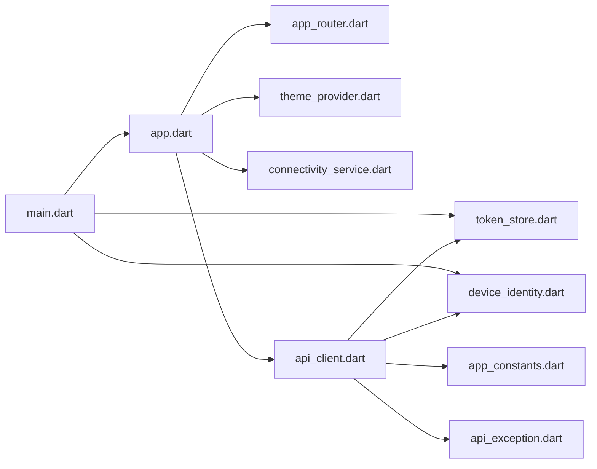

# Core Infrastructure Components

<cite>
**Referenced Files in This Document**
- [main.dart](file://lib/main.dart)
- [app.dart](file://lib/app.dart)
- [api_client.dart](file://lib/core/network/api_client.dart)
- [api_exception.dart](file://lib/core/network/api_exception.dart)
- [token_store.dart](file://lib/core/network/token_store.dart)
- [connectivity_service.dart](file://lib/core/network/connectivity_service.dart)
- [device_identity.dart](file://lib/core/device/device_identity.dart)
- [app_theme.dart](file://lib/core/theme/app_theme.dart)
- [theme_provider.dart](file://lib/core/providers/theme_provider.dart)
- [app_constants.dart](file://lib/core/constants/app_constants.dart)
- [app_router.dart](file://lib/core/router/app_router.dart)
</cite>

## Table of Contents
1. [Introduction](#introduction)
2. [Project Structure](#project-structure)
3. [Core Components](#core-components)
4. [Architecture Overview](#architecture-overview)
5. [Detailed Component Analysis](#detailed-component-analysis)
6. [Dependency Analysis](#dependency-analysis)
7. [Performance Considerations](#performance-considerations)
8. [Troubleshooting Guide](#troubleshooting-guide)
9. [Conclusion](#conclusion)

## Introduction
This document explains the core infrastructure that powers the application: the API client with interceptors and retry logic, error handling, theme system, shared services, dependency injection setup, platform-specific configuration, and cross-cutting concerns such as logging and analytics. It is intended for both developers integrating new features and reviewers who need a clear mental model of how the app boots, authenticates, makes network requests, and adapts to device and user preferences.

## Project Structure
The core infrastructure lives under `lib/core` and is wired at the application entry points `lib/main.dart` and `lib/app.dart`. Key areas include:
- Networking: API client, endpoints, exceptions, token store, connectivity service
- Device identity and constants
- Theme and appearance provider
- Routing and deep links
- App shell behavior and global error handling

**Diagram sources**
- [main.dart:17-149](file://lib/main.dart#L17-L149)
- [app.dart:56-257](file://lib/app.dart#L56-L257)
- [api_client.dart:16-275](file://lib/core/network/api_client.dart#L16-L275)
- [app_constants.dart:1-65](file://lib/core/constants/app_constants.dart#L1-L65)
- [api_exception.dart:5-79](file://lib/core/network/api_exception.dart#L5-L79)
- [token_store.dart:74-237](file://lib/core/network/token_store.dart#L74-L237)
- [device_identity.dart:17-130](file://lib/core/device/device_identity.dart#L17-L130)
- [connectivity_service.dart:16-45](file://lib/core/network/connectivity_service.dart#L16-L45)
- [app_router.dart:94-410](file://lib/core/router/app_router.dart#L94-L410)

**Section sources**
- [main.dart:17-149](file://lib/main.dart#L17-L149)
- [app.dart:56-257](file://lib/app.dart#L56-L257)

## Core Components
- API Client: Central Dio-based HTTP layer with request/response logging, sensitive data redaction, automatic bearer token injection, single-flight refresh on 401, and safe retries for idempotent GET/HEAD/OPTIONS calls.
- Error Handling: Normalized `ApiException` with friendly messages, status codes, backend error codes, and an outcome-unknown flag for non-idempotent operations.
- Token Store: Encrypted secure storage with in-memory mirror, legacy migration, biometric session support, and session invalidation streams.
- Connectivity Service: Streamed online/offline state used by the UI to show offline banners and gate network-dependent actions.
- Device Identity: Privacy-safe device metadata including a random UUID, platform, version, locale, and manufacturer hints.
- Theme System: Brand palette, Material 3 themes, typography, shapes, and persisted theme mode selection.
- Constants: Build-time configurable base URLs, timeouts, feature flags, and deep link policies.
- Router: GoRouter-based navigation with auth guards, deep link handling, and root-level overlays for payment callbacks and recipient decisions.

**Section sources**
- [api_client.dart:16-275](file://lib/core/network/api_client.dart#L16-L275)
- [api_exception.dart:5-79](file://lib/core/network/api_exception.dart#L5-L79)
- [token_store.dart:74-237](file://lib/core/network/token_store.dart#L74-L237)
- [connectivity_service.dart:16-45](file://lib/core/network/connectivity_service.dart#L16-L45)
- [device_identity.dart:17-130](file://lib/core/device/device_identity.dart#L17-L130)
- [app_theme.dart:5-233](file://lib/core/theme/app_theme.dart#L5-L233)
- [theme_provider.dart:6-38](file://lib/core/providers/theme_provider.dart#L6-L38)
- [app_constants.dart:1-65](file://lib/core/constants/app_constants.dart#L1-L65)
- [app_router.dart:94-410](file://lib/core/router/app_router.dart#L94-L410)

## Architecture Overview
The application bootstraps in `main.dart`, initializes secure storage and tokens, sets up Riverpod providers, hydrates pending payments, restores auth sessions with bounded timeouts, and then renders the app shell in `app.dart`. The shell configures routing, theme, push notifications, deep links, and connectivity-aware UI. Network requests flow through `ApiClient`, which injects tokens, logs requests/responses, and handles 401 refreshes transparently. Errors are normalized into `ApiException` for consistent UI handling.

**Diagram sources**
- [main.dart:17-149](file://lib/main.dart#L17-L149)
- [app.dart:56-257](file://lib/app.dart#L56-L257)
- [api_client.dart:268-275](file://lib/core/network/api_client.dart#L268-L275)
- [token_store.dart:120-146](file://lib/core/network/token_store.dart#L120-L146)
- [connectivity_service.dart:11-14](file://lib/core/network/connectivity_service.dart#L11-L14)

## Detailed Component Analysis

### API Client with Interceptors, Retry Logic, and Error Handling
Responsibilities:
- Configure Dio with base URL, timeouts, and JSON headers from constants.
- Inject Authorization header using stored access token.
- Attach a unique request ID per call.
- Log requests, responses, and errors in debug builds while redacting sensitive fields.
- On 401 with a Bearer token, perform a single-flight token refresh; if successful, retry once for idempotent methods only.
- Convert all Dio failures to `ApiException` with friendly messages and outcome-unknown semantics.

**Diagram sources**
- [api_client.dart:25-83](file://lib/core/network/api_client.dart#L25-L83)
- [api_client.dart:195-202](file://lib/core/network/api_client.dart#L195-L202)
- [api_client.dart:204-265](file://lib/core/network/api_client.dart#L204-L265)
- [api_exception.dart:22-38](file://lib/core/network/api_exception.dart#L22-L38)

Key implementation patterns:
- Sensitive payload redaction before logging.
- Single-flight refresh using a shared future to avoid concurrent refresh storms.
- Safe retry policy limited to idempotent methods.
- Graceful degradation on refresh failure without forcing immediate logout unless explicitly rejected.

**Section sources**
- [api_client.dart:16-275](file://lib/core/network/api_client.dart#L16-L275)
- [api_exception.dart:5-79](file://lib/core/network/api_exception.dart#L5-L79)

### Secure Token Store and Session Management
Responsibilities:
- Persist access and refresh tokens plus profile in encrypted storage with an in-memory mirror for fast reads.
- Migrate legacy plaintext tokens to secure storage during load.
- Support optional biometric session snapshot.
- Emit a stream when the session is cleared so listeners can drop cached state.
- Expose convenience properties like `hasSession` and `profileJson`.

**Diagram sources**
- [token_store.dart:26-69](file://lib/core/network/token_store.dart#L26-L69)
- [token_store.dart:74-237](file://lib/core/network/token_store.dart#L74-L237)

Operational notes:
- `load()` never throws; it degrades gracefully if keystore fails.
- Biometric session requires a refreshable session; otherwise it throws to prevent partial snapshots.
- Clearing session emits `onCleared` to notify subscribers.

**Section sources**
- [token_store.dart:74-237](file://lib/core/network/token_store.dart#L74-L237)

### Connectivity Service and Offline Awareness
Responsibilities:
- Monitor connectivity changes and expose a broadcast stream of online/offline state.
- Provide an initial check and handle plugin errors gracefully.
- Integrate with the app shell to display a non-blocking offline banner.

**Diagram sources**
- [connectivity_service.dart:16-45](file://lib/core/network/connectivity_service.dart#L16-L45)

Usage in the app shell:
- The app watches `isOnlineProvider` and shows a red banner when offline.
- Background polling remains active when needed (e.g., pending recipient top-ups).

**Section sources**
- [connectivity_service.dart:11-14](file://lib/core/network/connectivity_service.dart#L11-L14)
- [app.dart:137-146](file://lib/app.dart#L137-L146)
- [app.dart:214-252](file://lib/app.dart#L214-L252)

### Device Identity
Responsibilities:
- Produce privacy-safe device metadata: random UUID, platform, app version/build number, locale, model, OS version, and manufacturer.
- Persist device ID across reinstalls within the same install scope.
- Provide helper flags like `isSamsung` and locale-derived country hint.

**Diagram sources**
- [device_identity.dart:72-130](file://lib/core/device/device_identity.dart#L72-L130)

**Section sources**
- [device_identity.dart:17-130](file://lib/core/device/device_identity.dart#L17-L130)

### Theme System and Appearance Provider
Responsibilities:
- Define brand colors, gradients, radii, shadows, and Material 3 theme configurations for light and dark modes.
- Persist user-selected theme mode and apply it globally.
- Customize input decoration, buttons, cards, navigation bar, bottom sheets, dialogs, and page transitions.

**Diagram sources**
- [app_theme.dart:5-81](file://lib/core/theme/app_theme.dart#L5-L81)
- [app_theme.dart:83-233](file://lib/core/theme/app_theme.dart#L83-L233)

Theme persistence:
- `ThemeModeNotifier` persists the chosen mode and restores it on startup.
- The app shell applies the selected theme and adjusts system overlay styles based on brightness.

**Section sources**
- [app_theme.dart:5-233](file://lib/core/theme/app_theme.dart#L5-L233)
- [theme_provider.dart:6-38](file://lib/core/providers/theme_provider.dart#L6-L38)
- [app.dart:177-195](file://lib/app.dart#L177-L195)

### Constants and Build-Time Configuration
Responsibilities:
- Provide base API URL, timeouts, OTP cooldown, default locale/currency, and build-time flags such as allowed checkout hosts and Google Maps key.
- Centralize deep link policy and update policy path.

Configuration examples:
- Base URL and timeouts: `AppConstants.apiBaseUrl`, `apiTimeout`, `apiConnectTimeout`.
- Feature flags: `checkoutAllowedHosts`, `googleMapsApiKey`, `googleMapsConfigured`.
- Deep link policy: `shopCheckoutRedirectUrl`.

**Section sources**
- [app_constants.dart:1-65](file://lib/core/constants/app_constants.dart#L1-L65)

### Router and Cross-Cutting Navigation Concerns
Responsibilities:
- Define route constants and nested shell branches for Home, Services, Shop, History, and Profile.
- Guard routes based on authentication state.
- Handle deep links for payment returns and password reset flows.
- Provide root navigator keys for full-screen overlays.

Cross-cutting behaviors:
- Redirect logic ensures unauthenticated users see onboarding/login, while authenticated users cannot access auth screens.
- Payment callback routes bypass normal auth gating to preserve in-flight flows.
- Legal documents remain accessible without a session.

**Section sources**
- [app_router.dart:40-86](file://lib/core/router/app_router.dart#L40-L86)
- [app_router.dart:108-164](file://lib/core/router/app_router.dart#L108-L164)
- [app_router.dart:165-410](file://lib/core/router/app_router.dart#L165-L410)

## Dependency Analysis
The following diagram maps core dependencies between infrastructure components:

**Diagram sources**
- [main.dart:17-149](file://lib/main.dart#L17-L149)
- [app.dart:56-257](file://lib/app.dart#L56-L257)
- [api_client.dart:16-275](file://lib/core/network/api_client.dart#L16-L275)
- [app_constants.dart:1-65](file://lib/core/constants/app_constants.dart#L1-L65)
- [api_exception.dart:5-79](file://lib/core/network/api_exception.dart#L5-L79)
- [token_store.dart:74-237](file://lib/core/network/token_store.dart#L74-L237)
- [device_identity.dart:17-130](file://lib/core/device/device_identity.dart#L17-L130)
- [connectivity_service.dart:16-45](file://lib/core/network/connectivity_service.dart#L16-L45)
- [app_router.dart:94-410](file://lib/core/router/app_router.dart#L94-L410)

Coupling and cohesion:
- `ApiClient` depends on `TokenStore`, `DeviceIdentity`, and `AppConstants`; this keeps networking cohesive and isolated from feature code.
- `TokenStore` abstracts secret storage behind `SecretStore`, enabling testability and platform-specific implementations.
- `App` composes cross-cutting concerns (router, theme, connectivity, push notifications) without leaking details into feature modules.

Potential circular dependencies:
- None observed among core infrastructure files; feature modules depend on core but not vice versa.

External integration points:
- Dio for HTTP, FlutterSecureStorage for secrets, SharedPreferences for non-secret prefs, connectivity_plus for network state, device_info_plus and package_info_plus for device metadata.

**Section sources**
- [api_client.dart:268-275](file://lib/core/network/api_client.dart#L268-L275)
- [token_store.dart:10-23](file://lib/core/network/token_store.dart#L10-L23)

## Performance Considerations
- Fast boot: Auth session restore and pending payment hydration use bounded timeouts to avoid splash freezes.
- Non-blocking offline UI: Connectivity banner does not block rendering.
- Efficient token reads: In-memory mirror avoids disk I/O on hot paths.
- Single-flight refresh: Prevents multiple concurrent refresh attempts.
- Debug logging suppression in release builds reduces overhead and prevents sensitive data leakage.

[No sources needed since this section provides general guidance]

## Troubleshooting Guide
Common issues and resolutions:
- 401 Unauthorized loops:
  - Ensure refresh endpoint returns valid tokens; otherwise, the session is cleared.
  - Verify that only idempotent methods are retried after refresh.
- No internet connection banner stuck:
  - Confirm connectivity stream updates; check platform connectivity plugin initialization.
- Tokens not persisting:
  - Validate secure storage initialization and migration; check keystore/keychain permissions.
- Theme not applying:
  - Ensure `ThemeModeNotifier` persists and restores correctly; verify `MaterialApp.router` uses the current theme mode.
- Deep link not handled:
  - Verify router redirect logic for custom schemes and payment callback routes.

**Section sources**
- [api_client.dart:50-83](file://lib/core/network/api_client.dart#L50-L83)
- [api_client.dart:211-265](file://lib/core/network/api_client.dart#L211-L265)
- [connectivity_service.dart:33-39](file://lib/core/network/connectivity_service.dart#L33-L39)
- [token_store.dart:120-146](file://lib/core/network/token_store.dart#L120-L146)
- [theme_provider.dart:20-37](file://lib/core/providers/theme_provider.dart#L20-L37)
- [app_router.dart:108-164](file://lib/core/router/app_router.dart#L108-L164)

## Conclusion
The core infrastructure provides a robust foundation for secure networking, resilient error handling, persistent and encrypted session management, adaptive theming, and reliable navigation. By centralizing cross-cutting concerns and exposing clean abstractions, it enables feature teams to focus on business logic while maintaining consistency, performance, and security across platforms.

[No sources needed since this section summarizes without analyzing specific files]