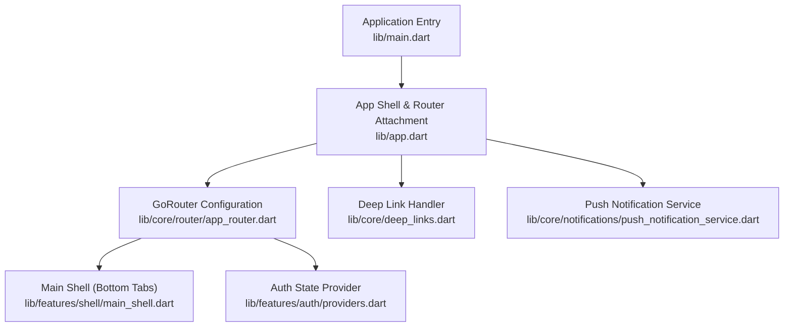
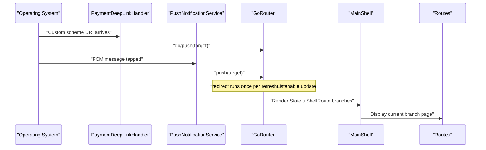
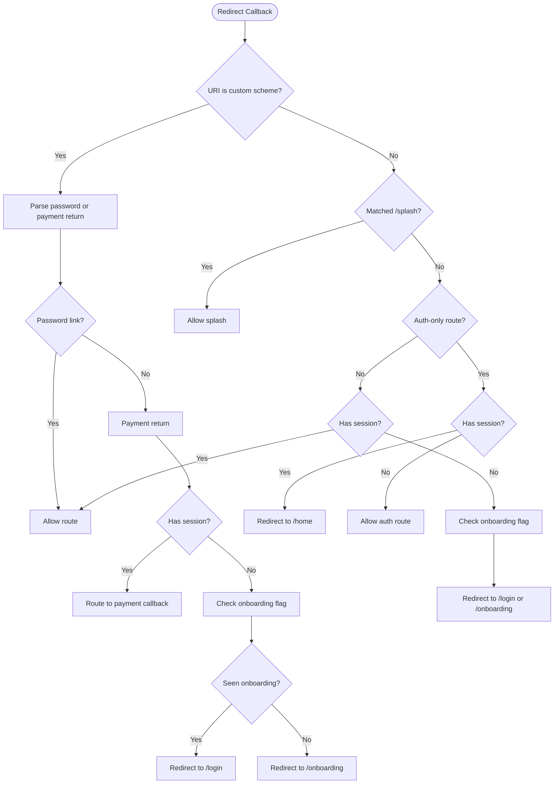
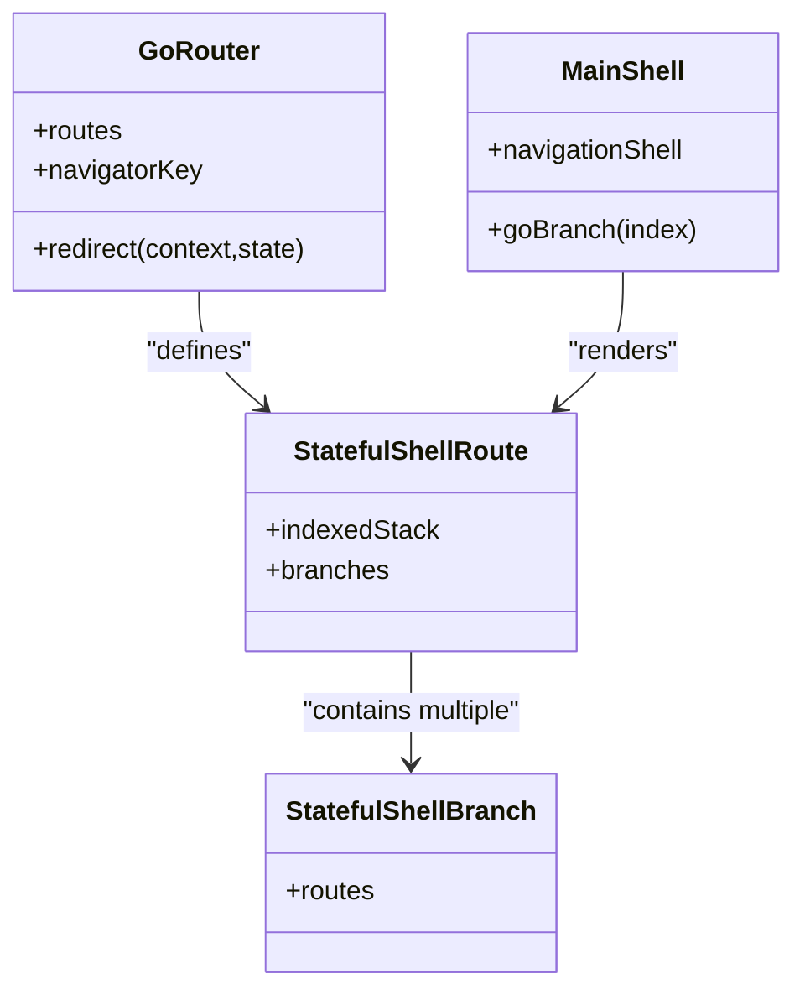
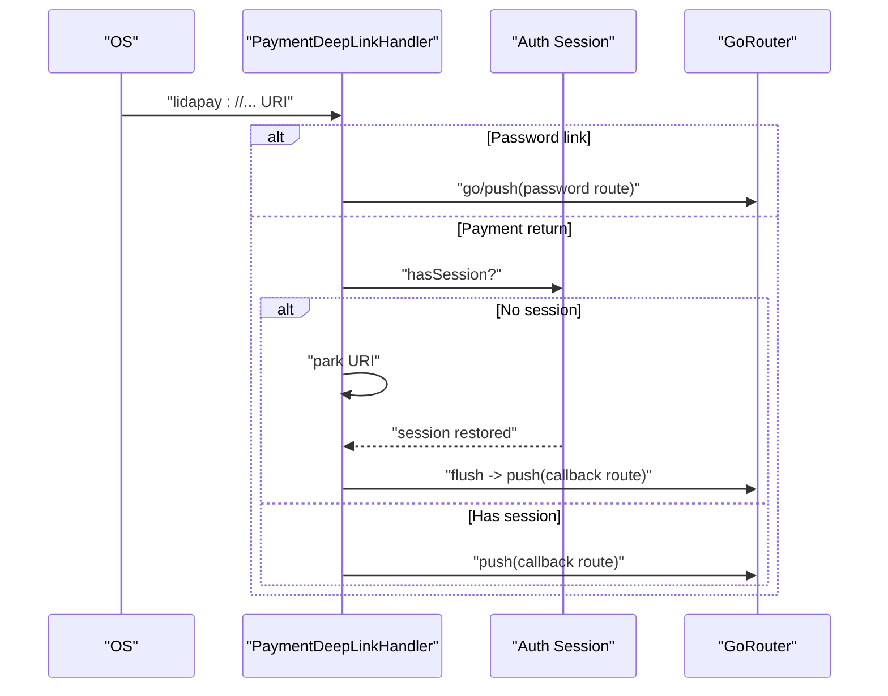
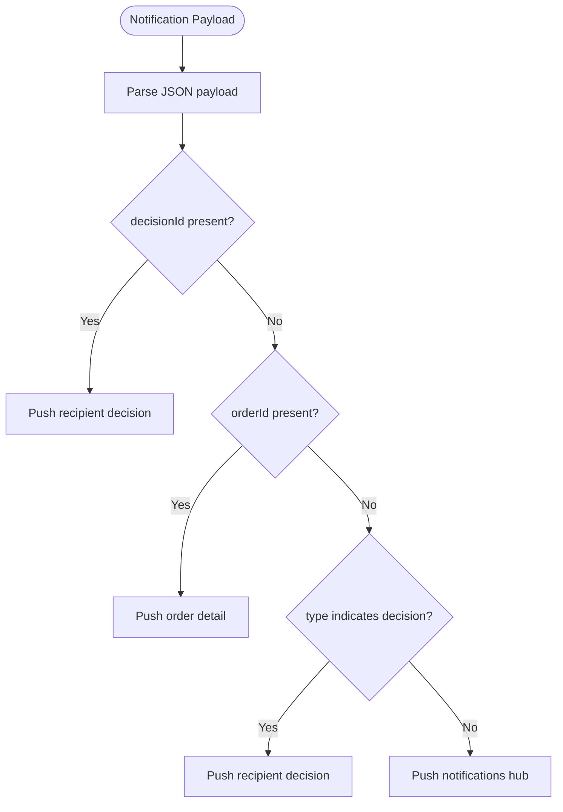
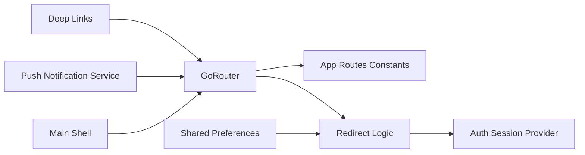

# Navigation with GoRouter

<cite>
**Referenced Files in This Document**
- [main.dart](file://lib/main.dart)
- [app.dart](file://lib/app.dart)
- [app_router.dart](file://lib/core/router/app_router.dart)
- [deep_links.dart](file://lib/core/deep_links.dart)
- [push_notification_service.dart](file://lib/core/notifications/push_notification_service.dart)
- [providers.dart](file://lib/features/auth/providers.dart)
- [main_shell.dart](file://lib/features/shell/main_shell.dart)
</cite>

## Table of Contents
1. [Introduction](#introduction)
2. [Project Structure](#project-structure)
3. [Core Components](#core-components)
4. [Architecture Overview](#architecture-overview)
5. [Detailed Component Analysis](#detailed-component-analysis)
6. [Dependency Analysis](#dependency-analysis)
7. [Performance Considerations](#performance-considerations)
8. [Troubleshooting Guide](#troubleshooting-guide)
9. [Conclusion](#conclusion)

## Introduction
This document explains the GoRouter-based navigation system used by the application. It covers route configuration, nested routing with StatefulShellRoute for bottom tabs, authentication guards, deep linking, programmatic navigation, route parameters and query parameters, platform-specific behaviors, navigation state persistence, and error handling during route transitions.

## Project Structure
The navigation implementation is centered around a single router definition, an app shell for tabbed navigation, deep link handling, and notification-driven routing. The entry points initialize providers, restore sessions, and attach the router to MaterialApp.router.

**Diagram sources**
- [main.dart:17-149](file://lib/main.dart#L17-L149)
- [app.dart:68-101](file://lib/app.dart#L68-L101)
- [app.dart:192-252](file://lib/app.dart#L192-L252)
- [app_router.dart:94-410](file://lib/core/router/app_router.dart#L94-L410)
- [deep_links.dart:8-158](file://lib/core/deep_links.dart#L8-L158)
- [push_notification_service.dart:28-164](file://lib/core/notifications/push_notification_service.dart#L28-L164)
- [main_shell.dart:14-43](file://lib/features/shell/main_shell.dart#L14-L43)
- [providers.dart:22-43](file://lib/features/auth/providers.dart#L22-L43)

**Section sources**
- [main.dart:17-149](file://lib/main.dart#L17-L149)
- [app.dart:68-101](file://lib/app.dart#L68-L101)
- [app.dart:192-252](file://lib/app.dart#L192-L252)

## Core Components
- Router provider and routes: Centralized route constants, redirect logic, and nested routes under a StatefulShellRoute for tabs.
- Authentication guard: Redirects based on session state without recreating the navigator.
- Deep links: Handles custom-scheme payment returns and password reset flows.
- Push notifications: Routes users from notifications into specific screens.
- Main shell: Bottom tab navigation using StatefulNavigationShell.

Key responsibilities:
- Route constants and path patterns live in the router file.
- Session-aware redirects are computed in the router’s redirect callback.
- Deep links and notifications translate external events into internal route transitions.
- The shell maintains independent branch stacks for each tab.

**Section sources**
- [app_router.dart:40-86](file://lib/core/router/app_router.dart#L40-L86)
- [app_router.dart:94-164](file://lib/core/router/app_router.dart#L94-L164)
- [deep_links.dart:8-158](file://lib/core/deep_links.dart#L8-L158)
- [push_notification_service.dart:273-337](file://lib/core/notifications/push_notification_service.dart#L273-L337)
- [main_shell.dart:14-43](file://lib/features/shell/main_shell.dart#L14-L43)

## Architecture Overview
The navigation architecture integrates three input channels into one GoRouter instance:
- In-app navigation via context.go or context.push.
- Deep links from the OS (custom scheme).
- Push notifications that encode target routes.

**Diagram sources**
- [deep_links.dart:27-52](file://lib/core/deep_links.dart#L27-L52)
- [deep_links.dart:137-155](file://lib/core/deep_links.dart#L137-L155)
- [push_notification_service.dart:134-149](file://lib/core/notifications/push_notification_service.dart#L134-L149)
- [push_notification_service.dart:273-337](file://lib/core/notifications/push_notification_service.dart#L273-L337)
- [app_router.dart:238-408](file://lib/core/router/app_router.dart#L238-L408)

## Detailed Component Analysis

### Router Configuration and Authentication Guards
- Route constants define all paths, including nested paths under services, shop, history, profile, and legal.
- Initial location starts at splash.
- A refreshListenable ensures redirect re-evaluation when auth state changes without rebuilding the entire Navigator.
- Redirect rules:
  - Custom-scheme URIs are parsed first; password links bypass session checks; payment callbacks require a session or redirect to login/onboarding.
  - Password reset and verification routes are accessible without a session.
  - Unauthenticated users are redirected to onboarding or login depending on whether onboarding has been seen.
  - Authenticated users visiting auth routes are redirected home.

**Diagram sources**
- [app_router.dart:108-164](file://lib/core/router/app_router.dart#L108-L164)

**Section sources**
- [app_router.dart:40-86](file://lib/core/router/app_router.dart#L40-L86)
- [app_router.dart:94-164](file://lib/core/router/app_router.dart#L94-L164)
- [providers.dart:22-43](file://lib/features/auth/providers.dart#L22-L43)

### Nested Routing with StatefulShellRoute and Bottom Tabs
- The main shell uses StatefulShellRoute.indexedStack with five branches: Home, Services, Shop, History, Profile.
- Each branch defines its root route and nested child routes.
- Child routes that should cover the shell use parentNavigatorKey to push onto the root navigator.
- The shell renders a floating bottom dock; selecting a tab navigates within the same branch stack.

**Diagram sources**
- [app_router.dart:238-408](file://lib/core/router/app_router.dart#L238-L408)
- [main_shell.dart:14-43](file://lib/features/shell/main_shell.dart#L14-L43)

**Section sources**
- [app_router.dart:238-408](file://lib/core/router/app_router.dart#L238-L408)
- [main_shell.dart:14-43](file://lib/features/shell/main_shell.dart#L14-L43)

### Deep Linking Support
- Custom scheme handler supports:
  - Password reset and change flows, which do not require a session.
  - Payment return flows, which require a session; otherwise, they park until authentication completes.
- The handler maps incoming URIs to internal routes and avoids duplicate callback pages.
- When a session becomes available, parked links are flushed once.

**Diagram sources**
- [deep_links.dart:27-61](file://lib/core/deep_links.dart#L27-L61)
- [deep_links.dart:66-135](file://lib/core/deep_links.dart#L66-L135)
- [deep_links.dart:137-155](file://lib/core/deep_links.dart#L137-L155)

**Section sources**
- [deep_links.dart:8-158](file://lib/core/deep_links.dart#L8-L158)

### Push Notification Navigation
- Notification payloads are parsed to navigate to:
  - Recipient decision screen.
  - Order detail screen.
  - Notifications hub as fallback.
- If no session exists at cold start, the payload is held and flushed after authentication.

**Diagram sources**
- [push_notification_service.dart:293-337](file://lib/core/notifications/push_notification_service.dart#L293-L337)

**Section sources**
- [push_notification_service.dart:273-337](file://lib/core/notifications/push_notification_service.dart#L273-L337)

### Programmatic Navigation and Route Parameters
- Screens navigate using context.go and context.push with route constants or string paths.
- Path parameters:
  - Legal documents: docId.
  - Support categories: category.
  - Orders detail: orderId.
  - Recipient decisions: decisionId.
- Query parameters:
  - Password reset token.
  - Payment callback status, orderId, hasToken, errorMessage.
  - Service funding and flow flags.
  - Shop initial product and order IDs.

Examples of usage patterns:
- Navigate to home after successful login or OTP verification.
- Open a service wizard with funding and flow parameters.
- Open a specific order detail from orders list.

**Section sources**
- [app_router.dart:166-237](file://lib/core/router/app_router.dart#L166-L237)
- [app_router.dart:238-408](file://lib/core/router/app_router.dart#L238-L408)

### Platform-Specific Navigation Behaviors
- Edge-to-edge UI is applied consistently across platforms.
- Android custom scheme intents are handled both by GoRouter and the deep link stream; duplicates are avoided.
- Local notifications and Firebase messaging are initialized safely with graceful fallbacks if unavailable.

**Section sources**
- [app.dart:127-133](file://lib/app.dart#L127-L133)
- [deep_links.dart:146-155](file://lib/core/deep_links.dart#L146-L155)
- [push_notification_service.dart:64-164](file://lib/core/notifications/push_notification_service.dart#L64-L164)

### Navigation State Persistence
- Onboarding completion is persisted in shared preferences and consulted during redirects.
- Session restoration occurs early in startup; navigation guards rely on this state.
- Router rebuild is avoided by refreshing only the redirect function when auth state changes.

**Section sources**
- [app_router.dart:88-101](file://lib/core/router/app_router.dart#L88-L101)
- [app_router.dart:157-163](file://lib/core/router/app_router.dart#L157-L163)
- [app_router.dart:413-423](file://lib/core/router/app_router.dart#L413-L423)
- [main.dart:133-141](file://lib/main.dart#L133-L141)

### Error Handling During Route Transitions
- Global Flutter errors and platform errors are caught and logged without crashing the host process.
- Error widget builder provides a recovery action to navigate back to home and reassemble the app.
- Router redirect handles missing or malformed deep links gracefully.
- Notification parsing failures are logged and fall back to the notifications hub.

**Section sources**
- [main.dart:30-40](file://lib/main.dart#L30-L40)
- [main.dart:44-96](file://lib/main.dart#L44-L96)
- [deep_links.dart:27-36](file://lib/core/deep_links.dart#L27-L36)
- [push_notification_service.dart:334-336](file://lib/core/notifications/push_notification_service.dart#L334-L336)

## Dependency Analysis
The navigation layer depends on:
- Riverpod providers for auth state and other app state.
- Deep link plugin for custom scheme URIs.
- Firebase messaging and local notifications for push-driven navigation.
- Shared preferences for onboarding persistence.

**Diagram sources**
- [app_router.dart:94-164](file://lib/core/router/app_router.dart#L94-L164)
- [deep_links.dart:8-158](file://lib/core/deep_links.dart#L8-L158)
- [push_notification_service.dart:28-164](file://lib/core/notifications/push_notification_service.dart#L28-L164)
- [providers.dart:22-43](file://lib/features/auth/providers.dart#L22-L43)

**Section sources**
- [app_router.dart:94-164](file://lib/core/router/app_router.dart#L94-L164)
- [deep_links.dart:8-158](file://lib/core/deep_links.dart#L8-L158)
- [push_notification_service.dart:28-164](file://lib/core/notifications/push_notification_service.dart#L28-L164)
- [providers.dart:22-43](file://lib/features/auth/providers.dart#L22-L43)

## Performance Considerations
- Avoid rebuilding the entire Navigator when auth state changes; instead, refresh the redirect function via a ValueNotifier.
- Use parentNavigatorKey for overlay-style pages to prevent unnecessary shell rebuilds.
- Keep deep link and notification handlers resilient to missing plugins or slow initialization.
- Minimize synchronous work in redirect; perform async operations carefully and rely on refreshListenable updates.

[No sources needed since this section provides general guidance]

## Troubleshooting Guide
Common issues and resolutions:
- Payment callback does not open: Ensure the session is restored before the callback is processed; check parked link flushing.
- Duplicate callback pages: Verify that the current route is already the callback before pushing again.
- Redirect loops: Confirm that password reset and verification routes are allowed without session checks.
- Notification tap does nothing: Validate payload parsing and ensure a session exists; check flushPendingNavigation behavior.
- Splash freeze: Ensure session restore has a timeout and non-fatal error handling.

**Section sources**
- [deep_links.dart:146-155](file://lib/core/deep_links.dart#L146-L155)
- [app_router.dart:108-164](file://lib/core/router/app_router.dart#L108-L164)
- [push_notification_service.dart:278-287](file://lib/core/notifications/push_notification_service.dart#L278-L287)
- [main.dart:133-141](file://lib/main.dart#L133-L141)

## Conclusion
The navigation system centers on a single GoRouter instance with robust redirect logic, nested StatefulShellRoute branches for bottom tabs, and integration points for deep links and push notifications. Authentication guards protect sensitive routes while allowing public flows like password resets. The design emphasizes resilience, performance, and clear separation between navigation concerns and feature screens.

[No sources needed since this section summarizes without analyzing specific files]