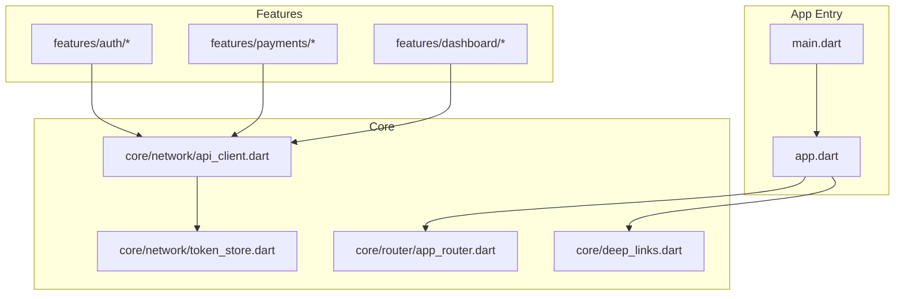
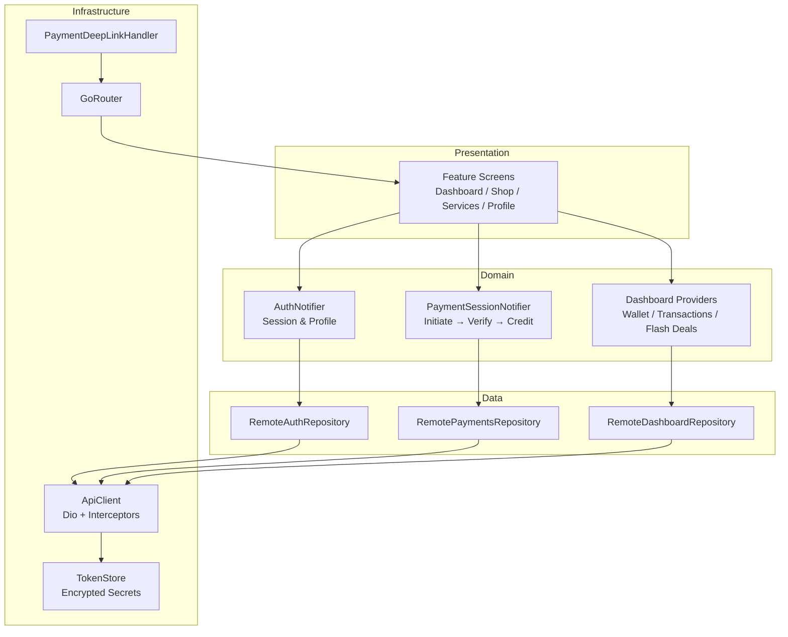
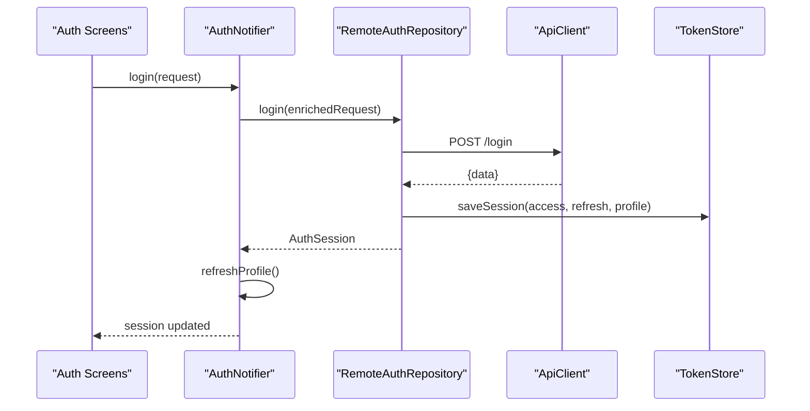
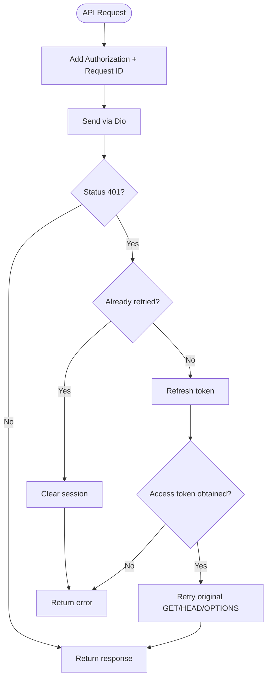
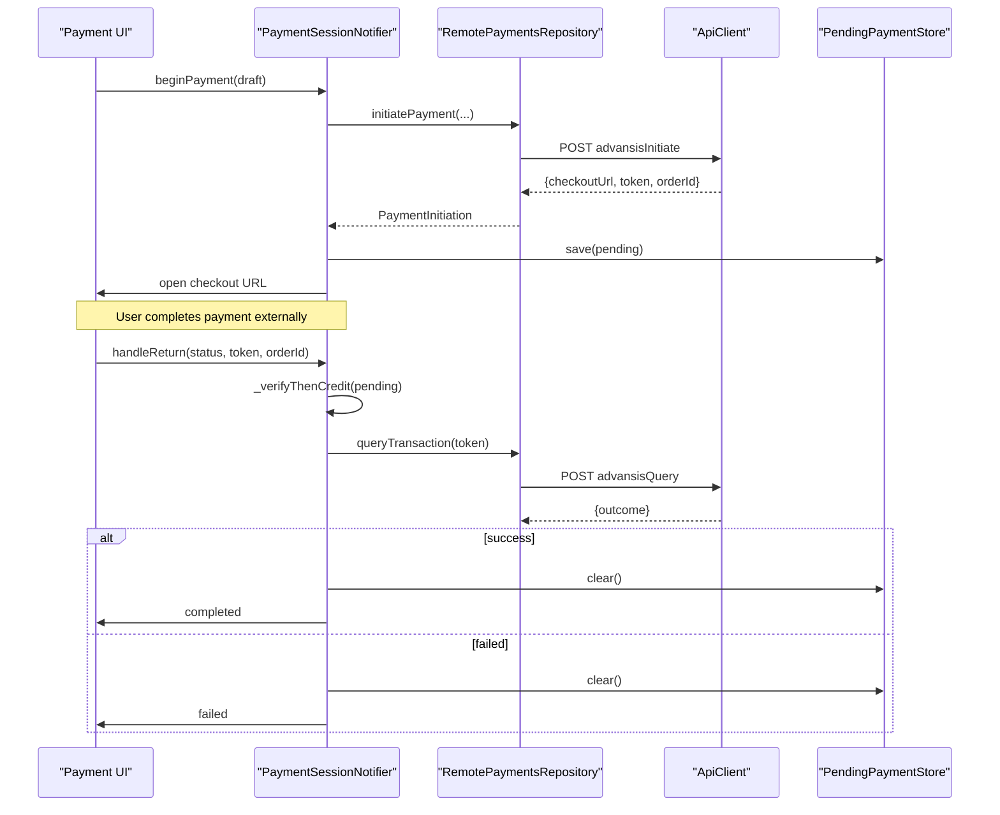
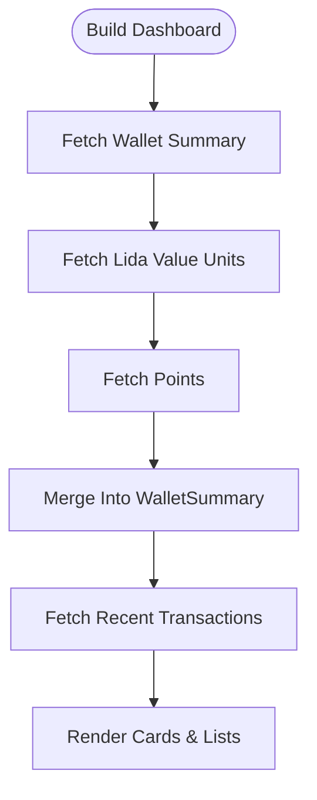
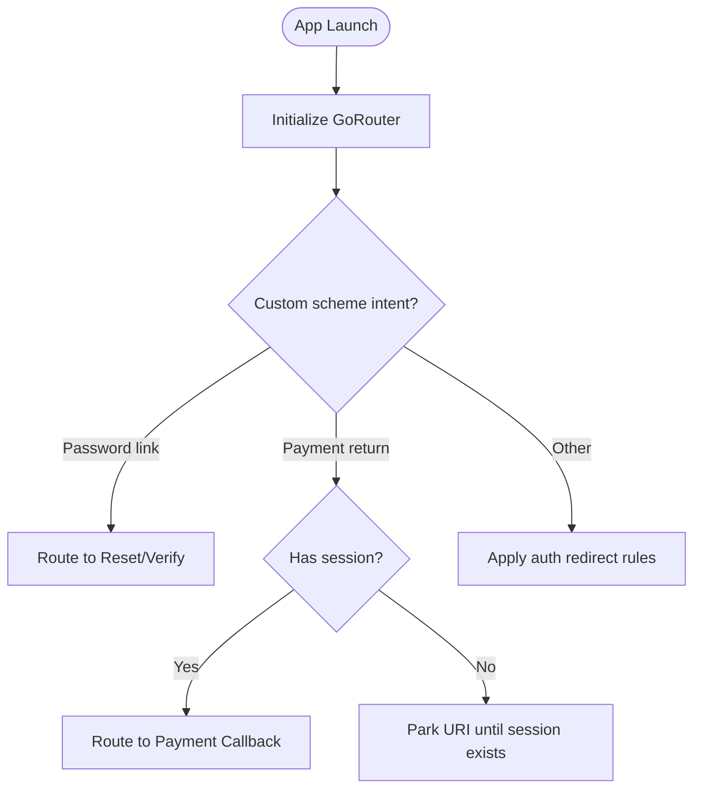
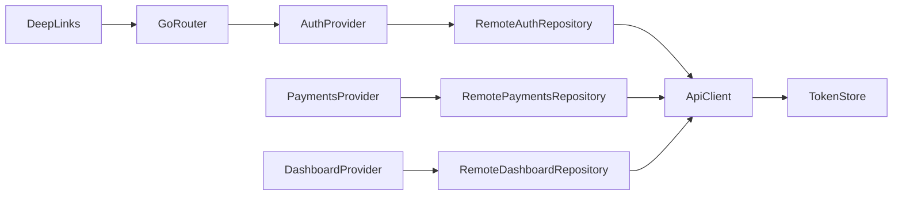

# Overall Architecture Patterns

<cite>
**Referenced Files in This Document**
- [main.dart](file://lib/main.dart)
- [app.dart](file://lib/app.dart)
- [pubspec.yaml](file://pubspec.yaml)
- [app_router.dart](file://lib/core/router/app_router.dart)
- [api_client.dart](file://lib/core/network/api_client.dart)
- [token_store.dart](file://lib/core/network/token_store.dart)
- [deep_links.dart](file://lib/core/deep_links.dart)
- [providers.dart (auth)](file://lib/features/auth/providers.dart)
- [remote_auth_repository.dart](file://lib/features/auth/data/remote_auth_repository.dart)
- [providers.dart (payments)](file://lib/features/payments/providers.dart)
- [remote_payments_repository.dart](file://lib/features/payments/data/remote_payments_repository.dart)
- [providers.dart (dashboard)](file://lib/features/dashboard/providers.dart)
- [remote_dashboard_repository.dart](file://lib/features/dashboard/data/remote_dashboard_repository.dart)
</cite>

## Table of Contents
1. [Introduction](#introduction)
2. [Project Structure](#project-structure)
3. [Core Components](#core-components)
4. [Architecture Overview](#architecture-overview)
5. [Detailed Component Analysis](#detailed-component-analysis)
6. [Dependency Analysis](#dependency-analysis)
7. [Performance Considerations](#performance-considerations)
8. [Troubleshooting Guide](#troubleshooting-guide)
9. [Conclusion](#conclusion)

## Introduction
LidaPay is a Flutter-based mobile application organized around a feature-based architecture and an MVVM-style separation between presentation, domain logic, and data access. The app uses Riverpod for state management, GoRouter for navigation, Dio for HTTP communication, and secure local storage for authentication tokens. Authentication, API client behavior, deep links, payment orchestration, dashboard aggregation, and routing are implemented as cohesive modules that interact through providers and repositories.

This document explains the architectural patterns, technology decisions, component interactions, trade-offs, scalability considerations, and design principles guiding the codebase.

## Project Structure
The project follows a feature-based layout under `lib/features`, with shared infrastructure under `lib/core`. Each feature typically contains:
- `data/`: models, repositories, and remote/mock implementations
- `screens/`: UI screens
- `widgets/`: reusable UI components
- `providers.dart`: Riverpod providers exposing domain state and repository wiring

Shared core modules include:
- Network layer (`core/network`): Dio client, token store, connectivity service, exceptions
- Router (`core/router`): GoRouter configuration and route constants
- Theme and providers (`core/theme`, `core/providers`)
- Deep link handling (`core/deep_links.dart`)
- Device identity and utilities

**Diagram sources**
- [main.dart:17-149](file://lib/main.dart#L17-L149)
- [app.dart:55-255](file://lib/app.dart#L55-L255)
- [app_router.dart:94-410](file://lib/core/router/app_router.dart#L94-L410)
- [api_client.dart:16-276](file://lib/core/network/api_client.dart#L16-L276)
- [token_store.dart:74-238](file://lib/core/network/token_store.dart#L74-L238)
- [deep_links.dart:11-159](file://lib/core/deep_links.dart#L11-L159)

**Section sources**
- [main.dart:17-149](file://lib/main.dart#L17-L149)
- [app.dart:55-255](file://lib/app.dart#L55-L255)
- [pubspec.yaml:30-75](file://pubspec.yaml#L30-L75)

## Core Components
- Application bootstrap and error boundaries: initializes platform settings, global error handlers, Riverpod container overrides, device identity, secure secret store, token store hydration, session restoration, and pending payment hydration.
- App shell: configures Material app, theme, scroll behavior, router, offline banner, edge-to-edge system UI, push notifications, deep links, and lifecycle-driven profile refresh.
- Routing: centralized route constants, auth guards, deep link routing, and shell branches for main tabs.
- API client: Dio-based client with bearer token injection, request ID logging, sensitive payload redaction, single-flight token refresh on 401, and retry semantics.
- Token store: encrypted secret storage with in-memory mirror, migration from legacy plain preferences, biometric session support, and clear events.
- Feature providers: Riverpod providers for auth, payments, and dashboard, each composing repositories and domain logic.

**Section sources**
- [main.dart:17-149](file://lib/main.dart#L17-L149)
- [app.dart:55-255](file://lib/app.dart#L55-L255)
- [app_router.dart:40-424](file://lib/core/router/app_router.dart#L40-L424)
- [api_client.dart:16-276](file://lib/core/network/api_client.dart#L16-L276)
- [token_store.dart:74-238](file://lib/core/network/token_store.dart#L74-L238)

## Architecture Overview
LidaPay implements a feature-based architecture layered over MVVM-like responsibilities:
- Presentation: Flutter widgets and screens consume Riverpod providers.
- Domain: State notifiers and orchestrators encapsulate business workflows (e.g., payment sessions).
- Data: Repositories implement interfaces and call the API client; models describe payloads.

Technology stack decisions:
- Flutter: cross-platform UI framework.
- Riverpod: declarative, testable state management via providers and notifiers.
- GoRouter: type-safe routing with shell branches, redirects, and deep link integration.
- Dio: HTTP client with interceptors for auth, timeouts, and error mapping.

System context diagram showing how authentication, API client, and feature modules interact:

**Diagram sources**
- [providers.dart (auth):23-37](file://lib/features/auth/providers.dart#L23-L37)
- [providers.dart (payments):120-129](file://lib/features/payments/providers.dart#L120-L129)
- [providers.dart (dashboard):16-31](file://lib/features/dashboard/providers.dart#L16-L31)
- [remote_auth_repository.dart:13-275](file://lib/features/auth/data/remote_auth_repository.dart#L13-L275)
- [remote_payments_repository.dart:7-111](file://lib/features/payments/data/remote_payments_repository.dart#L7-L111)
- [remote_dashboard_repository.dart:11-195](file://lib/features/dashboard/data/remote_dashboard_repository.dart#L11-L195)
- [api_client.dart:16-276](file://lib/core/network/api_client.dart#L16-L276)
- [token_store.dart:74-238](file://lib/core/network/token_store.dart#L74-L238)
- [app_router.dart:94-410](file://lib/core/router/app_router.dart#L94-L410)
- [deep_links.dart:11-159](file://lib/core/deep_links.dart#L11-L159)

## Detailed Component Analysis

### Authentication Flow
Authentication is modeled as a Riverpod `StateNotifier` that coordinates login, OTP verification, session restore, profile refresh, and logout. It composes a repository abstraction and persists tokens via `TokenStore`.

Key behaviors:
- Login and OTP flows enrich requests with device identity and FCM token.
- Session restore at cold start hydrates user state and triggers side effects like syncing device tokens.
- Profile refresh is best-effort with retry for transient failures and clears session on 401.
- Biometric login reads a secure snapshot and restores tokens without prompting for credentials.

**Diagram sources**
- [providers.dart (auth):89-105](file://lib/features/auth/providers.dart#L89-L105)
- [remote_auth_repository.dart:20-23](file://lib/features/auth/data/remote_auth_repository.dart#L20-L23)
- [api_client.dart:137-155](file://lib/core/network/api_client.dart#L137-L155)
- [token_store.dart:148-175](file://lib/core/network/token_store.dart#L148-L175)

**Section sources**
- [providers.dart (auth):23-37](file://lib/features/auth/providers.dart#L23-L37)
- [providers.dart (auth):89-105](file://lib/features/auth/providers.dart#L89-L105)
- [providers.dart (auth):171-180](file://lib/features/auth/providers.dart#L171-L180)
- [providers.dart (auth):204-239](file://lib/features/auth/providers.dart#L204-L239)
- [remote_auth_repository.dart:20-23](file://lib/features/auth/data/remote_auth_repository.dart#L20-L23)
- [remote_auth_repository.dart:83-103](file://lib/features/auth/data/remote_auth_repository.dart#L83-L103)

### API Client and Token Refresh
The API client centralizes Dio configuration, header injection, request logging, sensitive payload redaction, and automatic token refresh on 401 responses. It ensures concurrent refreshes are single-flighted and retries once after successful refresh.

Key behaviors:
- Adds Authorization and X-Request-Id headers.
- Redacts sensitive fields in debug logs.
- On 401, calls refresh endpoint with refresh token and device info; updates stored tokens.
- Clears session on invalid refresh or explicit rejection codes.

**Diagram sources**
- [api_client.dart:25-83](file://lib/core/network/api_client.dart#L25-L83)
- [api_client.dart:204-265](file://lib/core/network/api_client.dart#L204-L265)

**Section sources**
- [api_client.dart:16-276](file://lib/core/network/api_client.dart#L16-L276)

### Payment Orchestration
The payment flow orchestrates three phases: initiate, verify, and credit. It supports Advansis Pay checkout via browser redirect and Ghana MoMo via GTPay debit with polling. A persistent pending payment store survives process death.

Key behaviors:
- Initiates payment and opens external checkout URL.
- Handles deep link returns and manual rechecks.
- Polls transaction status until success, failure, or timeout.
- Credits services only after payment confirmation, ensuring idempotency.

**Diagram sources**
- [providers.dart (payments):182-277](file://lib/features/payments/providers.dart#L182-L277)
- [providers.dart (payments):372-421](file://lib/features/payments/providers.dart#L372-L421)
- [providers.dart (payments):474-572](file://lib/features/payments/providers.dart#L474-L572)
- [remote_payments_repository.dart:13-53](file://lib/features/payments/data/remote_payments_repository.dart#L13-L53)

**Section sources**
- [providers.dart (payments):120-129](file://lib/features/payments/providers.dart#L120-L129)
- [providers.dart (payments):182-277](file://lib/features/payments/providers.dart#L182-L277)
- [providers.dart (payments):372-421](file://lib/features/payments/providers.dart#L372-L421)
- [providers.dart (payments):474-572](file://lib/features/payments/providers.dart#L474-L572)
- [remote_payments_repository.dart:13-53](file://lib/features/payments/data/remote_payments_repository.dart#L13-L53)

### Dashboard Aggregation
The dashboard aggregates wallet balance, Lida Value units, points, recent transactions, and flash deals. It degrades gracefully when individual endpoints fail, preserving partial data.

Key behaviors:
- Concurrently fetches wallet, Lida Value, and points; maps varied response shapes.
- Merges ledger, Lida Value history, shop orders, and points into a unified activity feed.
- Provides visibility toggles and background tracking for pending top-ups.

**Diagram sources**
- [remote_dashboard_repository.dart:20-44](file://lib/features/dashboard/data/remote_dashboard_repository.dart#L20-L44)
- [remote_dashboard_repository.dart:121-134](file://lib/features/dashboard/data/remote_dashboard_repository.dart#L121-L134)

**Section sources**
- [providers.dart (dashboard):16-31](file://lib/features/dashboard/providers.dart#L16-L31)
- [providers.dart (dashboard):141-250](file://lib/features/dashboard/providers.dart#L141-L250)
- [remote_dashboard_repository.dart:11-195](file://lib/features/dashboard/data/remote_dashboard_repository.dart#L11-L195)

### Routing and Deep Links
GoRouter manages navigation across splash, onboarding, auth, shell branches, legal, payments callback, and recipient decision surfaces. Redirect logic enforces session requirements while allowing password reset flows to be reachable without a session. Deep links park payment return URIs until a session exists, then route them to the payment callback screen.

Key behaviors:
- Root navigator keys allow full-screen overlays above the shell.
- Redirect checks scheme/host/path for custom-scheme intents and routes accordingly.
- Password reset and verify-change routes accept tokens regardless of session state.
- Payment callback receives hints but relies on persisted token for verification authority.

**Diagram sources**
- [app_router.dart:108-164](file://lib/core/router/app_router.dart#L108-L164)
- [app_router.dart:221-237](file://lib/core/router/app_router.dart#L221-L237)
- [deep_links.dart:38-61](file://lib/core/deep_links.dart#L38-L61)
- [deep_links.dart:66-135](file://lib/core/deep_links.dart#L66-L135)

**Section sources**
- [app_router.dart:40-424](file://lib/core/router/app_router.dart#L40-L424)
- [deep_links.dart:11-159](file://lib/core/deep_links.dart#L11-L159)

## Dependency Analysis
The application exhibits clear separation of concerns:
- Features depend on repositories, which depend on the API client.
- The API client depends on the token store and optional device identity/notification services.
- Routing and deep links coordinate with auth state providers.

**Diagram sources**
- [providers.dart (auth):15-20](file://lib/features/auth/providers.dart#L15-L20)
- [providers.dart (payments):24-33](file://lib/features/payments/providers.dart#L24-L33)
- [providers.dart (dashboard):16-19](file://lib/features/dashboard/providers.dart#L16-L19)
- [api_client.dart:268-276](file://lib/core/network/api_client.dart#L268-L276)
- [token_store.dart:16-24](file://lib/core/network/token_store.dart#L16-L24)

**Section sources**
- [providers.dart (auth):15-20](file://lib/features/auth/providers.dart#L15-L20)
- [providers.dart (payments):24-33](file://lib/features/payments/providers.dart#L24-L33)
- [providers.dart (dashboard):16-19](file://lib/features/dashboard/providers.dart#L16-L19)
- [api_client.dart:268-276](file://lib/core/network/api_client.dart#L268-L276)

## Performance Considerations
- Startup performance: bounded timeouts for session restore and pending payment hydration prevent splash freeze.
- Network resilience: Dio interceptors add connect/send/receive timeouts; API client redacts logs and handles 401 refresh with single-flight deduplication.
- UI responsiveness: Riverpod providers avoid unnecessary rebuilds by selecting slices of state and using autoDispose where appropriate.
- Background polling: dashboard pending top-up polling backs off when no answers are received, reducing network load.
- Offline awareness: non-blocking offline banner keeps the app usable while waiting for connectivity.

[No sources needed since this section provides general guidance]

## Troubleshooting Guide
Common issues and their architectural handling:
- Unexpected display errors: global Flutter error handler and custom ErrorWidget provide a safe fallback and refresh action.
- Platform errors: root error handler prevents host process crashes and logs diagnostics safely.
- Token store corruption: graceful degradation clears legacy plaintext values and migrates to secure storage; broken keystore degrades to signed-out state.
- 401 token refresh failures: session cleared and user redirected to login; biometric session also cleared when required.
- Payment callback mismatches: callback parameters are treated as hints; verification authority is the persisted token, preventing double crediting.

**Section sources**
- [main.dart:30-40](file://lib/main.dart#L30-L40)
- [main.dart:44-96](file://lib/main.dart#L44-L96)
- [token_store.dart:120-146](file://lib/core/network/token_store.dart#L120-L146)
- [api_client.dart:211-265](file://lib/core/network/api_client.dart#L211-L265)
- [providers.dart (payments):372-421](file://lib/features/payments/providers.dart#L372-L421)

## Conclusion
LidaPay’s architecture combines feature-based organization with MVVM-like separation, enabling clear boundaries between presentation, domain, and data layers. Riverpod provides scalable state management, GoRouter offers robust navigation and deep link handling, and Dio’s interceptor-based API client centralizes authentication and error handling. The design emphasizes resilience (timeouts, retries, degraded rendering), security (encrypted secrets, token refresh), and maintainability (repositories, providers, and feature isolation). These patterns support scalability as new features are added while keeping cross-cutting concerns consistent and testable.

[No sources needed since this section summarizes without analyzing specific files]