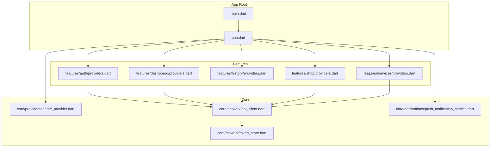
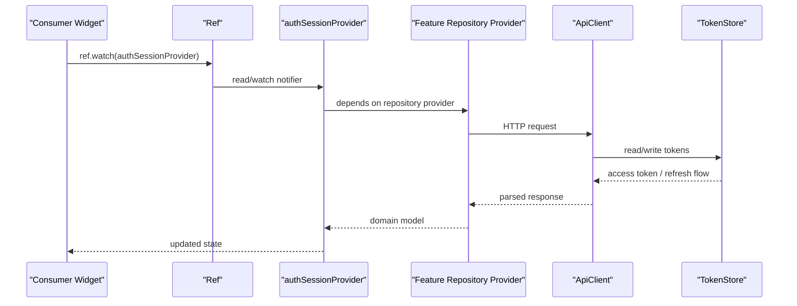
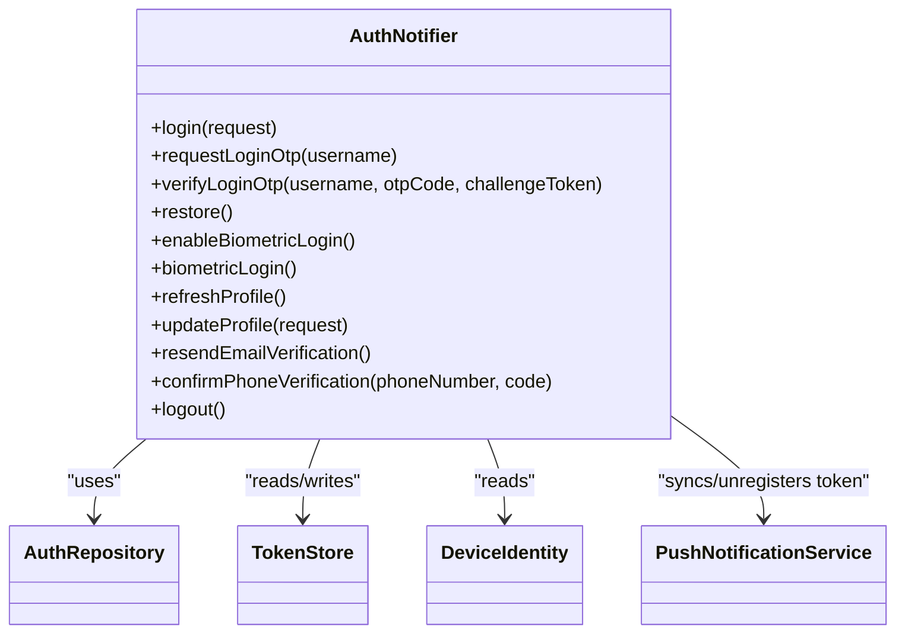
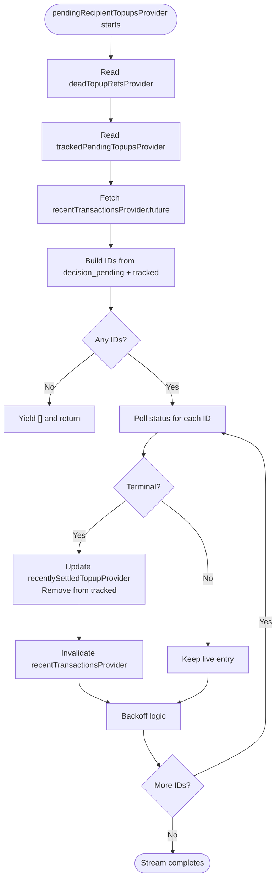
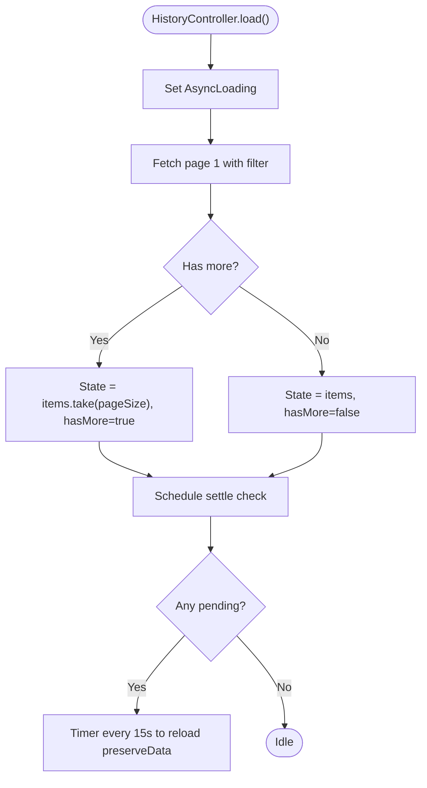
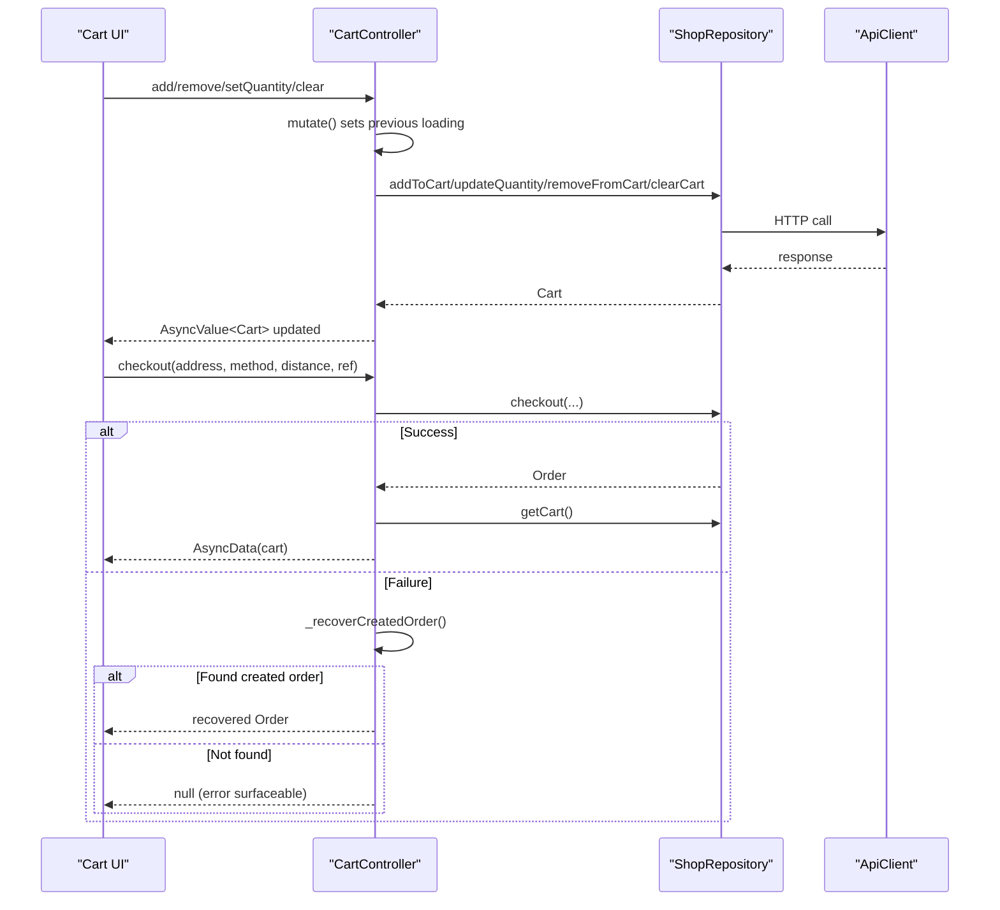
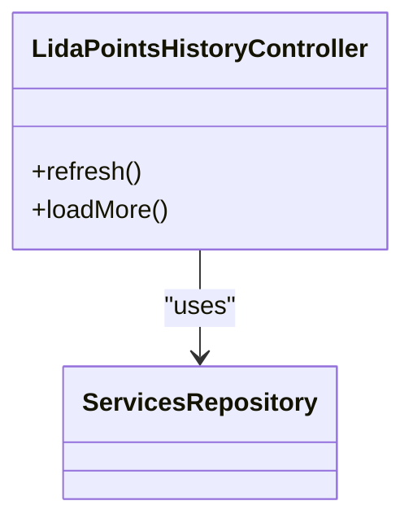
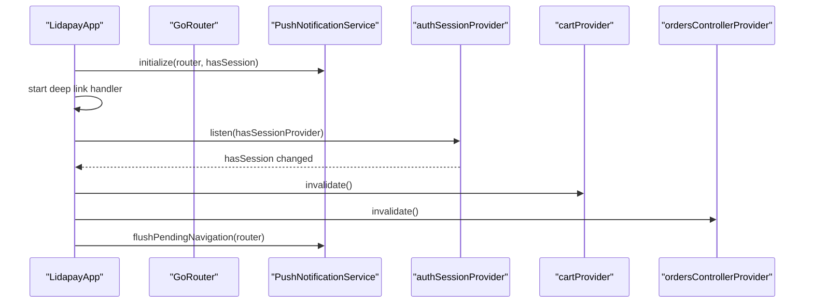
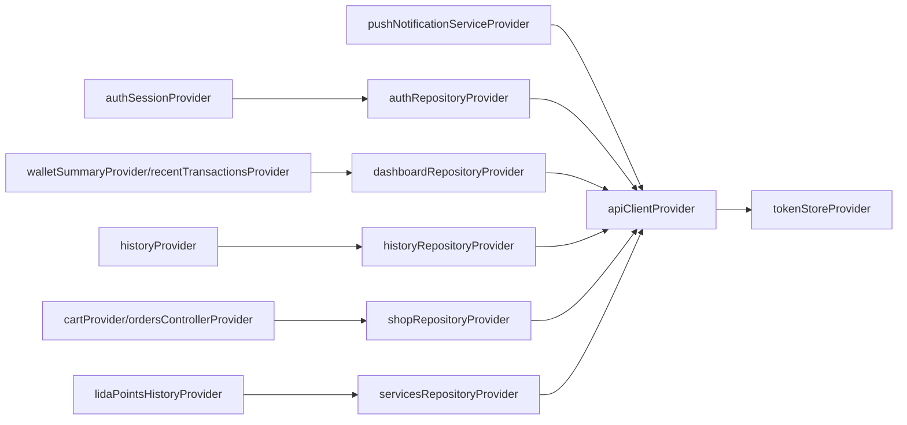

# State Management with Riverpod

<cite>
**Referenced Files in This Document**
- [pubspec.yaml](file://pubspec.yaml)
- [main.dart](file://lib/main.dart)
- [app.dart](file://lib/app.dart)
- [theme_provider.dart](file://lib/core/providers/theme_provider.dart)
- [api_client.dart](file://lib/core/network/api_client.dart)
- [token_store.dart](file://lib/core/network/token_store.dart)
- [push_notification_service.dart](file://lib/core/notifications/push_notification_service.dart)
- [providers.dart (Auth)](file://lib/features/auth/providers.dart)
- [providers.dart (Dashboard)](file://lib/features/dashboard/providers.dart)
- [providers.dart (History)](file://lib/features/history/providers.dart)
- [providers.dart (Shop)](file://lib/features/shop/providers.dart)
- [providers.dart (Services)](file://lib/features/services/providers.dart)
</cite>

## Table of Contents
1. [Introduction](#introduction)
2. [Project Structure](#project-structure)
3. [Core Components](#core-components)
4. [Architecture Overview](#architecture-overview)
5. [Detailed Component Analysis](#detailed-component-analysis)
6. [Dependency Analysis](#dependency-analysis)
7. [Performance Considerations](#performance-considerations)
8. [Troubleshooting Guide](#troubleshooting-guide)
9. [Conclusion](#conclusion)
10. [Appendices](#appendices)

## Introduction
This document explains how LidaPay uses Riverpod for state management across local and global application state. It covers the provider architecture, reactive updates, dependency injection patterns, UI propagation, async handling, performance considerations, memory management, and testing strategies. The goal is to make the system understandable for both new contributors and experienced Flutter developers.

## Project Structure
LidaPay organizes providers by feature under `lib/features/<feature>/providers.dart`, while cross-cutting concerns live under `lib/core`. The app root wires up providers, routing, theme, connectivity, and push notifications.



**Diagram sources**
- [main.dart:1-200](file://lib/main.dart#L1-L200)
- [app.dart:1-255](file://lib/app.dart#L1-L255)
- [theme_provider.dart:1-39](file://lib/core/providers/theme_provider.dart#L1-L39)
- [api_client.dart:1-276](file://lib/core/network/api_client.dart#L1-L276)
- [token_store.dart:1-238](file://lib/core/network/token_store.dart#L1-L238)
- [push_notification_service.dart:1-339](file://lib/core/notifications/push_notification_service.dart#L1-L339)
- [providers.dart (Auth):1-352](file://lib/features/auth/providers.dart#L1-L352)
- [providers.dart (Dashboard):1-250](file://lib/features/dashboard/providers.dart#L1-L250)
- [providers.dart (History):1-205](file://lib/features/history/providers.dart#L1-L205)
- [providers.dart (Shop):1-339](file://lib/features/shop/providers.dart#L1-L339)
- [providers.dart (Services):1-188](file://lib/features/services/providers.dart#L1-L188)

**Section sources**
- [pubspec.yaml:30-36](file://pubspec.yaml#L30-L36)
- [app.dart:1-255](file://lib/app.dart#L1-L255)

## Core Components
- Provider layering:
  - Repository providers expose a single swap point between mock and remote implementations.
  - Feature providers depend on repositories and session state.
  - Global services (API client, token store, push notifications) are provided once and reused.
- Reactive state:
  - `StateNotifierProvider` for mutable controllers (auth, cart, orders, history).
  - `FutureProvider` for one-shot data loads (wallet summary, products, analytics).
  - `StreamProvider.autoDispose` for polling streams (pending top-ups, order tracking).
- Dependency injection:
  - Providers compose dependencies via `ref.watch` and `ref.read`.
  - Session-aware providers recompute when the user changes.

Key responsibilities:
- Authentication and session lifecycle.
- Dashboard wallet and recent transactions.
- Paginated history with filters and settlement polling.
- Shop browsing, cart mutations, checkout reconciliation, and live delivery tracking.
- Services catalog, Lida Points ledger, and affiliate/invite summaries.

**Section sources**
- [providers.dart (Auth):15-49](file://lib/features/auth/providers.dart#L15-L49)
- [providers.dart (Dashboard):16-31](file://lib/features/dashboard/providers.dart#L16-L31)
- [providers.dart (History):15-61](file://lib/features/history/providers.dart#L15-L61)
- [providers.dart (Shop):16-48](file://lib/features/shop/providers.dart#L16-L48)
- [providers.dart (Services):12-58](file://lib/features/services/providers.dart#L12-L58)

## Architecture Overview
Riverpod drives the UI through reactive reads. Changes in providers propagate automatically to widgets that watch them. The app initializes core services at startup, then features consume them through providers.



**Diagram sources**
- [providers.dart (Auth):23-49](file://lib/features/auth/providers.dart#L23-L49)
- [api_client.dart:16-84](file://lib/core/network/api_client.dart#L16-L84)
- [token_store.dart:74-118](file://lib/core/network/token_store.dart#L74-L118)

## Detailed Component Analysis

### Authentication and Session State
The authentication provider encapsulates login flows, OTP challenges, profile refresh, biometric sign-in, and logout. It composes the repository, token store, device identity, and push notification service. A derived boolean provider exposes whether a session exists.



- Key behaviors:
  - On successful login or OTP verification, the profile is refreshed and side effects (e.g., token sync) run.
  - Biometric login restores a secure session snapshot if available.
  - Logout triggers token unregistration and clears in-memory state.

**Diagram sources**
- [providers.dart (Auth):51-351](file://lib/features/auth/providers.dart#L51-L351)

**Section sources**
- [providers.dart (Auth):15-49](file://lib/features/auth/providers.dart#L15-L49)
- [providers.dart (Auth):51-351](file://lib/features/auth/providers.dart#L51-L351)

### Dashboard State and Pending Top-ups
Dashboard providers fetch wallet summary, recent transactions, and flash deals. A background stream tracks pending top-ups requiring recipient decisions, polling until terminal states and updating global alerts.



**Diagram sources**
- [providers.dart (Dashboard):141-249](file://lib/features/dashboard/providers.dart#L141-L249)

**Section sources**
- [providers.dart (Dashboard):16-31](file://lib/features/dashboard/providers.dart#L16-L31)
- [providers.dart (Dashboard):57-85](file://lib/features/dashboard/providers.dart#L57-L85)
- [providers.dart (Dashboard):141-249](file://lib/features/dashboard/providers.dart#L141-L249)

### History State and Settlement Polling
History uses a controller to manage paginated transactions, filters, and settlement polling for pending items. Errors during load-more are surfaced without losing existing data.



**Diagram sources**
- [providers.dart (History):58-131](file://lib/features/history/providers.dart#L58-L131)

**Section sources**
- [providers.dart (History):15-61](file://lib/features/history/providers.dart#L15-L61)
- [providers.dart (History):63-177](file://lib/features/history/providers.dart#L63-L177)

### Shop State: Cart, Orders, and Live Tracking
Shop state includes product browsing, favorites persistence, cart mutation, checkout reconciliation, and live delivery tracking.



**Diagram sources**
- [providers.dart (Shop):223-338](file://lib/features/shop/providers.dart#L223-L338)

```mermaid
streamDiagram
title "orderTrackingProvider autoDispose family"
StreamProvider.family("orderId") --> Poll["Poll getOrderTracking(orderId) every 8s"]
Poll --> Terminal{"Terminal?"}
Terminal -- Yes --> Stop["Stop polling"]
Terminal -- No --> Continue["Continue polling"]
```

**Diagram sources**
- [providers.dart (Shop):189-221](file://lib/features/shop/providers.dart#L189-L221)

**Section sources**
- [providers.dart (Shop):16-48](file://lib/features/shop/providers.dart#L16-L48)
- [providers.dart (Shop):54-85](file://lib/features/shop/providers.dart#L54-L85)
- [providers.dart (Shop):94-180](file://lib/features/shop/providers.dart#L94-L180)
- [providers.dart (Shop):189-221](file://lib/features/shop/providers.dart#L189-L221)
- [providers.dart (Shop):223-338](file://lib/features/shop/providers.dart#L223-L338)

### Services State: Wallets, Points, and Affiliate Data
Services providers expose catalogs, wallets, points history, and affiliate/invite summaries. Points history is paginated with error handling and deduplication.



**Diagram sources**
- [providers.dart (Services):98-169](file://lib/features/services/providers.dart#L98-L169)

**Section sources**
- [providers.dart (Services):12-58](file://lib/features/services/providers.dart#L12-L58)
- [providers.dart (Services):98-169](file://lib/features/services/providers.dart#L98-L169)
- [providers.dart (Services):170-188](file://lib/features/services/providers.dart#L170-L188)

### Theme and Global Settings
Theme mode is persisted and applied globally. It is a simple `StateNotifierProvider` backed by shared preferences.

**Section sources**
- [theme_provider.dart:6-38](file://lib/core/providers/theme_provider.dart#L6-L38)

### App Lifecycle and Cross-Feature Coordination
The app root coordinates initialization, deep links, session changes, and offline awareness. It invalidates or listens to providers to keep state consistent across features.



**Diagram sources**
- [app.dart:69-100](file://lib/app.dart#L69-L100)

**Section sources**
- [app.dart:69-100](file://lib/app.dart#L69-L100)
- [app.dart:116-125](file://lib/app.dart#L116-L125)
- [app.dart:136-174](file://lib/app.dart#L136-L174)

## Dependency Analysis
Providers form a layered dependency graph:
- Core services: `apiClientProvider`, `tokenStoreProvider`, `pushNotificationServiceProvider`.
- Feature repositories: `authRepositoryProvider`, `dashboardRepositoryProvider`, `historyRepositoryProvider`, `shopRepositoryProvider`, `servicesRepositoryProvider`.
- Feature state: auth session, dashboard feeds, history controller, shop cart/orders, services wallets and history.



**Diagram sources**
- [api_client.dart:268-275](file://lib/core/network/api_client.dart#L268-L275)
- [token_store.dart:10-18](file://lib/core/network/token_store.dart#L10-L18)
- [providers.dart (Auth):15-37](file://lib/features/auth/providers.dart#L15-L37)
- [providers.dart (Dashboard):16-31](file://lib/features/dashboard/providers.dart#L16-L31)
- [providers.dart (History):15-61](file://lib/features/history/providers.dart#L15-L61)
- [providers.dart (Shop):16-48](file://lib/features/shop/providers.dart#L16-L48)
- [providers.dart (Services):12-58](file://lib/features/services/providers.dart#L12-L58)

**Section sources**
- [api_client.dart:16-84](file://lib/core/network/api_client.dart#L16-L84)
- [providers.dart (Auth):15-37](file://lib/features/auth/providers.dart#L15-L37)
- [providers.dart (Dashboard):16-31](file://lib/features/dashboard/providers.dart#L16-L31)
- [providers.dart (History):15-61](file://lib/features/history/providers.dart#L15-L61)
- [providers.dart (Shop):16-48](file://lib/features/shop/providers.dart#L16-L48)
- [providers.dart (Services):12-58](file://lib/features/services/providers.dart#L12-L58)

## Performance Considerations
- Prefer `FutureProvider` for one-shot data and `StreamProvider.autoDispose` for polling streams so they stop when no longer watched.
- Use `select` or derived providers to avoid unnecessary rebuilds (e.g., `hasSessionProvider`).
- Preserve previous loading state during mutations (`AsyncLoading.copyWithPrevious`) to prevent skeleton flicker.
- Debounce/back off polling where appropriate (pending top-ups backoff strategy; order tracking fixed interval).
- Avoid recomputing expensive values by caching in providers and invalidating only when necessary.
- Use `autoDispose` for per-route or per-widget state to free resources promptly.

[No sources needed since this section provides general guidance]

## Troubleshooting Guide
Common issues and remedies:
- Token refresh failures:
  - The API client handles 401 responses by refreshing tokens once; repeated failures clear the session.
  - If the refresh endpoint rejects credentials, the session is cleared and the user is logged out.
- Offline behavior:
  - Connectivity state is consumed by the app shell to show an offline banner; providers may still hold cached data.
- Notification navigation:
  - If a notification arrives before authentication, it is queued and flushed once a session exists.
- Pending top-up loops:
  - Stale ledger references are blacklisted to prevent infinite 404 loops; explicitly tracked transfers are removed upon settlement.

**Section sources**
- [api_client.dart:50-84](file://lib/core/network/api_client.dart#L50-L84)
- [api_client.dart:204-265](file://lib/core/network/api_client.dart#L204-L265)
- [push_notification_service.dart:278-287](file://lib/core/notifications/push_notification_service.dart#L278-L287)
- [providers.dart (Dashboard):181-196](file://lib/features/dashboard/providers.dart#L181-L196)

## Conclusion
LidaPay’s Riverpod implementation cleanly separates concerns: core services provide infrastructure, feature repositories abstract network calls, and feature providers manage UI state. Reactive updates propagate efficiently, with careful attention to async flows, polling, and resource disposal. By following the patterns shown here—repository providers, session-aware composition, `FutureProvider`/`StreamProvider.autoDispose`, and explicit invalidation—you can extend the app safely and predictably.

[No sources needed since this section summarizes without analyzing specific files]

## Appendices

### Provider Scopes and Consumer Widgets
- Wrap your app with a `ProviderScope` (typically in `main.dart`) to enable Riverpod.
- Consume providers using:
  - `ref.watch` in `ConsumerWidget` or `ConsumerStatefulWidget`.
  - `ref.read` for fire-and-forget actions.
  - `ref.listen` for side effects triggered by state changes.

Example patterns:
- Watch a boolean derived from session state to gate routes or features.
- Listen to a settled top-up event to show a snackbar and invalidate dependent providers.

**Section sources**
- [app.dart:136-174](file://lib/app.dart#L136-L174)
- [providers.dart (Auth):41-49](file://lib/features/auth/providers.dart#L41-L49)

### Testing Strategies for Riverpod Providers
- Override providers in tests:
  - Replace `sharedPrefsProvider` and `secretStoreProvider` with in-memory implementations.
  - Swap repository providers with mock implementations.
- Test notifiers:
  - Instantiate the notifier directly and assert state transitions after calling methods.
- Test futures and streams:
  - Use `future.whenData` and stream matchers to verify asynchronous outcomes.
- Isolate side effects:
  - Mock push notification service and router interactions where applicable.

**Section sources**
- [token_store.dart:10-18](file://lib/core/network/token_store.dart#L10-L18)
- [token_store.dart:32-44](file://lib/core/network/token_store.dart#L32-L44)
- [push_notification_service.dart:289-337](file://lib/core/notifications/push_notification_service.dart#L289-L337)