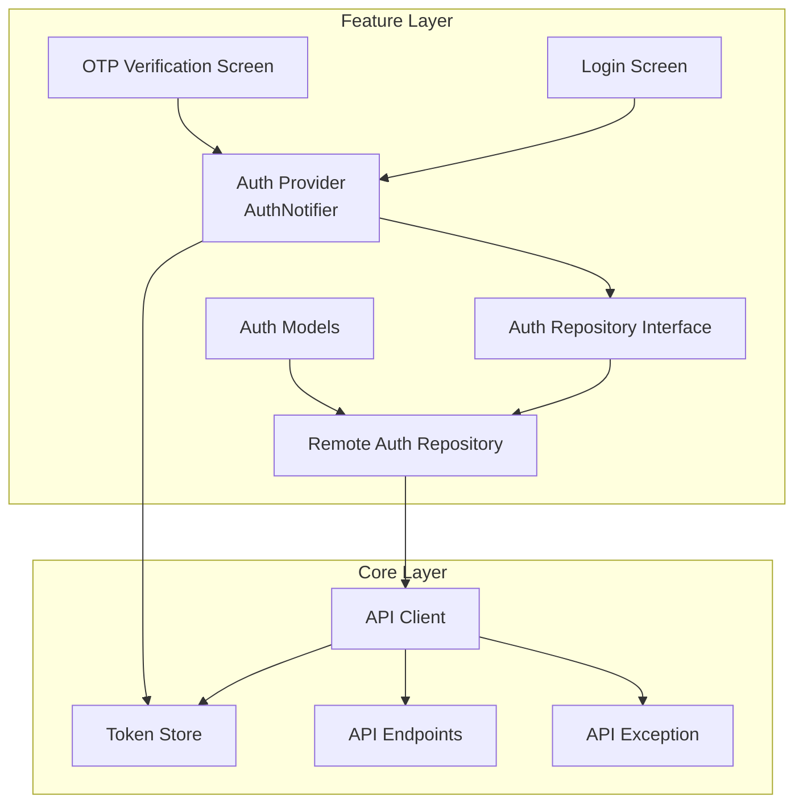
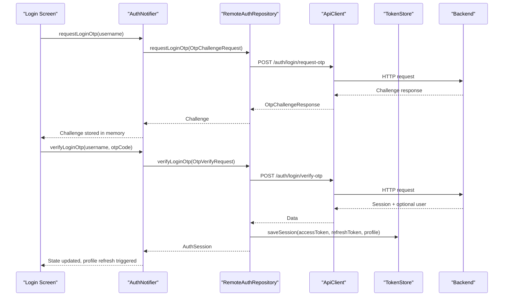
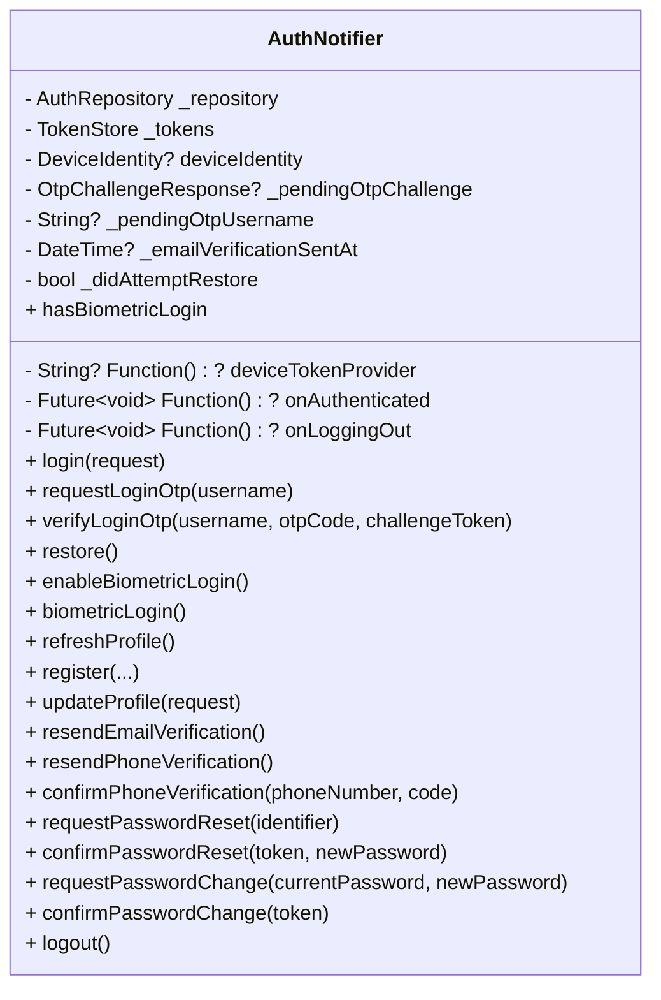
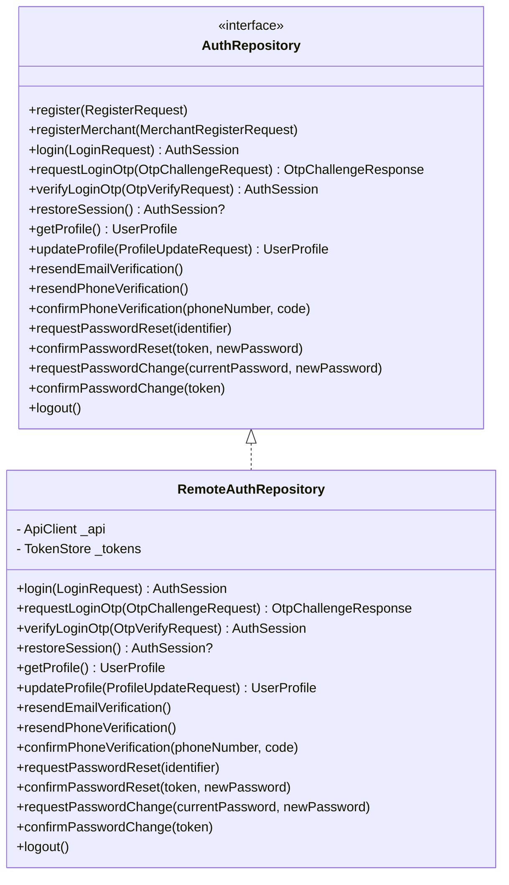
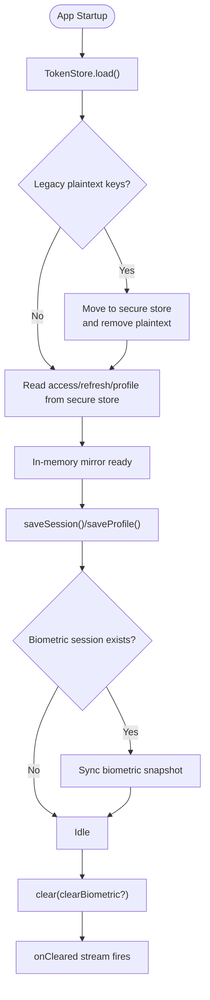
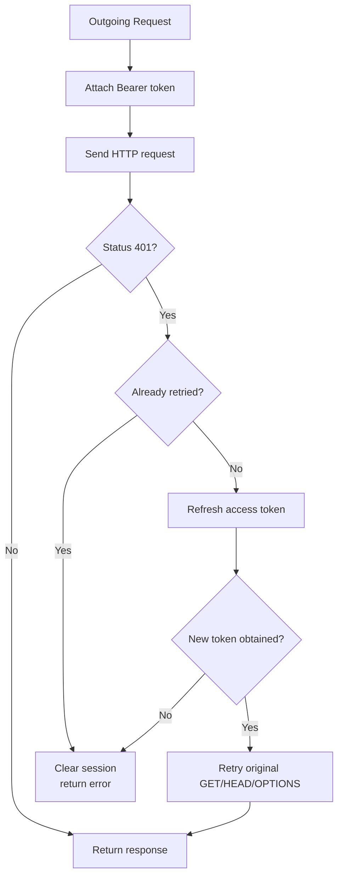
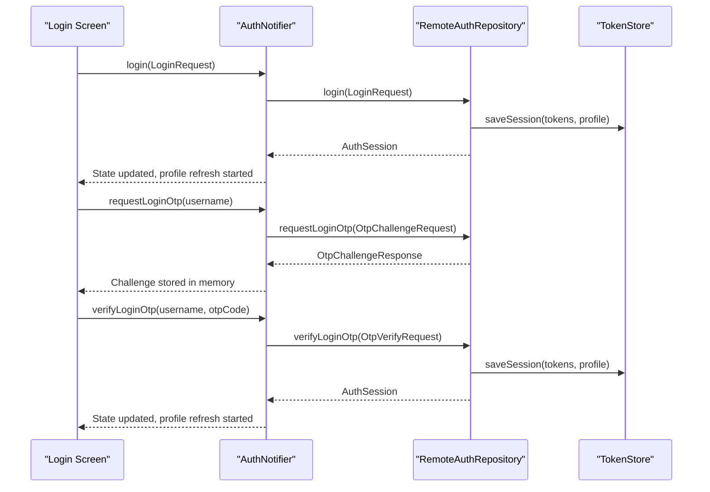
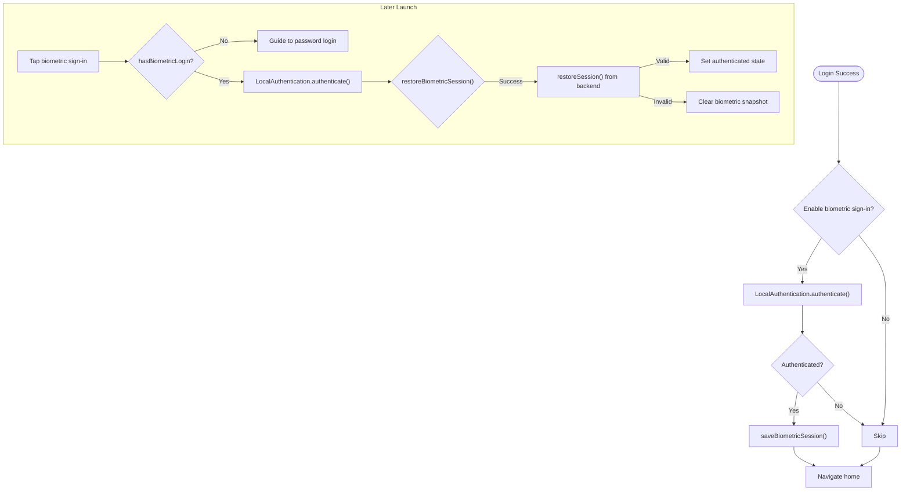
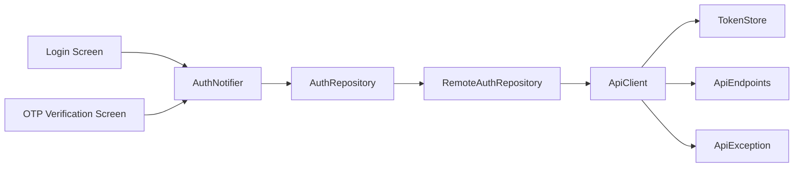

# Authentication & Security

<cite>
**Referenced Files in This Document**
- [providers.dart](file://lib/features/auth/providers.dart)
- [auth_repository.dart](file://lib/features/auth/data/auth_repository.dart)
- [remote_auth_repository.dart](file://lib/features/auth/data/remote_auth_repository.dart)
- [auth_models.dart](file://lib/features/auth/data/auth_models.dart)
- [login_screen.dart](file://lib/features/auth/screens/login_screen.dart)
- [otp_verification_screen.dart](file://lib/features/auth/screens/otp_verification_screen.dart)
- [token_store.dart](file://lib/core/network/token_store.dart)
- [api_client.dart](file://lib/core/network/api_client.dart)
- [api_endpoints.dart](file://lib/core/network/api_endpoints.dart)
- [api_exception.dart](file://lib/core/network/api_exception.dart)
</cite>

## Table of Contents
1. [Introduction](#introduction)
2. [Project Structure](#project-structure)
3. [Core Components](#core-components)
4. [Architecture Overview](#architecture-overview)
5. [Detailed Component Analysis](#detailed-component-analysis)
6. [Dependency Analysis](#dependency-analysis)
7. [Performance Considerations](#performance-considerations)
8. [Troubleshooting Guide](#troubleshooting-guide)
9. [Conclusion](#conclusion)

## Introduction
This document explains the authentication and security subsystem for the mobile application. It covers multi-factor login flows, OTP verification, biometric authentication, session persistence, token refresh, error handling, input validation, and user experience patterns. The implementation uses a repository pattern, Riverpod state management, secure storage for secrets, and an HTTP client with automatic bearer-token refresh.

## Project Structure
The authentication subsystem is organized by feature:
- Feature layer: screens, providers, data models, and repositories.
- Core layer: network client, endpoints, exceptions, device identity, and token storage.

**Diagram sources**
- [login_screen.dart:177-352](file://lib/features/auth/screens/login_screen.dart#L177-L352)
- [otp_verification_screen.dart:70-125](file://lib/features/auth/screens/otp_verification_screen.dart#L70-L125)
- [providers.dart:51-202](file://lib/features/auth/providers.dart#L51-L202)
- [auth_repository.dart:3-78](file://lib/features/auth/data/auth_repository.dart#L3-L78)
- [remote_auth_repository.dart:13-80](file://lib/features/auth/data/remote_auth_repository.dart#L13-L80)
- [auth_models.dart:197-354](file://lib/features/auth/data/auth_models.dart#L197-L354)
- [api_client.dart:16-84](file://lib/core/network/api_client.dart#L16-L84)
- [token_store.dart:74-118](file://lib/core/network/token_store.dart#L74-L118)
- [api_endpoints.dart:6-33](file://lib/core/network/api_endpoints.dart#L6-L33)
- [api_exception.dart:3-38](file://lib/core/network/api_exception.dart#L3-L38)

**Section sources**
- [providers.dart:1-50](file://lib/features/auth/providers.dart#L1-L50)
- [auth_repository.dart:1-78](file://lib/features/auth/data/auth_repository.dart#L1-L78)
- [remote_auth_repository.dart:1-12](file://lib/features/auth/data/remote_auth_repository.dart#L1-L12)
- [api_client.dart:1-16](file://lib/core/network/api_client.dart#L1-L16)
- [token_store.dart:1-24](file://lib/core/network/token_store.dart#L1-L24)

## Core Components
- AuthProvider (Riverpod): Manages current session, login, OTP challenge, OTP verification, profile refresh, biometric sign-in, and logout.
- AuthRepository interface: Declares all authentication operations.
- RemoteAuthRepository: Implements API calls, persists sessions, and merges profiles.
- TokenStore: Securely stores access/refresh tokens and profile; supports biometric session snapshots and emits clear events.
- ApiClient: Dio-based HTTP client that injects Authorization headers, redacts sensitive logs, and transparently refreshes tokens on 401.
- AuthModels: Request/response types for login, OTP, registration, and profile updates.
- Screens: Login screen orchestrates username/password/OTP/biometric flows; OTP verification screen handles second-factor entry after password login.

Key responsibilities:
- Multi-factor login via OTP challenge and verification.
- Password-based login returning a full session.
- Biometric quick sign-in using a previously saved refreshable session.
- Session restoration at cold start.
- Profile synchronization and best-effort retry logic.
- Secure token persistence and safe clearing.

**Section sources**
- [providers.dart:51-202](file://lib/features/auth/providers.dart#L51-L202)
- [auth_repository.dart:3-78](file://lib/features/auth/data/auth_repository.dart#L3-L78)
- [remote_auth_repository.dart:13-103](file://lib/features/auth/data/remote_auth_repository.dart#L13-L103)
- [token_store.dart:74-238](file://lib/core/network/token_store.dart#L74-L238)
- [api_client.dart:16-84](file://lib/core/network/api_client.dart#L16-L84)
- [auth_models.dart:197-354](file://lib/features/auth/data/auth_models.dart#L197-L354)

## Architecture Overview
The authentication flow combines UI orchestration, provider state, repository abstraction, secure storage, and HTTP networking.

**Diagram sources**
- [login_screen.dart:195-335](file://lib/features/auth/screens/login_screen.dart#L195-L335)
- [providers.dart:107-163](file://lib/features/auth/providers.dart#L107-L163)
- [remote_auth_repository.dart:25-52](file://lib/features/auth/data/remote_auth_repository.dart#L25-L52)
- [api_endpoints.dart:6-9](file://lib/core/network/api_endpoints.dart#L6-L9)
- [token_store.dart:148-175](file://lib/core/network/token_store.dart#L148-L175)

## Detailed Component Analysis

### Authentication Provider (State Management)
Responsibilities:
- Enrich login and OTP requests with device metadata.
- Manage pending OTP challenge in memory only.
- Restore persisted session at cold start.
- Refresh profile with best-effort retry and 401 handling.
- Enable and execute biometric login using stored refreshable session.
- Handle logout and notify observers.

Important behaviors:
- On successful login or OTP verification, it clears pending OTP state and triggers profile refresh.
- Profile refresh retries once after a short delay for transient errors but does not retry on auth failures.
- Biometric login requires a refreshable session; otherwise it throws a user-facing exception.

**Diagram sources**
- [providers.dart:51-202](file://lib/features/auth/providers.dart#L51-L202)

**Section sources**
- [providers.dart:51-202](file://lib/features/auth/providers.dart#L51-L202)

### Repository Pattern
Interface:
- Defines login, OTP challenge, OTP verification, session restoration, profile operations, verification resends, password reset/change flows, and logout.

Live implementation:
- Maps to backend endpoints.
- Persists tokens and profile through TokenStore.
- Merges profile payloads defensively.
- Extracts user ID from JWT when missing in payload.

**Diagram sources**
- [auth_repository.dart:3-78](file://lib/features/auth/data/auth_repository.dart#L3-L78)
- [remote_auth_repository.dart:13-275](file://lib/features/auth/data/remote_auth_repository.dart#L13-L275)

**Section sources**
- [auth_repository.dart:3-78](file://lib/features/auth/data/auth_repository.dart#L3-L78)
- [remote_auth_repository.dart:13-103](file://lib/features/auth/data/remote_auth_repository.dart#L13-L103)

### Token Storage and Biometric Sessions
Capabilities:
- Stores access token, refresh token, and last known profile securely.
- Migrates legacy plaintext preferences into secure storage.
- Emits a stream when the session is cleared so UI can react.
- Supports saving/restoring a biometric session snapshot containing access and refresh tokens plus profile.

Security considerations:
- Secrets are written to a secure backend (Android Keystore/iOS Keychain).
- Legacy plaintext keys are migrated and removed.
- Clearing the session removes both regular and optionally biometric snapshots.

**Diagram sources**
- [token_store.dart:74-146](file://lib/core/network/token_store.dart#L74-L146)
- [token_store.dart:148-238](file://lib/core/network/token_store.dart#L148-L238)

**Section sources**
- [token_store.dart:74-238](file://lib/core/network/token_store.dart#L74-L238)

### HTTP Client and Token Refresh
Responsibilities:
- Adds Authorization header with stored access token.
- Redacts sensitive fields in debug logs.
- Transparently refreshes access token on 401 responses.
- Single-flight refresh to avoid concurrent refresh storms.
- Clears session when refresh fails due to invalid/expired refresh tokens.

**Diagram sources**
- [api_client.dart:16-84](file://lib/core/network/api_client.dart#L16-L84)
- [api_client.dart:204-265](file://lib/core/network/api_client.dart#L204-L265)

**Section sources**
- [api_client.dart:16-84](file://lib/core/network/api_client.dart#L16-L84)
- [api_client.dart:204-265](file://lib/core/network/api_client.dart#L204-L265)

### Login Flow and OTP Verification
Two primary flows:
- Password login: Username/email + password returns a session directly.
- OTP login: Username triggers a challenge; user enters a 6-digit code to verify and obtain a session.

User experience highlights:
- Proactive OTP challenge attempt hides password step if unsupported.
- Cooldown timers prevent rapid OTP resend.
- Auto-focus and paste support for OTP digits.
- Post-login prompt to enable biometric sign-in.

**Diagram sources**
- [login_screen.dart:177-352](file://lib/features/auth/screens/login_screen.dart#L177-L352)
- [providers.dart:88-163](file://lib/features/auth/providers.dart#L88-L163)
- [remote_auth_repository.dart:20-52](file://lib/features/auth/data/remote_auth_repository.dart#L20-L52)
- [token_store.dart:148-175](file://lib/core/network/token_store.dart#L148-L175)

**Section sources**
- [login_screen.dart:177-352](file://lib/features/auth/screens/login_screen.dart#L177-L352)
- [otp_verification_screen.dart:70-125](file://lib/features/auth/screens/otp_verification_screen.dart#L70-L125)
- [providers.dart:88-163](file://lib/features/auth/providers.dart#L88-L163)

### Biometric Authentication
Flow:
- After successful login, the app prompts the user to enable biometric sign-in.
- If enabled, a refreshable session snapshot is saved securely.
- On subsequent launches, the user can authenticate locally and restore the session without re-entering credentials.

Error handling:
- If biometrics are not set up, the UI guides the user to sign in with password first.
- If the biometric session expired, the app clears the biometric snapshot and asks the user to sign in again.

**Diagram sources**
- [login_screen.dart:382-485](file://lib/features/auth/screens/login_screen.dart#L382-L485)
- [providers.dart:182-202](file://lib/features/auth/providers.dart#L182-L202)
- [token_store.dart:177-215](file://lib/core/network/token_store.dart#L177-L215)

**Section sources**
- [login_screen.dart:382-485](file://lib/features/auth/screens/login_screen.dart#L382-L485)
- [providers.dart:182-202](file://lib/features/auth/providers.dart#L182-L202)
- [token_store.dart:177-215](file://lib/core/network/token_store.dart#L177-L215)

### Data Models and Payloads
Key models:
- LoginRequest: Username/email and password with optional device metadata.
- OtpChallengeRequest: Username-only public call to initiate OTP challenge.
- OtpChallengeResponse: Challenge token and message; kept in memory only.
- OtpVerifyRequest: Challenge token, OTP code, username, and device metadata.
- AuthTokens: Access and refresh tokens.
- UserProfile: Defensive parsing of loosely typed backend payloads.

Notes:
- Models normalize flexible backend shapes and compute derived values such as avatar URLs and contact phone.

**Section sources**
- [auth_models.dart:197-354](file://lib/features/auth/data/auth_models.dart#L197-L354)
- [auth_models.dart:356-612](file://lib/features/auth/data/auth_models.dart#L356-L612)

## Dependency Analysis
High-level dependencies between components:

**Diagram sources**
- [login_screen.dart:177-352](file://lib/features/auth/screens/login_screen.dart#L177-L352)
- [otp_verification_screen.dart:70-125](file://lib/features/auth/screens/otp_verification_screen.dart#L70-L125)
- [providers.dart:51-202](file://lib/features/auth/providers.dart#L51-L202)
- [auth_repository.dart:3-78](file://lib/features/auth/data/auth_repository.dart#L3-L78)
- [remote_auth_repository.dart:13-275](file://lib/features/auth/data/remote_auth_repository.dart#L13-L275)
- [api_client.dart:16-84](file://lib/core/network/api_client.dart#L16-L84)
- [api_endpoints.dart:6-33](file://lib/core/network/api_endpoints.dart#L6-L33)
- [api_exception.dart:3-38](file://lib/core/network/api_exception.dart#L3-L38)

**Section sources**
- [providers.dart:1-50](file://lib/features/auth/providers.dart#L1-L50)
- [remote_auth_repository.dart:1-12](file://lib/features/auth/data/remote_auth_repository.dart#L1-L12)
- [api_client.dart:1-16](file://lib/core/network/api_client.dart#L1-L16)

## Performance Considerations
- Best-effort profile refresh avoids blocking navigation; transient failures retry once after a delay.
- OTP challenge is stored in memory only to reduce persistence overhead.
- Token refresh is single-flighted to prevent concurrent refresh storms.
- Sensitive data is redacted in debug logs to minimize noise while aiding diagnostics.
- Secure storage reads/writes are minimized by maintaining an in-memory mirror for fast access.

[No sources needed since this section provides general guidance]

## Troubleshooting Guide
Common issues and resolutions:
- Invalid OTP or missing challenge:
  - Ensure a challenge was requested before verification; the provider validates presence of a challenge token.
  - Re-request OTP if the challenge is missing or expired.
- Incorrect credentials:
  - User-friendly messages guide users to check email/phone/password.
- Expired or invalid refresh token:
  - The client clears the session and notifies the UI; the user must sign in again.
- Biometric sign-in not available:
  - Prompt the user to sign in with password first; ensure biometrics are enrolled on the device.
- Network timeouts or offline:
  - Friendly messages instruct users to check connectivity; non-idempotent operations are not blindly retried.
- Backend 5xx errors:
  - Transient server errors are surfaced as temporary unavailability; profile refresh retries once.

Operational tips:
- Use the API exception mapping to translate backend messages into actionable UI text.
- Verify endpoint paths match the OpenAPI spec constants.
- Confirm that TokenStore.load runs early to migrate legacy plaintext keys and populate secure storage.

**Section sources**
- [api_exception.dart:3-79](file://lib/core/network/api_exception.dart#L3-L79)
- [providers.dart:121-163](file://lib/features/auth/providers.dart#L121-L163)
- [api_client.dart:204-265](file://lib/core/network/api_client.dart#L204-L265)
- [token_store.dart:120-146](file://lib/core/network/token_store.dart#L120-L146)

## Conclusion
The authentication subsystem implements a robust, secure, and user-friendly multi-factor login experience. It separates concerns across screens, providers, repositories, and core networking/storage layers. OTP challenges are handled safely in memory, tokens are persisted securely, and the HTTP client transparently manages token refresh. Biometric sign-in offers a convenient shortcut while preserving security boundaries. Error handling and input validation provide clear feedback, and the architecture supports testing and maintenance through repository abstractions and dependency injection.