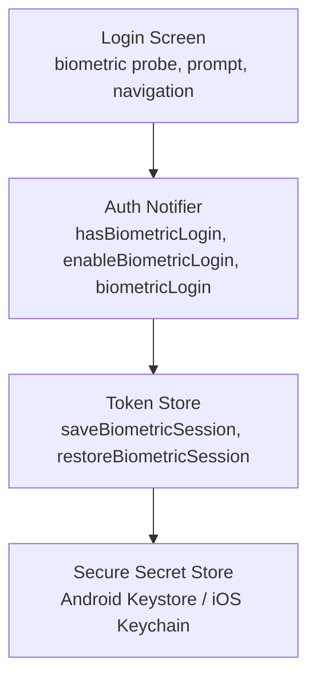
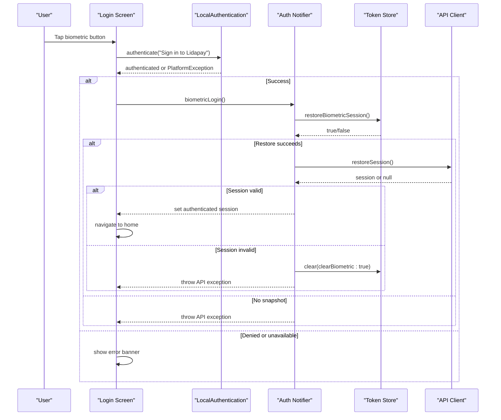
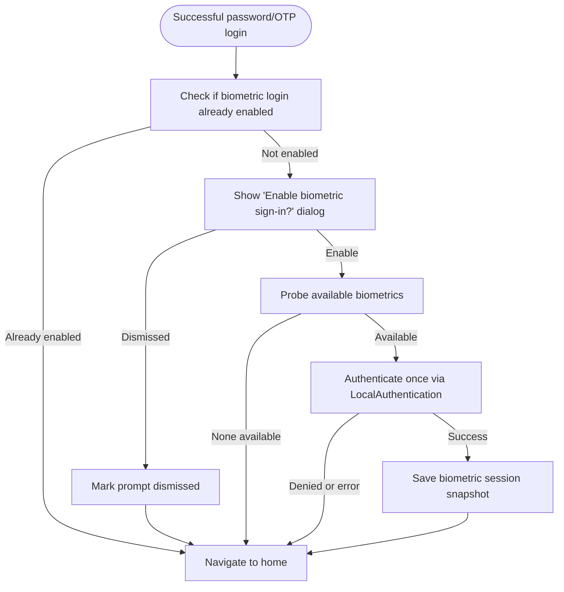
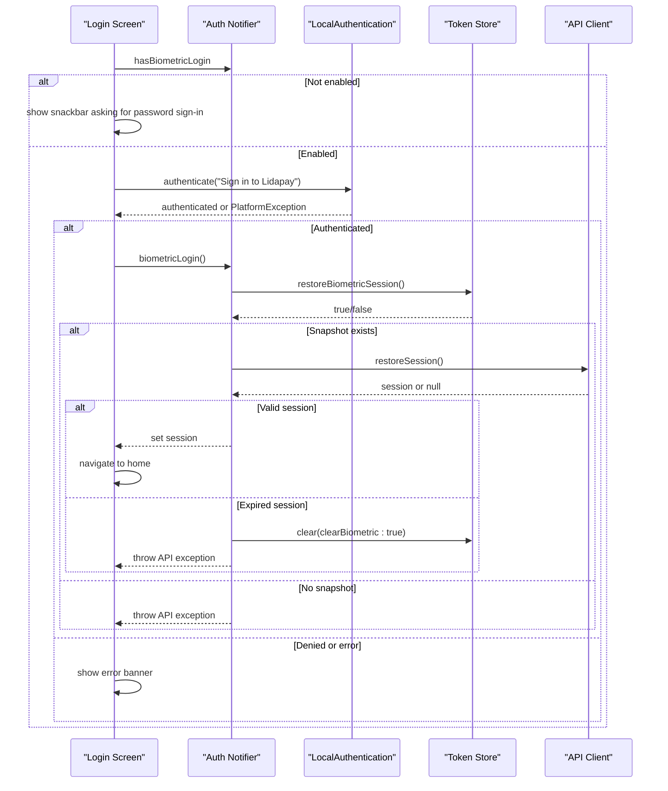
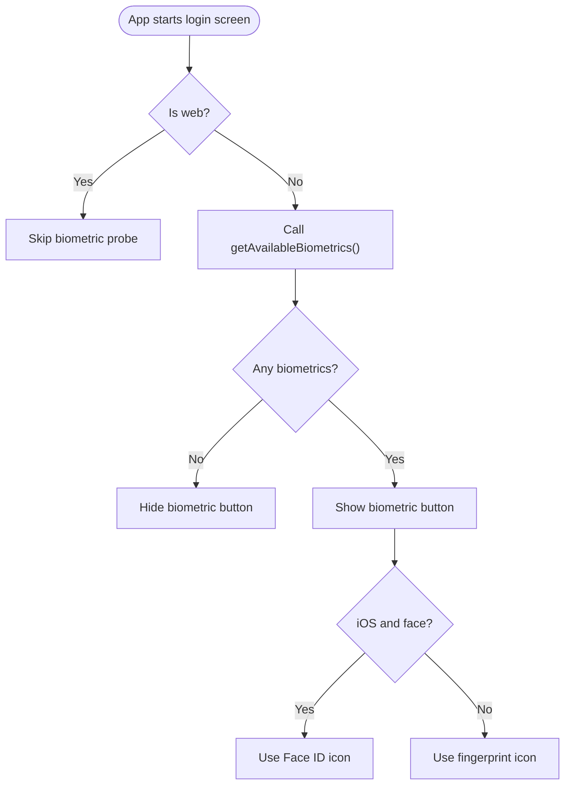
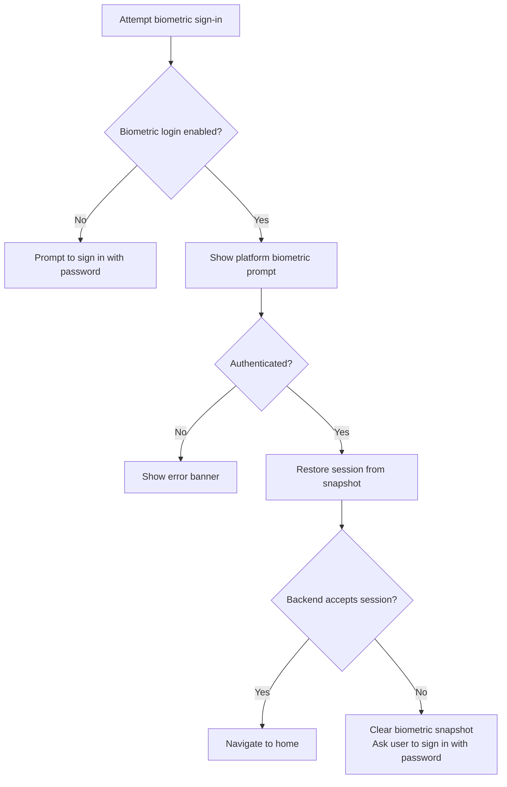
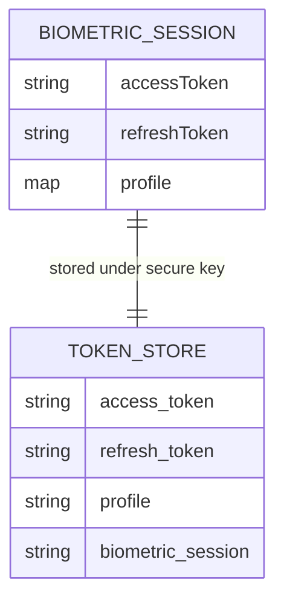
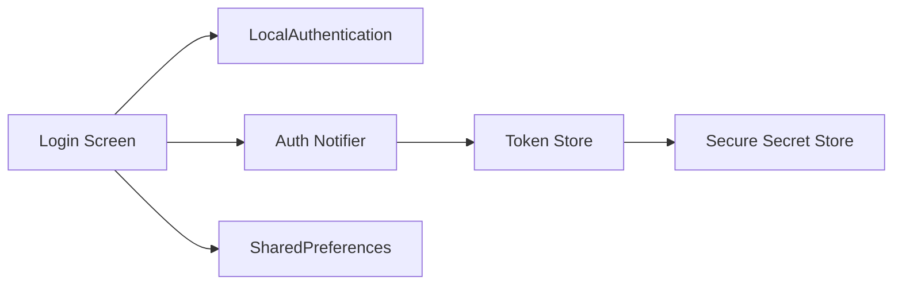

# Biometric Authentication

<cite>
**Referenced Files in This Document**
- [login_screen.dart](file://lib/features/auth/screens/login_screen.dart)
- [providers.dart](file://lib/features/auth/providers.dart)
- [token_store.dart](file://lib/core/network/token_store.dart)
</cite>

## Table of Contents
1. [Introduction](#introduction)
2. [Project Structure](#project-structure)
3. [Core Components](#core-components)
4. [Architecture Overview](#architecture-overview)
5. [Detailed Component Analysis](#detailed-component-analysis)
6. [Dependency Analysis](#dependency-analysis)
7. [Performance Considerations](#performance-considerations)
8. [Troubleshooting Guide](#troubleshooting-guide)
9. [Security and Privacy Considerations](#security-and-privacy-considerations)
10. [Conclusion](#conclusion)

## Introduction
This document explains the biometric authentication implementation in the application. It covers how fingerprint, Face ID, and device credential support are detected and used, how biometric prompts are handled, and how platform-specific behavior is managed through Flutter’s local authentication API. It also documents the fallback mechanisms to password or OTP sign-in, the enrollment flow after a successful login, and the error handling paths for unsupported devices, denied permissions, or expired sessions.

The implementation does not store passwords or raw biometric data. Instead, it uses the platform’s secure hardware-backed storage to persist an encrypted session snapshot that can be restored after a successful biometric verification.

## Project Structure
Biometric authentication spans three main layers:

- User interface layer: The login screen probes available biometrics, shows the biometric button when appropriate, handles the prompt, and navigates on success.
- Session state layer: A Riverpod-based notifier exposes whether biometric login is enabled and performs the actual restore operation.
- Storage layer: An encrypted secret store persists the biometric session snapshot alongside regular tokens.

**Diagram sources**
- [login_screen.dart:100-121](file://lib/features/auth/screens/login_screen.dart#L100-L121)
- [login_screen.dart:382-485](file://lib/features/auth/screens/login_screen.dart#L382-L485)
- [providers.dart:182-202](file://lib/features/auth/providers.dart#L182-L202)
- [token_store.dart:71-108](file://lib/core/network/token_store.dart#L71-L108)
- [token_store.dart:177-217](file://lib/core/network/token_store.dart#L177-L217)

**Section sources**
- [login_screen.dart:1-22](file://lib/features/auth/screens/login_screen.dart#L1-L22)
- [providers.dart:1-37](file://lib/features/auth/providers.dart#L1-L37)
- [token_store.dart:1-30](file://lib/core/network/token_store.dart#L1-L30)

## Core Components
- Login screen biometric integration:
  - Probes available biometrics at startup.
  - Shows a biometric icon button only when biometrics are available.
  - Chooses between fingerprint and Face ID icons based on platform and enrolled modality.
  - Prompts the user to enable biometric sign-in after a successful password or OTP login.
  - Handles platform exceptions and generic errors without blocking normal sign-in.

- Auth notifier:
  - Exposes `hasBiometricLogin`, `enableBiometricLogin`, and `biometricLogin`.
  - Restores the session from the stored biometric snapshot and refreshes the profile.
  - Clears the biometric session when the backend rejects the restored token.

- Token store:
  - Stores access and refresh tokens plus a separate biometric session snapshot in secure storage.
  - Synchronizes the biometric snapshot when tokens rotate.
  - Provides safe restore and clear operations with graceful degradation when secure storage fails.

**Section sources**
- [login_screen.dart:100-121](file://lib/features/auth/screens/login_screen.dart#L100-L121)
- [login_screen.dart:382-485](file://lib/features/auth/screens/login_screen.dart#L382-L485)
- [providers.dart:182-202](file://lib/features/auth/providers.dart#L182-L202)
- [token_store.dart:71-108](file://lib/core/network/token_store.dart#L71-L108)
- [token_store.dart:148-217](file://lib/core/network/token_store.dart#L148-L217)

## Architecture Overview
The biometric flow is layered so that the UI never directly manipulates secrets. The login screen delegates capability checks and prompts to the local authentication API, while session restoration and persistence are delegated to the auth notifier and token store.

**Diagram sources**
- [login_screen.dart:439-485](file://lib/features/auth/screens/login_screen.dart#L439-L485)
- [providers.dart:186-202](file://lib/features/auth/providers.dart#L186-L202)
- [token_store.dart:195-217](file://lib/core/network/token_store.dart#L195-L217)

## Detailed Component Analysis

### Biometric Enrollment Flow
After a successful password or OTP login, the app asks the user whether they want to enable biometric sign-in. If they accept, the app authenticates them once more using the platform biometric prompt. On success, it saves the current session material into the biometric snapshot.

**Diagram sources**
- [login_screen.dart:382-436](file://lib/features/auth/screens/login_screen.dart#L382-L436)
- [providers.dart:182-184](file://lib/features/auth/providers.dart#L182-L184)
- [token_store.dart:177-193](file://lib/core/network/token_store.dart#L177-L193)

Key behaviors:
- The enrollment prompt is shown only once per device unless the user clears preferences; dismissing it stores a flag so the app does not nag on every login.
- Enrollment requires a refreshable session; credentials are never saved into the biometric snapshot.
- Platform exceptions during enrollment are caught so that normal sign-in still completes.

**Section sources**
- [login_screen.dart:380-436](file://lib/features/auth/screens/login_screen.dart#L380-L436)
- [providers.dart:182-184](file://lib/features/auth/providers.dart#L182-L184)
- [token_store.dart:177-193](file://lib/core/network/token_store.dart#L177-L193)

### Biometric Sign-In Flow
When the user taps the biometric button on the login screen, the app first checks whether biometric login has been enabled. If not, it guides the user to sign in with a password first. If enabled, it calls the platform biometric prompt and then restores the session.

**Diagram sources**
- [login_screen.dart:439-485](file://lib/features/auth/screens/login_screen.dart#L439-L485)
- [providers.dart:186-202](file://lib/features/auth/providers.dart#L186-L202)
- [token_store.dart:195-217](file://lib/core/network/token_store.dart#L195-L217)

Important details:
- The UI sets loading state and clears previous API errors before attempting biometric sign-in.
- `PlatformException` is caught separately from API exceptions so platform-level failures such as denied permission or missing biometric hardware can be surfaced clearly.
- Navigation to the home route happens only after the notifier successfully sets an authenticated session.

**Section sources**
- [login_screen.dart:439-485](file://lib/features/auth/screens/login_screen.dart#L439-L485)
- [providers.dart:186-202](file://lib/features/auth/providers.dart#L186-L202)
- [token_store.dart:195-217](file://lib/core/network/token_store.dart#L195-L217)

### Platform-Specific Behavior and Modality Detection
The login screen detects available biometrics and chooses the displayed icon accordingly:
- On iOS, if the primary enrolled biometric is face, the Face ID icon is used.
- Otherwise, the fingerprint icon is used.
- On web, biometric probing is skipped.

**Diagram sources**
- [login_screen.dart:100-121](file://lib/features/auth/screens/login_screen.dart#L100-L121)

**Section sources**
- [login_screen.dart:100-121](file://lib/features/auth/screens/login_screen.dart#L100-L121)

### Fallback Mechanisms
Biometric authentication is optional. The following fallbacks are implemented:
- If biometric login is not enabled, the UI tells the user to sign in with a password first.
- If the biometric prompt is denied or fails, the UI displays an error banner and keeps the user on the login screen.
- After a successful password or OTP login, the app still proceeds to the home screen even if biometric enrollment fails.
- If the backend rejects the restored session, the app clears the biometric snapshot and asks the user to sign in again with credentials.

**Diagram sources**
- [login_screen.dart:439-485](file://lib/features/auth/screens/login_screen.dart#L439-L485)
- [providers.dart:186-202](file://lib/features/auth/providers.dart#L186-L202)

**Section sources**
- [login_screen.dart:439-485](file://lib/features/auth/screens/login_screen.dart#L439-L485)
- [providers.dart:186-202](file://lib/features/auth/providers.dart#L186-L202)

### Data Model and Storage Contract
The biometric session snapshot contains:
- Access token
- Refresh token
- Optional profile payload

It is written only after a successful biometric enrollment and kept in sync when tokens rotate. Restoration reads the snapshot, validates required fields, writes them back into the active session, and returns success or failure.

**Diagram sources**
- [token_store.dart:177-217](file://lib/core/network/token_store.dart#L177-L217)

**Section sources**
- [token_store.dart:71-108](file://lib/core/network/token_store.dart#L71-L108)
- [token_store.dart:148-217](file://lib/core/network/token_store.dart#L148-L217)

## Dependency Analysis
The biometric feature depends on:
- Flutter’s `local_auth` package for capability detection and prompting.
- Riverpod providers for session state and repository access.
- Encrypted secret storage for secure token persistence.
- Shared preferences for lightweight flags such as whether the enrollment prompt was dismissed.

**Diagram sources**
- [login_screen.dart:1-22](file://lib/features/auth/screens/login_screen.dart#L1-L22)
- [providers.dart:1-37](file://lib/features/auth/providers.dart#L1-L37)
- [token_store.dart:1-30](file://lib/core/network/token_store.dart#L1-L30)

**Section sources**
- [login_screen.dart:1-22](file://lib/features/auth/screens/login_screen.dart#L1-L22)
- [providers.dart:1-37](file://lib/features/auth/providers.dart#L1-L37)
- [token_store.dart:1-30](file://lib/core/network/token_store.dart#L1-L30)

## Performance Considerations
- Biometric probing runs once at login screen initialization and avoids running on web.
- The biometric prompt is guarded by loading state to prevent duplicate attempts.
- Session restoration is asynchronous but short-circuits when no snapshot exists.
- Profile refresh after authentication is best-effort and does not block navigation.

[No sources needed since this section provides general guidance]

## Troubleshooting Guide
Common scenarios and their handling:

- Unsupported device or no enrolled biometrics:
  - The biometric button remains hidden because the probe finds no available biometrics.
  - Users can still sign in with password or OTP.

- Denied biometric permission or failed prompt:
  - The UI catches `PlatformException` and shows an error banner.
  - The user remains on the login screen and can retry or switch to password/OTP.

- Biometric login not enabled:
  - The UI shows a snackbar instructing the user to sign in with a password first.

- Expired or rejected biometric session:
  - The notifier clears the biometric snapshot and throws an API exception indicating that the user must sign in with a password again.

- Broken secure storage:
  - The token store degrades gracefully to a signed-out state instead of crashing at launch.

**Section sources**
- [login_screen.dart:100-121](file://lib/features/auth/screens/login_screen.dart#L100-L121)
- [login_screen.dart:439-485](file://lib/features/auth/screens/login_screen.dart#L439-L485)
- [providers.dart:186-202](file://lib/features/auth/providers.dart#L186-L202)
- [token_store.dart:120-146](file://lib/core/network/token_store.dart#L120-L146)

## Security and Privacy Considerations
- Credentials are never stored in the biometric snapshot. Only access tokens, refresh tokens, and an optional profile payload are persisted.
- Secrets are written to a secure secret store backed by Android Keystore and iOS Keychain. The iOS options explicitly avoid iCloud sync and device restore.
- The biometric snapshot is synchronized whenever tokens rotate, preventing stale snapshots from breaking subsequent biometric sign-ins.
- Rejected or expired sessions trigger clearing of the biometric snapshot to avoid reusing invalid credentials.
- Biometric enrollment is opt-in and optional; users can dismiss the prompt without losing access to standard sign-in flows.
- Errors from platform biometric APIs are isolated so that UI and normal authentication remain resilient.

**Section sources**
- [token_store.dart:46-69](file://lib/core/network/token_store.dart#L46-L69)
- [token_store.dart:148-217](file://lib/core/network/token_store.dart#L148-L217)
- [login_screen.dart:382-436](file://lib/features/auth/screens/login_screen.dart#L382-L436)
- [login_screen.dart:439-485](file://lib/features/auth/screens/login_screen.dart#L439-L485)

## Conclusion
The biometric authentication implementation provides a secure, optional fast-path login using fingerprint or Face ID where available. It integrates cleanly with the existing password and OTP flows, preserves user privacy by avoiding credential storage, and handles platform differences and error conditions gracefully. When biometrics are unavailable, denied, or expired, the app falls back to standard sign-in methods while keeping the overall experience smooth and predictable.