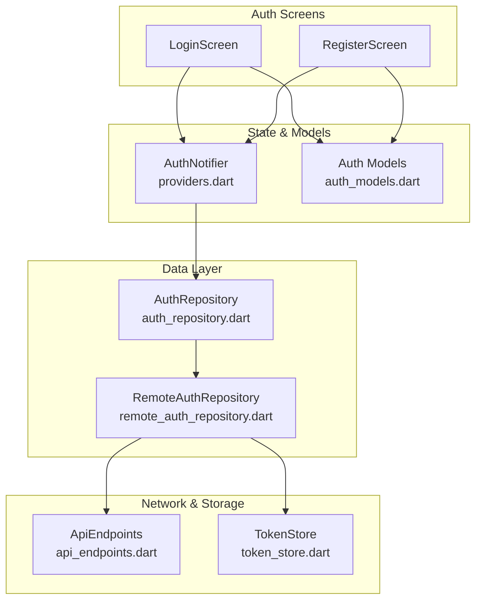
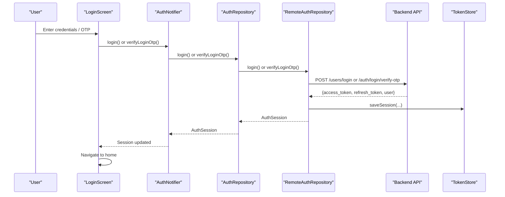
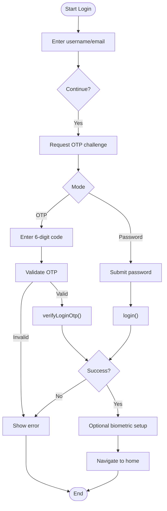
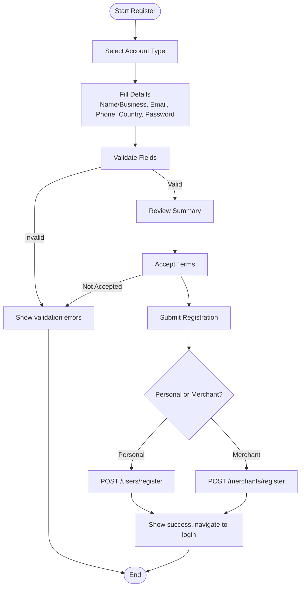
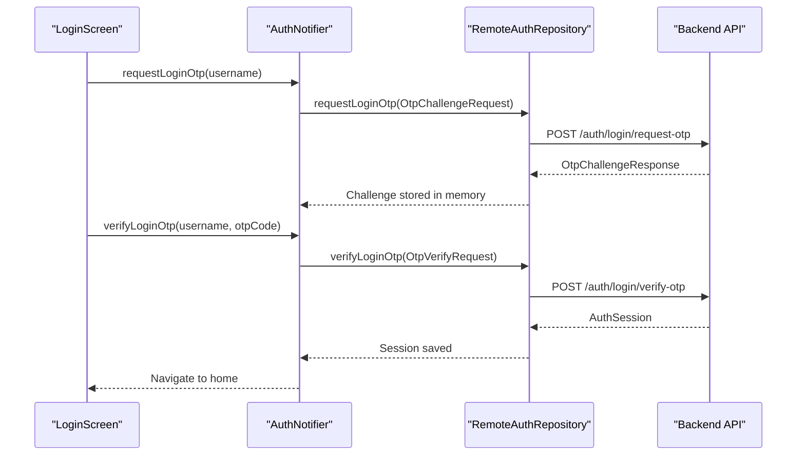
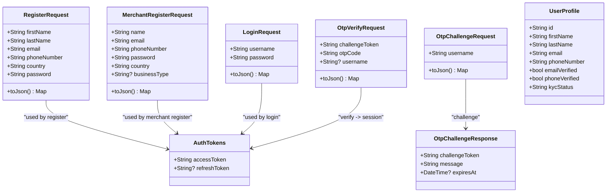
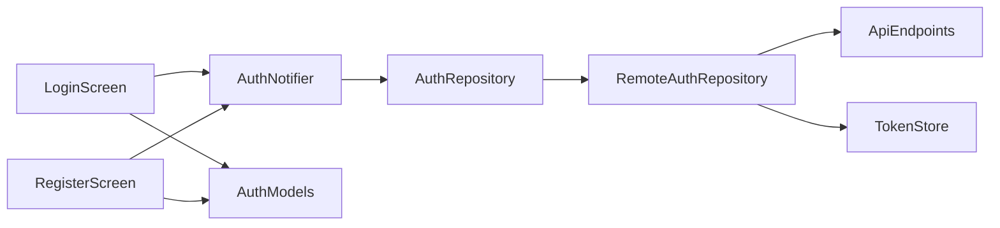

# Login & Registration

<cite>
**Referenced Files in This Document**
- [login_screen.dart](file://lib/features/auth/screens/login_screen.dart)
- [register_screen.dart](file://lib/features/auth/screens/register_screen.dart)
- [auth_models.dart](file://lib/features/auth/data/auth_models.dart)
- [auth_repository.dart](file://lib/features/auth/data/auth_repository.dart)
- [remote_auth_repository.dart](file://lib/features/auth/data/remote_auth_repository.dart)
- [providers.dart](file://lib/features/auth/providers.dart)
- [validators.dart](file://lib/core/utils/validators.dart)
- [api_endpoints.dart](file://lib/core/network/api_endpoints.dart)
- [token_store.dart](file://lib/core/network/token_store.dart)
- [ENDPOINTS.md](file://api/ENDPOINTS.md)
- [swagger-api-documentation.md](file://docs/swagger-api-documentation.md)
</cite>

## Table of Contents
1. [Introduction](#introduction)
2. [Project Structure](#project-structure)
3. [Core Components](#core-components)
4. [Architecture Overview](#architecture-overview)
5. [Detailed Component Analysis](#detailed-component-analysis)
6. [Dependency Analysis](#dependency-analysis)
7. [Performance Considerations](#performance-considerations)
8. [Troubleshooting Guide](#troubleshooting-guide)
9. [Security Considerations](#security-considerations)
10. [Conclusion](#conclusion)

## Introduction
This document explains the login and registration functionality in the application, covering:
- Email/password login
- Phone-number-based registration for personal and merchant accounts
- Form validation rules and user experience patterns
- OTP-based verification flow
- API integration and error handling
- Security considerations for password handling, input sanitization, and secure communication

The implementation is built with Flutter, Riverpod state management, a repository pattern over an HTTP client, and platform-secure token storage.

## Project Structure
Authentication-related code lives under `lib/features/auth` with shared utilities under `lib/core`. The main pieces are:
- Screens: login and registration UIs
- Data models: request/response shapes for authentication APIs
- Repository contract and remote implementation
- Riverpod providers for session state
- Validators for form inputs
- Network endpoints and token persistence

**Diagram sources**
- [login_screen.dart:1-120](file://lib/features/auth/screens/login_screen.dart#L1-L120)
- [register_screen.dart:1-120](file://lib/features/auth/screens/register_screen.dart#L1-L120)
- [providers.dart:1-120](file://lib/features/auth/providers.dart#L1-L120)
- [auth_repository.dart:1-79](file://lib/features/auth/data/auth_repository.dart#L1-L79)
- [remote_auth_repository.dart:1-80](file://lib/features/auth/data/remote_auth_repository.dart#L1-L80)
- [api_endpoints.dart:1-33](file://lib/core/network/api_endpoints.dart#L1-L33)
- [token_store.dart:71-103](file://lib/core/network/token_store.dart#L71-L103)

**Section sources**
- [login_screen.dart:1-120](file://lib/features/auth/screens/login_screen.dart#L1-L120)
- [register_screen.dart:1-120](file://lib/features/auth/screens/register_screen.dart#L1-L120)
- [providers.dart:1-120](file://lib/features/auth/providers.dart#L1-L120)
- [auth_repository.dart:1-79](file://lib/features/auth/data/auth_repository.dart#L1-L79)
- [remote_auth_repository.dart:1-80](file://lib/features/auth/data/remote_auth_repository.dart#L1-L80)
- [api_endpoints.dart:1-33](file://lib/core/network/api_endpoints.dart#L1-L33)
- [token_store.dart:71-103](file://lib/core/network/token_store.dart#L71-L103)

## Core Components
- Login screen: supports username (email or phone), password sign-in, OTP verification, biometric sign-in, and password reset navigation.
- Registration screen: three-step wizard for account type selection, details entry, and confirmation; supports personal and merchant accounts.
- Auth models: typed request/response payloads for register, login, OTP challenge/verify, tokens, and user profile.
- Repository layer: abstract contract plus live implementation that calls backend endpoints and persists sessions.
- Providers: Riverpod notifier managing session state, OTP challenges, profile refresh, and device metadata enrichment.
- Validators: reusable validators for email, phone, international phone, required fields, password, confirm password, and OTP.
- Endpoints: centralized route constants aligned with the OpenAPI spec.
- Token store: encrypted storage for access/refresh tokens and profile data with migration support.

**Section sources**
- [login_screen.dart:25-120](file://lib/features/auth/screens/login_screen.dart#L25-L120)
- [register_screen.dart:48-120](file://lib/features/auth/screens/register_screen.dart#L48-L120)
- [auth_models.dart:24-105](file://lib/features/auth/data/auth_models.dart#L24-L105)
- [auth_repository.dart:1-79](file://lib/features/auth/data/auth_repository.dart#L1-L79)
- [providers.dart:51-120](file://lib/features/auth/providers.dart#L51-L120)
- [validators.dart:1-72](file://lib/core/utils/validators.dart#L1-L72)
- [api_endpoints.dart:1-33](file://lib/core/network/api_endpoints.dart#L1-L33)
- [token_store.dart:71-103](file://lib/core/network/token_store.dart#L71-L103)

## Architecture Overview
The authentication architecture follows a layered design:
- UI screens call the Riverpod `AuthNotifier`.
- `AuthNotifier` delegates to `AuthRepository`.
- `RemoteAuthRepository` uses `ApiClient` against `ApiEndpoints`.
- Successful authentication persists tokens and profile via `TokenStore`.
- Device metadata (platform, device ID, app version, locale, push token) is attached to requests.

**Diagram sources**
- [login_screen.dart:337-352](file://lib/features/auth/screens/login_screen.dart#L337-L352)
- [providers.dart:88-105](file://lib/features/auth/providers.dart#L88-L105)
- [remote_auth_repository.dart:20-23](file://lib/features/auth/data/remote_auth_repository.dart#L20-L23)
- [remote_auth_repository.dart:43-52](file://lib/features/auth/data/remote_auth_repository.dart#L43-L52)
- [remote_auth_repository.dart:54-80](file://lib/features/auth/data/remote_auth_repository.dart#L54-L80)
- [api_endpoints.dart:6-11](file://lib/core/network/api_endpoints.dart#L6-L11)

**Section sources**
- [login_screen.dart:337-352](file://lib/features/auth/screens/login_screen.dart#L337-L352)
- [providers.dart:88-105](file://lib/features/auth/providers.dart#L88-L105)
- [remote_auth_repository.dart:20-80](file://lib/features/auth/data/remote_auth_repository.dart#L20-L80)
- [api_endpoints.dart:6-11](file://lib/core/network/api_endpoints.dart#L6-L11)

## Detailed Component Analysis

### Login Flow
The login screen supports:
- Username entry (email or phone)
- Password sign-in
- OTP verification with six-digit input boxes
- Biometric sign-in when enabled
- Resend cooldown for OTP
- Error banners for API failures

Key behaviors:
- Username step transitions to verification step after submission.
- OTP challenge is requested via provider; if it fails due to password requirement, the UI switches to password mode.
- On success, optional biometric setup prompt appears once per device.
- Navigation goes to home on successful sign-in.

**Diagram sources**
- [login_screen.dart:177-230](file://lib/features/auth/screens/login_screen.dart#L177-L230)
- [login_screen.dart:308-352](file://lib/features/auth/screens/login_screen.dart#L308-L352)
- [providers.dart:110-163](file://lib/features/auth/providers.dart#L110-L163)

**Section sources**
- [login_screen.dart:177-230](file://lib/features/auth/screens/login_screen.dart#L177-L230)
- [login_screen.dart:308-352](file://lib/features/auth/screens/login_screen.dart#L308-L352)
- [providers.dart:110-163](file://lib/features/auth/providers.dart#L110-L163)

### Registration Flow
Registration is a three-step wizard:
1. Account type: Personal or Merchant
2. Details: name/business info, email, phone number, country, password + confirm
3. Review and submit with terms acceptance

Validation rules:
- Email must be valid
- Phone number validated locally (Ghana format for GH, otherwise 6–15 digits)
- Password minimum length enforced
- Confirm password must match
- Terms acceptance required before submission

On submit:
- Personal account calls `register(RegisterRequest)`
- Merchant account calls `registerMerchant(MerchantRegisterRequest)`
- Policy acceptance is recorded
- User navigates to login

**Diagram sources**
- [register_screen.dart:178-231](file://lib/features/auth/screens/register_screen.dart#L178-L231)
- [auth_models.dart:24-105](file://lib/features/auth/data/auth_models.dart#L24-L105)
- [auth_models.dart:107-195](file://lib/features/auth/data/auth_models.dart#L107-L195)
- [api_endpoints.dart:9-11](file://lib/core/network/api_endpoints.dart#L9-L11)

**Section sources**
- [register_screen.dart:178-231](file://lib/features/auth/screens/register_screen.dart#L178-L231)
- [auth_models.dart:24-105](file://lib/features/auth/data/auth_models.dart#L24-L105)
- [auth_models.dart:107-195](file://lib/features/auth/data/auth_models.dart#L107-L195)
- [api_endpoints.dart:9-11](file://lib/core/network/api_endpoints.dart#L9-L11)

### OTP Verification Flow
After requesting an OTP challenge:
- The server returns a short-lived challenge token and message.
- The UI collects a 6-digit code and verifies it.
- On success, the session is persisted and profile refreshed.
- If no active challenge exists, the UI prompts to request one first.

**Diagram sources**
- [login_screen.dart:195-230](file://lib/features/auth/screens/login_screen.dart#L195-L230)
- [login_screen.dart:308-335](file://lib/features/auth/screens/login_screen.dart#L308-L335)
- [providers.dart:110-163](file://lib/features/auth/providers.dart#L110-L163)
- [remote_auth_repository.dart:26-52](file://lib/features/auth/data/remote_auth_repository.dart#L26-L52)
- [api_endpoints.dart:6-8](file://lib/core/network/api_endpoints.dart#L6-L8)

**Section sources**
- [login_screen.dart:195-230](file://lib/features/auth/screens/login_screen.dart#L195-L230)
- [login_screen.dart:308-335](file://lib/features/auth/screens/login_screen.dart#L308-L335)
- [providers.dart:110-163](file://lib/features/auth/providers.dart#L110-L163)
- [remote_auth_repository.dart:26-52](file://lib/features/auth/data/remote_auth_repository.dart#L26-L52)
- [api_endpoints.dart:6-8](file://lib/core/network/api_endpoints.dart#L6-L8)

### Data Models and API Contracts
- RegisterRequest mirrors `/api/v1/users/register`, includes device metadata.
- MerchantRegisterRequest mirrors `/api/v1/merchants/register`.
- LoginRequest mirrors `/api/v1/users/login`.
- OtpChallengeRequest/OtpChallengeResponse model OTP challenge lifecycle.
- OtpVerifyRequest mirrors `/api/v1/auth/login/verify-otp`.
- AuthTokens and UserProfile represent authenticated session and user profile.

**Diagram sources**
- [auth_models.dart:24-105](file://lib/features/auth/data/auth_models.dart#L24-L105)
- [auth_models.dart:107-195](file://lib/features/auth/data/auth_models.dart#L107-L195)
- [auth_models.dart:197-255](file://lib/features/auth/data/auth_models.dart#L197-L255)
- [auth_models.dart:257-354](file://lib/features/auth/data/auth_models.dart#L257-L354)
- [auth_models.dart:356-425](file://lib/features/auth/data/auth_models.dart#L356-L425)

**Section sources**
- [auth_models.dart:24-105](file://lib/features/auth/data/auth_models.dart#L24-L105)
- [auth_models.dart:107-195](file://lib/features/auth/data/auth_models.dart#L107-L195)
- [auth_models.dart:197-255](file://lib/features/auth/data/auth_models.dart#L197-L255)
- [auth_models.dart:257-354](file://lib/features/auth/data/auth_models.dart#L257-L354)
- [auth_models.dart:356-425](file://lib/features/auth/data/auth_models.dart#L356-L425)

### Validation Rules and UX Patterns
Validators provide consistent feedback:
- Email: required and regex-checked
- Phone: Ghana local format for registration; international format where applicable
- International phone: allows dial codes and normalizes whitespace/dashes
- Required: generic field presence check
- Password: minimum length
- Confirm password: equality check
- OTP: exactly 6 digits

UX patterns:
- Inline validation messages
- Real-time enable/disable of buttons based on validity
- Animated transitions between steps
- Haptic feedback on interactions
- Cooldown timers for resend actions

**Section sources**
- [validators.dart:1-72](file://lib/core/utils/validators.dart#L1-L72)
- [register_screen.dart:76-92](file://lib/features/auth/screens/register_screen.dart#L76-L92)
- [login_screen.dart:123-139](file://lib/features/auth/screens/login_screen.dart#L123-L139)

### Error Handling
- API exceptions are caught at screen level and displayed in banners.
- OTP flows handle missing challenge tokens gracefully.
- Profile refresh retries transient errors once; auth failures clear session.
- Biometric setup does not block successful sign-in.

Examples:
- Login password submission catches `ApiException` and shows error.
- OTP verification clears input boxes and refocuses on failure.
- Registration submission wraps API calls in try/catch and surfaces messages.

**Section sources**
- [login_screen.dart:337-352](file://lib/features/auth/screens/login_screen.dart#L337-L352)
- [login_screen.dart:308-335](file://lib/features/auth/screens/login_screen.dart#L308-L335)
- [register_screen.dart:178-231](file://lib/features/auth/screens/register_screen.dart#L178-L231)
- [providers.dart:210-239](file://lib/features/auth/providers.dart#L210-L239)

## Dependency Analysis
High-level dependencies:
- Screens depend on Riverpod providers (`AuthNotifier`)
- Providers depend on `AuthRepository`
- Remote repository depends on `ApiClient` and `TokenStore`
- Endpoints define routes used by the remote repository
- Models define serialization for requests/responses

**Diagram sources**
- [login_screen.dart:1-120](file://lib/features/auth/screens/login_screen.dart#L1-L120)
- [register_screen.dart:1-120](file://lib/features/auth/screens/register_screen.dart#L1-L120)
- [providers.dart:1-120](file://lib/features/auth/providers.dart#L1-L120)
- [auth_repository.dart:1-79](file://lib/features/auth/data/auth_repository.dart#L1-L79)
- [remote_auth_repository.dart:1-80](file://lib/features/auth/data/remote_auth_repository.dart#L1-L80)
- [api_endpoints.dart:1-33](file://lib/core/network/api_endpoints.dart#L1-L33)
- [token_store.dart:71-103](file://lib/core/network/token_store.dart#L71-L103)

**Section sources**
- [login_screen.dart:1-120](file://lib/features/auth/screens/login_screen.dart#L1-L120)
- [register_screen.dart:1-120](file://lib/features/auth/screens/register_screen.dart#L1-L120)
- [providers.dart:1-120](file://lib/features/auth/providers.dart#L1-L120)
- [auth_repository.dart:1-79](file://lib/features/auth/data/auth_repository.dart#L1-L79)
- [remote_auth_repository.dart:1-80](file://lib/features/auth/data/remote_auth_repository.dart#L1-L80)
- [api_endpoints.dart:1-33](file://lib/core/network/api_endpoints.dart#L1-L33)
- [token_store.dart:71-103](file://lib/core/network/token_store.dart#L71-L103)

## Performance Considerations
- Avoid unnecessary network calls: OTP challenge is cached in memory until verified or expired.
- Profile refresh is best-effort with retry for transient errors to keep UI responsive.
- Token store uses an in-memory mirror to avoid disk I/O during interceptors.
- Debounce or throttle repeated actions like resend OTP using cooldown timers.

[No sources needed since this section provides general guidance]

## Troubleshooting Guide
Common issues and resolutions:
- Missing OTP challenge: ensure `requestLoginOtp` succeeded before verifying; the UI will prompt to request one.
- Invalid OTP: validate 6-digit input and clear boxes on failure.
- Biometric sign-in not set up: guide users to sign in with password first.
- Session expired: profile refresh handles 401 by clearing session; prompt re-login.
- Registration validation errors: show inline messages and disable submit until all fields pass.

**Section sources**
- [login_screen.dart:308-335](file://lib/features/auth/screens/login_screen.dart#L308-L335)
- [login_screen.dart:439-485](file://lib/features/auth/screens/login_screen.dart#L439-L485)
- [providers.dart:210-239](file://lib/features/auth/providers.dart#L210-L239)
- [register_screen.dart:178-231](file://lib/features/auth/screens/register_screen.dart#L178-L231)

## Security Considerations
- Password handling:
  - Minimum length enforced on the client side.
  - Passwords are sent over HTTPS to the backend; do not log or display them.
- Input sanitization:
  - Trim inputs and normalize phone numbers before sending.
  - Use strict validators for email, phone, and OTP.
- Secure communication:
  - All API calls go through `ApiClient` with proper headers and base URL.
  - Endpoints are centralized to prevent typos and ensure consistency.
- Token storage:
  - Access and refresh tokens are stored in a secure secret store (encrypted).
  - Legacy plaintext tokens are migrated and wiped.
  - Biometric sessions are separate and require unlock to restore.
- Session management:
  - On 401 responses, sessions are cleared to prevent stale access.
  - Profile refresh failures do not expose sensitive data; they degrade gracefully.

**Section sources**
- [validators.dart:50-72](file://lib/core/utils/validators.dart#L50-L72)
- [remote_auth_repository.dart:54-80](file://lib/features/auth/data/remote_auth_repository.dart#L54-L80)
- [token_store.dart:71-103](file://lib/core/network/token_store.dart#L71-L103)
- [api_endpoints.dart:1-33](file://lib/core/network/api_endpoints.dart#L1-L33)
- [ENDPOINTS.md:10-14](file://api/ENDPOINTS.md#L10-L14)
- [swagger-api-documentation.md:80-198](file://docs/swagger-api-documentation.md#L80-L198)

## Conclusion
The login and registration system provides a robust, secure, and user-friendly experience:
- Flexible login with password and OTP options
- Streamlined registration for personal and merchant accounts
- Strong validation and clear error messaging
- Secure token storage and session management
- Clear separation of concerns with repository and provider layers

Developers can extend this foundation by adding new authentication flows while maintaining consistency in validation, error handling, and security practices.