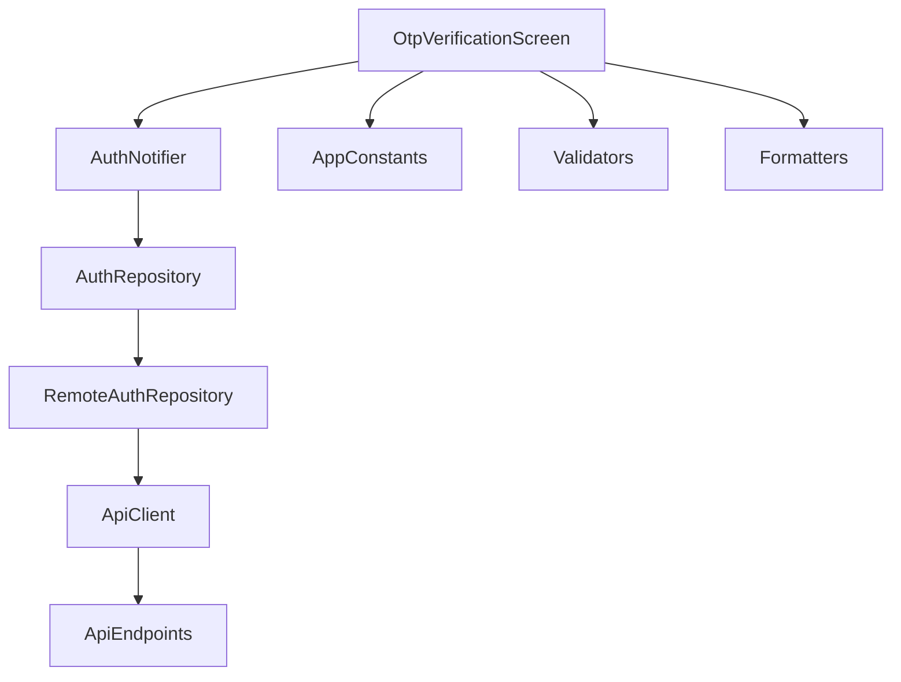
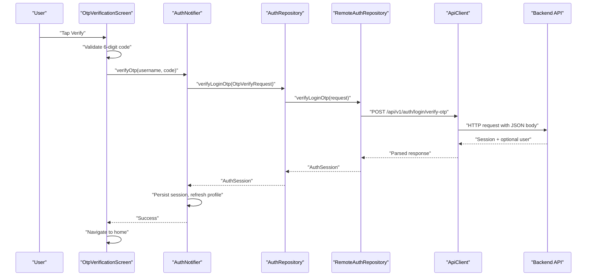
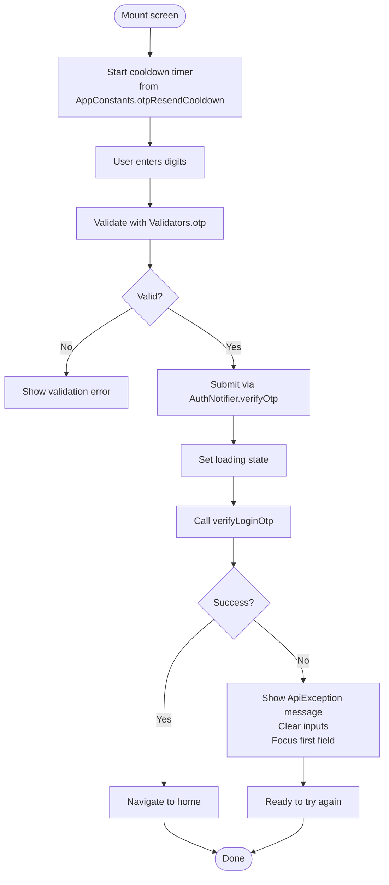
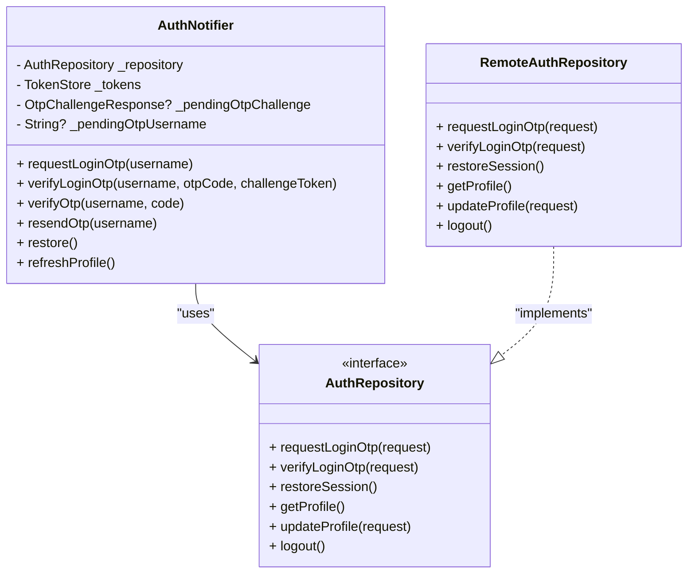
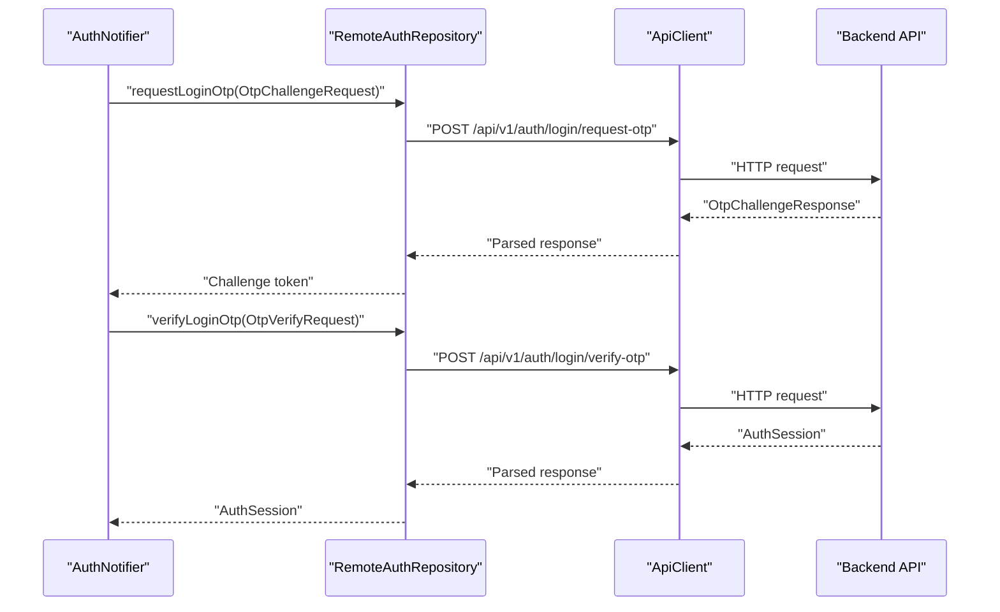
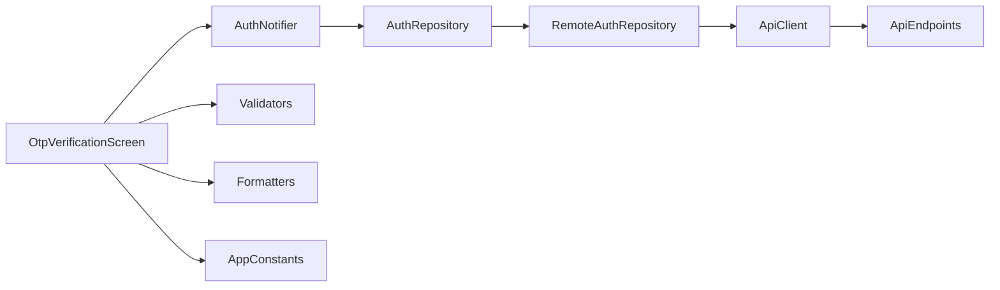

# OTP Verification

<cite>
**Referenced Files in This Document**
- [otp_verification_screen.dart](file://lib/features/auth/screens/otp_verification_screen.dart)
- [providers.dart](file://lib/features/auth/providers.dart)
- [auth_repository.dart](file://lib/features/auth/data/auth_repository.dart)
- [remote_auth_repository.dart](file://lib/features/auth/data/remote_auth_repository.dart)
- [mock_auth_repository.dart](file://lib/features/auth/data/mock_auth_repository.dart)
- [auth_models.dart](file://lib/features/auth/data/auth_models.dart)
- [api_endpoints.dart](file://lib/core/network/api_endpoints.dart)
- [api_client.dart](file://lib/core/network/api_client.dart)
- [app_constants.dart](file://lib/core/constants/app_constants.dart)
- [validators.dart](file://lib/core/utils/validators.dart)
- [formatters.dart](file://lib/core/utils/formatters.dart)
</cite>

## Table of Contents
1. [Introduction](#introduction)
2. [Project Structure](#project-structure)
3. [Core Components](#core-components)
4. [Architecture Overview](#architecture-overview)
5. [Detailed Component Analysis](#detailed-component-analysis)
6. [Dependency Analysis](#dependency-analysis)
7. [Performance Considerations](#performance-considerations)
8. [Troubleshooting Guide](#troubleshooting-guide)
9. [Security Considerations](#security-considerations)
10. [Conclusion](#conclusion)

## Introduction
This document explains the One-Time Password verification system used by the application. It covers how an OTP challenge is requested, how the user enters and submits the code, how the backend verifies it, and what happens after successful authentication. It also documents the OTP verification screen, input handling, resend cooldown, error states, retry behavior, API contracts, and security considerations for OTP transmission, storage, and validation.

## Project Structure
The OTP verification flow spans UI, state management, repository abstraction, and network layers:

- UI layer: OTP verification screen with six-digit input fields, auto-focus, paste support, countdown timer, and feedback messages.
- State layer: Riverpod notifier that holds the pending OTP challenge token and exposes methods to request and verify OTPs.
- Repository layer: Abstract contract plus remote implementation that calls the live endpoints and persists sessions.
- Network layer: HTTP client that attaches tokens, redacts sensitive data, and refreshes access tokens on 401.
- Models and constants: Request/response models, endpoint paths, validation rules, and global constants such as resend cooldown.

**Diagram sources**
- [otp_verification_screen.dart:18-226](file://lib/features/auth/screens/otp_verification_screen.dart#L18-L226)
- [providers.dart:51-169](file://lib/features/auth/providers.dart#L51-L169)
- [auth_repository.dart:13-29](file://lib/features/auth/data/auth_repository.dart#L13-L29)
- [remote_auth_repository.dart:13-52](file://lib/features/auth/data/remote_auth_repository.dart#L13-L52)
- [api_client.dart:16-135](file://lib/core/network/api_client.dart#L16-L135)
- [api_endpoints.dart:6-8](file://lib/core/network/api_endpoints.dart#L6-L8)
- [app_constants.dart:11-13](file://lib/core/constants/app_constants.dart#L11-L13)
- [validators.dart:64-71](file://lib/core/utils/validators.dart#L64-L71)
- [formatters.dart:49-55](file://lib/core/utils/formatters.dart#L49-L55)

**Section sources**
- [otp_verification_screen.dart:18-226](file://lib/features/auth/screens/otp_verification_screen.dart#L18-L226)
- [providers.dart:51-169](file://lib/features/auth/providers.dart#L51-L169)
- [auth_repository.dart:13-29](file://lib/features/auth/data/auth_repository.dart#L13-L29)
- [remote_auth_repository.dart:13-52](file://lib/features/auth/data/remote_auth_repository.dart#L13-L52)
- [api_client.dart:16-135](file://lib/core/network/api_client.dart#L16-L135)
- [api_endpoints.dart:6-8](file://lib/core/network/api_endpoints.dart#L6-L8)
- [app_constants.dart:11-13](file://lib/core/constants/app_constants.dart#L11-L13)
- [validators.dart:64-71](file://lib/core/utils/validators.dart#L64-L71)
- [formatters.dart:49-55](file://lib/core/utils/formatters.dart#L49-L55)

## Core Components
- OtpVerificationScreen: Collects a six-digit code, validates it, submits it, handles errors, and manages the resend cooldown timer.
- AuthNotifier: Holds the in-memory OTP challenge token and username, exposes requestLoginOtp and verifyLoginOtp, and updates the authenticated session.
- AuthRepository: Defines the contract for requesting and verifying OTPs, login, profile operations, and logout.
- RemoteAuthRepository: Implements OTP requests and verifications against the live API, persists tokens and profile, and fills missing user IDs from JWT claims.
- ApiClient: Adds Authorization headers, redacts sensitive payloads, retries once after token refresh on 401, and maps Dio exceptions to ApiException.
- Models: OtpChallengeRequest, OtpChallengeResponse, OtpVerifyRequest, AuthTokens, UserProfile.
- Utilities: Validators.otp for six-digit validation, Formatters.countdown for timer display, AppConstants.otpResendCooldown for cooldown duration.

Key responsibilities:
- Generation: The app requests an OTP challenge; the backend generates and delivers the code (email or other channel).
- Delivery: Handled by the backend; the app receives a message indicating where the code was sent.
- Verification: The app sends the code along with the challenge token; the backend returns an authenticated session.
- Retry logic: Resend is rate-limited by a two-minute cooldown enforced in the UI and additional provider-level cooldowns for related flows.

**Section sources**
- [otp_verification_screen.dart:18-226](file://lib/features/auth/screens/otp_verification_screen.dart#L18-L226)
- [providers.dart:51-169](file://lib/features/auth/providers.dart#L51-L169)
- [auth_repository.dart:13-29](file://lib/features/auth/data/auth_repository.dart#L13-L29)
- [remote_auth_repository.dart:26-52](file://lib/features/auth/data/remote_auth_repository.dart#L26-L52)
- [api_client.dart:16-135](file://lib/core/network/api_client.dart#L16-L135)
- [auth_models.dart:257-354](file://lib/features/auth/data/auth_models.dart#L257-L354)
- [validators.dart:64-71](file://lib/core/utils/validators.dart#L64-L71)
- [formatters.dart:49-55](file://lib/core/utils/formatters.dart#L49-L55)
- [app_constants.dart:11-13](file://lib/core/constants/app_constants.dart#L11-L13)

## Architecture Overview
The OTP verification architecture follows a layered design:

**Diagram sources**
- [otp_verification_screen.dart:78-107](file://lib/features/auth/screens/otp_verification_screen.dart#L78-L107)
- [providers.dart:121-169](file://lib/features/auth/providers.dart#L121-L169)
- [auth_repository.dart:23-29](file://lib/features/auth/data/auth_repository.dart#L23-L29)
- [remote_auth_repository.dart:42-52](file://lib/features/auth/data/remote_auth_repository.dart#L42-L52)
- [api_endpoints.dart:7-8](file://lib/core/network/api_endpoints.dart#L7-L8)

## Detailed Component Analysis

### OTP Verification Screen
Responsibilities:
- Six-digit input with auto-focus and numeric-only formatting.
- Auto-submit when the sixth digit is entered.
- Local validation using Validators.otp.
- Error state display and field clearing on failure.
- Resend button with cooldown timer using Formatters.countdown.
- Navigation back to login if the wrong account is selected.

Input handling:
- Each field accepts one digit and moves focus forward automatically.
- Autofill hints are applied to the first field to enable SMS OTP autofill on supported platforms.
- Submit is guarded against double submission while loading.

Countdown timer:
- Starts on mount with AppConstants.otpResendCooldown seconds.
- Updates every second and disables resend until zero.

Error handling:
- Validation errors set a user-facing message.
- Network errors from ApiException clear inputs and focus the first field.

**Diagram sources**
- [otp_verification_screen.dart:28-125](file://lib/features/auth/screens/otp_verification_screen.dart#L28-L125)
- [validators.dart:64-71](file://lib/core/utils/validators.dart#L64-L71)
- [app_constants.dart:13](file://lib/core/constants/app_constants.dart#L13)

**Section sources**
- [otp_verification_screen.dart:18-226](file://lib/features/auth/screens/otp_verification_screen.dart#L18-L226)
- [validators.dart:64-71](file://lib/core/utils/validators.dart#L64-L71)
- [formatters.dart:49-55](file://lib/core/utils/formatters.dart#L49-L55)
- [app_constants.dart:13](file://lib/core/constants/app_constants.dart#L13)

### OTP State Management (AuthNotifier)
Responsibilities:
- Stores the pending OTP challenge token and associated username in memory only.
- Exposes requestLoginOtp and verifyLoginOtp.
- On success, persists the session and refreshes the user profile.
- Provides verifyOtp and resendOtp convenience methods for the UI.

Flow details:
- requestLoginOtp calls the repository and stores the returned challenge token.
- verifyLoginOtp uses either an explicit challengeToken or the stored pending challenge for the same username.
- If no valid challenge token exists, it throws an ApiException instructing the user to request a code first.
- After verification, it clears the pending challenge and attempts a best-effort profile refresh.

**Diagram sources**
- [providers.dart:51-169](file://lib/features/auth/providers.dart#L51-L169)
- [auth_repository.dart:13-29](file://lib/features/auth/data/auth_repository.dart#L13-L29)
- [remote_auth_repository.dart:13-52](file://lib/features/auth/data/remote_auth_repository.dart#L13-L52)

**Section sources**
- [providers.dart:51-169](file://lib/features/auth/providers.dart#L51-L169)
- [auth_repository.dart:13-29](file://lib/features/auth/data/auth_repository.dart#L13-L29)
- [remote_auth_repository.dart:13-52](file://lib/features/auth/data/remote_auth_repository.dart#L13-L52)

### OTP Data Models
Models involved in OTP flows:
- OtpChallengeRequest: Contains username only.
- OtpChallengeResponse: Contains challengeToken, message, and optional expiresAt. Kept in memory only.
- OtpVerifyRequest: Contains challengeToken, otpCode, username, and device metadata.
- AuthTokens: Access and refresh tokens.
- UserProfile: User profile object used throughout the app.

Notes:
- Challenge tokens are never persisted as a session.
- The verify response may omit the user object; the repository fills missing user ID from JWT claims when needed.

**Section sources**
- [auth_models.dart:257-354](file://lib/features/auth/data/auth_models.dart#L257-L354)
- [remote_auth_repository.dart:54-121](file://lib/features/auth/data/remote_auth_repository.dart#L54-L121)

### API Endpoints and Network Layer
Endpoints:
- POST /api/v1/auth/login/request-otp: Creates a short-lived OTP challenge.
- POST /api/v1/auth/login/verify-otp: Verifies the OTP and returns an authenticated session.

Network behavior:
- ApiClient adds Authorization headers and request IDs.
- Sensitive keys like password, token, otp, pin are redacted in debug logs.
- On 401, it attempts a single token refresh and retries once for safe methods.
- Exceptions are mapped to ApiException with status codes and messages.

**Diagram sources**
- [providers.dart:107-169](file://lib/features/auth/providers.dart#L107-L169)
- [remote_auth_repository.dart:26-52](file://lib/features/auth/data/remote_auth_repository.dart#L26-L52)
- [api_endpoints.dart:7-8](file://lib/core/network/api_endpoints.dart#L7-L8)
- [api_client.dart:16-135](file://lib/core/network/api_client.dart#L16-L135)

**Section sources**
- [api_endpoints.dart:7-8](file://lib/core/network/api_endpoints.dart#L7-L8)
- [api_client.dart:16-135](file://lib/core/network/api_client.dart#L16-L135)
- [remote_auth_repository.dart:26-52](file://lib/features/auth/data/remote_auth_repository.dart#L26-L52)

### Retry Logic and Cooldowns
- UI resend cooldown: Two minutes enforced by AppConstants.otpResendCooldown.
- Provider-level email verification cooldown: A separate 60-second cooldown prevents rapid resends for email verification flows.
- Network retry: ApiClient retries once after token refresh on 401 for safe methods.
- Profile refresh retry: Best-effort refresh with one delayed retry on transient failures.

**Section sources**
- [app_constants.dart:13](file://lib/core/constants/app_constants.dart#L13)
- [providers.dart:81-84](file://lib/features/auth/providers.dart#L81-L84)
- [providers.dart:204-239](file://lib/features/auth/providers.dart#L204-L239)
- [api_client.dart:50-83](file://lib/core/network/api_client.dart#L50-L83)

### Mock Implementation
The mock repository simulates latency and failure scenarios:
- requestLoginOtp returns a mock challenge token and message.
- verifyLoginOtp rejects invalid codes (e.g., '000000' or non-six-digit codes) and returns a mock session otherwise.
- Useful for testing error states and loading indicators without hitting the backend.

**Section sources**
- [mock_auth_repository.dart:68-109](file://lib/features/auth/data/mock_auth_repository.dart#L68-L109)

## Dependency Analysis
The OTP verification feature depends on several core modules:

**Diagram sources**
- [otp_verification_screen.dart:18-226](file://lib/features/auth/screens/otp_verification_screen.dart#L18-L226)
- [providers.dart:51-169](file://lib/features/auth/providers.dart#L51-L169)
- [auth_repository.dart:13-29](file://lib/features/auth/data/auth_repository.dart#L13-L29)
- [remote_auth_repository.dart:13-52](file://lib/features/auth/data/remote_auth_repository.dart#L13-L52)
- [api_client.dart:16-135](file://lib/core/network/api_client.dart#L16-L135)
- [api_endpoints.dart:7-8](file://lib/core/network/api_endpoints.dart#L7-L8)
- [validators.dart:64-71](file://lib/core/utils/validators.dart#L64-L71)
- [formatters.dart:49-55](file://lib/core/utils/formatters.dart#L49-L55)
- [app_constants.dart:13](file://lib/core/constants/app_constants.dart#L13)

**Section sources**
- [otp_verification_screen.dart:18-226](file://lib/features/auth/screens/otp_verification_screen.dart#L18-L226)
- [providers.dart:51-169](file://lib/features/auth/providers.dart#L51-L169)
- [auth_repository.dart:13-29](file://lib/features/auth/data/auth_repository.dart#L13-L29)
- [remote_auth_repository.dart:13-52](file://lib/features/auth/data/remote_auth_repository.dart#L13-L52)
- [api_client.dart:16-135](file://lib/core/network/api_client.dart#L16-L135)
- [api_endpoints.dart:7-8](file://lib/core/network/api_endpoints.dart#L7-L8)
- [validators.dart:64-71](file://lib/core/utils/validators.dart#L64-L71)
- [formatters.dart:49-55](file://lib/core/utils/formatters.dart#L49-L55)
- [app_constants.dart:13](file://lib/core/constants/app_constants.dart#L13)

## Performance Considerations
- Avoid duplicate submissions: The screen guards against multiple submits while loading.
- Efficient timers: The countdown uses a periodic timer updated once per second.
- Best-effort profile refresh: After OTP verification, profile refresh runs asynchronously and tolerates transient failures.
- Network timeouts: ApiClient uses connect and receive timeouts configured in AppConstants to fail fast on poor networks.

[No sources needed since this section provides general guidance]

## Troubleshooting Guide
Common issues and resolutions:
- Invalid or expired OTP:
  - Cause: Wrong code, expired challenge, or missing challenge token.
  - Resolution: Request a new OTP; ensure the challenge token exists before verification.
- Resend too soon:
  - Cause: Cooldown not elapsed.
  - Resolution: Wait until the countdown reaches zero; the UI enforces a two-minute cooldown.
- No session after verification:
  - Cause: Missing user object in verify response or stale JWT sub.
  - Resolution: The repository fills user ID from JWT claims; if still failing, re-authenticate.
- Network errors:
  - Cause: Connectivity issues or server errors.
  - Resolution: Check connectivity; the API client retries once after token refresh for safe methods.

**Section sources**
- [otp_verification_screen.dart:78-125](file://lib/features/auth/screens/otp_verification_screen.dart#L78-L125)
- [providers.dart:121-169](file://lib/features/auth/providers.dart#L121-L169)
- [remote_auth_repository.dart:54-121](file://lib/features/auth/data/remote_auth_repository.dart#L54-L121)
- [api_client.dart:50-83](file://lib/core/network/api_client.dart#L50-L83)

## Security Considerations
OTP transmission:
- Use HTTPS endpoints defined in ApiEndpoints; ApiClient sets Content-Type and Accept headers.
- Sensitive payload keys including otp are redacted in debug logs to prevent accidental exposure.

OTP storage:
- Challenge tokens are kept only in memory during the verification flow and are never persisted.
- Session tokens are persisted securely through TokenStore; OTP-related fields are not stored beyond the session.

Validation:
- Client-side validation ensures exactly six digits before submission.
- Backend enforces OTP validity and expiration; the app treats invalid/expired responses as errors.

Rate limiting:
- UI cooldown prevents rapid resend attempts.
- Provider-level cooldowns protect related flows from abuse.

Token refresh:
- ApiClient handles 401 by refreshing the access token once and retrying safe methods.
- Failed refresh clears the session to force re-authentication.

**Section sources**
- [api_client.dart:86-113](file://lib/core/network/api_client.dart#L86-L113)
- [api_client.dart:50-83](file://lib/core/network/api_client.dart#L50-L83)
- [auth_models.dart:271-307](file://lib/features/auth/data/auth_models.dart#L271-L307)
- [validators.dart:64-71](file://lib/core/utils/validators.dart#L64-L71)
- [app_constants.dart:13](file://lib/core/constants/app_constants.dart#L13)
- [providers.dart:81-84](file://lib/features/auth/providers.dart#L81-L84)

## Conclusion
The OTP verification system combines a responsive UI, robust state management, and secure network interactions. It enforces strict validation, rate limits, and error handling while keeping sensitive challenge tokens out of persistent storage. The layered architecture makes it straightforward to test, extend, and maintain, with clear separation between screen logic, state, repository contracts, and HTTP concerns.

[No sources needed since this section summarizes without analyzing specific files]