# Password Management

<cite>
**Referenced Files in This Document**
- [forgot_password_screen.dart](file://lib/features/auth/screens/forgot_password_screen.dart)
- [reset_password_screen.dart](file://lib/features/auth/screens/reset_password_screen.dart)
- [change_password_screen.dart](file://lib/features/auth/screens/change_password_screen.dart)
- [password_requirements_panel.dart](file://lib/features/auth/widgets/password_requirements_panel.dart)
- [validators.dart](file://lib/core/utils/validators.dart)
- [providers.dart](file://lib/features/auth/providers.dart)
- [deep_links.dart](file://lib/core/deep_links.dart)
- [ENDPOINTS.md](file://api/ENDPOINTS.md)
- [MOBILE_APP_REBUILD_HANDOFF.md](file://docs/MOBILE_APP_REBUILD_HANDOFF.md)
</cite>

## Table of Contents
1. [Introduction](#introduction)
2. [Project Structure](#project-structure)
3. [Core Components](#core-components)
4. [Architecture Overview](#architecture-overview)
5. [Detailed Component Analysis](#detailed-component-analysis)
6. [Dependency Analysis](#dependency-analysis)
7. [Performance Considerations](#performance-considerations)
8. [Troubleshooting Guide](#troubleshooting-guide)
9. [Conclusion](#conclusion)

## Introduction
This document explains the password management features in the LidaPay mobile application, covering:
- Forgot password: initiating a reset link via email or phone number.
- Reset password: applying a token from an emailed or SMSed link to set a new password.
- Change password: signed-in users requesting a verification link before the change takes effect.
- Email and SMS verification behavior.
- Password strength validation and user guidance.
- API integration points and error handling strategies.

The implementation is Flutter-based, uses Riverpod for state, GoRouter for navigation, and integrates with backend endpoints documented in the API specification. Deep links route password-related URLs back into the app.

## Project Structure
Password management spans UI screens, shared validators, authentication providers, deep-link routing, and API documentation.

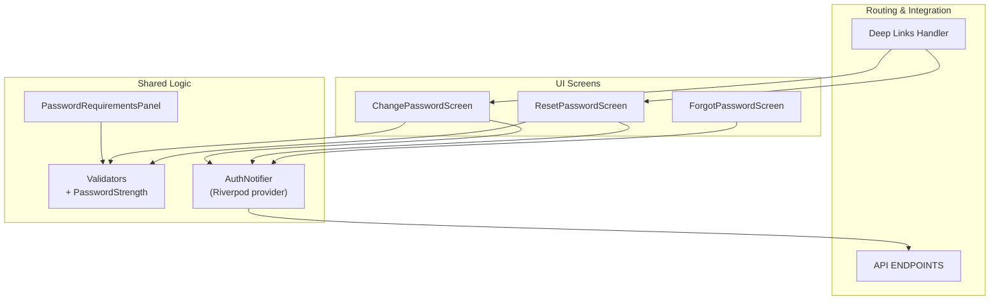

**Diagram sources**
- [forgot_password_screen.dart:13-50](file://lib/features/auth/screens/forgot_password_screen.dart#L13-L50)
- [reset_password_screen.dart:13-76](file://lib/features/auth/screens/reset_password_screen.dart#L13-L76)
- [change_password_screen.dart:13-60](file://lib/features/auth/screens/change_password_screen.dart#L13-L60)
- [validators.dart:50-102](file://lib/core/utils/validators.dart#L50-L102)
- [providers.dart:312-334](file://lib/features/auth/providers.dart#L312-L334)
- [deep_links.dart:77-114](file://lib/core/deep_links.dart#L77-L114)
- [ENDPOINTS.md:25-38](file://api/ENDPOINTS.md#L25-L38)

**Section sources**
- [forgot_password_screen.dart:1-160](file://lib/features/auth/screens/forgot_password_screen.dart#L1-L160)
- [reset_password_screen.dart:1-320](file://lib/features/auth/screens/reset_password_screen.dart#L1-L320)
- [change_password_screen.dart:1-259](file://lib/features/auth/screens/change_password_screen.dart#L1-L259)
- [validators.dart:1-103](file://lib/core/utils/validators.dart#L1-L103)
- [providers.dart:1-352](file://lib/features/auth/providers.dart#L1-L352)
- [deep_links.dart:1-159](file://lib/core/deep_links.dart#L1-L159)
- [ENDPOINTS.md:1-195](file://api/ENDPOINTS.md#L1-L195)

## Core Components
- Forgot password screen collects an email or phone number and calls the session provider to request a reset link.
- Reset password screen validates and submits a token plus a new password; it handles missing or rejected tokens.
- Change password screen requires the current password and sends a verification link before the change becomes active.
- Validators enforce minimum password length, confirmation matching, and optional email/phone formats.
- PasswordStrength provides live feedback for password quality.
- PasswordRequirementsPanel implements the hosted form’s five-rule policy and engagement-driven checklist.
- AuthNotifier exposes methods that forward requests to the repository and API.
- Deep links route password reset and change verification URLs back into the app.

**Section sources**
- [forgot_password_screen.dart:13-50](file://lib/features/auth/screens/forgot_password_screen.dart#L13-L50)
- [reset_password_screen.dart:13-76](file://lib/features/auth/screens/reset_password_screen.dart#L13-L76)
- [change_password_screen.dart:13-60](file://lib/features/auth/screens/change_password_screen.dart#L13-L60)
- [validators.dart:50-102](file://lib/core/utils/validators.dart#L50-L102)
- [password_requirements_panel.dart:5-57](file://lib/features/auth/widgets/password_requirements_panel.dart#L5-L57)
- [providers.dart:312-334](file://lib/features/auth/providers.dart#L312-L334)
- [deep_links.dart:77-114](file://lib/core/deep_links.dart#L77-L114)

## Architecture Overview
The password flows combine UI validation, provider-layer API calls, and deep-link routing.

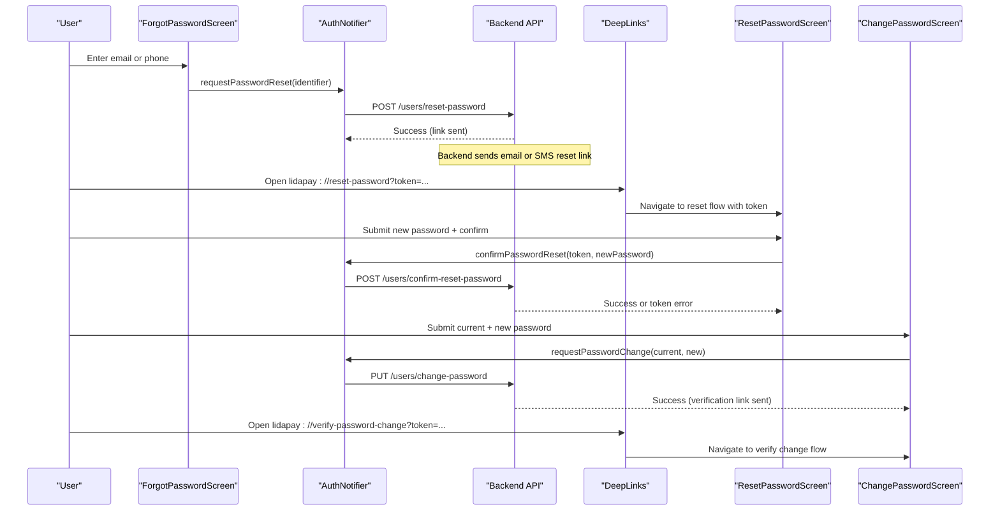

**Diagram sources**
- [forgot_password_screen.dart:35-50](file://lib/features/auth/screens/forgot_password_screen.dart#L35-L50)
- [reset_password_screen.dart:49-76](file://lib/features/auth/screens/reset_password_screen.dart#L49-L76)
- [change_password_screen.dart:41-60](file://lib/features/auth/screens/change_password_screen.dart#L41-L60)
- [providers.dart:312-334](file://lib/features/auth/providers.dart#L312-L334)
- [deep_links.dart:77-114](file://lib/core/deep_links.dart#L77-L114)
- [ENDPOINTS.md:25-38](file://api/ENDPOINTS.md#L25-L38)

## Detailed Component Analysis

### Forgot Password Flow
- Purpose: Initiate a password reset by sending a secure link to the user’s email or phone number.
- Input: Email or phone number validated through `Validators.emailOrPhone`.
- Submission: Calls `AuthNotifier.requestPasswordReset`, which forwards to the backend endpoint.
- Feedback: Shows success messaging and allows returning to sign-in. Errors are displayed under the form.

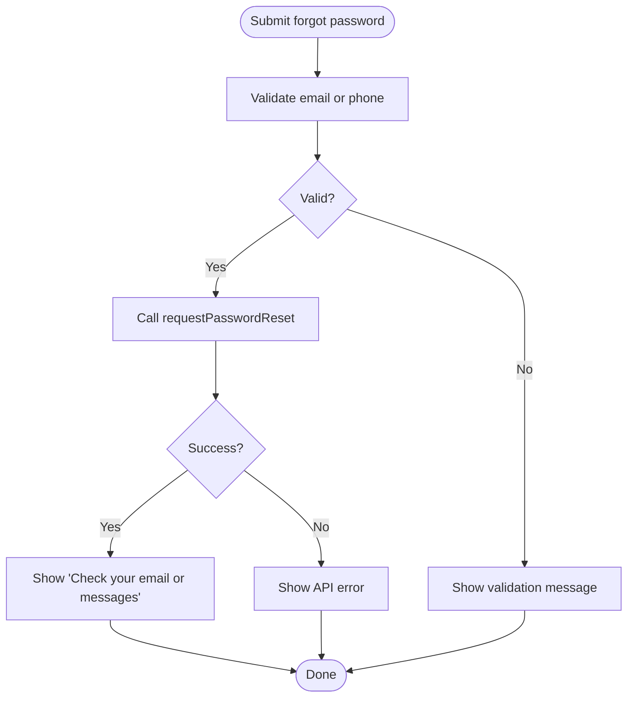

**Diagram sources**
- [forgot_password_screen.dart:35-50](file://lib/features/auth/screens/forgot_password_screen.dart#L35-L50)
- [validators.dart:33-43](file://lib/core/utils/validators.dart#L33-L43)
- [providers.dart:312-313](file://lib/features/auth/providers.dart#L312-L313)
- [ENDPOINTS.md:37-38](file://api/ENDPOINTS.md#L37-L38)

**Section sources**
- [forgot_password_screen.dart:13-50](file://lib/features/auth/screens/forgot_password_screen.dart#L13-L50)
- [validators.dart:33-43](file://lib/core/utils/validators.dart#L33-L43)
- [providers.dart:312-313](file://lib/features/auth/providers.dart#L312-L313)
- [ENDPOINTS.md:37-38](file://api/ENDPOINTS.md#L37-L38)

### Reset Password Flow
- Purpose: Apply a token from a reset link to set a new password. No session is required.
- Token handling: The screen detects missing tokens and marks links as invalid or expired based on API errors.
- Validation: Uses `Validators.password` and `Validators.confirmPassword`.
- Strength feedback: A local strength bar shows weak/fair/good/strong feedback using `PasswordStrength.of`.
- Error handling: If the token is rejected or expired, the screen offers to request a new link.

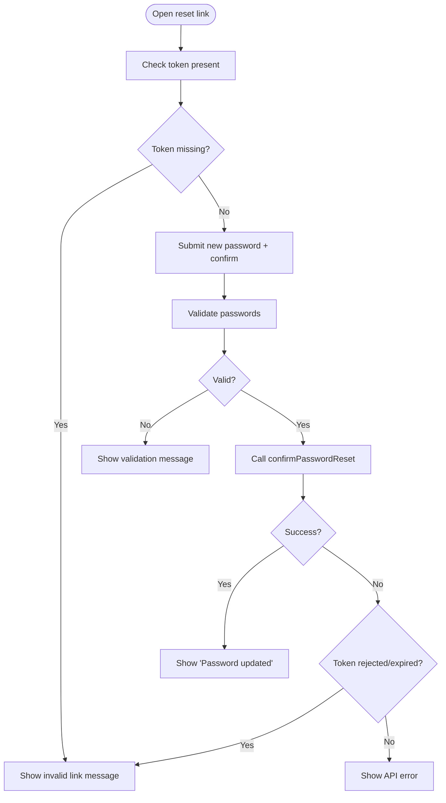

**Diagram sources**
- [reset_password_screen.dart:49-76](file://lib/features/auth/screens/reset_password_screen.dart#L49-L76)
- [reset_password_screen.dart:219-268](file://lib/features/auth/screens/reset_password_screen.dart#L219-L268)
- [validators.dart:50-62](file://lib/core/utils/validators.dart#L50-L62)
- [validators.dart:84-101](file://lib/core/utils/validators.dart#L84-L101)
- [providers.dart:315-321](file://lib/features/auth/providers.dart#L315-L321)
- [ENDPOINTS.md:37-38](file://api/ENDPOINTS.md#L37-L38)

**Section sources**
- [reset_password_screen.dart:13-76](file://lib/features/auth/screens/reset_password_screen.dart#L13-L76)
- [reset_password_screen.dart:219-268](file://lib/features/auth/screens/reset_password_screen.dart#L219-L268)
- [validators.dart:50-62](file://lib/core/utils/validators.dart#L50-L62)
- [validators.dart:84-101](file://lib/core/utils/validators.dart#L84-L101)
- [providers.dart:315-321](file://lib/features/auth/providers.dart#L315-L321)
- [ENDPOINTS.md:37-38](file://api/ENDPOINTS.md#L37-L38)

### Change Password Flow
- Purpose: Allow signed-in users to request a password change. The change only becomes active after opening a verification link.
- Inputs: Current password, new password, and confirmation.
- Submission: Calls `requestPasswordChange`, which triggers the backend to email a verification link.
- Post-submission: Displays a message instructing the user to open the verification link.

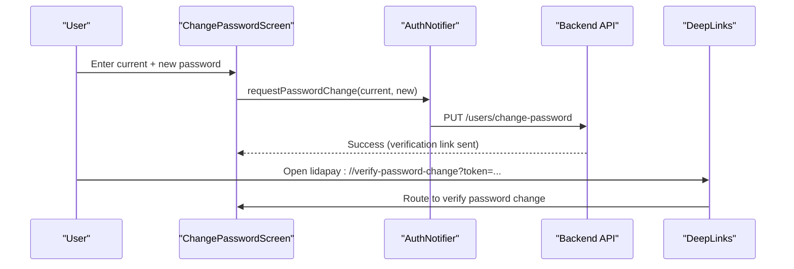

**Diagram sources**
- [change_password_screen.dart:41-60](file://lib/features/auth/screens/change_password_screen.dart#L41-L60)
- [providers.dart:323-334](file://lib/features/auth/providers.dart#L323-L334)
- [deep_links.dart:77-114](file://lib/core/deep_links.dart#L77-L114)
- [ENDPOINTS.md:25-26](file://api/ENDPOINTS.md#L25-L26)

**Section sources**
- [change_password_screen.dart:13-60](file://lib/features/auth/screens/change_password_screen.dart#L13-L60)
- [providers.dart:323-334](file://lib/features/auth/providers.dart#L323-L334)
- [deep_links.dart:77-114](file://lib/core/deep_links.dart#L77-L114)
- [ENDPOINTS.md:25-26](file://api/ENDPOINTS.md#L25-L26)

### Password Requirements Panel and Validation Rules
The hosted reset form enforces five rules, mirrored by the panel logic:
- Minimum length: at least 8 characters.
- Mixed case: uppercase and lowercase letters.
- Number: at least one digit.
- Symbol: at least one non-alphanumeric character.
- Confirmation: passwords must match when both fields are engaged.

The panel renders:
- An engagement-aware status label: Not started, Weak, Fair, Good, Strong — ready to save, or Confirm password.
- A four-bar strength indicator.
- A checklist of rules with checkmarks when met.

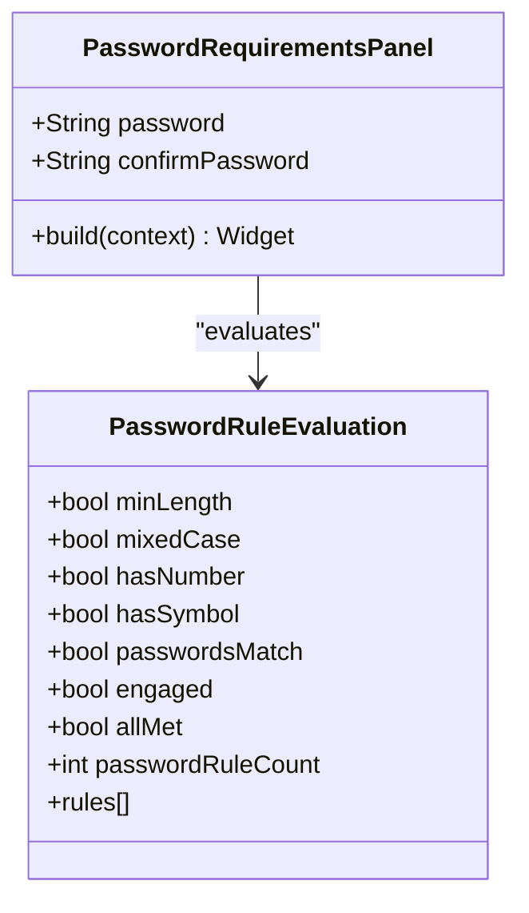

**Diagram sources**
- [password_requirements_panel.dart:5-57](file://lib/features/auth/widgets/password_requirements_panel.dart#L5-L57)
- [password_requirements_panel.dart:59-218](file://lib/features/auth/widgets/password_requirements_panel.dart#L59-L218)

For app-side password validation and strength scoring:
- Minimum length: 6 characters.
- Confirmation: exact match between password and confirm fields.
- Strength tiers: Weak, Fair, Good, Strong based on length, mixed case, digits, and symbols.

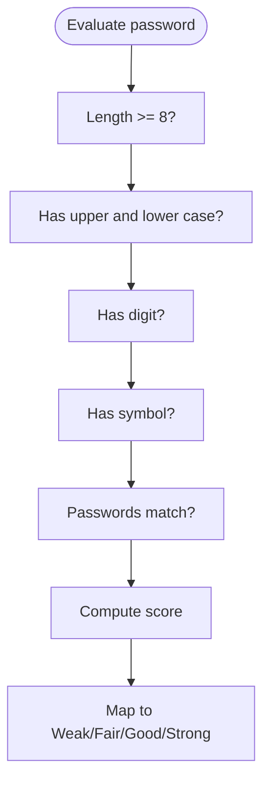

**Diagram sources**
- [validators.dart:50-62](file://lib/core/utils/validators.dart#L50-L62)
- [validators.dart:84-101](file://lib/core/utils/validators.dart#L84-L101)

**Section sources**
- [password_requirements_panel.dart:5-57](file://lib/features/auth/widgets/password_requirements_panel.dart#L5-L57)
- [password_requirements_panel.dart:59-218](file://lib/features/auth/widgets/password_requirements_panel.dart#L59-L218)
- [validators.dart:50-62](file://lib/core/utils/validators.dart#L50-L62)
- [validators.dart:84-101](file://lib/core/utils/validators.dart#L84-L101)

### Email and SMS Verification Behavior
- Forgot password can send a reset link via email or SMS depending on the identifier provided.
- For phone resets, the backend sends an SMS through One4All. Provider failures return HTTP 502; missing configuration returns HTTP 503.
- The hosted reset form displays live requirements and toggles for showing/hiding the password.
- After successful reset, the completion page offers two return paths:
  - Mobile deep link: `lidapay://auth/password-reset-complete`.
  - Browser return: `PASSWORD_RESET_WEB_RETURN_URL` or `APP_URL?passwordReset=complete`.

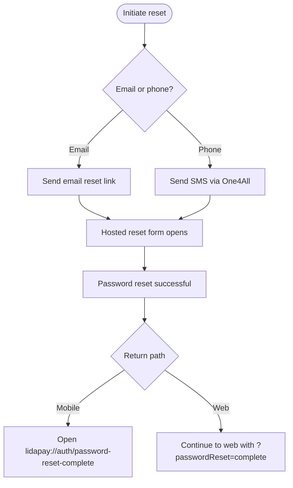

**Diagram sources**
- [MOBILE_APP_REBUILD_HANDOFF.md:195-205](file://docs/MOBILE_APP_REBUILD_HANDOFF.md#L195-L205)
- [deep_links.dart:77-114](file://lib/core/deep_links.dart#L77-L114)

**Section sources**
- [MOBILE_APP_REBUILD_HANDOFF.md:195-205](file://docs/MOBILE_APP_REBUILD_HANDOFF.md#L195-L205)
- [deep_links.dart:77-114](file://lib/core/deep_links.dart#L77-L114)

### API Integrations
Key endpoints involved in password management:
- `PUT /api/v1/users/change-password`: Request password change (email verification required).
- `POST /api/v1/users/confirm-password-change`: Confirm password change via email verification token.
- `POST /api/v1/users/reset-password`: Initiate password reset.
- `POST /api/v1/users/confirm-reset-password`: Confirm password reset with token.

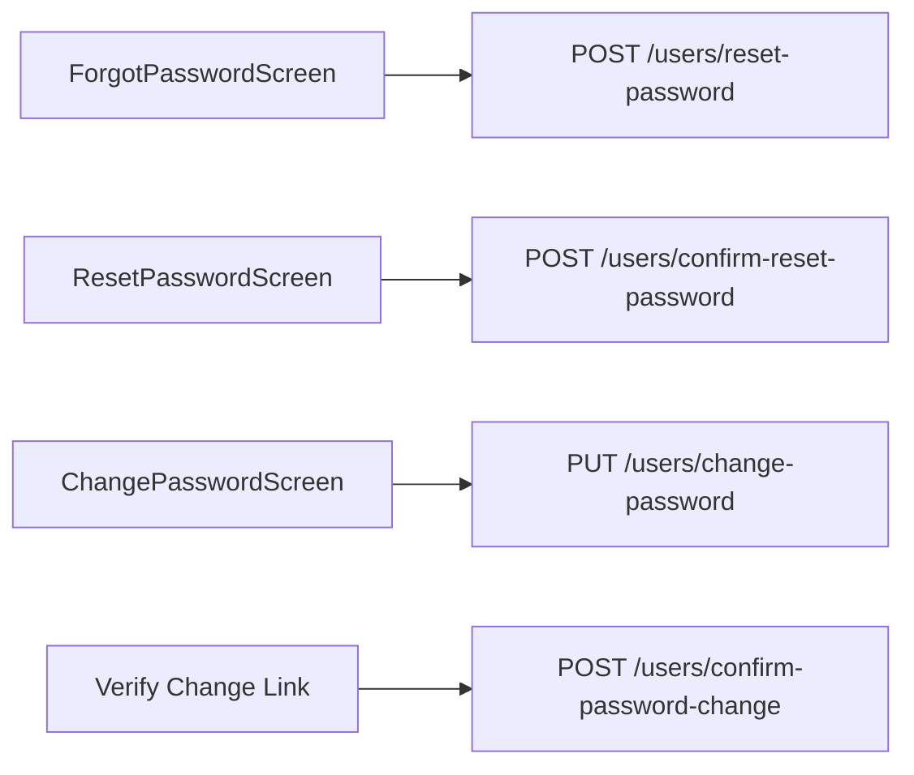

**Diagram sources**
- [ENDPOINTS.md:25-38](file://api/ENDPOINTS.md#L25-L38)

**Section sources**
- [ENDPOINTS.md:25-38](file://api/ENDPOINTS.md#L25-L38)

### Error Handling Strategies
- Form-level validation errors are shown inline beneath inputs.
- Network/API errors are caught and displayed as centered error text.
- Reset password screen distinguishes token rejection/expiry and suggests requesting a new link.
- Change password screen informs users that the password remains unchanged until the verification link is opened.

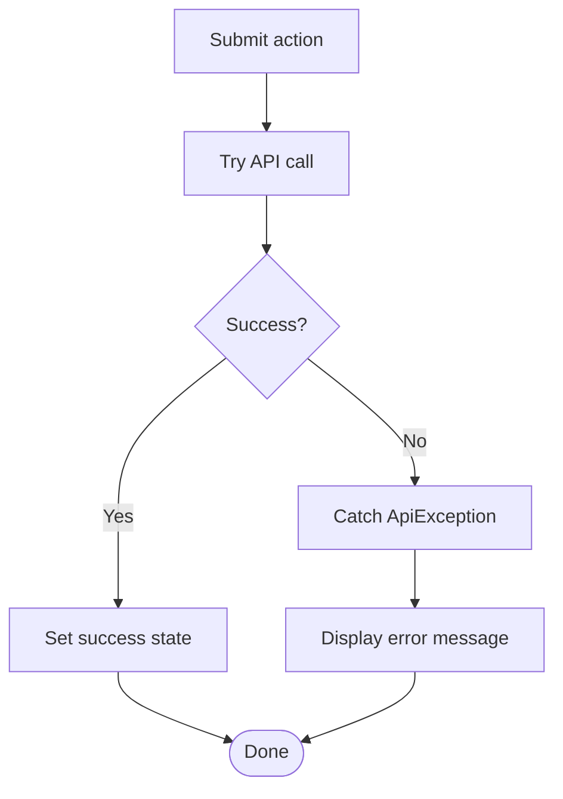

**Diagram sources**
- [forgot_password_screen.dart:35-50](file://lib/features/auth/screens/forgot_password_screen.dart#L35-L50)
- [reset_password_screen.dart:49-76](file://lib/features/auth/screens/reset_password_screen.dart#L49-L76)
- [change_password_screen.dart:41-60](file://lib/features/auth/screens/change_password_screen.dart#L41-L60)

**Section sources**
- [forgot_password_screen.dart:35-50](file://lib/features/auth/screens/forgot_password_screen.dart#L35-L50)
- [reset_password_screen.dart:49-76](file://lib/features/auth/screens/reset_password_screen.dart#L49-L76)
- [change_password_screen.dart:41-60](file://lib/features/auth/screens/change_password_screen.dart#L41-L60)

## Dependency Analysis
The password management feature depends on:
- UI screens for user input and feedback.
- Validators for input and password strength evaluation.
- Riverpod provider for API orchestration and session state.
- Deep links for routing password-related URLs.
- API endpoints for backend operations.

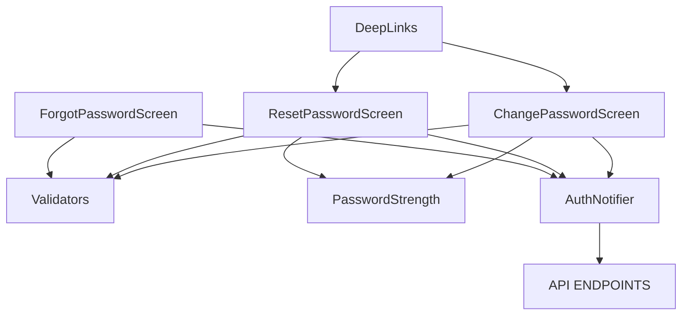

**Diagram sources**
- [forgot_password_screen.dart:13-50](file://lib/features/auth/screens/forgot_password_screen.dart#L13-L50)
- [reset_password_screen.dart:13-76](file://lib/features/auth/screens/reset_password_screen.dart#L13-L76)
- [change_password_screen.dart:13-60](file://lib/features/auth/screens/change_password_screen.dart#L13-L60)
- [validators.dart:50-102](file://lib/core/utils/validators.dart#L50-L102)
- [providers.dart:312-334](file://lib/features/auth/providers.dart#L312-L334)
- [deep_links.dart:77-114](file://lib/core/deep_links.dart#L77-L114)
- [ENDPOINTS.md:25-38](file://api/ENDPOINTS.md#L25-L38)

**Section sources**
- [forgot_password_screen.dart:13-50](file://lib/features/auth/screens/forgot_password_screen.dart#L13-L50)
- [reset_password_screen.dart:13-76](file://lib/features/auth/screens/reset_password_screen.dart#L13-L76)
- [change_password_screen.dart:13-60](file://lib/features/auth/screens/change_password_screen.dart#L13-L60)
- [validators.dart:50-102](file://lib/core/utils/validators.dart#L50-L102)
- [providers.dart:312-334](file://lib/features/auth/providers.dart#L312-L334)
- [deep_links.dart:77-114](file://lib/core/deep_links.dart#L77-L114)
- [ENDPOINTS.md:25-38](file://api/ENDPOINTS.md#L25-L38)

## Performance Considerations
- Avoid rapid retries on password reset initiation; the backend rate-limits related endpoints.
- Prefer best-effort profile refreshes where appropriate to avoid blocking critical flows.
- Use lightweight validation and strength checks to keep UI responsive during typing.
- Minimize unnecessary network calls by relying on tokens as the authority for reset/change flows.

[No sources needed since this section provides general guidance]

## Troubleshooting Guide
Common issues and resolutions:
- Invalid or expired reset link: The reset screen detects token issues and prompts to request a new link.
- Missing token in URL: The screen shows an explicit message guiding users to start a new reset.
- Phone reset failures: Backend provider errors return HTTP 502; missing SMS configuration returns HTTP 503. Check backend logs and environment variables.
- Change password not applied: Ensure the verification link is opened; the password remains unchanged until confirmed.

**Section sources**
- [reset_password_screen.dart:49-76](file://lib/features/auth/screens/reset_password_screen.dart#L49-L76)
- [reset_password_screen.dart:219-268](file://lib/features/auth/screens/reset_password_screen.dart#L219-L268)
- [MOBILE_APP_REBUILD_HANDOFF.md:195-205](file://docs/MOBILE_APP_REBUILD_HANDOFF.md#L195-L205)
- [change_password_screen.dart:13-60](file://lib/features/auth/screens/change_password_screen.dart#L13-L60)

## Conclusion
The password management system combines clear UI flows, robust validation, and secure token-based operations. It supports both email and SMS channels, provides actionable feedback, and routes external links back into the app. Security is reinforced by requiring verification links for sensitive changes and by offering strong password guidance. Proper error handling ensures users receive meaningful messages and next steps when things go wrong.

[No sources needed since this section summarizes without analyzing specific files]