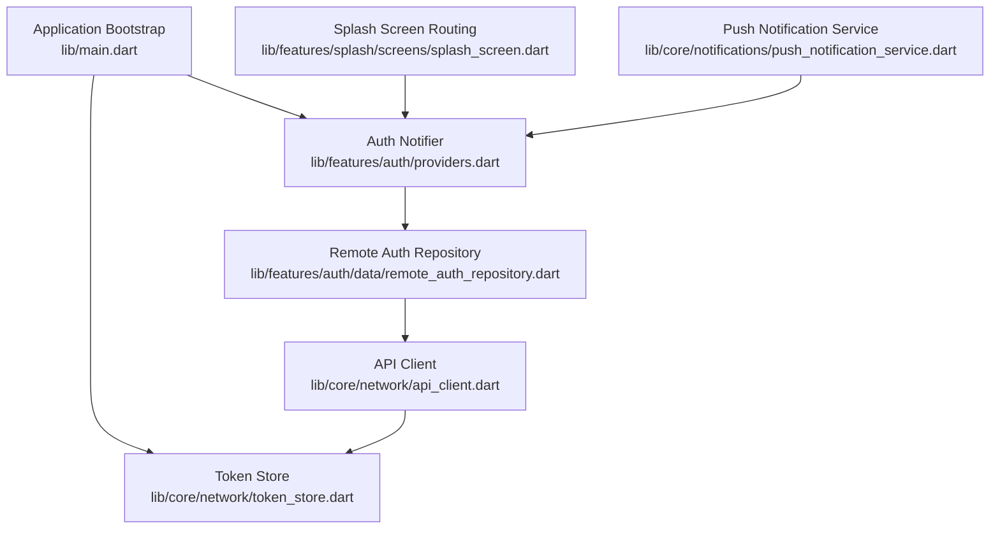
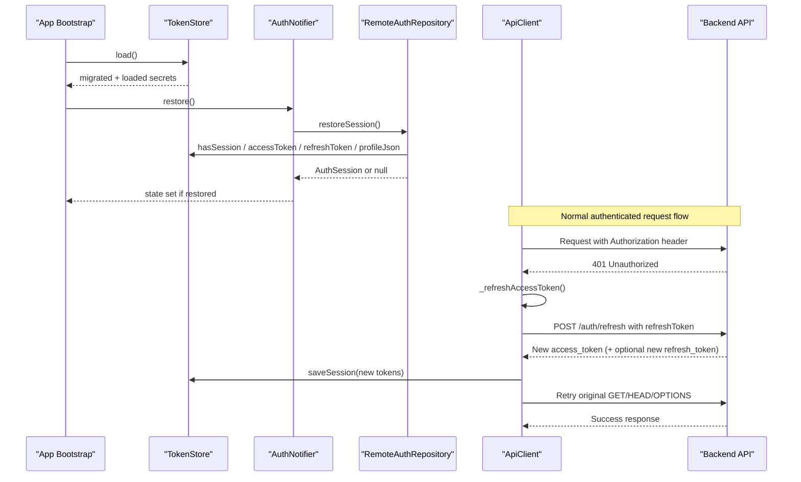
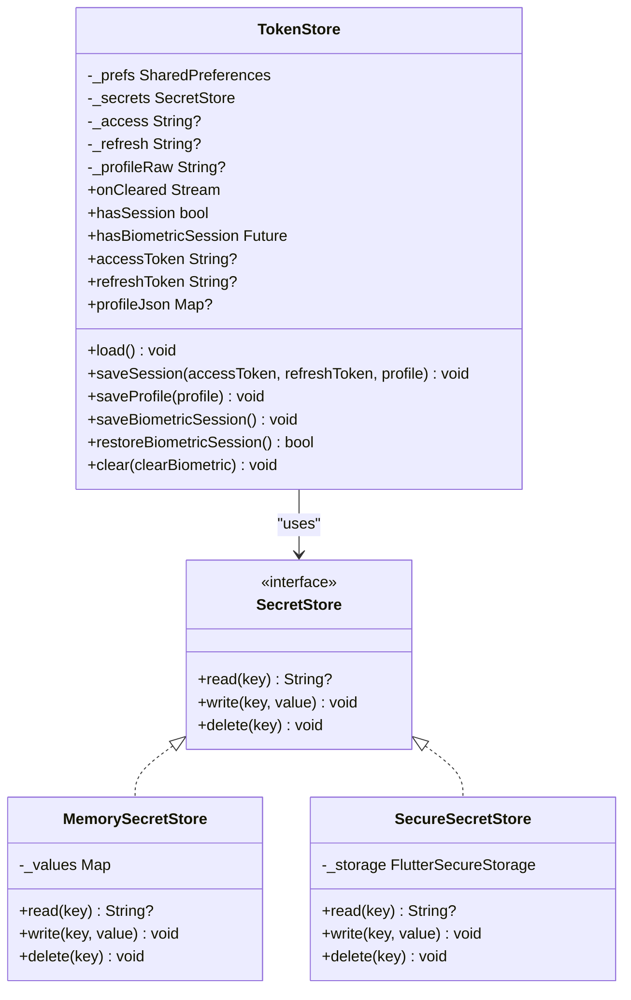
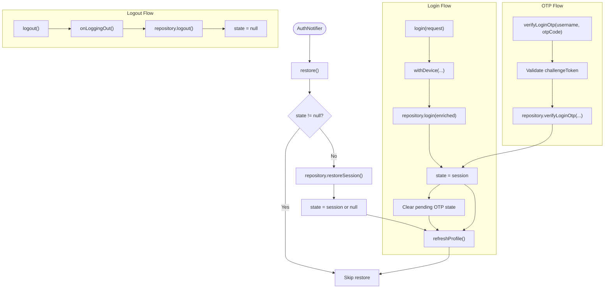
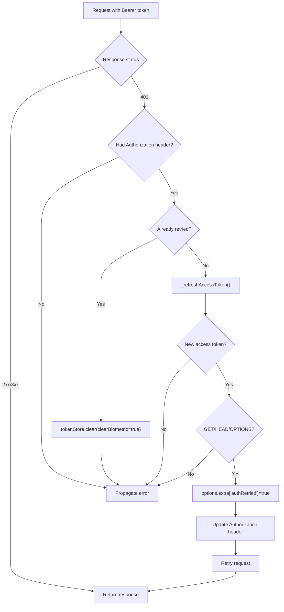
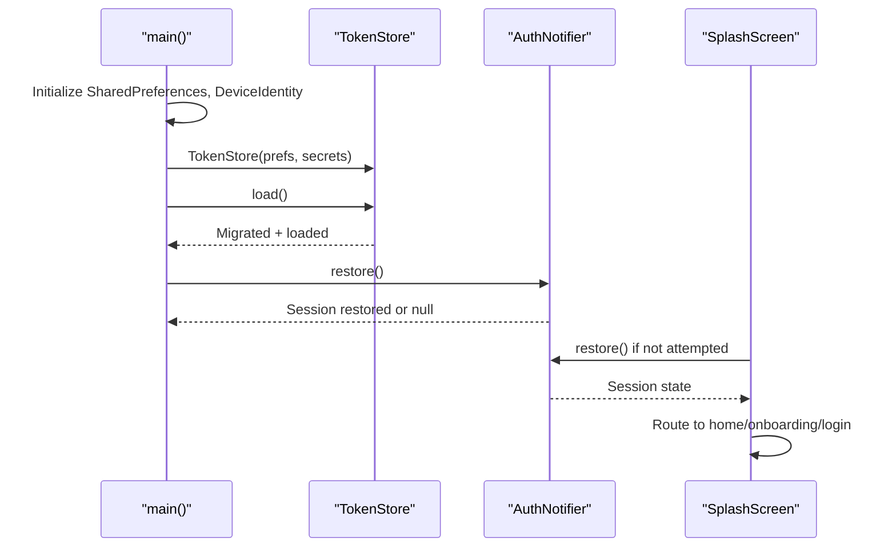
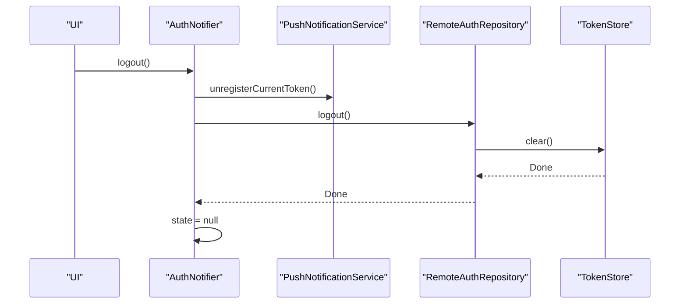
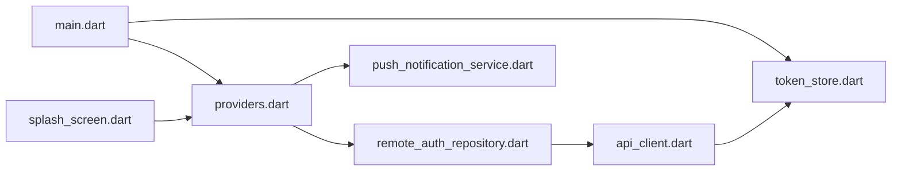

# Session Management

<cite>
**Referenced Files in This Document**
- [main.dart](file://lib/main.dart)
- [token_store.dart](file://lib/core/network/token_store.dart)
- [api_client.dart](file://lib/core/network/api_client.dart)
- [auth_repository.dart](file://lib/features/auth/data/auth_repository.dart)
- [remote_auth_repository.dart](file://lib/features/auth/data/remote_auth_repository.dart)
- [providers.dart](file://lib/features/auth/providers.dart)
- [auth_models.dart](file://lib/features/auth/data/auth_models.dart)
- [splash_screen.dart](file://lib/features/splash/screens/splash_screen.dart)
- [push_notification_service.dart](file://lib/core/notifications/push_notification_service.dart)
- [token_store_test.dart](file://test/token_store_test.dart)
- [remote_parsing_test.dart](file://test/remote_parsing_test.dart)
</cite>

## Table of Contents
1. [Introduction](#introduction)
2. [Project Structure](#project-structure)
3. [Core Components](#core-components)
4. [Architecture Overview](#architecture-overview)
5. [Detailed Component Analysis](#detailed-component-analysis)
6. [Dependency Analysis](#dependency-analysis)
7. [Performance Considerations](#performance-considerations)
8. [Troubleshooting Guide](#troubleshooting-guide)
9. [Conclusion](#conclusion)

## Introduction
This document explains how the application manages user sessions, stores authentication tokens securely, persists state across app restarts, supports automatic login and biometric sign-in, handles token refresh and expiration, and implements secure logout. It also provides practical examples for session initialization, token validation, and logout procedures, along with security best practices for token handling.

## Project Structure
The session management system spans several layers:
- Application bootstrap initializes secure storage and restores a session at cold start.
- A token store keeps access and refresh tokens plus a cached profile in encrypted device storage with an in-memory mirror.
- An API client injects bearer tokens and transparently refreshes them on 401 responses.
- Auth providers expose login, OTP verification, profile refresh, biometric login, and logout.
- Remote auth repository maps API calls to persisted sessions.

**Diagram sources**
- [main.dart:98-141](file://lib/main.dart#L98-L141)
- [token_store.dart:74-237](file://lib/core/network/token_store.dart#L74-L237)
- [providers.dart:51-351](file://lib/features/auth/providers.dart#L51-L351)
- [remote_auth_repository.dart:13-274](file://lib/features/auth/data/remote_auth_repository.dart#L13-L274)
- [api_client.dart:16-266](file://lib/core/network/api_client.dart#L16-L266)
- [splash_screen.dart:37-56](file://lib/features/splash/screens/splash_screen.dart#L37-L56)
- [push_notification_service.dart:278-291](file://lib/core/notifications/push_notification_service.dart#L278-L291)

**Section sources**
- [main.dart:98-141](file://lib/main.dart#L98-L141)
- [splash_screen.dart:37-56](file://lib/features/splash/screens/splash_screen.dart#L37-L56)

## Core Components
- TokenStore: Encrypted persistence for access token, refresh token, and profile; supports biometric session snapshots and migration from legacy plaintext storage.
- ApiClient: Dio-based HTTP client that attaches Authorization headers and automatically refreshes tokens on 401 errors with single-flight deduplication.
- AuthNotifier (Riverpod provider): Stateful session manager exposing login, OTP flows, profile refresh, biometric login, and logout; reacts to token store invalidation.
- RemoteAuthRepository: Live implementation mapping API endpoints to persisted sessions and profile updates.
- AuthModels: Data models for login requests, OTP challenges, tokens, and user profiles.

Key responsibilities:
- Secure storage: Tokens are written to platform keystore/keychain via FlutterSecureStorage; a synchronous in-memory mirror avoids I/O during request interception.
- Persistence: Profile JSON is persisted alongside tokens so UI can render immediately after restore.
- Automatic login: On startup, the app loads tokens, attempts to restore a session, and navigates users accordingly.
- Token refresh: Transparent retry on 401 with a separate Dio instance; only GET/HEAD/OPTIONS are retried after refresh.
- Logout: Clears stored tokens and optionally clears biometric snapshot; notifies observers to drop the session.

**Section sources**
- [token_store.dart:74-237](file://lib/core/network/token_store.dart#L74-L237)
- [api_client.dart:16-266](file://lib/core/network/api_client.dart#L16-L266)
- [providers.dart:51-351](file://lib/features/auth/providers.dart#L51-L351)
- [remote_auth_repository.dart:13-274](file://lib/features/auth/data/remote_auth_repository.dart#L13-L274)
- [auth_models.dart:358-371](file://lib/features/auth/data/auth_models.dart#L358-L371)

## Architecture Overview
The session lifecycle integrates app bootstrap, token storage, network interceptors, and auth state providers.

**Diagram sources**
- [main.dart:98-141](file://lib/main.dart#L98-L141)
- [token_store.dart:120-170](file://lib/core/network/token_store.dart#L120-L170)
- [providers.dart:171-180](file://lib/features/auth/providers.dart#L171-L180)
- [remote_auth_repository.dart:82-103](file://lib/features/auth/data/remote_auth_repository.dart#L82-L103)
- [api_client.dart:204-265](file://lib/core/network/api_client.dart#L204-L265)

## Detailed Component Analysis

### Token Storage and Security
TokenStore encapsulates:
- Encrypted secret backend (SecureSecretStore using FlutterSecureStorage).
- In-memory mirror for fast access by interceptors.
- Migration from legacy SharedPreferences to encrypted storage.
- Biometric session snapshotting and restoration.
- Stream notifications when the session is cleared.

Security highlights:
- Tokens and profile are never kept in plain SharedPreferences after migration.
- iOS Keychain options prevent iCloud sync and restrict accessibility to first unlock on this device.
- Biometric session requires both access and refresh tokens; credentials/passwords are not stored.

**Diagram sources**
- [token_store.dart:26-69](file://lib/core/network/token_store.dart#L26-L69)
- [token_store.dart:74-237](file://lib/core/network/token_store.dart#L74-L237)

**Section sources**
- [token_store.dart:46-69](file://lib/core/network/token_store.dart#L46-L69)
- [token_store.dart:74-237](file://lib/core/network/token_store.dart#L74-L237)
- [token_store_test.dart:20-107](file://test/token_store_test.dart#L20-L107)

### Authentication State Management
AuthNotifier is a Riverpod StateNotifier managing the current AuthSession:
- Login and OTP verification update state and trigger profile refresh.
- Cold-start restore sets the session if available and triggers device token sync.
- Biometric login restores a previously opted-in session and validates it against the repository.
- Profile refresh merges fresh profile data while preserving tokens; 401 clears the session.
- Logout unregisters device token, calls repository logout, and clears state.

**Diagram sources**
- [providers.dart:88-163](file://lib/features/auth/providers.dart#L88-L163)
- [providers.dart:171-202](file://lib/features/auth/providers.dart#L171-L202)
- [providers.dart:204-239](file://lib/features/auth/providers.dart#L204-L239)
- [providers.dart:336-344](file://lib/features/auth/providers.dart#L336-L344)

**Section sources**
- [providers.dart:51-351](file://lib/features/auth/providers.dart#L51-L351)

### Token Refresh Mechanism
ApiClient uses Dio interceptors to:
- Attach Authorization headers using the in-memory access token.
- Detect 401 responses and attempt a single-flight token refresh.
- Only retry GET/HEAD/OPTIONS requests after refresh to avoid unintended side effects.
- Persist updated tokens via TokenStore.saveSession.
- Clear the session on explicit refresh failures (e.g., 400/401/403) or missing refresh token.

**Diagram sources**
- [api_client.dart:25-83](file://lib/core/network/api_client.dart#L25-L83)
- [api_client.dart:204-265](file://lib/core/network/api_client.dart#L204-L265)

**Section sources**
- [api_client.dart:16-266](file://lib/core/network/api_client.dart#L16-L266)

### Session Initialization and Automatic Login
At app startup:
- SharedPreferences and DeviceIdentity are initialized.
- SecureSecretStore is created and passed into TokenStore.
- TokenStore.load() migrates legacy plaintext tokens to encrypted storage and loads them into memory.
- AuthNotifier.restore() attempts to restore a session within a bounded timeout.
- Splash screen routes to home if a session exists, otherwise to onboarding/login.

**Diagram sources**
- [main.dart:98-141](file://lib/main.dart#L98-L141)
- [splash_screen.dart:37-56](file://lib/features/splash/screens/splash_screen.dart#L37-L56)
- [providers.dart:171-180](file://lib/features/auth/providers.dart#L171-L180)

**Section sources**
- [main.dart:98-141](file://lib/main.dart#L98-L141)
- [splash_screen.dart:37-56](file://lib/features/splash/screens/splash_screen.dart#L37-L56)

### Logout Procedures
Logout involves:
- Optional device token unregistration via push notification service.
- Repository logout call (currently clears tokens via TokenStore).
- Clearing the notifier’s state to null.

**Diagram sources**
- [providers.dart:336-344](file://lib/features/auth/providers.dart#L336-L344)
- [remote_auth_repository.dart:272-274](file://lib/features/auth/data/remote_auth_repository.dart#L272-L274)
- [token_store.dart:219-236](file://lib/core/network/token_store.dart#L219-L236)

**Section sources**
- [providers.dart:336-344](file://lib/features/auth/providers.dart#L336-L344)
- [remote_auth_repository.dart:272-274](file://lib/features/auth/data/remote_auth_repository.dart#L272-L274)

### Examples

#### Session Initialization
- Create SharedPreferences and DeviceIdentity.
- Instantiate SecureSecretStore and TokenStore.
- Call TokenStore.load() to migrate and load secrets.
- Call AuthNotifier.restore() to attempt automatic login.

Relevant paths:
- [main.dart:98-141](file://lib/main.dart#L98-L141)
- [token_store.dart:120-146](file://lib/core/network/token_store.dart#L120-L146)
- [providers.dart:171-180](file://lib/features/auth/providers.dart#L171-L180)

#### Token Validation
- Access tokens are attached to requests via ApiClient interceptor.
- On 401, ApiClient attempts a single-flight refresh using the stored refresh token.
- If refresh succeeds, the original GET/HEAD/OPTIONS request is retried once.
- If refresh fails or returns no access token, the session is cleared.

Relevant paths:
- [api_client.dart:25-83](file://lib/core/network/api_client.dart#L25-L83)
- [api_client.dart:204-265](file://lib/core/network/api_client.dart#L204-L265)
- [remote_parsing_test.dart:1490-1527](file://test/remote_parsing_test.dart#L1490-L1527)

#### Logout
- Trigger logout from UI.
- Unregister device token via push notification service.
- Call repository logout which clears tokens.
- Clear AuthNotifier state to null.

Relevant paths:
- [providers.dart:336-344](file://lib/features/auth/providers.dart#L336-L344)
- [remote_auth_repository.dart:272-274](file://lib/features/auth/data/remote_auth_repository.dart#L272-L274)
- [token_store.dart:219-236](file://lib/core/network/token_store.dart#L219-L236)

## Dependency Analysis
The following diagram shows key dependencies among session-related components:

**Diagram sources**
- [main.dart:98-141](file://lib/main.dart#L98-L141)
- [token_store.dart:74-237](file://lib/core/network/token_store.dart#L74-L237)
- [providers.dart:51-351](file://lib/features/auth/providers.dart#L51-L351)
- [remote_auth_repository.dart:13-274](file://lib/features/auth/data/remote_auth_repository.dart#L13-L274)
- [api_client.dart:16-266](file://lib/core/network/api_client.dart#L16-L266)
- [splash_screen.dart:37-56](file://lib/features/splash/screens/splash_screen.dart#L37-L56)
- [push_notification_service.dart:278-291](file://lib/core/notifications/push_notification_service.dart#L278-L291)

**Section sources**
- [main.dart:98-141](file://lib/main.dart#L98-L141)
- [providers.dart:51-351](file://lib/features/auth/providers.dart#L51-L351)
- [remote_auth_repository.dart:13-274](file://lib/features/auth/data/remote_auth_repository.dart#L13-L274)
- [api_client.dart:16-266](file://lib/core/network/api_client.dart#L16-L266)

## Performance Considerations
- In-memory token mirror avoids disk I/O during request interception, improving latency.
- Startup operations are bounded with timeouts to prevent splash freeze.
- Single-flight refresh prevents concurrent refresh storms.
- Profile refresh retries transient failures once with a delay, keeping cached profile intact.

[No sources needed since this section provides general guidance]

## Troubleshooting Guide
Common issues and resolutions:
- Keystore corruption or OEM ROM issues: TokenStore.load() degrades gracefully to signed out and wipes legacy values.
- Missing refresh token: ApiClient clears the session on 401 without a refresh token.
- Expired biometric session: Biometric login requires a valid refreshable session; otherwise, prompt password login.
- Stale JWT sub claims: RemoteAuthRepository evicts sessions with invalid JWT sub fields at launch.

Actionable checks:
- Verify TokenStore.hasSession and TokenStore.refreshToken presence before protected calls.
- Inspect ApiClient error logs for 401 and refresh outcomes.
- Ensure SecureSecretStore is configured in production builds.

**Section sources**
- [token_store.dart:120-146](file://lib/core/network/token_store.dart#L120-L146)
- [api_client.dart:211-265](file://lib/core/network/api_client.dart#L211-L265)
- [providers.dart:186-202](file://lib/features/auth/providers.dart#L186-L202)
- [remote_auth_repository.dart:82-103](file://lib/features/auth/data/remote_auth_repository.dart#L82-L103)

## Conclusion
The session management system combines secure token storage, robust persistence, automatic login, and resilient token refresh. TokenStore ensures sensitive material is protected with platform keystores and provides a fast in-memory mirror. ApiClient transparently handles 401 scenarios with single-flight refresh and safe retries. AuthNotifier orchestrates login, OTP verification, profile synchronization, biometric login, and logout. Together, these components deliver a secure, reliable, and user-friendly session experience.

[No sources needed since this section summarizes without analyzing specific files]