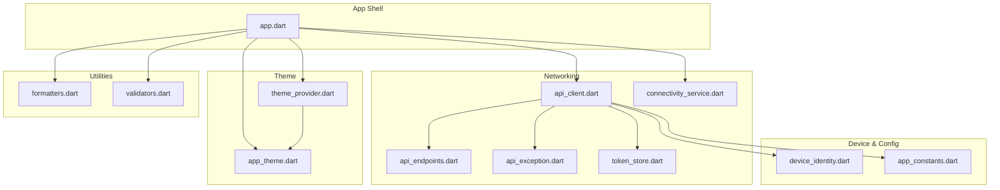
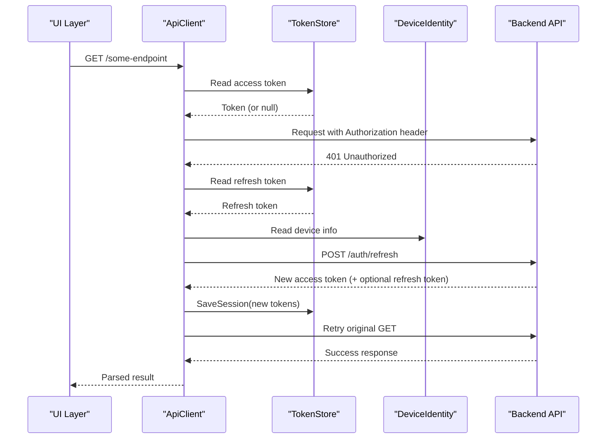
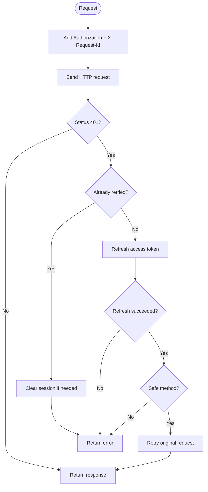
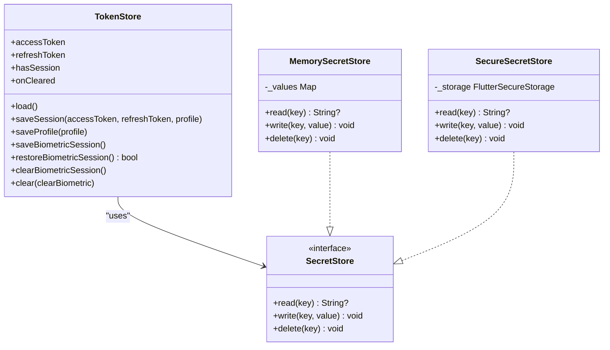
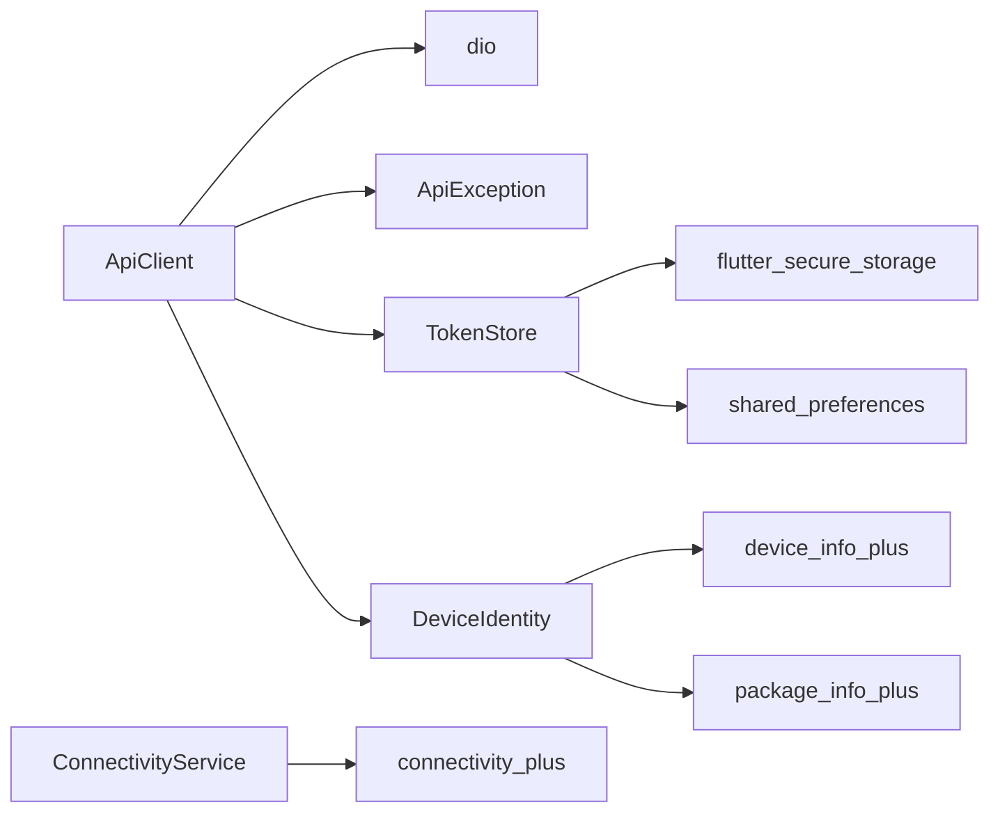

# Core Infrastructure

<cite>
**Referenced Files in This Document**
- [pubspec.yaml](file://pubspec.yaml)
- [app.dart](file://lib/app.dart)
- [app_constants.dart](file://lib/core/constants/app_constants.dart)
- [api_client.dart](file://lib/core/network/api_client.dart)
- [api_endpoints.dart](file://lib/core/network/api_endpoints.dart)
- [api_exception.dart](file://lib/core/network/api_exception.dart)
- [token_store.dart](file://lib/core/network/token_store.dart)
- [connectivity_service.dart](file://lib/core/network/connectivity_service.dart)
- [device_identity.dart](file://lib/core/device/device_identity.dart)
- [theme_provider.dart](file://lib/core/providers/theme_provider.dart)
- [app_theme.dart](file://lib/core/theme/app_theme.dart)
- [formatters.dart](file://lib/core/utils/formatters.dart)
- [validators.dart](file://lib/core/utils/validators.dart)
</cite>

## Table of Contents
1. [Introduction](#introduction)
2. [Project Structure](#project-structure)
3. [Core Components](#core-components)
4. [Architecture Overview](#architecture-overview)
5. [Detailed Component Analysis](#detailed-component-analysis)
6. [Dependency Analysis](#dependency-analysis)
7. [Performance Considerations](#performance-considerations)
8. [Troubleshooting Guide](#troubleshooting-guide)
9. [Conclusion](#conclusion)
10. [Appendices](#appendices)

## Introduction
This document explains the core infrastructure layer that powers networking, authentication, session persistence, device identity, theme and appearance, connectivity awareness, and shared utilities. It is designed for both new contributors and experienced engineers who need to extend or customize the system safely.

Key goals:
- Provide a secure, resilient API client with token refresh and request tracing.
- Persist sensitive data securely while keeping common reads fast.
- Manage sessions, biometric sign-in, and logout cleanly.
- Offer a consistent brand theme with light/dark modes and typography.
- Detect platform and device context without leaking hardware identifiers.
- Expose configuration points and extension patterns for custom behavior.

## Project Structure
The core infrastructure lives under `lib/core` and integrates with the app entry point and feature modules. The most relevant files are:

- Networking: `api_client.dart`, `api_endpoints.dart`, `api_exception.dart`, `token_store.dart`, `connectivity_service.dart`
- Device and environment: `device_identity.dart`, `app_constants.dart`
- Theme and appearance: `app_theme.dart`, `theme_provider.dart`
- Utilities: `formatters.dart`, `validators.dart`
- App shell integration: `app.dart`
- Dependencies: `pubspec.yaml`

**Diagram sources**
- [app.dart:1-262](file://lib/app.dart#L1-L262)
- [api_client.dart:1-276](file://lib/core/network/api_client.dart#L1-L276)
- [api_endpoints.dart:1-155](file://lib/core/network/api_endpoints.dart#L1-L155)
- [api_exception.dart:1-79](file://lib/core/network/api_exception.dart#L1-L79)
- [token_store.dart:1-238](file://lib/core/network/token_store.dart#L1-L238)
- [connectivity_service.dart:1-46](file://lib/core/network/connectivity_service.dart#L1-L46)
- [device_identity.dart:1-132](file://lib/core/device/device_identity.dart#L1-L132)
- [app_constants.dart:1-65](file://lib/core/constants/app_constants.dart#L1-L65)
- [app_theme.dart:1-233](file://lib/core/theme/app_theme.dart#L1-L233)
- [theme_provider.dart:1-39](file://lib/core/providers/theme_provider.dart#L1-L39)
- [formatters.dart:1-124](file://lib/core/utils/formatters.dart#L1-L124)
- [validators.dart:1-103](file://lib/core/utils/validators.dart#L1-L103)

**Section sources**
- [pubspec.yaml:30-75](file://pubspec.yaml#L30-L75)
- [app.dart:1-262](file://lib/app.dart#L1-L262)

## Core Components
- ApiClient: Centralized HTTP client using Dio with interceptors for authorization headers, request IDs, debug logging, and automatic token refresh on 401.
- TokenStore: Secure session storage with encrypted secrets, in-memory mirror for performance, migration from legacy plaintext preferences, and biometric session support.
- DeviceIdentity: Privacy-safe device context (UUID-based ID, platform, locale, model, OS version, manufacturer).
- ConnectivityService: Streamed online/offline state used by the app shell to show an offline banner.
- AppTheme and ThemeProvider: Brand colors, typography, Material 3 theming, and persisted theme mode selection.
- AppConstants: Build-time and runtime configuration such as API base URL, timeouts, default locale, and map key flags.
- Formatters and Validators: Shared helpers for currency, time, phone/email validation, and friendly error messages.

**Section sources**
- [api_client.dart:13-276](file://lib/core/network/api_client.dart#L13-L276)
- [token_store.dart:71-238](file://lib/core/network/token_store.dart#L71-L238)
- [device_identity.dart:12-132](file://lib/core/device/device_identity.dart#L12-L132)
- [connectivity_service.dart:11-46](file://lib/core/network/connectivity_service.dart#L11-L46)
- [app_theme.dart:4-233](file://lib/core/theme/app_theme.dart#L4-L233)
- [theme_provider.dart:5-39](file://lib/core/providers/theme_provider.dart#L5-L39)
- [app_constants.dart:1-65](file://lib/core/constants/app_constants.dart#L1-L65)
- [formatters.dart:3-124](file://lib/core/utils/formatters.dart#L3-L124)
- [validators.dart:1-103](file://lib/core/utils/validators.dart#L1-L103)

## Architecture Overview
The application bootstraps the UI, initializes push notifications and deep links, wires up connectivity monitoring, and applies the theme. Networking calls flow through ApiClient, which injects tokens and handles refreshes transparently. Sensitive tokens are stored via TokenStore backed by secure storage; non-sensitive preferences remain in SharedPreferences. Device identity and constants provide environment context.

**Diagram sources**
- [api_client.dart:13-276](file://lib/core/network/api_client.dart#L13-L276)
- [token_store.dart:71-238](file://lib/core/network/token_store.dart#L71-L238)
- [device_identity.dart:12-132](file://lib/core/device/device_identity.dart#L12-L132)
- [api_endpoints.dart:1-155](file://lib/core/network/api_endpoints.dart#L1-L155)

## Detailed Component Analysis

### API Client with Interceptors, Retry, and Authentication
Responsibilities:
- Attach Authorization headers when available.
- Inject a unique request ID per call.
- Redact sensitive fields in debug logs.
- Single-flight concurrent token refresh on 401.
- Retry only safe methods (GET/HEAD/OPTIONS) after successful refresh.
- Convert Dio errors into user-friendly ApiException instances.

Key behaviors:
- Base options use configured base URL and timeouts.
- Raw endpoints return untyped payloads for non-JSON responses.
- Refresh payload includes device token, device identity, app version, and locale when available.

**Diagram sources**
- [api_client.dart:13-276](file://lib/core/network/api_client.dart#L13-L276)
- [api_exception.dart:1-79](file://lib/core/network/api_exception.dart#L1-L79)

**Section sources**
- [api_client.dart:13-276](file://lib/core/network/api_client.dart#L13-L276)
- [api_exception.dart:1-79](file://lib/core/network/api_exception.dart#L1-L79)

### Token Storage, Secure Persistence, and Session Management
Design:
- Secrets (access token, refresh token, profile JSON, biometric snapshot) are written to a SecretStore implementation backed by FlutterSecureStorage in production.
- In-memory mirrors avoid disk I/O on hot paths like interceptors.
- Legacy plaintext keys in SharedPreferences are migrated once at startup.
- Biometric sign-in stores a refreshable session snapshot; it is kept in sync when refresh tokens rotate.
- Logout clears active session; rejected refresh tokens clear biometric session too.

Important APIs:
- load(): migrate and seed in-memory cache.
- saveSession(): persist tokens and profile.
- saveBiometricSession()/restoreBiometricSession(): manage fingerprint sign-in.
- clear(clearBiometric): full logout path.

**Diagram sources**
- [token_store.dart:20-238](file://lib/core/network/token_store.dart#L20-L238)

**Section sources**
- [token_store.dart:1-238](file://lib/core/network/token_store.dart#L1-L238)

### Theme System, Color Schemes, Typography, and Responsive Patterns
Highlights:
- Brand palette centered on magenta/crimson and deep navy, with gradients for CTAs and hero surfaces.
- Material 3 color scheme derived from a seed color, with overrides for dark/light variants.
- Custom typography using Plus Jakarta Sans across text styles.
- Consistent radii, shadows, input borders, navigation bar, bottom sheet, dialog, and snackbar themes.
- Theme mode persisted via SharedPreferences and applied by the app shell.

Responsive considerations:
- Platform-aware page transitions.
- Edge-to-edge UI with dynamic status/navigation bar overlay styling based on brightness.
- Offline banner integrated into the app shell.

**Section sources**
- [app_theme.dart:4-233](file://lib/core/theme/app_theme.dart#L4-L233)
- [theme_provider.dart:5-39](file://lib/core/providers/theme_provider.dart#L5-L39)
- [app.dart:179-257](file://lib/app.dart#L179-L257)

### Device Identity Management and Platform Detection
Capabilities:
- Generates a privacy-friendly UUID per install, persisted in SharedPreferences.
- Detects platform (WEB/ANDROID/IOS), model, OS version, manufacturer.
- Derives locale string and optional ISO country code hint.
- Provides fallback values when native plugins fail.

Usage:
- Sent during token refresh and OTP flows to help backend correlate device context.

**Section sources**
- [device_identity.dart:12-132](file://lib/core/device/device_identity.dart#L12-L132)

### Connectivity Awareness
- Streams online/offline state using connectivity_plus.
- App shell shows a non-blocking offline banner when no network is available.

**Section sources**
- [connectivity_service.dart:11-46](file://lib/core/network/connectivity_service.dart#L11-L46)
- [app.dart:218-257](file://lib/app.dart#L218-L257)

### Common Helpers: Formatting and Validation
Formatters:
- Currency formatting for GHS and other units.
- Compact numbers, relative time, countdown timers.
- Friendly failure reason mapping for payment errors.

Validators:
- Email, Ghana phone, international phone, email-or-phone.
- Required fields, password strength assessment.

**Section sources**
- [formatters.dart:3-124](file://lib/core/utils/formatters.dart#L3-L124)
- [validators.dart:1-103](file://lib/core/utils/validators.dart#L1-L103)

## Dependency Analysis
External dependencies relevant to the core infrastructure:
- dio: HTTP client and interceptors.
- flutter_secure_storage: Encrypted secret storage.
- shared_preferences: Non-secret preferences and legacy migration.
- device_info_plus and package_info_plus: Device and app metadata.
- connectivity_plus: Network reachability.
- uuid: Anonymous device identifier generation.

**Diagram sources**
- [pubspec.yaml:30-75](file://pubspec.yaml#L30-L75)
- [api_client.dart:1-276](file://lib/core/network/api_client.dart#L1-L276)
- [token_store.dart:1-238](file://lib/core/network/token_store.dart#L1-L238)
- [device_identity.dart:1-132](file://lib/core/device/device_identity.dart#L1-L132)
- [connectivity_service.dart:1-46](file://lib/core/network/connectivity_service.dart#L1-L46)

**Section sources**
- [pubspec.yaml:30-75](file://pubspec.yaml#L30-L75)

## Performance Considerations
- TokenStore keeps an in-memory mirror of secrets so interceptors do not await disk I/O.
- Dio uses short connect/send timeouts and a longer receive timeout to balance responsiveness with slow provider round-trips.
- Single-flight token refresh avoids thundering herds when multiple requests fail concurrently.
- Only safe HTTP methods are retried after refresh to prevent duplicate writes.
- Debug logging redacts sensitive fields automatically.

[No sources needed since this section provides general guidance]

## Troubleshooting Guide
Common issues and resolutions:
- Repeated 401s: Indicates invalid or expired refresh token. The client clears the session; ensure the backend accepts the refresh token and returns a valid access token.
- Offline banner appears: Connectivity stream reports no connection. Verify device network settings and permissions.
- Biometric sign-in fails after first refresh: Ensure refresh tokens are rotated and saved; TokenStore synchronizes the biometric snapshot when refresh material changes.
- Migration failures on some OEM ROMs: TokenStore.load degrades gracefully to signed-out state instead of crashing; verify keystore availability.

Operational tips:
- Use ApiException properties (message, code, statusCode, outcomeUnknown) to tailor user feedback.
- For write operations where server outcome is unknown, avoid blind retries.
- Keep API_BASE_URL and GOOGLE_MAPS_API_KEY configured via build defines.

**Section sources**
- [api_client.dart:204-265](file://lib/core/network/api_client.dart#L204-L265)
- [token_store.dart:120-146](file://lib/core/network/token_store.dart#L120-L146)
- [api_exception.dart:22-74](file://lib/core/network/api_exception.dart#L22-L74)
- [connectivity_service.dart:33-44](file://lib/core/network/connectivity_service.dart#L33-L44)

## Conclusion
The core infrastructure provides a secure, extensible foundation for networking, authentication, device context, theming, and shared utilities. Its design emphasizes safety (encrypted secrets, redacted logs), resilience (single-flight refresh, graceful degradation), and consistency (brand theme, validators, formatters). Teams can extend it by adding custom interceptors, overriding providers, or implementing alternative SecretStore backends.

[No sources needed since this section summarizes without analyzing specific files]

## Appendices

### Configuration Options and Customization Points
- API base URL and timeouts: configure via `API_BASE_URL`, `apiTimeout`, `apiConnectTimeout`.
- Checkout allowed hosts: pass `CHECKOUT_ALLOWED_HOSTS` at build time.
- Google Maps key: pass `GOOGLE_MAPS_API_KEY`; maps fall back gracefully when missing.
- Update policy path: override `APP_UPDATE_POLICY_PATH` for version checks.
- Theme mode: persisted via SharedPreferences; default is system.

**Section sources**
- [app_constants.dart:1-65](file://lib/core/constants/app_constants.dart#L1-L65)
- [theme_provider.dart:5-39](file://lib/core/providers/theme_provider.dart#L5-L39)

### Practical Examples

#### Extending the API Client with a Custom Interceptor
Steps:
- Create a Dio interceptor that adds custom headers, metrics, or caching logic.
- Register it in ApiClient’s interceptor chain before the auth interceptor runs.
- Ensure sensitive data is redacted in debug logs if you add new fields.

Reference pattern:
- See how ApiClient configures interceptors and redaction.

**Section sources**
- [api_client.dart:25-83](file://lib/core/network/api_client.dart#L25-L83)
- [api_client.dart:86-113](file://lib/core/network/api_client.dart#L86-L113)

#### Implementing a Custom SecretStore
Steps:
- Implement SecretStore to wrap your preferred secure storage solution.
- Override secretStoreProvider in main() to inject your implementation.
- Validate read/write/delete semantics and handle platform-specific errors.

Reference pattern:
- See MemorySecretStore and SecureSecretStore implementations.

**Section sources**
- [token_store.dart:20-69](file://lib/core/network/token_store.dart#L20-L69)

#### Overriding Theme Defaults
Steps:
- Extend AppColors or create a new ThemeData builder.
- Replace themeModeProvider’s initial state or expose a factory for alternate themes.
- Apply the theme in the app shell or via a Provider override.

Reference pattern:
- See AppTheme and ThemeModeNotifier.

**Section sources**
- [app_theme.dart:4-233](file://lib/core/theme/app_theme.dart#L4-L233)
- [theme_provider.dart:5-39](file://lib/core/providers/theme_provider.dart#L5-L39)