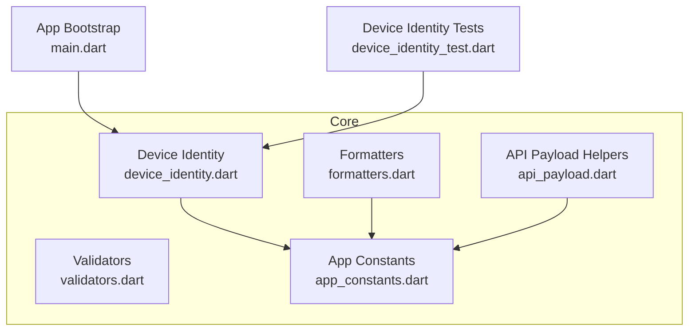
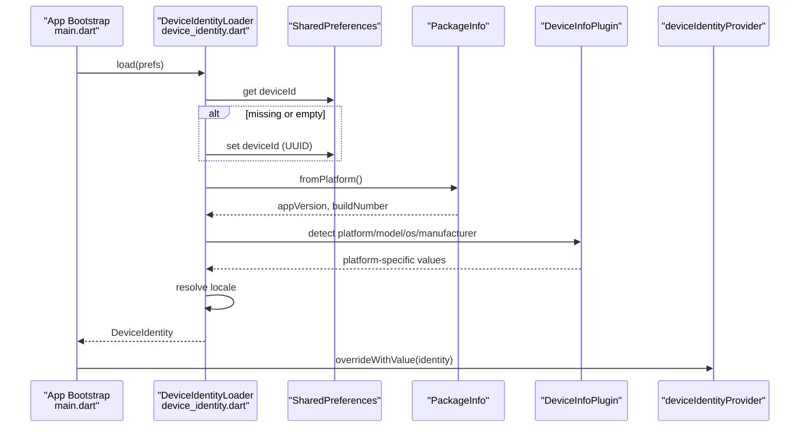
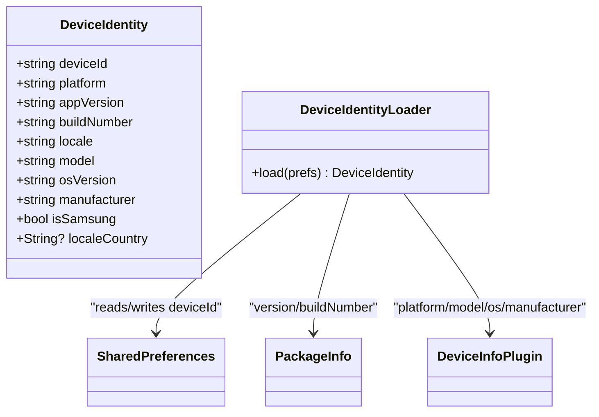
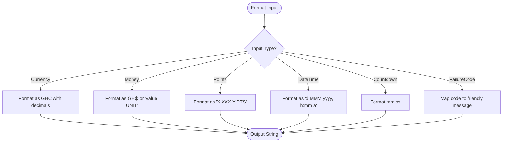
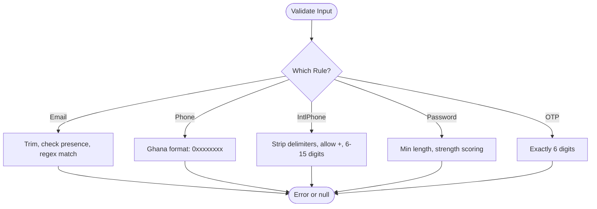
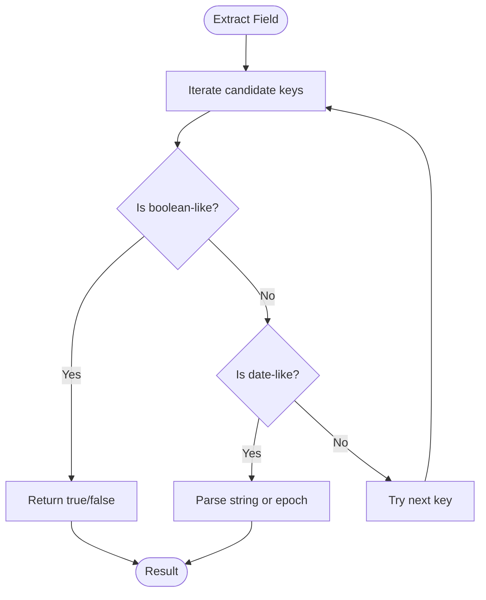
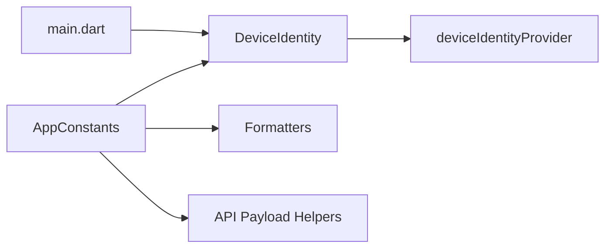

# Device Utilities

<cite>
**Referenced Files in This Document**
- [device_identity.dart](file://lib/core/device/device_identity.dart)
- [formatters.dart](file://lib/core/utils/formatters.dart)
- [validators.dart](file://lib/core/utils/validators.dart)
- [app_constants.dart](file://lib/core/constants/app_constants.dart)
- [api_payload.dart](file://lib/core/network/api_payload.dart)
- [main.dart](file://lib/main.dart)
- [device_identity_test.dart](file://test/device_identity_test.dart)
</cite>

## Table of Contents
1. [Introduction](#introduction)
2. [Project Structure](#project-structure)
3. [Core Components](#core-components)
4. [Architecture Overview](#architecture-overview)
5. [Detailed Component Analysis](#detailed-component-analysis)
6. [Dependency Analysis](#dependency-analysis)
7. [Performance Considerations](#performance-considerations)
8. [Troubleshooting Guide](#troubleshooting-guide)
9. [Conclusion](#conclusion)
10. [Appendices](#appendices)

## Introduction
This document explains the device utilities and helper functions used across the application, with a focus on:
- Platform detection and cross-platform compatibility via `DeviceIdentity`.
- Utility functions for string formatting, date manipulation, validation helpers, and safe platform-specific behavior.
- Practical examples for analytics, conditional feature loading, and platform-specific implementations.
- Guidelines for adding new utility functions while maintaining platform compatibility.

The goal is to make these utilities understandable for both developers and non-technical readers who need to extend or use them safely.

## Project Structure
The relevant utilities live under `lib/core`:
- Device identity and loader: `lib/core/device/device_identity.dart`
- Formatting and display helpers: `lib/core/utils/formatters.dart`
- Validation helpers: `lib/core/utils/validators.dart`
- Build-time and runtime constants: `lib/core/constants/app_constants.dart`
- Payload parsing helpers (date/boolean): `lib/core/network/api_payload.dart`
- App bootstrap where device identity is resolved: `lib/main.dart`
- Tests validating device identity behavior: `test/device_identity_test.dart`

**Diagram sources**
- [device_identity.dart:1-132](file://lib/core/device/device_identity.dart#L1-L132)
- [formatters.dart:1-124](file://lib/core/utils/formatters.dart#L1-L124)
- [validators.dart:1-103](file://lib/core/utils/validators.dart#L1-L103)
- [app_constants.dart:1-65](file://lib/core/constants/app_constants.dart#L1-L65)
- [api_payload.dart:87-115](file://lib/core/network/api_payload.dart#L87-L115)
- [main.dart:101-117](file://lib/main.dart#L101-L117)
- [device_identity_test.dart:47-101](file://test/device_identity_test.dart#L47-L101)

**Section sources**
- [device_identity.dart:1-132](file://lib/core/device/device_identity.dart#L1-L132)
- [formatters.dart:1-124](file://lib/core/utils/formatters.dart#L1-L124)
- [validators.dart:1-103](file://lib/core/utils/validators.dart#L1-L103)
- [app_constants.dart:1-65](file://lib/core/constants/app_constants.dart#L1-L65)
- [api_payload.dart:87-115](file://lib/core/network/api_payload.dart#L87-L115)
- [main.dart:101-117](file://lib/main.dart#L101-L117)
- [device_identity_test.dart:47-101](file://test/device_identity_test.dart#L47-L101)

## Core Components
- DeviceIdentity: Immutable model describing the current install’s platform, version, locale, device model, OS version, manufacturer, and a privacy-friendly app-scoped device ID.
- DeviceIdentityLoader: Resolves the identity at startup by reading persisted device ID, package info, platform details, and locale; never throws so plugin failures cannot block app start.
- Formatters: Currency, compact numbers, points, relative time, countdown timers, phone masking, and friendly failure reasons.
- Validators: Email, Ghana phone, international phone, email-or-phone, required fields, password strength, OTP.
- API payload helpers: Robust boolean and date field extraction from backend payloads.
- AppConstants: Build-time configuration such as API base URL, default locale/currency, allowed checkout hosts, and Google Maps key handling.

**Section sources**
- [device_identity.dart:12-65](file://lib/core/device/device_identity.dart#L12-L65)
- [device_identity.dart:72-130](file://lib/core/device/device_identity.dart#L72-L130)
- [formatters.dart:3-123](file://lib/core/utils/formatters.dart#L3-L123)
- [validators.dart:1-103](file://lib/core/utils/validators.dart#L1-L103)
- [api_payload.dart:87-115](file://lib/core/network/api_payload.dart#L87-L115)
- [app_constants.dart:1-65](file://lib/core/constants/app_constants.dart#L1-L65)

## Architecture Overview
At app startup, the device identity is resolved once and provided globally. Consumers read it through a provider to attach device context to analytics, network requests, and feature flags.

**Diagram sources**
- [main.dart:101-117](file://lib/main.dart#L101-L117)
- [device_identity.dart:72-130](file://lib/core/device/device_identity.dart#L72-L130)

**Section sources**
- [main.dart:101-117](file://lib/main.dart#L101-L117)
- [device_identity.dart:72-130](file://lib/core/device/device_identity.dart#L72-L130)

## Detailed Component Analysis

### DeviceIdentity and DeviceIdentityLoader
Responsibilities:
- Provide a stable, privacy-safe device identifier that resets on reinstall.
- Detect platform (`WEB`, `ANDROID`, `IOS`) and collect non-sensitive device metadata.
- Derive a locale country hint from the device locale.
- Expose a fallback instance for tests and a provider for dependency injection.

Key behaviors:
- Device ID persistence: reads/writes a UUID using a shared preferences key.
- Version resolution: uses package info with graceful fallbacks.
- Platform probing: web vs Android vs iOS, each branch collects appropriate fields.
- Locale normalization: constructs a consistent locale string and extracts an ISO alpha-2 country code when available.

**Diagram sources**
- [device_identity.dart:12-65](file://lib/core/device/device_identity.dart#L12-L65)
- [device_identity.dart:72-130](file://lib/core/device/device_identity.dart#L72-L130)

Usage patterns:
- Analytics: attach `platform`, `appVersion`, `buildNumber`, and `localeCountry` to events.
- Conditional features: check `isSamsung` or `platform` to enable/disable OEM-specific UI workarounds.
- Network context: include identity in registration calls for push tokens and device registration.

**Section sources**
- [device_identity.dart:12-65](file://lib/core/device/device_identity.dart#L12-L65)
- [device_identity.dart:72-130](file://lib/core/device/device_identity.dart#L72-L130)
- [device_identity_test.dart:47-101](file://test/device_identity_test.dart#L47-L101)

### Formatters
Responsibilities:
- Format currency amounts consistently for GHS and other units.
- Display compact numbers, wallet points, and human-readable dates/times.
- Render countdown timers and masked phone numbers.
- Convert backend error codes into user-friendly messages.

Highlights:
- Currency formatting uses a localized formatter with a fixed symbol for GHS.
- Money formatting distinguishes fiat currency from reward units to avoid misleading labels.
- Friendly failure reason mapping normalizes backend codes into actionable text.

**Diagram sources**
- [formatters.dart:3-123](file://lib/core/utils/formatters.dart#L3-L123)

**Section sources**
- [formatters.dart:3-123](file://lib/core/utils/formatters.dart#L3-L123)

### Validators
Responsibilities:
- Validate emails, local Ghana phone numbers, international phone numbers, passwords, confirmations, and OTPs.
- Provide reusable validation rules for forms and API inputs.

Highlights:
- Local phone validator enforces the Ghana format per API spec.
- International phone validator accepts optional leading plus and allows 6–15 digits after stripping whitespace/delimiters.
- Password strength enum provides feedback levels based on length, case, digits, and special characters.

**Diagram sources**
- [validators.dart:1-103](file://lib/core/utils/validators.dart#L1-L103)

**Section sources**
- [validators.dart:1-103](file://lib/core/utils/validators.dart#L1-L103)

### API Payload Helpers
Responsibilities:
- Safely extract booleans and dates from backend payloads that may vary in type or representation.

Highlights:
- Boolean extraction supports bool, numeric, and string representations.
- Date extraction supports ISO strings and epoch timestamps in seconds or milliseconds.

**Diagram sources**
- [api_payload.dart:87-115](file://lib/core/network/api_payload.dart#L87-L115)

**Section sources**
- [api_payload.dart:87-115](file://lib/core/network/api_payload.dart#L87-L115)

### AppConstants
Responsibilities:
- Centralize build-time and runtime configuration.
- Provide defaults for locale, currency, page size, API timeouts, and gateway host allowlist.
- Surface Google Maps configuration status.

Highlights:
- Checkout allowed hosts can be pinned at build time to restrict launchable URLs.
- Default locale and currency are defined centrally for consistency.

**Section sources**
- [app_constants.dart:1-65](file://lib/core/constants/app_constants.dart#L1-L65)

## Dependency Analysis
High-level dependencies among core utilities:

**Diagram sources**
- [app_constants.dart:1-65](file://lib/core/constants/app_constants.dart#L1-L65)
- [device_identity.dart:67-70](file://lib/core/device/device_identity.dart#L67-L70)
- [main.dart:101-117](file://lib/main.dart#L101-L117)

**Section sources**
- [app_constants.dart:1-65](file://lib/core/constants/app_constants.dart#L1-L65)
- [device_identity.dart:67-70](file://lib/core/device/device_identity.dart#L67-L70)
- [main.dart:101-117](file://lib/main.dart#L101-L117)

## Performance Considerations
- Device identity resolution is asynchronous but designed to be resilient: each probe (package info, device info, locale) is wrapped in try/catch so a failing plugin does not block startup.
- Caching: device ID is persisted to shared preferences to avoid regenerating identifiers.
- Formatting: formatters reuse preconfigured number/date formatters to minimize allocations.
- Validation: validators use simple regular expressions and early returns to keep overhead low.

[No sources needed since this section provides general guidance]

## Troubleshooting Guide
Common issues and resolutions:
- Missing device ID: ensure shared preferences initialization occurs before calling `DeviceIdentityLoader.load`; verify the persisted key exists.
- Empty platform or model: if native plugins fail, the loader falls back to safe defaults; check plugin availability on the target platform.
- Locale country not detected: `localeCountry` requires a two-letter suffix in the locale; otherwise it returns null.
- Invalid phone/email: use the provided validators to normalize input and surface clear error messages.
- Backend date parsing errors: prefer the date helper which handles multiple timestamp formats.

**Section sources**
- [device_identity.dart:72-130](file://lib/core/device/device_identity.dart#L72-L130)
- [device_identity_test.dart:47-101](file://test/device_identity_test.dart#L47-L101)
- [validators.dart:1-103](file://lib/core/utils/validators.dart#L1-L103)
- [api_payload.dart:87-115](file://lib/core/network/api_payload.dart#L87-L115)

## Conclusion
The device utilities provide a robust foundation for platform detection, safe data formatting, validation, and resilient startup behavior. By centralizing device identity and utility functions, the app maintains consistency across platforms and simplifies future extensions. Follow the guidelines below when adding new functionality to preserve compatibility and reliability.

[No sources needed since this section summarizes without analyzing specific files]

## Appendices

### Examples and Usage Patterns

- Analytics with device identity:
  - Attach `platform`, `appVersion`, `buildNumber`, and `localeCountry` to analytics events.
  - Use `isSamsung` to segment OEM-specific metrics.

- Conditional feature loading:
  - Check `platform` to enable/disable platform-specific features (e.g., maps on mobile only).
  - Use `AppConstants.googleMapsConfigured` to decide whether to render native map tiles.

- Platform-specific implementations:
  - Wrap platform-only logic with checks like `kIsWeb` or `Platform.isAndroid`/`Platform.isIOS`.
  - For checkout URL launching, validate with `isLaunchableCheckoutUrl` and respect the allowed hosts list.

- Adding new utility functions:
  - Keep pure functions stateless and side-effect free.
  - Place formatting helpers in `formatters.dart`, validation in `validators.dart`, and payload parsing in `api_payload.dart`.
  - If a utility depends on build-time configuration, reference `AppConstants`.
  - Add tests for edge cases (empty inputs, invalid formats, boundary conditions).

- Maintaining platform compatibility:
  - Prefer defensive programming: wrap platform probes in try/catch and provide safe defaults.
  - Avoid hardware identifiers; rely on the privacy-friendly `deviceId`.
  - Normalize locale and currency values using `AppConstants` and `Formatters`.

**Section sources**
- [device_identity.dart:12-65](file://lib/core/device/device_identity.dart#L12-L65)
- [device_identity.dart:72-130](file://lib/core/device/device_identity.dart#L72-L130)
- [formatters.dart:3-123](file://lib/core/utils/formatters.dart#L3-L123)
- [validators.dart:1-103](file://lib/core/utils/validators.dart#L1-L103)
- [app_constants.dart:1-65](file://lib/core/constants/app_constants.dart#L1-L65)
- [device_identity_test.dart:47-101](file://test/device_identity_test.dart#L47-L101)