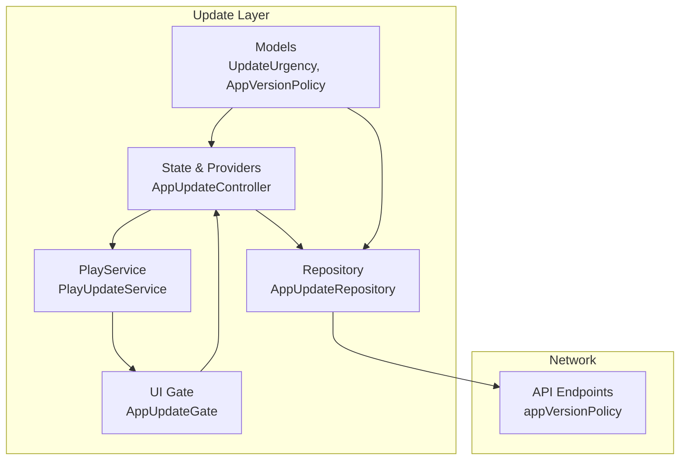
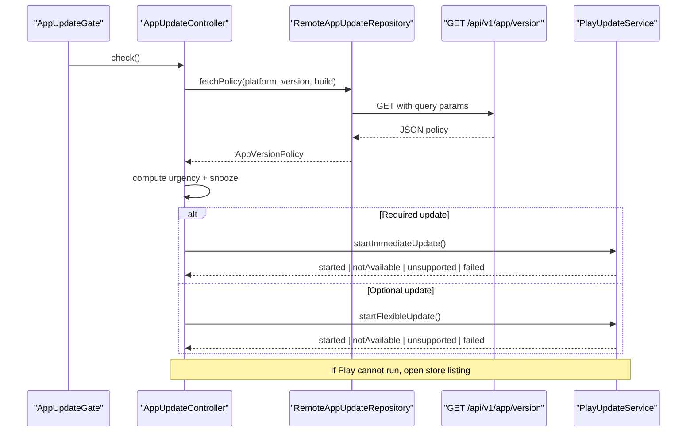
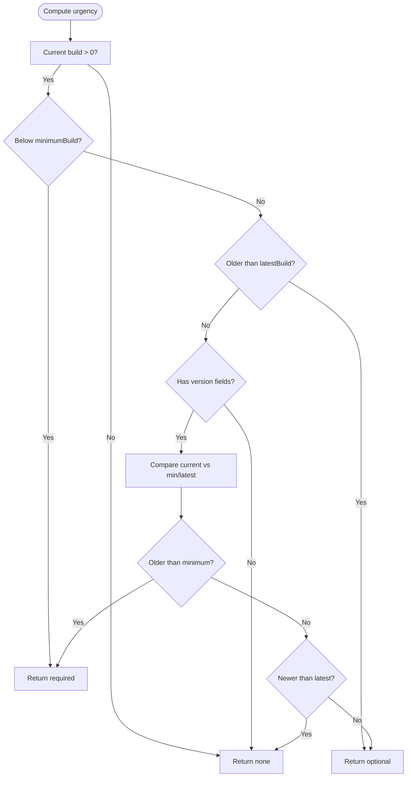
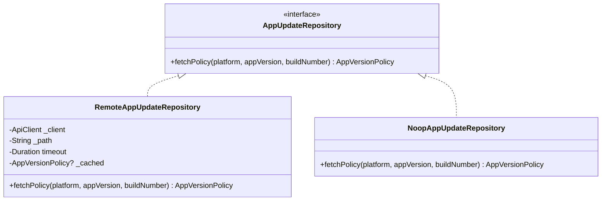
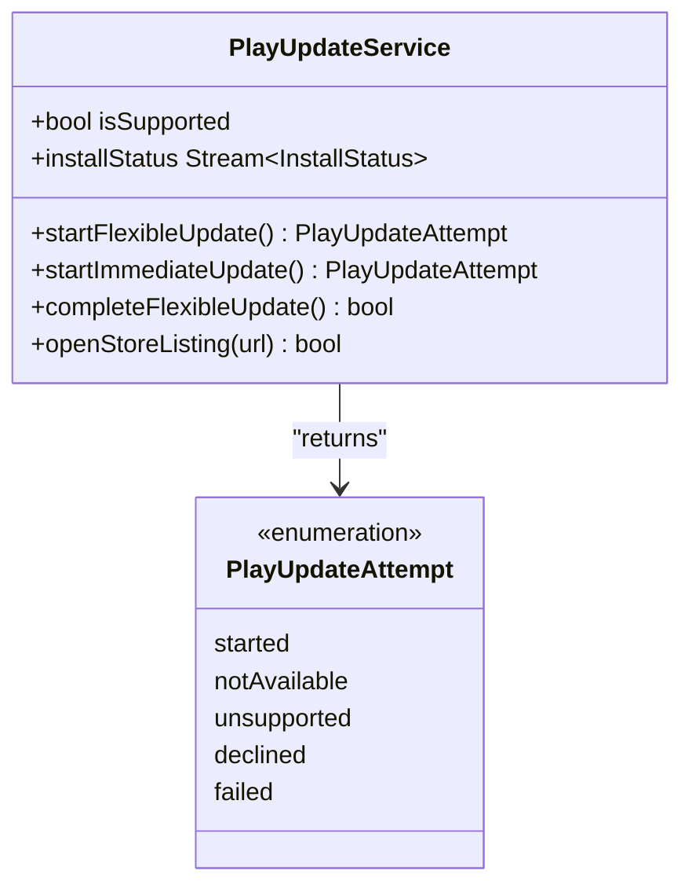
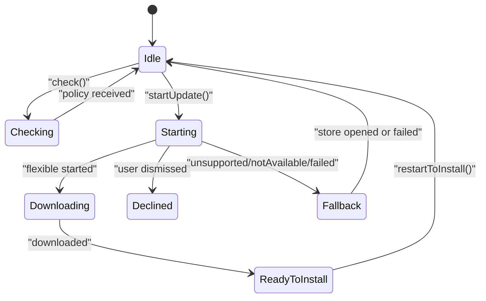
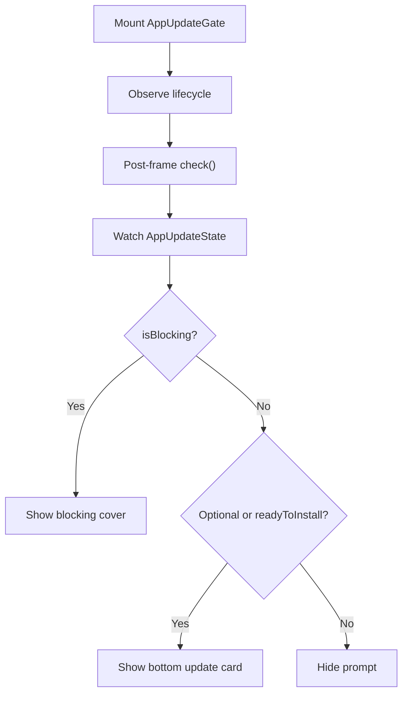
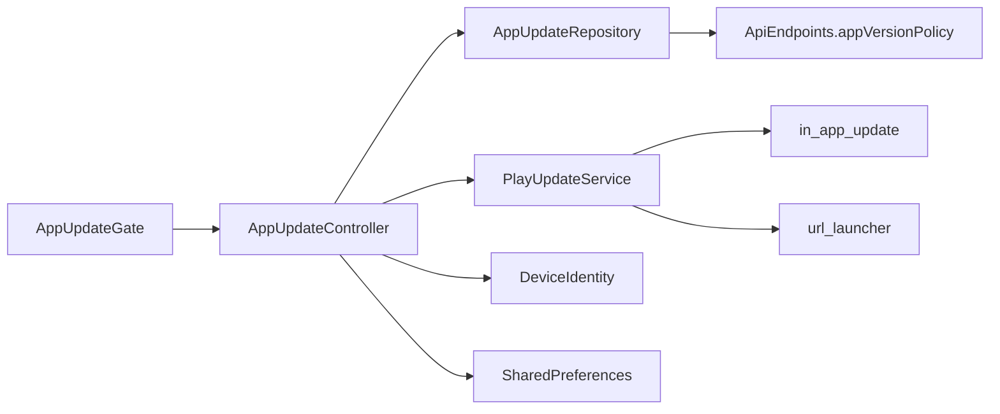

# In-App Update System

<cite>
**Referenced Files in This Document**
- [app_update_models.dart](file://lib/core/update/app_update_models.dart)
- [app_update_repository.dart](file://lib/core/update/app_update_repository.dart)
- [play_update_service.dart](file://lib/core/update/play_update_service.dart)
- [providers.dart](file://lib/core/update/providers.dart)
- [app_update_gate.dart](file://lib/core/update/widgets/app_update_gate.dart)
- [api_endpoints.dart](file://lib/core/network/api_endpoints.dart)
- [README.md](file://README.md)
- [APP_UPDATE_POLICY_HANDOFF.md](file://docs/APP_UPDATE_POLICY_HANDOFF.md)
- [app_update_gate_test.dart](file://test/app_update_gate_test.dart)
</cite>

## Table of Contents
1. [Introduction](#introduction)
2. [Project Structure](#project-structure)
3. [Core Components](#core-components)
4. [Architecture Overview](#architecture-overview)
5. [Detailed Component Analysis](#detailed-component-analysis)
6. [Dependency Analysis](#dependency-analysis)
7. [Performance Considerations](#performance-considerations)
8. [Troubleshooting Guide](#troubleshooting-guide)
9. [Conclusion](#conclusion)

## Introduction
This document explains the In-App Update System used by the LidaPay Flutter application. The system enforces backend-defined app-version policies, prompts users for optional updates, blocks outdated builds, and integrates with Google Play Core on Android to perform flexible or immediate in-app updates. It is designed to be fail-open: if the backend endpoint is missing, unreachable, or returns malformed data, the app continues working normally without blocking the user.

The update gate is mounted early in the UI tree so it can cover splash and authentication screens when required. On Android, it uses Google Play’s in-app update flow; on other platforms, it degrades gracefully to opening a store listing or doing nothing.

## Project Structure
The update system lives under `lib/core/update` and is composed of models, a repository abstraction, a Play-specific service, Riverpod providers/state, and a UI gate widget. The backend integration point is defined in the network endpoints file.

**Diagram sources**
- [app_update_models.dart:1-246](file://lib/core/update/app_update_models.dart#L1-L246)
- [app_update_repository.dart:1-84](file://lib/core/update/app_update_repository.dart#L1-L84)
- [play_update_service.dart:1-165](file://lib/core/update/play_update_service.dart#L1-L165)
- [providers.dart:1-303](file://lib/core/update/providers.dart#L1-L303)
- [app_update_gate.dart:1-368](file://lib/core/update/widgets/app_update_gate.dart#L1-L368)
- [api_endpoints.dart:146-153](file://lib/core/network/api_endpoints.dart#L146-L153)

**Section sources**
- [app_update_models.dart:1-246](file://lib/core/update/app_update_models.dart#L1-L246)
- [app_update_repository.dart:1-84](file://lib/core/update/app_update_repository.dart#L1-L84)
- [play_update_service.dart:1-165](file://lib/core/update/play_update_service.dart#L1-L165)
- [providers.dart:1-303](file://lib/core/update/providers.dart#L1-L303)
- [app_update_gate.dart:1-368](file://lib/core/update/widgets/app_update_gate.dart#L1-L368)
- [api_endpoints.dart:146-153](file://lib/core/network/api_endpoints.dart#L146-L153)

## Core Components
- **Update policy model**: Defines how urgent an update is (`none`, `optional`, `required`) and parses backend payloads flexibly across naming conventions and envelope shapes.
- **Repository abstraction**: Fetches the version policy from the backend over HTTP, caches it per process, and fails open on any error. A no-op implementation exists for tests and non-Android environments.
- **Play update service**: Wraps Google Play Core in-app updates. It supports flexible background downloads and immediate full-screen updates, plus a safe fallback to opening a store listing.
- **Riverpod state controller**: Orchestrates policy fetching, throttling, snoozing optional prompts, starting updates, listening to download progress, and deciding whether to show a blocking cover or a compact card.
- **UI gate widget**: Renders either a non-dismissible blocking cover or a bottom-aligned update card, depending on urgency and download state.

**Section sources**
- [app_update_models.dart:4-14](file://lib/core/update/app_update_models.dart#L4-L14)
- [app_update_models.dart:22-62](file://lib/core/update/app_update_models.dart#L22-L62)
- [app_update_repository.dart:5-15](file://lib/core/update/app_update_repository.dart#L5-L15)
- [play_update_service.dart:8-39](file://lib/core/update/play_update_service.dart#L8-L39)
- [providers.dart:33-103](file://lib/core/update/providers.dart#L33-L103)
- [app_update_gate.dart:11-29](file://lib/core/update/widgets/app_update_gate.dart#L11-L29)

## Architecture Overview
The update system follows a layered architecture:

1. **UI layer**: `AppUpdateGate` observes state and renders the appropriate prompt.
2. **State layer**: `AppUpdateController` owns decision logic, throttling, snoozing, and Play flows.
3. **Domain model layer**: `AppVersionPolicy` and `UpdateUrgency` define rules and parsing.
4. **Data layer**: `AppUpdateRepository` fetches policy from the backend.
5. **Platform layer**: `PlayUpdateService` wraps Google Play Core.

**Diagram sources**
- [app_update_gate.dart:31-84](file://lib/core/update/widgets/app_update_gate.dart#L31-L84)
- [providers.dart:127-208](file://lib/core/update/providers.dart#L127-L208)
- [app_update_repository.dart:51-82](file://lib/core/update/app_update_repository.dart#L51-L82)
- [play_update_service.dart:44-86](file://lib/core/update/play_update_service.dart#L44-L86)

## Detailed Component Analysis

### Policy Model and Urgency Rules
`AppVersionPolicy` parses backend responses flexibly, supporting flat payloads, enveloped payloads, and per-platform objects. It also accepts multiple field aliases (camelCase, snake_case, and various domain names). Urgency is computed first by comparing numeric builds; if no build is available, it falls back to semantic version-name comparison. Unknown local builds never block.

Key behaviors:
- Fail-open: empty or unparseable payloads resolve to `AppVersionPolicy.none`.
- Blocking: builds below `minimumBuild` are forced to update.
- Optional: builds older than `latestBuild` get a non-blocking prompt.
- Version-name fallback: works when only version strings are published.

**Diagram sources**
- [app_update_models.dart:144-183](file://lib/core/update/app_update_models.dart#L144-L183)

**Section sources**
- [app_update_models.dart:4-14](file://lib/core/update/app_update_models.dart#L4-L14)
- [app_update_models.dart:22-62](file://lib/core/update/app_update_models.dart#L22-L62)
- [app_update_models.dart:64-142](file://lib/core/update/app_update_models.dart#L64-L142)
- [app_update_models.dart:144-183](file://lib/core/update/app_update_models.dart#L144-L183)
- [app_update_models.dart:218-245](file://lib/core/update/app_update_models.dart#L218-L245)

### Repository Abstraction and Backend Integration
`AppUpdateRepository` defines the contract for fetching the policy. `RemoteAppUpdateRepository` calls `GET /api/v1/app/version` with platform, version, and build parameters. It caches the result per process and has a short timeout to avoid delaying the first frame. Any failure (network, timeout, 404, bad payload) resolves to `AppVersionPolicy.none`. `NoopAppUpdateRepository` provides a safe default for tests and non-Android builds.

**Diagram sources**
- [app_update_repository.dart:5-15](file://lib/core/update/app_update_repository.dart#L5-L15)
- [app_update_repository.dart:17-28](file://lib/core/update/app_update_repository.dart#L17-L28)
- [app_update_repository.dart:30-83](file://lib/core/update/app_update_repository.dart#L30-L83)

**Section sources**
- [app_update_repository.dart:5-15](file://lib/core/update/app_update_repository.dart#L5-L15)
- [app_update_repository.dart:17-28](file://lib/core/update/app_update_repository.dart#L17-L28)
- [app_update_repository.dart:30-83](file://lib/core/update/app_update_repository.dart#L30-L83)
- [api_endpoints.dart:146-153](file://lib/core/network/api_endpoints.dart#L146-L153)
- [APP_UPDATE_POLICY_HANDOFF.md:24-48](file://docs/APP_UPDATE_POLICY_HANDOFF.md#L24-L48)

### Play Update Service
`PlayUpdateService` wraps Google Play Core. It exposes:
- Flexible update: background download while the app remains usable.
- Immediate update: full-screen blocking flow for critical updates.
- Completion: install a finished flexible update.
- Progress stream: observe download/install status.
- Store listing fallback: safely opens Play/App Store URLs.

Errors are translated into `PlayUpdateAttempt` values so the caller can degrade gracefully.

**Diagram sources**
- [play_update_service.dart:8-39](file://lib/core/update/play_update_service.dart#L8-L39)
- [play_update_service.dart:44-113](file://lib/core/update/play_update_service.dart#L44-L113)
- [play_update_service.dart:115-164](file://lib/core/update/play_update_service.dart#L115-L164)

**Section sources**
- [play_update_service.dart:8-39](file://lib/core/update/play_update_service.dart#L8-L39)
- [play_update_service.dart:44-113](file://lib/core/update/play_update_service.dart#L44-L113)
- [play_update_service.dart:115-164](file://lib/core/update/play_update_service.dart#L115-L164)

### State Controller and Provider Wiring
`AppUpdateController` owns the update lifecycle:
- Throttles checks to once every six hours unless forced.
- Reads device identity and fetches policy.
- Computes urgency and applies snooze for optional updates.
- Starts the correct Play flow based on urgency.
- Listens to flexible download progress and shows a restart prompt when ready.
- Provides a default Play Store URL when the backend does not supply one.

**Diagram sources**
- [providers.dart:110-162](file://lib/core/update/providers.dart#L110-L162)
- [providers.dart:175-208](file://lib/core/update/providers.dart#L175-L208)
- [providers.dart:242-263](file://lib/core/update/providers.dart#L242-L263)

**Section sources**
- [providers.dart:16-31](file://lib/core/update/providers.dart#L16-L31)
- [providers.dart:33-103](file://lib/core/update/providers.dart#L33-L103)
- [providers.dart:110-162](file://lib/core/update/providers.dart#L110-L162)
- [providers.dart:175-208](file://lib/core/update/providers.dart#L175-L208)
- [providers.dart:215-263](file://lib/core/update/providers.dart#L215-L263)
- [providers.dart:265-295](file://lib/core/update/providers.dart#L265-L295)

### UI Gate Widget
`AppUpdateGate` mounts above all routes and renders:
- A full-screen blocking cover when urgency is `required`.
- A compact bottom card for optional updates or when a flexible download is ready to install.
- Contextual copy and actions based on state (update now, later, open store, restart).

It listens to app lifecycle changes and triggers throttled re-checks on resume.

**Diagram sources**
- [app_update_gate.dart:31-84](file://lib/core/update/widgets/app_update_gate.dart#L31-L84)
- [app_update_gate.dart:87-119](file://lib/core/update/widgets/app_update_gate.dart#L87-L119)
- [app_update_gate.dart:123-313](file://lib/core/update/widgets/app_update_gate.dart#L123-L313)

**Section sources**
- [app_update_gate.dart:11-29](file://lib/core/update/widgets/app_update_gate.dart#L11-L29)
- [app_update_gate.dart:31-84](file://lib/core/update/widgets/app_update_gate.dart#L31-L84)
- [app_update_gate.dart:87-119](file://lib/core/update/widgets/app_update_gate.dart#L87-L119)
- [app_update_gate.dart:123-313](file://lib/core/update/widgets/app_update_gate.dart#L123-L313)

## Dependency Analysis
The update system depends on:
- Device identity for platform, app version, and build number.
- Network client for fetching policy.
- Shared preferences for snoozing optional prompts.
- Google Play Core via `in_app_update` for Android flows.
- URL launcher for opening store listings.

**Diagram sources**
- [providers.dart:1-14](file://lib/core/update/providers.dart#L1-L14)
- [providers.dart:20-31](file://lib/core/update/providers.dart#L20-L31)
- [play_update_service.dart:1-6](file://lib/core/update/play_update_service.dart#L1-L6)
- [api_endpoints.dart:146-153](file://lib/core/network/api_endpoints.dart#L146-L153)

**Section sources**
- [providers.dart:1-14](file://lib/core/update/providers.dart#L1-L14)
- [providers.dart:20-31](file://lib/core/update/providers.dart#L20-L31)
- [play_update_service.dart:1-6](file://lib/core/update/play_update_service.dart#L1-L6)
- [api_endpoints.dart:146-153](file://lib/core/network/api_endpoints.dart#L146-L153)

## Performance Considerations
- **Fail-open design**: Missing or failing backend endpoints do not block the app.
- **Short timeout**: The repository uses a short timeout to avoid delaying the first frame.
- **Throttled checks**: Re-checks are limited to once every six hours unless forced.
- **Caching**: Policy results are cached per process to reduce redundant requests.
- **Background updates**: Flexible updates allow the app to remain usable during download.
- **Safe store URLs**: Only HTTPS Play/App Store hosts are launched, preventing unsafe redirects from untrusted backend input.

[No sources needed since this section provides general guidance]

## Troubleshooting Guide
Common issues and their likely causes:

- **Backend endpoint missing or returning 404**: The gate fails open and does nothing. Ensure `/api/v1/app/version` is deployed and reachable before expecting prompts.
- **Malformed response**: Parsing failures collapse to `AppVersionPolicy.none`; verify the JSON shape matches accepted variants.
- **Sideloaded APK or staged rollout lag**: Play Core may return unavailable errors; the gate falls back to opening the store listing.
- **Web or iOS builds**: Play in-app updates are unsupported; the gate will not trigger Play flows but may still show policy-driven UI where applicable.
- **Store listing not opening**: Verify that the backend-supplied URL is HTTPS and points to allowed hosts; otherwise the default Play Store URL is used.

**Section sources**
- [app_update_repository.dart:30-83](file://lib/core/update/app_update_repository.dart#L30-L83)
- [play_update_service.dart:29-39](file://lib/core/update/play_update_service.dart#L29-L39)
- [play_update_service.dart:115-134](file://lib/core/update/play_update_service.dart#L115-L134)
- [APP_UPDATE_POLICY_HANDOFF.md:30-48](file://docs/APP_UPDATE_POLICY_HANDOFF.md#L30-L48)

## Conclusion
The In-App Update System provides a robust, fail-safe mechanism to enforce backend-defined app-version policies. It distinguishes between required and optional updates, integrates with Google Play Core for seamless updates on Android, and degrades gracefully when Play is unavailable. The design prioritizes user experience and safety: it avoids blocking the app due to backend failures, limits network impact through throttling and caching, and ensures store interactions are restricted to trusted hosts.

[No sources needed since this section summarizes without analyzing specific files]