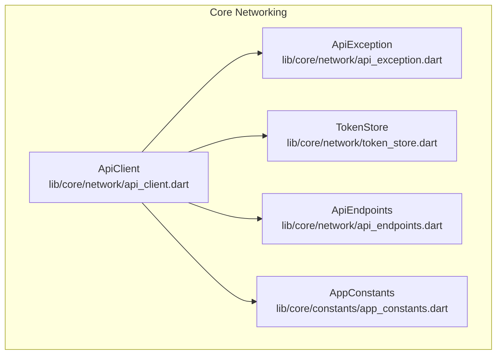
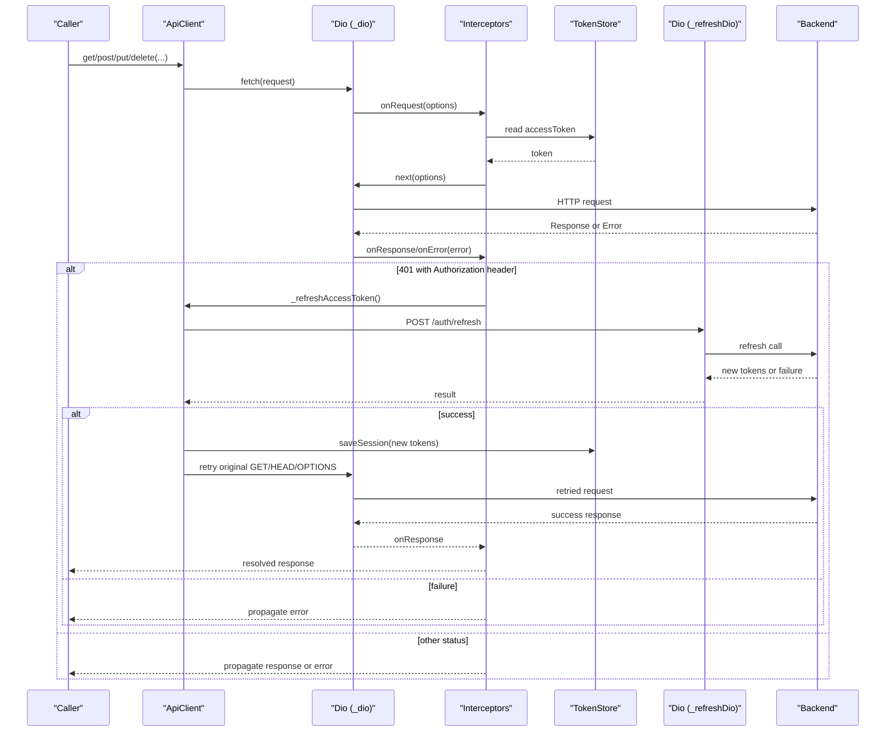
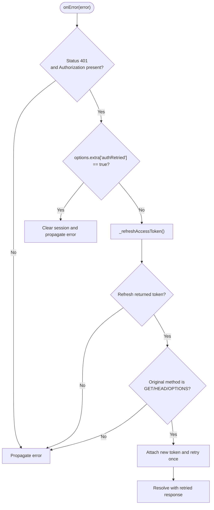
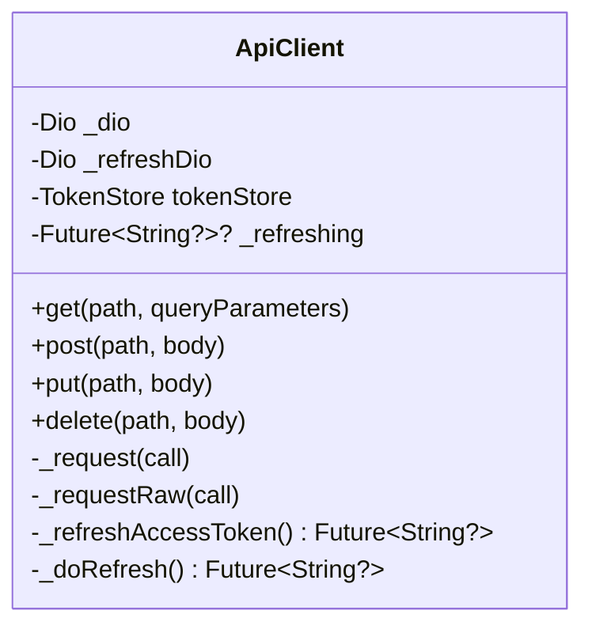
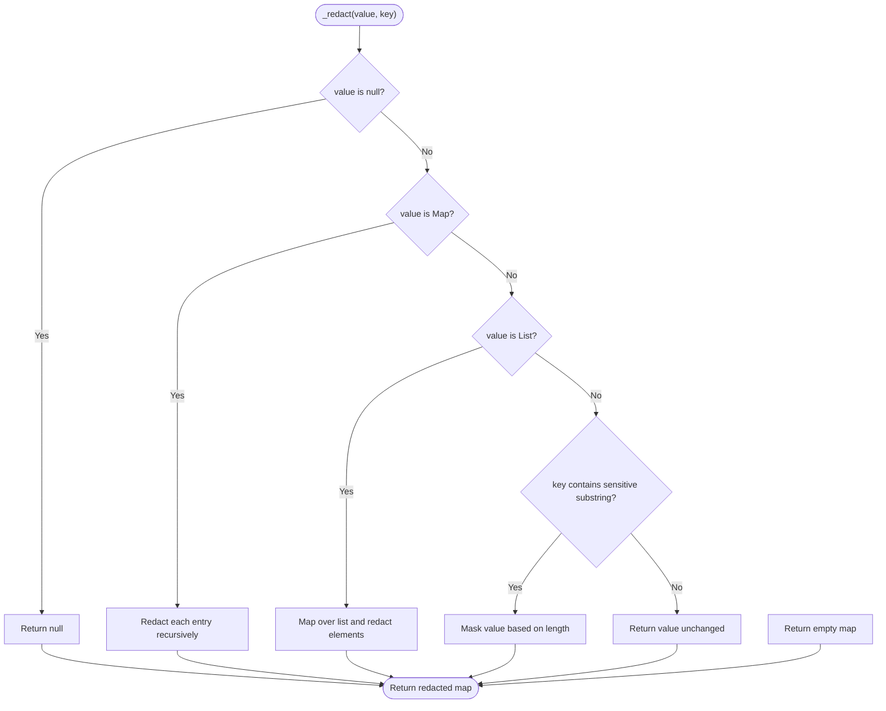
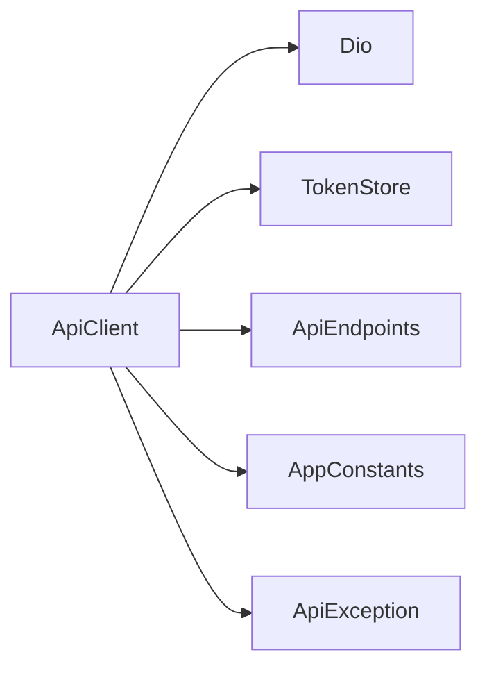

# API Client

<cite>
**Referenced Files in This Document**
- [api_client.dart](file://lib/core/network/api_client.dart)
- [api_exception.dart](file://lib/core/network/api_exception.dart)
- [app_constants.dart](file://lib/core/constants/app_constants.dart)
- [token_store.dart](file://lib/core/network/token_store.dart)
- [api_endpoints.dart](file://lib/core/network/api_endpoints.dart)
</cite>

## Table of Contents
1. [Introduction](#introduction)
2. [Project Structure](#project-structure)
3. [Core Components](#core-components)
4. [Architecture Overview](#architecture-overview)
5. [Detailed Component Analysis](#detailed-component-analysis)
6. [Dependency Analysis](#dependency-analysis)
7. [Performance Considerations](#performance-considerations)
8. [Troubleshooting Guide](#troubleshooting-guide)
9. [Conclusion](#conclusion)
10. [Appendices](#appendices)

## Introduction
This document explains the `ApiClient` class, which is the central HTTP client wrapper around Dio for this Flutter application. It documents how bearer tokens are automatically injected into requests, how concurrent 401 failures share a single token refresh operation, and how failed requests are transparently retried after a successful refresh. It also covers request/response logging with sensitive data redaction, debug-mode output formatting, error transformation to `ApiException`, the dual Dio instance pattern that separates normal traffic from token refresh calls, practical usage examples, and configuration options such as timeouts, base URL setup, and header management.

## Project Structure
The `ApiClient` lives under the core networking layer alongside related networking utilities:

**Diagram sources**
- [api_client.dart:1-15](file://lib/core/network/api_client.dart#L1-L15)
- [api_exception.dart:1-10](file://lib/core/network/api_exception.dart#L1-L10)
- [token_store.dart:71-105](file://lib/core/network/token_store.dart#L71-L105)
- [api_endpoints.dart:1-10](file://lib/core/network/api_endpoints.dart#L1-L10)
- [app_constants.dart:1-12](file://lib/core/constants/app_constants.dart#L1-L12)

**Section sources**
- [api_client.dart:1-15](file://lib/core/network/api_client.dart#L1-L15)
- [api_exception.dart:1-10](file://lib/core/network/api_exception.dart#L1-L10)
- [token_store.dart:71-105](file://lib/core/network/token_store.dart#L71-L105)
- [api_endpoints.dart:1-10](file://lib/core/network/api_endpoints.dart#L1-L10)
- [app_constants.dart:1-12](file://lib/core/constants/app_constants.dart#L1-L12)

## Core Components
- `ApiClient`: Central HTTP client built on Dio. It injects authentication headers, logs requests/responses/errors, handles 401 retries with a single shared refresh, and converts Dio errors into domain-friendly `ApiException`.
- `ApiException`: A normalized exception type representing network or server failures with user-friendly messages and metadata such as status code and whether the outcome is unknown.
- `TokenStore`: Secure persistence for access and refresh tokens, plus profile data. It exposes synchronous accessors used by interceptors and streams session invalidation events.
- `ApiEndpoints`: Centralized route constants, including the token refresh endpoint.
- `AppConstants`: Build-time configuration for base URL and timeouts.

Key responsibilities:
- Automatic bearer token injection via an interceptor.
- Single-flight concurrent refresh handling using a pending future guard.
- Transparent retry on 401 responses for safe methods after a successful refresh.
- Sensitive data redaction in debug logs.
- Dual Dio instances: `_dio` for regular requests and `_refreshDio` for token refresh calls.
- Error transformation to `ApiException`.

**Section sources**
- [api_client.dart:13-84](file://lib/core/network/api_client.dart#L13-L84)
- [api_client.dart:115-135](file://lib/core/network/api_client.dart#L115-L135)
- [api_client.dart:137-202](file://lib/core/network/api_client.dart#L137-L202)
- [api_client.dart:204-265](file://lib/core/network/api_client.dart#L204-L265)
- [api_exception.dart:1-79](file://lib/core/network/api_exception.dart#L1-L79)
- [token_store.dart:71-105](file://lib/core/network/token_store.dart#L71-L105)
- [api_endpoints.dart:1-10](file://lib/core/network/api_endpoints.dart#L1-L10)
- [app_constants.dart:1-12](file://lib/core/constants/app_constants.dart#L1-L12)

## Architecture Overview
At runtime, `ApiClient` configures Dio interceptors once during construction. Every outgoing request flows through these interceptors, which:
- Attach the current bearer token when available.
- Add a unique request ID.
- Log request/response/error details with sensitive fields redacted.
- Handle 401 errors by refreshing the token exactly once across concurrent callers and then retrying the original request once.

**Diagram sources**
- [api_client.dart:25-83](file://lib/core/network/api_client.dart#L25-L83)
- [api_client.dart:115-135](file://lib/core/network/api_client.dart#L115-L135)
- [api_client.dart:204-265](file://lib/core/network/api_client.dart#L204-L265)
- [api_endpoints.dart:6-6](file://lib/core/network/api_endpoints.dart#L6-L6)
- [token_store.dart:148-170](file://lib/core/network/token_store.dart#L148-L170)

## Detailed Component Analysis

### ApiClient Class
`ApiClient` encapsulates all HTTP behavior. Its constructor sets up interceptors and initializes two Dio instances:
- `_dio`: Used for normal API calls.
- `_refreshDio`: Used exclusively for token refresh calls so refresh traffic does not interfere with normal request flow.

#### Request Interceptor
- Injects `Authorization: Bearer <token>` if present in `TokenStore`.
- Adds a unique `X-Request-Id` header per request.
- Logs request method, URI, and body with sensitive data redacted when debug mode is enabled.

#### Response Interceptor
- Logs response status and URI in debug mode.

#### Error Interceptor
- Logs error details with redaction.
- If the error is a 401 and the original request included an Authorization header:
  - Skips retry if the request has already been retried for auth (`authRetried`).
  - Calls `_refreshAccessToken()` to perform a single shared refresh.
  - If refresh succeeds and the original method is safe (GET, HEAD, OPTIONS), reattaches the new token and retries once.
  - Otherwise, propagates the original error.

**Diagram sources**
- [api_client.dart:50-83](file://lib/core/network/api_client.dart#L50-L83)
- [api_client.dart:204-209](file://lib/core/network/api_client.dart#L204-L209)

#### Single-Flight Refresh Guard
`_refreshAccessToken()` returns a pending future that is reused while a refresh is in progress. Concurrent 401 handlers wait on the same future instead of issuing multiple refresh calls. Once completed, the guard is cleared.

**Diagram sources**
- [api_client.dart:115-123](file://lib/core/network/api_client.dart#L115-L123)
- [api_client.dart:137-202](file://lib/core/network/api_client.dart#L137-L202)
- [api_client.dart:204-265](file://lib/core/network/api_client.dart#L204-L265)

#### Sensitive Data Redaction
The redaction utility walks maps and lists and masks values associated with sensitive keys such as password, token, secret, otp, pin, and authorization. In debug logs, long values are truncated to a short prefix followed by asterisks.

**Diagram sources**
- [api_client.dart:86-113](file://lib/core/network/api_client.dart#L86-L113)

#### Public API Surface
- `get(path, queryParameters)`: Returns a JSON object map.
- `getRaw(path, queryParameters)`: Returns raw response data for non-object payloads.
- `post(path, body)`: Sends JSON body and expects a JSON object response.
- `postRaw(path, body, headers)`: Sends optional custom headers and returns raw data.
- `put(path, body)`: Updates a resource expecting a JSON object response.
- `putRaw(path, body)`: Updates a resource returning raw data.
- `delete(path, body)`: Deletes a resource expecting a JSON object response.
- `deleteRaw(path, body)`: Deletes a resource returning raw data.

All public methods wrap internal calls that convert Dio exceptions to `ApiException`.

**Section sources**
- [api_client.dart:17-84](file://lib/core/network/api_client.dart#L17-L84)
- [api_client.dart:86-113](file://lib/core/network/api_client.dart#L86-L113)
- [api_client.dart:137-202](file://lib/core/network/api_client.dart#L137-L202)
- [api_client.dart:204-265](file://lib/core/network/api_client.dart#L204-L265)

### ApiException
`ApiException` provides a stable error contract for UI layers. It includes:
- A friendly message derived from backend responses or fallback text.
- Optional backend error code and HTTP status code.
- An `outcomeUnknown` flag indicating no server response was received (e.g., timeout or connection loss).

It translates common backend messages into user-friendly text and provides sensible defaults for network-related failures.

**Section sources**
- [api_exception.dart:1-79](file://lib/core/network/api_exception.dart#L1-L79)

### TokenStore
`TokenStore` manages secure token persistence and session state:
- Exposes synchronous getters for access and refresh tokens used by interceptors.
- Provides `saveSession` to persist updated tokens after refresh.
- Emits a stream event when the session is cleared, allowing listeners to drop cached sessions.
- Supports biometric session snapshots and migration from legacy storage.

**Section sources**
- [token_store.dart:71-105](file://lib/core/network/token_store.dart#L71-L105)
- [token_store.dart:148-170](file://lib/core/network/token_store.dart#L148-L170)
- [token_store.dart:219-236](file://lib/core/network/token_store.dart#L219-L236)

### ApiEndpoints
Centralizes API route strings, including the token refresh endpoint used by `ApiClient`.

**Section sources**
- [api_endpoints.dart:1-10](file://lib/core/network/api_endpoints.dart#L1-L10)
- [api_endpoints.dart:6-6](file://lib/core/network/api_endpoints.dart#L6-L6)

### AppConstants
Holds build-time configuration for the API base URL and timeouts used by Dio.

**Section sources**
- [app_constants.dart:1-12](file://lib/core/constants/app_constants.dart#L1-L12)

## Dependency Analysis
`ApiClient` depends on:
- Dio for HTTP transport.
- `TokenStore` for reading/writing tokens.
- `ApiEndpoints` for the refresh route.
- `AppConstants` for base URL and timeouts.
- `ApiException` for error normalization.

**Diagram sources**
- [api_client.dart:1-11](file://lib/core/network/api_client.dart#L1-L11)
- [api_client.dart:115-135](file://lib/core/network/api_client.dart#L115-L135)
- [api_client.dart:195-202](file://lib/core/network/api_client.dart#L195-L202)

**Section sources**
- [api_client.dart:1-11](file://lib/core/network/api_client.dart#L1-L11)
- [api_client.dart:115-135](file://lib/core/network/api_client.dart#L115-L135)
- [api_client.dart:195-202](file://lib/core/network/api_client.dart#L195-L202)

## Performance Considerations
- **Single-flight refresh**: Prevents thundering herd refreshes by sharing one refresh future among concurrent 401 handlers.
- **Minimal overhead in interceptors**: Token retrieval is synchronous from memory; disk I/O happens only during explicit save/clear operations.
- **Timeout separation**: Connect/send timeouts are shorter than receive timeout to fail fast on dead links while allowing slow provider round-trips to complete.
- **Selective retry**: Only safe methods (GET, HEAD, OPTIONS) are retried after refresh to avoid unintended side effects.

[No sources needed since this section provides general guidance]

## Troubleshooting Guide
Common issues and their likely causes:

- **Requests never include Authorization header**:
  - Ensure `TokenStore.accessToken` is populated before making requests.
  - Verify that the app initialized the token store at startup.

- **Repeated 401 errors without retry**:
  - Non-safe methods (POST, PUT, DELETE) are not retried after refresh by design.
  - If the refresh fails due to invalid credentials, the session is cleared.

- **Debug logs show sensitive data**:
  - Confirm debug mode is enabled; redaction applies to known sensitive keys.
  - Avoid adding custom sensitive fields with unexpected casing.

- **Network timeouts or offline errors**:
  - These produce `ApiException` with `outcomeUnknown = true`; do not blindly retry non-idempotent operations.

- **Custom headers not applied**:
  - Use `postRaw` with the `headers` parameter for endpoints requiring custom headers.

**Section sources**
- [api_client.dart:25-83](file://lib/core/network/api_client.dart#L25-L83)
- [api_client.dart:159-169](file://lib/core/network/api_client.dart#L159-L169)
- [api_client.dart:195-202](file://lib/core/network/api_client.dart#L195-L202)
- [api_exception.dart:22-38](file://lib/core/network/api_exception.dart#L22-L38)

## Conclusion
`ApiClient` provides a robust, centralized HTTP client that automates authentication, logging, error handling, and resilient retry behavior. Its dual Dio instance pattern isolates token refresh traffic, while its single-flight refresh guard prevents redundant refresh attempts. The combination of sensitive data redaction, debug-mode logging, and `ApiException` normalization makes it straightforward to integrate safely into feature modules.

[No sources needed since this section summarizes without analyzing specific files]

## Appendices

### Practical Usage Examples

- **GET request returning JSON object**:
  - Call `client.get('/api/v1/users/profile')`.
  - Expect a `Map<String, dynamic>` response.

- **GET request returning raw data**:
  - Call `client.getRaw('/api/v1/users/points')`.
  - Useful for endpoints returning numbers or arrays.

- **POST request with JSON body**:
  - Call `client.post('/api/v1/users/login', body: {...})`.
  - Expects a JSON object response.

- **POST request with custom headers and raw response**:
  - Call `client.postRaw('/api/v1/internet/bundlelist', headers: {...})`.

- **PUT request updating a resource**:
  - Call `client.put('/api/v1/users/profile/update', body: {...})`.

- **DELETE request returning JSON object**:
  - Call `client.delete('/api/v1/shop/orders/{id}/cancel')`.

- **DELETE request returning raw acknowledgement**:
  - Call `client.deleteRaw('/api/v1/shop/orders/{id}/cancel')`.

- **Handling both JSON and raw responses**:
  - Prefer typed methods like `get`/`post` when the backend returns objects.
  - Use `*Raw` variants when the response is a primitive, array, or string.

- **Implementing custom interceptors**:
  - Extend behavior by composing additional Dio interceptors on top of the configured client if necessary.
  - Be mindful that bearer injection and 401 retry logic are already handled centrally.

[No sources needed since this section provides general guidance]

### Configuration Options

- **Base URL**:
  - Set via `AppConstants.apiBaseUrl`, configurable at build time through environment variables.

- **Timeouts**:
  - Connect/send timeout: `AppConstants.apiConnectTimeout`.
  - Receive timeout: `AppConstants.apiTimeout`.

- **Default Headers**:
  - Content-Type and Accept headers are set by default.
  - Authorization is added dynamically when a token exists.
  - X-Request-Id is added per request.

- **Header Management**:
  - For endpoints requiring custom headers, use `postRaw` with the `headers` option.

**Section sources**
- [app_constants.dart:1-12](file://lib/core/constants/app_constants.dart#L1-L12)
- [api_client.dart:125-135](file://lib/core/network/api_client.dart#L125-L135)
- [api_client.dart:25-40](file://lib/core/network/api_client.dart#L25-L40)
- [api_client.dart:159-169](file://lib/core/network/api_client.dart#L159-L169)