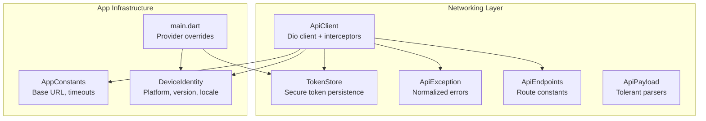
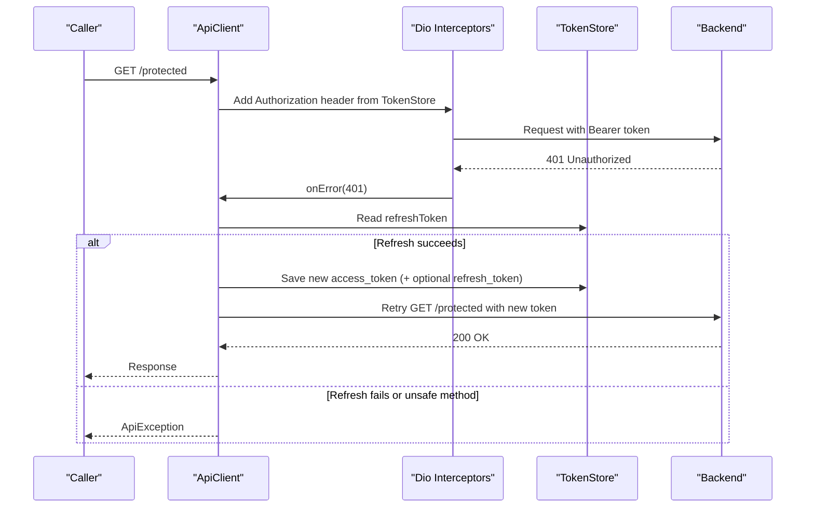
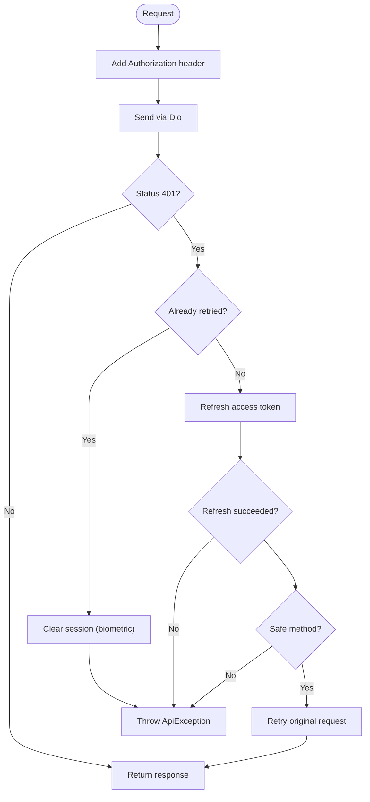
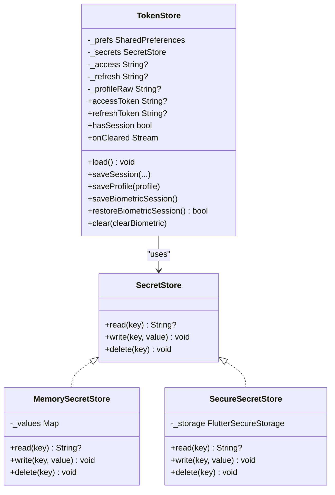
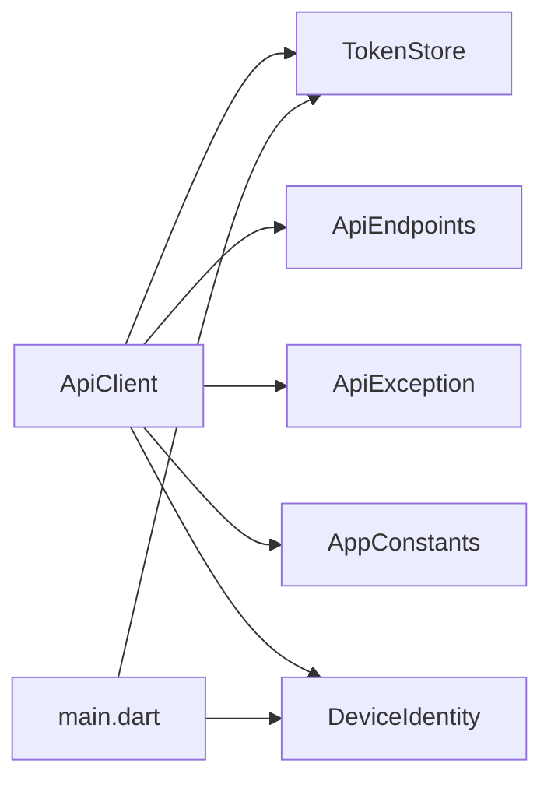

# Networking Layer

<cite>
**Referenced Files in This Document**
- [api_client.dart](file://lib/core/network/api_client.dart)
- [token_store.dart](file://lib/core/network/token_store.dart)
- [api_exception.dart](file://lib/core/network/api_exception.dart)
- [api_endpoints.dart](file://lib/core/network/api_endpoints.dart)
- [api_payload.dart](file://lib/core/network/api_payload.dart)
- [app_constants.dart](file://lib/core/constants/app_constants.dart)
- [device_identity.dart](file://lib/core/device/device_identity.dart)
- [main.dart](file://lib/main.dart)
- [token_store_test.dart](file://test/token_store_test.dart)
</cite>

## Table of Contents
1. [Introduction](#introduction)
2. [Project Structure](#project-structure)
3. [Core Components](#core-components)
4. [Architecture Overview](#architecture-overview)
5. [Detailed Component Analysis](#detailed-component-analysis)
6. [Dependency Analysis](#dependency-analysis)
7. [Performance Considerations](#performance-considerations)
8. [Troubleshooting Guide](#troubleshooting-guide)
9. [Conclusion](#conclusion)

## Introduction
This document explains the networking layer that powers authenticated HTTP requests against the backend. It covers:
- The centralized `ApiClient` built on Dio with interceptors for authorization, request logging, and automatic token refresh.
- Secure token persistence through `TokenStore`, including encrypted storage, legacy migration, and biometric session support.
- Centralized API endpoint definitions and tolerant payload parsing utilities.
- Error handling via `ApiException`, including user-friendly messages and outcome semantics.
- Configuration options such as timeouts, base URL, and device metadata injection.

The goal is to make it easy to understand how network calls are made, how authentication is maintained, and how errors and sensitive data are handled safely.

## Project Structure
The networking layer lives under `lib/core/network/`. It integrates with app-wide configuration, device identity, and secure storage providers.

**Diagram sources**
- [api_client.dart:1-276](file://lib/core/network/api_client.dart#L1-L276)
- [token_store.dart:1-238](file://lib/core/network/token_store.dart#L1-L238)
- [api_exception.dart:1-79](file://lib/core/network/api_exception.dart#L1-L79)
- [api_endpoints.dart:1-146](file://lib/core/network/api_endpoints.dart#L1-L146)
- [api_payload.dart:1-116](file://lib/core/network/api_payload.dart#L1-L116)
- [app_constants.dart:1-65](file://lib/core/constants/app_constants.dart#L1-L65)
- [device_identity.dart:1-132](file://lib/core/device/device_identity.dart#L1-L132)
- [main.dart:98-119](file://lib/main.dart#L98-L119)

**Section sources**
- [api_client.dart:1-276](file://lib/core/network/api_client.dart#L1-L276)
- [token_store.dart:1-238](file://lib/core/network/token_store.dart#L1-L238)
- [api_exception.dart:1-79](file://lib/core/network/api_exception.dart#L1-L79)
- [api_endpoints.dart:1-146](file://lib/core/network/api_endpoints.dart#L1-L146)
- [api_payload.dart:1-116](file://lib/core/network/api_payload.dart#L1-L116)
- [app_constants.dart:1-65](file://lib/core/constants/app_constants.dart#L1-L65)
- [device_identity.dart:1-132](file://lib/core/device/device_identity.dart#L1-L132)
- [main.dart:98-119](file://lib/main.dart#L98-L119)

## Core Components
- ApiClient: Central Dio client with interceptors for Authorization headers, request IDs, debug logging, redaction, and automatic token refresh on 401.
- TokenStore: Encrypted persistence for access and refresh tokens, profile JSON, and optional biometric session snapshot; supports legacy migration and stream-based invalidation.
- ApiException: Normalized exception with friendly messages, status codes, and an “outcome unknown” flag for non-idempotent operations.
- ApiEndpoints: Centralized route constants for all backend endpoints.
- ApiPayload: Tolerant helpers for inconsistent backend response shapes (wrappers, field naming).
- AppConstants: Base URL and timeout configuration.
- DeviceIdentity: Device metadata injected into refresh requests.

Key responsibilities:
- Transparent auth header injection.
- Single-flight concurrent refresh handling.
- Retry once after successful refresh for safe methods.
- Sensitive data redaction in logs.
- Graceful degradation when secure storage fails.

**Section sources**
- [api_client.dart:13-276](file://lib/core/network/api_client.dart#L13-L276)
- [token_store.dart:71-238](file://lib/core/network/token_store.dart#L71-L238)
- [api_exception.dart:1-79](file://lib/core/network/api_exception.dart#L1-L79)
- [api_endpoints.dart:1-146](file://lib/core/network/api_endpoints.dart#L1-L146)
- [api_payload.dart:1-116](file://lib/core/network/api_payload.dart#L1-L116)
- [app_constants.dart:1-65](file://lib/core/constants/app_constants.dart#L1-L65)
- [device_identity.dart:12-65](file://lib/core/device/device_identity.dart#L12-L65)

## Architecture Overview
The networking architecture centers around a single Dio client configured with interceptors. Authentication state is managed by `TokenStore`, which persists tokens securely and exposes them synchronously to avoid I/O during request interception. When a 401 occurs, the client attempts a single refresh using the stored refresh token and retries the original request once if safe.

**Diagram sources**
- [api_client.dart:25-83](file://lib/core/network/api_client.dart#L25-L83)
- [api_client.dart:204-265](file://lib/core/network/api_client.dart#L204-L265)
- [token_store.dart:148-170](file://lib/core/network/token_store.dart#L148-L170)

## Detailed Component Analysis

### ApiClient: Dio Integration, Interceptors, and Refresh Flow
Responsibilities:
- Build Dio instances with base URL and timeouts from `AppConstants`.
- Inject Authorization header from `TokenStore.accessToken`.
- Attach unique request IDs and debug logs.
- Redact sensitive fields in logs.
- Handle 401 by refreshing once and retrying safe methods.
- Convert Dio exceptions to `ApiException`.

Key behaviors:
- Automatic bearer token injection.
- Single-flight refresh: concurrent 401s share one refresh operation.
- Safe-method-only retry: only GET, HEAD, OPTIONS are retried after refresh.
- Redaction: passwords, tokens, secrets, OTP/PIN are masked in logs.
- Separate Dio instance for refresh to avoid interceptor recursion.

**Diagram sources**
- [api_client.dart:25-83](file://lib/core/network/api_client.dart#L25-L83)
- [api_client.dart:86-113](file://lib/core/network/api_client.dart#L86-L113)
- [api_client.dart:204-265](file://lib/core/network/api_client.dart#L204-L265)

Configuration and behavior references:
- Dio build and timeouts: [api_client.dart:125-135](file://lib/core/network/api_client.dart#L125-L135), [app_constants.dart:6-13](file://lib/core/constants/app_constants.dart#L6-L13)
- Request/response/error interceptors: [api_client.dart:25-83](file://lib/core/network/api_client.dart#L25-L83)
- Redaction logic: [api_client.dart:86-113](file://lib/core/network/api_client.dart#L86-L113)
- Refresh flow and single-flight guard: [api_client.dart:204-265](file://lib/core/network/api_client.dart#L204-L265)
- Provider wiring: [api_client.dart:268-275](file://lib/core/network/api_client.dart#L268-L275)

**Section sources**
- [api_client.dart:13-276](file://lib/core/network/api_client.dart#L13-L276)
- [app_constants.dart:6-13](file://lib/core/constants/app_constants.dart#L6-L13)

### TokenStore: Secure Persistence and Biometric Sessions
Responsibilities:
- Persist access and refresh tokens securely using `SecretStore` (Android Keystore/iOS Keychain).
- Maintain a synchronous in-memory mirror so interceptors do not await disk I/O.
- Migrate legacy plaintext tokens from SharedPreferences to secure storage.
- Provide biometric session snapshots that survive logout and can be restored after unlock.
- Emit an `onCleared` stream to notify listeners when the session is invalidated.

Key behaviors:
- `load()` migrates legacy values and degrades gracefully if keystore is corrupted.
- `saveSession()` updates memory mirror and writes to secure store; also syncs biometric snapshot when refresh token rotates.
- `clear()` wipes in-memory state and optionally clears biometric session; emits `onCleared`.
- `restoreBiometricSession()` restores tokens and profile from the encrypted snapshot.

**Diagram sources**
- [token_store.dart:26-69](file://lib/core/network/token_store.dart#L26-L69)
- [token_store.dart:71-238](file://lib/core/network/token_store.dart#L71-L238)

Behavioral references:
- Legacy migration and graceful degradation: [token_store.dart:120-146](file://lib/core/network/token_store.dart#L120-L146)
- Session save and biometric sync: [token_store.dart:148-170](file://lib/core/network/token_store.dart#L148-L170)
- Biometric snapshot lifecycle: [token_store.dart:177-217](file://lib/core/network/token_store.dart#L177-L217)
- Clear and stream emission: [token_store.dart:219-236](file://lib/core/network/token_store.dart#L219-L236)

Tests validating behavior:
- Basic save/load and secret store usage: [token_store_test.dart:21-44](file://test/token_store_test.dart#L21-L44)
- Legacy migration: [token_store_test.dart:46-70](file://test/token_store_test.dart#L46-L70)
- Clear and stream: [token_store_test.dart:72-93](file://test/token_store_test.dart#L72-L93)
- Biometric session restore and rotation: [token_store_test.dart:95-139](file://test/token_store_test.dart#L95-L139)
- Corrupted keystore degradation: [token_store_test.dart:157-168](file://test/token_store_test.dart#L157-L168)

**Section sources**
- [token_store.dart:26-238](file://lib/core/network/token_store.dart#L26-L238)
- [token_store_test.dart:21-168](file://test/token_store_test.dart#L21-L168)

### ApiException: Normalized Error Handling
Responsibilities:
- Wrap Dio errors into a consistent model with message, code, status code, and outcomeUnknown.
- Translate backend internals into user-friendly messages.
- Distinguish between transient failures and cases where server-side effect may have occurred.

Key behaviors:
- Friendly messages for 5xx and specific auth errors.
- Fallback messages for timeouts and connection errors.
- outcomeUnknown indicates no server response was received.

References:
- Construction and factory: [api_exception.dart:5-38](file://lib/core/network/api_exception.dart#L5-L38)
- Friendly translation and fallbacks: [api_exception.dart:40-74](file://lib/core/network/api_exception.dart#L40-L74)

**Section sources**
- [api_exception.dart:1-79](file://lib/core/network/api_exception.dart#L1-L79)

### ApiEndpoints: Centralized Route Management
Responsibilities:
- Define all backend routes as constants or simple builders.
- Keep route names aligned with OpenAPI spec.

Usage patterns:
- Use constants for static paths.
- Use builder functions for parameterized paths.

References:
- Endpoint definitions: [api_endpoints.dart:1-146](file://lib/core/network/api_endpoints.dart#L1-L146)

**Section sources**
- [api_endpoints.dart:1-146](file://lib/core/network/api_endpoints.dart#L1-L146)

### ApiPayload: Tolerant Response Parsing
Responsibilities:
- Normalize inconsistent backend responses that wrap payloads differently.
- Provide helpers to extract lists, merged maps, strings, numbers, booleans, and dates across multiple candidate keys.

Key helpers:
- `asMap`, `rowsOf`, `payloadPool`: unwrap envelopes and merge nested data.
- `stringField`, `numberField`, `boolField`, `dateField`: tolerant field extraction.

References:
- Payload helpers: [api_payload.dart:1-116](file://lib/core/network/api_payload.dart#L1-L116)

**Section sources**
- [api_payload.dart:1-116](file://lib/core/network/api_payload.dart#L1-L116)

### Configuration and Initialization
- Base URL and timeouts:
  - Base URL from environment: [app_constants.dart:6-9](file://lib/core/constants/app_constants.dart#L6-L9)
  - Timeouts: [app_constants.dart:11-13](file://lib/core/constants/app_constants.dart#L11-L13)
- Device identity injected into refresh requests:
  - Identity shape and loader: [device_identity.dart:12-132](file://lib/core/device/device_identity.dart#L12-L132)
- App startup wiring:
  - Secure secret store, token store load, provider overrides: [main.dart:98-119](file://lib/main.dart#L98-L119)

**Section sources**
- [app_constants.dart:6-13](file://lib/core/constants/app_constants.dart#L6-L13)
- [device_identity.dart:12-132](file://lib/core/device/device_identity.dart#L12-L132)
- [main.dart:98-119](file://lib/main.dart#L98-L119)

## Dependency Analysis

Observations:
- ApiClient depends on TokenStore for credentials, ApiEndpoints for routes, ApiException for error normalization, AppConstants for configuration, and DeviceIdentity for metadata.
- main.dart initializes secure storage and token store, then injects them into the provider container.

**Diagram sources**
- [api_client.dart:1-11](file://lib/core/network/api_client.dart#L1-L11)
- [main.dart:98-119](file://lib/main.dart#L98-L119)

**Section sources**
- [api_client.dart:1-11](file://lib/core/network/api_client.dart#L1-L11)
- [main.dart:98-119](file://lib/main.dart#L98-L119)

## Performance Considerations
- Interceptor overhead is minimal; Authorization header and request ID are added synchronously.
- TokenStore maintains an in-memory mirror to avoid disk I/O during request interception.
- Single-flight refresh prevents redundant refresh calls under concurrency.
- Separate Dio instance for refresh avoids recursive interceptor loops.
- Debug logging is disabled in release builds to prevent log leakage.

[No sources needed since this section provides general guidance]

## Troubleshooting Guide
Common issues and resolutions:
- 401 without refresh:
  - Ensure a refresh token exists and is valid. If refresh fails with 400/401/403, the session is cleared.
  - Verify that the app has initialized TokenStore and loaded the session at startup.
- Corrupted secure storage:
  - TokenStore.load() degrades gracefully to signed-out; ensure the app handles sign-in flow after load failure.
- Excessive retries:
  - Only safe methods (GET, HEAD, OPTIONS) are retried after refresh. POST/PUT/DELETE will not auto-retry.
- Sensitive data in logs:
  - Logs are redacted automatically; still avoid logging raw tokens or secrets.

Operational references:
- Refresh failure handling and session clearing: [api_client.dart:253-264](file://lib/core/network/api_client.dart#L253-L264)
- Graceful keystore failure: [token_store.dart:120-146](file://lib/core/network/token_store.dart#L120-L146)
- Startup initialization and provider overrides: [main.dart:98-119](file://lib/main.dart#L98-L119)

**Section sources**
- [api_client.dart:253-264](file://lib/core/network/api_client.dart#L253-L264)
- [token_store.dart:120-146](file://lib/core/network/token_store.dart#L120-L146)
- [main.dart:98-119](file://lib/main.dart#L98-L119)

## Conclusion
The networking layer provides a robust, secure, and maintainable foundation for authenticated HTTP communication:
- A single Dio client centralizes request/response handling, logging, and token management.
- TokenStore ensures secure persistence with graceful degradation and biometric session support.
- ApiException standardizes error handling and improves user-facing messaging.
- ApiEndpoints and ApiPayload keep route definitions and response parsing resilient to backend inconsistencies.
- Configuration via AppConstants and DeviceIdentity keeps the system adaptable and informative.

Use the provided APIs to make authenticated requests, handle different response types, and extend functionality with custom interceptors while preserving security and reliability.