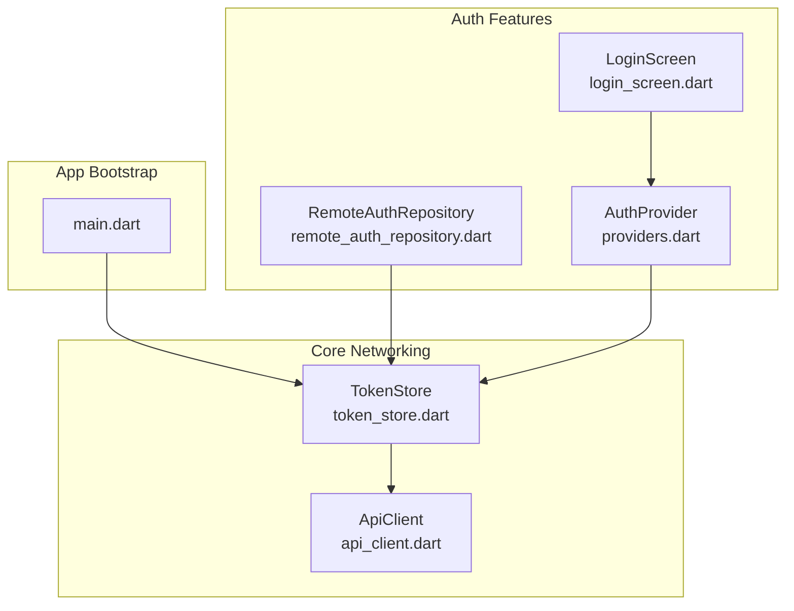
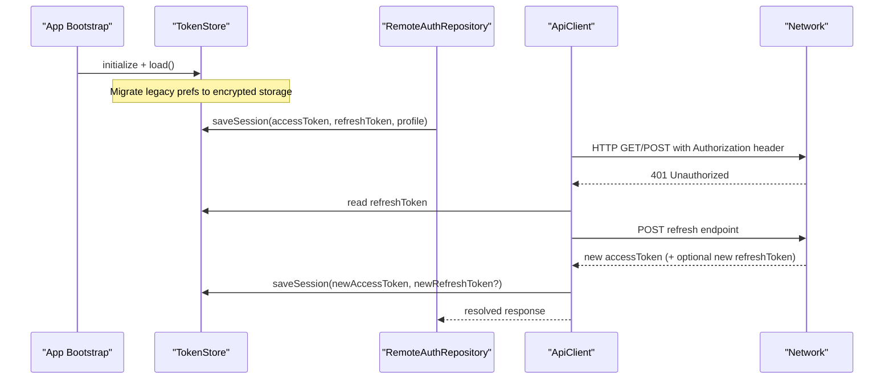
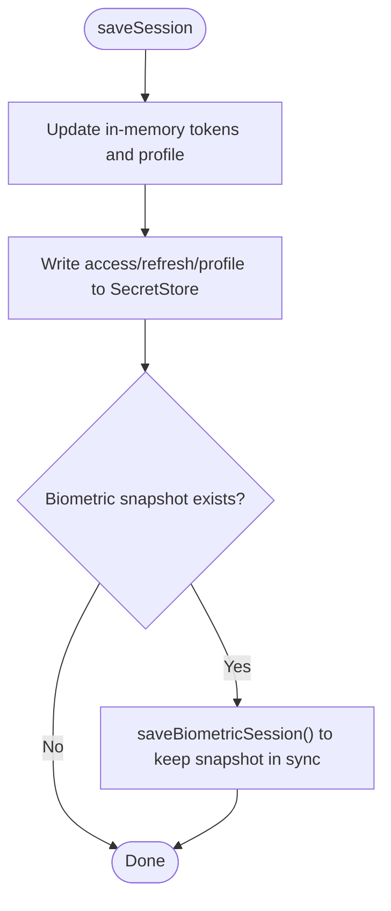
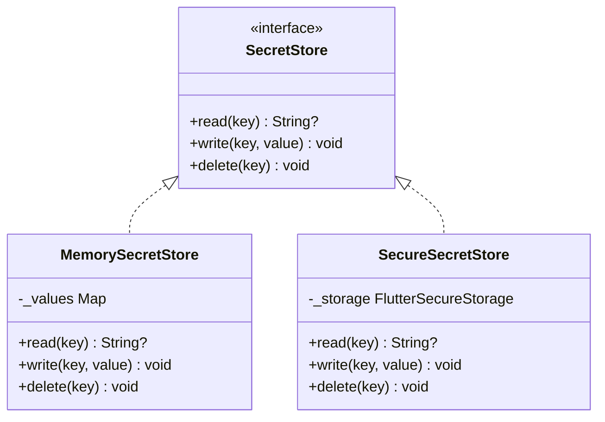
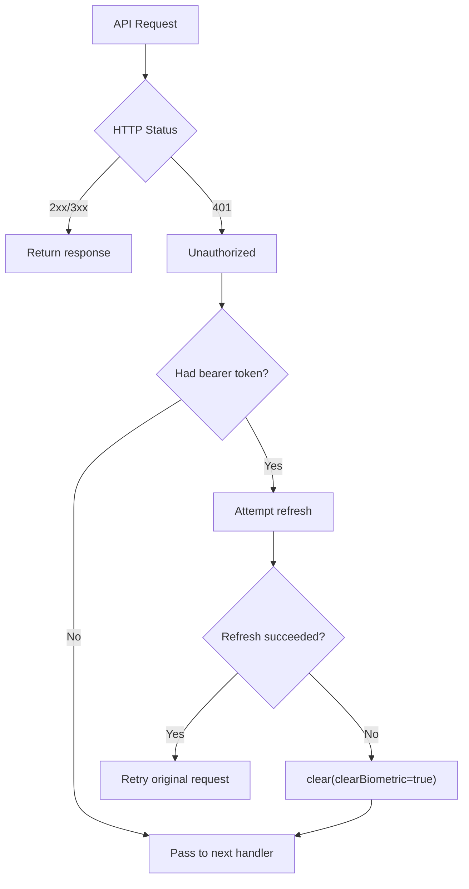
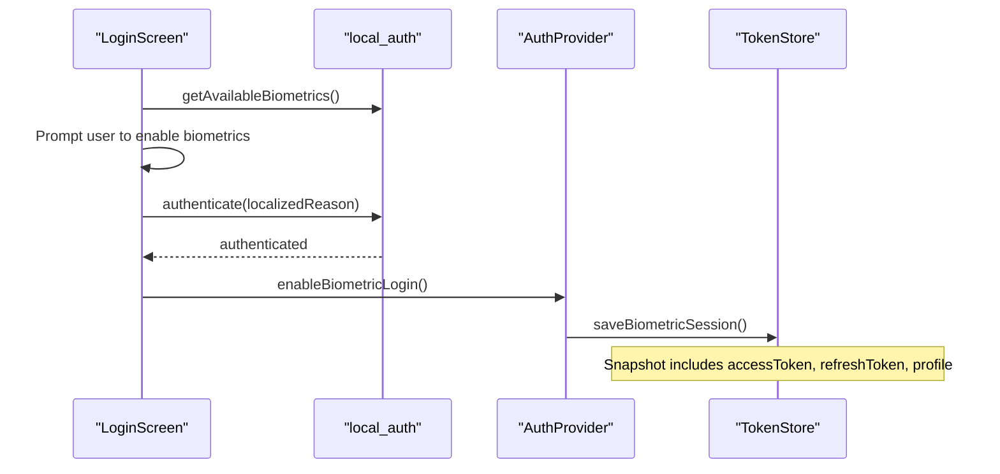
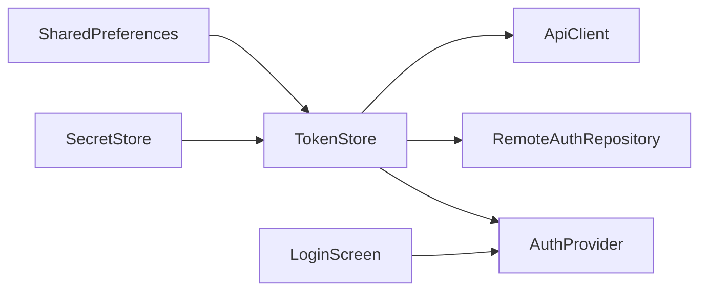

# Token Management

<cite>
**Referenced Files in This Document**
- [token_store.dart](file://lib/core/network/token_store.dart)
- [api_client.dart](file://lib/core/network/api_client.dart)
- [remote_auth_repository.dart](file://lib/features/auth/data/remote_auth_repository.dart)
- [providers.dart](file://lib/features/auth/providers.dart)
- [login_screen.dart](file://lib/features/auth/screens/login_screen.dart)
- [main.dart](file://lib/main.dart)
- [token_store_test.dart](file://test/token_store_test.dart)
</cite>

## Table of Contents
1. [Introduction](#introduction)
2. [Project Structure](#project-structure)
3. [Core Components](#core-components)
4. [Architecture Overview](#architecture-overview)
5. [Detailed Component Analysis](#detailed-component-analysis)
6. [Dependency Analysis](#dependency-analysis)
7. [Performance Considerations](#performance-considerations)
8. [Troubleshooting Guide](#troubleshooting-guide)
9. [Conclusion](#conclusion)

## Introduction
This document explains the secure token management system used by the application, focusing on the TokenStore implementation. It covers how access and refresh tokens are persisted, how platform-specific secure storage is used, how sessions are validated and refreshed, how biometric authentication integrates with token access, and how cleanup and error handling work. The goal is to help developers understand both the high-level behavior and the code-level details required for secure token management on mobile platforms.

## Project Structure
The token management logic lives primarily under the core networking layer and is consumed by authentication features:

- Core token persistence and lifecycle: `lib/core/network/token_store.dart`
- Network request interceptor and automatic token refresh: `lib/core/network/api_client.dart`
- Authentication repository that persists login results and profile data: `lib/features/auth/data/remote_auth_repository.dart`
- Auth state provider that exposes biometric login and session operations: `lib/features/auth/providers.dart`
- Login UI that prompts users to enable biometric sign-in after successful login: `lib/features/auth/screens/login_screen.dart`
- App bootstrap that initializes secure storage and loads the token store: `lib/main.dart`
- Unit tests validating token persistence, migration, biometric behavior, and error resilience: `test/token_store_test.dart`

**Diagram sources**
- [main.dart:103-110](file://lib/main.dart#L103-L110)
- [token_store.dart:74-100](file://lib/core/network/token_store.dart#L74-L100)
- [api_client.dart:117-121](file://lib/core/network/api_client.dart#L117-L121)
- [remote_auth_repository.dart:90-103](file://lib/features/auth/data/remote_auth_repository.dart#L90-L103)
- [providers.dart:182-202](file://lib/features/auth/providers.dart#L182-L202)
- [login_screen.dart:382-437](file://lib/features/auth/screens/login_screen.dart#L382-L437)

**Section sources**
- [main.dart:103-110](file://lib/main.dart#L103-L110)
- [token_store.dart:74-100](file://lib/core/network/token_store.dart#L74-L100)

## Core Components
- SecretStore abstraction: an async key/value backend for secrets. Two implementations exist:
  - MemorySecretStore: in-memory map used by tests and as a fallback.
  - SecureSecretStore: uses FlutterSecureStorage backed by Android Keystore / iOS Keychain.
- TokenStore: manages access tokens, refresh tokens, and profile data. It maintains:
  - A synchronous in-memory mirror for fast access by interceptors.
  - Encrypted persistent storage via SecretStore.
  - A separate biometric snapshot for optional quick re-authentication.
  - A broadcast stream to notify listeners when the session is cleared.

Key responsibilities:
- Load and migrate legacy plaintext tokens into encrypted storage.
- Save and restore sessions.
- Manage biometric snapshots independently from regular logout.
- Provide safe clearing semantics for explicit logout versus rejected tokens.

**Section sources**
- [token_store.dart:26-69](file://lib/core/network/token_store.dart#L26-L69)
- [token_store.dart:74-100](file://lib/core/network/token_store.dart#L74-L100)

## Architecture Overview
The token architecture separates concerns between secure persistence, network interception, and user-facing auth flows:

- Startup: main initializes SecureSecretStore and TokenStore, then calls load() to migrate and hydrate tokens.
- Login: RemoteAuthRepository persists tokens and profile via TokenStore.
- API requests: ApiClient attaches access tokens and automatically refreshes using the refresh token; it clears the session when refresh fails or tokens are invalid.
- Biometric login: LoginScreen offers enabling biometrics after successful login; AuthProvider handles saving/restoring the biometric snapshot.

**Diagram sources**
- [main.dart:103-110](file://lib/main.dart#L103-L110)
- [token_store.dart:120-146](file://lib/core/network/token_store.dart#L120-L146)
- [remote_auth_repository.dart:90-103](file://lib/features/auth/data/remote_auth_repository.dart#L90-L103)
- [api_client.dart:204-252](file://lib/core/network/api_client.dart#L204-L252)

## Detailed Component Analysis

### TokenStore: Storage Mechanism and Lifecycle
TokenStore provides:
- Accessor properties for accessToken, refreshToken, hasSession, and profileJson.
- Persistent keys for access token, refresh token, profile, and biometric session.
- Migration from legacy SharedPreferences to encrypted SecretStore.
- Methods to save and restore sessions, manage biometric snapshots, and clear tokens.

Important behaviors:
- Legacy migration: On construction, TokenStore seeds its in-memory mirror from SharedPreferences. During load(), it migrates any plaintext values to SecretStore and removes them from SharedPreferences.
- Error resilience: If SecretStore throws (e.g., corrupted keystore), load() catches exceptions, resets in-memory fields to null, attempts to wipe legacy keys, and never crashes at launch.
- Session sync: When saving a session with a refresh token and a biometric snapshot exists, TokenStore updates the biometric snapshot so future biometric restores use the latest token pair.

**Diagram sources**
- [token_store.dart:148-170](file://lib/core/network/token_store.dart#L148-L170)

**Section sources**
- [token_store.dart:85-100](file://lib/core/network/token_store.dart#L85-L100)
- [token_store.dart:120-146](file://lib/core/network/token_store.dart#L120-L146)
- [token_store.dart:148-170](file://lib/core/network/token_store.dart#L148-L170)

### Encryption and Platform-Specific Secure Storage
- SecretStore abstracts secret persistence.
- MemorySecretStore is used in tests and as a fallback.
- SecureSecretStore wraps FlutterSecureStorage:
  - On iOS, it sets Keychain accessibility to first unlock this device, preventing iCloud sync and cross-device restoration.
  - On Android, FlutterSecureStorage uses Keystore-backed storage.

**Diagram sources**
- [token_store.dart:26-69](file://lib/core/network/token_store.dart#L26-L69)

**Section sources**
- [token_store.dart:26-69](file://lib/core/network/token_store.dart#L26-L69)

### Session Lifecycle: Validation, Expiration, and Cleanup
- Loading: load() migrates legacy plaintext tokens to encrypted storage and populates the in-memory mirror.
- Saving: saveSession() writes tokens and profile to SecretStore and synchronizes the biometric snapshot if present.
- Clearing: clear() wipes in-memory state, deletes persistent tokens/profile, optionally deletes the biometric snapshot, and emits onCleared.
- Rejected tokens: ApiClient clears the session (and biometric snapshot) when refresh fails or when a 401 indicates rejection.

**Diagram sources**
- [api_client.dart:60-80](file://lib/core/network/api_client.dart#L60-L80)
- [api_client.dart:211-259](file://lib/core/network/api_client.dart#L211-L259)

**Section sources**
- [token_store.dart:120-146](file://lib/core/network/token_store.dart#L120-L146)
- [token_store.dart:219-236](file://lib/core/network/token_store.dart#L219-L236)
- [api_client.dart:60-80](file://lib/core/network/api_client.dart#L60-L80)
- [api_client.dart:211-259](file://lib/core/network/api_client.dart#L211-L259)

### Biometric Authentication Integration
- Enabling biometrics: After successful login, the login screen asks the user whether to enable biometric sign-in. If enabled, it authenticates via local_auth and then saves the biometric snapshot through the auth provider.
- Restoring via biometrics: The auth provider’s biometricLogin() method restores the biometric snapshot, validates the session against the server, and refreshes the profile. If restoration fails or the server rejects the session, it clears the biometric credential and surfaces an error.

**Diagram sources**
- [login_screen.dart:100-121](file://lib/features/auth/screens/login_screen.dart#L100-L121)
- [login_screen.dart:382-437](file://lib/features/auth/screens/login_screen.dart#L382-L437)
- [providers.dart:182-202](file://lib/features/auth/providers.dart#L182-L202)
- [token_store.dart:177-193](file://lib/core/network/token_store.dart#L177-L193)

**Section sources**
- [login_screen.dart:100-121](file://lib/features/auth/screens/login_screen.dart#L100-L121)
- [login_screen.dart:382-437](file://lib/features/auth/screens/login_screen.dart#L382-L437)
- [providers.dart:182-202](file://lib/features/auth/providers.dart#L182-L202)
- [token_store.dart:177-193](file://lib/core/network/token_store.dart#L177-L193)

### clear() Behavior: Selective vs Complete Removal
- clear(): Clears in-memory tokens and profile, deletes persistent access/refresh/profile keys, and emits onCleared. By default, it does not delete the biometric snapshot.
- clear(clearBiometric: true): In addition to the above, it also deletes the biometric snapshot. This is used when tokens are rejected by the server or when the user explicitly logs out and wants to remove all credentials.

Behavioral notes:
- Explicit logout typically calls clear() without clearing biometrics, allowing the user to quickly re-enter via biometrics later.
- Rejected tokens call clear(clearBiometric: true) to invalidate the biometric credential as well.

**Section sources**
- [token_store.dart:219-236](file://lib/core/network/token_store.dart#L219-L236)
- [api_client.dart:60-80](file://lib/core/network/api_client.dart#L60-L80)
- [api_client.dart:211-259](file://lib/core/network/api_client.dart#L211-L259)
- [remote_auth_repository.dart:90-103](file://lib/features/auth/data/remote_auth_repository.dart#L90-L103)
- [providers.dart:182-202](file://lib/features/auth/providers.dart#L182-L202)

### Examples of Token Operations
- Saving a session after login:
  - RemoteAuthRepository parses tokens and profile, then calls TokenStore.saveSession().
- Automatic token refresh:
  - ApiClient detects 401, attempts refresh, updates TokenStore with new tokens, and retries the request.
- Biometric login flow:
  - AuthProvider.restoreBiometricSession() loads the snapshot and re-establishes the session.

These examples are validated by unit tests covering:
- Saving and reading tokens and profile.
- Legacy migration from SharedPreferences to SecretStore.
- Clearing tokens and emitting onCleared.
- Biometric snapshot survival across logout and restoration.
- Keeping biometric snapshot in sync after token rotation.
- Removing biometric credential on rejected sessions.
- Graceful degradation when SecretStore is corrupted.

**Section sources**
- [remote_auth_repository.dart:90-103](file://lib/features/auth/data/remote_auth_repository.dart#L90-L103)
- [api_client.dart:211-259](file://lib/core/network/api_client.dart#L211-L259)
- [providers.dart:182-202](file://lib/features/auth/providers.dart#L182-L202)
- [token_store_test.dart:21-70](file://test/token_store_test.dart#L21-L70)
- [token_store_test.dart:72-93](file://test/token_store_test.dart#L72-L93)
- [token_store_test.dart:95-115](file://test/token_store_test.dart#L95-L115)
- [token_store_test.dart:117-139](file://test/token_store_test.dart#L117-L139)
- [token_store_test.dart:141-155](file://test/token_store_test.dart#L141-L155)
- [token_store_test.dart:157-168](file://test/token_store_test.dart#L157-L168)

## Dependency Analysis
TokenStore depends on:
- SharedPreferences for legacy migration and non-secret app preferences.
- SecretStore abstraction for secure persistence.
- StreamController for broadcasting session clearance events.

Consumers:
- ApiClient reads tokens and triggers refresh/clear.
- RemoteAuthRepository persists login results and profile.
- AuthProvider exposes biometric login and session state.
- LoginScreen orchestrates enabling biometrics post-login.

**Diagram sources**
- [token_store.dart:74-100](file://lib/core/network/token_store.dart#L74-L100)
- [api_client.dart:117-121](file://lib/core/network/api_client.dart#L117-L121)
- [remote_auth_repository.dart:90-103](file://lib/features/auth/data/remote_auth_repository.dart#L90-L103)
- [providers.dart:182-202](file://lib/features/auth/providers.dart#L182-L202)
- [login_screen.dart:382-437](file://lib/features/auth/screens/login_screen.dart#L382-L437)

**Section sources**
- [token_store.dart:74-100](file://lib/core/network/token_store.dart#L74-L100)
- [api_client.dart:117-121](file://lib/core/network/api_client.dart#L117-L121)
- [remote_auth_repository.dart:90-103](file://lib/features/auth/data/remote_auth_repository.dart#L90-L103)
- [providers.dart:182-202](file://lib/features/auth/providers.dart#L182-L202)

## Performance Considerations
- In-memory mirror: TokenStore keeps a synchronous in-memory copy of tokens and profile to avoid disk I/O during request interception.
- Bounded startup timeouts: App bootstrap applies timeouts around token store hydration and session restore to prevent splash freezes.
- Best-effort profile refresh: Profile updates retry once on transient failures but do not fail the overall flow.

Recommendations:
- Keep SecretStore operations asynchronous and avoid blocking UI threads.
- Use timeouts around initialization and restore operations to maintain responsive startup.
- Prefer selective clearing (logout vs rejected tokens) to balance security and user experience.

[No sources needed since this section provides general guidance]

## Troubleshooting Guide
Common scenarios and resolutions:
- Corrupted keystore or SecretStore errors:
  - load() catches exceptions and degrades gracefully to signed-out state. Ensure legacy keys are wiped and consider prompting the user to re-authenticate.
- Biometric login not available:
  - Verify device supports biometrics and that the user has enrolled credentials. The login screen probes availability and shows appropriate UI.
- Token refresh failing:
  - ApiClient clears the session and biometric snapshot on refresh failure or when the server rejects the refresh token. Prompt the user to log in again.
- Legacy plaintext tokens still present:
  - Ensure load() runs at startup to migrate and remove plaintext keys from SharedPreferences.

Operational tips:
- Always call TokenStore.load() early in app bootstrap.
- Use clear(clearBiometric: true) when rejecting tokens or performing a full security reset.
- Use clear() for normal logout to preserve optional biometric convenience.

**Section sources**
- [token_store.dart:120-146](file://lib/core/network/token_store.dart#L120-L146)
- [api_client.dart:211-259](file://lib/core/network/api_client.dart#L211-L259)
- [login_screen.dart:100-121](file://lib/features/auth/screens/login_screen.dart#L100-L121)

## Conclusion
TokenStore centralizes secure token persistence, session lifecycle, and biometric support. It leverages platform-native secure storage to protect sensitive material while providing a fast in-memory mirror for performance. The integration with ApiClient ensures robust token refresh and clean session teardown on rejection. Biometric authentication is optional and independent from regular logout, improving UX without compromising security. Following the outlined best practices—migrating legacy data, using timeouts, and choosing the correct clear() mode—helps maintain a secure and responsive authentication experience.

[No sources needed since this section summarizes without analyzing specific files]