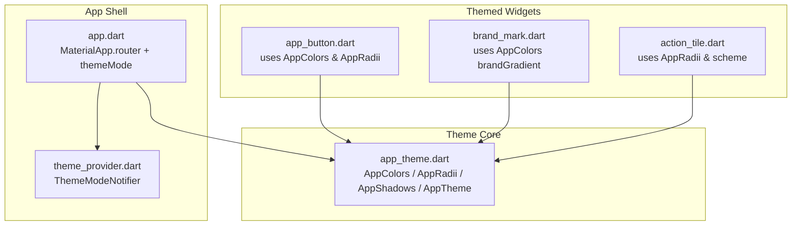
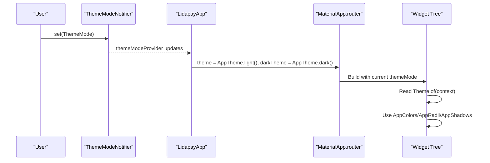
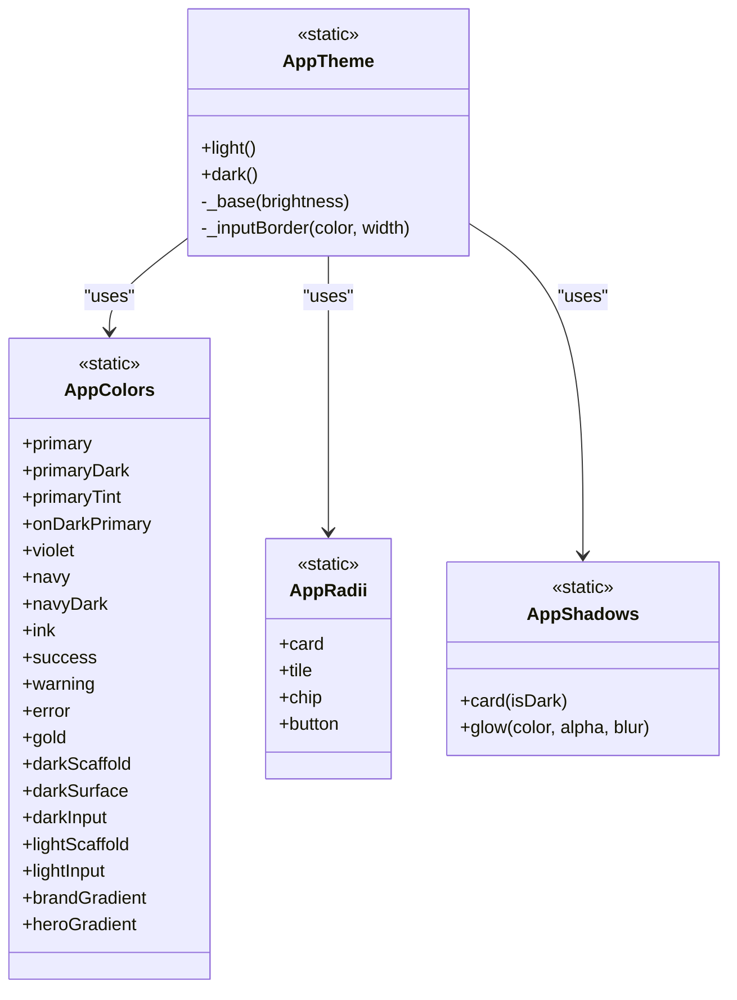
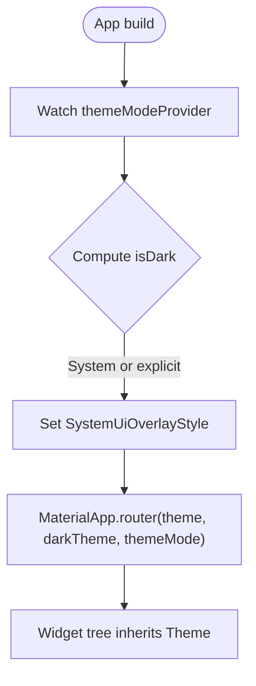
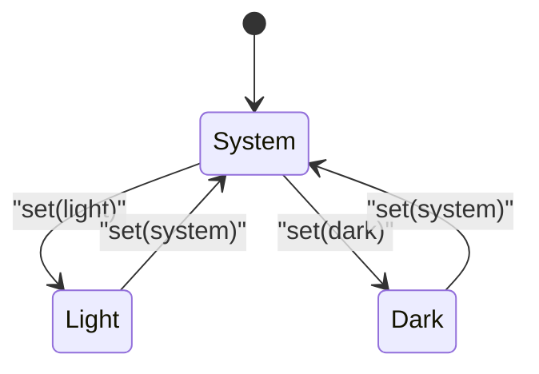
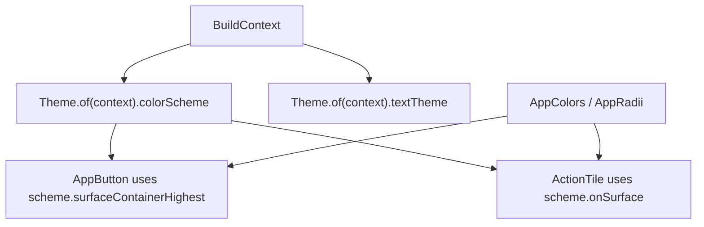
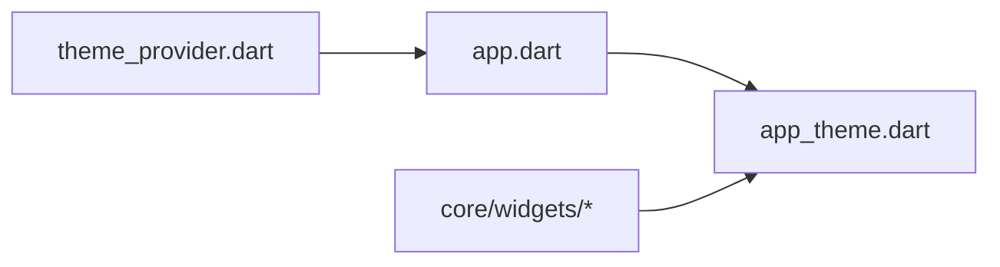

# Theme System

<cite>
**Referenced Files in This Document**
- [app_theme.dart](file://lib/core/theme/app_theme.dart)
- [theme_provider.dart](file://lib/core/providers/theme_provider.dart)
- [app.dart](file://lib/app.dart)
- [app_button.dart](file://lib/core/widgets/app_button.dart)
- [brand_mark.dart](file://lib/core/widgets/brand_mark.dart)
- [action_tile.dart](file://lib/core/widgets/action_tile.dart)
</cite>

## Table of Contents
1. [Introduction](#introduction)
2. [Project Structure](#project-structure)
3. [Core Components](#core-components)
4. [Architecture Overview](#architecture-overview)
5. [Detailed Component Analysis](#detailed-component-analysis)
6. [Dependency Analysis](#dependency-analysis)
7. [Performance Considerations](#performance-considerations)
8. [Troubleshooting Guide](#troubleshooting-guide)
9. [Conclusion](#conclusion)
10. [Appendices](#appendices)

## Introduction
This document explains the theme system architecture used by the application. It covers how the AppTheme implementation defines color schemes, typography scales, and component styling; how themes are applied across the app; how dark/light mode is supported; and where to customize for branding. It also provides guidelines for adding new colors, fonts, and theme variants, plus examples of extending the theme system and building custom components that respect theming.

## Project Structure
The theme system is centered around a single theme definition file, a persisted theme mode provider, and the root app widget that wires everything together. Reusable UI components consume the theme through Material’s Theme API and shared design tokens.

**Diagram sources**
- [app.dart:192-202](file://lib/app.dart#L192-L202)
- [theme_provider.dart:6-37](file://lib/core/providers/theme_provider.dart#L6-L37)
- [app_theme.dart:83-232](file://lib/core/theme/app_theme.dart#L83-L232)
- [app_button.dart:28-123](file://lib/core/widgets/app_button.dart#L28-L123)
- [brand_mark.dart:21-61](file://lib/core/widgets/brand_mark.dart#L21-L61)
- [action_tile.dart:30-85](file://lib/core/widgets/action_tile.dart#L30-L85)

**Section sources**
- [app.dart:192-202](file://lib/app.dart#L192-L202)
- [theme_provider.dart:6-37](file://lib/core/providers/theme_provider.dart#L6-L37)
- [app_theme.dart:83-232](file://lib/core/theme/app_theme.dart#L83-L232)

## Core Components
- AppColors: Centralized brand palette, gradients, and surface ramps for light/dark modes.
- AppRadii: Shared shape scale for cards, tiles, chips, and buttons.
- AppShadows: Shadow helpers for surfaces and brand glows.
- AppTheme: Builds ThemeData with Material 3, colorScheme, textTheme, and component themes.
- ThemeProvider: Persisted ThemeMode (light/dark/system) using SharedPreferences.
- App shell: MaterialApp.router consumes themeModeProvider and applies AppTheme.light()/dark().

Key responsibilities:
- Define tokens once in AppColors/AppRadii/AppShadows.
- Construct ThemeData in AppTheme for consistent look-and-feel.
- Persist user preference via ThemeModeNotifier.
- Apply theme at the root so all widgets inherit it.

**Section sources**
- [app_theme.dart:4-81](file://lib/core/theme/app_theme.dart#L4-L81)
- [app_theme.dart:83-232](file://lib/core/theme/app_theme.dart#L83-L232)
- [theme_provider.dart:6-37](file://lib/core/providers/theme_provider.dart#L6-L37)
- [app.dart:192-202](file://lib/app.dart#L192-L202)

## Architecture Overview
The theme flows from a persisted preference into the root widget, which supplies both light and dark ThemeData to MaterialApp. Components read from Theme.of(context) or use shared tokens directly.

**Diagram sources**
- [theme_provider.dart:32-37](file://lib/core/providers/theme_provider.dart#L32-L37)
- [app.dart:192-202](file://lib/app.dart#L192-L202)
- [app_theme.dart:86-134](file://lib/core/theme/app_theme.dart#L86-L134)

## Detailed Component Analysis

### AppTheme Implementation
AppTheme builds a cohesive Material 3 theme:
- ColorScheme derived from a seed color, then overridden with brand values.
- Scaffold background uses dedicated light/dark ramp colors.
- TextTheme based on Plus Jakarta Sans with adjusted labelLarge style.
- Component themes: AppBar, Card, InputDecoration, ElevatedButton, SnackBar, Divider, NavigationBar, BottomSheet, Dialog.

Design tokens:
- AppColors: primary, secondary, error, success, warning, gold, plus light/dark surface/input/scaffold ramps and brand gradients.
- AppRadii: card, tile, chip, button radii.
- AppShadows: card shadows and brand glow helper.

Customization points:
- Change seedColor or override specific ColorScheme fields to adjust global hues.
- Replace fontFamily in textTheme.apply(...) to change typography globally.
- Adjust component themes (e.g., ElevatedButtonThemeData) to alter default behavior.

Dark/Light support:
- Brightness-aware overrides for surface, onSurface, input backgrounds, and divider colors.
- Dedicated darkScaffold/darkSurface/darkInput vs lightScaffold/lightInput ramps.

**Diagram sources**
- [app_theme.dart:4-81](file://lib/core/theme/app_theme.dart#L4-L81)
- [app_theme.dart:83-232](file://lib/core/theme/app_theme.dart#L83-L232)

**Section sources**
- [app_theme.dart:4-81](file://lib/core/theme/app_theme.dart#L4-L81)
- [app_theme.dart:83-232](file://lib/core/theme/app_theme.dart#L83-L232)

### Theme Application Across the App
The root app reads the persisted themeMode and passes both light and dark ThemeData to MaterialApp.router. The overlay styles for status and navigation bars adapt to brightness. Offline banner and other UI elements reference AppColors.error for failure states.

**Diagram sources**
- [app.dart:136-178](file://lib/app.dart#L136-L178)
- [app.dart:192-202](file://lib/app.dart#L192-L202)

**Section sources**
- [app.dart:136-178](file://lib/app.dart#L136-L178)
- [app.dart:192-202](file://lib/app.dart#L192-L202)

### Typography Scale
Typography is built on Material 3’s textTheme with a custom font family:
- Base textTheme is created with useMaterial3 enabled.
- Font family is set to Plus Jakarta Sans globally.
- labelLarge is enhanced with increased weight and letter spacing.

Guidelines:
- Prefer Theme.of(context).textTheme for all text to maintain consistency.
- If you need a unique style, derive from an existing textTheme entry rather than inventing ad-hoc TextStyle values.

**Section sources**
- [app_theme.dart:115-128](file://lib/core/theme/app_theme.dart#L115-L128)

### Responsive Design Patterns
The theme itself is not responsive by screen size, but it supports platform-specific transitions and consistent component sizing:
- Page transitions differ per platform (iOS/macOS vs Android).
- Navigation bar height and indicator colors are defined centrally.
- Input decoration padding and border radii are centralized.

For responsive layouts, combine these theme settings with layout builders (e.g., LayoutBuilder, MediaQuery) and flexible widgets. Avoid hardcoding sizes in features; prefer theme-driven constants like AppRadii.

**Section sources**
- [app_theme.dart:136-142](file://lib/core/theme/app_theme.dart#L136-L142)
- [app_theme.dart:204-211](file://lib/core/theme/app_theme.dart#L204-L211)
- [app_theme.dart:165-183](file://lib/core/theme/app_theme.dart#L165-L183)

### Dark/Light Mode Support
- ColorScheme is generated from a seed and then customized per brightness.
- Surface and input backgrounds switch between light and dark ramps.
- Divider and navigation bar colors adapt to brightness.
- ThemeModeNotifier persists the user’s choice and restores it on launch.

**Diagram sources**
- [theme_provider.dart:12-37](file://lib/core/providers/theme_provider.dart#L12-L37)

**Section sources**
- [app_theme.dart:90-113](file://lib/core/theme/app_theme.dart#L90-L113)
- [app_theme.dart:200-211](file://lib/core/theme/app_theme.dart#L200-L211)
- [theme_provider.dart:12-37](file://lib/core/providers/theme_provider.dart#L12-L37)

### Customization Points for Branding
- Colors: Add new semantic colors under AppColors and wire them into ColorScheme or component themes if needed.
- Gradients: Extend AppColors.brandGradient or heroGradient for new branded surfaces.
- Shapes: Introduce new radii in AppRadii and apply them consistently.
- Shadows: Use AppShadows helpers for consistent elevation and brand glow.
- Typography: Change fontFamily in AppTheme to update the entire app’s typeface.

**Section sources**
- [app_theme.dart:4-81](file://lib/core/theme/app_theme.dart#L4-L81)
- [app_theme.dart:115-128](file://lib/core/theme/app_theme.dart#L115-L128)

### Guidelines for Adding New Colors, Fonts, and Variants
- New colors:
  - Add to AppColors with clear naming (semantic > literal).
  - If they affect global UI, add corresponding ColorScheme entries in AppTheme._base.
- New fonts:
  - Register the font asset in pubspec.yaml.
  - Update fontFamily in AppTheme.textTheme.apply(...) to apply globally.
  - For localized or feature-specific fonts, create a local TextStyle derived from Theme.of(context).textTheme.
- New theme variants:
  - Create a variant factory in AppTheme (e.g., highContrast()) that composes over _base.
  - Or extend ThemeData in a separate module and merge with AppTheme defaults.

**Section sources**
- [app_theme.dart:83-134](file://lib/core/theme/app_theme.dart#L83-L134)

### Examples: Extending the Theme System and Building Themed Components
- Themed Button Example:
  - Uses Theme.of(context).colorScheme for disabled state.
  - Applies AppColors.brandGradient and AppRadii.button for consistent branding.
  - Adds a subtle brand-colored shadow when enabled.

- Themed Brand Mark Example:
  - Falls back to AppColors.brandGradient and AppRadii-derived radius when asset fails.
  - Uses Plus Jakarta Sans to match app typography.

- Themed Action Tile Example:
  - Uses AppRadii.tile for rounded corners.
  - Reads scheme.onSurface for label color to respect brightness.

**Diagram sources**
- [app_button.dart:28-123](file://lib/core/widgets/app_button.dart#L28-L123)
- [action_tile.dart:30-85](file://lib/core/widgets/action_tile.dart#L30-L85)
- [brand_mark.dart:21-61](file://lib/core/widgets/brand_mark.dart#L21-L61)

**Section sources**
- [app_button.dart:28-123](file://lib/core/widgets/app_button.dart#L28-L123)
- [brand_mark.dart:21-61](file://lib/core/widgets/brand_mark.dart#L21-L61)
- [action_tile.dart:30-85](file://lib/core/widgets/action_tile.dart#L30-L85)

## Dependency Analysis
The theme system has low coupling and high cohesion:
- AppTheme depends only on Flutter Material APIs and internal token classes.
- Widgets depend on Theme.of(context) and shared tokens, not on each other.
- ThemeModeNotifier is independent and only affects runtime theme selection.

**Diagram sources**
- [theme_provider.dart:6-37](file://lib/core/providers/theme_provider.dart#L6-L37)
- [app.dart:192-202](file://lib/app.dart#L192-L202)
- [app_theme.dart:83-232](file://lib/core/theme/app_theme.dart#L83-L232)

**Section sources**
- [theme_provider.dart:6-37](file://lib/core/providers/theme_provider.dart#L6-L37)
- [app.dart:192-202](file://lib/app.dart#L192-L202)
- [app_theme.dart:83-232](file://lib/core/theme/app_theme.dart#L83-L232)

## Performance Considerations
- ThemeData construction is lightweight and executed once per theme mode; avoid heavy computations inside AppTheme._base.
- Prefer reading Theme.of(context) once per build and caching derived values locally when needed.
- Use shared tokens (AppColors/AppRadii) to reduce repeated calculations and ensure consistent visuals.
- Keep gradient and shadow definitions minimal to avoid excessive repaints on large surfaces.

[No sources needed since this section provides general guidance]

## Troubleshooting Guide
- Theme not updating after changing preference:
  - Ensure ThemeModeNotifier.set is called and persisted.
  - Verify MaterialApp.router receives the updated themeMode.
- Colors look wrong in dark mode:
  - Check brightness-aware overrides in AppTheme._base for surface, onSurface, and input backgrounds.
  - Confirm components use Theme.of(context).brightness or scheme properties instead of hardcoded colors.
- Typography not applying:
  - Verify fontFamily is set in AppTheme.textTheme.apply(...).
  - Ensure the font asset is registered and available at runtime.
- Buttons or inputs not themed:
  - Confirm ElevatedButtonThemeData and InputDecorationTheme are configured in AppTheme.
  - Check that custom widgets do not override Theme defaults unintentionally.

**Section sources**
- [theme_provider.dart:20-37](file://lib/core/providers/theme_provider.dart#L20-L37)
- [app.dart:192-202](file://lib/app.dart#L192-L202)
- [app_theme.dart:90-134](file://lib/core/theme/app_theme.dart#L90-L134)
- [app_theme.dart:165-195](file://lib/core/theme/app_theme.dart#L165-L195)

## Conclusion
The theme system centralizes brand tokens and Material 3 configuration in AppTheme, applies them consistently across the app, and supports persistent light/dark/system modes. By extending AppColors, AppRadii, AppShadows, and AppTheme, teams can evolve the visual language while keeping components predictable and accessible.

[No sources needed since this section summarizes without analyzing specific files]

## Appendices

### Quick Reference: Where to Modify
- Add or change colors: [app_theme.dart:4-46](file://lib/core/theme/app_theme.dart#L4-L46)
- Adjust typography: [app_theme.dart:115-128](file://lib/core/theme/app_theme.dart#L115-L128)
- Override component themes: [app_theme.dart:143-223](file://lib/core/theme/app_theme.dart#L143-L223)
- Persist theme preference: [theme_provider.dart:6-37](file://lib/core/providers/theme_provider.dart#L6-L37)
- Apply theme at root: [app.dart:192-202](file://lib/app.dart#L192-L202)

**Section sources**
- [app_theme.dart:4-46](file://lib/core/theme/app_theme.dart#L4-L46)
- [app_theme.dart:115-128](file://lib/core/theme/app_theme.dart#L115-L128)
- [app_theme.dart:143-223](file://lib/core/theme/app_theme.dart#L143-L223)
- [theme_provider.dart:6-37](file://lib/core/providers/theme_provider.dart#L6-L37)
- [app.dart:192-202](file://lib/app.dart#L192-L202)