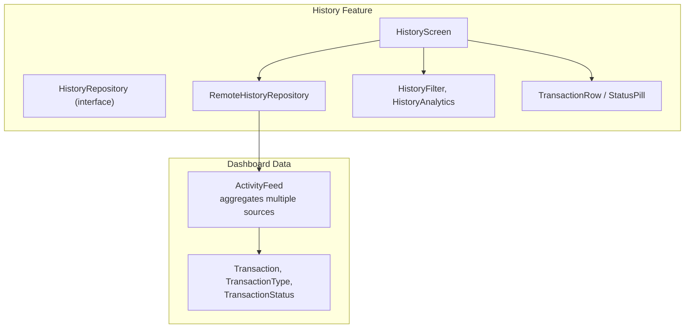
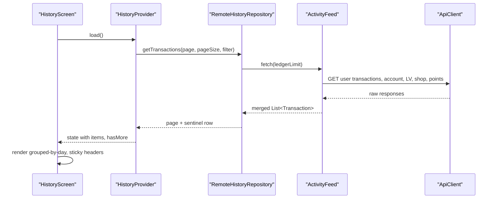
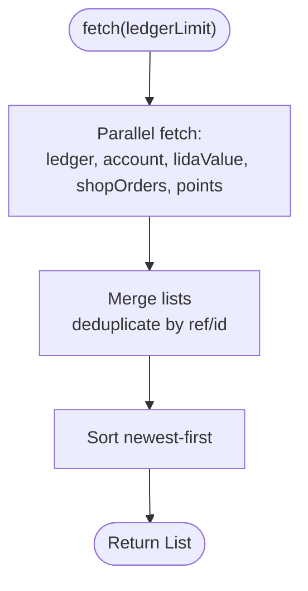
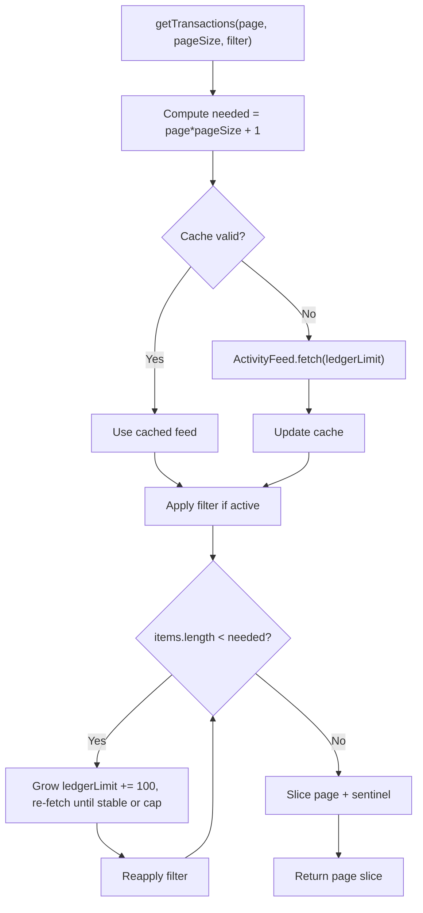
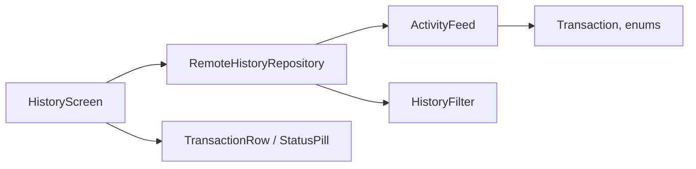

# Activity Feed & Transaction History

<cite>
**Referenced Files in This Document**
- [activity_feed.dart](file://lib/features/dashboard/data/activity_feed.dart)
- [dashboard_models.dart](file://lib/features/dashboard/data/dashboard_models.dart)
- [transaction_tile.dart](file://lib/features/dashboard/widgets/transaction_tile.dart)
- [history_repository.dart](file://lib/features/history/data/history_repository.dart)
- [remote_history_repository.dart](file://lib/features/history/data/remote_history_repository.dart)
- [history_models.dart](file://lib/features/history/data/history_models.dart)
- [history_screen.dart](file://lib/features/history/screens/history_screen.dart)
</cite>

## Table of Contents
1. [Introduction](#introduction)
2. [Project Structure](#project-structure)
3. [Core Components](#core-components)
4. [Architecture Overview](#architecture-overview)
5. [Detailed Component Analysis](#detailed-component-analysis)
6. [Dependency Analysis](#dependency-analysis)
7. [Performance Considerations](#performance-considerations)
8. [Troubleshooting Guide](#troubleshooting-guide)
9. [Conclusion](#conclusion)

## Introduction
This document explains the activity feed and transaction history functionality in the application. It covers:
- How the merged activity feed aggregates transactions from multiple sources.
- The transaction tile widget used to display individual rows.
- Real-time update behavior through pull-to-refresh, pagination, and state-driven UI updates.
- The activity feed repository, data fetching strategy, and client-side filtering/pagination.
- Examples for filtering, sorting, and customizing transaction displays.
- Performance guidance for large lists, offline-friendly caching, and smooth scrolling.

## Project Structure
The activity feed and transaction history are implemented across two feature areas:
- Dashboard data layer: defines shared transaction models and the merged activity feed aggregator.
- History feature: provides the repository interface, remote implementation, filter model, screen, and widgets.

**Diagram sources**
- [activity_feed.dart:12-38](file://lib/features/dashboard/data/activity_feed.dart#L12-L38)
- [dashboard_models.dart:38-138](file://lib/features/dashboard/data/dashboard_models.dart#L38-L138)
- [history_repository.dart:4-24](file://lib/features/history/data/history_repository.dart#L4-L24)
- [remote_history_repository.dart:16-86](file://lib/features/history/data/remote_history_repository.dart#L16-L86)
- [history_models.dart:10-93](file://lib/features/history/data/history_models.dart#L10-L93)
- [history_screen.dart:21-333](file://lib/features/history/screens/history_screen.dart#L21-L333)
- [transaction_tile.dart:8-205](file://lib/features/dashboard/widgets/transaction_tile.dart#L8-L205)

**Section sources**
- [activity_feed.dart:12-38](file://lib/features/dashboard/data/activity_feed.dart#L12-L38)
- [dashboard_models.dart:38-138](file://lib/features/dashboard/data/dashboard_models.dart#L38-L138)
- [history_repository.dart:4-24](file://lib/features/history/data/history_repository.dart#L4-L24)
- [remote_history_repository.dart:16-86](file://lib/features/history/data/remote_history_repository.dart#L16-L86)
- [history_models.dart:10-93](file://lib/features/history/data/history_models.dart#L10-L93)
- [history_screen.dart:21-333](file://lib/features/history/screens/history_screen.dart#L21-L333)
- [transaction_tile.dart:8-205](file://lib/features/dashboard/widgets/transaction_tile.dart#L8-L205)

## Core Components
- ActivityFeed: Merges transactions from the main ledger, account activity, Lida Value history, shop orders, and points into a single list, deduplicates by reference or id, and sorts newest-first.
- RemoteHistoryRepository: Implements paginated access over the merged feed with short-lived local cache, client-side filtering, and adaptive growth when filters reduce match density.
- HistoryFilter: Encapsulates type, status, direction, date range, and amount constraints; applied client-side.
- TransactionRow and StatusPill: Reusable widgets for compact transaction rows and status badges.
- HistoryScreen: Full activity ledger UI with sticky headers, grouped-by-day rendering, pull-to-refresh, filter chips, and load-more behavior.

Key responsibilities:
- Data aggregation and normalization live in dashboard data files.
- Repository logic and pagination live in history data files.
- UI composition and interaction live in history screens and dashboard widgets.

**Section sources**
- [activity_feed.dart:12-38](file://lib/features/dashboard/data/activity_feed.dart#L12-L38)
- [remote_history_repository.dart:16-86](file://lib/features/history/data/remote_history_repository.dart#L16-L86)
- [history_models.dart:10-93](file://lib/features/history/data/history_models.dart#L10-L93)
- [transaction_tile.dart:8-205](file://lib/features/dashboard/widgets/transaction_tile.dart#L8-L205)
- [history_screen.dart:21-333](file://lib/features/history/screens/history_screen.dart#L21-L333)

## Architecture Overview
The system uses a layered approach:
- UI layer (HistoryScreen) consumes a provider-backed state that calls the repository.
- Repository layer delegates to ActivityFeed for merged data and to API endpoints for stats/date-range queries.
- ActivityFeed orchestrates parallel requests to multiple backend sources and merges results.

**Diagram sources**
- [history_screen.dart:50-60](file://lib/features/history/screens/history_screen.dart#L50-L60)
- [remote_history_repository.dart:36-86](file://lib/features/history/data/remote_history_repository.dart#L36-L86)
- [activity_feed.dart:18-38](file://lib/features/dashboard/data/activity_feed.dart#L18-L38)

## Detailed Component Analysis

### ActivityFeed
Responsibilities:
- Fetches five sources concurrently using Future.wait.
- Normalizes each source into Transaction objects.
- Deduplicates by reference or id+timestamp.
- Sorts by createdAt descending.

Data sources:
- Main ledger: user transactions endpoint.
- Account activity: embedded wallet deposit/withdrawal entries.
- Lida Value history: wallet actions like use/send/sell/convert.
- Shop orders: app checkouts.
- Points: earned/redeemed points.

Error handling:
- Each source fails independently; failures return empty lists so one dead endpoint does not blank the entire feed.

Complexity:
- Merging is O(N) where N is total rows across all sources.
- Sorting is O(M log M) where M is unique merged rows.

**Diagram sources**
- [activity_feed.dart:18-38](file://lib/features/dashboard/data/activity_feed.dart#L18-L38)

**Section sources**
- [activity_feed.dart:18-38](file://lib/features/dashboard/data/activity_feed.dart#L18-L38)
- [activity_feed.dart:40-57](file://lib/features/dashboard/data/activity_feed.dart#L40-L57)
- [activity_feed.dart:59-133](file://lib/features/dashboard/data/activity_feed.dart#L59-L133)
- [activity_feed.dart:152-198](file://lib/features/dashboard/data/activity_feed.dart#L152-L198)
- [activity_feed.dart:200-258](file://lib/features/dashboard/data/activity_feed.dart#L200-L258)
- [activity_feed.dart:260-341](file://lib/features/dashboard/data/activity_feed.dart#L260-L341)

### Transaction Model and Enums
The shared Transaction model includes:
- Identity fields: id, reference.
- Classification: type, status, currency.
- Amount and timing: amount, createdAt.
- Context: counterparty, description.
- Direction hints: isCredit, isMoneyIn.
- Status detail: optional reason string for failed/pending rows.
- Special state: awaiting recipient decision.

Enums:
- TransactionType maps server strings to typed categories.
- TransactionStatus normalizes success/pending/failed states.

Parsing:
- Tolerant parsing supports multiple field names and nested structures.

**Section sources**
- [dashboard_models.dart:38-71](file://lib/features/dashboard/data/dashboard_models.dart#L38-L71)
- [dashboard_models.dart:73-90](file://lib/features/dashboard/data/dashboard_models.dart#L73-L90)
- [dashboard_models.dart:92-138](file://lib/features/dashboard/data/dashboard_models.dart#L92-L138)
- [dashboard_models.dart:142-312](file://lib/features/dashboard/data/dashboard_models.dart#L142-L312)

### RemoteHistoryRepository
Responsibilities:
- Provides paginated access to the merged feed.
- Applies client-side filters.
- Uses a short-lived in-memory cache to avoid repeated network calls within 30 seconds.
- Grows the fetched window when filters make matches sparse.

Pagination strategy:
- Requests more than one page size to include a sentinel row indicating “has more”.
- Adaptive growth increases ledgerLimit by 100 up to a cap while the feed grows.

Stats and date-range:
- Stats endpoint returns aggregated buckets by type/status.
- Date-range endpoint returns raw rows between two dates.

**Diagram sources**
- [remote_history_repository.dart:36-86](file://lib/features/history/data/remote_history_repository.dart#L36-L86)

**Section sources**
- [remote_history_repository.dart:16-34](file://lib/features/history/data/remote_history_repository.dart#L16-L34)
- [remote_history_repository.dart:36-86](file://lib/features/history/data/remote_history_repository.dart#L36-L86)
- [remote_history_repository.dart:88-113](file://lib/features/history/data/remote_history_repository.dart#L88-L113)

### HistoryFilter
Capabilities:
- Filter by transaction types and statuses.
- Filter by money-in/money-out direction.
- Filter by inclusive day range.
- Filter by min/max amount.
- Equality and copy helpers for immutable updates.

Matching:
- Day-granularity comparison ensures inclusive day boundaries.
- Empty sets mean “no constraint” for types/statuses.

**Section sources**
- [history_models.dart:10-93](file://lib/features/history/data/history_models.dart#L10-L93)

### TransactionTile Widget
Components:
- StatusPill: compact badge showing success/pending/failed.
- TransactionRow: flat row with icon/network avatar, title/description, subtitle with time and counterparty, amount with sign, and non-success status text.

Network avatars:
- For airtime/data transactions, shows brand-colored initials for MTN, Telecel/Vodafone, Airtel/Tigo, and Glo.

Customization:
- Icon and tint are mapped per TransactionType.
- Amount color adapts to credit/debit and failure state.

**Section sources**
- [transaction_tile.dart:8-36](file://lib/features/dashboard/widgets/transaction_tile.dart#L8-L36)
- [transaction_tile.dart:38-205](file://lib/features/dashboard/widgets/transaction_tile.dart#L38-L205)

### HistoryScreen
Features:
- Sticky header with back, analytics, and filter buttons.
- Hero stats for money in/out and pending count.
- Horizontal filter chips for quick type selection.
- Grouped-by-day rendering with cards per transaction.
- Pull-to-refresh and load-more with error retry.
- Opens full transaction details sheet on tap.

Grouping and labels:
- Groups transactions by local day label (“Today”, “Yesterday”, weekday name, or month/day).

Load-more behavior:
- Triggers provider.loadMore when near the end of the list.
- Shows spinner or retry button based on state.

**Section sources**
- [history_screen.dart:21-60](file://lib/features/history/screens/history_screen.dart#L21-L60)
- [history_screen.dart:63-333](file://lib/features/history/screens/history_screen.dart#L63-L333)
- [history_screen.dart:335-400](file://lib/features/history/screens/history_screen.dart#L335-L400)
- [history_screen.dart:402-517](file://lib/features/history/screens/history_screen.dart#L402-L517)
- [history_screen.dart:519-575](file://lib/features/history/screens/history_screen.dart#L519-L575)
- [history_screen.dart:577-694](file://lib/features/history/screens/history_screen.dart#L577-L694)
- [history_screen.dart:696-800](file://lib/features/history/screens/history_screen.dart#L696-L800)

## Dependency Analysis
High-level dependencies:
- HistoryScreen depends on HistoryProvider (not shown here), which uses RemoteHistoryRepository.
- RemoteHistoryRepository depends on ApiClient via ActivityFeed and directly for stats/date-range endpoints.
- ActivityFeed depends on ApiEndpoints and ApiPayload utilities for request/response handling.
- TransactionRow and StatusPill depend on shared Transaction model and theme/formatters.

**Diagram sources**
- [history_screen.dart:21-333](file://lib/features/history/screens/history_screen.dart#L21-L333)
- [remote_history_repository.dart:16-86](file://lib/features/history/data/remote_history_repository.dart#L16-L86)
- [activity_feed.dart:12-38](file://lib/features/dashboard/data/activity_feed.dart#L12-L38)
- [dashboard_models.dart:38-138](file://lib/features/dashboard/data/dashboard_models.dart#L38-L138)
- [history_models.dart:10-93](file://lib/features/history/data/history_models.dart#L10-L93)
- [transaction_tile.dart:8-205](file://lib/features/dashboard/widgets/transaction_tile.dart#L8-L205)

**Section sources**
- [history_screen.dart:21-333](file://lib/features/history/screens/history_screen.dart#L21-L333)
- [remote_history_repository.dart:16-86](file://lib/features/history/data/remote_history_repository.dart#L16-L86)
- [activity_feed.dart:12-38](file://lib/features/dashboard/data/activity_feed.dart#L12-L38)
- [dashboard_models.dart:38-138](file://lib/features/dashboard/data/dashboard_models.dart#L38-L138)
- [history_models.dart:10-93](file://lib/features/history/data/history_models.dart#L10-L93)
- [transaction_tile.dart:8-205](file://lib/features/dashboard/widgets/transaction_tile.dart#L8-L205)

## Performance Considerations
- Concurrency: ActivityFeed uses parallel fetches to reduce latency across sources.
- Deduplication: Reference-based set avoids duplicate rows during merge.
- Sorting: Newest-first sort ensures consistent ordering after merge.
- Pagination sentinel: Requesting one extra item prevents misinterpreting an exact final page as “more”.
- Adaptive growth: When filters reduce match density, the repository grows the fetched window in steps up to a cap to maintain page completeness.
- Short-lived cache: In-memory cache avoids repeated network calls for 30 seconds.
- UI grouping: Grouping by day reduces layout complexity and improves readability.
- Smooth scrolling: Sticky headers and sliver-based list improve scroll performance.

Recommendations:
- Keep pageSize modest (e.g., 10–20) to balance memory and UX.
- Avoid heavy computations inside list builders; precompute derived values where possible.
- Use lazy loading and only compute expensive formatting off the hot path.
- Debounce rapid filter changes to prevent excessive re-filtering.

[No sources needed since this section provides general guidance]

## Troubleshooting Guide
Common issues and resolutions:
- Missing user ID: Repository throws a clear authentication-style error when userId is null or empty. Ensure the user session is initialized before loading history.
- Empty feed under filters: Filters are applied client-side; if no matches exist, the repository may grow the fetched window up to a cap. Clear filters or broaden criteria.
- Load-more errors: The UI exposes a retry action when load-more fails; tapping it retries the next page.
- Stale data: The cache expires after 30 seconds; pull-to-refresh forces a fresh fetch.
- Network failures per source: Individual source failures do not blank the feed; missing sections degrade gracefully.

Operational tips:
- Verify ApiEndpoints configuration for user transactions, stats, and date-range endpoints.
- Inspect Transaction.fromApiJson mapping when new backend fields appear.
- Check HistoryFilter.isActive to confirm whether filters are constraining results.

**Section sources**
- [remote_history_repository.dart:25-34](file://lib/features/history/data/remote_history_repository.dart#L25-L34)
- [remote_history_repository.dart:67-86](file://lib/features/history/data/remote_history_repository.dart#L67-L86)
- [history_screen.dart:223-262](file://lib/features/history/screens/history_screen.dart#L223-L262)

## Conclusion
The activity feed and transaction history combine a robust data aggregator with a responsive, filterable, and paginated UI. ActivityFeed consolidates multiple backend sources into a unified, sorted, and deduplicated list. RemoteHistoryRepository adds practical pagination, adaptive growth, and short-lived caching. HistoryScreen delivers a polished experience with sticky headers, grouped-by-day rendering, and smooth interactions. Together, these components provide a scalable foundation for displaying real-time transaction updates, supporting large datasets, and enabling flexible filtering and customization.

[No sources needed since this section summarizes without analyzing specific files]