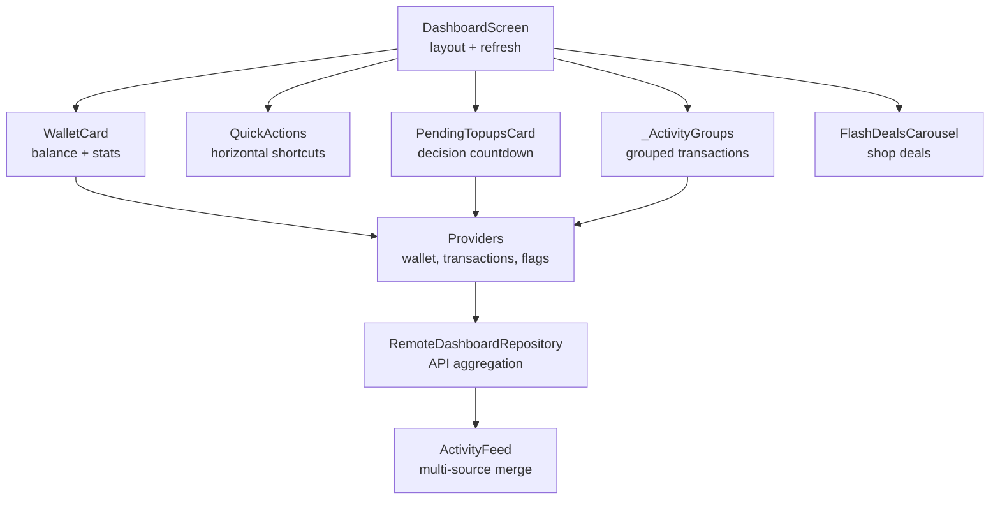
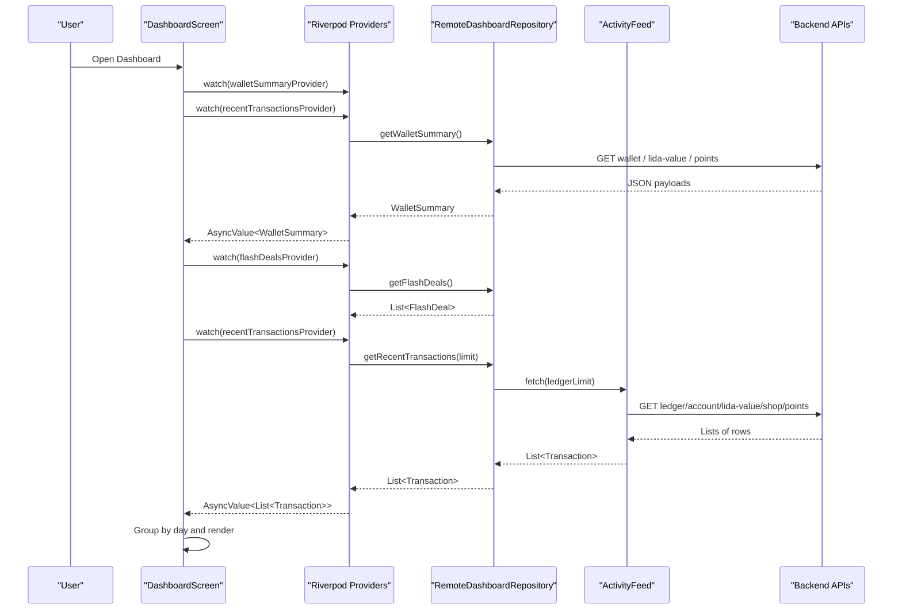
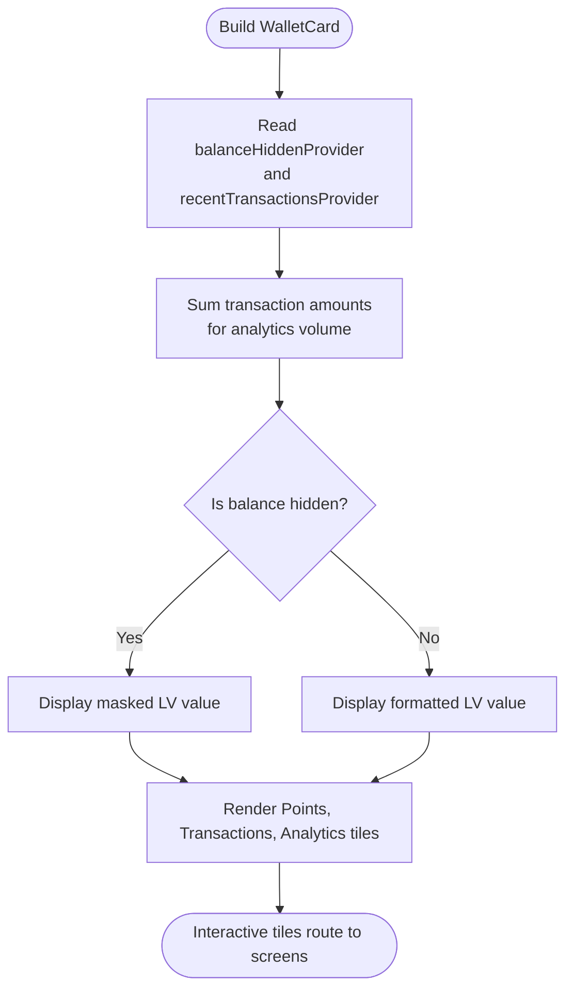
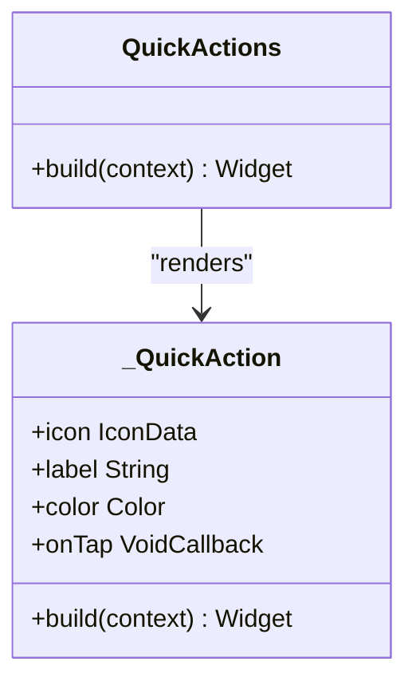
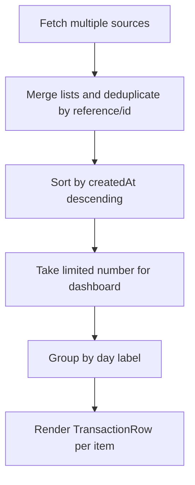
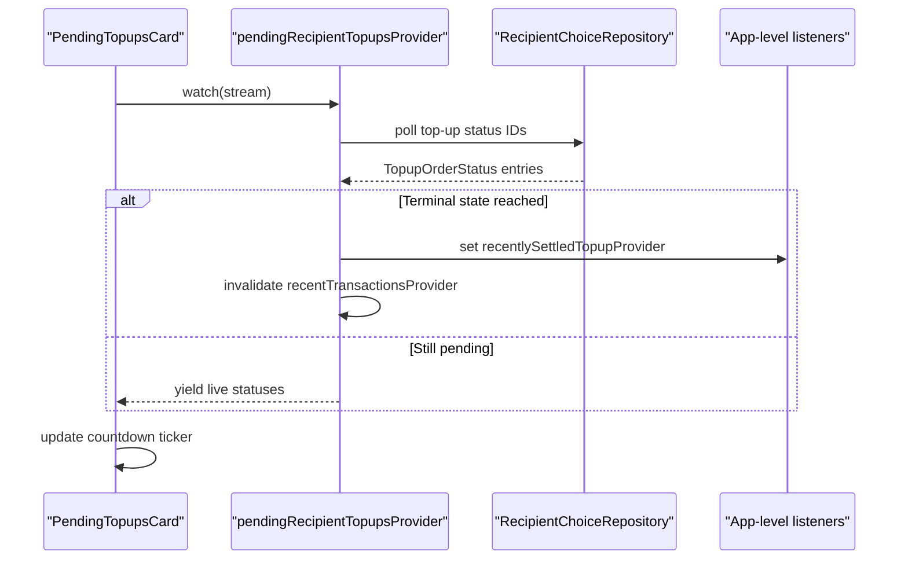
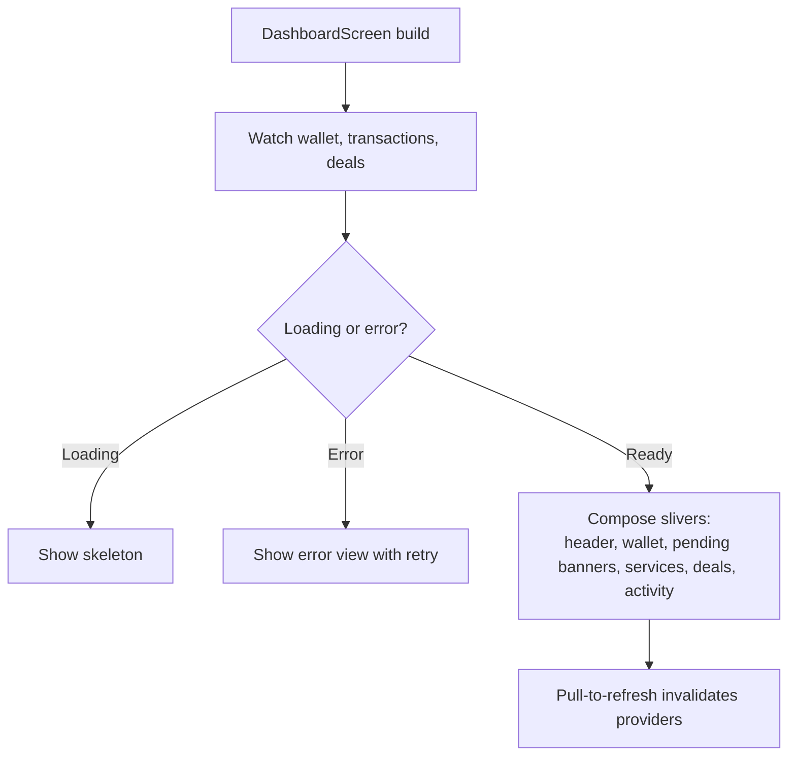
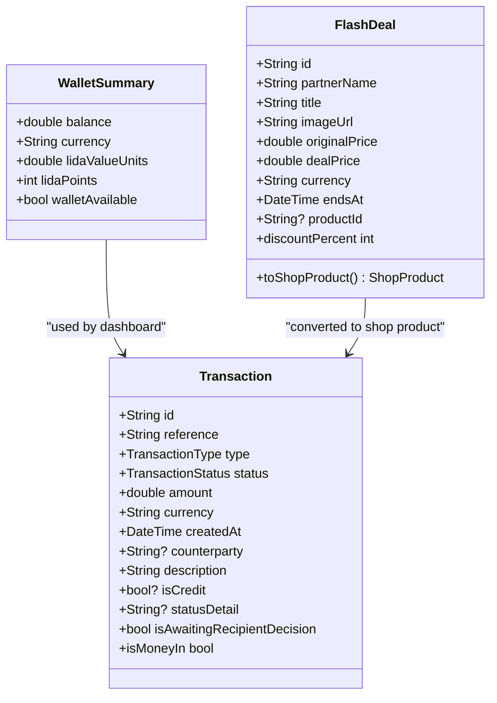
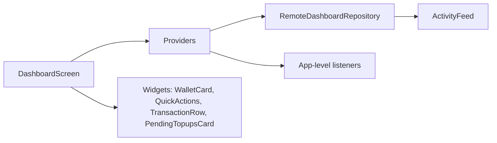

# Dashboard & Home

<cite>
**Referenced Files in This Document**
- [app.dart](file://lib/app.dart)
- [dashboard_screen.dart](file://lib/features/dashboard/screens/dashboard_screen.dart)
- [providers.dart](file://lib/features/dashboard/providers.dart)
- [wallet_card.dart](file://lib/features/dashboard/widgets/wallet_card.dart)
- [quick_actions.dart](file://lib/features/dashboard/widgets/quick_actions.dart)
- [transaction_tile.dart](file://lib/features/dashboard/widgets/transaction_tile.dart)
- [pending_topups_card.dart](file://lib/features/dashboard/widgets/pending_topups_card.dart)
- [dashboard_models.dart](file://lib/features/dashboard/data/dashboard_models.dart)
- [remote_dashboard_repository.dart](file://lib/features/dashboard/data/remote_dashboard_repository.dart)
- [activity_feed.dart](file://lib/features/dashboard/data/activity_feed.dart)
</cite>

## Table of Contents
1. [Introduction](#introduction)
2. [Project Structure](#project-structure)
3. [Core Components](#core-components)
4. [Architecture Overview](#architecture-overview)
5. [Detailed Component Analysis](#detailed-component-analysis)
6. [Dependency Analysis](#dependency-analysis)
7. [Performance Considerations](#performance-considerations)
8. [Troubleshooting Guide](#troubleshooting-guide)
9. [Conclusion](#conclusion)

## Introduction
This document explains the dashboard and home screen functionality, focusing on:
- Wallet overview implementation and balance display logic
- Quick actions system
- Activity feed composition and grouping
- Dashboard providers and real-time state management
- Widget composition patterns for cards, tiles, and sections
- Responsive design, performance optimizations for large datasets, and accessibility considerations
- Common rendering issues and optimization techniques

The dashboard is a Riverpod-driven Flutter interface that composes wallet data, recent activity, flash deals, services, and pending top-up notifications into a scrollable, pull-to-refresh experience.

## Project Structure
The dashboard feature is organized by domain:
- Screens: `DashboardScreen` orchestrates layout, navigation, and refresh behavior.
- Providers: Riverpod providers for wallet summary, transactions, flash deals, visibility toggles, and background polling.
- Data: Repository abstraction with remote implementation, models, and an activity feed aggregator.
- Widgets: Reusable UI components such as wallet card, quick actions, transaction tile, and pending top-ups card.

**Diagram sources**
- [dashboard_screen.dart:29-239](file://lib/features/dashboard/screens/dashboard_screen.dart#L29-L239)
- [wallet_card.dart:13-218](file://lib/features/dashboard/widgets/wallet_card.dart#L13-L218)
- [quick_actions.dart:5-57](file://lib/features/dashboard/widgets/quick_actions.dart#L5-L57)
- [pending_topups_card.dart:20-71](file://lib/features/dashboard/widgets/pending_topups_card.dart#L20-L71)
- [providers.dart:16-31](file://lib/features/dashboard/providers.dart#L16-L31)
- [remote_dashboard_repository.dart:11-44](file://lib/features/dashboard/data/remote_dashboard_repository.dart#L11-L44)
- [activity_feed.dart:12-38](file://lib/features/dashboard/data/activity_feed.dart#L12-L38)

**Section sources**
- [dashboard_screen.dart:29-239](file://lib/features/dashboard/screens/dashboard_screen.dart#L29-L239)
- [providers.dart:16-31](file://lib/features/dashboard/providers.dart#L16-L31)
- [remote_dashboard_repository.dart:11-44](file://lib/features/dashboard/data/remote_dashboard_repository.dart#L11-L44)
- [activity_feed.dart:12-38](file://lib/features/dashboard/data/activity_feed.dart#L12-L38)

## Core Components
- DashboardScreen: Builds the main scrollable view, handles pull-to-refresh, groups transactions by day, and wires navigation to services, shop, history, and notifications.
- WalletCard: Displays Lida Value balance, points, transaction count, and analytics volume; supports hiding/showing sensitive balances.
- QuickActions: Horizontal action shortcuts with haptic feedback and placeholder navigation.
- TransactionTile (TransactionRow): Renders individual transactions with icons, network avatars, amounts, and status pills.
- PendingTopupsCard: Shows in-flight top-ups waiting for recipient decisions with live countdowns.
- Providers: Riverpod providers for wallet summary, recent transactions, flash deals, balance visibility, and background polling of pending top-ups.
- RemoteDashboardRepository: Aggregates wallet, Lida Value, points, and recent transactions from multiple endpoints with graceful degradation.
- ActivityFeed: Merges ledger, account activity, Lida Value history, shop orders, and points into one deduplicated, sorted list.

**Section sources**
- [dashboard_screen.dart:29-239](file://lib/features/dashboard/screens/dashboard_screen.dart#L29-L239)
- [wallet_card.dart:13-218](file://lib/features/dashboard/widgets/wallet_card.dart#L13-L218)
- [quick_actions.dart:5-57](file://lib/features/dashboard/widgets/quick_actions.dart#L5-L57)
- [transaction_tile.dart:40-163](file://lib/features/dashboard/widgets/transaction_tile.dart#L40-L163)
- [pending_topups_card.dart:20-71](file://lib/features/dashboard/widgets/pending_topups_card.dart#L20-L71)
- [providers.dart:16-31](file://lib/features/dashboard/providers.dart#L16-L31)
- [remote_dashboard_repository.dart:11-44](file://lib/features/dashboard/data/remote_dashboard_repository.dart#L11-L44)
- [activity_feed.dart:12-38](file://lib/features/dashboard/data/activity_feed.dart#L12-L38)

## Architecture Overview
The dashboard uses a layered architecture:
- Presentation layer: DashboardScreen composes widgets and manages user interactions.
- State layer: Riverpod providers expose async data and local state (e.g., balance hidden flag).
- Domain layer: Models define wallet summaries, transactions, and flash deals.
- Data layer: Repository abstracts API calls; remote implementation aggregates multiple endpoints and merges activity sources.

**Diagram sources**
- [dashboard_screen.dart:51-239](file://lib/features/dashboard/screens/dashboard_screen.dart#L51-L239)
- [providers.dart:21-31](file://lib/features/dashboard/providers.dart#L21-L31)
- [remote_dashboard_repository.dart:19-134](file://lib/features/dashboard/data/remote_dashboard_repository.dart#L19-L134)
- [activity_feed.dart:18-38](file://lib/features/dashboard/data/activity_feed.dart#L18-L38)

## Detailed Component Analysis

### Wallet Overview and Balance Display Logic
- WalletCard reads the current wallet summary and recent transactions via providers.
- It computes total transaction volume by summing transaction amounts for analytics display.
- The Lida Value balance can be hidden or shown using a toggle provider; when hidden, values are masked.
- Points and transaction count are displayed alongside analytics.
- Tapping stat tiles navigates to relevant screens (history, analytics, Lida Value).

**Diagram sources**
- [wallet_card.dart:19-30](file://lib/features/dashboard/widgets/wallet_card.dart#L19-L30)
- [wallet_card.dart:71-157](file://lib/features/dashboard/widgets/wallet_card.dart#L71-L157)
- [wallet_card.dart:164-198](file://lib/features/dashboard/widgets/wallet_card.dart#L164-L198)

**Section sources**
- [wallet_card.dart:13-218](file://lib/features/dashboard/widgets/wallet_card.dart#L13-L218)
- [providers.dart:21-34](file://lib/features/dashboard/providers.dart#L21-L34)

### Quick Actions System
- QuickActions renders a horizontal list of icon-forward shortcuts.
- Each action triggers haptic feedback and shows a placeholder snackbar indicating future availability.
- The component is stateless and relies on external navigation or global state for deeper integration.

**Diagram sources**
- [quick_actions.dart:5-57](file://lib/features/dashboard/widgets/quick_actions.dart#L5-L57)
- [quick_actions.dart:60-121](file://lib/features/dashboard/widgets/quick_actions.dart#L60-L121)

**Section sources**
- [quick_actions.dart:5-121](file://lib/features/dashboard/widgets/quick_actions.dart#L5-L121)

### Activity Feed and Grouping
- ActivityFeed merges multiple sources: ledger, account activity, Lida Value history, shop orders, and points.
- Duplicates are removed based on reference or id; results are sorted newest-first.
- DashboardScreen groups transactions by day labels (“Today”, “Yesterday”, formatted date).
- TransactionRow displays amount direction, status pill, and optional network avatar for airtime/data.

**Diagram sources**
- [activity_feed.dart:18-38](file://lib/features/dashboard/data/activity_feed.dart#L18-L38)
- [dashboard_screen.dart:241-259](file://lib/features/dashboard/screens/dashboard_screen.dart#L241-L259)
- [transaction_tile.dart:40-163](file://lib/features/dashboard/widgets/transaction_tile.dart#L40-L163)

**Section sources**
- [activity_feed.dart:18-38](file://lib/features/dashboard/data/activity_feed.dart#L18-L38)
- [dashboard_screen.dart:212-233](file://lib/features/dashboard/screens/dashboard_screen.dart#L212-L233)
- [transaction_tile.dart:40-163](file://lib/features/dashboard/widgets/transaction_tile.dart#L40-L163)

### Pending Top-ups Card and Real-time Polling
- PendingTopupsCard listens to a StreamProvider that polls top-up statuses until terminal states.
- It shows a live countdown timer and opens the full waiting screen on tap.
- Background polling uses exponential backoff when no response is received and blacklists stale references.

**Diagram sources**
- [providers.dart:141-249](file://lib/features/dashboard/providers.dart#L141-L249)
- [pending_topups_card.dart:27-71](file://lib/features/dashboard/widgets/pending_topups_card.dart#L27-L71)
- [app.dart:147-174](file://lib/app.dart#L147-L174)

**Section sources**
- [providers.dart:141-249](file://lib/features/dashboard/providers.dart#L141-L249)
- [pending_topups_card.dart:20-205](file://lib/features/dashboard/widgets/pending_topups_card.dart#L20-L205)
- [app.dart:147-174](file://lib/app.dart#L147-L174)

### Dashboard Screen Composition and Navigation
- DashboardScreen composes sticky header, wallet card, pending decisions banner, pending top-ups, services rail, flash deals carousel, and recent activity.
- Pull-to-refresh invalidates providers and concurrently refreshes wallet, transactions, flash deals, and notifications.
- Day-grouped activity opens a details sheet for each transaction.

**Diagram sources**
- [dashboard_screen.dart:51-239](file://lib/features/dashboard/screens/dashboard_screen.dart#L51-L239)

**Section sources**
- [dashboard_screen.dart:29-239](file://lib/features/dashboard/screens/dashboard_screen.dart#L29-L239)

### Data Models and Parsing
- WalletSummary encapsulates balance, currency, Lida Value units, points, and wallet availability.
- Transaction includes type, status, amount, currency, timestamps, counterparty, description, credit direction, and decision-pending flag.
- FlashDeal represents time-boxed partner deals with server-authoritative expiry and conversion to shop product model.

**Diagram sources**
- [dashboard_models.dart:7-36](file://lib/features/dashboard/data/dashboard_models.dart#L7-L36)
- [dashboard_models.dart:92-326](file://lib/features/dashboard/data/dashboard_models.dart#L92-L326)
- [dashboard_models.dart:328-381](file://lib/features/dashboard/data/dashboard_models.dart#L328-L381)

**Section sources**
- [dashboard_models.dart:7-36](file://lib/features/dashboard/data/dashboard_models.dart#L7-L36)
- [dashboard_models.dart:92-326](file://lib/features/dashboard/data/dashboard_models.dart#L92-L326)
- [dashboard_models.dart:328-381](file://lib/features/dashboard/data/dashboard_models.dart#L328-L381)

## Dependency Analysis
The dashboard depends on:
- Riverpod providers for reactive state and background streams.
- RemoteDashboardRepository for aggregating wallet, Lida Value, points, and recent transactions.
- ActivityFeed for merging multi-source activity into a single timeline.
- App-level listeners for settling top-ups and showing alerts.

**Diagram sources**
- [dashboard_screen.dart:51-239](file://lib/features/dashboard/screens/dashboard_screen.dart#L51-L239)
- [providers.dart:16-31](file://lib/features/dashboard/providers.dart#L16-L31)
- [remote_dashboard_repository.dart:19-134](file://lib/features/dashboard/data/remote_dashboard_repository.dart#L19-L134)
- [activity_feed.dart:18-38](file://lib/features/dashboard/data/activity_feed.dart#L18-L38)
- [app.dart:147-174](file://lib/app.dart#L147-L174)

**Section sources**
- [dashboard_screen.dart:51-239](file://lib/features/dashboard/screens/dashboard_screen.dart#L51-L239)
- [providers.dart:16-31](file://lib/features/dashboard/providers.dart#L16-L31)
- [remote_dashboard_repository.dart:19-134](file://lib/features/dashboard/data/remote_dashboard_repository.dart#L19-L134)
- [activity_feed.dart:18-38](file://lib/features/dashboard/data/activity_feed.dart#L18-L38)
- [app.dart:147-174](file://lib/app.dart#L147-L174)

## Performance Considerations
- Independent section loading: The dashboard treats wallet as critical but allows activity and deals to render independently, improving perceived performance.
- Debounced polling: Background polling for pending top-ups uses exponential backoff to avoid hammering the backend under poor connectivity.
- Deduplication and sorting: ActivityFeed removes duplicates and sorts once, minimizing redundant computations.
- Selective ticker: PendingTopupsCard only runs a 1-second ticker while visible, reducing unnecessary rebuilds.
- Efficient list rendering: TransactionRow avoids heavy computations and uses simple icon/network detection.

Recommendations:
- Keep FutureProvider scopes narrow to avoid rebuilding unrelated sections.
- Prefer valueOrNull where possible to prevent unnecessary null checks during builds.
- Use stable keys for animated widgets to minimize re-layout.
- Limit list sizes at the repository level and paginate further if needed.

[No sources needed since this section provides general guidance]

## Troubleshooting Guide
Common dashboard rendering issues and fixes:
- Wallet endpoint returns 500 for users without a wallet document: The repository falls back to the account endpoint and degrades gracefully; ensure the app does not treat this as fatal.
- Missing user ID before profile loads: Recent transactions return empty instead of throwing; the provider rebuilds once auth state lands.
- Stale pending top-up references causing loops: The stream blacklists 404 references and removes them from tracking to prevent infinite polling.
- Duplicate activity entries: ActivityFeed deduplicates by reference/id; verify reference fields are present and consistent.
- Offline awareness: The app wraps content with an offline banner; ensure connectivity service updates are consumed by providers.

Operational tips:
- Use pull-to-refresh to invalidate providers and force fresh data.
- Check recentlySettledTopupProvider for settlement alerts and snackbar duplication suppression.
- Validate that balanceHiddenProvider toggles correctly and that AnimatedSwitcher key changes trigger transitions.

**Section sources**
- [remote_dashboard_repository.dart:19-71](file://lib/features/dashboard/data/remote_dashboard_repository.dart#L19-L71)
- [providers.dart:141-249](file://lib/features/dashboard/providers.dart#L141-L249)
- [dashboard_screen.dart:32-48](file://lib/features/dashboard/screens/dashboard_screen.dart#L32-L48)
- [app.dart:147-174](file://lib/app.dart#L147-L174)

## Conclusion
The dashboard integrates wallet overview, quick actions, activity feed, and pending top-up notifications through a clear separation of concerns:
- DashboardScreen composes the UI and manages interactions.
- Providers supply reactive state and background streams.
- RemoteDashboardRepository aggregates multiple endpoints with robust fallbacks.
- ActivityFeed consolidates diverse sources into a unified timeline.
This structure supports responsive design, efficient rendering, and resilient error handling, while providing accessible interactive elements and clear pathways for future enhancements.

[No sources needed since this section summarizes without analyzing specific files]